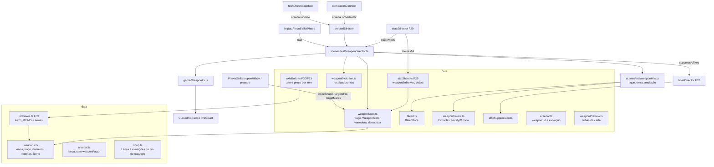

# Arma imbuída - Design

**Spec**: `.specs/features/arma-imbuida/spec.md` · **Plano**: `docs/plano-builds-e-habilidades.md` (linha F36 da
seção 6; seção 5.4; decisão 5 da seção 7) · **Base**: F29 `fundacao-de-poder`, F30 `vermelho-e-corpo`, F32
`chefes-com-afixos` (worktree `wt-chefes`), F33 `eixos-das-tecnicas`, F35 `vagas-e-talentos` (worktree `wt-f35spec`) e
a arte do branch `feat/arte-armas-imbuidas` (worktree `wt-armas`, `ce6e03c`)
**Status**: Draft. A abordagem A (abaixo) é a recomendada e está detalhada; ela e as três decisões de arte marcadas
"usuário" em "Risks & Concerns" (escala do arco do Bastão, âncora do rastro da Lâmina, ícone de 24 px) são confirmadas
com o usuário antes do `tasks.md`.

Linhas citadas conferidas em 14/10 no `feat/fundacao-de-poder` (HEAD `2bc1102`, F29 ainda em execução: as linhas de
`impactFx.ts`, `combat.ts`, `statsDirector.ts` e `debugApi.ts` andam a cada passo da F29) e no `wt-armas` (`ce6e03c`).
O que a F30, a F32, a F33, a F34 e a F35 criam ou trocam é citado pelo nome e pela interface dos designs delas: da F30,
`core/axisBuild.ts` (`AxisBuild`), `data/techAxes.ts`, `core/cursedBody.ts` (`widenForward`), `StrikeMods.reachPx`/
`recoveryMul`/`marks`, `core/shopDraw.ts` (`drawCards`, `axesFor`), `shopEligibility.ts` (`axisEligible`),
`shopPricing.ts` (`axisPointPrice`, `axisGate`, `cardCost`, `inflate`), `shopPreview.ts`, `axisParam.ts`,
`scenes/test/axisDirector.ts`, `bodyDirector.ts`, `BuildDirector.applyDebugAxes`, `build.onMeleeHit(hit, point,
target)`, `KOKUSEN_TRAITS`, o `hpMul` da rodada; da F32, `scenes/test/bossDirector.ts` (`s.runDirector.bosses`),
`game/boss/LavaField.ts`, `BeamAttack.ts`, `BossReadout.ts`, `Boss.adaptation`, `core/bossAI.ts` (ciclo com `beam`);
da F33, o registro `AXIS_ITEMS`/`ItemAxes`, `AxisBuild.offerable`, `core/bossChest.ts` (`ChestOption`,
`chestCandidates`), `core/choicePages.ts`, `scenes/test/choiceDirector.ts`, `core/cutBranch.ts` (`rectsTouch`); da
F34, `Projectile.relocate`; da F35, `PlayerStrikes.prepare(hit, target)`, `StrikeMods.crit` e `marks.unblockable`,
`CounterWindow.lastTakePerfect`, `core/buildTray.ts`, `core/spentLedger.ts`, `trayDirector.ts`, `game/BuildBar.ts`,
`frameFor`. Essas linhas valem depois dos merges e são reconferidas no começo de cada passo. Linhas efetivas contadas
como o `max-lines` do `.oxlintrc.json` (sem linha em branco e sem comentário).

---

## Architecture Overview

### Abordagens consideradas (todas entregam a mesma spec)

| | Abordagem | Prós | Contras |
| --- | --- | --- | --- |
| **A (recomendada)** | A arma entra no registro de eixos da F33 (`AXIS_ITEMS`) como item com teto próprio (2 por eixo, 3 no total) e preço próprio; os pontos moram no mesmo `AxisBuild` do `Loadout`. O efeito chega ao golpe pelo `meleeMul` (×1,2) e pelo `StrikeMods` (alcance, varredura, alvos, força, marcas por alvo). Um `WeaponDirector` (campo do `ArsenalDirector`) liga sangramento, anulação, evoluções e a arte | Carta de 2 eixos, `axisRng`, trava, `axes=`, eixo-foco marcado da `BuildBar`, página de ponto grátis e opção "2 pontos de eixo" do baú funcionam sem `if` por arma; a `TestScene`, o `Player` e o `moves.ts` não mudam | O `AxisBuild` e o `ItemAxes` ganham teto e preço por item, e ramo opcional; o nível da arma passa a ser lido do `AxisBuild` (não do `Arsenal`) |
| B | Um `WeaponAxes` próprio dentro do `Arsenal`, com carta, preço, página, baú e bandeja próprios para a arma | Não toca no `AxisBuild` | Duplica a carta de eixo, a escolha `W`/`S`, o `axes=`, a página de ponto e a marca do eixo-foco; cada consumidor ganha um ramo "é arma"; a WSH-04/WSH-05 viram código paralelo |
| C | Tabela de golpes por arma (o `MOVES` trocado pela arma equipada) | O traço fica "no dado do golpe" | O `moves.ts` não pode crescer (IMB-06); trocar o `MOVES` em vivo muda todo leitor dele (leitura, guarda, estrutura, animação) e a varredura/sangramento/anulação continuam precisando de código |

**Escolha: A.** O resto deste design detalha a A.

### Visão geral

A arma deixa de ser `Prop`: o `ArsenalDirector` não cria objeto nem põe nada na mão, e o `Arsenal` guarda só `{ id,
evolution }`. Os pontos da arma ficam no `AxisBuild` (item `lamina`/`bastao`/`lanca`), registrados em `AXIS_ITEMS`
com `axisCap 2`, `pointCap 3`, preço `16 + 6 × pontos` e sem ramo. As regras puras ficam em `core/weaponStats.ts`
(traço, resolução dos eixos em `WeaponStats`, forma da varredura, derrubada por alvo), `core/bleed.ts` (pilhas e
tiques), `core/weaponTimers.ts` (acertos extras da Nuvem e janela de anulação), `core/weaponEvolution.ts` (receitas) e
`core/affixSuppression.ts` (os 3 s do Arsenal de Toji). O `WeaponDirector` lê o `WeaponStats` do quadro e é chamado em
cinco pontos que já existem: `StatsDirector.strikeMods` (marcas do golpe), `PlayerStrikes.prepare` (marca por alvo,
via `StrikeMods.targetMarks`), `ImpactFx.onStrikePhase` (rastro e janela da anulação), `combat.onConnect` (impacto,
sangramento, Nuvem, Toji) e `TechDirector.update` (tiques, acertos extras, anulação, relógio da supressão). A vista é
`game/WeaponFx.ts`, que toca as folhas `weapon-fx-<arma>-trail`/`-impact` do `wt-armas` e conta no `fxCap` pelo
mesmo conjunto vivo do `CursedFx`.



Fluxo por quadro (a `TestScene` não muda de ordem): o `StatsDirector.update` refaz a folha (o `meleeMul` já tem o
×1,2 do traço); o `player.update` abre a hitbox com `strikeShape(shape, mods)` e `targetsFor(move, mods)`, e cada alvo
passa pelo `prepare` (crítico da F35, depois a derrubada do Bastão); o acerto chega ao `combat.onConnect`, que toca o
impacto amaldiçoado e, logo depois, `arsenal.onMeleeHit` (impacto da arma por cima, pilha de sangramento, Nuvem,
Toji); a fase `active` do golpe do traço chama o rastro da arma no lugar do amaldiçoado; o `techDirector.update`
chama `arsenal.update(dt)`, que tica o sangramento, entrega os acertos extras, apaga o projétil que toca a janela da
Lança e anda os 3 s da supressão.

---

## Code Reuse Analysis

### Existing Components to Leverage

| Component | Location | How to Use |
| --- | --- | --- |
| `StrikeMods` e o gancho `Player.strikeMods` | `src/core/statSheet.ts:29-32`, `src/game/Player.ts:85`, `src/scenes/test/statsDirector.ts:68-79` | A arma entra pelo retorno: `reachPx` (F30) soma o Fio e a Estocada; campos novos `sweepPx`, `maxTargets`, `targetMarks`; `force` multiplica o Peso (IMB-06) |
| `statSheet.meleeMul` | `src/core/statSheet.ts:72` | Ganha `weaponStrikeMul(arsenal.weapon, t)` entre a relíquia e os votos (WPN-03) |
| `PROP_TRAITS` | `src/core/statSheet.ts:21-26` | Ganha `object: true`, e o `weaponStrikeMul` devolve 1 para ele (WPN-04) |
| `widenForward(shape, px)` | F30 `src/core/cursedBody.ts` | Alcance do leve (LMN-01) e do Contra (LNC-01), com a borda de trás fixa; a varredura parte do resultado |
| `AttackHitbox.open(..., maxTargets)` e o `TargetGate` | `src/game/hitbox.ts:77-129` | Varredura com pelo menos 3 alvos e Perfuração; um alvo leva um acerto por golpe pelo portão que já existe (BST-04) |
| `PlayerStrikes.prepare(hit, target)` e `prepareHit(hit, target)` | F35 sobre `src/game/hitbox.ts:66`, `:89`, `src/game/Player.ts:146-149` | Derrubada do Bastão por alvo (armado ou não, chefe nunca, BST-02) sem campo novo no `Player` |
| `StrikeMods.marks.unblockable` | F35 `src/core/statSheet.ts` | Lâmina Dividida: o leve sai `unblockable` e a guarda do comum deixa de segurar (`src/core/enemyGuard.ts:87`, WEV-05) |
| `AxisBuild` (`add`, `canAdd`, `focusAxis`, `offerable`, `resetItem`) | F30/F33 `src/core/axisBuild.ts` | Pontos, nível e eixo-foco da arma (WPN-01); só o teto e o ramo passam a vir do registro |
| `AXIS_ITEMS` / `ItemAxes` | F33 `src/data/techAxes.ts` | A arma se registra; a carta, o `axes=`, a página de ponto e a bandeja pegam sozinhos |
| `drawCards`, `axesFor`, `axisRng`, `chooseAxis` | F30 `src/core/shopDraw.ts`, `src/core/shop.ts` | Carta de 2 eixos da arma (WSH-04) sem carta nova |
| `axisGate`, `inflate`, `cardCost` | F30 `src/core/shopPricing.ts` | Trava r2/r2/r4 dos 3 pontos (igual aos 3 primeiros da técnica) e inflação (WSH-02, WSH-03) |
| `parseAxesParam` / `axisDirector.applyDebug` | F30 `src/core/axisParam.ts`, `src/scenes/test/axisDirector.ts` | `axes=lamina.corte:2` (WDB-02) pelo registro; o teto vem do `add` em laço |
| `chestCandidates`, `ChestOption`, `choiceDirector.confirm` | F33 `src/core/bossChest.ts`, `scenes/test/choiceDirector.ts` | Opção `arma:<evolução>` do baú (WEV-03) e arma na opção "2 pontos de eixo" (WSH-05) |
| `BuildTray`, `BuildBar`, `SpentLedger`, `trayDirector.abandon` | F35 `src/core/buildTray.ts`, `src/game/BuildBar.ts`, `src/core/spentLedger.ts`, `scenes/test/trayDirector.ts` | Vaga da arma: 3 pontinhos pelos pontos, `Arma Nv<n>`, ícone da folha HD, livro com pontos e evolução, abandono limpando os pontos (WSH-07, WSH-09) |
| `CounterWindow.lastTakePerfect` | F35 `src/core/counter.ts` | Contra perfeito do Arsenal de Toji (WEV-07) |
| `Hit.band` e `effects.onTechConnect(hit, point, target)` | `src/core/hit.ts:57`, `src/scenes/test/effects.ts` | Tique do sangramento (`chip`, número cinza) e acertos extras da Nuvem (`micro`, teto de hitstop), fora do `combat.onConnect` (LMN-04) |
| `canSpawnParticle(live)` e o conjunto vivo do `CursedFx` | `src/game/CursedFx.ts:43-45`, `:152`, `:293` | O sprite da arma entra no mesmo conjunto (`track`), conta no `fxCap` 40 e some no `destroyAll` (WFX-04) |
| `strikeWorld`, `handTrail` | `src/scenes/test/impactFx.ts` | Ponto de partida do rastro da Lâmina e da Lança (WFX-02) |
| `rectsTouch(a, b)` | F33 `src/core/cutBranch.ts` | Projétil × área do Contra na anulação (LNC-02) |
| `Projectile` (`x`, `y`, `height`, `width` da F31, `kind`, `destroyNow`) | `src/game/Projectile.ts:73-122` | Anulação sem tocar no projétil (LNC-02) |
| `Enemy.weapon` | `src/game/Enemy.ts:276` | "Armado" da Derrubada 2 (BST-02) |
| `WEAPON_FX`, `weaponFxTex`, `weaponFxSheets` | `wt-armas` `src/game/art/hd/weaponFx/index.ts:15-36` | As folhas já registradas a 1 px por texel no `art/index.ts`; a F36 só toca |
| `HD_WEAPONS`, `art()`, `withOutline` | `src/game/art/hd/weapons.ts:104-131` | Folha nova `bound-spear` (ícone da Lança) no mesmo molde |
| `tests/core/noMathRandom.test.ts` | `tests/core/noMathRandom.test.ts` | Molde do teste de varredura de fonte do IMB-05 (`import.meta.glob` com `?raw`) |

### Integration Points

| System | Integration Method |
| --- | --- |
| Começo de rodada | `runDirector.applyRunCommand('roundStart')` já chama `arsenal.onRoundStart()` (`runDirector.ts:69`): só entrega a ferramenta pendente de mãos vazias, com ou sem arma (IMB-01, IMB-04) |
| Golpe do player | `StatsDirector.strikeMods(move)` termina com `this.s.arsenal.weapon.strikeMods(move, mods)`; `PlayerStrikes.openHitbox` usa `strikeShape(shape, mods)` e `targetsFor(move.maxTargets, mods.maxTargets)`; `prepare` aplica `mods.targetMarks?.(target)` depois do crítico |
| Acerto corpo a corpo | `combat.onConnect`, logo depois do `build.onMeleeHit(hit, point, target)` (F30): `this.s.arsenal.onMeleeHit(hit, point, target)` (+1 linha) |
| Fase do golpe | `ImpactFx.onStrikePhase` repassa a fase a `arsenal.weapon.onStrikePhase(name, phase)` e, no `active`, desenha o rastro por um `drawTrail(name, strength)` novo que pergunta `arsenal.weapon.trail(name, start)` antes do rastro amaldiçoado |
| Por quadro | `TechDirector.update` chama `this.s.arsenal.update(dt)` (+1 linha), no molde do `build.body.update(dt)` da F30 |
| Loja | `GAME_SHOP_CATALOG` ganha as 3 evoluções de arma e a Lança no fim; a carta nova usa o `arsenalEligible`; a carta de ponto usa o `axisEligible` (dono = `arsenal.weapon?.id === item`); `BuyContext.applyEvolution` manda a evolução de arma ao `arsenal.weapon.evolve(id)` |
| Konbini / baú | `choiceDirector` monta a lista de itens donos com eixo com a arma; o baú recebe as receitas de arma prontas |
| Debug | `ArsenalDirector.reset` lê `arsenal=` (como hoje); `axes=` pelo `applyDebugAxes` (F30, depois do `arsenal.reset`); `evo=` no fim do `BuildDirector.applyDebugAxes`, depois do `perks=` da F35 |
| Reset da run | `runDirector.onStartRun` já chama `loadout.reset()` (zera os pontos) e `arsenal.reset()` (arma, evolução, sangramento, acertos extras, janela); a supressão zera no `bosses.reset()` da F32 |
| Abandono | `trayDirector.abandon` chama `this.s.arsenal.abandon(kind)` (no lugar do `arsenal.clear(kind)` da F35, mesma linha): limpa o slot, a evolução e `loadout.axes.resetItem(id)` e chama `stats.sync()` |
| Snapshot | `arsenal: this.s.arsenal.snapshot()` (`snapshot.ts:162`) devolve o `ArsenalSnapshot` novo; `bleed` entra na entrada de cada comum e do chefe, montadas por métodos extraídos do `debugSnapshot` |

---

## Components

### `data/arsenal.ts` (muda, 34 → ~33)

- `WeaponId = 'bastao' | 'lamina' | 'lanca'`; `lanca: { id: 'lanca', kind: 'weapon', name: 'Lança Invertida do Céu',
  build: 'lutador' }` entra por último no `ARSENAL` (depois de `porrete`, l.25-33).
- As armas perdem o `tool` (`cursedClub`/`cursedKnife`, l.29-30): o campo fica só nas ferramentas.
- `ARSENAL_TUNING` perde `weaponCost` (l.43) e `weaponFactor` (l.52); `maxLevel` e `minRound` passam a ser só da
  relíquia (comentário).
- O comentário do topo troca "arma vinculada: fica na mão" por "arma imbuída: guardada, muda os golpes".

### `data/weapons.ts` (novo, ~105)

- Tipos: `LaminaAxisId = 'corte' | 'fio' | 'sangria'`, `BastaoAxisId = 'arco' | 'derrubada' | 'peso'`,
  `LancaAxisId = 'estocada' | 'anulacao' | 'perfuracao'`, `WeaponAxisId`, `WeaponTrait = 'light' | 'heavy' |
  'counter'`, `WeaponEvolutionId = 'laminaDividida' | 'nuvemItinerante' | 'arsenalToji'`.
- `WEAPON_AXES: Record<WeaponId, readonly [a, b, c]>` na ordem do WPN-02; `WEAPON_AXIS_NAMES` (`Corte`, `Fio`,
  `Sangria`, `Arco`, `Derrubada`, `Peso`, `Estocada`, `Anulação`, `Perfuração`); `WEAPON_TRAIT = { lamina: 'light',
  bastao: 'heavy', lanca: 'counter' }`.
- `WEAPON` (números da spec): `mul 1.2`, `axisCap 2`, `pointCap 3`, `newPrice 22`, `newRound 2`, `point { base 16,
  step 6 }`, `evolutionCost 60`; `lamina { reachBase 10, reachStep 8, bleedMs { base 1500, step 500 }, tickMs 300,
  tickBase 2 }`; `bastao { sweepBase 60, sweepStep 20, minTargets 3, pesoStep 0.25 }`; `lanca { reachStep 16,
  nullifyStep 100 }`; `nuvem { delaysMs [120, 240], frac 0.5 }`; `toji { ms 3000, glyphAlpha 0.3 }`.
- `WEAPON_RECIPES: readonly WeaponRecipe[]` (WEV-01, na ordem do catálogo): `laminaDividida` (Lâmina + relíquia
  `faixas`), `nuvemItinerante` (Bastão + relíquia `manoplas`), `arsenalToji` (Lança + talento `contraAfiado`), com
  `name` e `cost: WEAPON.evolutionCost`.
- `WEAPON_ICON = { lamina: 'bound-blade', bastao: 'bound-staff', lanca: 'bound-spear' }` (só as chaves; sem `phaser`).
- `WEAPON_AXIS_ITEMS: Record<WeaponId, ItemAxes>` (o pedaço do registro da F33: `ids`, `names`, `axisCap: 2`,
  `pointCap: 3`, `price: WEAPON.point`, sem `branches`). O `techAxes.ts` espalha no `AXIS_ITEMS`.

### `data/techAxes.ts` (F33, muda, ~125 → ~130)

- `AxisItem` ganha `WeaponId`; `AxisId` ganha `WeaponAxisId`.
- `ItemAxes`: `branches`, `branchNames` e `awakenings` passam a opcionais; campos novos opcionais `axisCap`
  (padrão `AXIS_CAP` 3), `pointCap` (padrão `ITEM_POINT_CAP` 5) e `price` (padrão o `axisPoint` do `PRICING`).
- `AXIS_ITEMS = { ...as técnicas e o Corpo, ...WEAPON_AXIS_ITEMS }`.

### `core/axisBuild.ts` (F30/F33/F35, muda, ~140 → ~146)

- `axisCap(item)` e `pointCap(item)` leem o registro; `canAdd` e `focusAxis` usam os dois (WPN-01: o 3º ponto num eixo
  e o 4º no total são recusados sem mudar nada).
- `add` só põe o item na fila `pending` e só liga o Despertar quando o registro tem `branches` (a arma nunca fica
  pendente nem desperta).
- `level(item)` continua `1 + total`: arma do Nv 1 ao Nv 4 (WPN-01).

### `core/weaponStats.ts` (novo, ~110)

- `weaponTraitOf(move: MoveDef): WeaponTrait` (`counter` vence `strength`, para o Bastão e a Lança não pegarem o
  mesmo golpe) e `hasTrait(id: WeaponId, move: MoveDef): boolean`.
- `weaponStrikeMul(weapon: { id: WeaponId } | null, t: MeleeTraits): number`: `t.object` → 1; o traço da arma (Lâmina
  `t.light`; Bastão `t.heavy && !t.counter`; Lança `t.counter`) → `WEAPON.mul`; senão 1 (WPN-03, WPN-04).
- `resolveWeapon(id, points: Readonly<Record<WeaponAxisId, number>>, evolution): WeaponStats` (ver "Data Models"):
  Lâmina `reachPx = 10 + 8 × fio`, `bleed = { maxStacks: 1 + corte, durationMs: 1500 + 500 × corte, tickMs 300, tick:
  2 + sangria }`, `unblockable = evolution === 'laminaDividida'`; Bastão `sweepPx = 60 + 20 × arco`, `minTargets 3`,
  `knockdown = ['none', 'unarmed', 'armed'][derrubada]`, `forceMul = 1 + 0,25 × peso`, `nuvem`; Lança
  `reachPx = 16 × estocada`, `maxTargets = 1 + perfuracao`, `nullifyMs = 100 × anulacao` (com 0 a janela é só o
  `active`), `toji`.
- `weaponStrike(stats, move, base: StrikeMods): StrikeMods`: com o traço, soma `reachPx`, multiplica `force` pelo
  `forceMul`, põe `sweepPx`, `maxTargets` (o maior entre o do golpe, o do `base` e o da arma) e
  `marks.unblockable`; sem o traço devolve `base` igual (WPN-03.2, o `jab` com o Bastão).
- `sweepShape(shape, R): HitboxShape`: `left = −R`, `right = max(shape.offsetX + shape.width / 2, R)`, `width =
  right − left`, `offsetX = (left + right) / 2`, `offsetY` e `height` iguais (BST-01).
- `strikeShape(shape, mods): HitboxShape` = `sweepShape(widenForward(shape, mods.reachPx), mods.sweepPx)` quando há
  `sweepPx`, senão só o `widenForward` (a ordem deixa o Alcance do Corpo empurrar a borda da frente antes da
  varredura).
- `targetsFor(moveMax: number | undefined, modsMax: number | undefined): number | undefined`: `undefined` fica
  `undefined` (golpe sem teto continua sem teto), senão o maior.
- `knockdownFor(level, target: { isBoss: boolean; armed: boolean }): boolean` (BST-02: chefe nunca; `unarmed` só o
  desarmado; `armed` os dois).
- **Reuses**: `widenForward` (F30), `MeleeTraits`, `HitboxShape`. Sem `phaser` (AD-001).

### `core/bleed.ts` (novo, ~60)

- `class BleedBook` com relógio injetado (`nowMs` do `s.clockMs`, tempo de jogo):
  - `apply(id, spec: { maxStacks; durationMs; tickMs; tick }, nowMs)`: soma 1 pilha até `maxStacks` e reinicia o
    relógio (LMN-02); guarda o `spec` da última aplicação, então a arma abandonada não muda o que já sangra (edge case).
  - `update(nowMs, hpMul): { id: number; damage: number }[]`: a cada `tickMs` desde o último reinício, enquanto
    `elapsed ≤ durationMs`, devolve `round(stacks × tick × hpMul)` (LMN-03); a entrada sai depois do último tique
    (Corte 0: tiques em 300, 600, 900, 1200 e 1500 ms; nada em 1501).
  - `view(id): { stacks; msLeft }` (`{ 0, 0 }` sem sangramento, WDB-05), `drop(id)`, `prune(liveIds)` (LMN-05: morto
    ou fora da área), `reset()`.

### `core/weaponTimers.ts` (novo, ~60)

- `class ExtraHits` (Nuvem Itinerante, WEV-06): `schedule(id, firstDamage, nowMs)` agenda `round(0,5 × firstDamage)`
  em `nowMs + 120` e `nowMs + 240`; `due(nowMs): { id; damage }[]` devolve os vencidos uma vez; `drop(id)`,
  `prune(liveIds)`, `reset()`.
- `class NullifyWindow` (LNC-02): `open(shape)` no `active` do Contra, `close(nowMs, afterMs)` no fim do `active`,
  `isOpen(nowMs)` = no `active` ou com `nowMs − fim < afterMs` (com `afterMs` 0 fecha no fim do `active`), `shape`
  (a forma resolvida do Contra, para a área seguir o player), `reset()`.

### `core/weaponEvolution.ts` (novo, ~45)

- `weaponRecipeReady(r, s: { weapon: { id; evolution } | null; level: number; relic: RelicId | null; talents:
  readonly PerkId[] }): boolean` (WEV-01: arma do recibo, Nv 4, não evoluída, catalisador na build em qualquer nível).
- `readyWeaponRecipes(s): WeaponRecipe[]` na ordem de `WEAPON_RECIPES`; `recipeOfWeapon(id)`.
- `ledgerKeyOf(entryId): LedgerKey` (a evolução de arma grava no livro da arma, WSH-09).

### `core/affixSuppression.ts` (novo, ~25)

- `class AffixSuppression`: `trigger(nowMs, ms = 3000)` (reinicia), `active(nowMs)` (`nowMs − início < ms`: 2999
  ativo, 3000 não), `msLeft(nowMs)`, `reset()`. Usado pelo `BossDirector` da F32 (WEV-07).

### `core/weaponPreview.ts` (novo, ~45)

- `weaponAxisLine(id, axis, points): string` com o valor resolvido antes e depois (≤ 20 caracteres): `Corte 1,5s→2s`,
  `Fio +10→+18`, `Sangria 2→3`, `Arco 60→80`, `Derrubada —→comum` / `comum→armado`, `Peso +0%→+25%`, `Estocada
  +0→+16`, `Anulação +0→+100ms`, `Perfuração 1→2` (WSH-04).
- `evolutionLine(willEvolve): string | null` (`+ evolução` quando a compra leva ao Nv 4 com o catalisador na build).
- `weaponNewPreview(id): string` (texto da carta de arma nova: o traço, ex. `leve corta e sangra`).
- O `shopPreview.axisPreview` (F30) chama `weaponAxisLine` quando o item é arma; o `frameFor` da F35 ganha a regra da
  arma (Nv 1 cinza, Nv 2 e 3 azul, Nv 4 roxo; carta de evolução de arma dourada, WSH-08).

### `core/arsenal.ts` (muda, ~101 → ~78)

- Saem `WEAPON_KEYS` (l.13), `WEAPON_TEXTURES` (l.15), `weaponDef` (l.95-105) e o import de `TOOL_DEFS`/`PropDef`
  usado só por ela (IMB-05).
- `Arsenal.weapon: { id: WeaponId; evolution: WeaponEvolutionId | null } | null`.
- `buy(id)`: relíquia como hoje; arma só equipa com o slot vazio (repetir o id é ignorado, WDB-01) e **não** zera a
  ferramenta pendente (sai a l.42, IMB-04).
- `levelOf(id)` fica só da relíquia (a arma devolve 0); o nível da arma é `axes.level(id)`, lido por quem tem o
  `Loadout`.
- `arsenalEligible`: ferramenta com `pendingTool === null` e a trava, com ou sem arma (l.66, IMB-04); arma nova só com
  o slot vazio e `round ≥ WEAPON.newRound` (WSH-03); relíquia como hoje.
- `arsenalCost`: relíquia como hoje; arma nova `WEAPON.newPrice` (a inflação fica no `cardCost` da F30).
- `arsenalPreview`: as linhas `bastao`/`lamina` (l.119-121) viram `weaponNewPreview(id)`.
- `evolveWeapon(id): boolean` e o `clear(kind)` da F35 (que agora também apaga a evolução).

### `scenes/test/arsenalDirector.ts` (muda, 69 → ~58)

- Sai tudo do `Prop` da arma: o campo `bound` (l.14), `discardBound` (l.65-71), o ramo da arma do `onRoundStart`
  (l.39-53) e os imports de `Prop` e `weaponDef`.
- `readonly weapon = new WeaponDirector(s)` (campo; a `TestScene` não muda).
- `onRoundStart()`: de mãos vazias, entrega a ferramenta pendente (IMB-04.5); com algo na mão, nada.
- `buy(id)` e `reset()` (`arsenal=` como hoje, com o id de arma repetido ignorado pelo `Arsenal.buy`) chamam
  `weapon.reset()` no reset.
- Novos: `onMeleeHit(hit, point, target)` e `update(dt)` (repassam ao `weapon`), `abandon(kind)` (F35 + pontos +
  evolução + `stats.sync()`), `applyDebugEvolution()` (`evo=`), `snapshot(): ArsenalSnapshot`.

### `scenes/test/weaponDirector.ts` (novo, ~160)

- **Purpose**: a arma no combate: resolve o `WeaponStats` do quadro e liga o traço, o rastro, o impacto, a evolução e o
  snapshot.
- **Interfaces**:
  - `stats(): WeaponStats | null` (refeito por quadro a partir de `arsenal.weapon` e `loadout.axes`).
  - `strikeMods(move, base): StrikeMods` (chamado pelo `StatsDirector.strikeMods`, por último): `weaponStrike` e, no
    Bastão com Derrubada, `targetMarks = (t) => ({ knockdown: knockdownFor(stats.knockdown, sideOf(t)) })`.
  - `onStrikePhase(name, phase)`: no `active` do Contra com a Lança abre a `NullifyWindow`; no `recovery`/`end` fecha
    com `nullifyMs`.
  - `trail(name, start: Vec2 | null): boolean` (`true` quando o golpe é do traço e o rastro da arma saiu, ou foi pulado
    pelo `fxCap`; o rastro amaldiçoado não sai nesses dois casos, WFX-01, WFX-04).
  - `onMeleeHit(hit, point, target)`: só com `hit.moveName` de um golpe do `MOVES` e do traço (o objeto do mundo não
    tem `moveName`, WPN-04; o finalizador não é do `MOVES`): impacto da arma (WFX-03), pilha de sangramento (LMN-02),
    `ExtraHits.schedule` na Nuvem (WEV-06), `suppressAffixes` no Contra perfeito no chefe com o Toji (WEV-07).
  - `update(dtMs)`: chama o `WeaponHits.update` e anda o relógio.
  - `evolve(id): boolean` (WEV-04: guarda a evolução, evento `weaponEvolved:<id>`, `stats.sync()`), `reset()`,
    `bleedOf(id)`, `snapshot()`.
- **Dependencies**: `TestScene` (arsenal, loadout, player, enemies, boss, projectiles, clockMs, runDirector.bosses,
  snapshot.debugEvents), `WeaponFx`, `WeaponHits`, `core/weaponStats`, `core/weaponEvolution`.

### `scenes/test/weaponHits.ts` (novo, ~110)

- **Purpose**: o que a arma entrega fora do golpe: tique do sangramento, acertos extras da Nuvem e anulação de projétil.
- **Interfaces**: `update(nowMs, stats)`, `addBleed(id, spec, nowMs)`, `scheduleExtra(id, damage, nowMs)`,
  `bleedOf(id)`, `reset()`.
  - Tique: `target.receiveHit({ ownerId: player.id, damage, strength: 'light', force: 0, direction, band: 'chip',
    tech: true })`; aceito, `effects.onTechConnect(hit, point, target)` (número cinza `chip`, faísca pequena, sem
    hitstop). Não passa pelo `combat.onConnect`, então não dá energia, combo, Fúria, Cadência, Kokusen nem talento e
    não gasta o Passo sombrio (LMN-04). O `tech: true` deixa o tique valer no comum caído (edge case do POW-15).
  - Extra da Nuvem: o mesmo caminho com `band: 'micro'`, `strength: 'heavy'` e o dano agendado (WEV-06).
  - Anulação: com a janela aberta, cada `Projectile` vivo cujo retângulo (`x`, `y`, `width` da F31, `height`) toca a
    área do Contra (`strikeShape` posta no centro do player de agora, virada pelo `facing`) leva `destroyNow()`,
    evento `nullify:<kind>` e o impacto da Lança no ponto do projétil (LNC-02).
  - `prune` pelos ids vivos (comuns na lista e o chefe com `hp > 0`) a cada quadro: morte e troca de área encerram o
    sangramento e os extras (LMN-05, edge cases).
- **Por que arquivo próprio**: o `weaponDirector` passaria de ~250 linhas com os três laços.

### `game/WeaponFx.ts` (novo, ~85)

- **Purpose**: vista do rastro e do impacto da arma (WFX-01 a WFX-04).
- **Interfaces**:
  - `trail(weapon, anchorAt: Vec2, facing, scale, activeMs): boolean`: `false` (nada criado) quando
    `canSpawnParticle(cursedFx.liveCount)` é falso; senão um `Sprite` com `weaponFxTex(weapon, 'trail')`, quadro
    `trail-0`, origem na âncora da folha (`ax / w`, `ay / h`; com `facing −1`, `(w − ax) / w`), `setFlipX(facing < 0)`,
    `setScale(scale)`, profundidade `FX_DEPTH`; troca de quadro a cada `activeMs / 4` por um evento de tempo da cena
    (tempo de jogo: o hitstop segura o rastro aceso, como o TRL-09) e some depois do `trail-3`; `cursedFx.track(sprite)`.
  - `impact(weapon, at, facing): boolean`: `impact-0..3` a 50 ms cada, origem na âncora do impacto, profundidade
    `FX_DEPTH + 1` (por cima do impacto amaldiçoado, que fica em `FX_DEPTH` e `FX_DEPTH − 0,5`).
  - `debug(): WeaponFxSnapshot` lido do sprite vivo (L-055): `live`, `last: { weapon, part, texture, frame, scale,
    flipX, originX, x, y, depth }`.
- **Dependencies**: `CursedFx` (conjunto vivo e teto), `WEAPON_FX` e `weaponFxTex` do `wt-armas`.

### `game/CursedFx.ts` (muda, 282 → ~285)

- `track<T>(o: T): T` público (o `add` privado da l.293 passa a chamar ele): o objeto entra no `live`, conta no
  `canSpawnParticle` e some no `destroyAll` (troca de área e `R`).

### `scenes/test/impactFx.ts` (muda, ~186 com a F30 → ~192)

- `onStrikePhase` (l.135-162): a 1ª linha passa a fase a `this.s.arsenal.weapon.onStrikePhase(name, phase)`; o corpo do
  ramo `active` (l.146-157) vai para `drawTrail(name, strength)`, que calcula o ponto de partida (`handTrail[0]` ou
  `strikeWorld('<nome>-wind')`), pergunta `this.s.arsenal.weapon.trail(name, start)` e, com `false`, desenha o rastro
  amaldiçoado como hoje (com o `extraPx` da F29 e o `reachPx` da F30). A complexidade do `onStrikePhase` (arquivo na
  lista de exceção) desce.

### `game/player/strikes.ts` (muda, ~229 com a F35 → ~232)

- `openHitbox` (l.265-289): o `widenForward(shape, mods.reachPx)` da F30 vira `strikeShape(shape, mods)` (mesma
  linha); `maxTargets` passa a `targetsFor(move.maxTargets, mods.maxTargets)` (l.288).
- `prepare(hit, target)` da F35: depois do crítico, `mods.targetMarks?.(target)` espalhado no `Hit` (+1).
- Nenhum ramo novo no `updateStrikes` nem no `onMove` (exceções de complexidade, 19 e 22 hoje).

### `core/statSheet.ts` (muda, ~62 com a F35 → ~66)

- `MeleeTraits.object?: boolean` (opcional: os literais de hoje continuam valendo); `PROP_TRAITS` ganha `object: true`
  (l.21-26).
- `meleeMul`: `... × relicStrikeMul(arsenal, t.light) × weaponStrikeMul(arsenal.weapon, t) × vowStrikeMul(...)`
  (l.72; o Impacto da F30 fica onde a F30 o pôs).
- `StrikeMods` ganha `sweepPx?: number`, `maxTargets?: number` e `targetMarks?: (target: Hittable) => Pick<Hit,
  'knockdown'>`.

### `scenes/test/statsDirector.ts` (muda, ~84 com a F35 → ~86)

- `strikeMods(move, peek)`: o retorno passa por `this.s.arsenal.weapon.strikeMods(move, mods)` por último.
- O `kokusenScale.meleeMul` (F30, `KOKUSEN_TRAITS` forte sem contra) já leva o ×1,2 do Bastão pelo `meleeMul`
  (assumption da spec); nada muda aqui.

### `game/arsenalSnapshot.ts` (novo, ~30)

- `ArsenalSnapshot`, `BleedSnapshot`, `WeaponFxSnapshot` (ver "Data Models"); o `debugApi.ts` só importa (WDB-04).

### `game/art/hd/weapons.ts` (muda, 85 → ~105)

- Grade nova `SPEAR` (ponta para cima, como as outras; haste longa com a ponta preta de contorno branco da arte do
  rastro, só chaves da `PALETTE`, pelo menos 14 px de largura com as colunas vazias do molde do bastão) e a entrada
  `'bound-spear': art(SPEAR, grip)` no `HD_WEAPONS` (l.119-131). Registrada pelo laço que já existe no `art/index.ts`.
- O comentário do topo troca "armas vinculadas" por "ícones das armas imbuídas".

### Arquivos da F35 que mudam

- `core/buildTray.ts` (~110 → ~114): pontinhos da arma = pontos de eixo (0 a 3); `buildBarText` com `Arma
  Nv<1 + pontos>` e o nome da evolução na bandeja (WSH-07).
- `game/BuildBar.ts` (~110 → ~118): ícone da arma = `WEAPON_ICON[id]` quadro `common` (ver "Risks"); borda `A` com a
  evolução.
- `core/shopPreview.ts` (`frameFor`, ~80 → ~84): regra da arma e da carta de evolução de arma (WSH-08).
- `scenes/test/trayDirector.ts` (~140 → ~140): `abandon` chama `this.s.arsenal.abandon(kind)` na linha do
  `arsenal.clear(kind)`.
- `scenes/test/shopDirector.ts` (~158 → ~162): `applyEvolution(id)` manda a evolução de arma ao
  `arsenal.weapon.evolve(id)`; o `recordBuy` grava pela `ledgerKeyOf(id)` (WSH-09).

### Arquivos da F30 e da F33 que mudam

- `core/shopEligibility.ts` (~58 → ~68): `ownsAxisItem(item, loadout, arsenal)` (técnica equipada, Corpo sempre,
  arma equipada) usado pelo `axisEligible`, pelo `axisDirector.applyDebug`, pela lista de donos do `choiceDirector` e
  pela bandeja; elegibilidade da evolução de arma pela `readyWeaponRecipes`.
- `core/shopDraw.ts` (~98 → ~108): `DrawContext.arsenal`; a carta 0 pega as receitas prontas na ordem do catálogo
  (Uniões de técnica primeiro, WEV-02); "outro item dono" inclui a arma com eixo livre e a relíquia abaixo do Nv 3
  (WSH-05); o item-foco automático não muda.
- `core/shopPricing.ts` (~52 → ~58): `axisPointPrice(item, points)` lê o `price` do registro; arma nova e evolução de
  arma no `cardCost`, com o `inflate`.
- `core/bossChest.ts` (~52 → ~57): `ChestOption` ganha `{ kind: 'arma'; id: WeaponEvolutionId }` (`chestOptionId` =
  `arma:<id>`); `chestCandidates` recebe `readyWeaponRecipes`; `hasOpenAxis` conta a arma.
- `scenes/test/choiceDirector.ts` (~150 → ~155): lista de donos com a arma; `confirm` da opção `arma` chama
  `arsenal.weapon.evolve(id)` (grátis, sem livro).

### Arquivos da F32 que mudam (WEV-07)

- `scenes/test/bossDirector.ts` (~170 → ~178): `readonly suppression = new AffixSuppression()`;
  `suppressAffixes(nowMs)` (dispara ou reinicia, evento `affixSuppressed`); `summon(phase)` não invoca enquanto ativo
  (a invocação perdida não volta); `update` repassa `active` ao `BossAffixFx`, ao `Boss` e ao `BossReadout`; `reset()`
  zera.
- `game/boss/LavaField.ts` (~55 → ~58): ativo, não cria faixa nova e o contato não dá dano.
- `game/boss/BeamAttack.ts` (~70 → ~72): ativo, apaga o feixe em aviso ou ativo (`telegraphCancel`, sem abrir hitbox).
- `core/bossAI.ts` (~290 → ~293): `BossAIObservation.beamBlocked` faz o ciclo pular o `beam`.
- `game/Boss.ts` (~285 → ~288): `affixesSuppressed` (atribuído pelo diretor); `receiveHit` usa a escala 1 e não chama
  o `adaptation.onHit` enquanto vale; a observação leva `beamBlocked`.
- `game/boss/BossReadout.ts` (~70 → ~72): `setSuppressed(on)` põe os glifos em alfa 0,3.

### Mudanças em arquivos existentes (por passo)

**Passo 0 (a arma sai da mão; IMB-01 a IMB-06)**

| Arquivo | Linha | Mudança |
| --- | --- | --- |
| `src/core/arsenal.ts` | 12-15, 31-44, 64-71, 94-105, 119-121 | saem `WEAPON_KEYS`, `WEAPON_TEXTURES`, `weaponDef`; `weapon: { id, evolution }`; `buy` sem zerar a ferramenta e sem subir nível da arma; ferramenta elegível com arma; texto provisório da carta da arma (`imbuída`), trocado pelo `weaponNewPreview` no passo 6 |
| `src/data/arsenal.ts` | 22, 29-30, 43, 52 | armas sem `tool`; sai `weaponFactor` (o `weaponCost` sai no passo 6, quando entra o preço novo) |
| `src/core/armed.ts` | 14-18, 24 | sai `BOUND_NAMES`; `propName` só com `PROP_NAMES` |
| `src/scenes/test/arsenalDirector.ts` | 1-89 | sem `Prop`; entrega só a ferramenta; snapshot com `weaponLevel = axes.level` (1 até o passo 1) |
| `src/core/build.ts` | 57-60 | a arma soma 1 na build dela (nível sem eixos até o passo 1; depois `axes.level(id)`) |
| `tests/core/arsenal.test.ts` | 50-59, 79-89, 125-137, 161-169 | ferramenta não é descartada pela arma; ferramenta com arma; sai o caso do `weaponDef`; build com a arma |
| `tests/game/hdWeapons.test.ts` | 2, 22-26 | as folhas `bound-blade`/`bound-staff` existem como ícone, sem `weaponDef` |
| `tests/core/boundWeaponGone.test.ts` (novo) | — | IMB-05 pela varredura `?raw` de `src/` |
| `scripts/smoke/arsenal.smoke.mjs` | 1-68 | reescrito (ver "Testes e smokes") |
| `scripts/smoke/power.smoke.mjs` | cenário 6 (F29 T-POW-11) | `arsenal=bastao` vira a cadeira do mapa (o objeto do mundo segue `Prop`); `round(X × 1,3)` com as Manoplas igual |

`TestScene`: 0. `Player.ts`: 0. `moves.ts`: 0. Smokes: `arsenal` (novo texto), `held-item`, `armed`, `drops`,
`power`, `fight`, `defense`.

**Passo 1 (nível, eixos e multiplicador; WPN-01 a WPN-04, WDB-01, WDB-02, WDB-04)**

| Arquivo | Linha | Mudança |
| --- | --- | --- |
| `src/data/weapons.ts` (novo) | — | eixos, nomes, traço, `WEAPON`, `WEAPON_AXIS_ITEMS` |
| `src/data/arsenal.ts` | 11, 25-33 | `lanca` (só debug até o passo 6: fora do catálogo) |
| `src/data/techAxes.ts` (F33) | tipos, registro | `AxisItem`/`AxisId` com as armas; `ItemAxes` com `axisCap`, `pointCap`, `price` e ramo opcional |
| `src/core/axisBuild.ts` (F30/F33) | `canAdd`, `focusAxis`, `add` | teto do registro; sem fila de ramo sem `branches` |
| `src/core/weaponStats.ts` (novo) | — | `weaponTraitOf`, `hasTrait`, `weaponStrikeMul`, `resolveWeapon` |
| `src/core/statSheet.ts` | 7-13, 21-26, 72 | `object`; `weaponStrikeMul` entre relíquia e votos |
| `src/core/shopEligibility.ts` (F30) | `axisEligible` | `ownsAxisItem` (o `axes=` da arma depende dele) |
| `src/scenes/test/axisDirector.ts` (F30) | `applyDebug` | dono pelo `ownsAxisItem` |
| `src/core/build.ts` | 57-60 | arma vale `axes.level(id)` |
| `src/game/arsenalSnapshot.ts` (novo), `src/game/debugApi.ts` | 289-295 | `arsenal: ArsenalSnapshot` (`weaponAxes`, `evolution`) |
| `tests/core/weaponAxes.test.ts` (novo), `tests/core/statSheet.test.ts`, `tests/core/axisBuild.test.ts` (F30) | — | ver "Testes" |

**Passo 2 (golpe da arma e Lâmina; LMN-01 a LMN-05, WDB-05)**

| Arquivo | Linha | Mudança |
| --- | --- | --- |
| `src/core/weaponStats.ts` | — | `weaponStrike`, `strikeShape`, `targetsFor` |
| `src/core/statSheet.ts` | 29-32 | `sweepPx`, `maxTargets`, `targetMarks` no `StrikeMods` |
| `src/game/player/strikes.ts` | 268-269, 288, `prepare` (F35) | `strikeShape`, `targetsFor`, `targetMarks` |
| `src/core/bleed.ts` (novo) | — | `BleedBook` |
| `src/scenes/test/weaponDirector.ts`, `weaponHits.ts` (novos) | — | `strikeMods`, `onMeleeHit` (pilha), tique |
| `src/scenes/test/arsenalDirector.ts` | — | campo `weapon`, `onMeleeHit`, `update` |
| `src/scenes/test/statsDirector.ts` | 76-79 | `arsenal.weapon.strikeMods(move, mods)` |
| `src/scenes/test/combat.ts` | 101 | `this.s.arsenal.onMeleeHit(hit, point, target)` logo depois do `build.onMeleeHit` |
| `src/scenes/test/techDirector.ts` | 10-65 | `this.s.arsenal.update(dt)` |
| `src/scenes/test/snapshot.ts` | 78-106, 111-126 | `enemyEntry(e)` e `bossEntry()` saem do `debugSnapshot` (função na exceção, encolhe ~40); `bleed` nas duas |
| `src/game/debugApi.ts` | 55, 114 | `bleed: BleedSnapshot` no comum e no chefe |
| `scripts/smoke/weapon-imbued.smoke.mjs` (novo) | — | IMB e Lâmina |

**Passo 3 (Bastão; BST-01 a BST-04)**: `weaponStats.ts` (`sweepShape`, `knockdownFor`, Peso), `weaponDirector.ts`
(`targetMarks` com `Enemy.weapon` e `instanceof Boss`), `tests/core/weaponStrike.test.ts`, cenários do Bastão no
`weapon-imbued`. Smokes: `weapon-imbued`, `fight`, `impact`, `targets`, `enemy-`.

**Passo 4 (Lança; LNC-01 a LNC-03)**: `weaponStats.ts` (alcance e alvos do Contra), `core/weaponTimers.ts`
(`NullifyWindow`), `weaponHits.ts` (anulação), `weaponDirector.onStrikePhase`, `impactFx.ts` (repasse da fase, l.135),
`tests/core/weaponTimers.test.ts`, cenários da Lança. Smokes: `weapon-imbued`, `defense`, `boss`.

**Passo 5 (rastro e impacto; WFX-01 a WFX-05; depende do merge do `feat/arte-armas-imbuidas`)**

| Arquivo | Linha | Mudança |
| --- | --- | --- |
| `src/game/WeaponFx.ts` (novo) | — | vista |
| `src/game/CursedFx.ts` | 293 | `track` público |
| `src/scenes/test/impactFx.ts` | 135-162 | `drawTrail(name, strength)`; rastro da arma antes do amaldiçoado |
| `src/scenes/test/weaponDirector.ts` | — | `trail`, impacto no `onMeleeHit`, impacto da Lança na anulação, `fx` no snapshot |
| `src/game/art/hd/weapons.ts` | 119-131 | `bound-spear` |
| `src/game/arsenalSnapshot.ts` | — | `WeaponFxSnapshot` |
| `tests/game/hdWeapons.test.ts` | — | `bound-spear` na paleta, ≥ 14 px, mais alta que a lâmina |

Smokes: `weapon-imbued`, `impact`, `feel`, `fxlab`, `fight`. Conferência visual em HD, parado e correndo, para os dois
lados (memória "conferir animação em movimento"), e `node tools/weapon-fx-boards.mjs` (do `wt-armas`).

**Passo 6 (loja e `BuildBar`; WSH-01 a WSH-09; depende da F35)**

| Arquivo | Linha | Mudança |
| --- | --- | --- |
| `src/data/arsenal.ts` | 43 | sai `weaponCost` |
| `src/data/shop.ts` | 17, 209-225, 241-246 | `ARSENAL_SHOP_ENTRIES` sem a Lança; entrada da arma com `maxLevel 4`, `cost.base 22`, `minRound(next)` = `newRound` no Nv 1 e `axisGate(next − 1)` depois; `GAME_SHOP_CATALOG` termina com a Lança (WSH-01) |
| `src/core/arsenal.ts` | 64-79 | `arsenalEligible`/`arsenalCost` da arma nova |
| `src/core/shopEligibility.ts`, `shopDraw.ts`, `shopPricing.ts` (F30) | ver acima | dono, carta 0, preço |
| `src/core/weaponPreview.ts` (novo), `src/core/shopPreview.ts` (F30/F35) | `axisPreview`, `frameFor` | linhas da carta, moldura |
| `src/core/buildTray.ts`, `src/game/BuildBar.ts`, `src/scenes/test/trayDirector.ts` (F35) | ver acima | vaga da arma, abandono |
| `src/scenes/test/shopDirector.ts` (F35) | `resolveBuy` | `ledgerKeyOf` |
| `tests/core/weaponShop.test.ts` (novo), `tests/core/weaponPreview.test.ts` (novo), `tests/core/buildTray.test.ts` (F35), `tests/core/shopAxes.test.ts` (F30), `tests/data/shop.test.ts` | — | ver "Testes" |

Smokes: `shop`, `shop-axes`, `shop-progress`, `build-bar` (F35), `run-loop`, `weapon-imbued`.

**Passo 7 (evoluções; WEV-01 a WEV-07, WDB-03; depende da F32 e da F33)**

| Arquivo | Linha | Mudança |
| --- | --- | --- |
| `src/data/weapons.ts` | — | `WEAPON_RECIPES` |
| `src/data/shop.ts` | 231-246 | as 3 evoluções de arma depois das Uniões e antes da Lança |
| `src/core/weaponEvolution.ts`, `src/core/affixSuppression.ts` (novos) | — | receitas, `ledgerKeyOf`, supressão |
| `src/core/weaponTimers.ts` | — | `ExtraHits` |
| `src/core/weaponStats.ts` | `resolveWeapon` | `unblockable`, `nuvem`, `toji` |
| `src/core/shopDraw.ts`, `shopEligibility.ts`, `core/bossChest.ts`, `scenes/test/choiceDirector.ts` | ver acima | carta 0, baú |
| `src/scenes/test/weaponDirector.ts`, `weaponHits.ts`, `arsenalDirector.ts` | — | `evolve`, extras, Toji, `applyDebugEvolution` |
| `src/scenes/test/buildDirector.ts` (F30/F35) | `applyDebugAxes` | `this.s.arsenal.applyDebugEvolution()` no fim |
| Arquivos da F32 | ver acima | supressão |
| `tests/core/weaponEvolution.test.ts` (novo), `tests/core/bossChest.test.ts` (F33) | — | ver "Testes" |

Smokes: `weapon-imbued` (ou `weapon-evolution`), `boss`, `boss-` (F32), `boss-chest` (F33), `shop`, `evolution`.

---

## Data Models

```typescript
// data/weapons.ts
export type WeaponAxisId = 'corte' | 'fio' | 'sangria' | 'arco' | 'derrubada' | 'peso' | 'estocada' | 'anulacao' | 'perfuracao';
export type WeaponTrait = 'light' | 'heavy' | 'counter';
export type WeaponEvolutionId = 'laminaDividida' | 'nuvemItinerante' | 'arsenalToji';
export interface WeaponRecipe {
  into: WeaponEvolutionId;
  weapon: WeaponId;
  catalyst: { kind: 'relic'; id: RelicId } | { kind: 'talent'; id: PerkId };
  name: string;   // Lâmina Dividida da Alma, Nuvem Itinerante, Arsenal de Toji
  cost: number;   // 60, antes da inflação
}

// data/techAxes.ts (F33, ampliado)
export interface ItemAxes {
  ids: readonly AxisId[];
  names: Partial<Record<AxisId, string>>;
  branches?: readonly [BranchId, BranchId];      // a arma não tem
  branchNames?: Partial<Record<BranchId, string>>;
  awakenings?: Partial<Record<BranchId, { id: AwakeningId; name: string; text: string }>>;
  deadAxis?: Partial<Record<BranchId, AxisId>>;
  axisCap?: number;                              // padrão AXIS_CAP (3); arma 2
  pointCap?: number;                             // padrão ITEM_POINT_CAP (5); arma 3
  price?: { base: number; step: number };        // padrão o axisPoint do PRICING; arma 16/6
}

// core/weaponStats.ts
export interface WeaponStats {
  id: WeaponId;
  trait: WeaponTrait;
  level: number;                                 // 1 + pontos (1 a 4)
  reachPx: number;                               // Lâmina 10/18/26; Lança 0/16/32; Bastão 0
  sweepPx: number | null;                        // Bastão 60/80/100
  maxTargets: number | null;                     // Bastão 3; Lança 1 + perfuração
  forceMul: number;                              // Bastão 1/1,25/1,5; os outros 1
  knockdown: 'none' | 'unarmed' | 'armed';
  bleed: { maxStacks: number; durationMs: number; tickMs: number; tick: number } | null;
  nullifyMs: number | null;                      // Lança: 100 × anulação (0 = só o active)
  unblockable: boolean;                          // Lâmina Dividida da Alma
  nuvem: boolean;
  toji: boolean;
}

// core/statSheet.ts (F29/F30/F35, ampliado)
export interface MeleeTraits { heavy: boolean; light: boolean; counter: boolean; shadow: boolean; object?: boolean }
export interface StrikeMods {
  damage: number; force: number; reachPx: number; recoveryMul: number;            // F29, F30
  marks: Pick<Hit, 'knockdown' | 'wallStun' | 'decisive' | 'maxHpBonus' | 'unblockable'>; // F30, F35
  crit?: (target: Hittable) => number;                                            // F35
  sweepPx?: number;                                                               // BST-01
  maxTargets?: number;                                                            // BST-01, LNC-01
  targetMarks?: (target: Hittable) => Pick<Hit, 'knockdown'>;                     // BST-02
}

// core/arsenal.ts
// Arsenal.weapon: { id: WeaponId; evolution: WeaponEvolutionId | null } | null

// core/bossChest.ts (F33, ampliado)
// ChestOption ganha { kind: 'arma'; id: WeaponEvolutionId }  →  chestOptionId: `arma:<id>`

// game/arsenalSnapshot.ts
export interface BleedSnapshot { stacks: number; msLeft: number }
export interface WeaponFxSnapshot {
  live: number;
  last: { weapon: string; part: 'trail' | 'impact'; texture: string; frame: string; scale: number; flipX: boolean;
          originX: number; x: number; y: number; depth: number } | null;
}
export interface ArsenalSnapshot {
  relic: string | null; relicLevel: number;
  weapon: string | null; weaponLevel: number;                    // 1 + pontos; 0 sem arma
  weaponAxes: Record<string, number>;                            // {} sem arma
  evolution: string | null;
  tool: string | null;
  fx: WeaponFxSnapshot;                                          // superconjunto do WDB-04 (L-043, L-055)
}
// GameSnapshot: enemies[i].bleed: BleedSnapshot; boss.bleed: BleedSnapshot
```

**Relação entre os modelos.** O nível da arma não mora no `Arsenal`: é `loadout.axes.level(id)`, e o `WeaponStats`
é refeito a cada quadro a partir de `arsenal.weapon` e dos pontos, então uma compra no meio da konbini vale no golpe
seguinte sem cache a invalidar. O sangramento guarda o `spec` da aplicação, então nem compra nem abandono mudam um
sangramento em curso.

---

## Linhas efetivas dos arquivos perto do teto e dos que crescem

"F29 hoje" é o `feat/fundacao-de-poder` em `2bc1102` (a F29 ainda não terminou); "fim da F35" soma as estimativas dos
designs da F30, da F33 e da F35 (que partem de `f17a6a8`) e, onde indicado, da F32; "fim da F36" é este design.
Reconferir nos merges.

| Arquivo | F29 hoje | Fim da F35 | Fim da F36 | Observação |
| --- | --- | --- | --- | --- |
| `src/scenes/TestScene.ts` | 390 | 390 | 390 | nenhum passo toca (IMB-06) |
| `src/data/moves.ts` | 397 | 397 | 397 | não muda (IMB-06) |
| `src/game/Player.ts` | 359 | ~356 | ~356 | não muda: a marca por alvo usa o `prepare` da F35 (IMB-06) |
| `src/game/debugApi.ts` | 310 | ~342 (F35 ~327 + F32 ~15) | ~339 | o tipo `arsenal` vira import (−6); `bleed` ×2 e 1 import |
| `src/game/CursedFx.ts` | 282 | ~282 | ~285 | `track` |
| `src/scenes/test/impactFx.ts` | 183 | ~186 | ~192 | repasse da fase e `drawTrail` (exceção de complexidade: a função encolhe) |
| `src/scenes/test/combat.ts` | 226 | ~240 | ~241 | uma chamada |
| `src/game/player/strikes.ts` | 214 | ~229 | ~232 | duas expressões e uma linha no `prepare`; nenhum ramo no `updateStrikes`/`onMove` |
| `src/scenes/test/snapshot.ts` | 210 | ~211 | ~217 | `enemyEntry`/`bossEntry` extraídos; o `debugSnapshot` (151 hoje, na exceção) desce para ~110 |
| `src/core/shop.ts` | 292 | ~222 | ~226 | `applyEvolution` com a evolução de arma; `DrawContext.arsenal` |
| `src/data/shop.ts` | 194 | ~214 | ~224 | entrada da arma, 3 evoluções, Lança no fim |
| `src/data/tuning.ts` | 273 | ~288 (+F32) | igual | os números da arma vão para `data/weapons.ts` |
| `src/game/Boss.ts` | 276 | ~285 (F32) | ~288 | `affixesSuppressed` |
| `src/core/bossAI.ts` | 200 | ~290 (F32) | ~293 | `beamBlocked` |
| `src/scenes/test/bossDirector.ts` (F32) | — | ~170 | ~178 | supressão |
| `src/scenes/test/statsDirector.ts` | 69 | ~84 | ~86 | uma chamada |
| `src/core/statSheet.ts` | 52 | ~62 | ~66 | `object`, fator da arma, 3 campos do `StrikeMods` |
| `src/scenes/test/techDirector.ts` | 47 | ~62 | ~63 | uma chamada |
| `src/scenes/test/buildDirector.ts` | 39 | ~80 | ~81 | `applyDebugEvolution` |
| `src/scenes/test/arsenalDirector.ts` | 69 | 69 | ~58 | sai o `Prop` |
| `src/core/arsenal.ts` | 96 | ~101 | ~78 | sai o `weaponDef` |
| `src/data/arsenal.ts` | 34 | 34 | ~33 | `lanca`; saem `weaponCost` e `weaponFactor` |
| `src/core/armed.ts` | 56 | 56 | ~52 | sai `BOUND_NAMES` |
| `src/core/build.ts` | 84 | ~105 | ~105 | troca de expressão |
| `src/game/art/hd/weapons.ts` | 85 | 85 | ~105 | `bound-spear` |
| `src/game/art/index.ts` | 137 | ~139 (arte) | ~139 | não muda: o laço do `HD_WEAPONS` registra o ícone |
| `src/core/axisBuild.ts` (F30) | — | ~140 | ~146 | teto e ramo do registro |
| `src/data/techAxes.ts` (F30) | — | ~125 | ~130 | campos opcionais, armas no registro |
| `src/core/shopDraw.ts` (F30) | — | ~98 | ~108 | arma e relíquia como dono; receitas de arma |
| `src/core/shopEligibility.ts` (F30) | — | ~58 | ~68 | `ownsAxisItem`, evolução de arma |
| `src/core/shopPricing.ts` (F30) | — | ~52 | ~58 | preço do registro, arma nova, evolução |
| `src/core/shopPreview.ts` (F30) | — | ~80 | ~84 | `frameFor` da arma; as linhas vão ao `weaponPreview.ts` |
| `src/core/bossChest.ts` (F33) | — | ~52 | ~57 | opção `arma` |
| `src/scenes/test/choiceDirector.ts` (F33) | — | ~150 | ~155 | dono com a arma, opção `arma` |
| `src/core/buildTray.ts` (F35) | — | ~110 | ~114 | pontinhos e texto da arma |
| `src/game/BuildBar.ts` (F35) | — | ~110 | ~118 | ícone e borda da arma |
| `src/scenes/test/shopDirector.ts` | 144 | ~158 | ~162 | evolução de arma e chave do livro |
| `tests/core/shop.test.ts` / `techShop.test.ts` | 368 / 383 | — | não crescem | casos novos da arma vão ao `weaponShop.test.ts` |
| `scripts/smoke/power.smoke.mjs` | 367 | — | ~367 | só a troca do bastão pela cadeira |

Arquivos novos (todos abaixo de 400, nenhum na lista de exceções): `data/weapons.ts` ~105, `core/weaponStats.ts`
~110, `core/bleed.ts` ~60, `core/weaponTimers.ts` ~60, `core/weaponEvolution.ts` ~45, `core/affixSuppression.ts`
~25, `core/weaponPreview.ts` ~45, `scenes/test/weaponDirector.ts` ~160, `scenes/test/weaponHits.ts` ~110,
`game/WeaponFx.ts` ~85, `game/arsenalSnapshot.ts` ~30, `scripts/smoke/weapon-imbued.smoke.mjs` ~330 (passando de 380,
as evoluções vão para `weapon-evolution.smoke.mjs` ~200). Saem: nada inteiro (só funções e constantes do arsenal).

Funções nas listas de exceção que este design toca: `DebugSnapshot.debugSnapshot` (`snapshot.ts`, encolhe com a
extração), `ImpactFx.onStrikePhase` (`impactFx.ts`, encolhe com o `drawTrail`), `PlayerStrikes.openHitbox` (fora das
funções com aviso; nenhum ramo novo no `updateStrikes` nem no `onMove`). O `EnemyDefense.receiveHit` e o
`EnemyGuard.resolveHit` não são tocados: o `unblockable` e o `knockdown` chegam pelo `Hit` que já leem.

---

## Error Handling Strategy

| Error Scenario | Handling | User Impact |
| --- | --- | --- |
| Ponto acima de 2 no eixo ou de 3 na arma (compra, ponto grátis, baú, `axes=`) | `AxisBuild.add` devolve `{ ok: false }` sem mudar nada; a carta e a página só oferecem `offerable` | A opção não aparece (edge case do `axisRng`) |
| `axes=` de arma não equipada, eixo desconhecido ou acima do teto | `axisDirector.applyDebug` ignora pela `ownsAxisItem`; o `parseAxesParam` tira o desconhecido; o excesso cai no `add` (WDB-02) | O smoke precisa do `arsenal=` junto |
| `arsenal=lamina,lamina` | O 2º id de arma é ignorado pelo `Arsenal.buy`; a relíquia repetida sobe como hoje (WDB-01) | Arma no Nv 1 |
| `evo=` com a receita não pronta ou desconhecido | `applyDebugEvolution` ignora (WDB-03) | Sem evolução |
| Compra de arma com outra no slot | `arsenalEligible` não oferece (troca é pelo Abandonar da F35) | A carta não aparece |
| Ferramenta pendente e algo na mão no começo da rodada | Não entrega; continua pendente | Recebe na próxima rodada de mãos vazias (IMB-04.5) |
| Golpe do traço sem ponto de golpe no quadro (rastro da Lâmina/Lança) | `drawTrail` usa a borda de trás da hitbox resolvida no centro do player; o `strikeWorld` avisa uma vez por quadro | O rastro sai preso no corpo |
| `fxCap` cheio | `WeaponFx.trail`/`impact` devolvem sem criar; o golpe e o dano valem; o rastro amaldiçoado também não sai (WFX-04) | Sem efeito naquele golpe |
| Alvo morre ou a área troca com sangramento ou extras pendentes | `prune` pelos ids vivos no quadro seguinte (LMN-05, edge cases) | Nenhum tique a mais |
| Tique no comum caído ou em ragdoll | `tech: true` e `band: 'chip'`: aplica sem `downHits` nem reação (POW-15) | Número cinza |
| Dois leves no mesmo quadro no mesmo alvo | Cada `onMeleeHit` chama `apply`; o teto é do `BleedBook` | Até `1 + corte` pilhas |
| Projétil que toca a área do Contra sem nenhum inimigo perto | A anulação não depende de acerto (edge case) | Projétil some |
| Abandonar a arma com sangramento em curso | O `BleedBook` guarda o `spec` da aplicação | Sangramento segue até o fim |
| Abandonar o catalisador depois de evoluir | A evolução fica no `Arsenal.weapon` até a arma sair (WEV-04) | Arma continua evoluída |
| Arma no Nv 4 sem catalisador | Receita não pronta: nada na carta 0 nem no baú; com o catalisador comprado, aparece na loja seguinte | Edge case |
| Contra perfeito no chefe sem afixo, ou só com o Portador | A supressão liga (evento) e não muda nada visível | Nada |
| Run nova | `loadout.reset()` (pontos), `arsenal.reset()` (arma, evolução, sangramento, extras, janela), `bosses.reset()` (supressão) | Tudo vazio |

---

## Risks & Concerns

| Concern | Location (file:line) | Impact | Mitigation |
| --- | --- | --- | --- |
| **Usuário.** A escala `R / 32` do arco do Bastão (WFX-02) é 1,875, 2,5 e 3,125: pixel art em escala não inteira desenha texels de 1 e 2 px alternados (e 3 e 4 px de tela com o zoom da câmera) | spec WFX-02; `wt-armas` `staff.ts:11-13` (`radius 32`) | O arco mais visto do jogo fica com texel torto, contra a regra "1 texel = 1 px" do HD | O passo 5 toca como a spec manda e confere em movimento; se ler torto, duas saídas para o usuário escolher antes do passo 5: (a) a arte desenha 3 folhas de arco (raios 60, 80 e 100) no `wt-armas`, a 1 px por texel; (b) escala inteira 2 (raio 64) para os três níveis, aceitando a ponta do arco fora da borda da varredura |
| **Usuário.** A âncora do rastro da Lâmina na arte é o centro do giro (`PIVOT (4, 19)`, raio 19), não o começo do risco; presa no ponto de partida do golpe (WFX-02), o arco nasce ~19 px à frente da mão | `wt-armas` `blade.ts:9-14`, `:155`; spec WFX-02 | Rastro descolado do braço | Conferir no jogo no passo 5; se descolar, a âncora vai ao meio do caminho do rastro amaldiçoado (`handTrail` no `t = 0,5`), com a troca no WFX-02 antes do commit |
| **Usuário.** O ícone da `BuildBar` tem 24 px e as folhas `bound-*` têm a ponta para cima e até 48 px de altura | `src/game/art/hd/weapons.ts:119-131`; `tests/game/hdWeapons.test.ts:31-37`; F35 `BuildBar` (ícones de 24 px) | O quadro `common` inteiro só cabe a 0,5×, que some com texel | Recomendação: quadro `icon` próprio (~20×20, a arma na diagonal) em cada folha `bound-*`, ainda "a folha HD da arma"; troca a assumption "o quadro `common`" da spec antes do passo 6 |
| A IMB tira a arma da mão, mas o cenário 6 do `power.smoke.mjs` (POW-11, F29) e o `arsenal.smoke.mjs` batem com o bastão na mão | `scripts/smoke/arsenal.smoke.mjs:30-58`; F29 `tasks.md` (cenário 6 do `power`) | Os dois smokes quebram no passo 0 | O passo 0 reescreve o `arsenal` e troca o bastão do `power` pela cadeira do mapa (o objeto do mundo segue `Prop`, o mesmo `PROP_TRAITS`); se a F29 ainda não tiver o cenário 6, a troca vai à T dele |
| O `PROP_TRAITS` é `heavy` e pegaria o ×1,2 do Bastão no `propDamage` da F29 | `src/core/statSheet.ts:21-26`; F29 design (`propDamage`) | Objeto do mundo ficaria mais forte com o Bastão (contra o WPN-04) | `object: true` no `PROP_TRAITS` e `weaponStrikeMul` devolve 1; `weaponAxes.test.ts` prova `meleeMul(PROP_TRAITS)` igual com e sem Bastão |
| O Kokusen leva o ×1,2 do Bastão (assumption `n` da spec) | F30 `KOKUSEN_TRAITS`, `kokusenScale.meleeMul` | O Bastão sobe também o golpe mais forte do Divergente | Fica como a spec; teste explícito com o número (`kokusenDamage` com e sem Bastão) para a escolha ficar visível ao usuário |
| A anulação roda no `update` da cena e o projétil acerta o player no passo do Matter | `src/scenes/TestScene.ts:489`, `:496`; `src/game/Projectile.ts:104-121` | Um projétil que entra na área e no corpo no mesmo passo acerta antes de sumir | A área do Contra fica à frente do corpo (o projétil de frente cruza a área vários quadros antes); o smoke mede `hp` igual depois do `nullify:projectile`; se falhar, a janela também apaga no `open` da hitbox (mesmo quadro do `hitboxOn`) |
| A anulação precisa da largura do projétil, que hoje é privada | `src/game/Projectile.ts:35` | Retângulo errado no toque | Usa o `width` da F31 (público); sem ele no merge, o passo 4 expõe `width`/`height` (+2) |
| O traço por golpe depende de `counter` vencer `strength` (os Contras são `heavy`) | `src/data/moves.ts:331-362`; assumption "Golpe do traço" | Bastão e Lança mexeriam no mesmo golpe | `weaponTraitOf` testa `counter` antes; `weaponAxes.test.ts` com `contra` e `cotovelada` para as três armas |
| `debugSnapshot` está na exceção de tamanho e o `bleed` cresceria a função | `src/scenes/test/snapshot.ts:56` (151 linhas) | Função na exceção crescendo | `enemyEntry(e)`/`bossEntry()` extraídos no passo 2; a função encolhe ~40 linhas; o `debugApi.test.ts` prova o literal |
| `onStrikePhase` está num arquivo da exceção de complexidade | `src/scenes/test/impactFx.ts:135-162`; `.oxlintrc.json` | Mais um ramo no `active` | O `active` vai para `drawTrail`; o `oxlint` mostra a complexidade sem subir |
| O nível da arma deixa de morar no `Arsenal` | `src/core/arsenal.ts:24-28`, `src/core/build.ts:57-60`, `src/core/shop.ts:367` | Quem lia `arsenal.weapon.level` quebra em silêncio | O tipo de `Arsenal.weapon` perde o `level` (o compilador acha cada leitor); `build.ts` e o snapshot leem `axes.level(id)` |
| Lança no fim do `GAME_SHOP_CATALOG` com `lanca` no `ARSENAL_IDS` | `src/data/shop.ts:209-246` | O `map` do `ARSENAL_IDS` poria a Lança no meio do catálogo e mudaria o sorteio de todas as seeds | `ARSENAL_SHOP_ENTRIES` filtra a Lança e o catálogo a acrescenta no fim; `tests/data/shop.test.ts` prova o último id |
| Muitos arquivos citados ainda não existem (F30, F32, F33, F35) | todo o design | Linhas e nomes mudam nos merges | Cada passo começa reconferindo os nomes; os passos 6 e 7 só começam com a F35, a F33 e a F32 na base |
| O `bossDirector` da F32 está em ~170 e ganha a supressão | F32 `scenes/test/bossDirector.ts` | Arquivo grande, com laço por afixo | A regra do tempo é pura (`affixSuppression.ts`); cada vista lê um `boolean` |
| O arsenal tinha cobertura só pela regra pura e por um smoke de mão | `src/scenes/test/arsenalDirector.ts`; `.specs/STATE.md` (fracos do arsenal) | Regressão de entrega sem teste | O `arsenal.smoke.mjs` reescrito mede `heldProp` nulo com arma e a ferramenta entregue com arma |
| Arte nova em movimento (rastro de 4 quadros no `active`, arco escalado, impacto por cima) | `game/WeaponFx.ts`; `wt-armas` | Prancha estática não mostra troca de lado nem o arco no corpo | Conferir em HD, parado e correndo, para os dois lados, antes do commit do passo 5; o smoke lê `flipX`, `originX`, `scale` e `depth` do sprite vivo (L-043, L-055, L-070) |

---

## Tech Decisions

| Decision | Choice | Rationale |
| --- | --- | --- |
| Onde moram os pontos da arma | No `AxisBuild` do `Loadout`, com a arma no registro `AXIS_ITEMS` (teto e preço por item, sem ramo) | Carta, trava, debug, página, baú e bandeja sem código por arma (abordagem A) |
| Onde mora o nível da arma | Derivado: `axes.level(id)`; o `Arsenal` guarda só `id` e `evolution` | Uma fonte só; compra vale no golpe seguinte |
| Como o efeito chega ao golpe | ×1,2 pelo `meleeMul` (traço); o resto pelo `StrikeMods` (`reachPx`, `sweepPx`, `maxTargets`, `force`, `marks`, `targetMarks`) | WPN-03 e IMB-06; o Kokusen e o objeto do mundo seguem a regra dos traços |
| Marca que depende do alvo | `StrikeMods.targetMarks`, aplicado no `prepare(hit, target)` da F35 | Derrubada por alvo armado sem campo novo no `Player` |
| Varredura do Bastão | Uma hitbox só, mais larga (`sweepShape`) | O portão de alvos já dá um acerto por golpe (BST-04) |
| Sangramento e Nuvem | Acertos com faixa (`chip`, `micro`) entregues fora do `combat.onConnect` | Não alimentam a build (LMN-04) e usam o teto de hitstop da F29 |
| Contagem no `fxCap` | O sprite da arma entra no conjunto vivo do `CursedFx` (`track`) | Um teto só, como pede o WFX-04, e limpeza no `destroyAll` |
| Diretor da arma | `WeaponDirector` como campo do `ArsenalDirector`; entregas fora do golpe no `WeaponHits` | A `TestScene` não ganha campo; arquivos abaixo de ~160 |
| Supressão dos afixos | Regra pura `AffixSuppression` no `BossDirector` da F32; cada vista lê um `boolean` | O chefe continua na luta; uma regra de tempo só |

**Decisão de projeto nova (passo 0):** entra no `.specs/STATE.md` no commit do passo 0, com o próximo número livre
(a F35 reserva a AD-028; conferir se a F34 tomou a AD-029).

- **AD-NNN**: a arma do arsenal é **imbuída**: nunca vira `Prop` nem vai à mão; fica guardada e muda os golpes que já
  existem pelo traço dela (Lâmina: leve; Bastão: forte sem contra; Lança: Contra), com ×1,2 no `meleeMul` e o resto
  pelo `StrikeMods`. Sobe do Nv 1 ao Nv 4 por 3 pontos em 3 eixos próprios (teto 2 por eixo), no mesmo `AxisBuild` e
  carta de eixo das técnicas, e evolui no Nv 4 com catalisador. Objeto do mundo continua `Prop` na mão e não pega
  nenhum efeito da arma. Arma com moveset próprio fica fora (decisão 5 do plano).

O resto segue AD-001 (regras novas em `core/` com teste par), AD-003 (`BuildBar` na `uiLayer`), AD-006 (`axisRng` da
F30 na carta da arma; nenhum sorteio novo), AD-009 (`bound-spear` e as folhas de efeito só com `PALETTE`), AD-021
(`knockdown` do Bastão decidido por quem cria o `Hit`), AD-026 e AD-027 (F33) e AD-028 (F35).

---

## Testes e smokes

**Testes novos** (um arquivo por sistema; nenhum teste da lista de exceções cresce):

| Arquivo | Prova |
| --- | --- |
| `tests/core/boundWeaponGone.test.ts` | IMB-05: nenhum `.ts` de `src/` cita `weaponDef`, `WEAPON_KEYS`, `WEAPON_TEXTURES`, `BOUND_NAMES`, `weaponFactor`, `boundClub` ou `boundKnife` (molde do `noMathRandom.test.ts`) |
| `tests/core/weaponAxes.test.ts` | WPN-01 (nível com 0 a 3 pontos; o 3º ponto num eixo e o 4º no total recusados sem mudar nada; a relíquia continua Nv 1 a 3), WPN-02 (ordem dos eixos), WPN-03 (`meleeMul` do `jab` com a Lâmina = 1,2 × sem arma e da `cotovelada` igual; Bastão o inverso e o `contra` igual; Lança só o `contra` e o `contraGancho`; o fator entre a relíquia e os votos, com Manoplas Nv 3 e um voto de dano, conferido pelo `Math.round`), WPN-03.4 (a grade do POW-01.3 sem arma, `toBe`), WPN-04 (`meleeMul(PROP_TRAITS)` igual com o Bastão); Kokusen com e sem o Bastão |
| `tests/core/weaponStrike.test.ts` | LMN-01 (alcance 10/18/26 somado ao do Corpo, borda de trás fixa), BST-01 (`sweepShape` com R 60/80/100: borda de trás em −R, frente no maior entre a borda e R; `targetsFor(2, 3)` = 3, `targetsFor(undefined, 3)` = `undefined`), BST-02 (`knockdownFor` nos 3 níveis × armado/desarmado/chefe), BST-03 (força 1/1,25/1,5 sobre o `forceMul` e o Peso do Corpo), LNC-01 (alcance 0/16/32, alvos 1/2/3), LNC-03 (`unblockable` do Contra com e sem a Lança), WEV-05 (`unblockable` no leve só com a Lâmina Dividida); `jab` com o Bastão devolve o `base` igual |
| `tests/core/bleed.test.ts` | LMN-02 (3 leves com Corte 1 dão 2 pilhas; o reinício da duração), LMN-03 (tiques em 299/300/301 ms; duração 1500/1501 com Corte 0 = 5 tiques; r1 e r9 com `hpMul` 1 e 1,48 dão 2 e 3; Sangria 1 dá 3 por pilha), o `spec` guardado na aplicação (abandono), `prune` (LMN-05), `view` `{0, 0}` sem sangramento |
| `tests/core/weaponTimers.test.ts` | WEV-06 (`ExtraHits` em 119/120 e 239/240 ms, `round(0,5 × dano)` com dano ímpar, alvo podado não recebe), LNC-02 (`NullifyWindow`: aberta no `active`; com Anulação 1 aberta em 99 e fechada em 100 ms depois do fim; com 0 fecha no fim) |
| `tests/core/weaponShop.test.ts` | WSH-02 (arma nova na r2 = `round(22 × 1,06)` = 23; pontos 16, 22 e 28 antes da inflação), WSH-03 (arma nova recusada na r1 e com o slot ocupado; o 3º ponto recusado na r3 e aceito na r4), WSH-04 (2 eixos com o foco primeiro, 1 só quando sobra um, nunca eixo com 2 pontos nem arma com 3), WSH-05 (arma com eixo livre e relíquia abaixo do Nv 3 como "outro item dono" da carta 0), WSH-06 (≥ 60% de foco da técnica em 1000 seeds com 2 técnicas, Corpo, arma e relíquia), WSH-09 (livro com arma, pontos e evolução; abandono limpa), IMB-04 (ferramenta elegível com arma; a compra da arma mantém a ferramenta) |
| `tests/core/weaponPreview.test.ts` | WSH-04 (as 9 linhas de eixo com o valor antes e depois, `—→comum` e `comum→armado`, `+ evolução` só com o catalisador e o Nv 4; todas ≤ 20 caracteres), WSH-08 (moldura cinza, azul, azul, roxo; evolução de arma dourada) |
| `tests/core/weaponEvolution.test.ts` | WEV-01 (Nv 3 com Faixas: não; Nv 4 sem Faixas: não; Nv 4 com Faixas Nv 1: sim; evoluída: não; as três receitas), WEV-02 (ordem: União de técnica antes, depois a ordem do catálogo), WEV-04 (mantém id, Nv 4 e pontos; catalisador abandonado não desfaz), WEV-07 (`AffixSuppression` ativa em 2999 e não em 3000 ms; novo gatilho reinicia), `ledgerKeyOf` |

Cada limiar nos dois lados (L-010): 299/300/301 ms do tique; 1500/1501 ms da duração; 119/120 e 239/240 ms dos
extras; 2999/3000 ms da supressão; 99/100 ms da janela; 2 e 3 pontos no eixo; 3 e 4 no total; r3 e r4 do 3º ponto;
r1 e r2 da arma nova.

**Testes refeitos:** `tests/core/arsenal.test.ts` (IMB-04, sem `weaponDef`, `Arsenal.weapon` sem nível, `arsenal=`
repetido), `tests/core/statSheet.test.ts` (`PROP_TRAITS` com `object: true`; a grade não muda),
`tests/core/axisBuild.test.ts` e `axisParam.test.ts` (F30/F33: teto do registro com a arma, `axes=lamina.corte:3`
corta em 2, arma sem ramo nunca fica pendente), `tests/core/bossChest.test.ts` (F33: opção `arma:<id>`),
`tests/core/buildTray.test.ts` (F35: 3 pontinhos pelos pontos, `Arma Nv4`, nome da evolução),
`tests/core/shopAxes.test.ts` (F30: carta de 2 eixos da arma), `tests/data/shop.test.ts` (último id do catálogo =
`lanca`; as 3 evoluções antes dela), `tests/core/build.test.ts` (arma vale o nível dela), `tests/game/hdWeapons.test.ts`
(`bound-spear`), `tests/game/debugApi.test.ts` (literal com `arsenal` novo e `bleed`), `tests/core/armed.test.ts` (sem
`BOUND_NAMES`).

**Adaptador (L-043).** Sem `vi.mock('phaser')` na base, a prova de que o número chega ao motor fica no smoke, lendo o
objeto vivo: `arsenal.fx.last` (textura, quadro, `scale`, `flipX`, `originX`, `depth` lidos do `Sprite` que o
`WeaponFx` criou), o HP do comum atrás do player depois da `cotovelada` (a hitbox larga existiu), o HP e o
`state === 'ragdoll'` do comum na Derrubada (a marca chegou ao `Hit`), `projectiles` sem o projétil e `hp` igual depois
do `nullify:projectile`, e o `bleed` do comum lido do `BleedBook` que o `WeaponHits` tica.

**Smokes novos** (todos com `?debug&hd=1&area=modular`):

1. `weapon-imbued.smoke.mjs`:
   - IMB (`seed=1&maxAlive=1&enemyGuard=0&arsenal=bastao&tech=vermelho`): no começo da rodada `player.heldProp` é
     `null`; `J J` dá `move:jab` e `move:direto`; `L` conjura o Vermelho; com a cadeira do mapa na mão, `L` dá
     `techDenied:busy` e `J` balança a cadeira (IMB-01 a IMB-03).
   - Lâmina (`arsenal=lamina`): o `jab` deixa o alvo com `bleed.stacks` 1 e o `damageNumbers.last.kind` passa a
     `chip` no 1º tique; `ce.cur` não sobe no tique (LMN-04, L-036); eventos `weaponFx:lamina:trail` e
     `weaponFx:lamina:impact`; com `arsenal=bastao`, nenhum `weaponFx:*` em toda a janela do `jab` (L-020).
   - Bastão (`arsenal=bastao&maxAlive=2`): comum atrás a 50 px leva a `cotovelada`; com `axes=bastao.arco:2`, um comum
     a 95 px atrás leva e um com a borda do corpo 1 px além dos 100 px não leva (L-047); com `axes=bastao.derrubada:1`, o desarmado cai e o armado
     (`armed=club`) não; com 2 pontos os dois caem; o chefe nunca.
   - Lança (`round=5&bossArch=oni&bossAffix=none&arsenal=lanca&axes=lanca.anulacao:1`): parry na rajada, Contra, e o
     `projectile` seguinte que toca a área some com `nullify:projectile`, o `hp` do player igual e `arsenal.fx.last`
     com `weapon: 'lanca'`; com `axes=lanca.perfuracao:2`, o Contra acerta 3 comuns em fila.
   - WFX: `arsenal.fx.last.flipX` verdadeiro virado para a esquerda e falso para a direita (L-074); `depth` do impacto
     da arma acima do impacto amaldiçoado (L-070); `scale` do arco do Bastão = `R / 32` (ou a escolha do usuário).
   - WDB-04: `arsenal.weaponAxes` e `arsenal.evolution` depois de
     `arsenal=lanca&perks=contraAfiado&axes=lanca.estocada:2,lanca.perfuracao:1&evo=arsenalToji`.
2. Evoluções (no mesmo arquivo ou em `weapon-evolution.smoke.mjs` se passar de 380 linhas): Lâmina Dividida
   (`arsenal=lamina,faixas&axes=lamina.corte:2,lamina.fio:1&evo=laminaDividida&enemyGuard=1`: o `jab` passa a guarda);
   Nuvem (`arsenal=bastao,manoplas&axes=bastao.arco:2,bastao.peso:1&evo=nuvemItinerante`: a `cotovelada` dá 3 números
   no mesmo alvo, os 2 últimos `micro` com metade); Toji (`round=5&bossAffix=igneo&arsenal=lanca&perks=contraAfiado&
   axes=...&evo=arsenalToji`: Contra perfeito no chefe dá `affixSuppressed`, a lava não cria faixa por 3 s e os glifos
   ficam com alfa 0,3); `weaponEvolved:<id>` na compra da carta 0 (`fragments=200`).

**Smoke reescrito:** `arsenal.smoke.mjs` (`hd=1`): `arsenal=bastao,manoplas` deixa `arsenal.weapon === 'bastao'`,
`weaponLevel` 1, `player.heldProp` nulo e `build.points.lutador` 2; no modular igual; `arsenal=lamina,faca` entrega a
faca na mão com a Lâmina equipada e `tool` volta a `null` (IMB-04.5).

**Smokes por passo** (`npm run smoke -- <trecho>`):

| Passo | Smokes |
| --- | --- |
| 0 | `arsenal`, `held-item`, `armed` (repetir isolado se falhar, ARM-12), `drops`, `power`, `fight`, `defense` |
| 1 | `arsenal`, `power`, `vows`, `build`, `shop-axes` |
| 2 | `weapon-imbued`, `fight`, `impact`, `hud` |
| 3 | `weapon-imbued`, `fight`, `targets`, `enemy-`, `impact` |
| 4 | `weapon-imbued`, `defense`, `boss` |
| 5 | `weapon-imbued`, `impact`, `feel`, `fxlab`, `fight` |
| 6 | `shop`, `shop-axes`, `shop-progress`, `build-bar`, `run-loop`, `weapon-imbued` |
| 7 | `weapon-imbued` (ou `weapon-evolution`), `boss`, `boss-`, `boss-chest`, `shop`, `evolution` |

Fim da F36: os novos, `arsenal` e `build-bar`, `shop`, `shop-axes`, `fight`, `defense`, `boss`, `held-item`, `armed`
e `power` iguais. Antes de cada commit de código: `npm run gate`.
