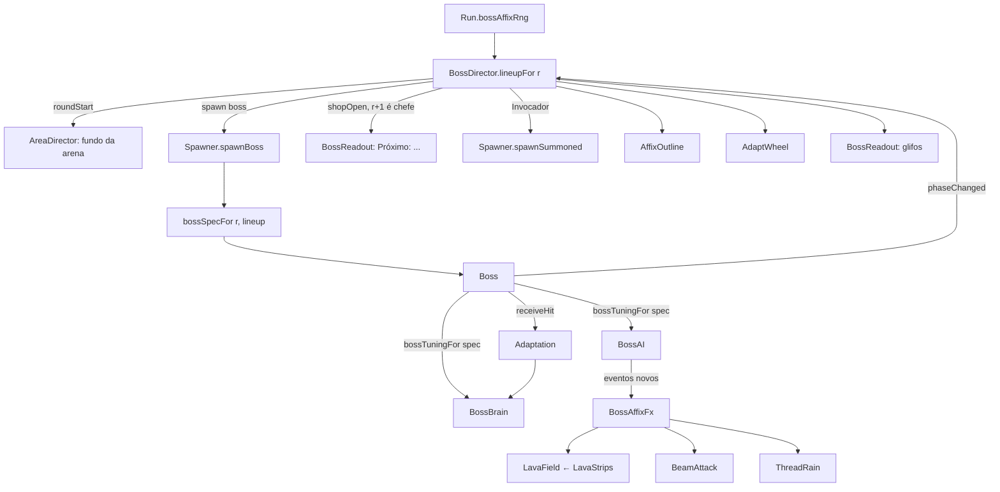

# Chefes com afixos — Design

**Spec**: `.specs/features/chefes-com-afixos/spec.md` · **Plano**: `docs/plano-builds-e-habilidades.md` (5.8, linha F32)
**Status**: Draft

Conforma com AD-001 (regra pura em `core`), AD-003 (glifo e aviso na câmera de UI), AD-006 (sorteio só por `Rng`
com seed), AD-009 (cor só da `PALETTE`, geometria em `Graphics`), AD-018 (arte do chefe intocada) e AD-023 (Phaser 4:
`setTintMode(FILL)`, sem `postFX`). Nenhuma decisão de projeto nova: tudo abaixo é local da feature.
Lições aplicadas: L-010 (todo limiar testado dos dois lados) e L-043 (testar o adaptador que repassa um número ao
motor, não só a função pura: escala do Portador e tuning derivada conferidas pelo snapshot).

---

## Arquitetura

```
data/bossAffixes.ts   ids, nomes m/f, leve, cores (chave da PALETTE), números de cada afixo e do Portador
data/tuning.ts        BOSS: ciclos por arquétipo, Investida Dupla, Salto Triplo, Chuva de Fios, nome curto
core/bossAffix.ts     escalação (sorteio, overrides, cache por rodada), rótulos, ciclos, invocação, cores, tuning derivada
core/bossAdapt.ts     Adaptation: janela de 20 s, adapta/esquece, escala do golpe; adaptSourceOf(hit)
core/bossLava.ts      LavaStrips: faixas por tempo, contato e tique de 600 ms
core/bossAttacks.ts   ajudantes puros dos ataques: threadXs, beamThickness, animBase
core/bossAI.ts        + doubleCharge, tripleLeap, threadRain, beam; ciclos vêm da tuning; eventos novos
core/bossTier.ts      bossSpecFor(round, lineup): arquétipo da escalação, Portador, dano de lava e feixe
core/run.ts           + bossAffixRng (seed ^ 0x9b05688c)
game/boss/            BossAffixFx (um por chefe) → LavaField, BeamAttack, ThreadRain, AffixOutline, AdaptWheel;
                      BossReadout (glifos ao lado da barra + aviso "Próximo:" na câmera de UI)
scenes/test/bossDirector.ts   dono da escalação na cena, overrides de debug, invocados, ligação com Boss e HUD
```



**Fluxo da escalação (BLN-01..03, BRD-06).** `BossLineups` (em `core/bossAffix.ts`) guarda o resultado sorteado por
rodada e o `Rng` que o gerou; quando o `Run` cria um stream novo (run nova), a identidade do `Rng` muda e o cache
zera sozinho, sem gancho no `startRun`. Quem pede primeiro consome: na prática a loja da rodada anterior (aviso), ou
o `roundStart` da área, ou o spawn do chefe. O sorteio consome sempre a mesma quantidade (1 `next()` do arquétipo,
1 `int()` por vaga de afixo do tier, 1 `next()` do Portador, inclusive antes da r10); os overrides de debug são
aplicados depois, sobre uma cópia, e nunca mudam o consumo (BLN-09).

**Onde mora o diretor.** `TestScene.ts` está no teto (399 linhas efetivas) e não ganha linha: o `BossDirector` é
criado no construtor do `RunDirector` (`this.bosses = new BossDirector(s)`, no corpo do construtor, não em
inicializador de campo, por causa do `target: ES2022` com propriedade de parâmetro) e acessado por
`s.runDirector.bosses`. O `RunDirector` já tem os três ganchos de que ele precisa: `applyRunCommand` (`shopOpen`,
`roundStart`), `onStartRun` e `updateBoss`.

**Fonte da técnica no golpe (ADP-01).** `core/hit.ts` não muda (F29). `techMarks(strength, id)` em
`game/tech/shared.ts` passa a devolver também `techId`, e o tipo `TechHit = Hit & { techId?: TechId }` mora em
`core/bossAdapt.ts` (tipo estrutural, sem tocar no `Hit`). Os 5 arquivos de técnica trocam só a chamada. Kokusen
(`receiveKokusen`), finalizador (`receiveFinisher`) e aparo (`parried`) não passam por `Boss.receiveHit`, então ficam
fora do Adaptativo por construção (ADP-02); golpe com `tech: true` sem `techId` (laboratório) não conta.

---

## Reuso

| Existente | Onde | Uso |
| --- | --- | --- |
| `Rng` (`next`, `int`) | `src/core/rng.ts:5` | stream `bossAffixRng`; atenção: `chance(p)` não consome com `p <= 0`, por isso o Portador usa `next() < p` |
| Streams com salt | `src/core/run.ts:297-307` | mesmo padrão para `bossAffixRng` |
| `parseVariant` / override que não muda a sequência | `src/core/enemyVariant.ts:13`, `scenes/test/spawner.ts:58-61` | molde de `parseBossArch`, `parseBossAffixes`, `parseFinger` |
| `bossHpFor`, `bossDamageMultFor`, `tierFor` | `src/core/bossTier.ts:15-27` | escala de vida e dano, depois multiplicada pelo Portador |
| `AttackHitbox` (um acerto por alvo por abertura) | `src/game/hitbox.ts:55-77` | feixe (uma abertura) e cada fio (uma abertura por fio) |
| `pickEnemySpawnPoint` (com o mais distante quando não há ponto fora da câmera) | `scenes/test/spawner.ts:29`, `core/spawnPoint.ts:41` | ponto de cada invocado; cobre o edge case "sem ponto livre" |
| `scaleFor`, `attackKindFor`, `ENEMY_VARIANTS` | `core/difficulty.ts`, `core/attackKind.ts`, `core/enemyVariant.ts:4` | invocado com a escala da rodada, desarmado, aparência por índice |
| `fx.curseSmoke`, `Enemy.destroyNow` | `game/fx.ts`, `game/Enemy.ts` | sumiço dos invocados na morte do chefe (INV-04) |
| `setTint(...).setTintMode(Phaser.TintModes.FILL)` | `game/enemy/EnemyAnimator.ts:202` | contorno de 1 px: 4 cópias do sprite deslocadas ±1 px, atrás dele |
| `uiLayer` + câmera de UI | `scenes/test/uiSetup.ts:30-42` | glifos e aviso nascem na camada de UI, ignorados pela principal |
| `combat.debugHit('heavy')` (tecla 2) | `scenes/test/combat.ts:276` | smokes: golpe forte sem técnica para adaptar e trocar de fase |
| `player.receiveHit`, `player.grounded`, `player.hurtRect` | `game/Player.ts:177-228` | tique de lava pelo caminho de dano de hoje (IGN-03) |

---

## Componentes

### `data/bossAffixes.ts` (novo)

- `BossAffixId = 'igneo' | 'invocador' | 'sangue' | 'adaptativo'`; `BOSS_AFFIX_IDS` (ordem fixa do pool); `BOSS_AFFIXES: Record<BossAffixId, { name: { m, f };
  light: boolean; outline: string | null; glyph: string }>` (cor = chave da `PALETTE`; não há tipo `PaletteKey`, a `PALETTE` é `Record<string, number>`, então o teste confere cada chave) (Ígneo `a`/`a`, Invocador `u`/`u`, Sangue
  `null`/`r`, Adaptativo `null`/`A`).
- `AFFIX_RULES`: `countByTier: [1, 1, 2, 2, 3]` (índice = tier − 1; tier além do fim usa o último), `incompatible: []` (pares; vazia na leva 1), `lightPool`
  derivado de `light`.
- Números em `BOSS_AFFIX` (padrão `VOW`/`PERK`: singular = números, plural = definições): `lava { durationMs: 2000, tickMs: 600, damage: 4 }`, `summon { count: 3, firstBossCount: 2, maxAlive: 4, spotGap: 28 }`,
  `beam { warnMs: 800, activeMs: 250, damage: 16, thickness: [1, 6], height: 10 }`, `adapt { windowMs: 20000,
  minHits: 5, maxAdapted: 2, forgetMs: 10000, mult: 0.5 }`, `finger { fromRound: 10, chance: 0.1, scale: 1.25,
  hpMult: 1.3, damageMult: 1.5, extraProjectiles: 1, name: { m: 'Portador de Dedo', f: 'Portadora de Dedo' },
  glyph: 'w' }`, `outlineSwapMs: 600`, `adaptLabels` ("Leve", "Forte", "Divergente", "Vermelho", "Azul", "Corte",
  "Roxo").

### `data/tuning.ts` (`BOSS`, linhas 330-379)

- `archetypes.oni`/`tecela` ganham `shortName` ("Oni", "Tecelã", na T11, para o aviso da loja) e `cycles` (CYC-02..04).
- `cycles` no topo = os ciclos de hoje: base do `new BossAI()` sem argumento, para `tests/core/bossAI.test.ts`
  (365 linhas, com cópia local da tabela) seguir intacto. O jogo sempre passa a tuning derivada.
- `doubleCharge { rewindupMs: 250 }`, `tripleLeap { hops: 3, gapMs: 200 }`, `threadRain { windupMs: 600,
  activeMs: 200, offsets: [-96, -48, 0, 48, 96], width: 12, height: 120 }`.

### `core/bossAffix.ts` (novo)

- `BossLineup { archetype: BossArchetype; affixes: readonly BossAffixId[]; finger: boolean }`.
- `drawLineup(rng, round, rules = AFFIX_RULES, finger = BOSS_AFFIX.finger): BossLineup` — BLN-04..07, PDD-01/02. Cada vaga sorteia com
  `rng.int` no pool elegível (sem repetidos, sem par incompatível; r5 só o pool leve).
- `LineupOverrides { archetype?: BossArchetype; affixes?: readonly BossAffixId[]; finger?: boolean }`;
  `parseBossArch(raw)`, `parseBossAffixes(raw)` (`none` → `[]`; qualquer id desconhecido invalida o valor inteiro →
  `undefined`; repetidos ficam uma vez; é debug, não confere tier nem par incompatível), `parseFinger(raw)` (`1`/`0`,
  vale em qualquer rodada); `applyOverrides(lineup, o)` devolve cópia (BLN-09, BLN-10).
- `class BossLineups { lineupFor(rng: Rng, round: number, o?: LineupOverrides): BossLineup }` — cache por rodada
  com o sorteio puro, zera quando o `rng` muda (BLN-02, BLN-03); os overrides entram só na saída, numa cópia.
- `affixName(id, archetype)`, `bossBarLabel(spec)` (BRD-01), `announceText(lineup)` (BRD-04).
- `cyclesFor(archetype, affixes, t = BOSS)` — Sangue põe `beam` logo depois do 1º ataque de cada fase (SNG-01).
- `bossTuningFor(spec): { ai: BossAITuning; brain: BossBrainTuning }` (AFX-01). Na leva 1 nenhum afixo mexe no
  cérebro: `brain` é o `BOSS`; a vida já vem do `spec.maxHp`.
- `summonCount(round, alive, t)` = `min(round === 5 ? 2 : 3, max(0, maxAlive − alive))` (INV-01/02).
- `outlineKeyAt(affixes, ms)` (BRD-03: nenhum, um, ou alterna a cada 600 ms) e `glyphKeys(spec)` (BRD-02).

### `core/bossAdapt.ts` (novo)

- `AdaptSource = 'light' | 'heavy' | TechId`; `adaptSourceOf(hit: TechHit): AdaptSource | null` (técnica sem
  `techId` → `null`).
- `class Adaptation` — relógio próprio (`update(dtMs)`), sem `Date.now`:
  - `onHit(source): number` — devolve a escala deste golpe (0,5 se a fonte **já** estava adaptada, senão 1), registra
    o acerto e reavalia (ADP-03: a fonte não adaptada com mais acertos na janela, `>= minHits`, menos de 2 adaptadas;
    empate: a fonte cujo último acerto é mais antigo, isto é, a que chegou ao número primeiro).
  - `update(dtMs)` — descarta acertos com idade `>= windowMs`; esquece a fonte adaptada com `>= forgetMs` sem acerto
    e **apaga os acertos dela da janela** (senão o próximo golpe de qualquer fonte a readaptaria na hora).
  - `adapted: readonly AdaptSource[]` (ADP-06/07).

### `core/bossLava.ts` (novo)

- `class LavaStrips(t = BOSS_AFFIX.lava)`: `add(fromX, toX, groundY)`, `update(dtMs)` (some com idade `>= 2000`,
  IGN-02), `tick(rect, grounded): boolean` (verdadeiro quando há contato, o player está no chão e passaram `>= 600 ms`
  desde o último tique; o 1º contato bate na hora; IGN-03/05), `strips`, `clear()`. O `rect` é pelo centro (como o
  `hurtRect()`); contato = cruzar `[minX, maxX]` × `[groundY - LAVA_DEPTH (8 px), groundY]`. O relógio do tique é um
  só para todas as faixas: sair e voltar, ou pisar em duas, não adianta nem dobra o tique.

### `core/bossAttacks.ts` (novo)

- `threadXs(centerX, minX, maxX, offsets)` (CYC-09, presos aos limites), `beamThickness(elapsedMs, warnMs)` (1 → 6 px,
  SNG-02), `animBase(attack)` (`doubleCharge`→`charge`, `tripleLeap`→`leap`, `threadRain`/`beam`→`volley`; CYC-11).

### `core/bossAI.ts` (estendido)

- `BossAttack` + `'doubleCharge' | 'tripleLeap' | 'threadRain' | 'beam'`; `BossAIState` + `'threadRain' | 'beam'`.
- `BossAITuning` + `cycles`, `doubleCharge`, `tripleLeap`, `threadRain`, `beam` (os números do feixe vêm de
  `data/bossAffixes`); `CYCLES` (linha 45) sai, `step` e `enterRestAfterAttack` leem `this.t.cycles`. Os tipos
  dos ataques novos e os números de `doubleCharge`, `tripleLeap` e `threadRain` entram já na T15 (para a
  `bossTuningFor` ter tipo); o `beam` da tuning entra com o ataque, na T20, como `BOSS.beam = BOSS_AFFIX.beam`
  (`data/tuning` importa `data/bossAffixes`), e a IA lê dele só `warnMs` e `activeMs`. Um ataque sem corpo no
  `beginAttackBody` cai direto no descanso.
- Eventos novos (`BossStrike = 'beam' | 'threadRain'`): `{ type: 'telegraph'; attack; dir; playerX }` ao sair do
  descanso para o preparo; `{ type: 'strikeOn'; attack; dir }` (o `dir` preso no aviso) e `{ type: 'strikeOff';
  attack }` no corpo; `{ type: 'telegraphCancel' }` no `interrupt` durante preparo ou corpo desses dois (no corpo,
  precedido de `strikeOff`, para todo `strikeOn` ter o seu fechamento); `{ type: 'chargeTrail'; fromX; toX }` ao fim de toda investida, por alcance ou parede
  (IGN-01: `fromX` é o X do chefe ao sair, `toX` o `selfX` observado no frame em que parou, na ordem do movimento;
  cancelar sem `canAct` não deixa rastro); `landed` ganha `final: boolean`.
- Preparo: `beam` 800 ms e `threadRain` 600 ms fixos (sem `windupMult`); a direção do feixe fica presa no aviso (o
  `beginAttackBody` de hoje recalcularia pelo player e o feixe sairia fora da linha avisada).
- `doubleCharge`: 1ª investida; fim por alcance → vira para o player, preparo de 250 ms, 2ª investida, sem descanso
  entre elas; parede na 1ª → `wallStun` e fim (CYC-05/06). `tripleLeap`: 3 saltos com 200 ms entre pouso e saída,
  cada um mirando o X do player na saída; `landed.final` só no 3º, descanso de pouso só depois dele (CYC-07/08).
- Troca de fase no meio de um encadeado: o `BossBrain` entra em `roar`, `canAct` cai e o `interrupt` (linha 244) já
  cancela tudo e zera o encadeamento; o ciclo novo começa do 1º ataque (edge case).

### `core/bossTier.ts` e `core/bossBrain.ts`

- `archetypeFor` (linhas 29-36) sai (BLN-08 substitui o BTIER-04). `bossSpecFor(round, lineup, t = BOSS)`: arquétipo
  da escalação; `BossSpec` + `affixes`, `finger`, `bodyScale`, `damage.lava`, `damage.beam` (fio usa `projectile`).
  Portador: `maxHp × 1,3` arredondado, cada dano `round(base × multTier × 1,5)` (um arredondamento só), rajada + 1
  (PDD-03..05; edge case da lava).
- `BossBrain.receiveHit(hit, scale = 1)` (linha 92): com `scale < 1`, dano `max(1, round(dano × scale))` e postura
  `round(postura × scale)`; o multiplicador do `stagger` vem depois (ADP-04).

### `core/run.ts`

- `bossAffixRngValue` + getter `bossAffixRng` + `new Rng(seed ^ 0x9b05688c)` em `resolveStart` (linhas 59-68,
  132-179, 297-307).

### `game/Boss.ts` (só delega)

- `BODY_W`/`BODY_H` (linhas 16-17) viram `w`/`h` da instância (`× spec.bodyScale`); o sprite usa `setScale(facing ×
  s, s)` em `animate` (linha 368) — PDD-03.
- Construtor (72-73): `const tuning = bossTuningFor(spec)`; `new BossBrain(spec.maxHp, tuning.brain)`, `new
  BossAI(tuning.ai)`; `readonly adaptation = spec.affixes.includes('adaptativo') ? new Adaptation() : null`.
- `receiveHit` (163): `this.brain.receiveHit(hit, this.adaptation?.onHit(adaptSourceOf(hit)) ?? 1)`.
- Os três laços iguais de eventos do cérebro (163-210) viram um `dispatch(events)` que também avisa
  `onPhaseChanged?.(phase)` (Invocador): o arquivo encolhe nessa parte.
- `handleAIEvents` (257): eventos novos vão para `fxSink?.(ev, anchor)` com `{ x, groundY, chestY, facing }`;
  `onLand(final)` (310) só chama as ondas de choque no 3º pouso. `animate` usa `animBase` (363-364).
- `update` (212): `this.adaptation?.update(dtMs)`. Campos públicos novos: `fxSink`, `onPhaseChanged` (atribuídos pelo
  diretor, como `enemy.onEvent`), getters `affixes`, `finger`, `spriteScale` (lida do sprite) e `bodySize` (lida dos limites do corpo Matter, L-043).

### `game/boss/` (novo)

- **`BossAffixFx`** — criado por chefe pelo diretor; recebe `fxSink` e repassa: `chargeTrail` → `LavaField` (se
  Ígneo), `telegraph/strikeOn/strikeOff/telegraphCancel` → `BeamAttack` ou `ThreadRain`. `update(dt, player)`,
  `destroy()`, `debug()`.
- **`LavaField`** — `LavaStrips` + um retângulo `a`/`A` por faixa no chão; por quadro, `tick(player.hurtRect(),
  player.grounded)` → `player.receiveHit({ ownerId: boss.id, damage: spec.damage.lava, strength: 'light', force: 0,
  height: 'low', unblockable: true, direction: { x: 0, y: -1 } })` (IGN-03/04). O `BossDirector.update(dt)` roda no
  `RunDirector.updateBoss`, logo depois do `boss.update`; o snapshot traz `boss.lava` (faixas, tiques, tiques aceitos,
  dano), `player.grounded` e `bossLavaStrips` (faixas vivas com ou sem chefe, para a morte dele e a run nova).
- **`BeamAttack`** — `Graphics` da linha `r` → `R` com `beamThickness`, do chefe até a borda da `worldView` no lado
  avisado; `strikeOn` abre um `AttackHitbox` próprio (dono = chefe) com `height: 'high'`, dano `spec.damage.beam`,
  por 250 ms; `telegraphCancel` apaga sem abrir (SNG-02/03, edge case). Nasce no `BossDirector.attach` só com Sangue
  (como a lava, `null` sem o afixo); a espessura e a borda andam no `BossAffixFx.update`; a hitbox vai do X do chefe
  à borda da vista no quadro da abertura e fecha no `strikeOff` da IA (golpe `heavy`, força 6, para longe do chefe). O
  snapshot traz `boss.beam` (`phase`, `dir`, `fromX`, `toX`, `y`, `thickness`, `warnElapsedMs`, `damage`, `hits`).
- **`ThreadRain`** — 5 marcas `u` no chão em `threadXs(playerX, 0, level.widthPx, offsets)`; `strikeOn` troca cada
  marca por um fio `U` vertical com um `AttackHitbox` por fio (um acerto cada); `strikeOff` fecha (CYC-09/10).
- **`AffixOutline`** — 4 cópias do sprite do chefe (`fxSprite`) com `tintMode FILL` na cor de `outlineKeyAt`,
  deslocadas ±1 px e atrás dele; copia textura, quadro, posição e escala a cada quadro (BRD-03). Nasce no
  `BossDirector.attach` (`AffixOutline.create` devolve `null` sem Ígneo nem Invocador), segue o chefe no
  `BossDirector.update`, depois do `boss.update`, e sai no `onBossDied` e no `reset`; o relógio da troca de cor conta
  desde o nascimento. O snapshot traz `boss.outline` (`key`, `frame` das cópias, `sourceFrame` do chefe, `visible`).
- **`AdaptWheel`** — `Graphics` de 8 raios `A` (aro e um quadradinho na ponta de cada raio) sobre a cabeça + `Text`
  com os rótulos curtos (`adaptLabels`, juntos por " · "); some sem adaptação e com o chefe morto; gira um raio (45°)
  em 300 ms a cada fonte nova (ADP-06). Nasce no `BossDirector.attach` só com Adaptativo, segue o topo do corpo no
  `BossDirector.update` e sai no `onBossDied` e no `reset`. O snapshot traz `boss.adapted` (ADP-07) e `boss.wheel`
  (`visible`, `labels`, centro `x`/`y`).
- **`BossReadout`** — na `uiLayer`: um quadrado de 6 px por chave de `glyphKeys`, à direita da barra
  (`BOSS_BAR_WIDTH` e `MARGIN` passam a `export` em `Hud.ts`, sem linha nova), e o texto do aviso abaixo da área da
  barra (BRD-02/04/05).

### `scenes/test/bossDirector.ts` (novo)

- `lineupFor(round)` (lê os overrides `bossArch`, `bossAffix`, `finger` por `debugParam`), `specFor(round)`.
- `showBar(spec)` / `hideBar()` / `glyphs()`: barra do `Hud` e glifos do `BossReadout` (criado no primeiro chefe,
  porque a `uiLayer` nasce depois do `RunDirector`) sempre juntos; o snapshot traz `bossGlyphs` (BRD-01/02).
- `attach(boss, spec)` (a `spec` dá o dano de projétil dos fios): liga `fxSink`, `onPhaseChanged` (Invocador), cria `BossAffixFx`, `AffixOutline`, `AdaptWheel` e os
  glifos. `update(dt)` depois do `boss.update` (lava, contorno, roda).
- `summon(round)` (ligado ao `onPhaseChanged` só com Invocador, rodada do `run.round`): `summonCount` →
  `spawner.spawnSummoned(point, round, index, onGone)`, com `point` do `pickEnemySpawnPoint` e `index` contado na run;
  guarda o conjunto vivo (a morte tira dele). O snapshot traz `bossSummoned` (ids vivos).
- `onBossDied()`: limpa lava, feixe, fios, contorno, roda, glifos; cada invocado vivo sai com `curseSmoke` +
  `destroyNow`, sai da lista da cena e do `attackGate` (o `destroyNow` não chama o `onRemoved`) e registra
  `summonDismissed:<id>` (INV-04, edge case da lava).
- `onShopOpen(round)`: se `isBossRound(round + 1)`, mostra `announceText(lineupFor(round + 1))`; `hideAnnounce()` no
  `roundStart`/`startRun`. `reset()` na run nova. `snapshot()`.

### `scenes/test/spawner.ts`

- O bloco de ligação do inimigo (linhas 89-103) sai para `wireEnemy(enemy, spawnAt)`, usado por `spawnFromCommand` e pelo novo
  `spawnSummoned(point, round, index, onGone)`: `scaleFor(round)`, sem `loot.rollArmed` (não consome o stream de
  loot, nunca armado), aparência `ENEMY_VARIANTS[index % 3]` (não consome `variantRng`), e o callback de morte só
  registra `summonDied:<id>` — sem `combat.onEnemyDied` (não chega à `Run`) e sem drop (INV-03, INV-05).
- `spawnBoss` (119-146): `spec = s.runDirector.bosses.specFor(round)`, `bosses.attach(boss)`,
  `bosses.showBar(spec)` (o `hud.showBossBar(bossBarLabel(spec))` e os glifos do `BossReadout`, juntos).
  `onBossDefeated` (153): `bosses.hideBar()` no lugar do `hud.hideBossBar()`, e `bosses.onBossDied()`; o `startRun`
  também troca o `hud.hideBossBar()` pelo `bosses.hideBar()`.

---

## Arquivos tocados e tetos

Linhas efetivas medidas agora (sem brancos e comentários, regra do `max-lines`) e a estimativa depois.

| Arquivo | Pontos (linha) | Hoje | Depois | Observação |
| --- | --- | --- | --- | --- |
| `src/scenes/TestScene.ts` | — | 399 | 399 | não muda (diretor vive no `RunDirector`) |
| `src/game/Hud.ts` | 15, 61-62 (`export`) | 336 | 336 | exceção do lint; não cresce |
| `src/game/debugApi.ts` | 113-131 (tipo `boss` + `affixes`, `finger`, `fx`: eventos que o `BossAffixFx` recebeu por tipo), + `bossLineup` (última escalação pedida, do `BossDirector.snapshot()`) | 307 | ~322 | |
| `src/game/Boss.ts` | 16-17, 72-73, 83-86, 163-210, 212, 257-270, 310-331, 357-370 | 276 | ~285 | `dispatch` compensa as linhas novas |
| `src/core/bossAI.ts` | 4-13, 27-33, 45-49, 116, 146-173, 176-193, 196-207, 229-252 | 200 | ~290 | `switch` de `step` vai a 8 casos; `windupDurationFor` vira tabela |
| `src/data/tuning.ts` | 330-379 | 272 | ~290 | |
| `src/core/run.ts` | 59-68, 132-179, 297-307 | 237 | ~243 | |
| `src/scenes/test/snapshot.ts` | 111-125 | 209 | ~212 | exceção só de tamanho de função |
| `src/scenes/test/spawner.ts` | 68-103, 119-146, 153-171 | 148 | ~172 | |
| `src/scenes/test/runDirector.ts` | 20, 62-66 (`shopOpen`/`roundStart`), 101-118, 213 | 183 | ~190 | |
| `src/scenes/test/areaDirector.ts` | 8, 83 | 141 | 141 | troca `bossSpecFor(...).archetype` por `bosses.lineupFor(...)` |
| `src/core/bossBrain.ts` | 92-98 | 160 | ~164 | |
| `src/core/bossTier.ts` | 5-12, 29-36, 47-66 | 46 | ~58 | |
| `src/game/tech/shared.ts` + `blue.ts:127`, `cut.ts:56`, `divergent.ts:171,205,235`, `purple.ts:100`, `red.ts:129` | `techMarks(strength, id)` | — | +0 | uma chamada por golpe |
| `tests/core/bossTier.test.ts` | 88-111 | 111 | ~118 | sai `archetypeFor`; entra `bossSpecFor` com escalação |
| `tests/data/tuning.test.ts` | 86 | — | — | arquétipos ganham `shortName` e `cycles` |
| `README.md` | parâmetros de debug | — | — | `round=5` deixa de "abrir o Oni"; `bossArch`, `bossAffix`, `finger` |

Arquivos novos (estimativa, todos longe dos 400): `data/bossAffixes.ts` ~70, `core/bossAffix.ts` ~170,
`core/bossAdapt.ts` ~80, `core/bossLava.ts` ~50, `core/bossAttacks.ts` ~30, `game/boss/BossAffixFx.ts` ~60,
`LavaField.ts` ~55, `BeamAttack.ts` ~70, `ThreadRain.ts` ~70, `AffixOutline.ts` ~50, `AdaptWheel.ts` ~55,
`BossReadout.ts` ~70, `scenes/test/bossDirector.ts` ~170. Nenhum entra na lista de exceções do `.oxlintrc.json`.

Não tocados (F29 ou teto): `core/hit.ts`, `combat.ts`, `effects.ts`, `impactFx.ts`, `enemyBrain.ts`,
`EnemyDefense`, `strikes`, `Player.ts`, `vowDirector.ts`, `arsenalDirector.ts`, `shopDirector.ts`, `ShopPanel.ts`,
`tests/core/bossBrain.test.ts`, `tests/core/bossAI.test.ts`, `tests/core/run.test.ts`.

---

## Testes (Vitest, Node, arquivos novos)

| Arquivo | Cobre |
| --- | --- |
| `tests/core/bossLineup.test.ts` | BLN-02/03 (cache, mesma seed, `Rng` novo zera), BLN-04 (limiar 0,5 dos dois lados; seeds 1..50 dão os 2 arquétipos), BLN-05/06 (contagem por tier nos limites r5/r10/r15/r20/r25), BLN-07 (sem repetidos; par incompatível injetado nunca sai), PDD-01/02 (nunca antes da r10; limiar 0,10; fora da contagem), consumo do stream igual na r5 e na r10, Success Criteria 1 (20 seeds seguidas na r5). Arquivo à parte para o `bossAffix.test.ts` não passar do teto de 400 linhas |
| `tests/core/bossLineupOverrides.test.ts` | BLN-09/10 (`parseBossArch`, `parseBossAffixes` com `none` e id inválido, `parseFinger`; `applyOverrides` numa cópia; consumo igual com e sem override na r5/r10/r25; inválido ignorado; `finger=1` antes da r10). Arquivo à parte pelo teto de 400 linhas |
| `tests/core/bossAffix.test.ts` | BLN-01 (sequência igual a `new Rng(seed ^ 0x9b05688c)` via `Run`), BRD-01/04 (rótulos m/f, Portador/Portadora), SNG-01 e CYC-02..04 (`cyclesFor`), INV-01/02 (`summonCount` com vivos 0..4, r5), BRD-03 (`outlineKeyAt` em 599/600 ms), BRD-02 (`glyphKeys`), AFX-01 (`bossTuningFor`) |
| `tests/core/bossAdapt.test.ts` | ADP-01 (fontes leve/forte/técnica), ADP-02 (`adaptSourceOf` de técnica sem id → `null`), ADP-03 (4 e 5 acertos; idade 19999/20000; teto de 2; empate), ADP-04 (escala só depois de adaptar), ADP-05 (9999/10000 ms; acertos apagados ao esquecer) |
| `tests/core/bossLava.test.ts` | IGN-02 (1999/2000 ms), IGN-03 (1º contato bate; 599/600 ms entre tiques), IGN-05 (no ar não bate), contato fora da faixa |
| `tests/core/bossAttacks.test.ts` | CYC-05..08 (`BossAI` com a tuning do Oni e da Tecelã: eventos, 250 ms, parede, 3 pousos, `final`, descanso só no 3º), CYC-09/10 (`threadXs` com limites; `strikeOn`), SNG-02/03 (800 ms fixos, 250 ms, direção presa), IGN-01 (`chargeTrail` em cada investida), edge cases de interrupção (`telegraphCancel`, encadeado parado), CYC-11 (`animBase`), `beamThickness` 0/800 ms |
| `tests/core/bossBrainScale.test.ts` | ADP-04 no cérebro: dano mínimo 1, postura × 0,5, `stagger` depois da escala |
| `tests/core/bossTier.test.ts` (atualizado) | BLN-08 (arquétipo da escalação), PDD-04/05 (vida × 1,3, dano × 1,5 com um arredondamento, rajada + 1), dano de lava e feixe por tier |
| `tests/data/bossAffixes.test.ts` | AFX-02 e BRD-07 (toda chave de cor existe na `PALETTE`; nomes nas duas formas; leves = Ígneo e Invocador; lista de incompatíveis vazia) |

## Smokes (`hd=1&area=modular`, prefixo `boss-` para `npm run smoke -- boss-`)

| Smoke | URL base | Confere |
| --- | --- | --- |
| `boss-lineup` | `seed=N&round=4`, depois duas seeds na r5 | aviso na loja (BRD-04/08), r5 igual ao anunciado e barra com o mesmo texto (BRD-01/06), sem aviso na loja da r1 (BRD-05), glifos (BRD-02), `affixes`/`finger` no snapshot (BLN-11), seeds diferentes dão chefes diferentes (goal 1) |
| `boss-igneo` | `round=10&bossArch=oni&bossAffix=igneo` | faixa depois da investida, tique de `round(4 × mult)` a 600 ms parado nela, pulo sem dano, some em 2 s, contorno `a` (IGN-01..05, BRD-03) |
| `boss-invocador` | `round=5&bossAffix=invocador` | tecla 2 até o rugido → 2 invocados; `run.kills` igual ao matar um; morte do chefe → 0 invocados com fumaça (INV-01..05) |
| `boss-sangue` | `round=10&bossArch=oni&bossAffix=sangue&finger=0&regen=0` | `attack === 'beam'` logo depois do 1º ataque, aviso de 800 ms, dano `round(16 × mult)`; abaixado não leva (SNG-01..03) |
| `boss-adaptativo` | `round=10&bossAffix=adaptativo` | 5 × tecla 2 → `adapted: ['heavy']`, 6º golpe tira a metade, roda visível; finalizador não reduzido (ADP-01..07) |
| `boss-attacks` | `round=15&bossArch=oni&bossAffix=none`, `bossArch=tecela`, `round=10&finger=1` | Investida Dupla na fase 2, Chuva de Fios com 5 fios, Portador com `spriteScale` 1,25 e vida × 1,3 (CYC-03..10, PDD-03..05; L-043) |

Smokes antigos que passam a fixar o chefe (`bossArch=oni&bossAffix=none&finger=0`, ou `tecela` onde hoje esperam a
Tecelã): `boss.smoke.mjs:6,250,365`, `boss-prop.smoke.mjs:5`, `boss-punish.smoke.mjs:28`,
`boss-victory.smoke.mjs:3`, `world-boss.smoke.mjs:6,134`. Na T12 apareceram mais três cenários com `round=5` que
supõem o Oni (investida e pouso, "arena do Oni") ou só atravessam o chefe, e também passaram a fixá-lo:
`defense-extra.smoke.mjs:167`, `evolution.smoke.mjs:95` e `vows.smoke.mjs:168,185`.

---

## Tratamento de erro

| Cenário | Tratamento | O que o jogador vê |
| --- | --- | --- |
| Override inválido (`bossAffix=foo`, `bossArch=x`) | ignorado; vale o sorteio (BLN-10) | chefe sorteado |
| Pool elegível vazio (só possível com pares incompatíveis da leva 2) | a vaga fica sem afixo, consumo do stream igual | menos afixos |
| Invocação sem ponto fora da câmera | `pickSpawnPoint` cai no ponto mais distante | invocado nasce longe |
| Chefe morre ou run reinicia com lava, feixe, fios ou invocados | `onBossDied`/`reset` limpam tudo | arena limpa |
| Interrupção no aviso do feixe ou dos fios | `telegraphCancel`, hitbox nunca abre | aviso some |

---

## Riscos e pontos de atenção

| Ponto | Local | Impacto | Mitigação |
| --- | --- | --- | --- |
| `BODY_W`/`BODY_H` usados em ~14 pontos | `src/game/Boss.ts:16-17` | Portador com corpo e hitbox desencontrados | trocar todos pela medida da instância (busca no arquivo) e conferir no `boss-attacks` |
| Smokes de chefe supõem Oni na r5, Tecelã na r15 e o nome puro na barra | `boss*.smoke.mjs`, `world-boss.smoke.mjs` | quebram com o sorteio | fixar `bossArch`/`bossAffix=none`/`finger=0` (lista acima) |
| `boss.smoke` observa "investida → rajada → salto" na fase 2 | `scripts/smoke/boss.smoke.mjs:157-221` | com a Investida Dupla do Oni o tempo muda | ele só espera projéteis e pouso; se falhar, ajustar o tempo de espera, não o que mede; repetir isolado (carga na máquina) |
| `bossAI.ts` cresce de 200 para ~290 e os `switch` ganham casos | `src/core/bossAI.ts:109-173` | complexidade perto de 15 | `windupDurationFor` e o corpo de cada ataque em métodos próprios; se passar, `core/bossChain.ts` com o encadeamento |
| Esquecer a fonte sem apagar os acertos readaptaria na hora | `core/bossAdapt.ts` (novo) | Adaptativo pune em vez de empurrar à variedade | apagar os acertos da fonte esquecida; teste próprio |
| Cache da escalação depende da ordem dos pedidos | `core/bossAffix.ts` (novo) | pedir a r10 antes da r5 mudaria o resultado | hoje os pedidos vêm sempre em ordem de rodada; documentado no código e testado com `?round=N` |
| Invocados consomem `spawnRng` e `guardRng` | `scenes/test/spawner.ts:29`, `game/Enemy.ts:61` | sequência dos comuns depois de um chefe Invocador muda | aceito: segue determinística pela seed; o stream de loot e o `variantRng` não são tocados |
| Tecelã pode sair na r5 | `scenes/test/areaDirector.ts:83` | fundo da arena e smokes da r5 | o fundo já suporta a Tecelã (ARN-05 em qualquer tier); smokes fixam o arquétipo |
| Contorno por 4 cópias do sprite | `game/boss/AffixOutline.ts` | quadro trocando sem acompanhar | copiar textura e quadro do `fxSprite` todo quadro, depois do `boss.update` |
| Arquivos de técnica tocados por uma chamada | `game/tech/*.ts` | conflito pequeno com outras frentes | só a assinatura de `techMarks`; `core/hit.ts` fica de fora |

---

## Decisões técnicas (não óbvias)

| Decisão | Escolha | Por quê |
| --- | --- | --- |
| Fonte da técnica | `techId` no objeto do golpe via `techMarks`, tipo `TechHit` em `core/bossAdapt.ts` | não toca no `Hit` da F29; Kokusen/finalizador/aparo ficam fora por não passarem em `receiveHit` |
| Dono do `BossDirector` | `RunDirector` (construtor) | `TestScene.ts` no teto; o `RunDirector` já tem os ganchos |
| Ciclo padrão do `new BossAI()` | ciclos de hoje em `BOSS.cycles` | `tests/core/bossAI.test.ts` segue igual; o jogo sempre passa a tuning derivada |
| Escala do Adaptativo no cérebro | `receiveHit(hit, scale)` | dano e postura saem exatos (50% cada); reduzir só o `damage` erraria a postura do golpe forte |
| Consumo do Portador | sempre 1 `next()`, comparado com 0 antes da r10 | `Rng.chance(0)` não consome; o consumo precisa ser igual em toda rodada |
| Invocado | sem `rollArmed`, aparência por índice, morte só no snapshot | INV-03/05 sem tocar no stream de loot nem no `variantRng` |
| Direção do feixe | presa no início do aviso | o feixe sai exatamente na linha avisada |
| Preparos do feixe e dos fios | fixos (800 e 600 ms), fora do `windupMult` | números da spec; a fase 3 não encurta o aviso |
| Golpe do feixe | `strength: 'light'`, `force: 3`, `height: 'high'` | a spec fixa só altura e dano; leve não derruba e abaixar responde |
| Fio | 12 px de largura, 120 px de altura, 200 ms ativo | um acerto por fio; curto para ler como chuva |
| Glifo e aviso | componente novo `BossReadout`; `Hud.ts` só exporta 2 constantes | `Hud.ts` está nas exceções e não cresce; `ShopPanel` não cresce |
