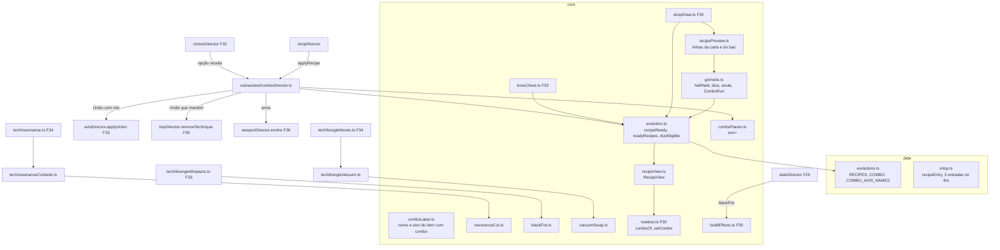

# Combos - Design

**Spec**: `.specs/features/combos/spec.md` · **Plano**: `docs/plano-builds-e-habilidades.md` (linha F37 da seção 6;
seções 3.1, 3.2, 5.2 e 5.7; decisões 1, 3, 5, 6 e 8 da seção 7) · **Base**: F29 `fundacao-de-poder` (branch
`feat/fundacao-de-poder`), F30 `vermelho-e-corpo`, F31 `expansao-de-dominio`, F33 `eixos-das-tecnicas`, F36
`arma-imbuida` (designs neste worktree e no `wt-f31spec`), F34 `tecnicas-jjk-1` (worktree `wt-leva1`) e F35
`vagas-e-talentos` (worktree `wt-f35spec`)
**Status**: Draft. A abordagem A (abaixo) é a recomendada e está detalhada; ela e os dois riscos marcados "usuário" em
"Risks & Concerns" (altura da carta com a linha do Grimório e nome longo de combo na carta) são confirmados com o
usuário antes do `tasks.md`.

Linhas citadas conferidas em 15/10 no worktree `docs/spec-vermelho-e-corpo` (`666ad13`, sem a F29 a F36), no
`feat/fundacao-de-poder` (`6fff962`, F29 em execução) e no `wt-leva1` (`649f4e6`, regras puras da leva 1:
`core/resonance.ts`, `core/boogie.ts`, `core/swap.ts`). O que a F30 a F36 criam ou trocam é citado pelo nome e pela
interface dos designs delas: da F30, `core/shopDraw.ts` (`drawCards`, `DrawContext`), `shopEligibility.ts`,
`shopPricing.ts` (`cardCost`, `inflate`), `shopPreview.ts` (`previewText`, `axisPreview`), `axisParam.ts`
(`parseBranchParam`), `Loadout.levelOf`/`kokusenScale`, `TECH_GEOMETRY`; da F31, `DomainState` (id e nível),
`chestRng`; da F33, `RecipePiece`/`minLevel`, `unionInheritance`, `core/bossChest.ts` (`ChestOption`,
`chestCandidates`, `drawChest`, `chestOptionId`), `core/choice.ts` (`ChoiceQueue`), `core/choicePages.ts`
(`buildPage`, `ctx.unionOf`), `scenes/test/choiceDirector.ts` (`confirm`, `openUnion`), `axisDirector.applyUnion`,
`core/cutBranch.ts` (`cutPlan`, `rectsTouch`), `game/tech/divergentImpacts.ts`, `CutFx.cut(center, dir, angle, rect)`,
`game/axisSnapshot.ts` (`techBuildSnapshot`); da F34, `TechModule`/`TECH_MODULES`, `TechPorts`/`techPorts.ts`,
`ctx.objects()`/`ctx.relocate()`, `game/tech/resonance.ts`, `resonanceHits.ts`, `boogie.ts`, `boogieMoves.ts`,
`techFx/BoogieFx.ts`, `ResonanceFx`, `Enemy.teleport`; da F35, `SlotIndex`, `poolOf`, `Perks` com nível,
`buildEffects` (`kokusenMul`), `SpentLedger`, `BuildTray`/`trayItems`/`buildBarText`, `trayDirector.abandon`,
`game/BuildBar.ts`, `game/TechSlotsHud.ts`, `game/buildSnapshot.ts`, `frameFor`, `Shop.buy` com `reason: 'item'`
(ABD-07); da F36, `Arsenal.weapon.evolution`, `WeaponDirector.evolve`, `WEAPON_RECIPES`, `core/weaponEvolution.ts`,
`ledgerKeyOf`, a opção `arma:<id>` do baú e o `evo=` do `arsenalDirector.applyDebugEvolution`. Essas linhas valem depois
dos merges e são reconferidas no começo de cada passo. Linhas efetivas contadas como o `max-lines` do `.oxlintrc.json`
(sem linha em branco e sem comentário).

**Quatro correções de endereço da spec, sem mudar requisito.**

1. O `pool.find` único que a spec cita em `core/shop.ts:292` (`drawFresh`) sai do `Shop` na F30 e mora no
   `shopDraw.drawCards` (carta 0, CRD-02); a F36 o estende para as receitas de arma. É lá que a F37 troca a regra.
2. O CGL-04 fala do ícone no `EnergyHud`; o passo 0 da F35 tira os ícones dos slots do `EnergyHud` para o
   `game/TechSlotsHud.ts`. A marca do combo entra no `TechSlotsHud` e na `BuildBar`.
3. O Independent Test do Vácuo de Troca (`tech=boogie,azul&evo=vacuoDeTroca`) deixa o Boogie no Nv 1, e o CDB-01
   ignora a receita que não está pronta. O smoke soma `axes=boogie.alcance:2,boogie.cargas:1` (Nv 4). O do Punho Negro
   (`axes=divergente.alvos:3`) e o da Ressonância Cortante (`axes=ressonancia.pregos:2,ressonancia.detonacao:1`) já
   chegam ao Nv 4.
4. O cinema do Kokusen da F29 (`ImpactFx.onKokusen` → `KokusenFx.trigger`: congelamento, raios, cartão 黒閃 e zoom) é
   de tela, um por quadro. No Punho Negro só o alvo principal dispara o cinema; os outros alvos ganham o número
   promovido a `kokusen` e o estouro de faíscas e onda do mesmo `KokusenFx` (PND-06 pede "o número e o flash").

**Revisão adversarial (15/10).** Mudanças de requisito que este design acompanha: a loja mostra até 2 receitas, com
rodízio pela rodada quando há 3 (OFR-01, OFR-02); a rajada da Ressonância Cortante vai de 0 a 180 px e crava no
máximo `floor(N / 2)` marcas por alvo (CRT-01, CRT-02, CRT-09); o Punho Negro ganha a peça `eixo`
`divergente.alvos` 1 (RCP-03, RCP-05, RCP-06) e dá a carga do Domínio e o anel da Zona Negra Nv 3 uma vez por
conjuração (PND-01); as linhas da carta de receita são recalculadas a cada `view()` (OFR-07, GRM-04); a linha da União
que mantém a principal é `+1 vaga, devolve <n>`.

---

## Architecture Overview

### Abordagens consideradas (todas entregam a mesma spec)

| | Abordagem | Prós | Contras |
| --- | --- | --- | --- |
| **A (recomendada)** | O combo mora com o dono da peça principal: o `Loadout` guarda o combo da técnica (`comboOf(id)`, apagado no `clear`/`equip` por cima/`reset`) e o `Arsenal.weapon.evolution` da F36 guarda o da arma, sem mudar. Uma vista pura (`RecipeView`) lê `Loadout`, `Perks`, `Arsenal` e `DomainState`, e uma regra só (`recipeReady`) decide sobre ela. Um `ComboDirector` (campo do `BuildDirector`) aplica qualquer receita, vinda da loja, do baú ou do `evo=` | O combo sai junto com o item pelo caminho que já apaga os pontos (`Loadout.clear` → `axes.resetItem`, `arsenal.abandon`), então abandono, União e reset não precisam lembrar de nada novo; o contrato da F36 fica; a `TestScene` não muda | O `Loadout` ganha um `Map` e três linhas; a vista junta quatro donos de estado |
| B | Um `ComboBook` único (`Map<chave do item, RecipeId>`) no `BuildDirector`, com a evolução da arma migrada para ele | Um lugar só para ler e escrever combo | Todo caminho que tira item (abandono, União, `tech=`, reset, troca de arma) precisa chamar `drop`, senão o combo fica preso num item que saiu; muda o `Arsenal.weapon.evolution` e o `resolveWeapon` da F36 |
| C | O combo como campo do `AxisBuild` (como o ramo), apagado pelo `resetItem` | Técnica e arma apagadas pelo mesmo `resetItem` | Talento, relíquia e Domínio não estão no `AxisBuild` e não poderiam ser peça principal (o tipo da spec os aceita); muda o contrato da F36 |

**Escolha: A.** O resto deste design detalha a A.

### Visão geral

A lista única `RECIPES` (`data/evolutions.ts`) guarda toda receita com peças `{ kind, id, minLevel }`. A regra pura
mora em `core/evolution.ts` (`recipeReady`, `recipeDone`, `readyRecipes`, `duoEligible`, `evolve` do Roxo,
`unionInheritance` da F33, `ledgerKeyOf` da F36) e lê só a `RecipeView` montada por `core/recipeView.ts`. A loja
(`shopDraw`, `shopEligibility`, `shopPreview`, `Shop.buy`), o baú (`bossChest`, `choicePages`) e o snapshot leem a
mesma vista. Toda aplicação passa pelo `ComboDirector.apply(id, fonte, pago)`, que despacha pelo tipo:

- União com `into` (Roxo): `axisDirector.applyUnion(into)` da F33, como hoje (herança, `evolve:<id>`).
- União que mantém a principal (Ressonância Cortante): a outra técnica sai pelo `trayDirector.removeTechnique` (o
  mesmo corpo do Abandonar, devolvendo o livro), os pontos pendentes passam à principal e o `Loadout` grava o combo.
- Evolução de técnica (Punho Negro, Vácuo): o `Loadout` grava o combo na principal.
- Evolução de arma: `arsenal.weapon.evolve(id)` da F36 (`weaponEvolved:<id>`).

Depois de todas: `stats.sync()`, a receita entra nas reveladas da run (`ComboRun`) e sai o evento `combo:<id>`.

Cada efeito de combo é lido pelo módulo da técnica no momento do aperto, pelo `loadout.comboOf(id)`, sem
reconstruir módulo: a Ressonância troca os pregos por uma rajada de cortes (`core/resonanceCut.ts` +
`game/tech/resonanceCortante.ts`), o Divergente escolhe os alvos do Kokusen por `core/blackFist.ts` e o Boogie põe o
orbe do Azul na frente dos candidatos e carrega o grupo (`core/vacuumSwap.ts` + `game/tech/boogieVacuum.ts`). O +0,3
do Kokusen entra no `buildEffects` da F35, que é o único lugar que monta o multiplicador. O Grimório (`core/grimoire.ts`)
põe a dica no texto da carta, que o `ShopPanel` já desenha em várias linhas.



Fluxo da konbini (a `TestScene` não muda de ordem): o baú do chefe (F33) monta as opções com `readyRecipes(view)`; a
confirmação de uma receita chama `combos.apply(id, 'chest', 0)`; a loja abre e o `drawCards` põe as prontas nas cartas
0 a k − 1; a compra passa pelo `Shop.buy`, que recusa a receita que deixou de valer, e o `BuyContext.applyRecipe` chama
`combos.apply(id, 'shop', preço)`; depois de cada `shop.view()`, o `shopDirector` repassa as dicas mostradas ao
`combos.reveal`.

---

## Code Reuse Analysis

### Existing Components to Leverage

| Component | Location | How to Use |
| --- | --- | --- |
| `Recipe`, `RECIPES`, `recipeReady`, `evolve` | `src/data/evolutions.ts:7-20`, `src/core/evolution.ts:5-24` (F33: `RecipePiece`, `minLevel`, `unionInheritance`) | A lista vira a lista única; `evolve` e `unionInheritance` ficam para a União com `into`; `recipeReady` passa a ler a `RecipeView` |
| `EVOLUTION_SHOP_ENTRIES` | `src/data/shop.ts:233-241` | Vira `recipeEntry(id)`; as entradas de hoje ficam na mesma posição (OFR-08) |
| `drawCards`, `DrawContext` | F30 `src/core/shopDraw.ts` (o `drawFresh` de `src/core/shop.ts:286-298` hoje) | A carta 0 única vira as cartas 0 a k − 1; a regra de item novo da F35 (POL-06) passa a valer na carta k |
| `Shop.buy` com `reason: 'item'`, `frame: 'grey'`, `FORA DA BUILD` | F35 `src/core/shop.ts` (ABD-07) | A carta de receita que deixou de valer usa o mesmo caminho (OFR-06), sem tipo de recusa novo |
| `cardCost`, `inflate` | F30 `src/core/shopPricing.ts` | Preço `round(60 × inflação)` da receita (OFR-05), sem mudança |
| `frameFor` | F35/F36 `src/core/shopPreview.ts` | Moldura dourada de toda carta de receita (a F36 já a dá à evolução de arma) |
| `chestCandidates`, `drawChest`, `chestOptionId`, `chestRng` | F33/F35/F36 `src/core/bossChest.ts`, F31 `run.ts` | As receitas prontas entram forçadas; o resto completa pelo `chestRng` (OFR-04) |
| `buildPage`, `ctx.unionOf`, páginas `heranca` | F33 `src/core/choicePages.ts`, `scenes/test/choiceDirector.ts` | Texto da opção de receita e a página de ponto pendente que passa à principal (UNI-05) |
| `axisDirector.applyUnion(into)` | F33 `scenes/test/axisDirector.ts` | O Roxo continua por aqui, chamado pelo `ComboDirector` (UNI-01) |
| `trayDirector.abandon`, `SpentLedger.refund` | F35 `scenes/test/trayDirector.ts`, `src/core/spentLedger.ts` | O corpo do abandono de técnica vira `removeTechnique(id, pointsTo)`, usado pelo Abandonar e pela União que mantém a principal (UNI-03, UNI-04) |
| `poolOf` | F35 `src/core/skillSlots.ts` | A vaga liberada sai sozinha: o pool conta técnicas equipadas (UNI-06) |
| `Arsenal.weapon.evolution`, `WeaponDirector.evolve`, `arsenal.abandon` | F36 `src/core/arsenal.ts`, `scenes/test/weaponDirector.ts` | Combo da arma sem mudança; a vista lê a evolução daqui |
| `ledgerKeyOf` | F36 `src/core/weaponEvolution.ts` | Vai para `core/evolution.ts` e vale para toda receita (livro da principal; o Roxo no `into`) |
| `ResonanceState` (`stick`, `marksOn`, `nextTap`, `update`) | `wt-leva1` `src/core/resonance.ts:175-300`, `:406-420` (privado `stick`) | O corte crava marca pelo mesmo `stick` do prego: Grampo, Coroa, Boneco e propagação reagem sem tabela nova (CRT-03) |
| `cutPlan`, `rectsTouch`, retângulo do Desmantelar | F33 `src/core/cutBranch.ts`; F30 `TECH_GEOMETRY.corte`; hoje `src/core/cut.ts:21-37` | Ângulos 20/−25/70, o longe de 180 px e a altura 48 do Desmantelar a 0 ponto, com a borda perto no centro do player (`COMBO.cortante.nearPx = 0`); toque com bordas inclusas (CRT-01) |
| `CutFx.cut(center, dir, angle, rect)` | F33 `src/game/techFx/CutFx.ts` | Desenha cada corte da Ressonância Cortante pelo retângulo (CRT-06) |
| `resonanceHits` (evento `nail`, `grampo`) | F34 `game/tech/resonanceHits.ts` | O acerto `micro` do corte é o evento `nail` de hoje (dano 3 pelo `scaleTechDamage`) |
| `pickSwapTarget`, `swapPlacement`, `BoogieState.swap` | `wt-leva1` `src/core/swap.ts:28-80`, `src/core/boogie.ts:213-247` | O Vácuo só põe um candidato prioritário antes do `pickSwapTarget`; encaixe, recusa, cargas e eco ficam (VAC-03, VAC-05) |
| `ctx.objects()`, `ctx.relocate(tech, id, at)`, `Enemy.teleport` | F34 `game/TechRunner.ts`, `game/tech/blue.ts`, `game/Enemy.ts` | O orbe do Azul é achado e movido pelos serviços que o Boogie já usa; o grupo anda pelo `teleport` (velocidade zero) |
| `BoogieFx.flash` | F34 `game/techFx/BoogieFx.ts` | O clarão âmbar continua; o anel azul entra ao lado (VAC-08) |
| `buildEffects.kokusenMul` | F35 `src/core/buildEffects.ts` (BEF-04) | O +0,3 do Punho Negro entra na mesma conta, com o teto 3,4 |
| `divergentImpacts` (2º impacto, anel do Eco, `kokusen.land` uma vez) | F33 `game/tech/divergentImpacts.ts` | A lista de alvos do Kokusen sai de `blackFist.kokusenTargets` (PND-01, PND-05) |
| `ImpactFx.onKokusen`, `KokusenFx` (`spawnSparksAndShock`) | `feat/fundacao-de-poder` `src/scenes/test/impactFx.ts:104-108`, `src/game/techFx/KokusenFx.ts:176`, `:294` | Cinema no alvo principal; estouro e número nos outros (PND-06) |
| `techBuildSnapshot`, `buildSnapshot` | F33 `game/axisSnapshot.ts`, F35 `game/buildSnapshot.ts` | `build.<técnica>.combo` e `combos` (CDB-02) |
| `tests/core/noMathRandom.test.ts` (molde `import.meta.glob`) e o teste de nomes do EIX-10 | `tests/core/noMathRandom.test.ts`, F33 `tests/data/techAxes.test.ts` | O `combos.test.ts` lê os nomes dos módulos de dados, sem lista copiada (NOM-04) |

### Integration Points

| System | Integration Method |
| --- | --- |
| Loja | `eligible` (F30 `shopEligibility`) oferece a entrada `evolution` cuja receita está pronta; `drawCards` recebe `view` e põe as prontas nas cartas 0 a k − 1; `Shop.buy` recusa a receita que deixou de valer (`reason: 'item'`); `BuyContext.applyRecipe(id)` (no lugar do `applyEvolution`, `src/core/shop.ts:209`, `:246`) |
| Compra | `shopDirector.resolveBuy`: `applyRecipe: (id) => this.s.build.combos.apply(id, 'shop', custo)`; com `inherited ≥ 1`, `build.choice.openUnion(into, inherited)` (F33, como hoje); o livro grava pela `ledgerKeyOf(receita)` (F36) |
| Baú do chefe | `choiceDirector.queueBossChest` monta as opções com `combos.ready()`; o `confirm` da opção `receita` chama `combos.apply(id, 'chest', 0)` e insere as `heranca` que ele devolver (F33) |
| Painel | `ChoiceQueue.transferPoints(de, para)` (UNI-05) e `addFront(reqs)` (heranças do `evo=roxo` na 1ª konbini) |
| Abandono | `trayDirector.abandon` chama `removeTechnique(id)` (técnica) ou o `arsenal.abandon(kind)` da F36; o combo sai pelo `Loadout.clear` ou pelo `Arsenal`, e o livro da principal já tem o preço da receita (CGL-05) |
| Luta | Módulos da F34 leem `ctx.loadout.comboOf(id)` no aperto: Ressonância no `techCast:ressonancia`, Boogie no `swap`/`echo`, Divergente no fim da espera |
| Folha da build | `StatsDirector.update` passa `blackFist: loadout.comboOf('divergente') === 'punhoNegro'` ao `buildEffects` (+1 linha) |
| Debug | `BuildDirector.applyDebugAxes` termina com `this.combos.applyDebug()` no lugar do `arsenal.applyDebugEvolution()` da F36, depois do `tech=`, `axes=`, `ramo=`, `perks=`, `arsenal=` e `domain=` (ver Risks: ordem do `domain=`) |
| Reset da run | `loadout.reset()` (combos de técnica), `arsenal.reset()` (F36), `build.combos.reset()` (reveladas e Duos), `choice.reset()` (página do baú pendente, F33) |
| Snapshot | `build.snapshot()` ganha `combos: ComboSnapshot`; `techBuildSnapshot` ganha `combo`; o módulo da Ressonância põe `cortante` no `techState.ressonancia` |

---

## Components

### `data/evolutions.ts` (reescrito, F33 ~14 → ~105)

- Tipos (ver "Data Models"): `RecipeType = 'uniao' | 'evolucao' | 'duo'`, `PieceKind = 'tecnica' | 'talento' | 'arma' |
  'reliquia' | 'dominio'`, `RecipePiece`, `WeaponEvolutionId` (sai de `data/weapons.ts`), `RecipeId`, `Recipe`.
- `RECIPES: readonly Recipe[]` com as sete da tabela do RCP-05, na ordem da lista (Uniões, Evoluções de técnica,
  Evoluções de arma), `cost: COMBO.cost` (60). Nome, texto e dica (ver "Data Models"). O nome da carta do Roxo continua
  `Vazio Roxo (Azul + Vermelho)` (o `evolution.smoke.mjs` e a carta de hoje não mudam).
- `COMBO = { cost: 60, maxShop: 2, maxChest: 3, duoCap: 4, hintMax: 10, blackFistMul: 0.3, cortante: { gapMs: 60,
  nearPx: 0 } }` e `UNION_INHERIT_CAP` (F33). O dano do corte é o do prego, lido do `data/resonance.ts` da F34 pelo
  `stick`, sem número repetido aqui.
- `COMBO_AXIS_NAMES: Partial<Record<RecipeId, Partial<Record<AxisId, string>>>>` = `{ ressonanciaCortante: { pregos:
  'Cortes' } }` (CRT-07).
- `recipeById(id): Recipe | undefined`.
- Sem `phaser`. O passo 0 traz só o Roxo e as três de arma; cada passo de combo soma a sua.

### `core/recipeView.ts` (novo no passo 0, ~45)

- **Purpose**: a vista da build que toda regra de receita lê (RCP-03), sem conhecer `Loadout`, `Perks`, `Arsenal` nem
  `DomainState` dentro da regra.
- **Interfaces**: `recipeView(src: { loadout; perks; arsenal; domain }): RecipeView`:
  - `level('tecnica', id)` = `loadout.levelOf(id)` (0 fora do slot; `1 + pontos` dentro, F30);
  - `level('talento', id)` = `perks.levelOf(id)` (F35);
  - `level('arma', id)` = `arsenal.weapon?.id === id ? loadout.axes.level(id) : 0` (F36);
  - `level('reliquia', id)` = `arsenal.levelOf(id)`;
  - `level('dominio', id)` = `domain.id === id ? domain.level : 0` (F31);
  - `level('eixo', 'item.eixo')` = os pontos do eixo no `AxisBuild` com o item equipado, 0 sem ele ou com o eixo
    morto pelo ramo (`alvos` no Concentrado, F33 DVG-06: a mesma pergunta que o `shopEligibility` faz para não oferecer
    o eixo);
  - `techniques` = os slots ocupados com `{ id, level }` (curinga, DUO-01);
  - `comboOf('tecnica', id)` = `loadout.comboOf(id)`; `comboOf('arma', id)` = a `evolution` da arma equipada; os outros
    `null` (nenhuma receita da leva 1 tem talento, relíquia ou Domínio como principal).
- Pura (só tipos de `core/`); refeita a cada consulta, sem cache.

### `core/evolution.ts` (muda, F33 ~27 → ~85)

- `assignPieces(r, view, atMin: boolean): (string | null)[]`: o id possuído que casa com cada peça; com `atMin`, só no
  nível mínimo ou acima, senão em qualquer nível ≥ 1. As peças nomeadas casam primeiro; o curinga `'*'` pega a
  primeira técnica de `view.techniques` (ordem dos slots) que não é outra peça de técnica da receita (DUO-01).
- `recipeBlocked(r, view)`: com `into`, o resultado equipado; sem `into` e fora do Duo, a principal (`pieces[0]`) já
  carrega qualquer combo (RCP-04: no máximo 1 por item).
- `recipeReady(r, view)` = `!recipeBlocked && assignPieces(r, view, true).every(não nulo)` (RCP-02).
- `recipeDone(r, view, duos: ReadonlySet<RecipeId>)`: o resultado equipado, ou a principal carrega esta receita, ou o
  Duo está no conjunto da run.
- `readyRecipes(view, list = RECIPES): Recipe[]`: Uniões e Evoluções prontas na ordem da lista, sem teto (o teto de 3 é
  de quem mostra, OFR-02); nunca Duo (DUO-03).
- `duoEligible(r, view, duosDone)` = `duosDone < COMBO.duoCap && recipeReady(r, view)` (DUO-02).
- `recipeOptionId(r)` = `` `${r.type}:${r.id}` `` (CDB-02, CDB-03).
- `consumedTechniques(r): TechId[]`: com `into`, toda peça de técnica; União sem `into`, as de técnica menos a
  principal; Evolução, nenhuma (GRM-04 e RCP-07).
- `ledgerKeyOf(r)` = `r.into ?? r.pieces[0].id` (vem do `weaponEvolution.ts` da F36).
- Ficam: `evolve(recipe, loadout)` (só União com `into`, RXO-02) e `unionInheritance` (RXO-12).

### `core/grimoire.ts` (novo: `ComboRun` no passo 1, ~25; o resto no passo 5, ~80)

- `class ComboRun`: `reveal(id)`, `revealed: ReadonlySet<RecipeId>`, `addDuo(id)`, `duos`, `get duosDone`, `reset()`
  (CGL-06, GRM-03). A F39 troca o `reveal` por gravação persistente.
- `halfHeld(r, view)` = não feita, não pronta e `assignPieces(r, view, false)` com pelo menos `ceil(itens / 2)` não
  nulos entre as peças que não são `eixo` (GRM-01).
- `offerPiece(entry, offer, view): OfferPiece | null`: o que a carta vende, visto como peça. Técnica, talento, arma ou
  relíquia que a vista dá nível 0 → `{ kind, id, adds: 'new' }`; carta de ponto de eixo de técnica ou arma, nível de
  talento ou de relíquia → `{ kind, id, adds: 'level' }`, e a carta de ponto de eixo de técnica traz também o eixo
  escolhido (`axis`) para casar com uma peça `eixo` que falta; o resto (modificador, consumível, Corpo, receita) →
  `null`.
- `grimoireHint(piece, view, list = RECIPES): Recipe | null`: a 1ª receita meio na mão em que a peça falta (`new`: o id
  casa com uma peça sem dono, ou com o curinga) ou está abaixo do mínimo (`level`: possuída abaixo do `minLevel`)
  (GRM-02).
- `voidedHint(union, view, list = RECIPES): string | null`: a dica da 1ª Evolução feita cujo catalisador (peça de
  técnica que não é a principal) está em `consumedTechniques(union)` (GRM-04).

### `core/recipePreview.ts` (novo no passo 1, ~45)

- **Purpose**: as linhas da carta de receita e da opção do baú, iguais nos dois (OFR-07, GRM-02, GRM-04, CRD-05).
- **Interfaces**:
  - `recipeKindLine(r)`: `União`, `Evolução` (ou `Duo`, sem uso na F37).
  - `recipeLines(r, ctx: { inherit: number; refund: number; voids: string | null }): string[]`: União com `into` →
    `herda <N> pontos` (o `unionInheritance` das peças de agora); União sem `into` → `+1 vaga, devolve <n>` (o
    `refund` da técnica que sai, ABD-02; 20 caracteres com `n` de 3 dígitos); depois, com `voids`, `anula <dica>`.
  - Chamado a cada `Shop.view()` com a vista do momento (como o ABD-07 recalcula preço e `OCUPA VAGA`), nunca guardado
    no sorteio: comprar o Vácuo põe o `anula Vácuo` na carta do Roxo aberta, e comprar o Roxo deixa a do Vácuo cinza.
  - `grimoireLine(hint)`: `Grimório: <dica>` (10 + até 10 = 20 caracteres).
- Toda linha com até 20 caracteres; o teste confere com o maior número de cada linha.

### `core/comboLabel.ts` (novo no passo 2, ~35)

- `itemLabel(kind, id, base, view): string`: o nome da receita que o item carrega, ou `base` (CGL-04).
- `axisLabel(item, axis, combo: RecipeId | null): string`: `COMBO_AXIS_NAMES[combo]?.[axis]` ou o nome do registro
  `AXIS_ITEMS` (CRT-07).
- Usados pelo `buildTray` (faixa e pergunta do Abandonar), pelo `shopPreview` (nome da carta de melhoria e linha de
  eixo) e pelo `choicePages` (título das páginas e linha de eixo).

### `core/comboParam.ts` (novo no passo 1, ~20)

- `parseEvoParam(raw: string | null): RecipeId[]`: separa por vírgula, tira espaço, mantém a ordem e só os ids do
  `RECIPES` que não são Duo; desconhecido some (CDB-01). Repetido fica: o 2º não está pronto e é ignorado na aplicação.

### `core/resonanceCut.ts` (novo no passo 2, ~55)

- `cortantePlan(n): { times: number[]; angles: number[] }`: corte `i` em `i × COMBO.cortante.gapMs`, ângulo
  `[20, −25, 70][i mod 3]` (CRT-01; o `cutPlan` da F33 com intervalo 60 e sem Para Trás).
- `class CortanteVolley(n)`: `update(dtMs): number[]` (índices vencidos, cada um uma vez, com o corte 0 no 1º
  `update` depois do `release`), `left`, `done`.
- `cortanteRect(center, facing)`: de `COMBO.cortante.nearPx` (0, o centro do player) ao longe do Desmantelar a 0 ponto
  (180, `TECH_GEOMETRY.corte` da F30), altura 48 centrada no player, sem ler o `AxisBuild` (o Desmantelar já saiu da
  build).
- `cortanteTargets(rect, targets: { id; box }[]): number[]`: os ids cuja caixa toca o retângulo (`rectsTouch`, bordas
  inclusas: caixa com a borda perto em 0 e em 180 px dentro; toda atrás do centro, a −1 px, e com a borda perto a
  181 px fora).
- `cortanteMarkCap(n)` = `floor(n / 2)` (1, 2, 2, 3 para n de 3 a 6, CRT-02) e `class CortanteMarks`: conta as marcas
  que a rajada pôs em cada alvo; `mayMark(id)` responde se ainda cabe uma.
- CRT-09 é provado sobre estas funções: uma rajada de n cortes com 1 alvo na faixa dá `cortanteMarkCap(n)` < n marcas,
  e com 3 alvos dá `3 × cortanteMarkCap(n)` ≤ 1,5 × n.
- Sem `phaser`.

### `core/resonance.ts` (F34, muda no passo 2, ~357 → ~367)

- Campo `cutsLeft = 0`; `throwCuts(n): { cost } | null` (só na fase `ready`: vai a `armed` com `cutsLeft = n`, sem
  prego); `cutStick(target, point, targets): ResonanceEvent[]` (chama o `stick` privado: evento `nail` com o dano do
  prego, marca e Grampo, CRT-02, CRT-03); `cutGraze(target): ResonanceEvent` (o evento `nail` com o dano do prego, sem
  marca nem Grampo, para o alvo que já está no teto da rajada); `cutDone()` (desconta 1).
- `nextTap`: `detonate` só com `cutsLeft === 0` e marca viva (CRT-04: aperto durante a rajada é `consume` sem nada).
- `update`: a recarga começa com `nails.length === 0 && cutsLeft === 0 && marks.size === 0` (CRT-05).
- `reset`/fim de detonação zeram `cutsLeft`. Nenhuma outra regra muda.

### `core/blackFist.ts` (novo no passo 3, ~30)

- `kokusenTargets({ registered, mainId, press, blackFist }): number[]`: `press !== 'hit'` → `[]` (PND-04); sem o combo
  → `[mainId]`; com o combo → todos os registrados pelo 1º impacto, na ordem (PND-01). No Concentrado o registro tem 1.
- `blackFistMul(base, on)` = `on ? min(KOKUSEN.mulCap, base + COMBO.blackFistMul) : base` (PND-02; 2,5 → 2,8, 2,8 →
  3,1, 3,1 → 3,4, e nunca acima de 3,4).
- `ringWithoutKokusen(ring, kokusen): number[]` (PND-05; com a F33 os dois conjuntos já são disjuntos, a função
  deixa a regra escrita para o Eco Negro).

### `core/vacuumSwap.ts` (novo no passo 4, ~55)

- `vacuumTarget(origin, rangePx, orbs: { id; center }[]): SwapCandidate | null`: o orbe do Azul com centro a até
  `rangePx` do centro do player, para qualquer lado, o mais perto; empate pelo menor id; devolve `{ id, kind: 'orb',
  center }` (VAC-01).
- `pulledGroup(orbCenter, radius, delta, bodies: { id; center; box }[], fits): { id; to: Vec2 }[]`: cada comum com o
  centro a até `radius` (inclusive) do centro do orbe, deslocado por `delta`, só se a caixa nova couber (VAC-04). O
  chefe nunca entra na lista (quem chama passa só comuns).

### `core/boogie.ts` (F34, muda no passo 4, ~237 → ~240)

- `SwapContext.priority?: SwapCandidate | null`; `swap`: `const target = ctx.priority ?? pickSwapTarget(...)`. Encaixe,
  recusa, carga, 2ª palma e eco ficam (VAC-03, VAC-05, VAC-07).

### `core/loadout.ts` (muda no passo 1, F35 ~132 → ~140)

- `private readonly combos = new Map<TechId, RecipeId>()`; `comboOf(id): RecipeId | null`; `setCombo(id, recipe)`
  (só com a técnica equipada).
- `clear(slot)` apaga o combo do id que sai; `equip(slot, id)` por cima de outro id apaga o do anterior (o Roxo entra no
  slot do Azul sem `clear`, F33); `reset()` apaga todos (CGL-05, CGL-06).

### `core/buildEffects.ts` (F35, muda no passo 3, ~120 → ~122)

- A entrada ganha `blackFist: boolean`; `kokusenMul = blackFistMul(min(KOKUSEN.mulCap, max(2,5, Zona Negra)),
  blackFist)`. A janela não muda (PND-03).

### `scenes/test/comboDirector.ts` (novo no passo 1, ~150, campo `combos` do `BuildDirector`)

- **Purpose**: aplica qualquer receita por qualquer caminho e expõe o estado dos combos (CGL-01, CGL-03, UNI-02 a
  UNI-05, CDB-01, CDB-02).
- **Interfaces**:
  - `view(): RecipeView` (montada na hora), `ready(): Recipe[]` (`readyRecipes(view)`).
  - `apply(id, source: 'shop' | 'chest' | 'debug', paid: number): { ok: false } | { ok: true; inherited: number }`:
    reconfere `recipeReady` (não pronta → `{ ok: false }`, evento `comboDenied:<id>`) e despacha pelo tipo:
    - com `into` → `build.axes.applyUnion(into)` (F33: `evolve`, maestria, `evolve:<id>`, herança);
    - União sem `into` → `applyKeepUnion(r)`;
    - Evolução de arma → `arsenal.weapon.evolve(id)` (F36);
    - Evolução de técnica → `loadout.setCombo(pieces[0].id, id)`.
    Depois: `stats.sync()`, `run.reveal(id)`, evento `combo:<id>`.
  - privado `applyKeepUnion(r)`: `slot = loadout.slotOf(outra)`; `n = build.tray.removeTechnique(outra, principal)`
    (devolução, livro limpo, `loadout.clear(slot)`, ramo e Despertar zerados pelo `resetItem`, páginas de ramo fora da
    fila e as de ponto passadas à principal); `mastery.resetSlot(slot)` (as marcas por `TechId` ficam);
    `loadout.setCombo(principal, id)`; evento `uniaoRefund:<id>:<n>`.
  - `applyDebug()`: `parseEvoParam(params.evo)` e `apply(id, 'debug', 0)` em ordem; o Roxo do debug põe as `heranca`
    na frente da fila pelo `choice.addFront` (edge case).
  - `reveal(ids)`, `reset()` (`run.reset()`), `snapshot(): ComboSnapshot`.
- **Dependencies**: `TestScene` (loadout, build.perks, build.axes, build.tray, build.choice, build.domain, arsenal,
  mastery, stats, snapshot.debugEvents), `core/evolution`, `core/recipeView`, `core/grimoire`, `core/comboParam`.

### `game/tech/resonanceCortante.ts` (novo no passo 2, ~70)

- **Purpose**: a rajada de cortes da Ressonância Cortante no mundo (CRT-01 a CRT-06).
- **Interfaces**: `class CortanteRunner(ports: { cut(center, dir, angle, rect): void })`:
  - `start(state: ResonanceState, facing)`: `state.throwCuts(state.stats.nails)`, nova `CortanteVolley`, guarda o
    `facing` do `release`.
  - `update(dtMs, playerCenter, targets: ResTarget[]): ResonanceEvent[]`: para cada corte vencido,
    `rect = cortanteRect(playerCenter, facing)`, `ports.cut(playerCenter, facing, ângulo, rect)`, `cortanteTargets` e,
    em cada alvo (um por corte), `state.cutStick` se `marks.mayMark(id)`, senão `state.cutGraze`; `state.cutDone()`.
  - `active`, `reset()`.
- Só `import type` de `phaser` e dos corpos: o teste do adaptador (L-043) usa uma porta falsa e confere o retângulo e o
  ângulo entregues.

### `game/tech/boogieVacuum.ts` (novo no passo 4, ~60)

- **Purpose**: a troca com o orbe do Azul e o grupo levado (VAC-03, VAC-04, VAC-06, VAC-07).
- **Interfaces**:
  - `priorityOrb(ctx, playerCenter, rangePx): SwapCandidate | null` (`vacuumTarget` sobre os `ctx.objects()` com
    `tech === 'azul'` e `kind === 'orb'`).
  - `carry(from, to, radius, bodies: VacuumBody[], fits): number`: `pulledGroup` com `delta = to − from` e
    `body.teleport(destino)` em cada um; devolve quantos andaram. `VacuumBody = { id; center; box; teleport(at) }`.
- Só `import type`: o teste do adaptador confere o destino entregue a cada `teleport` falso (L-043).

### `game/tech/resonance.ts` (F34, muda no passo 2, ~150 → ~158)

- No `techCast:ressonancia`: com `ctx.loadout.comboOf('ressonancia') === 'ressonanciaCortante'`, `cortante.start(state,
  facing)` no lugar do `throwNails`.
- A cada quadro, com `cortante.active`, monta os alvos (comuns vivos e o chefe) e repassa os eventos do
  `cortante.update` ao `resonanceHits` como os do prego (o `nail` vira `micro` de 3 escalado, CRT-02).
- `objects()` não muda (sem prego no ar, CRT-06); `state()` ganha `cortante: boolean`.

### `game/tech/boogieMoves.ts` (F34, muda no passo 4, ~120 → ~130)

- `swap(cast, f)`: com o Vácuo, `priority = priorityOrb(...)`; com a troca aceita e `targetId` igual ao do orbe
  prioritário: `ctx.relocate('azul', id, targetCenter)`, `carry(centro do orbe, targetCenter, raio do orbe, comuns
  vivos, world.fits)`, eventos `boogieSwap:azul:<id>` e `vacuo:<n>` e `BoogieFx.ring` nos dois pontos. O choque nos dois
  pontos segue o BWG-05.
- `echo(ev)`: alvo `orb` do Azul vivo com o Vácuo → a mesma troca de volta com o grupo; morto → `boogieEchoRefused`
  (VAC-07).
- `candidates(f)` continua tirando o Azul (`tech !== 'azul'`): sem orbe no alcance, BWG-01 (VAC-02).

### `game/tech/blue.ts` (F34, muda no passo 4, ~172 → ~175)

- `relocate(id, at)`: no Lapso ainda andando, a `LapsoDrive` para no centro novo, como se a tecla tivesse sido solta
  (edge case); o Andante segue o `andanteStep` para os 80 px à frente do player (já é assim).

### `game/tech/divergentImpacts.ts` (F33, muda no passo 3, ~130 → ~138)

- No fim da espera: `ids = kokusenTargets({ registered, mainId, press, blackFist: comboOf('divergente') ===
  'punhoNegro' })`; cada id vivo leva o 2º impacto como Kokusen (`kokusenDamage` do ESC-02) e o evento `kokusen`; o
  anel do Eco usa `ringWithoutKokusen`; `kokusen.land` e o hitstop uma vez por conjuração (PND-01, PND-05).
- `ctx.onKokusen(target, point, facing, streak, primary)` com `primary = id === mainId`.
- Ganhos "por Kokusen" de outras fases (PND-01): a carga de +15 do Domínio (F31 DOM-02) e o anel de 48 px da Zona Negra
  Nv 3 (F35 TAL-15) saem só com `primary`, e o anel recebe a lista de quem levou Kokusen para pular. O passo 3 começa
  conferindo onde a F31 e a F35 ligam os dois: se for no evento `kokusen` de debug ou no `onKokusen` sem filtro, passam a
  ler o `kokusen.land` (uma vez por conjuração) ou o `primary`; teste do `domain.test.ts` (F31) ou do
  `talentsKokusen` (F35) com 3 Kokusen numa conjuração → +15 e 1 anel.

### `scenes/test/impactFx.ts` (muda no passo 3, F36 ~192 → ~194) e `game/techFx/KokusenFx.ts` (317 → ~320)

- `onKokusen(..., primary = true)`: com `primary`, como hoje; senão `kokusenFx.burst(point, facing)` e
  `damageNumbers.promote(target.id, 'kokusen')`. O `kokusenFrame` marca o quadro nos dois casos.
- `KokusenFx.burst(point, facing)`: público, chama o `spawnSparksAndShock` privado (`KokusenFx.ts:294`), sem
  congelamento, cartão nem zoom.

### `game/techFx/BoogieFx.ts` (F34, muda no passo 4, ~60 → ~75)

- `ring(x, y)`: anel na cor do Azul (`TECHNIQUES.azul.aura`, só `PALETTE`), raio 24 → 40 px em 150 ms,
  `fxRegistry.register` com `scheduleDestroy(150)` (VAC-08). `debug()` lê o último anel vivo (L-055).

### `game/comboMark.ts` (novo no passo 2, ~20)

- `drawComboMark(g: Graphics, x, y)`: losango de 5 px na chave `u` da `PALETTE` (o roxo do Vazio Roxo) com contorno
  `k`, no canto superior esquerdo do ícone; a borda dourada do Despertar fica no contorno inteiro. Usado pelo
  `TechSlotsHud` e pela `BuildBar` (CGL-04).

### Arquivos da F30, F33, F35 e F36 que mudam

- `core/shopEligibility.ts` (F36 ~68 → ~62): a entrada `evolution` vale com `recipeById(id)` fora do Duo e
  `recipeReady(view)`; sai a elegibilidade própria da evolução de arma; o edge case da F24 (`techniqueEligible`, a
  linha de `src/core/shop.ts:33` hoje) só olha receita com `into` (RCP-07).
- `core/shopDraw.ts` (F36 ~108 → ~118): `DrawContext.view` e `round`; `ready = entradas evolution do pool na ordem do
  RECIPES`; `shown = shopRecipes(ready, round)`: até `COMBO.maxShop` (2); com 3 ou mais, as 3 primeiras menos a de
  índice `round % 3`, na ordem da lista (OFR-02); cartas 0 a k − 1; com k = 0, a carta 0 do CRD-02 como na F30 (OFR-09);
  a regra de item novo (POL-06) na carta `max(k, 1)`; o resto pelo sorteio, então a carta 3 é sempre de sorteio. Com
  k ≤ 1 a ordem dos sorteios é a de hoje. O reroll da mesma loja tem a mesma rodada e mostra as mesmas receitas.
- `core/shop.ts` (~229 → ~234): `BuyContext.applyRecipe?(id: RecipeId)`; `buy` recusa `evolution` com a receita fora
  do `recipeReady` (`reason: 'item'`, sem cobrar, OFR-06) e o `view` dá `frame: 'grey'` e `FORA DA BUILD`;
  `OfferView.grimoire: RecipeId | null` (passo 5).
- `core/shopPreview.ts` (~84 → ~94): carta de receita com `levelText = recipeKindLine` e `preview =
  recipeLines(...)`; nome da carta de melhoria por `itemLabel`; linha de eixo por `axisLabel`; linha `Grimório:` no fim
  do `preview` (passo 5). O `ShopPanel` já desenha o `preview` com `\n` (`ShopPanel.ts:140`, `:229`).
- `core/bossChest.ts` (F36 ~57 → ~60): `ChestOption` troca `{ kind: 'uniao'; into }` e `{ kind: 'arma'; id }` por
  `{ kind: 'receita'; id: RecipeId }` (passo 1); `chestOptionId` usa o `recipeOptionId`; `drawChest(candidates, rng)`:
  receitas (até `COMBO.maxChest` = 3, na ordem da lista) forçadas, as outras opções sorteadas pelo `rng` até 3, e a ordem final embaralhada
  pelo `rng` (OFR-04).
- `core/choicePages.ts` (F35 ~112 → ~116): opção `receita` com o nome, `recipeKindLine` e `recipeLines`; título e linha
  de eixo por `itemLabel`/`axisLabel`; o `ctx.unionOf` vira o mapa genérico que o `transferPoints` grava.
- `core/choice.ts` (F35 ~89 → ~95): `transferPoints(de, para)` (as páginas `ponto` pendentes de `de` passam a `para`;
  as de `ramo`/`despertar` saem pelo `dropItem` que vem logo depois) e `addFront(reqs)`.
- `scenes/test/choiceDirector.ts` (F36 ~155 → ~148): o `confirm` da opção `receita` chama `build.combos.apply(id,
  'chest', 0)` e devolve `inherited` × `heranca` (saem os ramos `uniao` e `arma`).
- `scenes/test/shopDirector.ts` (~165 → ~161): `applyEvolution` (`src/scenes/test/shopDirector.ts:63-71` hoje, com o
  ramo da arma da F36) vira `applyRecipe`; depois de cada `shop.view()`, `build.combos.reveal(ofertas com grimoire)`
  (passo 5).
- `scenes/test/trayDirector.ts` (F36 ~140 → ~146): `removeTechnique(id, pointsTo?): number` extraído do `abandon`
  (devolução na carteira, livro limpo, `loadout.clear`, `choice.transferPoints`/`dropItem`); o `abandon` chama ele e
  emite o `abandon:<item>:<n>` de hoje.
- `core/buildTray.ts` (F36 ~114 → ~117): `TrayItem` de slot e de arma ganha `combo: RecipeId | null`; o rótulo da faixa
  e a pergunta usam `itemLabel`.
- `game/BuildBar.ts` (F36 ~118 → ~122) e `game/TechSlotsHud.ts` (F35 ~160 → ~163): `drawComboMark` no ícone do item com
  combo.
- `scenes/test/statsDirector.ts` (F36 ~86 → ~87): `blackFist` na entrada do `buildEffects`.
- `scenes/test/buildDirector.ts` (F36 ~81 → ~84): `readonly combos = new ComboDirector(s)`; `reset`, `snapshot` e o fim
  do `applyDebugAxes`.
- `scenes/test/arsenalDirector.ts` (F36 ~58 → ~53): sai `applyDebugEvolution`.
- `data/weapons.ts` (F36 ~105 → ~96): saem `WeaponRecipe`, `WEAPON_RECIPES` e `WeaponEvolutionId` (vai a
  `data/evolutions.ts`); `WEAPON.evolutionCost` sai (é o `COMBO.cost`).
- `core/weaponEvolution.ts` (F36 ~45): sai inteiro; `weaponRecipeReady`/`readyWeaponRecipes` viram `recipeReady`/
  `readyRecipes`, `recipeOfWeapon` vira `recipeById` e `ledgerKeyOf` vai a `core/evolution.ts`.
- `data/shop.ts` (~252 → ~256): `recipeEntry(id)` (rara, sem nível, `cost.base` da receita); `EVOLUTION_SHOP_ENTRIES`
  mantém o Roxo na posição de hoje, as três de arma onde a F36 as pôs, e as três novas entram no fim do
  `GAME_SHOP_CATALOG` (OFR-08); `ShopEntryId` ganha `RecipeId`.
- `game/axisSnapshot.ts` (F34 ~72 → ~73): `combo: loadout.comboOf(id)` no `techBuildSnapshot`.
- `game/buildSnapshot.ts` (F35 ~45 → ~52) e `game/debugApi.ts` (~343 → ~345): `ComboSnapshot` e o campo `combos`.
- `scenes/test/techPorts.ts` (F34 ~55 → ~55) e `game/tech/shared.ts` (F34 ~50 → ~50): `onKokusen` ganha o `primary`
  (só a assinatura).

### Mudanças em arquivos existentes (por passo)

**Passo 0 (refatoração, smokes iguais; RCP-01, RCP-02, RCP-03, RCP-07)**

| Arquivo | Linha | Mudança |
| --- | --- | --- |
| `src/data/evolutions.ts` | 1-20 (F33) | tipos novos; `RECIPES` com o Roxo e as 3 de arma, com `text` e `hint`; `COMBO`; `recipeById` |
| `src/data/weapons.ts` (F36) | `WEAPON_RECIPES`, `WeaponRecipe`, `WeaponEvolutionId`, `WEAPON.evolutionCost` | saem |
| `src/core/recipeView.ts` (novo) | — | `recipeView` |
| `src/core/evolution.ts` | 5-24 (F33) | `assignPieces`, `recipeBlocked`, `recipeReady(r, view)`, `readyRecipes`, `consumedTechniques`, `ledgerKeyOf`; `evolve` com a União de `into` |
| `src/core/weaponEvolution.ts` (F36) | inteiro | sai |
| `src/core/shopEligibility.ts` (F30/F36) | `evolutionEligible`, `techniqueEligible` | regra única; edge case da F24 só com `into` |
| `src/core/shopDraw.ts` (F30/F36) | carta 0 | `DrawContext.view`; 1ª pronta na ordem do `RECIPES` (a mesma de hoje: Roxo, depois a ordem do catálogo) |
| `src/core/bossChest.ts` (F33/F36) | `chestCandidates` | recebe `readyRecipes(view)` e devolve `uniao`/`arma` como hoje |
| `src/data/shop.ts` | 233-248 | `recipeEntry(id)`; mesmas posições e ids |
| `src/scenes/test/shopDirector.ts`, `choiceDirector.ts`, `arsenalDirector.ts`, `weaponDirector.ts` | imports | `recipeById`, `readyRecipes`, `ledgerKeyOf` do lugar novo |
| `tests/core/evolution.test.ts` | 1-55 hoje | refeito com uma `RecipeView` falsa (RCP-02 a RCP-04, RCP-06, RCP-07) |
| `tests/core/recipeView.test.ts` (novo) | — | RCP-03 |
| `tests/core/weaponEvolution.test.ts` (F36) | — | os casos de receita vão ao `evolution.test.ts`; o da supressão vira `tests/core/affixSuppression.test.ts` |
| `tests/data/combos.test.ts` (novo) | — | NOM-01 a NOM-04 com os nomes e textos de hoje; RCP-05 com as 4 receitas |

Smokes: `evolution`, `boss-chest`, `weapon-imbued` (ou `weapon-evolution`), `shop`, `shop-axes`.

**Passo 1 (todas as prontas; OFR-01 a OFR-09, UNI-01, CGL-01, CGL-03, CGL-06, CDB-01 a CDB-03, DUO-01 a DUO-03)**

| Arquivo | Linha | Mudança |
| --- | --- | --- |
| `src/core/loadout.ts` (F30/F34/F35) | `clear`, `equip`, `reset` | `comboOf`, `setCombo` |
| `src/core/evolution.ts` | — | `recipeDone`, `duoEligible`, `recipeOptionId` |
| `src/core/grimoire.ts` (novo) | — | `ComboRun` |
| `src/core/comboParam.ts` (novo) | — | `parseEvoParam` |
| `src/core/recipePreview.ts` (novo) | — | `recipeKindLine`, `recipeLines` (`herda`) |
| `src/scenes/test/comboDirector.ts` (novo) | — | `apply` (Roxo e arma), `applyDebug`, `snapshot`, `reset` |
| `src/scenes/test/buildDirector.ts` | campos, `reset`, `snapshot`, `applyDebugAxes` | `combos` |
| `src/scenes/test/arsenalDirector.ts` (F36) | `applyDebugEvolution` | sai |
| `src/core/shopDraw.ts` | carta 0 | cartas 0 a k − 1; POL-06 na carta k |
| `src/core/shop.ts` | `BuyContext` (l.209 hoje), `applyPurchase` (l.246 hoje), `buy`, `view` | `applyRecipe`; recusa e `FORA DA BUILD` (OFR-06) |
| `src/core/shopPreview.ts` | carta `evolution` (l.143 hoje: `Funde as duas técnicas...`) | `União`/`Evolução` e `herda <N> pontos`; moldura dourada |
| `src/core/bossChest.ts` | `ChestOption`, `chestOptionId`, `drawChest` | `receita` (`uniao:`/`evolucao:`); receitas forçadas |
| `src/core/choicePages.ts`, `src/scenes/test/choiceDirector.ts` | opção do baú | `receita` → `combos.apply` |
| `src/scenes/test/shopDirector.ts` | `applyEvolution` | `applyRecipe` |
| `src/game/buildSnapshot.ts`, `src/game/axisSnapshot.ts`, `src/game/debugApi.ts` | — | `combos`, `combo` |
| `scripts/smoke/boss-chest.smoke.mjs`, `weapon-imbued.smoke.mjs` (ou `weapon-evolution`) | leituras de `arma:<id>` | `evolucao:<id>` (CDB-03) |
| `tests/core/shopDraw.test.ts`, `bossChest.test.ts`, `evolutionShop.test.ts`, `debugApi.test.ts` | — | casos novos (ver "Testes") |
| `tests/core/duo.test.ts`, `comboParam.test.ts`, `recipePreview.test.ts`, `grimoire.test.ts` (só `ComboRun`), `loadout.test.ts` | — | novos ou casos novos |

Smokes: `combos` (cena das duas prontas: Roxo e Lâmina Dividida), `evolution`, `boss-chest`, `weapon-imbued`, `shop`,
`shop-axes`, `shop-progress`, `run-loop`, `choice-panel`.

**Passo 2 (Ressonância Cortante; UNI-02 a UNI-06, CRT-01 a CRT-08, CGL-04, CGL-05)**

| Arquivo | Linha | Mudança |
| --- | --- | --- |
| `src/data/evolutions.ts`, `src/data/shop.ts` | `RECIPES`, catálogo | `ressonanciaCortante`; entrada no fim; `COMBO_AXIS_NAMES` |
| `src/core/resonance.ts` (F34) | `nextTap` (l.197), `update` (l.242-256), `stick` (l.406) | `throwCuts`, `cutStick`, `cutGraze`, `cutDone`, `cutsLeft` |
| `src/core/resonanceCut.ts` (novo), `src/game/tech/resonanceCortante.ts` (novo) | — | rajada |
| `src/game/tech/resonance.ts` (F34) | `update`, `state` | ramo do combo; `cortante` |
| `src/core/choice.ts` (F33/F35) | — | `transferPoints` |
| `src/scenes/test/trayDirector.ts` (F35) | `abandon` | `removeTechnique` |
| `src/scenes/test/comboDirector.ts` | — | `applyKeepUnion` |
| `src/core/recipePreview.ts` | — | `+1 vaga, devolve <n>` |
| `src/core/comboLabel.ts` (novo), `src/game/comboMark.ts` (novo) | — | nome, eixo e marca |
| `src/core/buildTray.ts`, `src/game/BuildBar.ts`, `src/game/TechSlotsHud.ts`, `src/core/shopPreview.ts`, `src/core/choicePages.ts` | rótulos e ícones | `itemLabel`, `axisLabel`, `drawComboMark` |
| `tests/core/resonanceCut.test.ts`, `tests/game/resonanceCortante.test.ts`, `tests/core/comboLabel.test.ts` (novos); `tests/core/resonance.test.ts` (F34, casos da rajada), `tests/core/choice.test.ts`, `tests/core/buildTray.test.ts` | — | ver "Testes" |

Smokes: `combos`, `resonance`, `build-bar`, `choice-panel`, `shop`, `tech-axes`, `hud`.

**Passo 3 (Punho Negro Divergente; PND-01 a PND-06)**

| Arquivo | Linha | Mudança |
| --- | --- | --- |
| `src/data/evolutions.ts`, `src/data/shop.ts` | — | `punhoNegro` |
| `src/core/blackFist.ts` (novo) | — | alvos, multiplicador, anel |
| `src/data/evolutions.ts`, `src/core/recipeView.ts` | `RECIPES`, `level` | peça `eixo` `divergente.alvos` 1 e o nível `eixo` da vista |
| `src/core/buildEffects.ts` (F35), `src/scenes/test/statsDirector.ts` | `kokusenMul` | `blackFist` |
| Ligação da carga do Domínio (F31) e do anel da Zona Negra Nv 3 (F35) | onde o passo 3 achar | só no `primary` / `kokusen.land` (PND-01) |
| `src/game/tech/divergentImpacts.ts` (F33) | resolução do 2º impacto | `kokusenTargets` |
| `src/scenes/test/impactFx.ts` | 104-108 | `primary` |
| `src/game/techFx/KokusenFx.ts` | 294 | `burst` |
| `src/game/tech/shared.ts`, `src/scenes/test/techPorts.ts` (F34) | `onKokusen` | `primary` |
| `tests/core/blackFist.test.ts` (novo), `tests/core/buildEffects.test.ts` (F35, caso novo) | — | ver "Testes" |

Smokes: `combos`, `kokusen`, `talents` (ou `talents-kokusen`), `tech`, `fight`.

**Passo 4 (Vácuo de Troca; VAC-01 a VAC-08)**

| Arquivo | Linha | Mudança |
| --- | --- | --- |
| `src/data/evolutions.ts`, `src/data/shop.ts` | — | `vacuoDeTroca` |
| `src/core/vacuumSwap.ts` (novo) | — | alvo e grupo |
| `src/core/boogie.ts` (F34) | `SwapContext` (l.89), `swap` (l.217) | `priority` |
| `src/game/tech/boogieVacuum.ts` (novo), `src/game/tech/boogieMoves.ts` (F34) | `swap`, `echo` | orbe prioritário, grupo, eventos |
| `src/game/tech/blue.ts` (F34) | `relocate` | Lapso para no centro novo |
| `src/game/techFx/BoogieFx.ts` (F34) | — | `ring` |
| `tests/core/vacuumSwap.test.ts`, `tests/game/boogieVacuum.test.ts` (novos), `tests/core/boogie.test.ts` (F34, caso do `priority`) | — | ver "Testes" |

Smokes: `combos`, `boogie`, `tech-axes`, `tech`, `fight`.

**Passo 5 (Grimório; GRM-01 a GRM-04)**

| Arquivo | Linha | Mudança |
| --- | --- | --- |
| `src/core/grimoire.ts` | — | `halfHeld`, `offerPiece`, `grimoireHint`, `voidedHint` |
| `src/core/recipePreview.ts` | — | `grimoireLine`; `anula <dica>` |
| `src/core/shop.ts`, `src/core/shopPreview.ts` | `view` | `OfferView.grimoire`; linha no fim do `preview` |
| `src/core/choicePages.ts` | opção `receita` | `anula <dica>` |
| `src/scenes/test/shopDirector.ts` | depois do `shop.view()` | `combos.reveal` |
| `tests/core/grimoire.test.ts`, `tests/core/recipePreview.test.ts` | — | ver "Testes" |

Smokes: `combos`, `shop`, `shop-axes`, `shop-progress`, `boss-chest`.

---

## Data Models

```typescript
// data/evolutions.ts
export type RecipeType = 'uniao' | 'evolucao' | 'duo';
export type PieceKind = 'tecnica' | 'talento' | 'arma' | 'reliquia' | 'dominio' | 'eixo';
export interface RecipePiece {
  kind: PieceKind;
  // '*' só em técnica (curinga do Duo, DUO-01); `${item}.${eixo}` só em `eixo` (pontos naquele eixo, RCP-03)
  id: TechId | PerkId | WeaponId | RelicId | DomainId | '*' | `${TechId}.${string}`;
  minLevel: number;
}
export type WeaponEvolutionId = 'laminaDividida' | 'nuvemItinerante' | 'arsenalToji';
export type RecipeId = 'roxo' | 'ressonanciaCortante' | 'punhoNegro' | 'vacuoDeTroca' | WeaponEvolutionId;
export interface Recipe {
  type: RecipeType;
  id: RecipeId;
  name: string;              // carta, baú, BuildBar (CGL-04)
  text: string;              // o que só o combo faz (NOM-01)
  hint: string;              // 1 a 10 caracteres (NOM-02)
  cost: number;              // 60 antes da inflação
  pieces: readonly RecipePiece[];  // a 1ª é a principal, exceto na União com into
  into?: TechId;             // só a União que cria técnica nova (o Roxo)
}

export const RECIPES: readonly Recipe[] = [
  { type: 'uniao', id: 'roxo', into: 'roxo', name: 'Vazio Roxo (Azul + Vermelho)',
    text: 'Esfera que apaga o que toca', hint: 'Roxo', cost: 60,
    pieces: [{ kind: 'tecnica', id: 'azul', minLevel: 1 }, { kind: 'tecnica', id: 'vermelho', minLevel: 4 }] },
  { type: 'uniao', id: 'ressonanciaCortante', name: 'Ressonância Cortante',
    text: 'Cortes que cravam marca', hint: 'Cortante', cost: 60,
    pieces: [{ kind: 'tecnica', id: 'ressonancia', minLevel: 4 }, { kind: 'tecnica', id: 'corte', minLevel: 1 }] },
  { type: 'evolucao', id: 'punhoNegro', name: 'Punho Negro Divergente',
    text: 'Kokusen em todo alvo do soco', hint: 'P. Negro', cost: 60,
    pieces: [{ kind: 'tecnica', id: 'divergente', minLevel: 4 }, { kind: 'talento', id: 'zonaNegra', minLevel: 1 },
             { kind: 'eixo', id: 'divergente.alvos', minLevel: 1 }] },
  { type: 'evolucao', id: 'vacuoDeTroca', name: 'Vácuo de Troca',
    text: 'Troca com o Azul e leva o grupo', hint: 'Vácuo', cost: 60,
    pieces: [{ kind: 'tecnica', id: 'boogie', minLevel: 4 }, { kind: 'tecnica', id: 'azul', minLevel: 1 }] },
  { type: 'evolucao', id: 'laminaDividida', name: 'Lâmina Dividida da Alma',
    text: 'Leve passa pela guarda', hint: 'Lâmina Div', cost: 60,
    pieces: [{ kind: 'arma', id: 'lamina', minLevel: 4 }, { kind: 'reliquia', id: 'faixas', minLevel: 1 }] },
  { type: 'evolucao', id: 'nuvemItinerante', name: 'Nuvem Itinerante',
    text: 'Forte acerta 3 vezes no arco', hint: 'Nuvem', cost: 60,
    pieces: [{ kind: 'arma', id: 'bastao', minLevel: 4 }, { kind: 'reliquia', id: 'manoplas', minLevel: 1 }] },
  { type: 'evolucao', id: 'arsenalToji', name: 'Arsenal de Toji',
    text: 'Contra perfeito cala os afixos', hint: 'Toji', cost: 60,
    pieces: [{ kind: 'arma', id: 'lanca', minLevel: 4 }, { kind: 'talento', id: 'contraAfiado', minLevel: 1 }] },
];
// Os textos são propostas deste design; o combos.test.ts só exige que nenhum repita nome ou texto de ramo,
// Despertar ou outra receita (NOM-01). Os nomes de arma são os da F36.

// core/recipeView.ts
export interface RecipeView {
  level(kind: PieceKind, id: string): number;                   // 0 = não possui (RCP-03)
  readonly techniques: readonly { id: TechId; level: number }[]; // slots ocupados, na ordem
  comboOf(kind: PieceKind, id: string): RecipeId | null;         // receita que o item carrega
}

// core/grimoire.ts
export interface OfferPiece { kind: PieceKind; id: string; adds: 'new' | 'level' }

// core/bossChest.ts (F33/F35, passo 1)
export type ChestOption =
  | { kind: 'receita'; id: RecipeId }      // chestOptionId: uniao:<id> | evolucao:<id>
  | { kind: 'pontos' } | { kind: 'dominio' } | { kind: 'talento'; id: PerkId };

// core/shop.ts (F30/F35, passo 5)
// OfferView ganha grimoire: RecipeId | null  (a receita cuja dica a carta mostra)

// game/buildSnapshot.ts
export interface ComboSnapshot {
  ready: string[];     // recipeOptionId das prontas, na ordem da lista, sem teto
  done: string[];      // feitas (resultado equipado, carregada por um item, Duo da run)
  revealed: string[];  // reveladas na run (GRM-03)
}
// build.<técnica>.combo: RecipeId | null; techState.ressonancia.cortante: boolean
```

**Relação entre os modelos.** O combo não tem tabela própria: a técnica guarda o seu no `Loadout` e a arma no
`Arsenal`, e o `recipeDone`/`recipeBlocked` leem por `view.comboOf`. A `RecipeView` é refeita a cada consulta, então uma
compra no meio da konbini muda a próxima carta, o próximo preço e a próxima recusa sem cache a invalidar. As reveladas e
os Duos da run moram no `ComboRun` do `ComboDirector`, que zera com a run.

---

## Linhas efetivas dos arquivos perto do teto e dos que crescem

"F29 hoje" é o `feat/fundacao-de-poder` em `6fff962` (conferido com a contagem do `max-lines`); "fim da F36" soma as
estimativas dos designs da F30 a F36 (a tabela da F36 não somou a F34 em `data/shop.ts`, `debugApi.ts`, `snapshot.ts`,
`core/shop.ts` e `shopDirector.ts`; aqui somou); "fim da F37" é este design. Reconferir nos merges.

| Arquivo | F29 hoje | Fim da F36 | Fim da F37 | Observação |
| --- | --- | --- | --- | --- |
| `src/scenes/TestScene.ts` | 390 | ~370 | ~370 | nenhum passo toca (CGL-07) |
| `src/data/moves.ts` | 397 | 397 | 397 | não muda (CGL-07) |
| `src/game/Player.ts` | 359 | ~357 | ~357 | nenhum campo (CGL-07) |
| `src/game/Hud.ts` | 336 | 336 | 336 | não muda (CGL-07) |
| `src/game/ShopPanel.ts` | 274 | ~269 | ~269 | não muda: as linhas novas vão no texto do `preview` (CGL-07) |
| `src/game/debugApi.ts` | 310 | ~343 | ~345 | `combos` e 1 import |
| `src/game/techFx/KokusenFx.ts` | 317 | 317 | ~320 | `burst` |
| `src/core/resonance.ts` (F34) | 357 (`wt-leva1`) | ~357 | ~367 | `cutsLeft` e três métodos curtos (ver Risks) |
| `src/core/boogie.ts` (F34) | 237 (`wt-leva1`) | ~237 | ~240 | `priority` |
| `src/data/shop.ts` | 194 | ~252 | ~256 | `recipeEntry`, 3 entradas |
| `src/core/shop.ts` | 292 | ~229 | ~234 | `applyRecipe`, recusa, `grimoire` |
| `src/data/tuning.ts` | 273 | ~288 | ~288 | não muda: os números vão a `data/evolutions.ts` |
| `src/scenes/test/snapshot.ts` | 210 | ~189 | ~189 | não muda: `combos` vem do `build.snapshot()` |
| `src/scenes/test/impactFx.ts` | 183 | ~192 | ~194 | `primary` |
| `src/game/tech/divergent.ts` | 200 | ~194 | ~194 | não muda: o Kokusen em vários alvos fica no `divergentImpacts` |
| `src/game/tech/divergentImpacts.ts` (F33) | — | ~130 | ~138 | `kokusenTargets` |
| `src/game/tech/blue.ts` | 119 | ~175 | ~178 | Lapso no `relocate` |
| `src/game/tech/resonance.ts` (F34) | — | ~150 | ~158 | ramo do combo |
| `src/game/tech/boogieMoves.ts` (F34) | — | ~120 | ~130 | orbe prioritário, eco |
| `src/game/techFx/BoogieFx.ts` (F34) | — | ~60 | ~75 | `ring` |
| `src/core/loadout.ts` | 86 | ~132 | ~140 | `comboOf`, `setCombo` |
| `src/core/evolution.ts` | 16 | ~27 | ~85 | regra genérica |
| `src/data/evolutions.ts` | 10 | ~14 | ~105 | 7 receitas com texto e dica |
| `src/data/weapons.ts` (F36) | — | ~105 | ~96 | saem as receitas |
| `src/core/weaponEvolution.ts` (F36) | — | ~45 | — | sai |
| `src/core/shopEligibility.ts` (F30) | — | ~68 | ~62 | regra única |
| `src/core/shopDraw.ts` (F30) | — | ~108 | ~118 | cartas 0 a k − 1, rodízio com 3 |
| `src/core/shopPreview.ts` (F30) | — | ~84 | ~94 | receita, rótulos, Grimório (as linhas moram no `recipePreview`) |
| `src/core/bossChest.ts` (F33) | — | ~57 | ~60 | `receita`, forçadas |
| `src/core/choice.ts` (F33) | — | ~89 | ~95 | `transferPoints`, `addFront` |
| `src/core/choicePages.ts` (F33) | — | ~112 | ~116 | opção `receita`, rótulos |
| `src/scenes/test/choiceDirector.ts` (F33) | — | ~155 | ~148 | um ramo no lugar de dois |
| `src/scenes/test/shopDirector.ts` | 144 | ~165 | ~161 | `applyRecipe`, `reveal` |
| `src/scenes/test/trayDirector.ts` (F35) | — | ~140 | ~146 | `removeTechnique` |
| `src/core/buildTray.ts` (F35) | — | ~114 | ~117 | `combo` no item, `itemLabel` |
| `src/game/BuildBar.ts` (F35) | — | ~118 | ~122 | marca |
| `src/game/TechSlotsHud.ts` (F35) | — | ~160 | ~163 | marca |
| `src/core/buildEffects.ts` (F35) | — | ~120 | ~122 | `blackFist` |
| `src/scenes/test/statsDirector.ts` (F29) | 69 | ~86 | ~87 | 1 linha |
| `src/scenes/test/buildDirector.ts` | 39 | ~81 | ~84 | `combos` |
| `src/scenes/test/arsenalDirector.ts` | — | ~58 | ~53 | sai `applyDebugEvolution` |
| `src/game/axisSnapshot.ts` (F30) | — | ~72 | ~73 | `combo` |
| `src/game/buildSnapshot.ts` (F35) | — | ~45 | ~52 | `ComboSnapshot` |
| `tests/core/shop.test.ts` / `techShop.test.ts` | 368 / 383 | — | não crescem | casos novos em arquivos novos ou no `shopDraw.test.ts` (F30); se ele passar de 380, `comboShop.test.ts` |
| `tests/core/resonance.test.ts` (F34) | — | — | ver Risks | se passar de 380, os casos da rajada vão ao `resonanceCut.test.ts` |

Arquivos novos (todos abaixo de 400, nenhum na lista de exceções): `core/recipeView.ts` ~45, `core/grimoire.ts` ~80,
`core/recipePreview.ts` ~45, `core/comboLabel.ts` ~35, `core/comboParam.ts` ~20, `core/resonanceCut.ts` ~65,
`core/blackFist.ts` ~30, `core/vacuumSwap.ts` ~55, `scenes/test/comboDirector.ts` ~150,
`game/tech/resonanceCortante.ts` ~70, `game/tech/boogieVacuum.ts` ~60, `game/comboMark.ts` ~20,
`scripts/smoke/combos.smoke.mjs` ~360 (passando de 380, as três cenas de luta vão a `combos-fight.smoke.mjs`). Sai:
`core/weaponEvolution.ts` (F36).

Funções nas listas de exceção que este design toca: nenhuma. O `debugSnapshot` (`snapshot.ts`) não muda, porque
`combos` chega pelo `build.snapshot()`; o `ShopPanel.updateCard` não muda; o `onStrikePhase` não é tocado.

---

## Error Handling Strategy

| Error Scenario | Handling | User Impact |
| --- | --- | --- |
| Carta de receita comprada depois que uma peça saiu (outra receita da mesma loja, abandono) | `Shop.buy` reconfere `recipeReady` e devolve `reason: 'item'` sem cobrar; o `view` dá moldura cinza e `FORA DA BUILD` (OFR-06) | `buyDenied:item`; a carta fica à vista, morta |
| Receita que fica pronta por uma compra na loja aberta | As cartas abertas não mudam; a carta aparece no próximo sorteio (reroll ou próxima loja) | Edge case da spec |
| 3 ou mais receitas prontas | `readyRecipes` devolve todas; o baú mostra as 3 primeiras; a loja mostra 2 delas pelo rodízio `round % 3` (OFR-02) | Cada uma fica fora de no máximo uma loja seguida; a loja guarda a carta de item novo e uma de sorteio |
| Divergente com 0 ponto em Alvos ou no Concentrado | A peça `eixo` lê 0; o Punho Negro não fica pronto (RCP-06) | A carta de ponto de Alvos leva `Grimório: P. Negro` |
| Alvo da rajada no teto de marcas | `CortanteMarks.mayMark` falso: `cutGraze`, acerto `micro` sem marca nem Grampo (CRT-02) | O corte ainda dá o acerto; a cabeça de prego não cresce |
| Opção de receita do baú que deixou de valer antes da confirmação | `combos.apply` reconfere e devolve `{ ok: false }` com `comboDenied:<id>`; o painel avança sem efeito | Não acontece na leva 1 (nenhuma página do mesmo painel tira peça); a regra fecha a porta |
| `evo=` com id desconhecido, Duo ou receita não pronta | `parseEvoParam` tira o desconhecido e o Duo; `apply` ignora a não pronta (CDB-01) | O smoke precisa montar as peças antes |
| `evo=roxo,vacuoDeTroca` (o Roxo consome o Azul) | Aplica em ordem; o Vácuo não está mais pronto e é ignorado | Igual à loja (edge case) |
| Desmantelar comprado de novo depois da Ressonância Cortante | A principal já carrega combo (`recipeBlocked`): nada fica pronto | Edge case |
| Catalisador abandonado ou consumido depois do combo | O combo mora na principal e não é reconferido (CGL-05) | O Vácuo sem Azul só não acha orbe (VAC-02); o Punho Negro sem Zona Negra fica com ×2,8 |
| Principal abandonada | `Loadout.clear` ou `arsenal.abandon` apagam o combo; o livro da principal tem o preço da receita (CGL-05) | Devolve 40% do pago, combo incluso |
| Aperto da Ressonância durante a rajada | `nextTap` dá `none`; a F34 consome sem evento (CRT-04) | Nada acontece; o smoke confere a janela inteira (L-020) |
| Rajada sem marca nenhuma | A recarga começa depois do último corte (CRT-05) | Igual a todo prego perdido |
| Alvo morto no meio da rajada | O corte seguinte não o acha; as marcas dele seguem o RSN-07 pelo módulo | Edge case |
| Orbe do Azul some no quadro da palma | `priorityOrb` não o acha; a troca segue o BWG-01 sem o Azul (VAC-02) | Troca normal |
| Player não cabe no centro do orbe | `swapPlacement` recusa; a F34 devolve a energia, ninguém anda (VAC-05) | `boogieRefused:<motivo>` |
| Comum do grupo que não cabe no destino | Fica onde está (VAC-04) | Só os que cabem andam; `vacuo:<n>` conta esses |
| Comum do grupo em hitstun, caído, tonto ou preso pela Âncora | `teleport` só muda a posição; o estado e o tempo ficam (edge case) | Continua preso no lugar novo |
| Kokusen em alvo que morreu antes do 2º impacto | `divergentImpacts` só resolve alvo vivo (F33) | Menos números de Kokusen |
| Kokusen em vários alvos no mesmo quadro | Cinema só no principal; os outros ganham `burst` e número | Um congelamento, vários estouros |
| Linha de carta acima de 20 caracteres | `recipePreview.test.ts` falha com o maior número de cada linha | Pega no gate |
| Run nova | `loadout.reset`, `arsenal.reset`, `combos.reset`, `choice.reset` (CGL-06) | Nada carregado nem revelado |

---

## Risks & Concerns

| Concern | Location (file:line) | Impact | Mitigation |
| --- | --- | --- | --- |
| **Usuário.** A carta de técnica, talento ou ponto já tem até duas linhas de texto (as duas linhas de eixo da F30, o `OCUPA VAGA` da F35); a linha `Grimório:` é mais uma, e o `ShopPanel` não pode crescer | `src/game/ShopPanel.ts:44` (`preview: CARD_TOP + 42`), `:140`, `:229`; F30 CRD-05; F35 POL-07 | O texto pode encostar no preço ou sair da carta | O passo 5 começa medindo a carta mais cheia com o `ShopPanel.debug()` e a caixa do texto no smoke; se não couber, duas saídas para o usuário escolher antes do commit: (a) a linha do Grimório troca a 2ª linha de eixo (fica só o eixo-foco); (b) a carta mostra só o nome curto `Grimório` no lugar do `OCUPA VAGA`, com a dica completa no `ShopPanel.hint` da carta selecionada |
| **Usuário.** `Punho Negro Divergente` (22) e `Lâmina Dividida da Alma` (23) passam dos 20 caracteres do CRD-05 no nome da carta e na pergunta do Abandonar | CGL-04; F35 `buildTray` (pergunta), `BuildBar` | Nome cortado ou fora da carta | A F36 já põe `Lâmina Dividida da Alma` no nome da carta; o passo 2 confere a largura do nome no smoke (`debug().cards[i]`); se cortar, o usuário escolhe um nome curto por receita (campo `short`) para a carta e a faixa |
| Ressonância Cortante dominante contra o grupo | spec, "Cortes da Ressonância Cortante"; F34 RES-03 (pregos todos no 1º alvo) | Sem teto, N marcas em cada alvo da faixa = N × alvos marcas, com a Coroa e o Grampo junto | Teto `floor(N / 2)` por alvo por rajada (CRT-02) e a conta do CRT-09 no `resonanceCut.test.ts`; se a conferência em movimento (CRT-08) mostrar a rajada fraca contra 1 alvo demais, o ajuste é o teto, nunca tirar o teto |
| `core/resonance.ts` chega a ~367 efetivas | `wt-leva1` `src/core/resonance.ts` (357 hoje) | Pouca folga para a F41 (Prego Rubro) | A rajada mora em `core/resonanceCut.ts`; a classe só ganha o contador e três métodos de uma linha; se passar de 380, a cascata e a Coroa (`cascade`, `crown`, `propagate`) saem para `core/resonanceDetonation.ts` num passo de refatoração com os smokes iguais |
| `debugApi.ts` chega a ~345 somando os designs da F32 a F36 | `src/game/debugApi.ts` (310 na F29) | A soma pode passar da estimativa em algum merge | A F37 só põe 1 campo e 1 import; os tipos ficam em `game/buildSnapshot.ts`; reconferir no começo do passo 1 |
| Ordem do `domain=` em relação ao `evo=` | F31 `domainDirector` (lugar do `domain=` no reset); F36 põe o `evo=` no fim do `BuildDirector.applyDebugAxes` | Receita com Domínio de peça ficaria fora do `evo=` | Nenhuma receita da leva 1 usa Domínio; o passo 1 confere onde o `domain=` roda e, se for depois do `applyDebugAxes`, chama o `combos.applyDebug()` logo depois dele (CDB-01) |
| O baú passa a consumir o `chestRng` em outra ordem | F33 `core/bossChest.ts` (`drawChest`) | Seeds fixas do `boss-chest.smoke.mjs` mudam de opção | O passo 1 já troca o smoke (CDB-03); o teste puro fixa a regra (receitas forçadas, ordem pelo `rng`) com seed |
| A loja com 2 ou 3 receitas consome o `rng` de outro jeito | F30 `shopDraw.drawCards` | Seeds de smoke com 2 receitas prontas | Com k ≤ 1 a ordem dos sorteios é a de hoje (carta 0 receita, carta 1 item novo, o resto pelo peso), então nenhum smoke antigo muda; só a cena nova do `combos` tem 2 prontas |
| Página de ponto pendente do Desmantelar quando ele sai | F33 `core/choice.ts`, F35 `dropItem`; UNI-03, UNI-05 | O `dropItem` sozinho apagaria a página que deve passar à Ressonância | `transferPoints` roda antes do `dropItem`, dentro do `removeTechnique`; teste do `choice.test.ts` com as duas páginas |
| Cinema do Kokusen chamado várias vezes no mesmo quadro | `src/scenes/test/impactFx.ts:104-108`, `src/game/techFx/KokusenFx.ts:176` | Três congelamentos, três cartões, zoom empilhado | `primary` só no alvo principal; `burst` nos outros (correção 4 do topo) |
| Lapso andando quando a troca o move | F33 `core/blueBranch.ts` (`LapsoDrive`), F34 `blue.ts` `relocate` | O orbe continuaria andando do ponto novo | `relocate` para a `LapsoDrive` (edge case da spec); o smoke confere a posição dois quadros depois |
| O Boogie da F34 tira o Azul dos candidatos por regra | F34 `boogieMoves.candidates` (`tech !== 'azul'`) | Sem o combo, nada muda; com o combo, o orbe precisa entrar só como prioritário | O Azul continua fora da lista; entra só pelo `priority` do Vácuo (VAC-02) |
| Testes dos adaptadores sem `vi.mock('phaser')` na base | `game/tech/resonanceCortante.ts`, `game/tech/boogieVacuum.ts` (L-043) | Teste de adaptador que importa `phaser` não roda no Vitest | Os dois recebem portas por interface e só fazem `import type`; o smoke lê o objeto vivo (`CutFx.debug().lastRect`, posição dos comuns) (L-055) |
| Arte nova em movimento (rajada de cortes, anel azul, estouro do Kokusen nos outros alvos) | `CutFx`, `BoogieFx.ring`, `KokusenFx.burst` | Prancha não mostra lado nem sobreposição | Conferir em HD, parado e correndo, para os dois lados, com 3 comuns e o chefe, antes do commit de cada passo de combo (CRT-08, PND-06, VAC-08); o smoke lê o retângulo e o `facing` vivos nos dois lados (L-074) |

---

## Tech Decisions

| Decision | Choice | Rationale |
| --- | --- | --- |
| Onde mora o combo | Com o dono da principal: `Loadout` (técnica) e `Arsenal.weapon.evolution` (arma, F36) | Sai junto com o item pelo caminho que já apaga os pontos (abordagem A) |
| Uma regra de pronto | `recipeReady(recipe, view)` sobre a `RecipeView` | Loja, baú, Grimório, debug e snapshot leem a mesma regra (RCP-02) |
| Teto das prontas mostradas | `readyRecipes` sem teto; o baú corta em 3 e a loja em 2 com rodízio pela rodada | O snapshot mostra todas; a loja guarda a carta de item novo e uma de sorteio (OFR-01, OFR-02, CDB-02) |
| Quem aplica | `ComboDirector.apply` para loja, baú e debug | Um despacho por tipo; o evento `combo:<id>` e a revelação num lugar só (CGL-03) |
| Saída da técnica na União que mantém a principal | `trayDirector.removeTechnique`, o mesmo corpo do Abandonar | A devolução e a limpeza já são as do ABD-02/ABD-03 (UNI-03, UNI-04) |
| Efeito do combo na luta | Lido no aperto por `loadout.comboOf`, sem reconstruir módulo | O combo vale na conjuração seguinte à compra, como o ponto de eixo |
| Multiplicador do Punho Negro | No `buildEffects` da F35 | Um lugar só monta o multiplicador do Kokusen, com o teto do BEF-04 |
| Cortes da Ressonância Cortante | Pelo `stick` privado do `ResonanceState` | Grampo, Coroa, Boneco e propagação reagem sem tabela nova (CRT-03) |
| Linha do Grimório | No texto do `preview` da carta | O `ShopPanel` já desenha várias linhas e não pode crescer (CGL-07) |
| Ids do baú e do snapshot | `recipeOptionId` = `<tipo>:<id>` | Um prefixo por tipo serve o baú, o snapshot e o Grimório (CDB-02, CDB-03) |

**Decisão de projeto nova (passo 0):** entra no `.specs/STATE.md` no commit do passo 0, com o próximo número livre (a
F35 reserva a AD-028, a F34 a AD-029 e a F36 pega a seguinte; conferir antes).

- **AD-NNN** substitui a AD-027 repetindo as partes (1), (3) e (4) sem mudança e trocando a (2): toda receita (União,
  Evolução e Duo) mora na lista única `RECIPES` com peças `{ kind, id, minLevel }` de técnica, talento, arma, relíquia
  ou Domínio; a peça principal pede o Nv 4 e o catalisador qualquer nível; uma regra pura decide se está pronta; toda
  receita pronta é oferecida no baú do chefe (grátis, até 3) e na loja (60, com inflação, até 2, em rodízio pela rodada
  quando há 3); a peça `eixo` pede pontos num eixo vivo da principal quando o combo depende dele; um item carrega
  no máximo 1 combo, e ele sai com o item. A AD-027 passa a `superseded by AD-NNN`.

O resto segue AD-001 (regras novas em `core/` com teste par), AD-003 (`ChoicePanel` e `BuildBar` na `uiLayer`), AD-006
(o `chestRng` da F31 no baú; nenhum sorteio novo), AD-009 (anel azul, estouro e marca do combo só com `PALETTE`),
AD-026 (F33), AD-028 (F35), AD-029 (F34) e a da F36 (arma imbuída).

---

## Testes e smokes

**Testes novos** (um arquivo por sistema; nenhum teste da lista de exceções cresce):

| Arquivo | Prova |
| --- | --- |
| `tests/data/combos.test.ts` | RCP-05 (as 7 receitas na ordem, peças, mínimos e custo 60); NOM-01 (nomes e textos de todo ramo e Despertar do `AXIS_ITEMS`, das Uniões, das Evoluções e dos Duos, depois de `trim` e minúsculas, sem repetição); NOM-02 (nome e texto não vazios, dica de 1 a 10: 10 passa, 11 falha numa receita sintética); NOM-03 (uma peça no Nv 4, primeira, as outras no Nv 1; o Roxo com `into` aceita a do Nv 4 em 2º); NOM-04 (lê tudo dos módulos de dados) |
| `tests/core/recipeView.test.ts` | RCP-03 (técnica fora do slot = 0, `1 + pontos` dentro; talento pelo nível; arma só equipada; relíquia pelo nível; Domínio só o possuído) |
| `tests/core/resonanceCut.test.ts` | CRT-01 (4 cortes a 0/60/120/180 ms, ângulos 20/−25/70/20, nos dois `facing`; retângulo de 0 a 180 px); CRT-02 (caixa com a borda perto em 0 e em 180 px cortada, toda atrás a −1 e a 181 não, L-010; 2 comuns com 4 cortes → 4 acertos e 2 marcas cada, o 3º e o 4º pelo `cutGraze`); CRT-09 (n de 3 a 6: 1 alvo < n marcas, 3 alvos ≤ 1,5 × n); com o `ResonanceState`: CRT-04 (`nextTap` `none` com `cutsLeft > 0`), CRT-05 (recarga depois do último corte sem marca), CRT-03 (Grampo sai do `cutStick`) |
| `tests/game/resonanceCortante.test.ts` | L-043: o retângulo e o ângulo que o `CortanteRunner` entrega à porta `cut` em cada corte, com o centro do player do quadro e o `facing` do `release` |
| `tests/core/blackFist.test.ts` | PND-01 (3 registrados e `hit` → 3; sem combo → só o principal); PND-04 (`miss` e `null` → nenhum); PND-02 (2,5/2,8/3,1 → 2,8/3,1/3,4; 3,4 nunca vira 3,7, L-010); PND-05 (anel sem quem leva Kokusen) |
| `tests/core/vacuumSwap.test.ts` | VAC-01 (orbe a exatamente o alcance → alvo, 1 px além → não, L-010; atrás do player também vale; empate pelo menor id); VAC-04 (comum com o centro a exatamente o raio anda, 1 px além fica; comum que não cabe fica; deslocamento igual ao do orbe) |
| `tests/game/boogieVacuum.test.ts` | L-043: o destino entregue a cada `teleport` falso e a contagem devolvida |
| `tests/core/grimoire.test.ts` | GRM-01 (`ceil(itens / 2)` em qualquer nível, sem contar a peça `eixo`; feita ou pronta → falso; Divergente Nv 4 com Zona Negra e Alvos 0 → meio na mão e a carta de ponto de Alvos dá `P. Negro`); GRM-02 (Boogie sem Azul: carta do Azul → `Vácuo`; Boogie Nv 3 com Azul: ponto do Boogie → `Vácuo`; Boogie Nv 4 com Azul: nada, está pronta; a 1ª receita da lista quando a carta serve duas); GRM-03 (`ComboRun.reveal`, `reset`); GRM-04 (Azul, Vermelho Nv 4 e o Vácuo feito: o Roxo dá `anula Vácuo`) |
| `tests/core/recipePreview.test.ts` | OFR-07 (`União`/`Evolução`, `herda 3 pontos`, `+1 vaga, devolve <n>` com o maior `n` possível, `anula <dica>`, `Grimório: Lâmina Div`), todas com até 20 caracteres |
| `tests/core/comboLabel.test.ts` | CGL-04 (`itemLabel` com e sem combo), CRT-07 (`axisLabel` da Ressonância com o combo = `Cortes`, sem = o nome do registro) |
| `tests/core/duo.test.ts` | DUO-01 (Duo sintético talento `contraAfiado` 1 + técnica `*` Nv 3: pronto com uma técnica Nv 3, não com Nv 2, L-010; o curinga não casa com outra peça de técnica da receita); DUO-02 (3 feitos → segue o `recipeReady`, 4 → falso); DUO-03 (`readyRecipes` nunca devolve Duo; o `RECIPES` não tem Duo) |
| `tests/core/comboParam.test.ts` | CDB-01 (id desconhecido some; ordem mantida; repetido fica para a aplicação ignorar) |

**Testes refeitos:** `tests/core/evolution.test.ts` (RCP-02 a RCP-04, RCP-06 nos dois lados do Nv 4 para cada principal
e catalisador ausente/Nv 1, o Punho Negro com Alvos 0 e 1 e com 1 ponto no Concentrado, RCP-07, `evolve` do Roxo, `unionInheritance`, `ledgerKeyOf`, `recipeDone`);
`tests/core/evolutionShop.test.ts` e `tests/core/shopDraw.test.ts` (OFR-01: Roxo e Vácuo prontos → cartas 0 e 1 nessa
ordem e carta 2 de item novo; OFR-02: 3 prontas A, B, C → B e C na r6, A e C na r7, A e B na r8, carta 2 de item novo e
carta 3 de sorteio; 4 prontas → o rodízio só entre as 3 primeiras; OFR-07/GRM-04: linhas recalculadas na mesma loja depois
de uma compra; OFR-03: reroll
mantém as receitas; OFR-06: Vácuo e depois Roxo aceitos, Roxo e depois Vácuo recusado sem gasto com `FORA DA BUILD`;
OFR-09: sem receita, carta 0 do CRD-02; OFR-05: `round(60 × 1,3)` na r6); `tests/core/bossChest.test.ts` (OFR-04: 2
prontas e "2 pontos" → as 3; 3 prontas → só elas; 1 pronta e 4 outras → a receita sempre, 2 outras pelo `rng`; ordem pelo
`rng` com seed; CDB-03: `uniao:roxo`, `evolucao:laminaDividida`); `tests/core/loadout.test.ts` (`setCombo`, `clear`,
`equip` por cima, `reset`); `tests/core/choice.test.ts` (UNI-05: página de ponto do Desmantelar passa à Ressonância e a
de ramo sai); `tests/core/resonance.test.ts` (F34; casos da rajada no `resonanceCut.test.ts` se passar de 380);
`tests/core/boogie.test.ts` (F34: `priority` vence o mais perto à frente); `tests/core/buildEffects.test.ts` (F35:
`blackFist`); `tests/core/buildTray.test.ts` (F35: rótulo e pergunta com o nome do combo); `tests/data/shop.test.ts`
(OFR-08: as entradas de hoje na mesma posição, as 3 novas no fim); `tests/game/debugApi.test.ts` (literal com
`combos` e `combo`).

Cada limiar nos dois lados (L-010): Nv 3 e Nv 4 da principal em cada receita; catalisador ausente e Nv 1; curinga Nv 2 e
Nv 3; 3 e 4 Duos; 2 e 3 receitas prontas na loja; Alvos 0 e 1; borda em 0/−1 e 180/181 px do corte; teto de marcas
`floor(n / 2)` e um corte além; alcance do Boogie e 1 px além; raio do orbe e
1 px além; 3,1 + 0,3 = 3,4 e nunca 3,7; dica de 10 e de 11.

**Adaptador (L-043, L-055).** Além dos dois testes de porta falsa, o smoke lê o objeto vivo: `CutFx.debug().lastRect`
(largura 180, altura 48, borda perto no centro do player, nos dois lados), `BoogieFx.debug()` (anel vivo nos
dois pontos), a posição dos comuns depois da palma e o `damageNumbers` de cada alvo do Kokusen.

**Smoke novo:** `combos.smoke.mjs` (todas as cenas com `?debug&hd=1&area=modular`; vira `combos.smoke.mjs` +
`combos-fight.smoke.mjs` se passar de 380 linhas):

1. Duas prontas (passo 1): `tech=azul,vermelho&axes=vermelho.potencia:3&arsenal=lamina,faixas&axes=lamina.corte:2,
   lamina.fio:1&round=6&fragments=300` → `combos.ready` = `['uniao:roxo', 'evolucao:laminaDividida']`; na loja, cartas
   0 e 1 nessa ordem e moldura dourada; com o baú do chefe (`chest=1`), as duas opções lá; comprar a Lâmina e depois o
   Roxo → os dois feitos, `combo:laminaDividida` e `combo:roxo`; `evo=` com id desconhecido não muda nada.
2. Ressonância Cortante na loja (passo 2): `tech=ressonancia,corte&axes=ressonancia.pregos:2,ressonancia.detonacao:1&
   ramo=ressonancia:a&round=6&fragments=200` → carta 0 com `+1 vaga, devolve 0`; comprada: slot do Desmantelar vazio,
   `build.pool.used` cai 1, a Ressonância no mesmo slot com os 3 pontos, `build.ressonancia.combo ===
   'ressonanciaCortante'`, `uniaoRefund:ressonanciaCortante:0`, a `BuildBar` com `Ressonância Cortante` e a marca;
   a carta seguinte do Desmantelar volta como técnica nova e a receita não fica pronta de novo.
3. Ressonância Cortante na luta (passo 2): `...&evo=ressonanciaCortante&maxAlive=3&seed=1` (Pregos 2, N = 5) → 1º
   toque: nenhum `techObjects` de prego, `techState.ressonancia.cortante`, 2 marcas em cada um dos 3 comuns perto,
   inclusive o colado no player, `CutFx.debug().lastRect` nos dois
   lados (L-074); aperto durante a rajada não dá evento em toda a janela (L-020); 2º toque → `resonanceDetonate:6`; com `ramo=ressonancia:a`, o Grampo sai num corte.
4. Punho Negro (passo 3): `tech=divergente&axes=divergente.alvos:3&perks=zonaNegra&evo=punhoNegro&maxAlive=3` e o aperto
   na janela → 3 eventos `kokusen` no mesmo soco, 3 números `kokusen`, `ce.cur` e a barra de Domínio (com
   `domain=santuario`) sobem uma vez (L-036), `stats.kokusenMul` 2,8; sem o aperto → nenhum; sem o `evo=` → 1 evento;
   com `axes=divergente.zona:3` no lugar de Alvos, `combos.ready` sem `evolucao:punhoNegro` e o `evo=` ignorado.
5. Vácuo de Troca (passo 4): `tech=boogie,azul&axes=boogie.alcance:2,boogie.cargas:1&evo=vacuoDeTroca&maxAlive=3` →
   Azul, palma: o player no ponto do orbe, os comuns puxados perto do ponto antigo do player, `boogieSwap:azul:<id>` e
   `vacuo:<n>` com n ≥ 1, o chefe nunca anda; nos dois lados; sem orbe no alcance, troca normal com um comum.
6. Grimório (passo 5): `tech=boogie&round=4&fragments=100` → a carta do Azul (quando sai) com `Grimório: Vácuo`;
   `combos.revealed` com `evolucao:vacuoDeTroca`; com `tech=boogie,azul,vermelho&axes=vermelho.potencia:3,
   boogie.alcance:2,boogie.cargas:1&evo=vacuoDeTroca&round=6`, a carta do Roxo com `anula Vácuo`; sem o `evo=`, com o
   Roxo e o Vácuo nas cartas 0 e 1, comprar o Vácuo põe `anula Vácuo` na carta do Roxo aberta (`ShopPanel.debug()`).

**Smokes antigos que mudam:** `boss-chest.smoke.mjs` e `weapon-imbued.smoke.mjs` (ou `weapon-evolution.smoke.mjs`) no
passo 1, onde leem `arma:<id>` (vira `evolucao:<id>`, CDB-03).

**Smokes por passo** (`npm run smoke -- <trecho>`):

| Passo | Smokes |
| --- | --- |
| 0 | `evolution`, `boss-chest`, `weapon-imbued` (ou `weapon-evolution`), `shop`, `shop-axes` |
| 1 | `combos`, `evolution`, `boss-chest`, `weapon-imbued`, `shop`, `shop-axes`, `shop-progress`, `run-loop`, `choice-panel` |
| 2 | `combos`, `resonance`, `build-bar`, `choice-panel`, `shop`, `tech-axes`, `hud` |
| 3 | `combos`, `kokusen`, `talents` (ou `talents-kokusen`), `tech`, `fight` |
| 4 | `combos`, `boogie`, `tech-axes`, `tech`, `fight` |
| 5 | `combos`, `shop`, `shop-axes`, `shop-progress`, `boss-chest` |

Fim da F37: os da lista "Smokes que rodam junto" da spec (`combos`, `evolution`, `boss-chest`, `weapon-imbued`, `shop`,
`shop-axes`, `shop-progress`, `run-loop`, `choice-panel`, `build-bar`, `talents`, `resonance`, `boogie`, `kokusen`,
`tech-axes`, `tech`, `fight` e `hud`). Antes de cada commit de código: `npm run gate`. A conferência no jogo, em HD, em
movimento e nos dois lados (CRT-08, PND-06, VAC-08) fecha cada passo de combo antes do commit.
