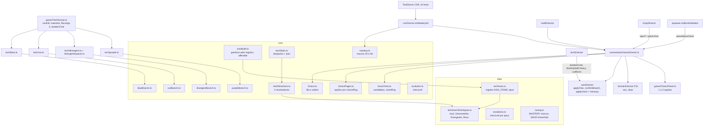

# Eixos das técnicas - Design

**Spec**: `.specs/features/eixos-das-tecnicas/spec.md` · **Plano**: `docs/plano-builds-e-habilidades.md` (linha F33 da
seção 6; seções 2.1, 2.3, 2.4, fim da 2.5, 2.7, 3.1 e 5.7) · **Base**: F29 `fundacao-de-poder`, F30 `vermelho-e-corpo`
(`.specs/features/vermelho-e-corpo/design.md`) e F31 `expansao-de-dominio` (design na branch
`docs/spec-expansao-de-dominio`)
**Status**: Draft, revisado (a Largura 58 do Roxo já está no RXO-04; o modelo do Divergente seguiu a recomendação deste design e está na spec, com a caixa do soco no eixo Alvos; a curva de build continua como decisão do usuário que trava tarefa, na tabela do `tasks.md`; a herança de pontos da União, RXO-12, entrou por decisão do diretor no lugar do risco "a União descarta todo o investimento")

Linhas citadas conferidas em 14/10 no código de `f17a6a8` (worktree `docs/spec-vermelho-e-corpo`), que ainda não tem a
F29, a F30 nem a F31. O que essas três criam ou trocam é citado pelo nome e pela interface dos designs delas: da F30,
`data/techAxes.ts`, `core/axisBuild.ts`, `core/techStats.ts` (`TechStats`, `TECH_GEOMETRY`), `Loadout.stats`/
`refundCooldown`, `core/shopDraw.ts`, `shopEligibility.ts`, `shopPreview.ts`, `shopPricing.ts`, `axisParam.ts`,
`scenes/test/axisDirector.ts`, `game/ChoicePanel.ts`, `game/axisSnapshot.ts`, `TechCaster.slotHeld`,
`game/tech/redFlight.ts`, `kokusenDamage`, `Hit.maxHpBonus`/`dealtDamage`; da F31, `chestRng`, `DomainState.raise()`,
`domainDirector.choicePages()`/`confirm()`/`bossPrize()`, a página `bauChefe`, `bossPrizePlan`,
`runDirector.bossRewardTarget()`, `AttackHitbox.rect` e `Projectile.width`. Essas linhas valem depois dos merges e são
reconferidas no começo de cada passo. Linhas efetivas contadas como o `max-lines` do `.oxlintrc.json` (sem linha em
branco e sem comentário).

**O que a F31 já entrega e a spec da F33 pede de novo.** O `chestRng` (BAU-02) já nasce na F31 (`run.ts`, sal
`0xa54ff53a`, usado pelo Baú do Véu): a F33 reaproveita o stream e só cria o `choiceRng`. A F31 também põe a página
`bauChefe` (2 opções: nível do Domínio ou o prêmio de técnica adiado) e o `bossPrizePlan`; o passo 6 da F33 tira as
duas junto com o `bossReward.ts`.

---

## Architecture Overview

A F33 não cria modelo novo: generaliza o da F30. O passo 0 troca todo `item === 'vermelho'` da F30 por uma consulta a um
registro (`AXIS_ITEMS` em `data/techAxes.ts`). Cada passo de técnica só registra a tabela dela, escreve o resolvedor do
`TechStats` e o ramo, e a loja, a carta, o preço, a trava, o painel, o debug e o snapshot a pegam sozinhos. As regras
de ramo e Despertar de cada técnica ficam num arquivo puro por técnica (`core/<técnica>Branch.ts`), no molde do
`core/redBranch.ts`. O painel entre rodadas sai do `shopDirector` para um `choiceDirector` (campo `choice` do
`BuildDirector`), com a fila pura em `core/choice.ts` e as opções em `core/choicePages.ts`. A maestria e o baú do chefe
viram fontes de página dessa fila.



Fluxo por quadro: igual ao da F30 e da F31. O `TechDirector.update` já passa o `slotHeld` ao `TechRunner` (F30); a F33
só repassa também ao Azul e ao Roxo, e lê três sinais novos que o `TechRunner` deixa no quadro: `awakenCast:<id>`
(banner do Despertar), `blueImplode:heavy` (tremida da Implosão 2+) e `cutRects` (os retângulos dos cortes do quadro,
para o Desmantelar do Rei apagar projétil). Fluxo da konbini: `shopDirector.openShop` → `VowPanel` (rodada de chefe) →
`build.choice.openIfPending()` → loja; enquanto `build.choice.open`, a loja não lê entrada. A compra da União na loja
chama `build.choice.openUnion(into, herdados)` (RXO-12), que reabre o painel na mesma visita só com as páginas
`heranca` e o ramo da técnica nova.

---

## Code Reuse Analysis

### Existing Components to Leverage

| Component | Location | How to Use |
| --- | --- | --- |
| `AxisBuild` (pontos, ramo, pendente, Despertar, `focusAxis`, `announce`, `resetItem`) | F30 `src/core/axisBuild.ts` | Passa a ler o registro; cada técnica entra só com a tabela (EIX-01, EIX-03) |
| `resolveTechStats` e o piso de 60% | F30 `src/core/techStats.ts` | O caminho antigo (`LEVEL_FACTOR`, −5 por nível) vira fallback até o passo 4 e some; o piso fica (EIX-02) |
| `TECH_GEOMETRY` | F30 `src/data/techniques.ts` | Base dos 4 resolvedores (aheadPx, margem, tique, ângulos, velocidade e altura do Roxo) |
| `Loadout.refundCooldown(slot, 0.3)` | F30 `src/core/loadout.ts` | Recarga 3 das quatro técnicas, num lugar só (EIX-04) |
| `dealtDamage(hit, maxHp, isBoss)` e `Hit.maxHpBonus` | F30 `src/core/hit.ts` | Todo componente proporcional dos Despertares e do Clivar (EIX-05) |
| `drawCards`, `axesFor`, `axisRng`, `chooseAxis` | F30 `src/core/shopDraw.ts`, `src/core/shop.ts` | A carta de 2 eixos das quatro técnicas (EIX-06) sem código novo de carta |
| `axisPointPrice`, `axisGate`, `inflate`, `cardCost` | F30 `src/core/shopPricing.ts` | Preço e trava das quatro técnicas (EIX-06.10) |
| `axisPreview` (linha `›Nome a→b`, `+ ramo`, `+ Despertar`) | F30 `src/core/shopPreview.ts` | Texto da carta e das opções da página `ponto`/`livre` (CHC-05) |
| `parseAxesParam` / `parseBranchParam` | F30 `src/core/axisParam.ts` | `axes=` e `ramo=` das quatro técnicas (EIX-07) |
| `axisDirector.applyAxis`, `confirmBranch`, `announce`, `snapshot` | F30 `src/scenes/test/axisDirector.ts` | Compra, ramo, banner e câmera lenta do Despertar e `build.<item>` (EIX-03, EIX-08) |
| `TechCaster.slotHeld` | F30 `src/game/TechCaster.ts` | Lapso e Massa (AZL-06, RXO-06), como o Contido |
| `ChoicePanel` (molde do `VowPanel`) | F30 `src/game/ChoicePanel.ts` | Vira página genérica de 1 a 3 opções (CHC-04, CHC-05, CHC-07) |
| `chestRng`, `DomainState.raise()`, `domainDirector.choicePages()`/`confirm()` | F31 `src/core/run.ts`, `src/core/domain.ts`, `scenes/test/domainDirector.ts` | Baú do chefe (BAU-02, BAU-06) e a página `veu` na fila nova |
| `AttackHitbox.open(..., maxTargets)` | `src/game/hitbox.ts:77` | O 1º impacto do Divergente com N alvos (DVG-02); a F31 dá o `rect` para escolher os mais perto |
| `Projectile` (`x`, `y`, `height`, `destroyNow`) e o `width` da F31 | `src/game/Projectile.ts:77-122` | Desmantelar do Rei apaga projétil e onda que tocam o corte (DSM-06) |
| `EnemyAI` com `windupAllowed` | `src/core/enemyAI.ts:39`, `:150` | A Âncora segura o comum sem mexer na IA: `windupAllowed: false` e `vx` zerado (AZL-08) |
| `BossAI` com o estado `rest` | `src/core/bossAI.ts:111-121` | A Âncora segura o chefe parando o relógio do `rest` (o único estado que começa ataque) |
| `EnemyBrain.receiveHit` com `knockdown` e dano 0 | `src/core/enemyBrain.ts:72-91` | A derrubada do fim do voo do Roxo 200% (RXO-07): golpe de técnica de dano 0 com `knockdown` entra em `ragdollStun` |
| `Mover` e `PurpleSphere` | `src/core/mover.ts`, `src/core/purple.ts` | Voo, Massa, Retorno e Eclipse reaproveitam o teste círculo-caixa de `purple.ts:62-71` |
| `expectedIncome` | `src/core/economy.ts:10` | Régua do `buildCurve` (EIX-12, RXO-11) |
| `RUN.bannerMs`, `Hud.banner` | `src/data/tuning.ts`, `src/game/Hud.ts` | Banner da maestria (MAE-04), sem crescer o `Hud.ts` |

### Integration Points

| System | Integration Method |
| --- | --- |
| Konbini | `shopDirector.openShop` chama `build.choice.openIfPending()` no lugar do `openChoiceOrShop()` da F30/F31; `updateShop` pergunta `build.choice.update(input)` e sai se o painel consumiu o quadro |
| Maestria | `TechRunner` chama `onCastHit({ slot, castId, tech, targetId, isBoss, killed })`; a `TestScene` (l.329) troca só o texto da lambda para `(hit) => this.runDirector.onMasteryHit(hit)`; o `runDirector` chama `mastery.registerHit` e, no marco, `build.choice.addFreePoint(tech)` |
| Chefe | `spawner.onBossDefeated` (`spawner.ts:168`): `upgradeText` sai do `clearedBanner`; uma linha chama `this.s.build.choice.queueBossChest()` |
| Reset da run | `build.reset()` já é chamado (`runDirector.ts:145`); ganha `choice.reset()`; `build.applyDebugAxes()` (F30) chama também `choice.applyDebug()` (`chest=1`) |
| Conjuração | `TechRunner.update` repassa o `slotHeld` ao `blue.update` e ao `purple.update`; o `currentCast` ganha `tech` (o `TechId` da conjuração) |
| Snapshot | `build.snapshot()` (F30) ganha `azul`, `corte`, `divergente`, `roxo`; `statsDirector.snapshotFields()` troca `choice: ui.choicePanel.debug()` por `choice: build.choice.snapshot()` (mesma linha) |

---

## Components

### `data/techAxes.ts` (muda no passo 0, F30 ~110 → ~125) e `data/techAxesTechniques.ts` (novo, ~150)

- **Passo 0**: o tipo `AxisItem` passa a `'vermelho' | 'corpo' | 'azul' | 'corte' | 'divergente' | 'roxo'`, e nasce o
  registro `AXIS_ITEMS: Partial<Record<AxisItem, ItemAxes>>` com `ItemAxes = { ids; names; branches: [a, b];
  awakenings: Record<BranchId, AwakeningId>; deadAxis?: Partial<Record<BranchId, AxisId>> }`. Só o Vermelho e o Corpo
  entram no passo 0 (CHC-01: smokes iguais); o `AXIS_NAMES`/`BRANCH_NAMES` da F30 vira campo do registro.
- **`techAxesTechniques.ts`**, uma tabela por técnica, entrando no passo dela (números da spec; ver a calibração):
  - `BLUE_AXES`: `radius [130,160,190,220]`, `pullSpeed [150,190,230,270]`, `lifeMs [1400,1800,2200,2600]`,
    `implosion [10,18,26,34]`, `tick [5,6,7,8]`, `cost [40,34,29,24]`, `cooldownMs [2500,2100,1800,1500]`,
    `knockdownFrom: 2`, `pullsElite: 3` (só dado até a F38); `BLUE_BRANCHES`: `andante { aheadPx 80, lifeMul 0.7,
    followSpeed 600 }`,
    `lapso { speed 200, maxPx 220, wallMarginPx 16 }`; `BLUE_AWAKENINGS`: `azulMaximo { implosionMul 3, pct }`,
    `ancora { holdMs 500, pct }`.
  - `CUT_AXES`: `cuts [3,4,5,6]`, `farPx [180,220,260,300]`, `heightPx [48,56,64,72]`, `cut [10,13,16,19]`,
    `intervalMs [60,45,35,25]`, `signMs [150,120,100,80]`, `cost [30,25,20,18]`, `cooldownMs [2500,2000,1600,1200]`;
    `CUT_BRANCHES`: `paraTras {}`, `clivar { pct: { enemy 0.02, boss 0.005 } }`; `CUT_AWAKENINGS`:
    `desmantelarDoRei { lastCutPct }`, `fenda { reachPx 120, maxChain 3, pct { enemy 0.03 } }`.
  - `DIVERGENT_AXES`: `second [18,24,30,36]`, `targets [1,2,2,3]`, `boxPx [26,30,34,36]` (largura da caixa do soco,
    borda de trás fixa), `zoneMs [8000,10000,12000,14000]`,
    `kokusenGain [30,38,46,54]`, `cost [20,17,14,12]`, `cooldownMs [1200,1000,850,700]`, `first 12`;
    `DIVERGENT_BRANCHES`: `eco { reachPx 48 }`, `concentrado { secondMul 2 }` com `deadAxis: { concentrado: 'alvos' }`;
    `DIVERGENT_AWAKENINGS`: `ecoNegro { pct enemy 0.03 }`, `impactoUnico { pct, unblockable: true, knockdown: true }` (`unblockable` nos dois impactos).
  - `PURPLE_AXES`: `radius [36,44,51,58]` (calibrado), `rangePx [288,300,310,320]`, `speed [180,210,240,270]` (no
    mesmo eixo Alcance), `signMs [300,240,195,150]`,
    `chargeMs [400,320,260,200]`, `hit [60,70,80,90]`, `cost [70,60,51,42]`, `cooldownMs [6000,5000,4200,3500]`;
    `PURPLE_BRANCHES`: `massa { holdMs 1000, radiusMul 1.6 }`, `retorno { backMul 0.5, maxTouches 2 }`;
    `PURPLE_AWAKENINGS`: `roxo200 { pct enemy 0.05 }`, `eclipse { pct }`.
  - `pct` sem número próprio usa `MAX_HP_PCT` da F30 (4% no comum, 1% no chefe).
- **Reuses**: molde e nomes da F30; `MAX_HP_PCT`, `AXIS_CAP`, `ITEM_POINT_CAP`, `BRANCH_LEVEL`, `AWAKEN_LEVEL`.

### `core/axisBuild.ts` (muda no passo 0, F30 ~110 → ~125)

- `has(item): boolean` (o item está no registro), `ids(item)` e o resto da F30 lendo do registro.
- `offerable(item, axis): boolean` = `canAdd(item, axis)` e o eixo não é o `deadAxis` do ramo escolhido (DVG-06). O
  `focusAxis` e o `axesFor` passam a usar `offerable`; os pontos já postos no eixo morto continuam no `total`
  (edge case do Concentrado). A trava por rodada não mora aqui: a loja usa o `axisGate` da F30 e as páginas de ponto
  usam o mesmo `axisGate` pelo total do item (`choicePages.ts`).
- `deadPoints(item, branch): number` (os pontos do eixo que o ramo anularia), para a linha `anula Alvos (n)` (CHC-04).
- `resetItem(item)` vale para qualquer item (a F30 só zerava o Vermelho): `Loadout.clear` chama com o id do slot.
- `pending` continua a fila de ramos pendentes; a ordem slot 0, slot 1, Corpo é decidida pelo `choice.ts`, não aqui.

### `core/techStats.ts` (muda, F31 ~92 → ~85) e `core/techResolvers.ts` (novo, ~150)

- `TechStats` ganha no topo `branch: BranchId | null`, `awakened: boolean` e `killRefund: number` (o passo 0 tira os
  três de dentro de `red`, onde a F30 os pôs) e os blocos `blue`, `cut`, `divergent`, `purple` crescem (ver "Data
  Models").
- `resolveTechStats` vira despacho: `RESOLVERS[id]` quando a técnica está no registro, senão a regra antiga (até o passo
  4, quando a regra antiga, o `LEVEL_FACTOR` e o −5 por nível saem). O piso `max(custo, ceil(0,6 × TECHNIQUES[id].cost))`
  continua aplicado por último, depois do `costMul` (PRC-05, EIX-02).
- `techResolvers.ts`: `resolveBlue`, `resolveCut`, `resolveDivergent`, `resolvePurple`, cada um lê a tabela pelos pontos,
  aplica `Math.round(base × damageMul × vowDamageMul)` na ordem de `loadout.ts:97` e preenche o bloco da técnica com o
  ramo e o Despertar já decididos (ex.: `blue.implosionKnockdown = implosao ≥ 2 || azulMaximo`). O Kokusen usa
  `D = DIVERGENT_AXES.second[pontos]` (DVG-04), sem `damageMul`, `vowDamageMul` nem o ×2 do Concentrado.

### `core/blueBranch.ts` (novo, ~70)

- `andantePoint(playerCenter, facing, aheadPx = 80): Vec2` e `andanteStep(orbX, targetX, dtMs, maxSpeed = 600): number`
  (anda para o ponto a no máximo `maxSpeed`; ao virar cruza os 160 px em ~270 ms, sem pulo; AZL-05).
- `class LapsoDrive` (`constructor(spawnX, castCenterX, dir, wallLimitX, heldAtSpawn)`, `update(dtMs, held): { x;
  stopped; justStopped }`): anda a 200 px/s enquanto `held`; para ao soltar, a 220 px do centro do player no início da
  conjuração ou a 16 px da parede, o que vier primeiro; com `heldAtSpawn` falso nasce parado e o 1º `update` devolve
  `justStopped` (a Âncora vale no toque rápido; AZL-06, AZL-08).
- `anchorTargets(center, radius, targets): number[]` (todo comum e o chefe dentro do raio no quadro da parada, AZL-08).

### `core/cutBranch.ts` (novo, ~45)

- `cutPlan(stats): { times: number[]; angles: number[]; mirrored: boolean[] }`: corte `i` em `i × intervalo`, ângulo
  `[20, −25, 70][i mod 3]`, e `mirrored[i] = paraTras && i % 2 === 1` (DSM-02, DSM-04).
- `fendaTarget(deadAt, livingEnemies, reachPx = 120, exclude: Set<number>): number | null` (o comum vivo mais perto que
  ainda não levou fenda) e `class FendaChain` (`open(): boolean` até `maxChain` 3 por conjuração; DSM-07).
- `rectsTouch(a, b)`: o mesmo `overlaps` de `cut.ts:14-16`, exportado para o Desmantelar do Rei.

### `core/divergentBranch.ts` (novo, ~60)

- `pickTargets(firstId, candidates: { id; distToPlayer }[], n): number[]` (o tocado sempre entra; os outros, dentro da
  caixa resolvida, pelo mais perto do player; o chefe conta como um; DVG-02). O alvo principal é o mais perto (`[0]`).
- `punchBox(boxPx, base = CROSS_HITBOX): HitboxShape` (largura resolvida, `offsetX` que mantém a borda de trás de hoje:
  `22 − 13 + boxPx / 2`; DVG-02).
- `echoTargets(center, enemies, reachPx = 48, exclude: Set<number>): number[]` (DVG-05).
- `divergentPlan(stats)`: `{ targets: 1 no Concentrado, senão o eixo; secondMul; echo; ecoNegro; impactoUnico }`.

### `core/purpleBranch.ts` (novo, ~110)

- `class PurpleFlight` (substitui o uso direto do `PurpleSphere` no adaptador): fases `hold` (Massa), `out`, `back`
  (Retorno) e `through` (Eclipse); `update(dtMs, held, playerCenter, targets): { touches: { id; n: 1 | 2 }[]; ended;
  radius; x; y }`. `out` termina no alcance resolvido a partir do nascimento, nunca além de 320 px (RXO-05); `hold`
  cresce o raio em linha reta até `1,6 ×` em 1000 ms e sai ao soltar ou aos 1000 ms, com `fullHold = true` só aos
  1000 ms (RXO-06, RXO-07); `back` mira o centro atual do player a cada quadro e some ao tocá-lo ou depois de mais um
  alcance (RXO-08); `through` atravessa o player e segue até o alcance resolvido do outro lado (RXO-09). No máximo 2
  toques por alvo por conjuração, o 2º só na volta.
- **Reuses**: o teste círculo-caixa de `PurpleSphere.update` (`purple.ts:62-71`), extraído para uma função.

### `core/mastery.ts` (reescrito, 45 → ~58) e `core/masteryBar.ts` (4 → ~8)

- `registerHit(slot, tech, castId, targetId, { isBoss, killed }): { mark: 25 | 60 | null }`: `+castPoints` uma vez por
  `(slot, castId)` no 1º acerto, `+bossPoints` uma vez por conjuração no 1º acerto no chefe, `+killPoints` por comum
  morto (MAE-01). Marco é o cruzamento `antes < m ≤ depois` de um `m` de `MASTERY.marks` ainda não dado àquele `TechId`
  (MAE-02); os dados ficam num `Map<TechId, Set<number>>` que só o `reset()` limpa (MAE-06).
- `threshold(slot): number | null` = o próximo marco acima dos pontos, `null` a partir do 60 (MAE-07);
  `resetSlot(slot)` zera os pontos e as conjurações vistas do slot, sem tocar nos marcos dados; `setPoints` fica.
- `masteryBarWidth(slotW, points, marks = MASTERY.marks): number | null` (MAE-05).
- Nenhuma chamada a `Loadout.upgrade` (MAE-03).

### `core/choice.ts` (novo, ~85; ~92 com o `openNow` do passo 5)

- `type ChoiceRequest = { kind: 'ramo'; item: AxisItem } | { kind: 'ponto'; item: TechId } | { kind: 'livre' } |
  { kind: 'despertar'; item: AxisItem } | { kind: 'heranca'; item: TechId } | { kind: 'veu' } | { kind: 'bau' }`
  (`heranca` nasce no passo 5, RXO-12; no passo 0 também `'bauChefe'` da F31,
  que sai no passo 6).
- `class ChoiceQueue`: `add(req)` (fora do painel, por ordem de chegada; ignora repetido de `ramo`, `veu` e `bau`),
  `open(rank)` (ordena por `(rank(req), chegada)` e abre), `current`, `advance()`, `insertNext(reqs)` (logo depois do
  atual, CHC-03), `pending`, `isOpen`, `reset()` (CHC-11).
- `choiceRank(req, slotOf)`: no passo 0 a ordem da F31 (`bauChefe`, `veu`, ramos), para os smokes não mudarem; no passo 5
  a do CHC-02, que é a mesma com os pontos no fim: `bau` (`bauChefe` até o passo 6) 0, `veu` 1, ramo 10 + (slot 0 = 0,
  slot 1 = 1, Corpo = 2), `ponto` 20. A União do baú vem antes de qualquer ramo ou ponto do mesmo painel.
- `defer(req)`: tira a página atual da vez sem confirmar e a guarda para o próximo `open` (CHC-08, trava da PRC-04).
- `openNow(reqs)` (passo 5, RXO-12): abre o painel só com essas páginas, na ordem dada, para a União comprada na loja;
  as páginas adiadas continuam na fila para a próxima visita. A `heranca` só entra por `openNow` (loja) ou por
  `insertNext` (baú), nunca pelo `add`, então não tem rank.

### `core/choicePages.ts` (novo no passo 5, ~108 com a `heranca`)

- `pointOptions(item, axes, rng, max = 3, lock = true): AxisId[]` (eixo-foco primeiro, os outros `offerable` sorteados pelo `rng`; `lock: false` na `heranca`, RXO-12,
  CHC-05); `openPointOptions(owned, focusItem, axes, rng): { item; axis }[]` (o eixo-foco do item-foco e 2 pares
  distintos sorteados, CHC-06).
- Oferecível nas páginas `ponto`/`livre` = `offerable` (teto e eixo morto) e `axisGate(total do item + 1, round)` da F30
  (1º e 2º ponto na r2, 3º e 4º na r4, 5º na r6). O eixo-foco só abre a lista quando é oferecível.
- `buildPage(req, ctx): { page } | { skip: true } | { defer: true }`: monta a página com os textos (linha de eixo do
  `axisPreview`, nome do ramo, a linha do Despertar que ele abre e `anula Alvos (n)` quando o ramo anula pontos, nome e
  efeito do Despertar, nome das opções do baú); `skip` quando a página deve ser pulada (CHC-08: sem eixo abaixo do teto,
  ramo que já não está pendente); `defer` quando há eixo abaixo do teto mas todos travados pela rodada.
- Página `ponto` de técnica que a União tirou do slot: o `ctx.unionOf` (`azul` → `roxo`, `vermelho` → `roxo`, gravado
  pelo `choiceDirector` ao confirmar a União) troca o item antes de montar (CHC-08).
- Página `heranca` (RXO-12): monta como a `ponto` com `lock: false`, título `Herança: <técnica>` e as linhas de eixo do
  `axisPreview`; nunca devolve `defer`; `skip` só sem eixo abaixo do teto (não acontece com até 3 pontos em 6 eixos,
  mas a regra é a mesma da `ponto`). A opção `uniao` do baú leva a linha `herda <n> pontos`, com o `n` do
  `unionInheritance`.
- Puro: recebe `{ loadout, round, rng, chest: ChestOption[] | null, veil: ChoicePage | null, unionOf }`.

### `core/bossChest.ts` (novo no passo 6, ~45)

- `type ChestOption = { kind: 'uniao'; into: TechId } | { kind: 'pontos' } | { kind: 'dominio' }` e
  `chestOptionId(o)` (`uniao:roxo`, `pontos`, `dominio`; BAU-08).
- `chestCandidates({ readyUnions, hasOpenAxis, domainLevel }): ChestOption[]` (BAU-01; "talento" fica para a F35).
- `drawChest(candidates, rng): ChestOption[]`: até 3, todos numa ordem sorteada; mais de 3, 3 distintos (BAU-01).

### `core/evolution.ts` (muda, 16 → ~19) e `data/evolutions.ts` (10 → ~14)

- `Recipe.from: readonly [RecipePiece, RecipePiece]` com `RecipePiece = { id: TechId; minLevel: number }`; o Roxo fica
  `[{ id: 'azul', minLevel: 1 }, { id: 'vermelho', minLevel: 4 }]` (RXO-01). `EVOLUTION_LEVEL` sai.
- `recipeReady` = toda peça equipada com `levelOf(id) ≥ minLevel`; `evolve` usa `from[0].id` para o slot (RXO-02).
- `shopEligibility.ts` (a linha de `shop.ts:33` que a F30 levou para lá) passa a `r.from.some((p) => p.id === ...)`.
- **Passo 5 (RXO-12)**: `unionInheritance(pointsA, pointsB, branch: BranchId | null): number` =
  `min(ceil((pointsA + pointsB) / 2), UNION_INHERIT_CAP, branch === null ? AWAKEN_LEVEL − 2 : UNION_INHERIT_CAP)`, com
  `UNION_INHERIT_CAP = 4` em `data/evolutions.ts` e o `AWAKEN_LEVEL` (5) da F30: sem ramo, no máximo 3 pontos (Nv 4), um
  ponto abaixo do Despertar. Quem chama passa o `axes.branch(into)` real lido depois do `evolve`, que é sempre `null`
  (RXO-02), então toda União herda no máximo 3; o ramo fica no parâmetro para a regra estar escrita inteira, sem `if`
  por técnica, e o teste prova o 4 com ramo num caso sintético. Os pontos das peças (`axes.total(p.id)` de cada
  `from`) são lidos **antes** do `evolve`, porque o `Loadout.clear` chama o `axes.resetItem`.

### `scenes/test/choiceDirector.ts` (novo, ~150 com a `heranca`, campo `choice` do `BuildDirector`)

- **Purpose**: dono do painel entre rodadas (CHC-01 a CHC-11): fila, entrada, despacho e snapshot.
- **Interfaces**:
  - `openIfPending(): boolean` (junta os ramos pendentes do `axes.pending`, a página do Véu da F31 e as fontes já
    enfileiradas; ordena; mostra a 1ª página que não for pulada; `false` sem página)
  - `update(input: ShopInput): boolean` (`A`/`D` andam entre as opções; `Enter` confirma; `true` enquanto aberto)
  - `addFreePoint(tech: TechId)` (MAE-02), `queueBossChest()` (BAU-03, BAU-07), `applyDebug()` (`chest=1`, BAU-08)
  - `openUnion(into: TechId, inherited: number): boolean` (passo 5, RXO-12): com `inherited ≥ 1`, `queue.openNow`
    com `inherited` × `heranca` e mostra a 1ª; `false` com 0. Chamado pela loja depois da compra da União
  - `get open(): boolean`, `reset()`, `snapshot(): ChoiceSnapshot`
  - privado `confirm(req, index): ChoiceRequest[]`: `ramo` → `axes.confirmBranch` (com Despertar ligado, devolve
    `despertar`); `ponto`/`livre` → `axes.applyFree(item, axis)` (com `branchPending` devolve `ramo`, com `awakened`
    devolve `despertar`); `despertar` → nada; `veu` → `domain.confirm('veu', i)` (F31); `bau` → União pelo
    `axes.applyUnion` (grava as duas peças em `unionOf` e devolve `inherited` × `heranca`, inseridas logo depois do
    baú), `pontos` devolve 2 × `livre`, `dominio` → `domain.state.raise()`; `heranca` → `axes.applyFree(item, axis)`,
    e o `ramo` que o 1º ponto deixa pendente só volta na última página do bloco (quando a próxima da fila não é
    `heranca` do mesmo item), nunca entre duas; com no máximo 3 herdados, a `heranca` nunca devolve `despertar`; cada
    confirmação empurra `choice:<kind>:<idDaOpção>` nos eventos de debug (`choice:heranca:<eixo>`).
  - `defer` do `buildPage` → `queue.defer(req)`: a página fica na fila para a próxima visita (evento
    `choice:defer:<kind>`).
- **Dependencies**: `ChoiceQueue`, `buildPage`, `drawChest`, `run.choiceRng`, `run.chestRng`, `ui.choicePanel`,
  `build.axes`, `build.domain`, `loadout`.

### `scenes/test/axisDirector.ts` (muda, F30 ~110 → ~125)

- Sai `choicePages()` (vai ao `choiceDirector` no passo 0); fica `confirmBranch(item, option): { awakened }`.
- Novos: `applyFree(item, axis): AddResult` (ponto sem custo e sem trava, CHC-05), `applyUnion(into): { ok: false } |
  { ok: true; inherited: number }` (o que o `applyEvolution` do `shopDirector.ts:64-71` faz hoje: `evolve`,
  `mastery.resetSlot` nos dois slots, evento `evolve:<id>`; mais a herança do RXO-12, que a T82 põe no `applyEvolution`
  no passo 5 e a T76 move para cá no passo 6: lê `axes.total` das duas peças antes do `evolve` e devolve o
  `unionInheritance`; chamado pela loja e pelo baú, BAU-04).
- `snapshot()` passa a montar `build.<item>` para todo item do registro, pelo `techBuildSnapshot(id, loadout)` de
  `game/axisSnapshot.ts` (EIX-08).
- `announce(item)` fica; quem chama passa a ser o `techDirector` lendo `awakenCast:<id>` (qualquer técnica).

### `game/ChoicePanel.ts` (muda, F31 ~98 → ~125)

- `ChoicePage = { kind: ChoiceKind; item: ChoiceItem | null; options: readonly ChoiceOption[] }` com 1 a 3 opções e
  `ChoiceOption = { id; title; line }` (a F31 já pôs `title` e `line`). `show(page)`, `select(index)`, `hide()`, `open`,
  `debug()`. Três cartas no máximo, centradas; a página `despertar` tem uma carta só e a dica "Enter".
- Continua no `uiLayer` (AD-003), mesma profundidade e cores do `VowPanel`.

### Adaptadores das técnicas

- **`game/tech/shared.ts`**: `CastRef` ganha `tech: TechId`; `TechTarget` ganha `hold?(ms)`; `TechContext.masteryHit`
  vira `castHit(cast, target)`.
- **`game/TechRunner.ts`**: `castHit` genérico: monta `{ slot, castId, tech, targetId, isBoss, killed }` (o `killed` é
  `!isBoss && target.isDead?.()`, lido logo depois do `receiveHit`), chama `onCastHit` e, com `stats(tech).killRefund
  > 0` e `killed`, `loadout.refundCooldown(slot, killRefund)` (EIX-04; o reembolso do `redFlight` da F30 vem para cá no
  passo 0); emite `awakenCast:<id>` no `techCast:<id>` com o Despertar ligado (o do `red.ts` vem para cá); repassa o
  `slotHeld` ao Azul e ao Roxo; expõe `cutRects` do quadro.
- **`game/tech/blue.ts`** (117 → ~165): Andante move o orbe a cada quadro pelo `andanteStep` (`BlueOrbState.setPosition`), Lapso pelo
  `LapsoDrive` (consulta de parede até `maxPx + margem`), Âncora no `justStopped` (`hold(500)` em comum e chefe e o
  acerto proporcional de dano 0 com `maxHpBonus`), Azul Máximo e a Implosão 2+ (`knockdown` nos comuns e o evento
  `blueImplode:heavy`, que o `techDirector` troca por `fx.shake()`). Os tiques continuam `chip` (F29).
- **`game/tech/cut.ts`** (70 → ~115): agenda do `cutPlan`; retângulo espelhado no Para Trás; `maxHpBonus` do Clivar por
  corte; o último corte do Rei com o `pct` dele e o retângulo de cada corte em `cutRects`; Fenda no abate por corte ou
  por fenda (`band: 'micro'`, dano do corte + `maxHpBonus` de 3%, `FendaChain` até 3 por conjuração, cada comum uma vez).
- **`game/tech/divergent.ts`** (F30 ~203 → ~185) e **`game/tech/divergentImpacts.ts`** (novo, ~130): o `divergent.ts`
  fica com a hitbox (aberta com `punchBox(stats.divergent.boxPx)` e `maxTargets` = alvos resolvidos; no 1º toque escolhe
  os N pelo `pickTargets` sobre o `hitbox.rect` da F31), a espera, o anel e a tentativa de Kokusen no alvo principal. O `divergentImpacts.ts` resolve no
  fim da espera o 2º impacto de cada alvo vivo (×2 no Concentrado; no Impacto Único o `pct`, `unblockable` e `knockdown`
  no comum; o `divergent.ts` põe o `unblockable` também no 1º impacto), o anel do Eco (`micro`, uma
  vez por inimigo, nunca em quem leva o próprio 2º impacto) e o Kokusen (`kokusen.land(energy, gain, zoneMs)` uma vez;
  Eco Negro troca o dano do anel pelo do Kokusen com 3%).
- **`game/tech/purple.ts`** (F30 ~96 → ~150): carga como hoje; soltura cria o `PurpleFlight` com o stat; Massa e Roxo
  200% leem o `slotHeld[cast.slot]`; o arrasto do Roxo 200% é `setPull` na direção do centro da esfera a cada quadro
  (chefe nunca) e, no fim do voo, um acerto de dano 0 com `knockdown` (RXO-07); o 2º toque do Retorno sai com 50% e o do
  Eclipse com o `pct`.
- **`game/Enemy.ts`** (+8) e **`game/Boss.ts`** (+7): `hold(ms)`. No comum, `heldMs` no contexto (`enemy/context.ts`):
  enquanto `> 0`, o `gate` passa `windupAllowed: false` e o `vx` da saída da IA vira 0 (o preparo e o golpe já em
  curso seguem). No chefe, `BossAIObservation.held` faz o `rest` não descontar o relógio (`bossAI.ts:111-121`, +2); o
  `windup` e os ataques em curso seguem (AZL-08).

### Vistas (EIX-11)

A F30 já mede o halo e a distorção do `BlueOrb`, a linha do `CutFx` e a esfera do `PurpleOrb` pelo stat (T7 a T9). A
F33 acrescenta o que ainda tem número solto ou forma nova:

- `BlueOrbFx.debug(): { radius }` (o raio que o adaptador passou, para o smoke; L-043).
- `CutFx.cut(center, dir, angle, rect)`: a linha centrada no retângulo resolvido de cada corte, inclusive o espelhado;
  `lastRect` no debug.
- `DivergentFx.echoRing(x, y, radiusPx)` com o `echoPx` do stat (hoje não existe anel de 48 px) e o anel de aproximação
  continua no alvo principal.
- `PurpleOrbFx.flight(x, y, ageMs, radius)`: o raio por quadro (a Massa cresce); `debug(): { radius }`.

### `game/axisSnapshot.ts` (muda, F30 ~30 → ~60)

- `TechBuildSnapshot<A, S>` genérico e as quatro formas (ver "Data Models"); `techBuildSnapshot(id, loadout)`;
  `ChoiceSnapshot` do CHC-10 (passo 5).

### Mudanças em arquivos existentes (por passo)

**Passo 0 (refatoração, smokes iguais; CHC-01)**

| Arquivo | Linha | Mudança |
| --- | --- | --- |
| `src/data/techAxes.ts` (F30) | tipos, nomes | `AxisItem` com 6 ids; `AXIS_ITEMS` com Vermelho e Corpo; `AXIS_NAMES`/`BRANCH_NAMES` viram campos |
| `src/core/axisBuild.ts` (F30) | todo | lê o registro; `has`, `ids`, `offerable`; `resetItem` genérico |
| `src/core/loadout.ts` (F30) | `levelOf`, `slotsView`, `equip`, `clear`, `upgrade` | `id === 'vermelho'` vira `axes.has(id)`; `clear` chama `axes.resetItem(id)`; `upgrade` dá o ponto no eixo-foco de todo item do registro (VRM-19 generalizada, EIX-01.4), para a maestria e o prêmio do chefe não subirem o nível antigo das técnicas que entram nos passos 1 a 4 |
| `src/core/techStats.ts` (F30) | `TechStats`, `resolveTechStats` | `branch`, `awakened`, `killRefund` no topo; despacho `RESOLVERS` (só o Vermelho nele) |
| `src/core/shopEligibility.ts`, `shopDraw.ts`, `shopPreview.ts`, `shopPricing.ts`, `axisParam.ts` (F30) | onde testam o Vermelho | `axes.has(item)` / item do registro; `axesFor` usa `offerable` |
| `src/game/tech/shared.ts` | 19-40 | `CastRef.tech`; `castHit` |
| `src/game/TechRunner.ts` | 56, 60-71, 108-110 | `castHit` genérico (maestria com a assinatura de hoje, reembolso, `awakenCast`) |
| `src/game/tech/red.ts`, `redFlight.ts` (F30) | reembolso, `awakenCast` | saem (vão ao `TechRunner`) |
| `src/game/tech/blue.ts`, `cut.ts`, `divergent.ts`, `purple.ts` | `masteryHit` | `castHit` (só o nome) |
| `src/game/EnergyHud.ts` (F30) | borda do Despertar | `loadout.stats(s.id).awakened` no lugar do teste do Vermelho |
| `src/game/ChoicePanel.ts` (F30/F31) | todo | página genérica de 1 a 3 opções; `debug()` mantém a forma da F31 até o passo 5 |
| `src/core/choice.ts` (novo) | — | fila e `choiceRank` com a ordem da F31 |
| `src/scenes/test/choiceDirector.ts` (novo) | — | recebe `openChoiceOrShop`/`updateChoicePanel` do `shopDirector` |
| `src/scenes/test/shopDirector.ts` (F31) | `openShop`, `updateShop`, `updateVowPanel` | perguntam ao `build.choice`; saem `openChoiceOrShop` e `updateChoicePanel` |
| `src/scenes/test/buildDirector.ts` (F31) | campos, `reset`, `applyDebugAxes` | `readonly choice = new ChoiceDirector(s)`; `choice.reset()` |
| `src/scenes/test/axisDirector.ts` (F30) | `choicePages` | sai; `confirmBranch` devolve `{ awakened }` |
| `src/scenes/test/statsDirector.ts` (F29/F30) | `snapshotFields` | `choice: this.s.build.choice.snapshot()` (mesma linha) |
| `src/scenes/test/techDirector.ts` (F30) | eventos | `awakenCast:<id>` → `build.axes.announce(id)` |
| `tests/core/axisBuild.test.ts`, `tests/game/choicePanel.test.ts` (F30) | — | registro, `offerable` sem ramo; 1 a 3 opções |
| `tests/core/choice.test.ts` (novo) | — | ordem da F31, inserção, pulo, reset |

`TestScene`: 0. Smokes: `shop-axes`, `shop`, `shop-progress`, `run-loop`, `red-axes`, `cursed-body`, `evolution`,
`vows`, `domain` (F31), iguais.

**Passo 1 (Azul; AZL-01 a AZL-09, EIX-* no Azul)**

| Arquivo | Linha | Mudança |
| --- | --- | --- |
| `src/data/techniques.ts` | 53-65 | Azul `cost 40`, `cooldownMs 2500` (AZL-01) |
| `src/data/techAxesTechniques.ts` (novo) | — | `BLUE_*`; registro do Azul em `techAxes.ts` |
| `src/core/techResolvers.ts` (novo) | — | `resolveBlue` |
| `src/core/blueOrb.ts` (F30) | 45-58, 77-88 | `setPosition`; tique e implosão do stat; `lifeMs` do stat (Andante ×0,7) |
| `src/core/blueBranch.ts` (novo) | — | ver acima |
| `src/game/tech/blue.ts` | 42-113, 115-141 | Andante, Lapso, Âncora, Máximo, Implosão 2+ |
| `src/game/TechRunner.ts` | 113 | `blue.update(..., slotHeld)` |
| `src/game/Enemy.ts`, `enemy/context.ts` | 131, 357-386 | `heldMs`, `hold(ms)` |
| `src/game/Boss.ts`, `src/core/bossAI.ts` | 212-255; 15-23, 111-121 | `hold(ms)`, `held` |
| `src/game/techFx/BlueOrb.ts` | — | `debug(): { radius }` |
| `src/game/tech/blue.ts` | 35-40 | `snapshot` ganha `radius` (do `BlueOrbFx.debug`) |
| `src/game/axisSnapshot.ts`, `src/game/debugApi.ts` | `build`, `techObjects` | `build.azul`; `radius` na entrada `blue` |
| `src/scenes/test/techDirector.ts` | eventos | `blueImplode:heavy` → `this.s.fx.shake()` |
| `src/data/shop.ts` | 135-146 | Azul `maxLevel 6` |
| `scripts/smoke/evolution.smoke.mjs` | 35-37 | ponte: `tech=azul,vermelho&axes=azul.gravidade:2,vermelho.potencia:2` (o Azul precisa do Nv 3 até o passo 4) |
| `scripts/smoke/shop-progress.smoke.mjs` | trecho ECN-05/08 (F30) | a carta do Azul vira carta de eixo: `Nv 2/6`, `axes` com o foco, custo `inflate(12, 2)` = 13, `buy:azul:13` |
| `scripts/smoke/techniques.smoke.mjs`, `tech.smoke.mjs` | Azul | custo 40 e recarga 2500 onde o smoke lê |
| `scripts/smoke/tech-axes.smoke.mjs` (novo) | — | cenários do Azul |

**Passo 2 (Desmantelar; DSM-01 a DSM-08)**

| Arquivo | Linha | Mudança |
| --- | --- | --- |
| `src/data/techAxesTechniques.ts`, `src/core/techResolvers.ts` | — | `CUT_*`, `resolveCut` |
| `src/core/cut.ts` (F30) | 28-32, 56-73 | `CutSchedule` pelo `cutPlan` (n cortes, intervalo); `targetsHit(center, facing, i)` com o espelho |
| `src/core/cutBranch.ts` (novo) | — | ver acima |
| `src/game/tech/cut.ts` | 24-71 | agenda, espelho, Clivar, Rei, Fenda, `cutRects` |
| `src/game/techFx/CutFx.ts` (F31) | 27-39 | `cut(center, dir, angle, rect)`, `lastRect` |
| `src/scenes/test/techDirector.ts` | depois do `techRunner.update` | `projectiles` que tocam um `cutRects` com o Rei → `destroyNow()` |
| `src/data/shop.ts` | 128-137 | Desmantelar `maxLevel 6` |
| `scripts/smoke/tech-axes.smoke.mjs` | — | cenários do Desmantelar |

**Passo 3 (Divergente; DVG-01 a DVG-09)**

| Arquivo | Linha | Mudança |
| --- | --- | --- |
| `src/data/techAxesTechniques.ts`, `src/core/techResolvers.ts` | — | `DIVERGENT_*`, `resolveDivergent`; `kokusenDamage` com `D` do eixo (DVG-04) |
| `src/core/divergent.ts` | 7-60 | `firstImpact(ids: number[])`, `markDead(id)`; `update` devolve os vivos no fim do atraso; o principal segue em `targetId` |
| `src/core/divergentBranch.ts` (novo) | — | ver acima |
| `src/core/kokusen.ts` (F30) | 79-83 | `land(energy, gain, zoneMs)` (DVG-03) |
| `src/game/tech/divergent.ts` | 163-258 | hitbox com `maxTargets`, `pickTargets`; resolução vai ao `divergentImpacts.ts` |
| `src/game/tech/divergentImpacts.ts` (novo) | — | ver acima |
| `src/game/techFx/DivergentFx.ts` | — | `echoRing` |
| `src/data/shop.ts` | 119-128 | Divergente `maxLevel 6` |
| `scripts/smoke/kokusen.smoke.mjs` | energia e zona | ganho e zona pelo eixo onde o smoke lê (sem cenário novo: o arquivo tem 361 linhas; cenário novo vai ao `tech-axes`) |

**Passo 4 (Roxo e a União; RXO-01 a RXO-11, EIX-01.3)**

| Arquivo | Linha | Mudança |
| --- | --- | --- |
| `src/data/evolutions.ts`, `src/core/evolution.ts` | todo | `minLevel`; sai `EVOLUTION_LEVEL` |
| `src/data/techAxesTechniques.ts`, `src/core/techResolvers.ts` | — | `PURPLE_*`, `resolvePurple` |
| `src/core/purple.ts` (F30) | 2-11 | `PURPLE.rangePx 288` (a vida sai do alcance); o teste círculo-caixa vira função exportada |
| `src/core/purpleBranch.ts` (novo) | — | `PurpleFlight` |
| `src/game/tech/purple.ts` | 47-109 | `PurpleFlight`, Massa, Roxo 200%, Retorno, Eclipse |
| `src/game/TechRunner.ts` | 115 | `purple.update(..., slotHeld)` |
| `src/game/techFx/PurpleOrb.ts` | 41-60 | raio por quadro; `debug(): { radius }` |
| `src/data/shop.ts` | fim de `TECHNIQUE_SHOP_ENTRIES` | entrada `roxo` (`kind 'technique'`, `maxLevel 6`), nunca técnica nova |
| `src/core/shopEligibility.ts` (F30) | `techniqueEligible`, `evolutionEligible` | recusa o Roxo como técnica nova; `from.some(p => p.id …)` |
| `src/core/techStats.ts` | fallback | sai a regra antiga (`LEVEL_FACTOR`, −5 por nível) |
| `src/data/techniques.ts` | 94-95 | sai `LEVEL_FACTOR` |
| `src/core/shopPricing.ts`, `src/data/shop.ts` (F30) | `techLevelGate`, preço de nível | saem (EIX-06.10) |
| `src/core/shopPreview.ts` (F30) | `techniquePreview`, `factorText` | saem (CRD-10 acaba) |
| `scripts/smoke/evolution.smoke.mjs` | 35-54 | `tech=azul,vermelho&axes=vermelho.potencia:3` (RXO-01) |
| `.specs/STATE.md` | Decisions | AD-026 e AD-027 (ver "Tech Decisions") |

Fim do passo 4: `grep -rnE "LEVEL_FACTOR|EVOLUTION_LEVEL|techGate|techLevelGate" src` vazio (EIX-01.3).

**Passo 5 (painel completo e maestria; CHC-02 a CHC-11, MAE-01 a MAE-07; RXO-12 na loja)**

| Arquivo | Linha | Mudança |
| --- | --- | --- |
| `src/data/tuning.ts` | 306-328 | `SHOP.choiceSalt`; `MASTERY = { marks: [25, 60], castPoints: 1, bossPoints: 3, killPoints: 1 }` |
| `src/core/run.ts` (F31) | 59-68, 133-179, 296-308 | `choiceRng` (campo, getter, `new Rng(seed ^ SHOP.choiceSalt)`) |
| `src/core/mastery.ts`, `masteryBar.ts` | todo | ver acima |
| `src/core/choice.ts` | `choiceRank`, `defer` | ordem do CHC-02 (a da F31 com os pontos no fim); `defer` |
| `src/core/choicePages.ts` (novo) | — | ver acima |
| `src/game/TechRunner.ts` | 56 | `onCastHit(hit: CastHit)` |
| `src/scenes/TestScene.ts` | 329 | `(hit) => this.runDirector.onMasteryHit(hit),` (só o texto; o comentário da l.328 cita MAE-01) |
| `src/scenes/test/runDirector.ts` (F31) | 182-194 | `onMasteryHit(hit)`: `registerHit`; no marco, banner `"{nome}: maestria {m}!"` e `build.choice.addFreePoint(tech)` |
| `src/scenes/test/shopDirector.ts` | `applyTechnique` | `mastery.resetSlot` continua ao equipar (MAE-06) |
| `src/game/EnergyHud.ts` | 181 | `masteryBarWidth(ICON_SIZE, mastery.points(i as 0 \| 1))` |
| `src/scenes/test/snapshot.ts` | 221 | `threshold: this.s.mastery.threshold(slot)` (só a expressão; a função está na exceção de tamanho e não cresce) |
| `src/scenes/test/choiceDirector.ts` | — | páginas `ponto`, `livre`, `despertar`, `heranca`; `openUnion`; `choiceRng`; snapshot do CHC-10 |
| `src/core/evolution.ts`, `src/data/evolutions.ts` | fim | `unionInheritance`, `UNION_INHERIT_CAP = 4` (RXO-12) |
| `src/core/choice.ts`, `src/core/choicePages.ts` | — | `heranca`, `openNow`, `pointOptions(..., lock)` (RXO-12) |
| `src/scenes/test/shopDirector.ts` | `applyEvolution` (64-71) | lê `axes.total` das peças antes do `evolve` e chama `build.choice.openUnion(into, herdados)` (RXO-12) |
| `scripts/smoke/evolution.smoke.mjs` | compra da carta 0 | a compra abre 2 páginas `heranca` e depois o ramo do Roxo; o cenário de 7 pontos nas peças dá 3 (RXO-12) |
| `src/game/ChoicePanel.ts`, `src/game/axisSnapshot.ts`, `src/game/debugApi.ts` | `debug`, tipos | `{ open, page: { kind, item, options: ids, selected }, pending }` |
| `scripts/smoke/shop-progress.smoke.mjs` | 70-142 | trecho da maestria: `mastery=24` → um acerto dá 25, banner `maestria 25!`, nível continua 1, barra pelo marco (MAE-02, MAE-04, MAE-05) |
| `scripts/smoke/choice-panel.smoke.mjs` (novo) | — | ver "Testes e smokes" |

**Passo 6 (baú do chefe; BAU-01 a BAU-08; RXO-12 no baú)**

| Arquivo | Linha | Mudança |
| --- | --- | --- |
| `src/core/bossChest.ts` (novo) | — | ver acima |
| `src/core/bossReward.ts` (F31) | todo | sai (com o `bossPrizePlan` da F31) |
| `src/scenes/test/runDirector.ts` (F31) | 1, 15-16, 26, 196-205, 234-240 | saem `bossRewardUpgrade`, `bossRewardTarget` (F31), `BOSS_UPGRADE_BANNER_MS` e o `upgradeText` do `clearedBanner` |
| `src/scenes/test/spawner.ts` | 165-169 | `clearedBanner` sem `upgradeText`; `this.s.build.choice.queueBossChest()` |
| `src/scenes/test/domainDirector.ts` (F31) | `bossPrize`, `confirm('bauChefe')`, `choicePages` | saem os do `bauChefe`; `choicePages` só devolve o `veu` |
| `src/core/choice.ts`, `choiceDirector.ts`, `choicePages.ts` | `bauChefe` | vira `bau` com as opções do `drawChest`; a `uniao` insere o bloco `heranca` logo depois e leva a linha `herda <n> pontos` (RXO-12) |
| `src/scenes/test/axisDirector.ts`, `shopDirector.ts` | `applyUnion`, `applyEvolution` | a União e a herança passam ao `applyUnion` (T76); a loja só repassa o `inherited` ao `openUnion` |
| `scripts/smoke/boss-punish.smoke.mjs` | 233-262 | a vitória não sobe o Vermelho nem mostra banner de prêmio; o baú fica pendente (`choice.pending ≥ 1` antes da konbini) (BAU-03) |
| `scripts/smoke/domain.smoke.mjs` (F31) | cenário do `bauChefe` | vira a página `bau` com a opção `dominio` (BAU-06) |
| `scripts/smoke/boss-chest.smoke.mjs` (novo) | — | ver "Testes e smokes" |

`TestScene`: 0 em todos os passos (a l.329 só troca o texto no passo 5).

---

## Data Models

```typescript
// data/techAxes.ts (passo 0)
export type AxisItem = 'vermelho' | 'corpo' | 'azul' | 'corte' | 'divergente' | 'roxo';
export type BlueAxisId = 'gravidade' | 'puxao' | 'duracao' | 'implosao' | 'eficiencia' | 'recarga';
export type CutAxisId = 'cortes' | 'alcance' | 'afiacao' | 'cadencia' | 'eficiencia' | 'recarga';
export type DivergentAxisId = 'segundo' | 'alvos' | 'zona' | 'energia' | 'eficiencia' | 'recarga';
export type PurpleAxisId = 'largura' | 'alcance' | 'carga' | 'potencia' | 'eficiencia' | 'recarga';
export type AxisId = RedAxisId | BodyAxisId | BlueAxisId | CutAxisId | DivergentAxisId | PurpleAxisId;
export type BranchId = 'ricochete' | 'contido' | 'cadencia' | 'ondaDoPunho'
  | 'andante' | 'lapso' | 'paraTras' | 'clivar' | 'eco' | 'concentrado' | 'massa' | 'retorno';
export type AwakeningId = 'fliperama' | 'vermelhoMaximo' | 'marteloNegro' | 'punhoQueRasga'
  | 'azulMaximo' | 'ancora' | 'desmantelarDoRei' | 'fenda' | 'ecoNegro' | 'impactoUnico' | 'roxo200' | 'eclipse';
export interface ItemAxes {
  ids: readonly AxisId[];                         // a ordem é o desempate do eixo-foco
  names: Partial<Record<AxisId, string>>;
  branches: readonly [BranchId, BranchId];        // ramo= :a e :b
  branchNames: Partial<Record<BranchId, string>>;
  awakenings: Partial<Record<BranchId, { id: AwakeningId; name: string; text: string }>>;
  deadAxis?: Partial<Record<BranchId, AxisId>>;   // concentrado → alvos
}
export const AXIS_ITEMS: Partial<Record<AxisItem, ItemAxes>>;

// core/techStats.ts (F30, ampliado)
type Pct = { enemy: number; boss: number };
export interface TechStats {
  /* ...campos da F30 (id, level, cost, cooldownMs, signMs, chargeMs, releaseMs, recoverMs, damage, kokusenDamage, red?) */
  branch: BranchId | null; awakened: boolean; killRefund: number;   // passo 0: saem de dentro de `red`
  blue?: { aheadPx: number; wallMarginPx: number; radius: number; pullSpeed: number; tickMs: number; lifeMs: number;
           implosionKnockdown: boolean; follow: { aheadPx: number; speed: number } | null; lapso: { speed: number; maxPx: number } | null;
           implosionPct: Pct | null; anchor: { holdMs: number; pct: Pct } | null };
  cut?: { times: readonly number[]; anglesDeg: readonly number[]; mirrored: readonly boolean[]; nearPx: number;
          farPx: number; heightPx: number; lineLen: number; cutPct: Pct | null; lastCutPct: Pct | null;
          clearsProjectiles: boolean; fenda: { reachPx: number; maxChain: number; pct: Pct } | null };
  divergent?: { targets: number; boxPx: number; zoneMs: number; kokusenGain: number; secondMul: 1 | 2;
                echoPx: number | null; secondPct: Pct | null; breaksGuard: boolean; echoKokusenPct: Pct | null };
  purple?: { speed: number; rangePx: number; radius: number; spawnAhead: number; lift: number; force: number;
             massa: { holdMs: number; radiusMul: number } | null; fullHoldPct: Pct | null;
             back: { mul: number } | null; through: boolean; secondTouchPct: Pct | null };
}
// `damage` mantém as chaves de hoje: azul {tick, end}, corte {cut}, divergente {first, second}, roxo {hit}.

// data/evolutions.ts
export interface RecipePiece { id: TechId; minLevel: number }
export interface Recipe { into: TechId; from: readonly [RecipePiece, RecipePiece]; cost: number; name: string }
export const UNION_INHERIT_CAP = 4;   // RXO-12; sem ramo o teto efetivo é AWAKEN_LEVEL − 2 = 3
// core/evolution.ts
export function unionInheritance(pointsA: number, pointsB: number, branch: BranchId | null): number;

// core/mastery.ts
export interface CastHit { slot: 0 | 1; castId: number; tech: TechId; targetId: number; isBoss: boolean; killed: boolean }
// data/tuning.ts
export interface MasteryTuning { marks: readonly number[]; castPoints: number; bossPoints: number; killPoints: number }

// game/ChoicePanel.ts
export type ChoiceKind = 'ramo' | 'ponto' | 'livre' | 'despertar' | 'heranca' | 'veu' | 'bau';
export type ChoiceItem = AxisItem | 'veu' | 'bau';
export interface ChoiceOption { id: string; title: string; line: string }
export interface ChoicePage { kind: ChoiceKind; item: ChoiceItem | null; options: readonly ChoiceOption[] } // 1 a 3

// game/axisSnapshot.ts
export interface ChoiceSnapshot {
  open: boolean;
  page: { kind: ChoiceKind; item: ChoiceItem | null; options: string[]; selected: number } | null;
  pending: number;
}
export interface TechBuildSnapshot<A extends string, S> {
  level: number; axes: Record<A, number>; branch: BranchId | null; awakened: boolean; stats: S;
}
export type BlueBuildSnapshot = TechBuildSnapshot<BlueAxisId,
  { cost: number; cooldownMs: number; radius: number; pullSpeed: number; lifeMs: number; implosion: number; tick: number }>;
export type CutBuildSnapshot = TechBuildSnapshot<CutAxisId,
  { cost: number; cooldownMs: number; cuts: number; farPx: number; heightPx: number; intervalMs: number; signMs: number; cut: number }>;
export type DivergentBuildSnapshot = TechBuildSnapshot<DivergentAxisId,
  { cost: number; cooldownMs: number; second: number; targets: number; boxPx: number; zoneMs: number; kokusenGain: number; kokusenDamage: number }>;
export type PurpleBuildSnapshot = TechBuildSnapshot<PurpleAxisId,
  { cost: number; cooldownMs: number; radius: number; rangePx: number; speed: number; signMs: number; chargeMs: number; hit: number }>;
// BuildSnapshot (F30) ganha: azul, corte, divergente, roxo, cada um | null sem a técnica equipada (EIX-08)
```

`build.<item>.stats` vai além do EIX-08 (superconjunto): é o que o `tech-axes` lê (raio 220 com `azul.gravidade:3`).
`ChoiceSnapshot.page.kind` traz também `veu` (F31); o CHC-10 lista os seis tipos da F33 (com a `heranca` do RXO-12), e o `veu` continua.

---

## Calibração do eixo dominante (EIX-09)

Conta feita com o modelo das Assumptions da spec, cada eixo sozinho no 3 e os outros no 0, em dano por segundo:

| Técnica | Base | Eixos no 3 | Mediana | Maior / mediana |
| --- | --- | --- | --- | --- |
| Azul (período preso à energia, 5000 ms) | 19,0 | Gravidade 32,1; Puxão 19,0; Duração 32,5; Implosão 40,1; Eficiência 31,6; Recarga 19,0 | 31,85 | Implosão 1,26 |
| Desmantelar (3750 ms) | 20,0 | Cortes 40,0; Alcance 40,0; Afiação 38,0; Cadência 20,0; Eficiência 28,3; Recarga 20,0 | 33,15 | 1,21 |
| Roxo com Largura 60 (8750 ms) | 10,3 | Largura 17,1; Alcance 11,4; Carga 10,3; Potência 15,4; Eficiência 13,4; Recarga 10,3 | 12,43 | **Largura 1,38** |
| Roxo com Largura 58 | 10,3 | Largura 16,6; o resto igual | 12,43 | 1,33 |
| Divergente, modelo da spec (2500 ms) | 12,0 | 2º impacto 19,2; Alvos 36,0; Zona 12; Energia 12; Eficiência 20,0; Recarga 12 | 15,6 | **Alvos 2,31** |
| Divergente, alvos pela caixa de 26 px fixa (proposta da 1ª versão) | 12,0 | Alvos 18,5; o resto igual | 15,25 | Eficiência 1,31 |
| **Divergente, alvos pela caixa do eixo (26/30/34/36 px), decidido** | 12,0 | Alvos 21,0 (`min(3, 1 + 2 × 36 / 96)` = 1,75); o resto igual | 15,6 | **Alvos 1,346** |

- **Roxo, decisão de número (regra da própria spec):** Largura `36/44/51/58` px. O 60 da spec dá 1,38×; o 58 dá 1,33×.
  O RXO-04 da spec já diz 58 no 3º ponto (e 51 no 2º).
- **Divergente, decidido na revisão (recomendação seguida, como o usuário manda nas decisões abertas):** com `alvos`
  cru nenhum número inteiro ≥ 2 passa, porque três eixos valem 0 no modelo (Zona, Energia e a Recarga presa à energia) e
  puxam a mediana para 15,6; até Alvos 2 dá 1,54×. O modelo passa a contar os alvos pela densidade da caixa do soco,
  como as outras áreas contam pelo raio: `alvos efetivos = min(alvos, 1 + 2 × caixa / 96)`. Com a caixa fixa de 26 px
  (a proposta da 1ª versão) o modelo mostrava o defeito do próprio jogo: 1,54 alvo efetivo com 1, 2 ou 3 pontos, isto é,
  o 2º e o 3º ponto de Alvos não faziam nada (e o 2º já era 2 → 2 na tabela). Por isso o eixo Alvos também alarga a
  caixa (26/30/34/36 px, borda de trás fixa): todo ponto muda o soco, e o 3º dá 1,346×, no teto. A caixa não passa de
  36 px sem estourar o teto (`1 + 2 × w / 96 ≤ 1,755`).
- **Roxo, Alcance:** o teto de 320 px deixa 32 px de faixa ao eixo; sem a velocidade 180/210/240/270 px/s ele seria
  "+12 px" por carta. A velocidade não entra no modelo (o voo toca o mesmo caminho), então a conta do Roxo não muda.
- **Azul, par da Recarga:** preso à energia, a Recarga vale 0 sozinha; com a regeneração no teto do fluxo (16/s), a
  Eficiência 3 sozinha tem período 2950 ms (32,1/s) e com a Recarga 2 somada, 2250 ms (42,1/s). O EIX-09.2 prova o par,
  como o ESC-03 da F30 prova a Eficiência do Vermelho.
- **Pendência 2:** o RXO-11 (União pronta e a carta de 60 inflada, `round(60 × 1,42)` = 85, até a loja da r8) e o EIX-12
  dependem da renda do `expectedIncome`. O teste roda no passo 4 (RXO-11) e nos passos 1 a 3 (EIX-12); se não fechar,
  o passo para e leva ao usuário, como a T64 da F30. Não mexer no número do preço sem decisão.

---

## Linhas efetivas dos arquivos perto do teto e dos que crescem

"Hoje" é `f17a6a8`; "fim da F31" soma as estimativas dos designs da F29, da F30 e da F31 (reconferir nos merges); "fim
da F33" é a estimativa deste design.

| Arquivo | Hoje | Fim da F31 | Fim da F33 | Observação |
| --- | --- | --- | --- | --- |
| `src/scenes/TestScene.ts` | 399 | 390 | 390 | só o texto da l.329 no passo 5 |
| `src/data/moves.ts` | 397 | 397 | 397 | não muda |
| `src/game/Player.ts` | 358 | 358 | 358 | não muda |
| `src/game/Hud.ts` | 336 | 336 | 336 | não muda; banners pelo `hud.banner` |
| `src/game/Enemy.ts` | 311 | ~318 | ~326 | `hold(ms)` e o `heldMs` no `update` |
| `src/game/debugApi.ts` | 307 | ~319 | ~322 | tipos ficam no `axisSnapshot.ts`; 1 import, `radius` no `techObjects` |
| `src/game/techFx/KokusenFx.ts` | 317 | 317 | 317 | não muda |
| `src/game/Boss.ts` | 276 | 276 | ~283 | `hold(ms)`, `held` na observação |
| `src/data/tuning.ts` | 272 | ~285 | ~288 | `MASTERY`, `SHOP.choiceSalt` |
| `src/game/ShopPanel.ts` | 274 | 274 | 274 | não muda |
| `src/core/run.ts` | 237 | ~252 | ~256 | `choiceRng` (campo, getter, linha); exceção de complexidade sem ramo novo |
| `src/game/EnergyHud.ts` | 196 | ~216 | ~216 | troca de expressão na borda e na barra |
| `src/game/techFx/BlueOrb.ts` | 222 | ~224 | ~228 | `debug()` |
| `src/core/shop.ts` | 292 | ~220 | ~214 | sai o caminho do preço de nível |
| `src/data/shop.ts` | 194 | ~212 | ~214 | `maxLevel 6` ×3 e a entrada `roxo` (+8); sai o preço de nível |
| `src/scenes/test/snapshot.ts` | 209 | 209 | 209 | só a expressão do `threshold` (exceção de tamanho de função, não cresce) |
| `src/core/bossAI.ts` | 200 | 200 | ~203 | `held` no `rest` |
| `src/game/tech/divergent.ts` | 200 | ~203 | ~185 | a resolução dos impactos sai para `divergentImpacts.ts` |
| `src/scenes/test/runDirector.ts` | 183 | ~193 | ~178 | saem prêmio, `upgradeText` e `bossRewardTarget`; entra o `onMasteryHit` novo |
| `src/scenes/test/domainDirector.ts` (F31) | — | ~190 | ~178 | sai o `bauChefe` |
| `src/scenes/test/shopDirector.ts` | 144 | ~180 | ~150 | o painel vai ao `choiceDirector` |
| `src/data/techniques.ts` | 125 | ~165 | ~163 | Azul novo, sai `LEVEL_FACTOR` |
| `src/game/tech/purple.ts` | 94 | ~96 | ~150 | Massa, Retorno, Eclipse, arrasto |
| `src/game/tech/blue.ts` | 117 | ~118 | ~165 | Andante, Lapso, Âncora, Máximo |
| `src/game/tech/cut.ts` | 70 | ~72 | ~115 | agenda, espelho, Clivar, Rei, Fenda |
| `src/game/tech/red.ts` | 187 | ~120 | ~117 | `awakenCast` sai |
| `src/core/loadout.ts` | 86 | ~129 | ~118 | genérico; sai `upgrade` (passo 6) e `LEVEL_FACTOR` |
| `src/game/TechRunner.ts` | 92 | ~97 | ~118 | `castHit`, `slotHeld` ao Azul e ao Roxo, `cutRects`, `awakenCast` |
| `src/game/ChoicePanel.ts` (F30) | — | ~98 | ~125 | até 3 cartas |
| `src/core/axisBuild.ts` (F30) | — | ~110 | ~125 | registro, `offerable` |
| `src/data/techAxes.ts` (F30) | — | ~110 | ~125 | registro |
| `src/core/techStats.ts` (F30) | — | ~92 | ~85 | sai a regra antiga |
| `src/game/techFx/DivergentFx.ts` | 101 | 101 | ~112 | `echoRing` |
| `src/core/blueOrb.ts` | 75 | ~80 | ~90 | `setPosition`, vida e dano do stat |
| `src/game/techFx/PurpleOrb.ts` | 71 | ~72 | ~76 | raio por quadro |
| `src/core/cut.ts` | 53 | ~56 | ~62 | agenda pelo plano |
| `src/core/kokusen.ts` | 54 | ~62 | ~64 | `land(energy, gain, zoneMs)` |
| `src/core/divergent.ts` | 38 | 38 | ~55 | vários alvos |
| `src/core/purple.ts` | 50 | ~50 | ~48 | o teste círculo-caixa vira função |
| `src/core/mastery.ts` | 45 | 45 | ~58 | marcos |
| `src/scenes/test/buildDirector.ts` | 40 | ~58 | ~62 | campo `choice`, reset, debug |
| `src/scenes/test/techDirector.ts` | 47 | ~51 | ~60 | `awakenCast`, tremida, projéteis do Rei |
| `src/core/evolution.ts` | 16 | 16 | ~19 | `minLevel`; `unionInheritance` (RXO-12) |
| `src/data/evolutions.ts` | 10 | 10 | ~14 | `RecipePiece`; `UNION_INHERIT_CAP` |
| `src/scenes/test/spawner.ts` | 148 | 148 | ~148 | troca a expressão por uma chamada |

Arquivos novos (todos bem abaixo de 400, nenhum na lista de exceções): `data/techAxesTechniques.ts` ~150,
`core/techResolvers.ts` ~150, `core/blueBranch.ts` ~70, `core/cutBranch.ts` ~45, `core/divergentBranch.ts` ~60,
`core/purpleBranch.ts` ~110, `core/choice.ts` ~92 (com `openNow`), `core/choicePages.ts` ~108 (com a `heranca`), `core/bossChest.ts` ~45,
`scenes/test/choiceDirector.ts` ~150 (com `openUnion` e a `heranca`), `game/tech/divergentImpacts.ts` ~130, `scripts/smoke/tech-axes.smoke.mjs` ~340
(passando de 380, o Roxo sai para `tech-axes-purple.smoke.mjs`), `scripts/smoke/choice-panel.smoke.mjs` ~200,
`scripts/smoke/boss-chest.smoke.mjs` ~150. Saem: `core/bossReward.ts`, `tests/core/bossReward.test.ts`.

Funções nas listas de exceção que este design toca: `Run.resolveStart` (1 atribuição, sem ramo), `debugSnapshot` (não
muda: `choice` vem do `snapshotFields()` e `build` do `build.snapshot()`), `SnapshotDirector.techSnapshot`
(`snapshot.ts`, só a expressão do `threshold`). O `EnemyAI` (exceção de complexidade) não é tocado: a Âncora usa o
`windupAllowed` que já existe.

---

## Error Handling Strategy

| Error Scenario | Handling | User Impact |
| --- | --- | --- |
| Ponto acima de 3 no eixo ou de 5 na técnica (compra, ponto grátis, ponto livre, `axes=`) | `AxisBuild.add` devolve `{ ok: false }` sem mudar nada (EIX-01.2); a carta e a página só oferecem `offerable` | A opção não aparece |
| Página `ponto` de técnica que chegou a 5 pontos | `buildPage` devolve `skip`; o diretor pula para a próxima (CHC-08) | A página não aparece; o marco conta mesmo assim |
| Página `ponto` de técnica que a União do baú tirou do slot | `unionOf` troca o item pelo Roxo antes de montar (CHC-08) | O ponto vai ao Roxo |
| Página `ponto`/`livre` só com eixos travados pela rodada | `buildPage` devolve `defer`; `queue.defer` guarda para a próxima visita | A página aparece na konbini em que a trava abre |
| Página `ramo` cujo ramo já não está pendente (União zerou o Vermelho) | `buildPage` devolve `skip` (o baú vem antes dos ramos) | Sem página (edge case) |
| Baú sem candidato na vitória | `queueBossChest` não enfileira (BAU-07) | Sem página |
| Baú enfileirado que perde candidatos até a konbini | `buildPage` recalcula; sem candidato, pula | Sem página |
| `chest=1` sem nenhum candidato | Igual ao caso anterior: a página é pulada | O smoke monta a build antes (`tech=azul,vermelho&axes=vermelho.potencia:3`) |
| Concentrado com pontos em Alvos | Os pontos contam no nível e o resolvedor força 1 alvo; `offerable` esconde o eixo | Nível certo, eixo morto fora da loja |
| `axes=`/`ramo=` de técnica não equipada | `axisDirector.applyDebug` ignora a entrada (EIX-07) | O smoke precisa do `tech=` junto |
| `tech=azul:3` | O nível do `tech=` é ignorado para toda técnica com eixo (EIX-07) | Azul no Nv 1 |
| Lapso ou Massa com a tecla solta antes do nascimento | `LapsoDrive`/`PurpleFlight` nascem sem segurar | Orbe parado / voo normal |
| Player atingido com o Lapso ou a Massa segurados | O `CastMachine.damageTaken` só cancela `sign`/`charge`; o orbe já é do adaptador | Segue até soltar ou o limite (edge case) |
| Fenda sem comum vivo a 120 px | `fendaTarget` devolve `null` | Nada |
| Eco e Eco Negro no mesmo inimigo | O conjunto de atingidos da conjuração é um só; o Kokusen do anel entra no lugar | Só o golpe do Kokusen |
| Roxo 200% arrastando para a parede | O voo termina no alcance; o golpe de derrubada sai no ponto onde cada comum está | Caem na parede |
| Run acaba com páginas pendentes | `choice.reset()` no `build.reset()` (CHC-11) | Painel não abre na run nova |
| Reroll | O `axisRng` sorteia de novo; o `choiceRng` não é lido na loja | Páginas iguais na mesma seed |
| União com 0 ponto herdado (receita futura com peças sem eixo) | `openUnion` devolve `false`; a `uniao` do baú não insere página (RXO-12) | Sem página |
| Herança acima do teto (peças com 7 ou mais pontos) | `unionInheritance` corta em 3 sem ramo | O excedente se perde; o Despertar vem do próximo ponto ganho ou comprado |
| Página `heranca` numa rodada que a PRC-04 travaria (só por parâmetro de debug) | `pointOptions(..., lock: false)`; `buildPage` nunca devolve `defer` para a `heranca` | A página abre mesmo assim |
| União comprada na loja | `openUnion` reabre o painel na hora; a loja não lê tecla até a última página (CHC-03 com a exceção do RXO-12) | Segundo painel da visita, o único permitido |

---

## Risks & Concerns

| Concern | Location (file:line) | Impact | Mitigation |
| --- | --- | --- | --- |
| O modelo do eixo dominante da spec reprovava o Divergente com qualquer número de alvos ≥ 2, e a caixa de 26 px deixava o 2º e o 3º ponto de Alvos mortos | spec, Assumptions ("Modelo do teste de eixo dominante"), DVG-01, DVG-02; `tests/data/techAxesTechniques.test.ts` | EIX-09 não passaria; ponto comprado sem efeito | Resolvido na revisão: densidade pela caixa no modelo e a caixa 26/30/34/36 px no eixo Alvos (1,346×); a T44 prova os 3 alvos dentro da caixa de 36 px no smoke |
| A União descartava todo o investimento: o Roxo nascia no Nv 1 e os 3 a 5 pontos do Vermelho (e os do Azul) sumiam no `resetItem` | spec RXO-02; `core/evolution.ts` (`evolve` → `Loadout.clear` → `axes.resetItem`, F30) | A União era perda de poder no meio da run, maior para quem mais investiu | Resolvido por decisão do diretor (RXO-12): a técnica nova herda `ceil((pA + pB) / 2)` pontos, teto 4 pela fórmula e 3 enquanto não tem ramo; os pontos são lidos antes do reset e postos pelo jogador em páginas `heranca` |
| O 4º ponto herdado ligaria o Despertar de graça | EIX-03, RXO-12 | O ramo escolhido no mesmo painel acenderia o Despertar sem ponto ganho | Teto 3 enquanto a técnica nova não tem ramo, que é sempre ao nascer; a T80 prova 4 → 3 sem ramo e a T82 prova `awakened: false` depois do ramo com 7 pontos nas peças |
| A União comprada na loja abre um segundo painel na visita | CHC-03; `shopDirector.applyEvolution` (`shopDirector.ts:64-71`) | Quebraria a regra de um painel por visita | Exceção só para a herança e o ramo da técnica nova, escrita no CHC-03 e no RXO-12; sem ela o Roxo jogaria uma rodada inteira no Nv 1 com os pontos parados na fila |
| A herança chega no passo 5 e o baú no passo 6 | tasks T80 a T82, T76, T77 | Entre o passo 4 e o 5 a União ainda zera tudo | Estado intermediário aceito: nenhum passo fica sem jogar; a regra pura e a loja no passo 5, o baú na T77 |
| A Largura 60 do Roxo passa do teto (1,38×) | spec RXO-04 | EIX-09 do Roxo falha | Largura 58 no 3º ponto, pela regra de calibração da spec; o RXO-04 é corrigido antes do `tasks.md` |
| A carta do Azul vira carta de eixo no passo 1, não no 4 | `scripts/smoke/shop-progress.smoke.mjs` (trecho ECN-05/08 que a F30 passou para o Azul) | A spec lista o `shop-progress` só nos passos 4 e 5; ele quebra no passo 1 | O trecho ECN-05/08 muda no passo 1 (carta de eixo `Nv 2/6`, 13 na r2); o passo 5 muda o trecho da maestria |
| O nível do `tech=azul:3` passa a ser ignorado no passo 1, e a União ainda pede o Nv 3 até o passo 4 | `scripts/smoke/evolution.smoke.mjs:35` | O smoke `evolution` quebra no passo 1 | Ponte com `axes=azul.gravidade:2,vermelho.potencia:2` no passo 1; a forma final (`tech=azul,vermelho&axes=vermelho.potencia:3`) no passo 4 |
| A 1ª versão do CHC-02 punha ramos e pontos antes do baú: o ponto e o ramo do Vermelho escolhidos no painel eram zerados pela União do baú logo depois, e o edge case do ramo pulado não podia acontecer | spec CHC-02, edge cases; F31 design (`openChoiceOrShop`) | Escolha jogada fora; edge case incoerente; o `domain` mudava de ordem no passo 5 | Resolvido na revisão: baú → Véu → ramos → pontos (a ordem da F31 com os pontos no fim), e a página de ponto da técnica consumida serve o Roxo (CHC-08); o `domain` não muda de ordem |
| O `upgrade` da F30 só dá ponto de eixo ao Vermelho; a maestria e o prêmio do chefe ainda o chamam até os passos 5 e 6 | F30 `core/loadout.ts` (`upgrade`), `runDirector.ts:190`, `:200-205` | A partir da T17 a maestria subiria o nível antigo do Azul, que o `levelOf` não lê: banner "Azul Nv 1!" sem efeito | A T3 generaliza o `upgrade` pelo registro (EIX-01.4); o `loadoutAxes.test.ts` ganha o caso de um item sintético |
| Ponto grátis fora da trava da loja dava Despertar na r3 a quem usa muito a técnica | spec CHC-05, `axisGate` (F30) | O ritmo da seção 3.2 (Despertar na r5) deixava de valer | Resolvido na revisão: a página de ponto obedece à trava pelo total do item e fica pendente quando só a trava a impede (CHC-08) |
| O orbe do Andante pularia 160 px ao virar | spec AZL-05 (1ª versão), T21 ("o orbe não pula ao virar") | Requisito e tarefa em conflito; o grupo puxado se soltaria | Resolvido na revisão: o orbe anda para o ponto a até 600 px/s (`andanteStep`) |
| O `chestRng` já existe na F31 | F31 `core/run.ts` | Criar outro stream mudaria o sorteio do Baú do Véu da mesma seed | O baú do chefe reaproveita o `chestRng` (BAU-02 fica cumprido); só o `choiceRng` é novo |
| O sal do `choiceRng` pode colidir com o `axisSalt` da F30, cujo valor ainda não existe no código | `src/data/tuning.ts:306-310` | Dois streams iguais | Proposta `0x71374491` (constante do SHA-256 como os outros sais); conferir com `grep` em `src/` no commit do passo 5 |
| `divergent.ts` está a 200 linhas e ganha vários alvos, Eco, Concentrado e Eco Negro | `src/game/tech/divergent.ts:163-258` | Passaria de 250 e misturaria hitbox com resolução | A resolução sai para `divergentImpacts.ts` (~130); `divergent.ts` desce a ~185 |
| "Mais perto do player primeiro" depende da ordem de contato do Matter | `src/game/hitbox.ts:77` | O `TargetGate` pega na ordem em que os corpos tocam | No 1º toque, `pickTargets` escolhe os N pelo `hitbox.rect` (F31) e a distância; o teste puro prova a ordem; o smoke usa 3 comuns encostados |
| O chefe não tem "segurar sem interromper" | `src/core/bossAI.ts:93`, `:111-121` | `canAct: false` cancela o ataque em curso (BAI-05) | `held` só para o relógio do `rest`; teste novo `tests/core/bossAIHold.test.ts` (o `bossAI.test.ts` tem 365 linhas e não cresce) com o `rest` parado e a investida em curso seguindo |
| O comum preso não pode cancelar o golpe em curso | `src/game/Enemy.ts:362-386` | Usar `suppressedMs` (aparo) interromperia o preparo | `heldMs` próprio: `windupAllowed: false` (o preparo em curso segue, `enemyAI.ts:150`) e `vx` 0; o smoke confere `ai.state` e posição durante os 500 ms |
| A derrubada no fim do voo do Roxo 200% é um golpe de dano 0 | `src/core/enemyBrain.ts:72-91` | Se o `Enemy.receiveHit` recusar dano 0 por outra guarda, ninguém cai | O cérebro aceita (`knockdown` com dano 0 entra em `ragdollStun`); o smoke lê o estado `ragdollStun` dos arrastados no fim |
| O Desmantelar do Rei precisa da lista de projéteis, que o `TechRunner` não recebe | `src/scenes/test/spawner.ts:174-187`, `src/game/TechRunner.ts:99-106` | Passar a lista mudaria a chamada da `TestScene` | O `TechRunner` expõe `cutRects` do quadro e o `techDirector` apaga os projéteis (a `TestScene` não muda) |
| A tremida da Implosão 2+ precisa do `fx`, que as técnicas não enxergam | `src/game/tech/shared.ts:26-40` | Mais um parâmetro no construtor do `TechRunner`, montado na `TestScene` | Evento `blueImplode:heavy`, lido pelo `techDirector` |
| A maestria precisa saber do abate da técnica | `src/game/TechRunner.ts:66-68` | O abate hoje só chega ao `combat.onEnemyDied` | `killed = target.isDead?.()` lido no `castHit`, logo depois do `receiveHit` aceito; os 5 adaptadores já chamam o aviso só depois do aceite |
| O `build.feiticeiro` passa a somar até 5 por técnica | `src/core/build.ts:53` | A build dominante pende para o feiticeiro com duas técnicas altas | A F30 já tem o mesmo efeito com o Vermelho; `tests/core/build.test.ts` ganha o caso com duas técnicas no Nv 6, e o número é ajuste de `data/perks` se o usuário pedir |
| Tiques do Azul no chefe davam 3 pontos cada | `src/core/mastery.ts:42` | A maestria por alvo premiaria o tique | `+bossPoints` uma vez por conjuração (MAE-01); o teste puro com 5 toques no chefe dá 4 |
| `tests/core/techShop.test.ts` tem 383 linhas | `.oxlintrc.json` (`max-lines` 400) | Qualquer caso novo passa do teto | Os casos de nível das quatro técnicas saem (o arquivo encolhe); os casos de carta de eixo vão ao `shopAxes.test.ts` (F30) |
| `scripts/smoke/kokusen.smoke.mjs` tem 361 linhas | idem | Cenário novo do eixo passaria de 400 | Só troca de número no `kokusen`; os cenários do eixo entram no `tech-axes` |
| Arte nova em movimento (orbe Andante, Lapso andando, Massa crescendo, Retorno, Eclipse, cortes espelhados, anel do Eco) | `game/techFx/*` | Prancha estática não mostra troca de lado | Conferir no jogo em HD (`?hd=1`), parado e correndo, para os dois lados, antes do commit de cada passo (memória "conferir animação em movimento") |
| O `ChoicePanel` muda de forma duas vezes (passo 0 e passo 5) | `game/ChoicePanel.ts`, `tests/game/choicePanel.test.ts` | O snapshot da F30/F31 (`options` com nomes) é lido pelo `shop-axes` e pelo `domain` | Passo 0 só generaliza a vista e mantém o `debug()`; o passo 5 troca para ids e reescreve as leituras nos dois smokes |

---

## Tech Decisions

| Decision | Choice | Rationale |
| --- | --- | --- |
| Como as técnicas entram no molde | Registro `AXIS_ITEMS` + um resolvedor por técnica | Cada passo só registra; loja, carta, preço, painel, debug e snapshot da F30 ficam sem `if` por técnica |
| Regras de ramo e Despertar | Um arquivo puro por técnica em `core/` | Mesmo molde do `redBranch.ts`; os adaptadores não passam de ~165 linhas |
| Onde mora o painel | `choiceDirector` como campo do `BuildDirector`, fila pura em `core/choice.ts`, opções em `core/choicePages.ts` | CHC-01; a `TestScene` não ganha campo; as opções são testáveis em Node (AD-001) |
| Quando as opções são sorteadas | Ao mostrar a página (pelo `choiceRng`), não ao enfileirar | A consequência de uma página aparece na seguinte (assumption da ordem); a mesma seed com as mesmas escolhas dá as mesmas páginas (CHC-09) |
| Baú do chefe | Candidatos conferidos na vitória (BAU-07) e sorteados ao mostrar | Um ponto grátis da mesma visita pode deixar a União pronta antes do baú |
| Maestria e Recarga 3 | Um aviso só (`castHit`) no `TechRunner`, com o `killed` | Uma fonte para a maestria por abate e para o reembolso das cinco técnicas; os adaptadores não mudam |
| Banner do Despertar | `awakenCast:<id>` emitido pelo `TechRunner` no `techCast` | Vale para toda técnica sem código em cada adaptador |
| Segurar o inimigo (Âncora) | `windupAllowed: false` + `vx` 0 no comum; relógio do `rest` parado no chefe | Não interrompe golpe em curso e não toca na IA do comum (exceção de complexidade) |
| Prêmio do chefe | Some o texto de prêmio e o `upgradeText` | BAU-03; o prêmio é escolhido no painel |
| `Loadout.upgrade` | Sai no passo 6 junto do último chamador (`bossRewardUpgrade`) | Nenhuma fonte sobe nível às cegas; os testes que o usavam passam a `axes.add` |
| Herança da União (RXO-12) | `unionInheritance` puro em `core/evolution.ts`; páginas `heranca` no `choiceDirector` | Nada automático (o jogador escolhe cada eixo); a regra fica escrita uma vez para toda União futura; o ramo depois do bloco para a escolha de eixo não depender da ordem das páginas |

**Decisões de projeto novas (passo 4):** entram no `.specs/STATE.md` no commit do passo 4.

- **AD-026** substitui a AD-005: o jogador começa sem técnica; cada técnica sobe do Nv 1 ao Nv 6 por pontos em 6 eixos
  (no máximo 3 por eixo), com ramo no Nv 2 e Despertar no Nv 5, e o ponto tem trava por rodada (1º e 2º na r2, 3º e 4º
  na r4, 5º na r6). A AD-005 passa a `superseded by AD-026`.
- **AD-027** substitui a AD-024 repetindo as partes (1), (3) e (4) sem mudança e trocando a (2): a receita de evolução
  pede um nível mínimo por peça (`minLevel`); o Vazio Roxo pede o Vermelho no Nv 4 e o Azul em qualquer nível, e sai do
  baú do chefe (grátis) ou da loja (60). A AD-024 passa a `superseded by AD-027`.

O resto segue AD-001 (regras novas em `core/` com teste par), AD-003 (o `ChoicePanel` continua no `uiLayer`), AD-006
(`choiceRng` com seed; o `chestRng` da F31 reaproveitado), AD-009 (anel do Eco e esfera da Massa só com `PALETTE`),
AD-021 (`knockdown` da Implosão 2+, do Azul Máximo e do fim do Roxo 200% decidido por quem cria o `Hit`) e AD-025 (F30).

---

## Testes e smokes

**Testes novos** (um arquivo por sistema; nenhum teste da lista de exceções cresce):

| Arquivo | Prova |
| --- | --- |
| `tests/data/techAxesTechniques.test.ts` | AZL-02, DSM-01, DVG-01, RXO-04 (tabela linha a linha), EIX-09 (teto de 1,35× com o modelo decidido; a tabela da calibração acima vira os números esperados), EIX-10 (nome e texto de efeito únicos entre os 12 ramos e os 12 Despertares) |
| `tests/core/techStatsTechniques.test.ts` | EIX-02: as quatro técnicas, cada eixo de 0 a 3, com `damageMul`/`vowDamageMul` 1 e 1,35 e o piso de 60% (Azul 24, Desmantelar 18, Divergente 12, Roxo 42 com o voto Fluxo selado); AZL-01 (40/2500 e o resto de hoje) |
| `tests/core/blueBranch.test.ts` | AZL-05 (80 px, vida ×0,7 arredondada; `andanteStep` nunca passa de 10 px num quadro de 16 ms e cruza os 160 px em 267 ms; duas viradas seguidas revertem sem pulo), AZL-06 (para ao soltar, aos 219/220/221 px, a 16 px da parede; tecla solta antes nasce parado e devolve `justStopped` no 1º quadro), AZL-08 (alvos no raio no quadro da parada) |
| `tests/core/cutBranch.test.ts` | DSM-02 (instantes e ângulos de 3 a 6 cortes), DSM-04 (1 de 3, 2 de 4, 2 de 5, 3 de 6 atrás), DSM-07 (fenda a 119/120/121 px; sem vivo, `null`; quem já levou fenda fica de fora; a 3ª fenda abre e a 4ª não) |
| `tests/core/divergentBranch.test.ts` | DVG-02 (o mais perto primeiro, o tocado sempre, o chefe conta como 1; `punchBox` com 26/30/34/36 px e a borda de trás em 9 px), DVG-05 (eco a 47/48/49 px, nunca em quem leva o próprio 2º impacto), DVG-06 (Concentrado força 1, caixa de 26 e ×2) |
| `tests/core/purpleBranch.test.ts` | RXO-05 (fim no alcance, nunca além de 320), RXO-06 (raio 1,6× aos 1000 ms, 999 sem `fullHold`), RXO-08 (volta ao centro atual, no máximo 2 toques, 50%), RXO-09 (atravessa e segue o alcance) |
| `tests/core/divergentState.test.ts` | Vários alvos no `DivergentState` (arquivo novo para não reescrever o `divergent.test.ts`) |
| `tests/core/choice.test.ts` | CHC-02 (ordem baú → Véu → ramos → pontos), CHC-03 (inserção logo depois), CHC-08 (pulo; `defer` guarda a página para o próximo `open`), CHC-09 (mesma seed e mesmas escolhas = mesmas páginas, com o `choiceRng` testado aqui e não no `run.test.ts`, que está na lista de exceções), CHC-11 (reset), RXO-12 (`openNow` com o bloco `heranca`; as adiadas continuam pendentes) |
| `tests/core/choicePages.test.ts` | CHC-04 (`anula Alvos (n)` só com pontos em Alvos), CHC-05 (até 3 eixos, foco primeiro quando oferecível, nunca Alvos no Concentrado; trava: 1º ponto `defer` na r1 e página na r2, 3º ponto `defer` na r3 e página na r4), CHC-06 (pares distintos, foco primeiro quando oferecível, item travado fora), CHC-07 (página do Despertar), CHC-08 (`skip` sem eixo abaixo do teto; `unionOf` troca o Vermelho e o Azul pelo Roxo), RXO-12 (`heranca` sem trava na r1, foco primeiro, nunca `defer`; linha `herda <n> pontos` da opção `uniao`) |
| `tests/core/bossChest.test.ts` | BAU-01 (0, 1, 3 e 4 candidatos, este com lista sintética; 3 ou menos voltam todos), BAU-02 (mesma seed = mesmo baú), BAU-07 |
| `tests/core/bossAIHold.test.ts` | `held` para o `rest` e não interrompe `windup` nem ataque |

Cada limiar nos dois lados (L-010): Vermelho Nv 3 e Nv 4 na União; soma 4 e 5 das peças na herança (2 e 3); fórmula 3
e 4 sem ramo (3 e 3) e com ramo (3 e 4); marcos 24/25 e 59/60; 3 e 4 candidatos; 999 e
1000 ms da Massa; 219/220/221 px do Lapso; 119/120/121 px da Fenda; 47/48/49 px do Eco; teto de 3 por eixo e de 5 por
técnica.

**Testes refeitos:**

- `tests/core/mastery.test.ts` (133 linhas, reescrito no passo 5): o literal do `MASTERY` vira `{ marks: [25, 60],
  castPoints: 1, bossPoints: 3, killPoints: 1 }`; 1 ponto no 1º acerto da conjuração e nada no 2º alvo da mesma
  conjuração (MAE-01, MAE-01.2); +3 uma vez no chefe (5 toques do Azul no chefe dão 4); +1 por abate, inclusive de tique;
  marco no 24→25 e no 59→60 e nada no 23→24 e no 58→59; terceiro marco nunca sai; `resetSlot` zera os pontos e o marco
  dado não volta (MAE-06); `threshold` 25, 60 e `null`; nenhum retorno de nível (MAE-03).
- `tests/core/masteryBar.test.ts`: `round(48 × p / 25)` antes do 25, `round(48 × (p − 25) / 35)` entre 25 e 60, `null`
  a partir do 60 (MAE-05).
- `tests/core/evolution.test.ts` (passo 4): Vermelho Nv 3 com Azul Nv 1 não está pronto e Nv 4 está (RXO-01); Azul em
  qualquer nível; `evolve` deixa o Roxo no Nv 1 com 0 ponto no slot do Azul, o outro slot vazio e os pontos, o ramo e o
  Despertar do Vermelho zerados (RXO-02); receita não pronta não muda nada. `tests/core/evolutionShop.test.ts`: a carta
  0 é a União com o Vermelho no Nv 4. No passo 5, `unionInheritance` (RXO-12): sem ramo 3+0 → 2, 3+1 → 2, 3+2 → 3,
  4+3 → 3, 5+5 → 3, 0+0 → 0; com ramo (caso sintético) 4+3 → 4 e 5+5 → 4.
- `tests/core/bossReward.test.ts` (passo 6): sai junto com o `core/bossReward.ts`, inclusive os casos do
  `bossPrizePlan` da F31; a prova do prêmio passa ao `bossChest.test.ts` e ao `boss-chest.smoke.mjs`.
- `tests/data/techniques.test.ts` (Azul 40/2500 no passo 1; sai o bloco do `LEVEL_FACTOR` no passo 4),
  `tests/core/techShop.test.ts` e `tests/data/shop.test.ts` (saem os casos de nível das quatro técnicas; `maxLevel 6`;
  Roxo nunca como técnica nova), `tests/core/loadout.test.ts` (nível derivado, `equip` ignora o nível, `clear` zera os
  pontos, `upgrade` sai no passo 6), `tests/core/techStats.test.ts` (F30; ficam o despacho e o piso),
  `tests/core/shopAxes.test.ts` (F30; carta de eixo das quatro, Concentrado sem Alvos), `tests/core/shopPricing.test.ts`
  (F30; sai `techLevelGate` e o preço de nível), `tests/core/kokusen.test.ts` e `kokusenDamage.test.ts` (F30; `land`
  com ganho e zona, `D` pelo eixo), `tests/core/blueOrb.test.ts`, `cut.test.ts`, `tests/core/purple.test.ts`,
  `tests/data/purple.test.ts` (só a construção), `tests/core/axisBuild.test.ts` e `axisParam.test.ts` (F30; os 6
  itens), `tests/core/buildCurve.test.ts` (F30; EIX-12 e RXO-11), `tests/core/build.test.ts` (duas técnicas no Nv 6),
  `tests/game/choicePanel.test.ts` (F30; 1 a 3 opções, `debug` do CHC-10) e `tests/game/debugApi.test.ts` (literal com
  `build.azul/corte/divergente/roxo`, `choice` novo e `radius` no `techObjects`).

**Adaptador (L-043).** Sem `vi.mock('phaser')` na base, a prova de que o stat chega ao motor fica no smoke, lendo o
objeto vivo: `techObjects[kind='blue'].radius` (o raio que o `BlueTech` passou ao `BlueOrbFx`), `fx.cut.lastRect` (o
retângulo que o `CutTech` passou ao `CutFx`) e `techObjects[kind='purple'].radius` (o raio que o `PurpleTech` passou ao
`PurpleOrbFx`, inclusive crescendo na Massa).

**Smokes novos** (todos com `?debug&hd=1&area=modular`):

1. `tech-axes.smoke.mjs` (`seed=1&maxAlive=3`): Azul (`axes=azul.gravidade:3`: `build.azul.stats.radius` 220 e
   `techObjects` blue `radius` 220; `ramo=azul:a`: o orbe a 80 px do player em dois quadros com o player andando;
   `ramo=azul:b` segurando `L`: o orbe para a 220 px; `axes=azul.implosao:2,azul.gravidade:2&ramo=azul:a`: `awakened`
   e a implosão derruba); Desmantelar (`axes=corte.cortes:3&ramo=corte:a` com um comum de cada lado: os dois levam
   corte; `ramo=corte:b`: o número passa do dano pelos 2% do HP; `fx.cut.lastRect` com `farPx` 300 em
   `axes=corte.alcance:3`); Divergente (`axes=divergente.alvos:3` com 3 comuns encostados: 3 números de 2º impacto;
   `ramo=divergente:b`: 1, com o dobro); Roxo (`tech=roxo&ramo=roxo:b`: a esfera volta e o mesmo comum leva dois
   números, o 2º com metade; `ramo=roxo:a` segurando: o `radius` cresce até 1,6×).
2. `choice-panel.smoke.mjs` (`seed=1`): `tech=vermelho&mastery=24&noshop=1`: um acerto dá 25, banner `maestria 25!`,
   nível 1 (MAE-02, MAE-04); `tech=vermelho&mastery=24&noshop=0&round=2`: na konbini, página `ponto` com 3 eixos, o 1º
   o eixo-foco; com `round=1` a página não abre e `choice.pending` continua 1 (CHC-08); com
   `axes=vermelho.potencia:3&ramo=vermelho:b&round=4` o ponto que leva ao Nv 5 abre a página `despertar` logo depois
   (CHC-07); a loja não lê tecla com o painel aberto (CHC-02).
3. `boss-chest.smoke.mjs` (`tech=azul,vermelho&axes=vermelho.potencia:3&chest=1&round=4`): a 1ª konbini abre o baú com
   `uniao:roxo` e `pontos`; escolher a União deixa o Roxo no slot e os fragmentos iguais (BAU-04); com `pontos`, as duas
   páginas `livre` vêm logo depois (BAU-05); depois da União, 2 páginas `heranca` e o ramo do Roxo, a opção com a
   linha `herda 2 pontos` (RXO-12).

**Smokes por passo** (`npm run smoke -- <trecho>`):

| Passo | Smokes |
| --- | --- |
| 0 | `shop-axes`, `shop`, `shop-progress`, `run-loop`, `red-axes`, `cursed-body`, `evolution`, `vows`, `domain` (iguais; CHC-01) |
| 1 | `tech-axes`, `tech`, `techniques`, `evolution` (ponte), `shop-progress` (trecho ECN-05/08), `shop-axes`, `fxlab`, `power` |
| 2 | `tech-axes`, `tech`, `techniques`, `boss` (projéteis do Rei), `fxlab` |
| 3 | `tech-axes`, `kokusen`, `tech`, `techniques`, `fight`, `impact` |
| 4 | `tech-axes`, `evolution`, `shop`, `shop-axes`, `shop-progress`, `red-anime` |
| 5 | `choice-panel`, `shop-progress` (trecho da maestria), `shop-axes`, `domain`, `hud`, `run-loop`, `vows`, `evolution` (herança) |
| 6 | `boss-chest`, `boss-punish`, `boss-victory`, `world-boss`, `domain`, `boss` |

Fim da F33: os três novos e `red-axes`, `cursed-body`, `shop-axes`, `shop`, `shop-progress`, `run-loop`, `tech`,
`techniques`, `red-anime`, `kokusen`, `evolution`, `fight`, `impact`, `feel`, `power`, `boss`, `boss-punish`,
`boss-victory`, `world-boss`, `vows` e `domain`. O `armed` é instável (ARM-12): repetir isolado antes de suspeitar.
Antes de cada commit de código: `npm run gate`.
