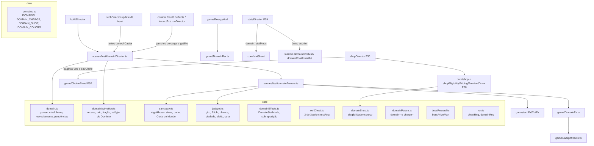

# Expansão de domínio - Design

**Spec**: `.specs/features/expansao-de-dominio/spec.md` · **Plano**: `docs/plano-builds-e-habilidades.md` (linha F31 da
seção 6, seções 3.1, 4 e 5.6) · **Base**: F29 `fundacao-de-poder` (`.specs/features/fundacao-de-poder/design.md`) e F30
`vermelho-e-corpo` (`.specs/features/vermelho-e-corpo/design.md`)
**Status**: Draft

Linhas citadas conferidas em 14/10: o código que a F31 lê e não reescreve (`EnergyHud`, `TechCaster`, `input.ts`,
`runDirector`, `shopDirector`, `CutFx`, `core/cut.ts`, `game/tech/cut.ts`) foi lido na branch `feat/fundacao-de-poder`
(F29 até o passo 2, commit `29d7c83`); as linhas desses arquivos não mudaram desde `4c0efae`. O que a F29 e a F30 criam
ou trocam (`StatsDirector.snapshotFields`, `statSheet`, `StrikeMods.marks`, `PropDamage`, `DamageNumbers`,
`impactFx.onKokusen`, `ChoicePanel`, `openChoiceOrShop`, `techStats`, `shopEligibility`, `shopPricing`, `shopPreview`,
`shopDraw`, `build.onMeleeHit(hit, point, target)`, `TechDirector.update` com `build.body.update`) é citado pelo nome e
pela interface dos dois designs; as linhas desses pontos valem depois do merge da F30 e são reconferidas no começo de
cada passo. Linhas efetivas contadas como o `max-lines` do `.oxlintrc.json` (sem linha em branco e sem comentário): a
`TestScene` tem 393 hoje (a F29 leva a 390 e a F30 não toca).

---

## Abordagens consideradas

| Abordagem | Como fica | Decisão |
| --- | --- | --- |
| **A. Regras puras + `domainDirector` como campo do `BuildDirector`** (recomendada) | Barra, ativação, Santuário, Jackpot, efeitos, baú e loja em módulos puros de `core/`; um diretor (`build.domain`) com um ajudante (`DomainPowers`) liga tudo ao motor, chamado pelo `TechDirector.update` como o `build.body` da F30 | **Escolhida.** Segue o molde da F30 (`build.axes`, `build.body`), a `TestScene` não ganha linha (DOM-11), e o Domínio, que é item de build e não técnica de slot, mora com o resto da build |
| B. Domínio como 3º slot da `CastMachine` e do `TechRunner` | A tecla `P` vira um pedido de conjuração; a barra vira o "custo" | Recusada: o Domínio não tem sinal, carga nem custo de energia; o 3º slot (`O`/`B`) e o pool de 7 vagas são da F35; misturar trava o `CastMachine` com regras que não são de conjuração |
| C. `DomainDirector` como campo da `TestScene` | Mais um `readonly domain = new DomainDirector(this)` e uma chamada no `update` | Recusada: +2 linhas na `TestScene` (DOM-11 pede 0) |

O usuário mandou seguir a recomendação para o que a seção 7 do plano não fecha; a abordagem A não troca nenhum
requisito da spec.

---

## Architecture Overview



**Fluxo por quadro** (sem mudança de ordem na `TestScene`):

1. `stats.update` (F29) monta a `StatSheet` já com o `DomainStatMods` do quadro anterior e grava o `Loadout` e o
   `Player` (o `×1,25` da Amplificação Nv 3, o custo e a recarga do Jackpot).
2. `updateGameplay` lê o input filtrado (`stats.inputFor`, que já zera tudo fora de `roundActive`/`intermission`/
   `traverse` e na transição de área) e chama `techDirector.update(dt, input)` (a única linha da `TestScene` que muda,
   sem linha a mais).
3. `TechDirector.update` chama primeiro `build.domain.update(dt, input.domainPressed)`: grava a trava de técnica no
   `techCaster.locked`, resolve a tecla `P`/`N` (recusa ou ativação), anda o relógio do Domínio, o esvaziamento da
   barra, os cortes pendentes do Santuário, o giro e o efeito do Jackpot, a anulação de projétil e a vista. Toda
   mudança de estado que mexe em número (ativação, parada dos tambores, fim do efeito, fim do Domínio) chama
   `stats.sync()` na hora, como a compra de `vida` faz hoje (`shopDirector.ts:39`), para a conjuração do mesmo quadro
   já ler o custo novo.
4. Depois vem o `techCaster.update` de hoje, que já lê a trava e o custo novos.

Os ganchos de carga e de gatilho chegam pelos pontos que já existem: `combat.onConnect` → `build.onMeleeHit`
(assinatura da F30), `combat.onDefense` → `build.onDefense`, `combat.tryFinisher` → `build.onFinisher`,
`combat.onEnemyDied`, `effects.onTechConnect`, `runDirector.onMasteryHit` e `impactFx.onKokusen` (F29). Os ganchos
só anotam (carga, gatilho, Riichi); nenhum aplica dano dentro de um callback de contato do Matter: os cortes do
Santuário ficam numa fila e saem no `update` do mesmo quadro.

---

## Code Reuse Analysis

### Existing Components to Leverage

| Component | Location | How to Use |
| --- | --- | --- |
| `Hit.swingId` (um id por golpe iniciado do player) | `src/core/hit.ts:50`, `src/game/player/strikes.ts:159`, `:280` | Uma carga, um gatilho do Santuário e um Riichi por golpe, mesmo com vários alvos (DOM-02.3, SAN-02, JAC-02) |
| `FINISHER_MOVE` e o caminho do finalizador | `src/data/moves.ts`; `src/scenes/test/combat.ts:214-243` | O `onMeleeHit` pula o golpe com `moveName === FINISHER_MOVE`; o `+5` vem do `build.onFinisher()` que já é chamado na l.235 |
| `FINISHER_HITSTOP_MS` (150) | `src/scenes/test/combat.ts:22` | Hitstop da ativação (DOM-09), importado de onde já mora |
| `ImpactFrame.trigger(swingId)` | `src/game/ImpactFrame.ts:44` | Um quadro de impacto por ativação, com id negativo próprio (`-(++activationSeq)`), que nunca colide com o `swingId` do golpe |
| `FocusLines.show(screenPoint)` e `camera.worldToScreen` | `src/game/FocusLines.ts`; `src/scenes/test/combat.ts:180` | Linhas de foco convergindo no centro do player na ativação |
| `CutFx.cut` e `CutFx.split` | `src/game/techFx/CutFx.ts:28`, `:42` | Vista do corte do Santuário (SAN-04). O `cut` centra a linha em `playerX + facing × CUT_MID_PX`; o diretor passa `x = alvo.x − CUT_MID_PX` com `facing` 1 para a linha cruzar o alvo. Muda só `const CUT_MID_PX` para `export const` |
| `techMarks('light')` e a composição do acerto do Desmantelar | `src/game/tech/shared.ts:46`; `src/game/tech/cut.ts:50-57` | O corte do Santuário copia `strength: 'light'`, `force: 0`, `direction: {x: 0, y: -1}` e `...techMarks('light')`, com `band: 'micro'` (SAN-03) |
| `effects.onTechConnect(hit, point, target)` (F29) | `src/scenes/test/effects.ts:40` | O corte passa por ele: faísca 10, hitstop micro de 15 ms dentro do teto de 60 ms (`MicroBudget`) e número `micro` (F29). O gatilho do Santuário sai do `onCastHit` (caminho da maestria), que o corte não percorre, então o corte nunca vira gatilho de outro corte |
| `Hit.counter` e o compromisso do comum | `src/core/enemyBrain.ts:96`, `src/game/enemy/EnemyDefense.ts:136-145` | O acerto da ativação leva `counter: true` e interrompe o ataque do comprometido (DOM-08.6); a Amplificação usa a marca nova `armorPierce` (o `counter` em todo golpe ligaria a câmera lenta do `impactFx.ts:97` e o decisivo em cada `jab`) |
| `ShopInput.read()` | `src/game/input.ts:115-153` | Ganha a leitura descartada de `P` e `N` (`anyJustDown`), para a borda não ficar represada na loja (DOM-06.2) |
| `EnemyDefense.receiveBand` (F29) | `src/game/enemy/EnemyDefense.ts` | O corte `micro` entra sem `hitstun`, com metade da estrutura (SAN-03) |
| `enemyGuard.resolveHit` com `unblockable` | `src/core/enemyGuard.ts:83-96` | A Amplificação marca o golpe do player com `unblockable: true` e o leve de frente deixa de ser bloqueado (AMP-02), sem mudar o `EnemyDefense` |
| `F30 StrikeMods.marks` (aplicado no `openHitbox` por `...mods.marks`) | `core/statSheet.ts` (F30) | Ganha `unblockable`; a marca chega à hitbox pelo hook que já existe |
| `F29 PropDamage` | `src/game/Prop.ts` (F29) | Ganha `marks()`, para o objeto na mão também atravessar a guarda |
| `TechCaster` e `CastMachine.request` | `src/game/TechCaster.ts:64-94`; `src/core/cast.ts:74-94` | A recusa nova `domain` entra como as outras (`techDenied:<motivo>`), sem gastar energia nem recarga (AMP-04) |
| `energy.gain(energy.max)` e `loadout.clearCooldown(slot)` | `src/scenes/test/techDirector.ts:41-45` (o laboratório já faz isso) | Energia no máximo a cada quadro e recargas zeradas na parada dos tambores com jackpot (JAC-04) |
| `player.heal(n)` com teto | `src/game/Player.ts:369` | Cura do Jackpot, 1 HP por tique (JAC-04/05) |
| `player.isBusyForCast()`, `player.cancelMelee()`, `techCaster.cast`, `recovery.reverse.active`, `player.dead` | `Player.ts:412`, `:397`; `TechCaster.ts:41`; `recovery.ts:70` | Recusa `busy` (DOM-07) e o fim do golpe na ativação, como o CAST-10 |
| `multipliersFor(round, DIFFICULTY).hp` | `src/core/difficulty.ts:41` | `hpMul` do corte do Santuário (`round(6 × hpMul)`), o mesmo do piso do Kokusen da F30 |
| `bossRewardSlot` e `runDirector.bossRewardUpgrade` | `src/core/bossReward.ts`; `src/scenes/test/runDirector.ts:202-207` | O prêmio de técnica do BFX-09 (com a regra da F30) fica igual; a F31 só decide se ele sai na hora, se vira opção do baú ou se cede o lugar ao nível do Domínio |
| `Hud.banner(text, ms)` e o espaço do BFX-10 | `src/scenes/test/runDirector.ts:236-242`; `spawner.ts:166-170` | "Domínio Nv N!" entra no lugar do texto do upgrade grátis (DNV-03) |
| `Rng` e os streams com sal | `src/core/run.ts:59-68`, `:296-306` | `chestRng` e `domainRng` no mesmo molde (VEU-02.3, JAC-03) |
| F30 `ChoicePanel` (`show`, `select`, `hide`, `open`, `debug`) e `openChoiceOrShop()` / `updateChoicePanel(input)` | `game/ChoicePanel.ts`, `scenes/test/shopDirector.ts` (F30) | As páginas `bauChefe` e `veu` entram na mesma fila, antes das páginas de ramo |
| F30 `drawCards`, `cardCost`, `inflate`, `previewText`, `eligible` | `core/shopDraw.ts`, `core/shopPricing.ts`, `core/shopEligibility.ts`, `core/shopPreview.ts` (F30) | A carta `dominio` entra por um `kind` novo em cada um, sem regra nova de sorteio |
| F29 `StatsDirector.snapshotFields()` e o tipo em arquivo à parte | `scenes/test/statsDirector.ts`, `game/powerSnapshot.ts` (F29) | O campo `domain` entra por aqui; o tipo mora em `game/domainSnapshot.ts`, no molde do `powerSnapshot`/`axisSnapshot` |
| `debugParam` | `src/scenes/test/params.ts:5` | Lê `domain=` e `charge=` |
| Faixa fina de estrutura sob a barra de HP | `src/game/Hud.ts:181-190` (3 px em `MARGIN + 17`) | A barra do Domínio copia o desenho: 3 px logo abaixo da moldura de energia (y = 51), antes do ícone de fragmentos (y = 54) |

### Integration Points

| System | Integration Method |
| --- | --- |
| Tecla `P`/`N` | `PlayerInput.read()` ganha `domainPressed` (`JustDown` de `P` e de `N`, as duas consumidas); `NEUTRAL_INPUT` ganha `domainPressed: false`. O `inputFor` da F29 já zera fora dos estados de input e na transição. Na loja o `updateGameplay` não roda e o `PlayerInput` não é lido (`TestScene.ts:419-420`): o `ShopInput.read()`, que roda em todo quadro da loja, consome as bordas de `P` e `N` sem usar (o `addKey` do Phaser devolve o mesmo `Key` para o mesmo código, então a borda é uma só) (DOM-06.2) |
| Por quadro | `TechDirector.update(dt, input)` chama `this.s.build.domain.update(dt, input.domainPressed)` antes do `techCaster.update` |
| Carga | `BuildDirector.onMeleeHit/onDefense/onFinisher` repassam ao `domain`; `combat.onEnemyDied`, `effects.onTechConnect`, `runDirector.onMasteryHit` e `impactFx.onKokusen` chamam o `domain` direto (uma linha cada) |
| Números do combate | `StatsDirector.sheet()` passa `domain: this.s.build.domain.statMods()` ao `statSheet`; o `sync` grava `loadout.domainCostMul` e `loadout.domainCooldownMul`; o `strikeMods` e o `propDamage` levam `unblockable` e `armorPierce` |
| Técnicas travadas | `TechCaster.locked` (campo novo) vai no `CastContext`; o `domain.update` grava a cada quadro |
| Rodada e run | `runDirector.applyRunCommand`: `case 'shopOpen'` chama `domain.onShopOpen()` (fim do Domínio, antes do `noshop`) e `case 'roundCleared'` chama `domain.onRoundCleared(round)` (só o Baú do Véu); `BuildDirector.reset` chama `domain.reset()`; `runDirector.onStartRun` chama `domain.applyDebug()` depois do `stats.reset()` (e do `build.applyDebugAxes()` da F30) |
| Armadura | `Hit.armorPierce` e `armorHolds` no `core/enemyGuard.ts`; `EnemyDefense.receiveHit` troca a expressão do `committed` (AMP-02.3) |
| Chefe | `spawner.onBossDefeated` troca `runDirector.bossRewardUpgrade()` por `build.domain.bossPrize()` na mesma linha |
| Konbini | `shopDirector.openChoiceOrShop()` (F30) junta `domain.choicePages()` antes de `axes.choicePages()`; `updateChoicePanel` despacha `veu`/`bauChefe` para `domain.confirm` |
| Loja | `Shop` ganha `domain?: { readonly level: number }` (0 sem Domínio) e o `BuyContext.applyDomain?()` |
| HUD | `EnergyHud` cria a `DomainBar` e chama `domainBar.update(dt)` no `update` dela; o `UiSetup.addHud` liga a fonte (`bind(() => domain.barView())`) e cria o `DomainFx` |
| Snapshot | `StatsDirector.snapshotFields()` ganha `domain`; `EnergyHud.debugState()` ganha `domainBar` (cai em `hud`, que já espalha o `debugState`) |

---

## Components

### `data/domains.ts` (novo, ~95 linhas)

- **Purpose**: todos os números da seção 5.6 e as chaves de cor (DHD-04).
- **Conteúdo**:
  - `type DomainId = 'santuario' | 'jackpot' | 'amplificacao'`; `type DomainLevel = 1 | 2 | 3`; `DOMAIN_IDS`.
  - `DOMAINS: Record<DomainId, DomainDef>` com `name`, `line` (efeito de uma linha para a carta do baú),
    `activation: { radiusPx, common, boss, elite, force }` (Santuário 320 / 0,40 / 0,06 / 0,20 / 8; Jackpot 96 / 0,40 /
    0,06 / 0,20 / 0; Amplificação 96 / 0,25 / 0,04 / 0,12 / 8; a elite fica sem alvo até a F38; 96 e não os 64 do plano,
    ver a assumption "Alcance da ativação") e `durationMs: [nv1, nv2, nv3]` (Santuário 6000/8000/8000; Amplificação
    7000/9000/9000; Jackpot `[2000, 2000, 2000]`, o giro).
  - `DOMAIN_CHARGE = { max: 100, light: 1, heavy: 2, prop: 2, kill: 1, defense: 5, techCast: 1, finisher: 5,
    kokusen: 15, drainAfterMs: 8000, drainStep: 10, veilStart: 100 }`.
  - `SANCTUARY = { triggersPerWindow: 4, windowMs: 1000, targets: [4, 6, 6], radiusPx: 320, cutBase: 6,
    worldCut: { threshold: 0.35, bossFraction: 0.08 } }`.
  - `JACKPOT = { spinMs: 2000, base: [0.33, 0.40, 0.40], riichiStep: 0.04, winStep: 0.05, cap: 0.60, pityMisses: 2,
    hit: { ms: 8000, healEveryMs: 200 }, miss: { ms: 4000, healEveryMs: 400, costMul: 0.5, cooldownMul: 0.5 } }`.
  - `AMPLIFICATION = { meleeMulLv3: 1.25 }` e `DOMAIN_HIT = { force: 8, liftY: -0.6 }` (empurrão do Corte do Mundo, no
    tamanho do golpe forte de hoje; a ativação lê o `activation.force` do Domínio, que é 0 no Jackpot para os
    atordoados ficarem ao alcance do Riichi).
  - `DOMAIN_SHOP = { base: 40, step: 10, minRound: 8 }` (Nv 2 = 40, Nv 3 = 50 antes da inflação).
  - `DOMAIN_COLORS` (só chaves da `PALETTE`): `barBg: 'K'`, `barFill: 'U'`, `barReady: 'W'`, `barActive: 'T'`,
    `vignette: 't'`, `reelFace: 'w'`, `reelBorder: 'A'`, `reelText: 'A'`, `outline: 'C'`.
  - `DOMAIN_BAR = { y: 51, h: 3, blinkMs: 250, keyLabel: 'P' }` e `DOMAIN_FX = { vignettePx: 24, vignetteAlpha: 0.35,
    fadeMs: 300, outlinePad: 3 }`.

### `core/domain.ts` (novo, ~120 linhas)

- **Purpose**: a barra e a posse do Domínio (DOM-01 a DOM-05, DNV-01, VEU-01/04 e a pendência do DNV-02).
- **Interfaces**:
  - `type ChargeEvent = 'light' | 'heavy' | 'prop' | 'kill' | 'defense' | 'techCast' | 'finisher' | 'kokusen'`.
  - `class DomainState`:
    - `owned: { id: DomainId; level: DomainLevel } | null`, `charge` (inteiro 0..100), `active: ActiveDomain | null`
      (de `domainActivation.ts`), `veilPending: readonly [DomainId, DomainId] | null`, `bossChestPending: boolean`.
    - `own(id, level = 1, charge = 0)`: dono com a carga dada (o Baú do Véu passa `DOMAIN_CHARGE.veilStart`, VEU-03; o
      `domain=` do debug fica em 0); `raise(): boolean` (sobe 1 sem mexer na carga, recusa no Nv 3 e sem Domínio, DNV-01).
    - `addCharge(ev)`: soma `DOMAIN_CHARGE[ev]` com teto 100, só com Domínio e sem Domínio ativo (DOM-02.5); zera o
      relógio do esvaziamento.
    - `tick(dtMs, roundActive)`: esvaziamento (DOM-03): o relógio só anda com `roundActive` e carga entre 1 e 99; a cada
      8000 ms seguidos sem carga tira 10, com piso 0. Aos 7999 ms nada muda.
    - `setCharge(n)` (debug), `markVeil(pair)`, `takeVeil()`, `reset()` (posse, carga, ativo e pendências; DOM-05,
      VEU-04.8, edge case do prêmio adiado).
    - `get ready(): boolean` (carga 100 e nenhum ativo).
  - `domainBarView(state): DomainBarView` = `{ visible: owned !== null, fill, blinking, active: boolean }`, com
    `fill = active ? remainingMs / totalMs : charge / 100` (DHD-01, DHD-03) e `blinking = ready` (DHD-02).
- **Reuses**: números de `DOMAIN_CHARGE`.

### `core/domainActivation.ts` (novo, ~85 linhas)

- **Purpose**: a decisão da tecla, o relógio do Domínio e o acerto decisivo (DOM-06 a DOM-10).
- **Interfaces**:
  - `type DomainDenial = 'none' | 'active' | 'charge' | 'busy'`.
  - `activationDenial(state, busy: boolean): DomainDenial | null`, na ordem `none` → `active` → `charge` → `busy`
    (com Domínio ativo a carga é 0, então `active` vem antes de `charge`; é o que o Independent Test do DOM-06 lê).
  - `class ActiveDomain { id; level; totalMs; remainingMs; update(dtMs): boolean /* acabou */; restart(ms) }` (o
    Jackpot reinicia o relógio na parada dos tambores com o tempo do efeito).
  - `inRadius(center: Vec2, target: Vec2, radiusPx): boolean` = `hypot ≤ radiusPx` (borda inclusa, DOM-08).
  - `activationDamage(fraction, maxHp): number` = `max(1, round(fraction × maxHp))`.
  - `activationTargets<T extends { id; center: Vec2; maxHp; isBoss }>(center, targets, def): { target: T; damage }[]`.
  - `type DomainEnd = 'timer' | 'shop' | 'death' | 'reset'` (só `timer` roda o fim, DOM-10.10; a rodada limpa não
    encerra).

### `core/sanctuary.ts` (novo, ~70 linhas)

- **Purpose**: o Santuário puro (SAN-01 a SAN-05).
- **Interfaces**:
  - `class SanctuaryTriggers { tryRelease(nowMs): boolean; countAt(nowMs): number; reset() }`: janela deslizante de
    tempo de jogo; um gatilho conta enquanto `now − t < 1000`; com 4 na janela o 5º é recusado (SAN-02.3). Gatilho
    sem alvo também conta (edge case).
  - `sanctuaryTargets(center, targets, max, radiusPx)`: vivos a até 320 px, do mais perto ao mais longe, empate pelo id,
    até `max` (4 no Nv 1, 6 no Nv 2 e 3).
  - `sanctuaryCutDamage(hpMul) = round(SANCTUARY.cutBase × hpMul)`.
  - `worldCutHits(center, targets)`: comum a até 320 px com `hp ≤ 0,35 × maxHp` leva `hp` (morre); o chefe a até 320 px
    leva `round(0,08 × maxHp)`; comum acima de 35% fica de fora (SAN-05).

### `core/jackpot.ts` (novo, ~100 linhas)

- **Purpose**: o Jackpot puro (JAC-01 a JAC-05).
- **Interfaces**:
  - `jackpotChance({ level, strikes, jackpotsWon }) = min(0,60, base[level] + (level === 3 ? 0,05 × jackpotsWon : 0)
    + 0,04 × strikes)` (JAC-02).
  - `shownChance(state, level) = state.misses ≥ JACKPOT.pityMisses ? 1 : jackpotChance(...)` e `guaranteed(state)`: o
    que os tambores e o snapshot mostram (JAC-06.11); o sorteio continua lendo o `jackpotChance`.
  - `class JackpotState`:
    - `misses` (falhas seguidas na run), `jackpotsWon`, `phase: 'idle' | 'spin' | 'jackpot' | 'miss'`, `strikes`,
      `effectMs`.
    - `startSpin()`; `onStrike()` (Riichi, só no giro).
    - `stop(level, draw: () => number): 'jackpot' | 'miss'`: com `misses ≥ 2` dá jackpot **sem** chamar `draw`
      (piedade, JAC-03.5); senão `draw() < chance`. Jackpot zera `misses` e soma `jackpotsWon`; falha soma `misses`.
      Arma `effectMs` em 8000 ou 4000.
    - `tickEffect(dtMs): number`: anda o efeito e devolve quantos tiques de cura caíram neste passo (a cada 200 ms no
      jackpot, a cada 400 ms na falha), acumulando o resto entre quadros.
    - `abort()`: morte no giro (para sem resultado, `misses` igual; edge case); `endEffect()`; `reset()` (run nova).
  - `reelFaces(result, misses): [string, string, string]`: três iguais no jackpot e pelo menos um diferente na falha,
    sem consumir o `domainRng` (JAC-06).

### `core/domainEffects.ts` (novo, ~55 linhas)

- **Purpose**: o que o Domínio ativo muda nos números e nas travas (JAC-04/05, AMP-02 a AMP-05).
- **Interfaces**:
  - `interface DomainStatMods { meleeMul; costMul; cooldownMul; techLocked; guardPierce; nullifyProjectiles;
    energyLock }` e `NEUTRAL_DOMAIN_MODS` (`1, 1, 1, false, false, false, false`).
  - `domainStatMods(active: { id; level } | null, jackpotEffect: 'jackpot' | 'miss' | null): DomainStatMods`:
    jackpot → `costMul 0`, `cooldownMul 0`, `energyLock`; falha → `0,5` e `0,5`; Amplificação →
    `techLocked`, `guardPierce`, `nullifyProjectiles` e `meleeMul 1,25` só no Nv 3; o resto neutro.
  - `rectsOverlap(a, b)` com retângulos pelo centro (convenção do `hurtRect`), bordas inclusas (AMP-03).

### `core/enemyGuard.ts` (muda, +4 linhas) e `core/hit.ts` (muda, +2 linhas)

- `Hit.armorPierce?: boolean` ("o comum comprometido não absorve este golpe", AMP-02.3), ao lado do `unblockable`.
- `armorHolds(committed: boolean, hit: Pick<Hit, 'armorPierce'>): boolean` = `committed && !hit.armorPierce`. O
  `EnemyDefense.receiveHit` passa `committed: armorHolds(this.c.ai.committed, hit)` ao `brain.receiveHit`
  (`EnemyDefense.ts:135-138`, troca de expressão): o `receiveHit` está na exceção de complexidade e não ganha `&&`, e o
  `enemyBrain.ts` (também na exceção, com o teste no `max-lines`) não muda. Sem `committed`, o cérebro segue o caminho de
  hoje (cambaleio, `hitReaction`) e o `EnemyDefense` chama `ai.interrupt()`, que cancela a garra pendente.
- Teste em `tests/core/enemyGuard.test.ts` (244 linhas, fora da lista de exceções): os quatro casos de `armorHolds`.

### `core/veilChest.ts` (novo, ~25 linhas)

- `drawVeil(rng: Rng): [DomainId, DomainId]`: dois Domínios diferentes dos três, pelo `chestRng` (VEU-02); a mesma seed
  dá o mesmo par.

### `core/domainShop.ts` (novo, ~30 linhas)

- `domainShopEligible(level, round): boolean` (Domínio entre Nv 1 e 2 e `round ≥ 8`; DNV-04.7/8).
- `domainLevelPrice(level): number` = `DOMAIN_SHOP.base + DOMAIN_SHOP.step × (level − 1)` (40 no Nv 1 → 2, 50 no Nv 2 →
  3); a inflação da F30 é aplicada por cima no `cardCost`.

### `core/domainParam.ts` (novo, ~25 linhas)

- `parseDomainParam(raw): { id: DomainId; level: DomainLevel } | null`, `parseChargeParam(raw): number | null` e
  `parseMissesParam(raw): number | null` (DDB-02: id desconhecido, nível fora de 1..3, carga fora de 0..100 inteiro ou
  falhas fora de 0..2 inteiro some). O `jackpotMisses=` monta a piedade no smoke sem encher a barra três vezes.

### `core/bossReward.ts` (muda, +8 linhas)

- `bossPrizePlan({ domainLevel, techTarget }): 'chest' | 'domain' | 'tech'`: Domínio abaixo do Nv 3 e prêmio de técnica
  com alvo → `chest` (DNV-02); Domínio abaixo do Nv 3 sem alvo → `domain` (DNV-03); sem Domínio ou no Nv 3 → `tech`
  (DNV-03.5, o BFX-09 de hoje).

### `core/run.ts` (muda, +10 linhas)

- `chestRngValue`/`domainRngValue`, getters `chestRng`/`domainRng` e, no `resolveStart`, `new Rng(seed ^ 0xa54ff53a)` e
  `new Rng(seed ^ 0x9b05688c)` (sais que nenhum stream usa; conferido com `grep` em `src/`). O `resolveStart` está na
  exceção de complexidade: só ganha 2 atribuições, sem ramo.

### `scenes/test/domainDirector.ts` (novo, ~190 linhas, campo `domain` do `BuildDirector`)

- **Purpose**: liga o `DomainState` ao input, aos ganchos de carga, à ativação, ao baú, à loja, ao HUD e ao snapshot.
- **Interfaces**:
  - `readonly state = new DomainState()`; `readonly powers = new DomainPowers(s, this)`.
  - `update(dtMs, pressed)`: sai cedo no laboratório (`fxLab`) e fora de `roundActive`/`intermission`/`traverse`; grava
    `techCaster.locked`; morte do player com Domínio ativo → `end('death')`; tecla → `tryActivate()`; relógio do
    Domínio (`active.update`; no fim, `powers.onPhaseEnd()` decide se é a parada dos tambores ou o fim); `state.tick(dt,
    run.state === 'roundActive')`; `powers.update(dt)`.
  - `tryActivate()`: `activationDenial`; recusa empurra `domainDenied:<motivo>` (uma vez, sem mexer na carga, DOM-07);
    aceita: `cancelMelee()` se havia golpe (DOM-07.4), carga 0, `active = new ActiveDomain(...)`, evento `domain:<id>`,
    `strikeActivation()`, `powers.onActivate()`, `stats.sync()`.
  - `strikeActivation()`: alvos por `activationTargets` (comuns vivos e chefe vivo, centro do `hurtRect`); para cada um,
    `Hit` `{ ownerId: player.id, damage, strength: 'heavy', force: def.activation.force, direction: { x: ±1, y:
    DOMAIN_HIT.liftY }, unblockable: true, tech: true, counter: true, knockdown: id === 'amplificacao' }` (o `counter`
    tira a armadura do comprometido, `enemyBrain.ts:96`; o `tech` passa pelo `refuses` do chão e do levantar,
    `:111-115`); aceito → `damageNumbers.show(target, damage, 'strike', ponto)` e `cursedFx.impact(impactTier(hit, {
    brokePosture: false, forced: 'decisive' }), ...)`. Depois, uma vez: `impactFrame.trigger(-(++activationSeq))`,
    `focusLines.show(worldToScreen(centro do player))`, `hud.banner(DOMAINS[id].name, RUN.bannerMs)` e
    `effects.hitstop.trigger(FINISHER_HITSTOP_MS)` + `freeze()` (DOM-09). O acerto não passa pelo
    `impactFx.reactCamera`, então o `counter` não liga a câmera lenta de lá.
  - Ganchos: `onMeleeHit(hit)` (golpe do moveset por `swingId`, objeto por quadro; pula `FINISHER_MOVE`; repassa ao
    `powers.onStrike`), `onDefense(kind)` (`parry`, `deflect`, `perfectDodge`), `onFinisher()`, `onKokusen()`,
    `onKill()`, `onTechHit(hit)` (só guarda `lastTechBand`), `onCastHit(castId)` (uma vez por `castId`, se o acerto que
    acabou de chegar pelo `onTechHit` não era chip: sem Domínio ativo, carga `techCast`; com o Santuário ativo,
    `powers.onCastTrigger()`, SAN-02). A Onda do Punho, o corte do Santuário e qualquer acerto sem `masteryHit` nunca
    chegam ao `onCastHit`, então não há guarda de reentrada.
  - `end(reason)`: `domainEnd:<id>`, `powers.onEnd(reason === 'timer')`, `active = null`, `stats.sync()`.
  - `onShopOpen()`: termina o ativo (`shop`); chamado no `case 'shopOpen'` do `runDirector` antes do `noshop`.
  - `onRoundCleared(round)`: na r3 sem Domínio, `state.markVeil(drawVeil(chestRng))`; o Domínio ativo segue (DOM-10.10).
  - `reset()`, `applyDebug()` (`domain=`, `charge=` e `jackpotMisses=`), `onSceneCreate()` (o `R` reinicia a cena: termina o ativo sem
    efeito de fim e solta a vista velha).
  - `choicePages(): ChoicePage[]` (`bauChefe` antes de `veu`) e `confirm(item, option)`: `veu` → `own(id, 1,
    DOMAIN_CHARGE.veilStart)`, evento `veil:<id>`; `bauChefe` → `raise()` com `bossChest:domain` ou `runDirector.bossRewardUpgrade()` com banner e
    `bossChest:tech`.
  - `bossPrize(): string | null` (no lugar do `bossRewardUpgrade()` do `spawner`): `bossPrizePlan` com
    `runDirector.bossRewardTarget()`; `chest` arma a pendência e devolve `null` (sem banner, DNV-02); `domain` sobe e
    devolve `"Domínio Nv N!"`; `tech` devolve o `bossRewardUpgrade()` de hoje.
  - `statMods()`, `barView()`, `snapshot(): DomainSnapshot`.
- **Funções**: nenhuma passa de ~35 linhas; a maior complexidade é a do `update` (~8 ramos).

### `scenes/test/domainPowers.ts` (novo, ~160 linhas)

- **Purpose**: o que cada Domínio faz enquanto está ativo, e a vista.
- **Interfaces**:
  - `onActivate(id, level)`: Jackpot → `jackpot.startSpin()`; liga a vinheta (Santuário) ou o contorno
    (Amplificação) no `DomainFx`.
  - `onStrike(hit)`: Santuário → `triggers.tryRelease(clockMs)` e, aceito, `pendingCuts++`; Jackpot no giro →
    `jackpot.onStrike()`.
  - `onCastTrigger()`: Santuário → mesmo gatilho, uma vez por conjuração (vem do `onCastHit`).
  - `update(dtMs)`: solta os cortes pendentes (`cutNow()`: alvos por `sanctuaryTargets`, `Hit` micro, `receiveHit`,
    `effects.onTechConnect` (o corte não tem `masteryHit`, então não volta como gatilho), `CutFx.cut` e `CutFx.split`, evento
    `domainCut:<targetId>`); efeito do Jackpot (`energyLock` → `energy.gain(energy.max)`; `tickEffect` → `player.heal(1)`
    por tique); Amplificação → anula projétil (`player.hitbox.rect` × cada `Projectile`, `rectsOverlap`, `destroyNow()`,
    evento `projectileNullified`); vista (`DomainFx.update`, com o contorno em `player.renderPos`, AD-019).
  - `onPhaseEnd(): boolean`: no Jackpot em giro, `stop(level, () => run.domainRng!.next())`, evento `jackpot:hit` ou
    `jackpot:miss`, no jackpot `clearCooldown(0)` e `clearCooldown(1)`, `active.restart(effectMs)`, `stats.sync()` e
    devolve `true` (o Domínio segue); nos outros casos `false`.
  - `onEnd(byTimer)`: Santuário Nv 3 pelo tempo → Corte do Mundo (`worldCutHits`, acerto decisivo por alvo, evento
    `worldCut`); Jackpot → `abort()` no giro ou `endEffect()`; apaga a vista (a vinheta some em 300 ms).
  - `reset()`, `snapshot(): { jackpot; triggersLastSecond }`.
- **CutFx**: criado na hora de cada corte (`new CutFx(s, s.realtimeFx, s.fxRegistry)`): o objeto não guarda nada vivo,
  e o `realtimeFx`/`fxRegistry` nascem de novo a cada `create`.

### `game/DomainFx.ts` (novo, ~95 linhas) e `game/JackpotReels.ts` (novo, ~75 linhas)

- **DomainFx**: vinheta do Santuário (4 retângulos nas bordas da tela, `DOMAIN_FX.vignettePx`, cor `t`, alpha 0,35,
  na `uiLayer`, AD-003), contorno da Amplificação (`Graphics` no mundo, retângulo de 1 texel em volta do corpo
  desenhado, cor `C`, preso a `player.renderPos`) e os tambores (`JackpotReels`). `update(dtMs, view)` anda o fade de
  300 ms no relógio próprio; `destroy()` no `SHUTDOWN` (DHD-05). Criado no `UiSetup.addHud()` como `ui.domainFx`.
  `debug(): { vignette: number; outline: boolean; reels: { spinning; faces; chance } | null }` (alpha real da vinheta,
  não o pedido; L-076 como cuidado).
- **JackpotReels**: 3 caixas (`Rectangle` com borda `A`) e 3 `Text` com o símbolo, no topo central da `uiLayer`, mais o
  texto `Riichi NN%`; no giro, o símbolo de cada caixa troca pelo relógio de jogo (sem `Rng`); na parada, mostra o
  `reelFaces` do resultado.

### `game/DomainBar.ts` (novo, ~70 linhas)

- **Purpose**: a barra de 3 px sob a moldura de energia (DHD-01 a DHD-03).
- **Interfaces**: construída pelo `EnergyHud` com o `x` e a largura do poço da barra de energia; `bind(source: () =>
  DomainBarView)`; `update(dtMs)` (largura `round(BAR_W × fill)`, cor `U` carregando, `T` ativa, pisca `U`/`W` a cada
  250 ms com a carga cheia e mostra o rótulo `P` à direita da moldura); `debug(): DomainBarSnapshot` com a largura
  medida no retângulo vivo (`fill` = largura / `BAR_W`).
- **Por que arquivo à parte**: o `EnergyHud` passa de 196 para ~212 na F30; a barra inteira dentro dele daria ~260 e
  misturaria duas barras numa classe. Fica com +4 linhas (import, campo, `update`, `debug`).

### `game/domainSnapshot.ts` (novo, ~30 linhas)

- `DomainSnapshot` e `DomainBarSnapshot` (DDB-01), no molde do `powerSnapshot` (F29) e do `axisSnapshot` (F30).

### Mudanças em arquivos existentes (por passo)

**Passo 1 (barra pura e dados; DOM-01 a DOM-05)**

| Arquivo | Linha | Mudança |
| --- | --- | --- |
| `src/data/domains.ts` (novo) | — | ver acima |
| `src/core/domain.ts` (novo) | — | `DomainState`, `domainBarView` |
| `src/core/domainParam.ts` (novo) | — | `parseDomainParam`, `parseChargeParam` |

Sem ligação ao jogo. `TestScene`: 0.

**Passo 2 (posse, tecla, carga e ativação; DOM-06 a DOM-11, DHD-01 a DHD-03, DDB-01 a DDB-03)**

| Arquivo | Linha | Mudança |
| --- | --- | --- |
| `src/core/domainActivation.ts` (novo) | — | ver acima |
| `src/game/input.ts` | 4-32, 40-73, 76-96, 115-153 | `domainPressed` no `InputSnapshot`; `private readonly domain: Key[]` com `P` e `N`; `domainPressed: anyJustDown(this.domain)`; o `ShopInput` ganha o mesmo par e o `read()` dele chama `anyJustDown(this.domain)` sem usar (+7) |
| `src/scenes/test/params.ts` | 19-36 | `domainPressed: false` no `NEUTRAL_INPUT` (+1) |
| `src/scenes/TestScene.ts` | 492 | `this.techDirector.update(dt)` vira `this.techDirector.update(dt, input)` (0) |
| `src/scenes/test/techDirector.ts` | 10-11 | `update(dt, input: InputSnapshot)`; 1ª linha `this.s.build.domain.update(dt, input.domainPressed)` (+2 com o import) |
| `src/scenes/test/buildDirector.ts` | 8-58 | campo `readonly domain = new DomainDirector(s)`; `reset` chama `domain.reset()`; `onDefense`, `onMeleeHit` (F30) e `onFinisher` repassam (+6) |
| `src/scenes/test/combat.ts` | 73-77, 250-273 | `onEnemyDied` chama `this.s.build.domain.onKill()`; `tryBossFinisher` chama `this.s.build.domain.onFinisher()` antes do `return true` (+2; o `build.onFinisher` não entra aqui para o `executor` não passar a curar no chefe) |
| `src/scenes/test/effects.ts` | 40 | 1ª linha do `onTechConnect`: `this.s.build.domain.onTechHit(hit)` (+1) |
| `src/scenes/test/runDirector.ts` | 80-84, 101-156, 188-196 | `case 'shopOpen'` chama `this.s.build.domain.onShopOpen()` antes do `noshop`; `onStartRun` chama `this.s.build.domain.applyDebug()` depois do `stats.reset()`; `onMasteryHit` chama `this.s.build.domain.onCastHit(castId)` depois do `fxLab` (+3) |
| `src/scenes/test/impactFx.ts` | `onKokusen` (F29) | `this.s.build.domain.onKokusen()` (+1; método novo da F29, sem ramo) |
| `src/game/DomainBar.ts` (novo) | — | ver acima |
| `src/game/EnergyHud.ts` | 63-141, 154-192, 195-234 | campo `readonly domainBar`, criado no construtor em `BAR_X`/`BAR_W`; `this.domainBar.update(dtMs)`; `domainBar: this.domainBar.debug()` no `debugState` (+4) |
| `src/scenes/test/uiSetup.ts` | 68-94 | `this.s.energyHud.domainBar.bind(() => this.s.build.domain.barView())`; `this.s.build.domain.onSceneCreate()` (+2) |
| `src/scenes/test/statsDirector.ts` (F29) | `snapshotFields` | `domain: this.s.build.domain.snapshot()` (+1) |
| `src/game/domainSnapshot.ts` (novo) | — | `DomainSnapshot`, `DomainBarSnapshot` |
| `src/game/debugApi.ts` | 214-252 | `domain: DomainSnapshot` no `GameSnapshot`; `domainBar: DomainBarSnapshot` no `hud` (+3 com o import) |
| `src/scenes/test/domainDirector.ts` (novo) | — | estado, tecla, carga, ativação, fim, debug, snapshot |
| `README.md` | tabela de parâmetros e de teclas | `domain=<id>[:<nível>]`, `charge=<n>`, `P`/`N` e os eventos novos (DDB-03); o `tasks.md` junta tudo na T48, no fim, quando todos os eventos existem |

`TestScene`: 0 (a linha do `techDirector.update` só troca o texto). O fim do Domínio na konbini (`case 'shopOpen'`)
entra neste passo (DOM-10, T10 do `tasks.md`); a chamada `build.domain.onRoundCleared(cmd.round)` no `case
'roundCleared'` só nasce no passo 3, com o Baú do Véu, porque a rodada limpa não encerra o Domínio.

**Passo 3 (Baú do Véu; VEU-01 a VEU-04)**

| Arquivo | Linha | Mudança |
| --- | --- | --- |
| `src/core/veilChest.ts` (novo) | — | `drawVeil` |
| `src/core/run.ts` | 59-68, 133-179, 296-306 | `chestRng` (campo, getter, sal); o `domainRng` entra no passo 5 |
| `src/scenes/test/runDirector.ts` | 71-79 | `case 'roundCleared'` chama `this.s.build.domain.onRoundCleared(cmd.round)` (+1; só marca o Baú do Véu) |
| `src/game/ChoicePanel.ts` (F30) | tipos | `ChoiceItem = AxisItem \| 'veu' \| 'bauChefe'`; a opção ganha `line` se a F30 não tiver (0 a +3) |
| `src/game/axisSnapshot.ts` (F30) | `ChoiceSnapshot` | `item: ChoiceItem` (0) |
| `src/scenes/test/shopDirector.ts` | `openChoiceOrShop`, `updateChoicePanel` (F30) | páginas `[...domain.choicePages(), ...axes.choicePages()]`; `veu`/`bauChefe` vão para `domain.confirm(item, option)` (+3) |
| `src/scenes/test/domainDirector.ts` | — | `onRoundCleared`, `choicePages`, `confirm('veu')` |

`TestScene`: 0.

**Passo 4 (Santuário; SAN-01 a SAN-06)**

| Arquivo | Linha | Mudança |
| --- | --- | --- |
| `src/core/sanctuary.ts` (novo) | — | ver acima |
| `src/game/techFx/CutFx.ts` | 10 | `const CUT_MID_PX` vira `export const CUT_MID_PX` (0) |
| `src/game/DomainFx.ts` (novo) | — | vinheta (os tambores e o contorno entram nos passos 5 e 6) |
| `src/scenes/test/uiSetup.ts` | 22, 68-79 | campo `domainFx!: DomainFx` criado no `addHud`, destruído no `SHUTDOWN` (+3) |
| `src/scenes/test/domainPowers.ts` (novo) | — | gatilhos, fila de cortes, `cutNow`, Corte do Mundo, vinheta |

`TestScene`: 0.

**Passo 5 (Jackpot; JAC-01 a JAC-06)**

| Arquivo | Linha | Mudança |
| --- | --- | --- |
| `src/core/jackpot.ts` (novo) | — | ver acima |
| `src/core/domainEffects.ts` (novo) | — | `DomainStatMods`, `domainStatMods` (parte do Jackpot) |
| `src/core/run.ts` | idem passo 3 | `domainRng` |
| `src/core/statSheet.ts` (F29) | `StatInput`, `statSheet` | `domain?: DomainStatMods`; `meleeMul(t)` multiplica por `domain.meleeMul` **por último**; saem `domainCostMul` e `domainCooldownMul` (+4) |
| `src/core/loadout.ts` | 31-37, 123-130 | `domainCostMul = 1`, `domainCooldownMul = 1` e o reset dos dois (+4) |
| `src/core/techStats.ts` (F30) | custo e recarga | custo = `domainCostMul < 1 ? round(bruto × costMul × domainCostMul) : max(round(bruto × costMul), ceil(0,6 × base))` (sem o piso do PRC-05 dentro do Jackpot); recarga = `round(cooldownMs × domainCooldownMul)` (+2) |
| `src/scenes/test/statsDirector.ts` (F29) | `sheet`, `sync` | `domain: this.s.build.domain.statMods()`; `loadout.domainCostMul` e `loadout.domainCooldownMul` (+3) |
| `src/game/JackpotReels.ts` (novo) | — | ver acima |
| `src/game/DomainFx.ts` | — | os tambores |
| `src/scenes/test/domainPowers.ts` | — | giro, Riichi, parada, efeito, cura, recargas zeradas |

`TestScene`: 0.

**Passo 6 (Amplificação; AMP-01 a AMP-06)**

| Arquivo | Linha | Mudança |
| --- | --- | --- |
| `src/core/domainEffects.ts` | — | travas da Amplificação, `meleeMul 1,25` no Nv 3, `rectsOverlap` |
| `src/core/cast.ts` | 6, 9-12, 74-82 | `DenyReason` ganha `'domain'`; `CastContext.locked?: boolean`; depois do slot vazio, `if (ctx.locked) return [{ type: 'denied', reason: 'domain' }]` (+3) |
| `src/game/TechCaster.ts` | 17-23, 65, 86 | campo `locked = false`; os dois `CastContext` levam `locked: this.locked` (+1; mesma linha nos dois `ctx`) |
| `src/core/hit.ts` | 36 | `armorPierce?: boolean` ao lado do `unblockable` (+1 efetiva; o JSDoc não conta) |
| `src/core/enemyGuard.ts` | fim | `armorHolds(committed, hit)` (+3) |
| `src/game/enemy/EnemyDefense.ts` | 136 | `committed: armorHolds(this.c.ai.committed, hit),` (0; troca de expressão, sem `&&` no `receiveHit` da exceção de complexidade) |
| `src/core/statSheet.ts` (F29/F30) | `StrikeMods.marks` | `Pick` ganha `'unblockable' \| 'armorPierce'` (0) |
| `src/scenes/test/statsDirector.ts` | `strikeMods`, `propDamage` | `marks` com `unblockable: true` e `armorPierce: true` quando `guardPierce`; `propDamage.marks()` (+2) |
| `src/game/Prop.ts` | 194-195 (F29) | `PropDamage.marks?(): Pick<Hit, 'unblockable' \| 'armorPierce'>`; o golpe do objeto espalha `...this.damage.marks?.()` (+2) |
| `src/game/hitbox.ts` | 69-72 | `get rect(): Rect \| null` (centro e tamanho do sensor aberto) (+5) |
| `src/game/Projectile.ts` | 86-89 | `get width(): number` ao lado do `height` (+3) |
| `src/game/DomainFx.ts` | — | contorno |
| `src/scenes/test/domainPowers.ts` | — | anulação de projétil, contorno |

`TestScene`: 0.

**Passo 7 (níveis 2 e 3; DNV-01 a DNV-05)**

| Arquivo | Linha | Mudança |
| --- | --- | --- |
| `src/core/bossReward.ts` | fim | `bossPrizePlan` |
| `src/scenes/test/runDirector.ts` | 202-207 | `bossRewardTarget(): { id; nextLevel } \| null` (o pedaço sem efeito) e o `bossRewardUpgrade` passa a usá-lo (+3) |
| `src/scenes/test/spawner.ts` | 168 | `upgradeText: this.s.build.domain.bossPrize(),` (0) |
| `src/core/domainShop.ts` (novo) | — | ver acima |
| `src/data/shop.ts` | 10-16, 243-248 | `ShopEntryKind` ganha `'domain'`, `ShopEntryId` ganha `'dominio'`; `DOMAIN_SHOP_ENTRY` (`rare`, `maxLevel: 3`, `cost: { base: 40, step: 10 }`, `minRound: () => 8`) **no fim** do `GAME_SHOP_CATALOG` (+12) |
| `src/core/shopEligibility.ts` (F30) | `eligible` | `if (entry.kind === 'domain') return !!domain && domainShopEligible(domain.level, round)` (+1) |
| `src/core/shopPricing.ts` (F30) | `cardCost` | `domain` → `inflate(domainLevelPrice(level), round)` (+1) |
| `src/core/shopPreview.ts` (F30) | `previewText` | `domain` → `Nv N → N+1` (+1) |
| `src/core/shopDraw.ts` (F30) | `drawCards` | o pool da carta 0 e da carta 1 sai sem `kind === 'domain'`; as cartas 2 e 3 usam o pool inteiro (DNV-04.7) (+2) |
| `src/core/shop.ts` | 255-391 (F30) | construtor com `domain?: { readonly level: number }`; `levelOf` lê o nível; `applyEntry` chama `ctx.applyDomain?.()` (+5) |
| `src/scenes/test/shopDirector.ts` | 31-72, 118-129 | `new Shop(..., this.s.build.domain.shopLevel)`; `applyDomain: () => this.s.build.domain.raiseFromShop()` no `BuyContext` (+2) |
| `src/scenes/test/domainDirector.ts` | — | `bossPrize`, `confirm('bauChefe')`, `shopLevel`, `raiseFromShop` |

O banner "Domínio Nv N!" entra no `clearedBanner.upgradeText` que já existe (BFX-10). `TestScene`: 0.

---

## Data Models

```typescript
// data/domains.ts
export type DomainId = 'santuario' | 'jackpot' | 'amplificacao';
export type DomainLevel = 1 | 2 | 3;
export interface DomainDef {
  name: string; line: string;
  activation: { radiusPx: number; common: number; boss: number; elite: number; force: number };
  durationMs: readonly [number, number, number];
}

// core/domain.ts
export type ChargeEvent = 'light' | 'heavy' | 'prop' | 'kill' | 'defense' | 'techCast' | 'finisher' | 'kokusen';
export interface DomainBarView { visible: boolean; fill: number; blinking: boolean; active: boolean }

// core/domainActivation.ts
export type DomainDenial = 'none' | 'active' | 'charge' | 'busy';
export type DomainEnd = 'timer' | 'shop' | 'death' | 'reset';

// core/jackpot.ts
export type JackpotPhase = 'idle' | 'spin' | 'jackpot' | 'miss';

// core/domainEffects.ts
export interface DomainStatMods {
  meleeMul: number;        // 1,25 só na Amplificação Nv 3
  costMul: number;         // 0 no jackpot, 0,5 na falha, 1 fora
  cooldownMul: number;     // idem
  techLocked: boolean; guardPierce: boolean; nullifyProjectiles: boolean; // Amplificação
  energyLock: boolean;     // jackpot: energia no máximo a cada quadro
}

// game/ChoicePanel.ts (F30, item ampliado)
export type ChoiceItem = AxisItem | 'veu' | 'bauChefe';
export interface ChoicePage { item: ChoiceItem; options: [ChoiceOption, ChoiceOption] }
export interface ChoiceOption { title: string; line: string }

// game/domainSnapshot.ts (DDB-01)
export interface DomainSnapshot {
  owned: { id: DomainId; level: DomainLevel } | null;
  charge: number;
  ready: boolean;
  active: { id: DomainId; level: DomainLevel; remainingMs: number } | null;
  jackpot: {
    spinning: boolean; chance: number; guaranteed: boolean; misses: number; jackpotsWon: number;
    effect: 'jackpot' | 'miss' | null; effectMs: number;
  } | null;                // null quando o Domínio possuído não é o Jackpot
  triggersLastSecond: number;
  veilPending: boolean;
}
export interface DomainBarSnapshot { visible: boolean; fill: number; blinking: boolean }
```

`active.remainingMs` no Jackpot é o da fase corrente (giro, depois o efeito), o mesmo número que a barra encolhe
(DHD-03). `chance` é a do giro em andamento ou a que valeria agora (`jackpotChance` com 0 golpes), para o smoke ler o
Riichi subir de 4 em 4; com a piedade armada é 1 e `guaranteed` é verdadeiro (`shownChance`, JAC-06.11). Se a F30 fechar o `ChoicePage` com outro formato, a F31 segue o da F30 e só amplia o `item`.

---

## Linhas efetivas dos arquivos tocados

"Hoje" é a contagem de 14/10 na branch `feat/fundacao-de-poder` (F29 no passo 2); "fim da F30" é a estimativa dos
designs da F29 e da F30 (reconferir nos merges); "fim da F31" é a estimativa deste design.

| Arquivo | Hoje | Fim da F30 | Fim da F31 | Observação |
| --- | --- | --- | --- | --- |
| `src/scenes/TestScene.ts` | 393 | 390 | 390 | só o texto da chamada do `techDirector` (DOM-11) |
| `src/game/debugApi.ts` | 307 | ~316 | ~319 | 2 campos e 1 import; os tipos em `game/domainSnapshot.ts` |
| `src/core/run.ts` | 237 | ~242 | ~252 | 2 streams (campo, getter, linha); exceção de complexidade sem ramo novo |
| `src/game/Prop.ts` | 230 | ~232 | ~234 | `marks` |
| `src/core/shop.ts` | 292 | ~215 | ~220 | `domain`, `levelOf`, `applyDomain` |
| `src/scenes/test/combat.ts` | 223 | ~232 | ~234 | `onKill`, `onFinisher` do chefe |
| `src/game/EnergyHud.ts` | 196 | ~212 | ~216 | só liga a `DomainBar` |
| `src/data/shop.ts` | 194 | ~200 | ~212 | entrada `dominio` |
| `src/scenes/test/runDirector.ts` | 184 | ~187 | ~194 | `onShopOpen`, `applyDebug`, `onCastHit`, `onRoundCleared`, `bossRewardTarget` |
| `src/game/enemy/EnemyDefense.ts` | 273 | 273 | 273 | troca de expressão no `committed` (exceção de complexidade sem `&&` novo) |
| `src/core/enemyGuard.ts` | 66 | 66 | ~69 | `armorHolds` |
| `src/core/hit.ts` | 69 | ~74 | ~75 | `armorPierce` (a F30 soma 4 campos e `dealtDamage`) |
| `src/scenes/test/shopDirector.ts` | 144 | ~175 | ~180 | páginas do Domínio, `applyDomain` |
| `src/scenes/test/impactFx.ts` | 163 | ~181 | ~182 | 1 chamada no `onKokusen` (exceção de complexidade, sem ramo) |
| `src/scenes/test/spawner.ts` | 148 | 148 | 148 | troca de expressão |
| `src/game/input.ts` | 119 | ~126 | ~133 | `domainPressed` e o consumo das bordas na loja |
| `src/core/cast.ts` | 110 | ~112 | ~115 | recusa `domain` |
| `src/game/hitbox.ts` | 108 | 108 | ~113 | `rect` |
| `src/game/Projectile.ts` | 100 | 100 | ~103 | `width` |
| `src/core/loadout.ts` | 86 | ~125 | ~129 | 2 multiplicadores do Domínio |
| `src/core/techStats.ts` (F30) | — | ~90 | ~92 | custo sem piso e recarga no Domínio |
| `src/scenes/test/statsDirector.ts` (F29) | 47 | ~125 | ~132 | `domain` na folha, no `sync`, nas marcas e no snapshot |
| `src/scenes/test/uiSetup.ts` | 76 | ~81 | ~86 | `domainFx`, `bind`, `onSceneCreate` |
| `src/game/TechCaster.ts` | 75 | 75 | ~76 | `locked` |
| `src/core/statSheet.ts` (F29) | 52 | ~60 | ~64 | `domain` |
| `src/scenes/test/effects.ts` | 61 | ~63 | ~64 | `onTechHit` |
| `src/scenes/test/buildDirector.ts` | 39 | ~52 | ~58 | campo `domain` e repasses |
| `src/scenes/test/techDirector.ts` | 47 | ~49 | ~51 | `input` e a chamada |
| `src/core/bossReward.ts` | — | — | +8 | `bossPrizePlan` |
| `src/game/techFx/CutFx.ts` | 39 | 39 | 39 | `export` na constante |
| `src/scenes/test/params.ts` | 31 | 31 | 32 | `domainPressed` |

Arquivos novos (todos bem abaixo de 400, nenhum na lista de exceções do `.oxlintrc.json`): `data/domains.ts` ~95,
`core/domain.ts` ~120, `core/domainActivation.ts` ~85, `core/sanctuary.ts` ~70, `core/jackpot.ts` ~100,
`core/domainEffects.ts` ~55, `core/veilChest.ts` ~25, `core/domainShop.ts` ~30, `core/domainParam.ts` ~25,
`scenes/test/domainDirector.ts` ~190, `scenes/test/domainPowers.ts` ~160, `game/DomainFx.ts` ~95,
`game/JackpotReels.ts` ~75, `game/DomainBar.ts` ~70, `game/domainSnapshot.ts` ~30, `scripts/smoke/domain.smoke.mjs`
~320 (o `max-lines` de 400 vale para smoke; passando de 380, o cenário do baú do chefe sai para
`domain-levels.smoke.mjs`).

Funções nas listas de exceção que este design toca: `Run.resolveStart` (2 atribuições, sem ramo), `ImpactFx.onKokusen`
(método da F29 no arquivo da exceção de complexidade; 1 chamada, sem ramo) e `debugSnapshot` (não muda: `domain` vem do
`snapshotFields()` e `domainBar` do `energyHud.debugState()`, que já é espalhado em `hud`). Nenhum teste da lista de
exceções do `max-lines` cresce: os streams novos são testados em arquivo novo (`tests/core/domainStreams.test.ts`) em
vez do `tests/core/run.test.ts`, que está na lista (a spec cita `run` nos testes atualizados; a regra da própria spec
vence).

---

## Error Handling Strategy

| Error Scenario | Handling | User Impact |
| --- | --- | --- |
| `P` sem Domínio, com barra abaixo de 100, com Domínio ativo ou ocupado | `activationDenial` devolve o motivo; um evento `domainDenied:<motivo>`; carga intacta (DOM-07) | Nada acontece na tela; o smoke lê o motivo |
| `P` e `N` no mesmo quadro | Um `domainPressed` só (as duas bordas consumidas num `anyJustDown`) | Uma tentativa |
| `P` na loja ou na transição | O `inputFor` zera fora dos estados de input e na transição; na loja o `ShopInput.read()` consome a borda de `P` e `N` em todo quadro (o `PlayerInput` não é lido lá) | Nenhum evento, nem no 1º quadro da rodada seguinte (DOM-06.2) |
| `domain=` ou `charge=` inválidos | `parseDomainParam`/`parseChargeParam` devolvem `null`; o parâmetro é ignorado | Run normal |
| `charge=` sem `domain=` | A carga só vale com Domínio (o `setCharge` sem dono não faz nada) | Barra escondida |
| Baú do Véu com Domínio já possuído | `onRoundCleared` não marca (VEU-04.7); `choicePages` não monta página sem par | Sem página |
| `raise()` no Nv 3 | Devolve `false`; a loja nem oferece (`domainShopEligible`) e o `bossPrizePlan` devolve `tech` | Prêmio de hoje |
| Compra do `dominio` sem saldo | "checar → gastar → aplicar" do `Shop.buy`: sem `spend`, nada muda | `buyRefused:dominio:funds` |
| Gatilho do Santuário com 4 na janela | `tryRelease` recusa; o golpe ou a técnica seguem iguais (SAN-02.3) | Sem corte extra |
| Corte com o teto do micro cheio | O `MicroBudget` (F29) devolve 0; o corte acerta e mostra o número sem hitstop (edge case) | Sem engasgo |
| Morte no giro do Jackpot | `end('death')` → `jackpot.abort()`: sem resultado, `misses` igual, sem efeito | Tambores somem |
| Run nova com o efeito do Jackpot ligado | `reset()` zera o ativo e o `JackpotState`; o `stats.reset()` regrava o `Loadout` com o Domínio neutro; `loadout.reset()` já volta os dois multiplicadores a 1 | Energia, custo e recarga de hoje |
| `R` com Domínio ativo | `onSceneCreate()` encerra sem efeito de fim; o `DomainFx` velho é destruído no `SHUTDOWN` | Sem vinheta órfã |
| Prêmio do chefe adiado e run acaba antes da konbini | `reset()` limpa `bossChestPending` | Prêmio some (edge case) |
| Ativação em inimigo levantando ou no limite do chão | O acerto leva `tech: true`, e o `refuses` deixa a técnica passar (`enemyBrain.ts:111-115`, GND-02/03): o alvo leva o dano | A ativação nunca falha num alvo do raio (DOM-08.6) |
| Ativação em comum no compromisso do ataque | O `counter: true` tira o `armored` (`enemyBrain.ts:96`); sem armadura, o `EnemyDefense` chama `ai.interrupt()` e a garra pendente não sai | O ultimate interrompe quem ia bater |
| Rodada limpa com Domínio ativo | Nada encerra: o relógio segue na travessia ou no intervalo; o `case 'shopOpen'` encerra com `end('shop')` | O giro do Jackpot termina com resultado; a vinheta some na konbini |

---

## Risks & Concerns

| Concern | Location (file:line) | Impact | Mitigation |
| --- | --- | --- | --- |
| Dano dentro de callback de contato | `src/scenes/test/combat.ts:83` (o `onConnect` roda do `routeContacts` no `collisionstart`, `:292-297`) | Cortar outros inimigos no meio do passo do Matter pode remover corpo em plena iteração | Os ganchos só anotam (carga, `pendingCuts`, Riichi); o dano dos cortes sai no `domainPowers.update` do mesmo quadro |
| Par `onTechHit` → `onCastHit` | `src/game/tech/*.ts` (todo `ctx.onTechHit(...)` é seguido de `ctx.masteryHit(...)`: blue 132-139, cut 61-69, divergent 183-241, purple 104-105, red 131-132) | A carga e o gatilho do Santuário "por conjuração, sem chip" dependem de os dois chegarem colados | O `onTechHit` sempre reescreve o `lastTechBand` antes do `onCastHit` seguinte; acerto sem `masteryHit` (Onda do Punho, corte do Santuário) não carrega nem solta gatilho. O smoke prova: `tech=azul` só com tiques não carrega; `tech=divergente` carrega 1 por conjuração e 16 com Kokusen |
| `JustDown` represado na loja | `src/scenes/TestScene.ts:419-420` (na loja só roda o `updateShop`; o `controls.read()` da l.472 fica dentro do `updateGameplay`) | Um `P` apertado na konbini ficaria com o `_justDown` ligado e ativaria no 1º quadro da rodada seguinte, que começa direto em `roundActive` (`run.ts:280`) | O `ShopInput.read()` consome as bordas de `P` e `N` (mesmo `Key`, porque o `addKey` reaproveita o código); o smoke aperta `P` na loja, fecha a loja e confere que nenhum `domain:` sai |
| Armadura atravessada sem custo de complexidade | `src/game/enemy/EnemyDefense.ts:136` e `src/core/enemyBrain.ts:96` (os dois na exceção de complexidade; `tests/core/enemyBrain.test.ts` na exceção do `max-lines`) | Um `&& !hit.armorPierce` no `receiveHit` subiria a complexidade de função já na exceção, e o teste não pode crescer | A regra vira `armorHolds` no `core/enemyGuard.ts`, chamada na expressão do `committed`; o teste vai para o `enemyGuard.test.ts`; o smoke `telegraph`, que lê o `armored:`, roda no passo 6 |
| Ativação no fim da rodada | `src/core/run.ts:236-240` (o último abate leva a `traverse`/`intermission` no mesmo quadro) | Encerrar o Domínio na rodada limpa jogaria fora o giro do Jackpot e os segundos do Santuário justo na ativação que limpou a tela | O Domínio só acaba no `shopOpen`; o `domainDirector.update` já roda em `traverse` e `intermission` |
| Projétil acerta o player antes da anulação | `src/game/Projectile.ts:104-120` (contato no passo do Matter, antes do `update` da cena) | Um projétil que toca hitbox e player no mesmo passo ainda fere | A hitbox fica à frente do corpo (`hitbox.ts` `offsetX`), então o projétil a cruza antes; o smoke da Amplificação usa `round=5` com o chefe disparando e o player socando parado |
| `TestScene` sem linha | `src/scenes/TestScene.ts` (393 hoje) | Qualquer campo ou chamada nova estoura o DOM-11 | Tudo entra por `build.domain`, `techDirector.update(dt, input)` e `UiSetup`; o gate conta antes de cada commit |
| Dependência da F30 ainda sem código | `ChoicePanel`, `openChoiceOrShop`, `techStats`, `shopDraw`, `shopPricing`, `StrikeMods.marks`, `build.onMeleeHit(hit, point, target)` | Nome ou forma pode mudar no merge | Reconferir as interfaces no começo de cada passo; os passos 1, 2 e 4 só dependem da F29 e podem começar antes do fim da F30 se a ordem de merge pedir |
| Equivalência do POW-01 com o Domínio | `core/statSheet.ts` (F29) | Um fator novo no meio troca o último bit do `meleeMul` | `× domain.meleeMul` entra por último; com o Domínio neutro é `× 1`, exato; o teste da F29 continua comparando com `toBe` |
| Orçamento de efeitos no Santuário | `src/game/techFx/CutFx.ts:28-52` | 4 gatilhos/s × 6 alvos = 24 cortes/s, 3 objetos cada por 120 a 140 ms | ~10 objetos vivos em média; o smoke do Santuário Nv 3 mede `fx.live ≤ 40` (o teto do POW-14) |
| `DomainBar` colada no ícone de fragmentos | `src/game/EnergyHud.ts:27` (moldura 34..50), `src/game/Hud.ts:192` (ícone em 54) | A faixa de 3 px em 51..54 pode encostar no ícone | Mesma folga da faixa de estrutura sob o HP (`Hud.ts:182`); conferir na captura em HD antes do commit do passo 2 (DHD-06) |
| Estado do diretor sobrevive ao `R` | `src/scenes/TestScene.ts:87` (campos da cena não reiniciam no `scene.restart()`) | Domínio ativo da cena velha seguiria no título | `onSceneCreate()` no `addHud`; o `update` só anda em `roundActive`/`intermission`/`traverse`; `reset()` no `startRun` |
| Teste do adaptador (L-043) | `domainDirector` (raio, fração, hitstop), `DomainBar` (largura) | Testar só o puro não prova que o número chega ao motor | Smoke: HP do comum perde `round(0,40 × maxHp)` a até 320 px e nada a 321 px; `hitstop.remainingMs` em 150 no quadro da ativação; `hud.domainBar.fill` medido do retângulo vivo bate com `charge / 100` |
| Limites exatos (L-010) | 7999/8000 ms, 320/321 px, 96/97 px, 4/5 gatilhos, 999/1000/1001 ms, 35% e logo acima, 60% com e sem Riichi, r7/r8, Nv 3 | Trocar `<` por `<=` passaria em teste longe do limite | Cada teste novo prova os dois lados (ver "Testes e smokes") |

---

## Tech Decisions

| Decision | Choice | Rationale |
| --- | --- | --- |
| Onde mora o diretor | `build.domain` (campo do `BuildDirector`), chamado pelo `TechDirector.update` | Molde da F30 (`build.axes`, `build.body`); zero linha na `TestScene` |
| Leitura da tecla | `domainPressed` no `InputSnapshot`, filtrado pelo `inputFor` | A porteira do DOM-06 é a mesma das teclas de combate, sem código novo |
| Ordem no quadro | `domain.update` antes do `techCaster.update`, com `stats.sync()` em cada mudança de número | A trava e o custo novos valem já para a conjuração do mesmo quadro |
| Ordem das recusas | `none` → `active` → `charge` → `busy` | Com Domínio ativo a carga é 0; o motivo útil é `active` |
| Dedupe "um por golpe" | `swingId` no golpe do moveset; quadro do jogo no objeto (que não tem `swingId`) | Sem campo novo no `Hit` |
| "+1 por conjuração" | `onTechHit` guarda a banda e o `onCastHit(castId)` carrega uma vez por `castId` se a banda não era chip | O `castId` só existe no caminho da maestria; nenhuma técnica muda de assinatura e a `TestScene` não reescreve a lambda da l.331 |
| Finalizador do chefe | Também dá +5, chamado direto no `domain` (`combat.tryBossFinisher`) | É o finalizador; o `build.onFinisher` ficaria com o `executor` curando no chefe, que hoje não cura |
| Custo e recarga do Jackpot | Dois multiplicadores do `Loadout` (`domainCostMul`, `domainCooldownMul`) escritos pelo `StatsDirector` a partir da `StatSheet` | Regra da F29: multiplicador novo só pelo agregador; o `costMul` dos votos fica intacto e o piso do PRC-05 só cai dentro do Domínio |
| Atravessar guarda | `unblockable: true` no golpe e no objeto | O `enemyGuard.resolveHit` já sabe o que fazer; o chefe não tem guarda |
| Atravessar armadura | Marca nova `armorPierce` no golpe e no objeto, lida por `armorHolds` | O `counter` faria o mesmo no cérebro, mas cada `jab` sairia `decisive` (`impactTier.ts:16`) e ligaria a câmera lenta (`impactFx.ts:97`) por 7 s |
| Fim do Domínio | `shopOpen`, morte, run nova e `R`; a rodada limpa não encerra | A ativação que limpa a tela não pode jogar fora o resto do Domínio; a konbini fica fora do Domínio para a prévia das cartas não ler o custo 0 |
| Gatilho do Santuário por técnica | Pelo `onCastHit`, uma vez por conjuração | Mesma regra da carga; a Onda do Punho e o próprio corte ficam de fora sem guarda de reentrada |
| Anulação de projétil | Sobreposição pura (`rectsOverlap`) entre `player.hitbox.rect` e o projétil, no `update` | O filtro de colisão do projétil não enxerga a hitbox do player; mexer no `Filters` mudaria a física de todo projétil |
| Corte do Santuário | `CutFx` de hoje com `export` do `CUT_MID_PX`; acerto montado no diretor | "Corte direto pelo `domainDirector`" (plano); o `TechEmitter` é da F34 |
| Barra | `game/DomainBar.ts` ligada pelo `EnergyHud` | O `EnergyHud` cresce +4, não +50 |
| Sais dos streams | Literais em `core/run.ts`, como 9 dos 10 streams de hoje | Mesmo molde; sal novo conferido por `grep` |
| Teste dos streams | `tests/core/domainStreams.test.ts` | `tests/core/run.test.ts` está na lista de exceções do `max-lines` |

Nenhuma decisão de projeto nova: o design segue AD-001 (regras novas em `core/` com teste par), AD-003 (barra,
vinheta e tambores na `uiLayer`; contorno no mundo), AD-009 (toda cor da `PALETTE`, geometria simples), AD-019 (o
contorno segue `player.renderPos`) e AD-021 (o acerto da ativação leva `tech: true`, e `knockdown` só na Amplificação).
A AD-014 já foi revista pela AD-025 da F30 (escala do inimigo), que a fração da ativação acompanha.

---

## Testes e smokes

**Testes novos** (um arquivo por módulo; nenhum teste da lista de exceções cresce):

| Arquivo | Prova |
| --- | --- |
| `tests/core/domain.test.ts` | DOM-01 (0..100, sem passar); DOM-02 (tabela evento a evento; sem dono e com ativo nada muda); DOM-03 (7999/8000/16000 ms, piso 0, carga 100 não esvazia, fora de `roundActive` o relógio para, evento zera o relógio); DOM-04 (ritmo de referência de 0: `40 < t ≤ 60` s, ~46,5 s); DOM-05 (reset); DNV-01 (`raise` 1 → 2 → 3, recusa no 3); `domainBarView` |
| `tests/core/domainActivation.test.ts` | DOM-06/07 (recusas na ordem, nenhuma muda a carga); DOM-08 (raio 320 e 96 com o alvo na borda e 1 px fora; frações 0,40/0,06 e 0,25/0,04; `max(1, ...)` com `maxHp` 1); DOM-10 (`ActiveDomain` 6000/8000 e 7000/9000 nos dois lados do fim; `restart`) |
| `tests/core/sanctuary.test.ts` | SAN-02 (4 e 5 em 1000 ms; o 5º em 999 recusado, em 1000 e 1001 aceito; gatilho sem alvo conta); SAN-03 (até 4 e 6 alvos, ordem por distância e id; `round(6 × hpMul)` em r1 e r19; limpeza: na r4 (HP 71, ativação 28, corte 7) e na r19 (HP 125, ativação 50, corte 12) os golpes de referência dos 6000 ms soltam 10 gatilhos, e 7 já zeram os 4 comuns); SAN-05 (35% exato morre, 35% + 1 HP fica; chefe `round(0,08 × maxHp)`, borda de 320 px) |
| `tests/core/jackpot.test.ts` | JAC-02 (chance com 0, 1 e 7 golpes; teto de 60% com e sem Riichi; Nv 3 com jackpots ganhos); JAC-03 (sorteio abaixo e igual à chance; piedade na 3ª com 2 falhas, `draw` não chamado; falhas zeram no jackpot); JAC-04/05 (40 tiques em 8000 ms, 10 em 4000; resto entre quadros); `abort` no giro; `reelFaces`; JAC-06.11 (`shownChance` 1 e `guaranteed` com 2 falhas, a chance normal com 1) |
| `tests/core/enemyGuard.test.ts` (atualizado) | AMP-02.3: `armorHolds` verdadeiro só com `committed` e sem `armorPierce`; os três outros casos falsos |
| `tests/core/domainEffects.test.ts` | AMP-01 a AMP-05 pelo `domainStatMods` (Amplificação Nv 2 sem e Nv 3 com 1,25; jackpot 0/0; falha 0,5/0,5; neutro fora); `rectsOverlap` com borda inclusa |
| `tests/core/veilChest.test.ts` | VEU-02: sempre 2 diferentes entre os 3; mesma seed, mesmo par; 1000 seeds cobrem os 3 pares |
| `tests/core/domainShop.test.ts` | DNV-04 (r7 recusa, r8 aceita; sem Domínio recusa; Nv 3 recusa); preço 40 e 50; com a inflação da r8 `round(40 × 1,42)` = 57 e `round(50 × 1,42)` = 71; carta 0 e 1 nunca são `dominio` em 1000 seeds; `dominio` é a última entrada do `GAME_SHOP_CATALOG`; DNV-05 (compra com saldo chama `applyDomain` uma vez, sem saldo nada muda). O `tests/core/shop.test.ts` (368 linhas efetivas) não recebe caso novo |
| `tests/core/domainParam.test.ts` | DDB-02 (`santuario`, `jackpot:3`, `amplificacao:0` e `xx` ignorados; `charge` 0, 100, 101, -1, `5.5`; `jackpotMisses` 0, 2, 3, -1) |
| `tests/core/domainStreams.test.ts` | `chestRng` e `domainRng` existem depois do start, são determinísticos por seed e não deslocam o `shopRng` |
| `tests/data/domains.test.ts` | números da seção 5.6 (frações, raios, durações, chance, carga) e toda chave de `DOMAIN_COLORS` na `PALETTE` (DHD-04) |

**Testes atualizados**: `tests/core/cast.test.ts` (recusa `domain` sem gastar energia nem recarga, e a ordem antes de
`busy`), `tests/core/statSheet.test.ts` (Domínio neutro dá o mesmo número com `toBe`; Amplificação Nv 3 dá × 1,25),
`tests/core/loadout.test.ts` ou o teste do `techStats` da F30 (custo do Jackpot 0, falha 0,5 sem o piso, recarga 0 e
0,5), `tests/core/bossReward.test.ts` (`bossPrizePlan` nos três casos), o teste do `ChoicePanel` da F30 (páginas
`veu` e `bauChefe`), `tests/game/debugApi.test.ts` (literal com `domain`, `jackpot.guaranteed` e `hud.domainBar`).
O catálogo e a compra do `dominio` ficam no `domainShop.test.ts`, não no `shop.test.ts`.

**Smoke novo** `scripts/smoke/domain.smoke.mjs`, base `?debug&hd=1&area=modular&seed=1` (pelo `fight-kit`):

1. DOM-02/03: `domain=santuario&maxAlive=1&enemyGuard=0` → `domain.charge` sobe 1 no `jab`, 2 na `cotovelada`, 1 no
   abate; `charge=50` parado 8 s de jogo cai para 40.
2. DOM-06 a DOM-10: `domain=santuario&charge=100&maxAlive=3` → `P` dá `domain:santuario`, `charge` 0, o banner com
   "Santuário Malevolente", os comuns a até 320 px perdem `round(0,40 × maxHp)` e o que está mais longe nada; o comum
   que estava no compromisso da garra não dá `armored:<id>` e não fere o player; `hitstop.remainingMs` parte de 150 e
   `damageNumbers.last.kind` é `strike`; segundo `P` dá `domainDenied:active`; sem `charge`, `P` dá
   `domainDenied:charge`; `P` apertado e solto na konbini não dá evento nenhum, nem no 1º quadro da rodada seguinte;
   com `maxAlive=1`, a ativação que mata o último comum deixa `domain.active` vivo na travessia e o `domainEnd` só sai
   no tempo ou na konbini.
3. VEU-01 a VEU-03: `round=3&maxAlive=1` → limpar a r3 abre o `ChoicePanel` com `choice.page.item === 'veu'` e 2 opções;
   `D` e `Enter` dão `veil:<id>`, `domain.owned.level` 1, `charge` 100 e `hud.domainBar.blinking`; o 1º `P` da r4 dá
   `domain:<id>`.
4. SAN-02 a SAN-05: `domain=santuario:3&charge=100&maxAlive=6` → cada `jab` durante o Domínio dá até 6 `domainCut:<id>`,
   `domain.triggersLastSecond ≤ 4`, `fx.live ≤ 40`; uma conjuração do Corte que acerta 3 comuns solta 1 gatilho; o fim
   pelo tempo dá `worldCut`.
5. JAC-01 a JAC-04: `domain=jackpot&charge=100&tech=vermelho` → `jackpot.spinning` por 2000 ms, `chance` sobe 0,04 por
   golpe; numa seed fixa escolhida na implementação para o 1º sorteio do `domainRng` dar jackpot (o stream é
   determinístico; o smoke falha com mensagem clara se a seed deixar de servir), depois do `jackpot:hit` a energia fica
   no máximo em todo quadro, a conjuração não gasta e a vida sobe 5 por segundo (a tecla `4` do debug tira vida antes).
   Com `jackpotMisses=2`, o giro mostra "GARANTIDO" e para em `jackpot:hit` sem consumir o `domainRng` (a regra inteira da piedade fica no teste puro).
6. AMP-02 a AMP-05: `domain=amplificacao:3&charge=100&enemyGuard=1` → o `jab` no comum de guarda levantada aplica dano
   (nenhum `enemyBlock`); com `enemyGuard=0`, o `jab` no comum que entrou no compromisso da garra não dá `armored:<id>`
   e a garra não sai, e sem o Domínio o mesmo `jab` dá `armored:<id>`; `L` dá `techDenied:domain`, `stats.meleeMul` sobe
   × 1,25; `round=5` com o chefe: o projétil que cruza a hitbox ativa some com `projectileNullified`.
7. DNV-02/03: `domain=santuario&round=5&tech=vermelho` → a vitória sobre o chefe não mostra o banner do prêmio de técnica
   e a konbini abre a página `bauChefe`; `Enter` dá `bossChest:domain` e `domain.owned.level` 2.

**Smokes por passo** (`npm run smoke -- <trecho>`; a máquina está carregada, então durante o passo só os testes do
arquivo tocado com `npx vitest run <arquivo>`, e o gate inteiro uma vez antes de cada commit):

| Passo | Smokes |
| --- | --- |
| 1 | nenhum (sem ligação ao jogo) |
| 2 | `domain` (partes 1 e 2), `fight`, `defense`, `kokusen`, `tech`, `hud`, `boot`, `no-debug`, `power`, `run-loop`, `world-traverse`, `shop` |
| 3 | `domain` (parte 3), `shop`, `run-loop`, `vows` |
| 4 | `domain` (parte 4), `impact`, `feel`, `tech` |
| 5 | `domain` (parte 5), `tech`, `techniques`, `hud` |
| 6 | `domain` (parte 6), `fight`, `defense`, `enemy-guard`, `telegraph`, `enemy-react`, `boss`, `held-item`, `armed` |
| 7 | `domain` (parte 7), `shop`, `shop-progress`, `boss-victory`, `world-boss`, `shop-axes` (F30) |

O `armed` é instável (ARM-12): repetir isolado antes de suspeitar. Antes do commit dos passos 2, 4, 5 e 6, a barra e o
efeito do passo são conferidos no jogo em HD, em movimento e com o player virado para os dois lados (DHD-06): captura
pelo `window.__game` e uma passada jogando.
