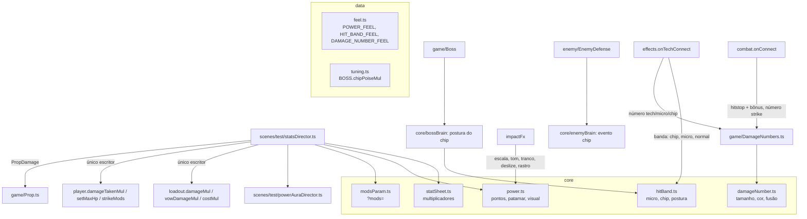

# Fundação de poder - Design

**Spec**: `.specs/features/fundacao-de-poder/spec.md` · **Plano**: `docs/plano-builds-e-habilidades.md` (seções 4 e 6.1)
**Status**: Draft

Linhas citadas conferidas no código em 14/10 (branch `feat/fundacao-de-poder`, depois de `4c0efae`). Linhas efetivas
contadas como o `max-lines` do `.oxlintrc.json` (sem linhas em branco e sem comentários): a contagem dá os 399 da
`TestScene`, os mesmos da spec.

---

## Architecture Overview

Quatro peças puras novas em `core/` e dois diretores novos em `scenes/test/`. Nada muda de camada: o `core` não importa
Phaser, o `data` guarda todos os números, e a `TestScene` só perde linhas.



Fluxo por quadro: `TestScene.update` chama `this.stats.update(delta)` no lugar de `this.vows.sync()`. O `StatsDirector`
monta a `StatSheet` (build + arsenal + votos), grava os números do `Loadout` e do `Player`, recalcula o `PowerLook` e
anda a aura. O golpe do player lê `player.strikeMods(move)` quando a hitbox abre; o objeto lê `PropDamage.damage(base)`
no toque.

---

## Code Reuse Analysis

### Existing Components to Leverage

| Component | Location | How to Use |
| --- | --- | --- |
| `strikeMultiplier(perks, traits)` | `src/core/build.ts:103` | O `statSheet` chama, sem copiar a regra das passivas |
| `relicStrikeMul`, `relicTechMul` | `src/core/arsenal.ts:82`, `:90` | O `statSheet` chama, sem copiar a regra das relíquias |
| `vowEffects(list, {kills})` | `src/core/vows.ts` | Entra na `StatSheet` pronto (a Fúria já vem com os abates) |
| `Modifiers.apply` / `level` / `meleeDamage` / `maxHp` | `src/core/modifiers.ts:63-96` | `?mods=` sobe nível pelo `apply` (o teto já vem dele); força lida por `level('forca')` |
| `Hitstop.trigger` (fica com o maior) | `src/core/hitstop.ts:17` | Micro e bônus de patamar só mudam o `ms` passado |
| `toneOf(s)` + `ImpactShape.tone` + `ImpactTone` | `src/game/cursedImpact.ts:16-48` | Já existe; falta só usar nas ondas de choque (l.148-149) e ler `scale` |
| `CursedFx.trail` e o getter `trails` (`widthPx`) | `src/game/CursedFx.ts:137`, `:159` | Recebe o bônus de largura; o smoke lê o `widthPx` |
| `CursedFlame.tick(dt, at, power)` | `src/game/techFx/CursedFlame.ts:36` | Brasas e chama da aura, cor `red` |
| `Slide.start(tier, dir)` | `src/core/slide.ts:16` | Ganha `scale = 1` |
| `FloatTexts` (texto, `css(PALETTE)`, `FX_DEPTH`, vida por `update`) | `src/game/FloatTexts.ts` | Mesmo padrão de objeto de texto; o `DamageNumbers` é classe à parte para não mudar o `FloatTexts.debug` |
| `Fx.spark(x, y, kind)` + `sparkSize` | `src/game/fx.ts:75`, `:112` | Ganha `size?` opcional para o chip (6) e o micro (10) |
| `Fx.shake()` (90 ms, 0,004) | `src/game/fx.ts:183` | Tremor do patamar 2 sem número novo |
| `debugParam` | `src/scenes/test/params.ts` | Lê `?mods=` |

### Integration Points

| System | Integration Method |
| --- | --- |
| Loja (`vida`) | `shopDirector.ts:39` troca `setMaxHp(modifiers.maxHp)` por `this.s.stats.sync()` antes do `heal` |
| Reset da run | `runDirector.ts:147` ganha `this.s.stats.reset()` logo depois do `this.s.vows.reset()`; l.134 ganha o `clear` dos números |
| Troca de área | `world.ts:164` (`teardown`) ganha o `clear` dos números |
| Técnicas | `TechContext.onTechHit(hit, point, target)` (`tech/shared.ts:33`), repassado por `TechRunner.ts:50` e pela `TestScene` l.319 |
| Snapshot | `snapshot.ts:56` (`debugSnapshot`) ganha uma linha `...this.s.stats.snapshotFields()`; o tipo mora em `game/powerSnapshot.ts` |

---

## Components

### `core/statSheet.ts` (novo, ~70 linhas)

- **Purpose**: único lugar que combina passivas, arsenal e votos em multiplicadores (POW-01).
- **Interfaces**:
  - `interface MeleeTraits { heavy: boolean; light: boolean; counter: boolean; shadow: boolean }`
  - `traitsOf(move: MoveDef, shadow: boolean): MeleeTraits`
  - `const PROP_TRAITS: MeleeTraits` = `{heavy: true, light: false, counter: false, shadow: false}` (POW-11)
  - `statSheet(input: StatInput): StatSheet`, com `StatInput = { perks, arsenal, vows: VowEffects, baseMaxHp }`
  - `StatSheet = { meleeMul(t: MeleeTraits): number; relicTechMul; vowTechMul; costMul; damageTakenMul; maxHp; guardOff }`
    - `meleeMul` = `strikeMultiplier(perks, t) × relicStrikeMul(arsenal, t.light) × (vows.damageMul × vows.meleeMul × (t.heavy ? vows.heavyMul : 1))`;
      os parênteses importam: a parte dos votos é calculada antes, como no `VowDirector.strikeMul` de hoje. Sem eles,
      com todos os votos e a Fúria no teto, o último bit muda e o teste de equivalência quebra
    - `relicTechMul` → `loadout.damageMul`; `vowTechMul` = `vows.techDamageMul × vows.damageMul` → `loadout.vowDamageMul`
    - `maxHp` = `round(baseMaxHp × vows.maxHpMul)`
- **Reuses**: `build.ts`, `arsenal.ts`, `vows.ts`. A ordem dos fatores é a de hoje (`TestScene.ts:516`), para o
  ponto flutuante dar o mesmo número no teste de equivalência.

### `scenes/test/statsDirector.ts` (novo, ~120 linhas)

- **Purpose**: dono dos números do combate; único escritor de `loadout.damageMul`, `vowDamageMul`, `costMul`,
  `player.damageTakenMul` e `setMaxHp` (POW-01); filtra o input do quadro; expõe a força.
- **Interfaces**:
  - `sheet(): StatSheet` (monta na hora a partir de `build.perks`, `arsenal.arsenal`, `vows.effects`, `modifiers.maxHp`)
  - `sync(): void` (o corpo do `VowDirector.sync` de hoje + o `syncTechBonus` do arsenal; `setMaxHp` só quando muda)
  - `update(deltaMs: number): void` (`sync()`, recalcula `power` e anda a aura)
  - `reset(): void` (aplica `?mods=` e chama `sync()`; POW-13)
  - `bindPlayer(p: Player): void` (liga o hook do golpe e recria a aura do player novo)
  - `strikeMods(move: MoveDef, peek = false): StrikeMods` (gasta o Passo sombrio pelo `build.consumeShadow(peek)`)
  - `inputFor(raw: InputSnapshot): InputSnapshot` (portão `acceptsPlayerInput`, `area.transitioning` e o
    `guardOff`, movido de `TestScene.ts:505-509`)
  - `readonly propDamage: PropDamage` (objeto fixo: `damage(base) = round(modifiers.meleeDamage(base) × sheet().meleeMul(PROP_TRAITS))`)
  - `power: PowerLook` (recalculado no `update`)
  - `readonly aura = new PowerAuraDirector(this.s)`
  - `snapshotFields(): { damageNumbers; power; stats }` (cada passo acrescenta o seu campo)
- **Dependencies**: `TestScene` (build, arsenal, vows, modifiers, loadout, player, run, area, ui).

### `scenes/test/powerAuraDirector.ts` (novo, ~55 linhas)

- **Purpose**: brasas (patamar 2) e chama no punho (patamar 3) na mão parada (POW-10).
- **Interfaces**: `bind(player)`, `update(deltaMs, look: PowerLook)`, `get view(): 'off' | 'embers' | 'flame'`.
- **Comportamento**: cria a `CursedFlame('red', ...)` só quando acende; o ponto é
  `player.renderPos + POWER_FEEL.handOffset[facing]`; sem repouso, `tick(dt, null)` apaga o que resta. O `bind` larga a
  chama antiga e o `SHUTDOWN` da cena zera a referência (edge case do `R`).
- **Reuses**: `CursedFlame`, `atRest` de `core/power.ts`.

### `core/power.ts` (novo, ~60 linhas)

- **Purpose**: pontos, patamar e o visual contínuo da força (POW-07, POW-08, POW-10).
- **Interfaces**:
  - `powerPoints({ forca, manoplas, punhoPesado }): number`
  - `powerTier(points): 0 | 1 | 2 | 3` (2, 5 e 8 pontos)
  - `powerLook(points): PowerLook` = `{ points, tier, p, impactScale, kickPx, forceMul, slideMul, trailBonusPx,
    hitstopBonusMs: { light, heavy }, shakes, tone: ToneKeys, aura: 'off' | 'embers' | 'flame' }`, com `p = min(points, 10)`
  - `atRest({ movePhase, grounded, casting, channeling, dead, idleFrame }): boolean`
- **Reuses**: números de `POWER_FEEL`.

### `core/hitBand.ts` (novo, ~50 linhas)

- **Purpose**: regras das faixas (POW-03, POW-14).
- **Interfaces**:
  - `microHitstopMs(strength): number` (15 leve, 20 forte)
  - `class MicroBudget { grant(strength, realNowMs): number; reset(): void }` (janela deslizante de 1000 ms de relógio
    real; devolve 0 se a soma passaria de 60 ms)
  - `bandPoiseDamage(hit, chipMul): number` (chip: `dano × chipMul`; micro e normal: regra de hoje, `bossBrain.ts:94`)
  - `bandStructureGain(band, gain): number` (chip 0, micro `gain / 2`)
- O tipo `HitBand = 'chip' | 'micro'` mora em `core/hit.ts` (sem import circular) e `Hit` ganha `band?: HitBand`.

### `core/damageNumber.ts` (novo, ~90 linhas) e `game/DamageNumbers.ts` (novo, ~90 linhas)

- **Purpose**: regra pura e vista do número de dano (POW-05, POW-06).
- **Core**: `type DamageKind = 'kokusen' | 'crit' | 'tech' | 'strike' | 'micro' | 'chip'`; `sizeFor(value, kind)`;
  `colorsFor(kind): { fill, outline }` (chaves da paleta); `class DamageBook { add(targetId, value, kind, nowMs):
  BookChange; promote(targetId, kind): BookChange | null; expire(nowMs): number[]; clear(); live; last }`. A fusão
  (300 ms desde o último acerto somado, prioridade do tipo, teto de 12 com fusão no mais recente do alvo ou despejo do
  mais antigo) fica toda no `DamageBook`.
- **Vista**: `show(target: { id }, value, kind, at: Vec2)`, `promote(targetId, kind)` (Kokusen com o "pop" de 1,6 a
  1,0 em 120 ms), `update(dtMs)` (relógio próprio somado de `dt`, sobe 18 px em 700 ms), `clear()`,
  `snapshot(): { live, last }`. Texto do Phaser no mundo, `FX_DEPTH`, contorno por `stroke`; criado em
  `UiSetup.addHud()` como `ui.damageNumbers` (a câmera de UI ignora sozinha pelo `route`).

### `core/modsParam.ts` (novo, ~20 linhas)

- **Purpose**: `parseModsParam(raw: string | null): [CoreModifierId, number][]` (POW-13: id desconhecido ou nível que
  não é inteiro positivo some). O `statsDirector.reset()` aplica cada par com `modifiers.apply` em laço (o teto vem
  do `apply`).

### Mudanças em arquivos existentes (por passo)

**Passo 1 (T1, refatoração, smokes iguais)**

| Arquivo | Linha | Mudança |
| --- | --- | --- |
| `src/scenes/TestScene.ts` | 18, 36, 52 | saem `acceptsPlayerInput`, `type InputSnapshot` e `NEUTRAL_INPUT` dos imports (linhas ficam: 0) |
| | 71 | sai `import type { MoveDef }` (−1) |
| | +2 | import do `StatsDirector` e campo `readonly stats = new StatsDirector(this)` (+2; o comentário não conta) |
| | 284 | `this.player.damageMul = ...` vira `this.stats.bindPlayer(this.player)` (0) |
| | 402-403 | `this.vows.sync()` vira `this.stats.update(delta)` (0) |
| | 472 | `this.inputFor(raw)` vira `this.stats.inputFor(raw)` (0) |
| | 504-509 | sai `inputFor` (−4) |
| | 511-517 | sai `strikeMul` (−3) |
| `src/scenes/test/vowDirector.ts` | 26-44 | saem `sync` e `strikeMul`; l.89 lê `this.s.stats.strikeMods(MOVES.jab, true).damage` (L-076: o mesmo número do hook) |
| `src/scenes/test/arsenalDirector.ts` | 24, 31, 35-37, 79-82 | saem o `syncTechBonus` e o `strikeMul`; o `reset` perde a chamada (o `stats.reset()` do `runDirector` cobre) e o `buy` chama `this.s.stats.sync()`, para o Rosário valer no mesmo quadro da compra, como antes |
| `src/scenes/test/buildDirector.ts` | 31-37 | `strikeMul` vira `consumeShadow(peek): boolean` (só o estado do Passo sombrio fica aqui) |
| `src/scenes/test/shopDirector.ts` | 39 | `setMaxHp(modifiers.maxHp)` vira `this.s.stats.sync()` (POW-01.4) |
| `src/scenes/test/runDirector.ts` | 147 | `this.s.stats.reset()` depois do `this.s.vows.reset()` |

`TestScene`: **399 → 393**. O `strikeMul` só tem os usos de `TestScene.ts:284` e `vowDirector.ts:89` (conferido com
`grep` em `src/`, `tests/` e `scripts/`).

**Passo 2 (faixas de acerto)**

| Arquivo | Linha | Mudança |
| --- | --- | --- |
| `src/core/hit.ts` | 22-45 | `HitBand` e `band?: HitBand` |
| `src/core/enemyBrain.ts` | 17-27, 73-107 | evento `{ type: 'chip'; hit }`; `receiveHit` extrai as recusas para `refuses(hit)` (complexidade de 20 para 18, já com o ramo da banda) e ganha `if (hit.band) return ...` depois da morte; `_downHits` não muda com banda |
| `src/game/enemy/EnemyDefense.ts` | 103-150 | `if (hit.band) return this.receiveBand(hit)` logo depois da guarda (l.115-118); a montagem de `effect`/`reaction` (l.119-125) vira `reactionFor(hit, wasBroken)` para a complexidade não subir |
| | 262-273 | `handle` trata `chip`: evento `chip:<id>`, sem reação de corpo (POW-15.9) |
| `src/core/bossBrain.ts` | 6-16, 94 | `chipPoiseMul` no `BossBrainTuning`; `poiseDamage = bandPoiseDamage(hit, t.chipPoiseMul)` |
| `src/data/tuning.ts` | 330-344 | `BOSS.chipPoiseMul: 0.5` |
| `src/data/feel.ts` | fim | `HIT_BAND_FEEL` (micro 15/20 ms, teto 60 ms em 1000 ms, faísca 10; chip faísca 6) |
| `src/scenes/test/effects.ts` | 33-38 | `onTechConnect(hit, point)` (o `target` entra no Passo 3, com o número): chip sem hitstop, sem `freeze`, faísca 6; micro com `MicroBudget.grant(strength, game.loop.time)` e faísca 10; normal como hoje |
| `src/game/fx.ts` | 112 | `spark(x, y, kind, size?)` |
| `src/game/tech/blue.ts` | 68, 115-128 | `applyDamage(..., band?)`: o tique (l.68) passa `'chip'`, a implosão (l.71) não passa nada |

`receiveBand` (novo, no `EnemyDefense`): `brain.receiveHit(hit)`; vazio devolve `false`; `handle(events)`; se morreu,
`walkVxStep = null` e `ai.interrupt()` como no caminho de hoje; vivo e `micro`, soma `bandStructureGain` (com
`onBreak` se quebrar); `hud.updateBar()`; devolve `true`. Sem `pickHitReaction`, sem `trackStreak`, sem efeito do golpe.

**Passo 3 (números de dano)**

| Arquivo | Linha | Mudança |
| --- | --- | --- |
| `src/scenes/test/uiSetup.ts` | 22, 68-71 | campo `damageNumbers!: DamageNumbers` criado em `addHud` |
| `src/scenes/test/combat.ts` | 96-104 | no bloco `hit.ownerId === player.id`: `ui.damageNumbers.show(target, hit.damage, 'strike', point)` (o `target` é opcional na assinatura: sem alvo, sem número; todo acerto do jogador hoje o passa) |
| `src/scenes/test/effects.ts` | 33 | número `tech`, `micro` ou `chip` pela banda |
| `src/game/tech/shared.ts` | 33 | `onTechHit(hit, point, target: Hittable)` |
| `src/game/TechRunner.ts` | 50 | assinatura do repasse |
| `src/game/tech/{blue,cut,divergent,purple,red}.ts` | blue 132/138, cut 61/68, divergent 183/208/240, purple 104, red 131 | passam o alvo que já têm na mão |
| `src/scenes/TestScene.ts` | 319 | `(hit, point, target) => this.effects.onTechConnect(hit, point, target)` (0) |
| | 324-327 | vira `(target, point, facing, streak) => this.impactFx.onKokusen(target, point, facing, streak),` (−3) |
| `src/scenes/test/impactFx.ts` | novo método | `onKokusen`: marca `kokusenFrame`, dispara `kokusenFx.trigger` e `damageNumbers.promote(target.id, 'kokusen')` (o Kokusen chama `onTechHit` antes, `divergent.ts:240-246`) |
| `src/scenes/test/drops.ts` | 33 | `this.s.ui.damageNumbers.update(dtMs)` |
| `src/game/FloatTexts.ts` | 7, 9 | exporta `FX_DEPTH` e `css` para o `DamageNumbers` reusar |
| `src/scenes/test/runDirector.ts` | 134 | `this.s.ui.damageNumbers.clear()` |
| `src/scenes/test/world.ts` | 164 | `s.ui.damageNumbers.clear()` |
| `src/game/powerSnapshot.ts` (novo) | — | `DamageNumbersSnapshot` (e, nos passos 4 e 6, `PowerSnapshot` e `StatsSnapshot`) |
| `src/game/debugApi.ts` | 23 | `GameSnapshot` ganha `damageNumbers` (+1 linha por campo, +1 import) |
| `src/scenes/test/snapshot.ts` | 56 | `...this.s.stats.snapshotFields()` (uma linha na função da lista de exceções; os campos crescem no `StatsDirector`) |

`TestScene`: **393 → 390**.

**Passo 4 (força contínua, patamar e tom)**

| Arquivo | Linha | Mudança |
| --- | --- | --- |
| `src/data/feel.ts` | fim | `POWER_FEEL` (teto 10; patamares 2/5/8; 0,05; 0,3 px; 0,03; 0,03; rastro 1 px a cada 2; hitstop forte 0/10/20/30 e leve 0/0/5/10; tons por patamar; aura 0,3 e 0,6; `handOffset` por `facing`) |
| `src/game/Player.ts` | 83-84 | `damageMul` vira `strikeMods: ((move: MoveDef) => StrikeMods) \| null` (mesmo número de linhas) |
| `src/game/player/strikes.ts` | 271-273 | lê `const mods = this.p.strikeMods?.(move) ?? NO_MODS` uma vez: `damage × mods.damage`, `force × mods.force` |
| `src/core/cameraKick.ts` | 14-26 | `kick(dx, dy, px = CAMERA_FEEL.kickPx)`; o `update` usa o `px` guardado |
| `src/core/slide.ts` | 16-21 | `start(tier, dir, scale = 1)`: `totalPx = cfg.px × scale` |
| `src/game/enemy/EnemyMovement.ts` | 90-93 | `slideBy(tier, dir, scale = 1)` repassa |
| `src/game/Enemy.ts` | 394-395 | `slideBy(tier, dir, scale = 1)` repassa |
| `src/core/impactTier.ts` | 12-18 | `ctx.forced?: ImpactTier` vence tudo (usado no passo 5; o teste entra aqui) |
| `src/game/cursedImpact.ts` | 16-28, 131-153 | `ImpactShape.scale?` multiplica o `k`; as ondas (l.148-149) usam `toneOf(s)` |
| `src/game/CursedFx.ts` | 159-160, 222, 313, 344-347 | `trail(path, strength, extraPx = 0)`; `impact(tier, at, dir, seed, look?)` com `look: ImpactLook = { scale, tone }` (`tone` já em `ImpactTone`, via `toneFromKeys`) levado pelo `shapeAt` só ao forte e decisivo |
| `src/scenes/test/impactFx.ts` | 56, 74, 85, 114, 122 | `look` do `stats.power` no `impact`, `slideMul` no `slideBy`, `kickPx` no `kick`, `trailBonusPx` nos dois `trail`; `reactCamera` ganha o `shake` do patamar 2 (`tier !== 'light' && power.shakes`); `lastImpact.tone` (chave do corpo do tom, `null` no leve) no snapshot |
| `src/scenes/test/combat.ts` | 91 | `HITSTOP_MS[strength] + (mine ? stats.power.hitstopBonusMs[strength] : 0)` |
| `src/scenes/test/statsDirector.ts` | — | `power` no `update`, `aura.update`, campo `power` no snapshot |
| `src/scenes/test/powerAuraDirector.ts` (novo) | — | ver acima |

O tom vira `ImpactTone` no adaptador: `toneFromKeys(keys: ToneKeys)` exportado de `game/cursedImpact.ts`, no molde
do `tone(...)` privado de `fx.ts:56-62` (que só aceita 4 chaves; o patamar tem 5). O `core` só conhece as chaves.
`TestScene`: 0.

**Passo 5 (objeto e arma pelo `ImpactFx`)**

| Arquivo | Linha | Mudança |
| --- | --- | --- |
| `src/game/Prop.ts` | 3, 51-52, 194-195 | `Modifiers` vira `PropDamage` (`{ damage(base: number): number }`, interface no próprio `Prop.ts`); `hit.damage = this.damage.damage(hit.damage)` |
| `src/scenes/test/arsenalDirector.ts` | 52 | `this.s.stats.propDamage` |
| `src/scenes/test/drops.ts` | 91 | `this.s.stats.propDamage` |
| `src/scenes/test/world.ts` | 355 | `this.s.stats.propDamage` |
| `src/scenes/test/combat.ts` | 83-90 | `mine && kind === 'prop'` vai para `impactFx.onPropImpact(hit, point, target)`, sem a faísca roxa e sem o `fx.shake` |
| `src/scenes/test/impactFx.ts` | novo método | `onPropImpact`: `onMeleeImpact(hit, point, target, 'heavy')` e o risco `heavy` do centro do player ao contato, com o `trailBonusPx` |

Só o player pega objeto (`holding.ts:24`, `arsenalDirector.ts:68`), então o `PropDamage` sempre resolve o golpe do
player. O Passo sombrio fica armado porque o `propDamage` lê `PROP_TRAITS` (`shadow: false`) e não chama
`consumeShadow`. `TestScene`: 0.

**Passo 6 (debug e snapshot)**

| Arquivo | Linha | Mudança |
| --- | --- | --- |
| `src/core/modsParam.ts` (novo) | — | parser de `?mods=` |
| `src/scenes/test/statsDirector.ts` | `reset` | aplica `?mods=` antes do `sync`; campo `stats: { meleeMul, techDamageMul, costMul }` |
| `src/game/powerSnapshot.ts`, `src/game/debugApi.ts` | 23 | `StatsSnapshot` e o campo |
| `tests/game/debugApi.test.ts` | 34 | o literal ganha `power`, `damageNumbers` e `stats` |
| `README.md` | 87-88 | linha de `mods=<id>:<n>[,<id>:<n>]` na tabela de parâmetros |
| `scripts/smoke/power.smoke.mjs` (novo) | — | ver "Testes e smokes" |

`TestScene`: 0. Fim da feature: **390 efetivas** (meta da spec: 393 ou menos).

---

## Data Models

```typescript
// core/hit.ts
export type HitBand = 'chip' | 'micro';
// Hit ganha: band?: HitBand

// core/statSheet.ts
export interface StrikeMods { damage: number; force: number } // multiplicadores lidos pelo strikes.ts
export interface MeleeTraits { heavy: boolean; light: boolean; counter: boolean; shadow: boolean }

// core/power.ts
export type PowerTier = 0 | 1 | 2 | 3;
export interface ToneKeys { shadow: string; body: string; core: string; altBody: string; altCore: string }
export interface PowerLook {
  points: number; tier: PowerTier; p: number;
  impactScale: number; kickPx: number; forceMul: number; slideMul: number; trailBonusPx: number;
  hitstopBonusMs: { light: number; heavy: number };
  shakes: boolean; tone: ToneKeys; aura: 'off' | 'embers' | 'flame';
}

// game/powerSnapshot.ts (POW-13)
export interface PowerSnapshot {
  points: number; tier: PowerTier; impactScale: number;
  hitstopBonusMs: { light: number; heavy: number }; tone: ToneKeys; aura: 'off' | 'embers' | 'flame';
}
export interface DamageNumbersSnapshot { live: number; last: { value: number; kind: DamageKind } | null }
export interface StatsSnapshot { meleeMul: number; techDamageMul: number; costMul: number }
```

`StrikeMods.damage` é o multiplicador de hoje (`player.damageMul`), não o dano: o `strikes.ts` continua aplicando o
`modifiers.meleeDamage` e o `Math.round` no mesmo lugar (l.271), e os números de hoje não mudam.

`aura` no `PowerSnapshot` é o estado real da chama (`powerAuraDirector.view`), não o desejado pelo patamar: o smoke
prova que ela acende na mão parada e apaga ao andar.

---

## Linhas efetivas dos arquivos tocados

| Arquivo | Hoje | Fim (estimado) | Observação |
| --- | --- | --- | --- |
| `src/scenes/TestScene.ts` | 399 | 390 | T1 −6, passo 3 −3; nenhum outro passo soma |
| `src/game/Player.ts` | 358 | 358 | troca de hook linha por linha, sem campo novo (também na exceção de complexidade: não sobe) |
| `src/scenes/test/world.ts` | 318 | 319 | +1 (`clear` dos números) |
| `src/game/Enemy.ts` | 311 | 311 | só a assinatura do `slideBy` |
| `src/game/debugApi.ts` | 307 | 311 | +3 campos +1 import (os tipos ficam em `game/powerSnapshot.ts`) |
| `src/game/Boss.ts` | 276 | 276 | sem mudança (a postura é do `bossBrain`) |
| `src/game/CursedFx.ts` | 275 | ~282 | `extraPx`, `look` |
| `src/data/tuning.ts` | 272 | 273 | `chipPoiseMul` |
| `src/game/enemy/EnemyDefense.ts` | 244 | ~262 | `receiveBand`, `reactionFor`, `chip` no `handle` |
| `src/game/Prop.ts` | 230 | ~232 | interface `PropDamage` |
| `src/scenes/test/combat.ts` | 223 | ~229 | número, bônus, ramo do objeto |
| `src/game/player/strikes.ts` | 211 | ~212 | `mods` uma vez |
| `src/scenes/test/snapshot.ts` | 209 | 210 | uma linha com espalhamento |
| `src/scenes/test/runDirector.ts` | 183 | 185 | `stats.reset`, `clear` |
| `src/game/fx.ts` | 180 | ~181 | `size?` |
| `src/scenes/test/impactFx.ts` | 163 | ~180 | `onKokusen`, `onPropImpact`, parâmetros do `power` |
| `src/core/bossBrain.ts` | 160 | ~161 | |
| `src/scenes/test/shopDirector.ts` | 144 | 144 | troca de linha |
| `src/game/cursedImpact.ts` | 142 | ~143 | |
| `src/core/enemyBrain.ts` | 125 | ~133 | evento e `refuses` |
| `src/game/tech/blue.ts` | 117 | ~118 | |
| `src/scenes/test/drops.ts` | 96 | 97 | |
| `src/scenes/test/arsenalDirector.ts` | 77 | ~68 | perde `syncTechBonus` e `strikeMul` |
| `src/scenes/test/uiSetup.ts` | 76 | ~79 | |
| `src/scenes/test/vowDirector.ts` | 70 | ~58 | perde `sync` e `strikeMul` |
| `src/scenes/test/effects.ts` | 45 | ~62 | faixas e números |
| `src/scenes/test/buildDirector.ts` | 40 | ~40 | `strikeMul` vira `consumeShadow` |
| `src/data/feel.ts` | 39 | ~85 | três blocos novos |
| `src/core/cameraKick.ts` | 36 | ~37 | |

Nenhum arquivo passa de 400, nenhum arquivo novo entra no `.oxlintrc.json`. Funções nas listas de exceção que este
design toca: `EnemyBrain.receiveHit` (20), `EnemyDefense.receiveHit` (21), `ImpactFx.onMeleeImpact` (16) e
`debugSnapshot` (150 linhas). As duas primeiras ganham uma extração que paga o ramo novo; o `onMeleeImpact` só recebe
argumentos novos (sem ramo: `forced` vai para dentro do `impactTier`); o `debugSnapshot` ganha uma linha só.

---

## Error Handling Strategy

| Error Scenario | Handling | User Impact |
| --- | --- | --- |
| `?mods=` com id desconhecido ou nível inválido | `parseModsParam` descarta a entrada | O resto do parâmetro vale |
| `?mods=forca:9` acima do teto | `modifiers.apply` para no teto | Força 5 |
| Acerto sem `target` no `onConnect` | O número usa a chave `-1` (sem fusão por alvo) | Número aparece, sem somar |
| Teto de 12 números | `DamageBook` funde no mais recente do alvo ou despeja o mais antigo | Nunca mais de 12 na tela |
| Teto do micro cheio | `MicroBudget.grant` devolve 0; faísca e número continuam | Sem engasgo extra |
| `R` reinicia a cena com a aura acesa | `bindPlayer` larga a chama velha; `SHUTDOWN` zera a referência | Sem chama órfã |
| Reset da run com números vivos | `clear()` no reset (`runDirector.ts:134`) antes do 1º quadro | Tela limpa |
| "Corpo de vidro" baixa o teto abaixo da vida | `Health.setMax` limita como hoje (`Player.ts:364`) | Igual a hoje |

---

## Risks & Concerns

| Concern | Location (file:line) | Impact | Mitigation |
| --- | --- | --- | --- |
| Complexidade acima de 15 já hoje (só aviso, lista de exceção) | `src/core/enemyBrain.ts:73` (20), `src/game/enemy/EnemyDefense.ts:103` (21) | O ramo da banda deixaria a função pior | Extrair `refuses(hit)` e `reactionFor(hit, wasBroken)` no mesmo passo; medir com `oxlint` antes e depois (a complexidade não sobe) |
| `debugSnapshot` com 150 linhas (exceção de `max-lines-per-function`) | `src/scenes/test/snapshot.ts:56` | Três campos novos aumentariam a exceção | Uma linha `...this.s.stats.snapshotFields()`; os campos crescem fora da função |
| Fields da cena não reiniciam no `scene.restart()` | `TestScene.ts:73-95` | `StatsDirector` e aura sobrevivem ao `R` com referência a objetos destruídos | `bindPlayer` no `createPlayer` recria a aura; o `DamageNumbers` nasce de novo no `addHud` a cada `create` |
| Relógio do teto do micro | `src/scenes/test/effects.ts` | O hitstop congela o relógio de jogo (`clockMs`, `TestScene.ts:415`), a janela nunca andaria | `MicroBudget` recebe `this.s.game.loop.time` (relógio real do laço) |
| `Fx.spark` não entra em nenhum teto | `src/game/fx.ts:112` | 8 inimigos no Azul soltam até 32 faíscas de chip por segundo (150 ms de vida cada, `STAR_MS`) | POW-14 mede `fx.live` e `fx.trails`; se o smoke passar de 40, o chip deixa de soltar os pedacinhos (`burst`) e fica só com o lampejo de tamanho 6 |
| `core/cameraKick.ts` importa `game/art/hd/screen` (o `core` não deveria conhecer `game`) | `src/core/cameraKick.ts:1` | Dívida de camada antiga | Fora do escopo; o `px` novo não aumenta a dependência |
| Equivalência do POW-01 por ponto flutuante | `src/core/statSheet.ts` | Mudar a ordem dos fatores troca o último bit e o `Math.round` pode cair do outro lado | Mesma ordem de `TestScene.ts:516` (build × arsenal × voto); o teste compara com `toBe` contra a fórmula literal de hoje |
| `?mods=vida:N` sobe o teto sem curar | `statsDirector.reset()` | A run começa com vida abaixo do teto | Só debug; o README avisa. A vida cheia continua vindo do `resetForRun` |
| Teste do adaptador (L-043) | `CursedFx.trail`, `Fx.spark`, `cameraKick` | Testar só o `powerLook` não prova que o número chega ao motor | Smoke lê `fx.trails[].widthPx`, `fx.lastImpact`, `hitstop.remainingMs` e `enemies[].slide`; `cameraKick.test` testa o `px` guardado |
| Limites exatos (L-010) | patamares 2/5/8, tamanhos 15/40, fusão 300 ms, teto 60 ms, 12 vivos | Trocar `<` por `<=` passaria em teste longe do limite | Cada teste novo prova os dois lados do limite (1 e 2 pontos, 14 e 15 de dano, 300 e 301 ms, 60 e 61 ms, 12 e 13 números) |
| `handOffset` sem medida | `POWER_FEEL.handOffset` | Chama fora da mão nos dois lados | Medir na prancha (`tools/hd-boards.mjs`, quadro `idle` da `player-yuta` e da `player-hd`) e conferir em movimento no jogo (repouso, corrida, repouso, para os dois lados) antes do commit do passo 4 |

---

## Tech Decisions

| Decision | Choice | Rationale |
| --- | --- | --- |
| Onde o Passo sombrio é gasto | Fica no `BuildDirector` (`consumeShadow(peek)`); o `statSheet` só recebe `shadow` nos traços | O `statSheet` continua puro e sem estado; o objeto não gasta por não chamar `consumeShadow` |
| Hook do golpe | `strikeMods` devolve multiplicadores `{damage, force}` | O `modifiers.meleeDamage` e o arredondamento ficam onde estão (`strikes.ts:271`), e o POW-01 sai igual |
| `stats.meleeMul` do snapshot | `meleeMul(traitsOf(MOVES.cotovelada, false))` (golpe forte sem Passo sombrio) | Um número só que mostra Punho Pesado, Manoplas e votos; o `vows.strike` continua com leve e forte |
| `stats.techDamageMul` do snapshot | `relicTechMul × vowTechMul` | É o fator que o `Loadout.damage` aplica (`loadout.ts:97`) |
| Faixa forçada do objeto | `impactTier(hit, { brokePosture, forced })` | Sem ramo novo no `onMeleeImpact`, que está na exceção de complexidade |
| Tipo do snapshot | `game/powerSnapshot.ts` com os três tipos | `debugApi.ts` (307) só ganha 3 campos e 1 import |
| Parser de `?mods=` | `core/modsParam.ts` com teste par | Regra testável mora no `core` (AD-001) |
| Tom no `core` | Só chaves da paleta (`ToneKeys`); o `ImpactTone` (números) nasce no adaptador | AD-001 e AD-009: o `core` não importa a `PALETTE` de `game/` |
| Relógio do micro | `game.loop.time` | Relógio real, igual em headless e no navegador |

Nenhuma decisão de projeto nova: o design segue AD-001, AD-009, AD-021 (o `tech` continua fora do limite do chão, a
banda não mexe nisso) e AD-023. O AD-014 (HP e dano fixos) continua valendo: a escala ficou para a F30.

---

## Testes e smokes

**Testes novos** (um arquivo por sistema; nenhum teste da lista de exceções cresce):

| Arquivo | Prova |
| --- | --- |
| `tests/core/statSheet.test.ts` | POW-01.3: 9 votos (nenhum + 8) × 7 relíquias (nenhuma, 3 × Nv 1 e 3) × 7 passivas (nenhuma + 6) × `jab`, `cotovelada`, `contra`, com e sem Passo sombrio, contra a fórmula literal de hoje; POW-01.5 pela conta (`maxHp` com e sem "Corpo de vidro") |
| `tests/core/power.test.ts` | POW-07/08: pontos, patamares nos limites (1/2, 4/5, 7/8), teto de 10 (13 pontos), valores contínuos em 0, 1, 10; `atRest` |
| `tests/core/hitBand.test.ts` | POW-03/14: 15/20 ms, janela de 1000 ms (999/1000/1001), soma 60/61 ms, postura do chip, estrutura do micro |
| `tests/core/damageNumber.test.ts` | POW-05: tamanhos 14/15, 39/40; cores por tipo; fusão 300/301 ms; prioridade; teto 12/13 com fusão e despejo; `promote` |
| `tests/core/enemyBrainChip.test.ts` | POW-03.4/5 e os edge cases de `gettingUp` e `downHits` com e sem `tech` |
| `tests/core/bossBrainChip.test.ts` | POW-03.6 (arquivo novo: `bossBrain.test.ts` está na lista de exceções) |
| `tests/core/modsParam.test.ts` | POW-13.2/3 |
| `tests/data/powerFeel.test.ts` | toda chave de tom e cor de número existe na `PALETTE`; `HITSTOP_MS` 50/90 e `kickPx` 4 intactos (POW-08.10) |

**Testes atualizados**: `tests/core/cameraKick.test.ts` (o `px` e o padrão de 4 px), `tests/core/impactTier.test.ts`
(`forced`), `tests/core/slide.test.ts` (`scale`), `tests/game/debugApi.test.ts` (literal com os 3 campos). Sem mudança:
`hitstop.test.ts`, `difficulty.test.ts`, `tuning.test.ts`, `build.test.ts`, `arsenal.test.ts`, `vows.test.ts`.

**Smoke novo** `scripts/smoke/power.smoke.mjs`, base `?debug&hd=1&area=modular&seed=1&maxAlive=1&enemyGuard=0`:

1. POW-13: `mods=forca:5&arsenal=manoplas,manoplas,manoplas` → 11 pontos, patamar 3, escala 1,5; `mods=forca:5` →
   patamar 2; sem nada → patamar 0; `mods=xx:2,forca:-1` ignorado.
2. POW-08: com `arsenal=manoplas,manoplas,manoplas&perks=punhoPesado` (8 pontos), a `cotovelada` deixa `fx.trails` 4 px
   mais largo, o deslize 24 % maior que sem build e `hitstop.remainingMs` partindo de 120.
3. POW-10: parado, `power.aura` é `flame`; andando, `off`; parado de novo virado para o outro lado, `flame`.
4. POW-05/06: o `jab` traz `damageNumbers.last` com o valor e o tipo `strike`.
5. POW-04/03b/15: com `tech=azul` e 5 inimigos (`maxAlive=5` no lugar do 1 da base), `hitstop.frozen` falso em todo quadro dos tiques, eventos `chip:<id>`,
   nenhum inimigo em `hitstun`, um chega a `attack`; `damageNumbers.last.kind` é `chip`.
6. POW-11: com `arsenal=bastao`, o golpe dispara `impact:heavy` e nenhuma faísca roxa; com Manoplas Nv 3 junto, o dano
   sobe ×1,3.
7. POW-14: 8 inimigos, Azul, Vermelho e soco juntos: `fx.live` ≤ 40, `damageNumbers.live` ≤ 12, hitstop dos micro
   somado ≤ 60 ms em qualquer janela de 1000 ms.

**Smokes por passo** (`npm run smoke -- <trecho>`):

| Passo | Smokes |
| --- | --- |
| 1 | `vows`, `arsenal`, `build`, `shop`, `fight`, `defense`, `run-loop`, `world-traverse` |
| 2 | `tech`, `techniques`, `enemy-`, `telegraph`, `boss`, `targets`, `fxlab` |
| 3 | `kokusen`, `tech`, `techniques`, `evolution`, `hud`, `drops`, `world-restart`, `power` (parte 4) |
| 4 | `fight`, `impact`, `feel`, `player-anim`, `power` (partes 1 a 3) |
| 5 | `held-item`, `armed`, `drops`, `arsenal`, `world-`, `boss-prop`, `power` (parte 6) |
| 6 | `boot`, `no-debug`, `power` inteiro |

O `armed` é instável (ARM-12): repetir isolado antes de suspeitar.
