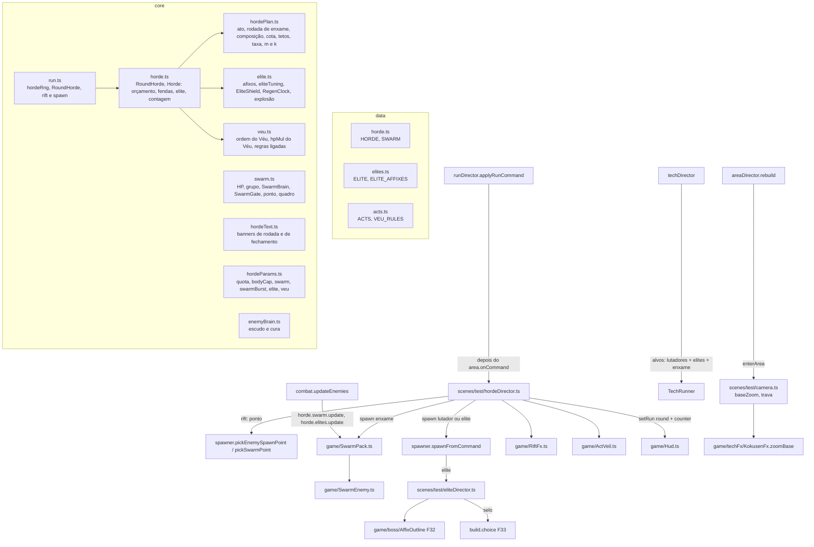

# Hordas em atos - Design

**Spec**: `.specs/features/hordas-em-atos/spec.md` · **Plano**: `docs/plano-builds-e-habilidades.md` (linha F38 da
seção 6, seções 3.1, 3.3 e 5.9) e a F27 de `docs/plano-cenario-rejogabilidade-hordas.md` · **Base**: F29
`fundacao-de-poder` (em implementação), F30 `vermelho-e-corpo`, F31 `expansao-de-dominio`, F32 `chefes-com-afixos`,
F33 `eixos-das-tecnicas`
**Status**: Draft

Linhas citadas conferidas em 14/10 na branch `feat/fundacao-de-poder` (commit `f32565d`, F29 até o passo 3; a árvore
de trabalho tem mudanças sem commit em `Player.ts`, `strikes.ts`, `debugApi.ts` e `statsDirector.ts`, que não mudam as
linhas citadas aqui). O que a F30, a F31, a F32 e a F33 criam ou trocam é citado pelo nome e pela interface dos designs
delas (`build.onMeleeHit(hit, point, target)`, `ChoiceQueue`, `choiceRank`, `choiceDirector`, `buildPage`,
`AffixOutline`, `outlineKeyAt`, `spawner.wireEnemy`, `runDirector.bosses`, `domainDirector`, `domainPowers`); as linhas
desses pontos valem depois dos merges e são reconferidas no começo de cada passo. Linhas efetivas contadas como o
`max-lines` do `.oxlintrc.json` (sem linha em branco e sem comentário): a `TestScene` tem 390 hoje e as F30 a F33
terminam em 390.

Duas correções de citação da spec, conferidas no código: `multipliersFor` mora em `core/difficulty.ts:41-48` (não
188-195), e nenhum dos smokes `run-loop` e `world-traverse` lê o texto "Inimigos: N" do HUD (só o `hud.smoke.mjs:46-49`
lê).

---

## Abordagens consideradas

| Abordagem | Como fica | Decisão |
| --- | --- | --- |
| **A. Diretor puro dentro da `Run` + `HordeDirector` na cena** (recomendada) | Cota, orçamento, tetos, fendas (com o relógio de 600 ms), escolha do tipo, elite e regras do ato num módulo puro (`core/horde.ts`, com o plano da rodada em `core/hordePlan.ts`), que a `Run` usa no lugar do `WaveSpawner` pela interface `RoundHorde`. A `Run` emite `rift` e `spawn`; a cena (`scenes/test/hordeDirector.ts`) escolhe o ponto na abertura da fenda, desenha a fenda e faz nascer | **Escolhida.** Mantém a ordem fixa do `Run.update` (morte, abates, tempos), o relógio da fenda para no hitstop e na loja junto com a rodada (FEN-01.2) sem código novo, e todo número é testado em Node (AD-001, AD-006) |
| B. Diretor na cena, a `Run` só conta | A cena decide orçamento e fenda com o `clockMs`; a `Run` recebe "nasceu" e "morreu" | Recusada: o orçamento e a cota saem do teste puro, a fenda precisaria de uma pausa própria no hitstop e na loja, e "mesma seed, mesmas fendas" (HRD-07) dependeria da ordem dos callbacks |
| C. Enxame como `Enemy` com tuning menor | O membro reaproveita o lutador inteiro | Recusada: cada `Enemy` tem um ouvinte `beforeupdate` (`Enemy.ts:133`), ragdoll de morte, guarda, estrutura, barra (`EnemyHud`), entra no `AttackGate` e no foco da postura; com 30 corpos o custo e as regras ficam errados (ENX-11, HPF-03, HPF-04) |

O usuário mandou seguir a recomendação para o que a seção 7 do plano não fecha; a abordagem A não troca nenhum requisito
da spec.

---

## Architecture Overview



**Fluxo por quadro** (a ordem da `TestScene` não muda; só a linha do `hud.setRun` vira `this.horde.update(dt)`):

1. Passo do Matter (antes do `update` da cena): contatos da hitbox do player e das técnicas chegam a `receiveHit` dos
   lutadores, das elites e dos membros do enxame. O membro que morre só se marca (`dead`); o corpo sai da física no
   `SwarmPack.update` do mesmo quadro (ENX-08), nunca dentro do callback de contato.
2. `updateGameplay`: `player.update` → ... → `techDirector.update` (a lista de alvos das técnicas passa a ser
   `this.s.horde.targets()`: lutadores, elites e enxame; ENX-10) → `combat.updateEnemies(dt)`, que, depois dos
   lutadores, chama `this.s.horde.updateUnits(dt)`: IA e limitador do enxame, mordidas, retirada dos mortos, troca de
   quadro; regeneração, escudo, contorno, rótulo e explosões das elites.
3. `area.update` e `run.update`: o `Horde` anda o orçamento e as fendas e devolve `rift` e `spawn`; o
   `runDirector.applyRunCommand` repassa cada comando ao `hordeDirector.onCommand` logo depois do `area.onCommand` (a área
   da rodada já está montada quando a 1ª fenda escolhe o ponto).
4. `this.horde.update(dt)` (no lugar das linhas 423-425 da `TestScene`): `RiftFx` (fendas e marcas de borda) e
   `hud.setRun({ round, counter })`.

**Fluxo de comandos** (da `Run` para a cena):

| Comando | Quem trata | O quê |
| --- | --- | --- |
| `startRun` | `hordeDirector.reset()` | limpa fendas, enxame, elites e explosões; esconde o véu do ato |
| `roundStart` | `area.onCommand` (rebuild) e depois `hordeDirector.onRoundStart(round)` | descarta fendas abertas (FEN-05), liga o véu do ato (ATO-03), o banner vem do `runDirector` com `roundStartText` |
| `rift` | `hordeDirector.onRift(cmd)` | escolhe o ponto (lutador e elite: `pickEnemySpawnPoint`, SPN-07..09; enxame: `pickSwarmPoint`, ENX-13), guarda por `id`, abre a fenda no `RiftFx`, evento `rift:<id>` |
| `spawn` | `hordeDirector.onSpawn(cmd)` | chefe: `spawner.spawnBoss` (sem fenda, FEN-07); lutador: `spawner.spawnFromCommand(point, round)`; elite: o mesmo com o `EliteSpec`; enxame: `swarm.spawnGroup(point, count, aerial)`; fecha a fenda em 150 ms; uma fumaça por unidade (FEN-04) |
| `roundCleared` | `hordeDirector.onRoundCleared(round)` | na rodada de enxame, o Selo (ESP-04) |
| `shopOpen` | `hordeDirector.onShopOpen()` | esconde o véu do ato (a konbini não tem, ATO-03.2) |
| `gameOver` | `hordeDirector.onGameOver()` | descarta as fendas abertas sem nascimento (edge case "player morre com fendas abertas") |

No laboratório de efeitos e com `?debug&spawn=0` o `hordeDirector` ignora `rift` e `spawn` (FXL-01, como o `case
'spawn'` de hoje, `runDirector.ts:56-63`); a `Run` segue contando como nascido, como hoje.

---

## Code Reuse Analysis

### Existing Components to Leverage

| Component | Location | How to Use |
| --- | --- | --- |
| `waveSize`, `maxAliveFor`, `isBossRound`, `farthestPoint`, `requireSpawnPoints` | `src/core/waves.ts:27-63` | Ficam. `waveSize` é o `W(r)` da cota do ato I (HRD-09) e da calibragem `m(r)`/`k(r)` (HRD-11, ENX-12); `maxAliveFor` é o teto de lutadores (HRD-04) |
| `WaveSpawner` (contagem por id, `enemyDied` idempotente) | `src/core/waves.ts:70-147` | Passo 0: embrulhado por `WaveHorde` (implementa `RoundHorde`). Passo 1: sai; a contagem por id (WAVE-06/08) passa ao `Horde` com o mesmo `Set` de ids |
| `Run` (ordem morte → abates → tempos; streams com sal) | `src/core/run.ts:207-217`, `:297-307` | `hordeRng` com `seed ^ 0xc2b2ae35` no mesmo molde; `spawner` vira `horde: RoundHorde`; `advanceTimers` (`:249-252`) repassa as ordens do diretor como comandos |
| `expectedIncome` | `src/core/economy.ts:10-18` | Não muda (HRD-11): a régua segue `waveSize × 3 × valor`; o teste prova que a composição nova dá a mesma média |
| `multipliersFor`, `scaleFor` | `src/core/difficulty.ts:41-64` | `scaleFor` ganha um 4º parâmetro `hpExtra = 1` (Véu, bruto pesado, elite ×2,5) multiplicado antes do único `Math.round`; com 1 o número é o de hoje, bit a bit |
| `pickSpawnPoint` e `SPAWN_VIEW_MARGIN` | `src/core/spawnPoint.ts`, `src/scenes/test/spawner.ts:19-48` | Lutador e elite escolhem o ponto da fenda com a regra de hoje, chamada na abertura da fenda (FEN-06) |
| `spawnFromCommand` (escala, armado, aparência, tipo do golpe, ligações) e o `wireEnemy` da F32 | `src/scenes/test/spawner.ts:51-104` (a F32 extrai as linhas 89-103 para `wireEnemy`) | A elite nasce por aqui com um `EliteSpec`; o lutador segue igual com `hpExtra` e o teto de armado do ato |
| `attackKindFor` | `src/core/attackKind.ts:14-17` | Ganha `heavyBruto?: boolean` (ATO-04): `bruto` desarmado vira `red` |
| `armedChance`, `Loot.rollArmed`, `Loot.enemyDrop`, `ElixirRoll` | `src/core/loot.ts:40-43`, `:74-98`, `:105-115` | `rollArmed(round, cap?)` (teto 0,65 no ato IV); `swarmDrop` e `eliteDrop` novos, no mesmo stream de loot e na ordem "cura, depois fragmentos" (ECO-17) |
| `Drops.applyDrop`, `rollElixir` | `src/scenes/test/drops.ts:63-80` | Drop do enxame e da elite no ponto da morte |
| `combat.onEnemyDied` | `src/scenes/test/combat.ts:73-77` | Ganha `kind` (`'enemy'` por padrão; `'swarm'`, `'elite'`) e repassa à `Run` |
| `combat.onConnect` | `src/scenes/test/combat.ts:83-107` | O golpe que acerta vários membros do enxame conta uma vez (ENX-11), agrupado pelo `Hit.swingId` (`core/hit.ts:50`) |
| `combat.attackerOf` | `src/scenes/test/combat.ts:125-134` | Acha o membro do enxame pelo id para o parry da mordida (ENX-07) |
| `AttackHitbox` | `src/game/hitbox.ts:55-108` | Mordida do enxame: uma por membro, com corpo Matter só na abertura (no máximo 3 abertas, ENX-06); entrega e defesa do player iguais às da garra; o `onConnect` da hitbox vai para o `hordeDirector.onBiteConnect` (faísca e hitstop micro), não para o `combat.onConnect`, que daria 50 ms por mordida |
| `resolveIncomingHit` | `src/core/defense.ts:75-92` | Sem mudança: a mordida `low` sem `unblockable` passa na guarda e no parry (que não olham a altura) e no pulo (`airborne && low`), e o agachar não a evita (só evita `high`) |
| `newEntityId`, `tagBody`, `Hittable`, `routeContacts` | `src/game/bodyTags.ts:13-85` | O membro é `Hittable`/`TechTarget`; `Hittable` ganha `readonly elite?: boolean` (ELT-12) |
| `Filters.enemy` | `src/core/collision.ts` | Corpo do enxame: só terreno e hitbox (par inimigo-inimigo nunca é resolvido) |
| `BodyRenderPos` (AD-019) | `src/game/` (usado em `Enemy.ts:111`) | Sprite do membro na posição interpolada |
| `HdSheet`, `registerIndexedSheet`, `decodeAtlasFrame`, o molde do `sleeperSheet` | `src/game/art/hd/sheet.ts:21-28`, `src/game/art/index.ts:75-77`, `src/game/art/hd/atlas/sleeperSheet.ts` | Folha `enemy-swarm` provisória e o ponto de troca para o atlas (ENX-14) |
| `fx.curseSmoke`, `fx.spark` | `src/game/fx.ts:113`, `:193` | Uma fumaça por grupo (FEN-04); faísca pequena nos membros seguintes (ENX-11); faísca `C` na quebra do escudo |
| Véu da arena preso à câmera (`Rectangle` com `scrollFactor` 0, alpha, profundidade) | `src/scenes/test/arena.ts:11-44` | `ActVeil` copia o molde, na profundidade −8 (ATO-03) |
| `CameraRig` (seguidor próprio, pulso, conjuração) e `ZoomPulse` | `src/scenes/test/camera.ts:28-91`, `src/core/cameraKick.ts:38-57` | Zoom base e trava da arena (PRT-01..05) |
| `outlineKeyAt` e `AffixOutline` (F32) | `core/bossAffix.ts:195-203` (branch `feat/chefes-com-afixos`), `game/boss/AffixOutline.ts` (design da F32) | O ciclo de chaves sai para `cycleKeyAt(keys, ms, swapMs)` (o `outlineKeyAt` passa a chamá-lo); a elite usa o mesmo `AffixOutline` sobre o `fxSprite` (`Enemy.ts:191`) |
| `ChoiceQueue`, `choiceRank`, `buildPage`, `choiceDirector` (F33) | `core/choice.ts`, `core/choicePages.ts`, `scenes/test/choiceDirector.ts` (F33) | Selo = `{ kind: 'livre', origin: 'selo' }`; página pulada vira fragmentos (ELT-09/10, ESP-04) |
| `Hud.setRun`, `Hud.banner` | `src/game/Hud.ts:285-293`, `:299` | `setRun` troca o campo `remaining` por `counter` (texto pronto), sem linha nova (HRD-12); banners com os textos de `core/hordeText.ts` |
| `DamageNumbers` (teto de 12), `MicroBudget` (60 ms), `microHitstopMs` e `Hit.band` (F29) | `game/DamageNumbers.ts`, `core/hitBand.ts` | Nenhum hitstop nem número em massa com o enxame (ENX-15); a mordida que conecta ou é bloqueada pede `microHitstopMs('light')` a um `MicroBudget` do `hordeDirector` (ENX-05) |
| `armedChance`, `ElixirRoll` | `src/core/loot.ts:40-43`, `:105-115` | `a(r)` e a chance média de Elixir `e(r)` da calibragem do enxame (ENX-12, HRD-11) |
| `debugParam`, `debugIntParam` | `src/scenes/test/params.ts:5-15` | Parâmetros novos lidos no `hordeDirector.runOptions()` |
| `__game.step(ms)` e `render()` | `src/game/debugApi.ts:428-450` | Medição do HPF-01 em laço dentro da página |

### Integration Points

| System | Integration Method |
| --- | --- |
| `Run` | `private horde: RoundHorde \| null` no lugar de `spawner` (`run.ts:58`); getters `alive`, `roundKills`, `queued`, `remaining`, `maxAlive` delegam (`:110-130`); `enemyDied(id, kind = 'enemy')`; `RunOptions.horde?: HordeOverrides`; `hordeRng` e `veuOrder` criados no `resolveStart` (`:297-307`); `startNextRound` e `resolveStart` criam `new Horde(planRound(...), hordeRng)` |
| Comandos | `RunCommand` ganha `{ type: 'rift'; round; id; kind: UnitKind; count; aerial; affixes }`; `spawn` ganha `rift: number \| null`, `count` e `affixes`; `SpawnKind` passa a `'enemy' \| 'boss' \| 'swarm' \| 'elite'` (`'enemy'` continua sendo o lutador, para o `run.test.ts` não reescrever o tipo) |
| Cena | `readonly horde = new HordeDirector(this)` na `TestScene`; `runDirector.applyRunCommand` chama `this.s.horde.onCommand(cmd)` logo depois de `this.s.area.onCommand(cmd)` e perde o `case 'spawn'`; a opção `maxAliveOverride` da construção da `Run` (`TestScene.ts:248`) vira `...this.horde.runOptions()` |
| HUD | `this.horde.update(dt)` chama `hud.setRun(round > 0 && !fxLab ? { round, counter } : null)` com `counter` = `Abates: k/q`, `Chefe` ou (só no passo 0) `Inimigos: N` |
| Por quadro | `combat.updateEnemies` termina com `this.s.horde.updateUnits(dt)` (enxame e elites); `techDirector.update` lê `this.s.horde.targets()` |
| Combate | `combat.onConnect` pergunta `this.s.horde.swarm.repeatHit(hit, target)`; `combat.attackerOf` procura em `this.s.horde.swarm.byId(ownerId)`; `combat.onPlayerMoveStart` passa `guardMul: this.s.horde.guardMul()` (Véu `guardaFirme`) |
| Lutador e elite | `spawner.spawnFromCommand(point, round, elite = null)`; `hpExtra`, `heavyBruto` e o teto de armado vêm de `this.s.horde.unitRules(round, elite)`; a elite é ligada por `this.s.horde.elites.attach(enemy, spec)` |
| Selo | `eliteDirector.onDied` e `hordeDirector.onRoundCleared` chamam `this.s.build.choice.addEliteSeal(origin)` (F33 `choiceDirector`) |
| Câmera | `areaDirector.rebuild` chama `s.camera.enterArea(variant !== null ? s.world.arena.sealSpan() : null)` antes do `followConfig` (`areaDirector.ts:131-136`); o `CameraRig` grava `kokusenFx.zoomBase` |
| Regras que separam comum, elite e chefe | `Hittable.elite` (`true` só na elite); F31 `domainActivation` (fração `elite`), F30 Perfuração 3 e F33 Puxão 3 leem `target.elite === true`; o enxame não tem o campo e conta como comum |
| Snapshot | `snapshot.ts` espalha `...this.s.horde.snapshotFields()` (`horde`, `swarm`) e, dentro de `camera`, `...this.s.camera.lockSnapshot()` (`baseZoom`, `locked`); tipos em `game/hordeSnapshot.ts` |
| Konbini | `choiceDirector` (F33) monta a página `livre` de origem `selo` com o `buildPage` de hoje; o `skip` do CHC-08 numa página de Selo credita `15 × fragmentValue(r)` e mostra "Selo: +N fragmentos" |

---

## Components

### `data/horde.ts` (novo, ~75 linhas)

- **Purpose**: números do diretor e do enxame, fora do `data/tuning.ts` (273 linhas efetivas hoje, ~306 com as F30 a
  F33; `HORDE` e `SWARM` levariam o arquivo perto de 360).
- **Interfaces**: `HordeTuning` e `HORDE = { lutadorMax: 14, bodyCap: 32 (provisório até o HPF-02), bodyBase: 6,
  bodyPerRound: 2, swarm: { from: 6, base: 8, perRound: 3, max: 40 }, eliteFrom: 8, riftMs: 600, riftCloseMs: 150,
  budget: { start: 9, base: 1.5, perRound: 0.15, perSec: 0.02, maxRate: 6, stored: 12 }, cost: { enemy: 3, swarm: 1,
  elite: 0 }, group: [0, 0, 4, 5, 6] (índice = ato, do IV em diante o último), swarmRound: { first: 13, every: 5, base:
  30, perRound: 2, max: 60, rateMul: 2, stored: 18, group: 6 } }`; `SwarmTuning` e `SWARM = { hp: { base: 12, min: 12,
  max: 20 }, body: { w: 18, h: 24 }, speed: 95, offsetPx: 14, rangePx: 40, windupMs: 300, biteMs: 120, lungePx: 48,
  restMs: 1000, damage: 5, force: 2, hitStunMs: 150, parry: { pushPx: 40, stunMs: 500 }, dieMs: 300, gate: { max: 3,
  gapMs: 200 }, aerial: { chance: 0.3, liftPx: 96 }, minDistPx: 160, bite: { offsetX: 14, offsetY: -2, width: 20,
  height: 14, hitHeight: 'low' }, rangeDyPx: 24, jitterPx: 3, depth: -1 }`.
- **Reuses**: o padrão dos outros arquivos de `data/` (interface + constante, comentário com o requisito).

### `data/elites.ts` (novo, ~45 linhas)

- `EliteAffix = 'escudo' | 'explosivo' | 'rapido' | 'regenerador'`; `ELITE_AFFIX_IDS` (ordem fixa do sorteio);
  `ELITE_AFFIXES: Record<EliteAffix, { name: string; outline: string }>` (Escudada `c`, Explosiva `a`, Rápida `A`,
  Regeneradora `G`).
- `ELITE = { hpMul: 2.5, scale: 1.2, fragments: 8, at: [0.4, 0.7], outlineNone: 'U', outlineSwapMs: 600, shield: {
  fraction: 0.4, heavyMul: 2 }, blast: { radiusPx: 72, warnMs: 700, damage: 12, mul: 1.5 }, rapido: { speed: 1.4,
  windup: 0.8, rest: 0.6 }, regen: { delayMs: 2000, tickMs: 200, fraction: 0.008 } }`.

### `data/acts.ts` (novo, ~55 linhas)

- `ActRules { light: { key: string; alpha: number } | null; group: number; affixes: 0 | 1 | 2; heavyBruto: boolean;
  armedCap: number | null; veu: boolean }`; `ACTS: readonly ActRules[]` com I a V (o V vale para todo ato depois):
  I `a` 0,10; II nenhum; III `S` 0,12; IV `r` 0,14; V `t` 0,18. Afixos 0/0/1/2/2; `heavyBruto` e `armedCap: 0.65` do
  IV em diante; `veu` do V em diante.
- `VeuRule = 'enxameVeloz' | 'eliteDupla' | 'guardaFirme' | 'semTregua'`; `VEU_RULES` (ordem fixa de base para a
  permutação); `VEU = { hpPerAct: 1.15, fromAct: 5, swarmSpeed: 1.25, secondEliteAt: 0.7, guardMul: 1.5, rateMul: 1.3,
  storedMul: 1.5 }`; `VEU_LABELS` ("Enxame veloz", "Elite dupla", "Guarda firme", "Sem trégua").
- `actRules(act): ActRules` (ato além do V devolve o V) e `ROMAN` (I a X, e o número arábico depois do X).

### `core/hordePlan.ts` (novo, ~95 linhas)

- **Purpose**: tudo que se decide uma vez por rodada (HRD-02, HRD-04, HRD-09, ESP-01/02, ATO-01, VRB-02), puro.
- **Interfaces**:
  - `actOf(round): number` = `ceil(round / 5)` (rodada < 1 vale 1).
  - `isSwarmRound(round, t = HORDE): boolean` = `round >= 13 && (round − 13) % 5 === 0`.
  - `composition(round, ctx): Composition` = `{ enemy, swarm, elite }`; rodada comum: `enemy = min(6 + 2·(r−1), 14)`,
    `swarm = 0` até a r5 e `min(8 + 3·(r−6), 40)` da r6, `elite = 1` da r8 (2 com `eliteDupla`); rodada de enxame:
    `{ 0, min(30 + 2·(r−13), 60), 0 }`; com `swarm=0` a parte do enxame é 0; antes do passo 2 (`ctx.swarmOn === false`)
    a composição é `{ waveSize(r), 0, 0 }`.
  - `applyQuota(comp, quota)` (`?debug&quota=n`): a elite fica (se `n > elite`), o enxame vira `round(swarm / (enemy +
    swarm) × (n − elite))` e o resto é lutador; `n ≤ elite` vira `{ n, 0, 0 }`.
  - `planRound(round, ctx): RoundPlan` (ver Data Models): cota, tetos (`lutadorCap = o ?? maxAliveFor(r)`, `bodyCap =
    min(6 + 2·(r−1), o.bodyCap ?? HORDE.bodyCap)`), grupo (`HORDE.group[ato]`, 6 na rodada de enxame), `rateMul` e
    `stored` (rodada de enxame ×2 e 18; `semTregua` ×1,3 e ×1,5), `eliteAt` (`[ceil(0,4·q)]`, `[ceil(0,4·q),
    ceil(0,7·q)]` com `eliteDupla`, `[0]` com `?debug&elite=`), regras do Véu ligadas e o `veuHpMul`.
  - `budgetRate(round, elapsedMs, plan, t): number` = `min(1,5 + 0,15·(r−1) + 0,02·t, 6) × plan.rateMul` (pontos/s).
  - `swarmDropMean(round, comp, waveT, econ): number` = `max(0, ((W − L) · μ − E · (8 + 2a)) / S)` com `a =
    armedChance(r, econ.armed)` (teto de hoje, 0,5) e `μ = 3 + a · econ.armedBonus` (0 com `S = 0`);
    `swarmHealFactor(round, comp, waveT)` = `(W − L − E) / S`; `swarmElixirChance(round, comp, waveT, econ, elixir)` =
    `swarmHealFactor × (a · elixir.armedChance + (1 − a) · elixir.chance)` (ENX-12, HRD-11). Na r6: `a` 0,3, `μ` 3,6,
    `m` 0,9; na r8: `m` (6 · 3,8 − 8,8) / 14 = 1,0; na r19: `m` 0,375; na r13 (enxame): `m` 2,67.
- **Dependencies**: `waves.ts` (`waveSize`, `maxAliveFor`, `isBossRound`), `veu.ts`, `data/horde`, `data/acts`.

### `core/horde.ts` (novo, ~165 linhas; `WaveHorde` mora aqui só no passo 0)

- **Purpose**: a onda da rodada por orçamento, com fenda (HRD-03..08, FEN-01, FEN-05, ELT-01, ELT-03, ESP-02).
- **Interfaces**:
  - `interface RoundHorde { readonly alive; kills; queued; remaining; cleared; maxAlive; quota; rifting: number;
    enemyDied(id, kind): boolean; update(dtMs): HordeOrder[]; view(): HordeView }`.
  - `class WaveHorde implements RoundHorde` (passo 0): embrulha o `WaveSpawner` de hoje e transforma cada `SpawnOrder`
    em `{ type: 'spawn', ... }`, com `quota = size`, `rifting = 0`.
  - `class Horde implements RoundHorde` (passo 1 em diante): `constructor(plan: RoundPlan, rng: Rng, t = HORDE)`.
- **`update(dtMs)`, nesta ordem** (a rodada de chefe devolve `{ spawn, boss }` no 1º `update` e nada mais):
  1. `elapsed += dt`. 1º `update`: `budget = 9` (ou o que o `plan` disser), abre as fendas do `swarmBurst` (fora do
     orçamento e dos tetos) e não soma taxa. Demais: `budget = min(stored, budget + budgetRate × dt / 1000)`.
  2. Fendas abertas: `msLeft −= dt`; com `msLeft ≤ 0` sai `{ type: 'spawn', rift: id, kind, count, affixes }` e as
     contagens passam de "em fenda" para "vivo" (FEN-01: nasce em 600 ms, nunca em 599).
  3. Elite: para cada limiar de `plan.eliteAt` ainda não usado, se `kills ≥ limiar` e `bodies + 1 ≤ bodyCap`, abre a
     fenda da elite com `affixes = drawAffixes(rng, ato)` (o sorteio sempre consome o stream; o `?debug&elite=` troca o
     resultado, DBH-01.2).
  4. Laço de nascimento: enquanto houver tipo elegível, sorteia o tipo se não houver um guardado ou se o guardado ficou
     inelegível (`rng.next() × (wL + wS) < wL` → lutador, com `wL` e `wS` o que falta de cada um na cota, 0 para quem
     não tem vaga, HRD-07); `cost` = 3 (lutador) ou o tamanho do grupo (1 por membro); se `budget < cost`, para e guarda
     o tipo; senão abre a fenda (`aerial = rng.chance(0,3)` só no enxame), `budget −= cost`, limpa o guardado.
- **Elegibilidade**: lutador com `enemyLeft > 0`, `lutAlive + lutRifting < lutadorCap` e `bodies < bodyCap`; enxame com
  `count = min(group, swarmLeft, bodyCap − bodies) > 0`. `bodies` conta vivos e membros em fenda (HRD-04); a elite fica
  fora do teto de lutadores. Nascidos + fendas nunca passam da cota (HRD-05), porque `enemyLeft` e `swarmLeft` já
  descontam os dois.
- **Contagem**: `enemyDied(id, kind)` com um `Set` de ids (WAVE-06/08), por tipo; conta todo id novo, nascido ou não
  (o `Horde` nunca vê os ids das entidades, e o `run.test.ts` mata os ids 1 a 6 sem nascimento no `cleared()`, l.24-34);
  `remaining = quota − kills`; vivos por tipo = `max(0, nascidos − abatidos)` e `alive` a soma;
  `queued = max(0, quota − kills − alive − rifting)` (DBH-03); `cleared = kills ≥ quota` (a cota que termina numa fenda
  só fecha quando ela nasce e morre, edge case); `maxAlive = lutadorCap`.
- **Dependencies**: `hordePlan.ts`, `elite.ts` (`drawAffixes`), `rng.ts`.

### `core/swarm.ts` (novo, ~150 linhas)

- **Purpose**: regras puras do enxame (ENX-02..07, ENX-12/13, ENX-14 na escolha do quadro).
- **Interfaces**:
  - `swarmHp(hpMul, t = SWARM)` = `clamp(round(12 × hpMul), 12, 20)` (ENX-02).
  - `groupOffset(index, count, id, t)` = `(index − (count − 1) / 2) × 14 + ((id mod 5) − 2) × 3` (ENX-04: o desvio por
    id impede que membros de grupos diferentes se empilhem no mesmo pixel).
  - `class SwarmBrain`: estados `chase | windup | bite | rest | stun | dead`; `update(dtMs, dxToTarget, dxToPlayer,
    dyToPlayer, gate): SwarmIntent` com `{ vx, startWindup, openBite, closeBite }`; `stun(ms)` (golpe aceito 150, parry
    500), `die()`. Persegue só em x a `speed × speedMul` px/s; com `|dx| ≤ 40` e `|dy| ≤ 24` (mesmo chão) e vaga no
    limitador, entra em `windup` (300 ms), `bite` (120 ms, investida de 48 px no sentido do player) e `rest` (1000 ms);
    com o `swarmBite=0` de debug nunca entra no `windup`.
  - `biteHit(damageMul, t = SWARM): Pick<Hit, 'damage' | 'strength' | 'force' | 'height'>` = `{ damage: round(5 ×
    damageMul), strength: 'light', force: 2, height: 'low' }`, sem `unblockable` (ENX-05).
  - `class SwarmGate { canWindup(); noteWindup(id); release(id); update(dtMs); activeCount }`: no máximo 3 membros em
    `windup`/`bite` e 200 ms entre dois `windup` (ENX-06), separado do `AttackGate`.
  - `pickSwarmPoint({ points, playerX, minDistPx: 160, maxReach?, rng }): number`: sorteia (spawnRng) entre os `E` a
    pelo menos 160 px na horizontal e dentro do alcance; sem nenhum, o mais distante (`farthestPoint`) (ENX-13).
  - `swarmFrame(state, ms, dieMs?)`: nome do quadro (`enxame-move-0..3` a 100 ms, `enxame-idle-0..1` a 250 ms,
    `enxame-windup-0` piscando `w` a cada 60 ms, `enxame-bite-0`, `enxame-hit-0`, `enxame-fall-0` no ar,
    `enxame-die-0..2` a 100 ms).
- **Dependencies**: `data/horde.ts`, `waves.ts` (`farthestPoint`), `rng.ts`.

### `core/elite.ts` (novo, ~105 linhas)

- **Purpose**: regras puras da elite (ELT-02..08).
- **Interfaces**:
  - `drawAffixes(rng, act): EliteAffix[]`: 0 no ato II, 1 no III, 2 distintos do IV em diante, uniformes; consome
    sempre 2 sorteios (`rng.int`) para o stream não depender do ato.
  - `eliteTuning(base: EnemyBase, affixes, t = ELITE): EnemyBase`: `rapido` multiplica `chaseSpeed` ×1,4, `windupMs`
    ×0,8 e `restMs` ×0,6; põe `brain.shield = round(0,4 × maxHp)` com `escudo` (o `maxHp` já vem com o ×2,5 do `hpExtra`).
  - `class EliteShield { constructor(max); get value; absorb(damage, heavy): number }`: devolve o que passa para o HP:
    `consumed = min(damage, ceil(shield / f))`, `shield = max(0, shield − consumed × f)`, `f = 2` no `heavy` e 1 no resto,
    HP leva `damage − consumed` (ELT-04; com escudo 0 devolve `damage`, idêntico).
  - `class RegenClock { onDamage(); update(dtMs, hp, maxHp): number }`: depois de 2000 ms sem dano, devolve
    `max(1, round(0,008 × maxHp))` a cada 200 ms enquanto `hp < maxHp`; dano zera o relógio (ELT-07).
  - `inBlast(player: Vec2, center: Vec2, radius): boolean` (borda inclusa, ELT-05); `blastDamage(damageMul)`.
  - `eliteLabel(affixes)` ("Elite · Escudada · Rápida"); `eliteOutlineKeys(affixes)` (`U` sem afixo) para o
    `cycleKeyAt`.
- **Dependencies**: `data/elites.ts`, `difficulty.ts` (tipo `EnemyBase`), `rng.ts`.

### `core/veu.ts` (novo, ~40 linhas)

- `drawVeuOrder(rng): VeuRule[]` (Fisher-Yates com 3 `rng.int`, VRB-01); `pickVeuOrder(rng, override?)` (sorteia sempre,
  devolve o override quando há, DBH-01.2); `veuRulesFor(act, order)` (do ato V, `act −
  4` regras, no máximo 4); `veuHpMul(act)` = `1,15^(act − 4)` do ato V, 1 antes (VRB-03); `parseVeuOrder(raw)`
  (DBH-01: ids conhecidos, sem repetir; o resto da ordem completa com os que faltam na ordem de `VEU_RULES`).

### `core/hordeText.ts` (novo, ~40 linhas)

- `roundStartText(round, veu)`: "Rodada de enxame!" na rodada de enxame (ESP-03); "Rodada N · Ato X" no 1º round de
  cada ato do II ao IV; "Rodada N · Véu Rompido: <regra nova>" no 1º round de cada ato do V em diante (sem regra nova
  depois da 4ª: "Rodada N · Véu Rompido"); "Rodada N" no resto (ATO-02).
- `clearedText(round)`: "Rodada N concluída", com " · Próxima: elite" quando `round + 1 === 8` (ELT-11), " · Próxima:
  rodada de enxame" quando `isSwarmRound(round + 1)` (ESP-03) e " · +1 Selo" quando `isSwarmRound(round)` (ESP-04); os
  três nunca coincidem (a r7 não é vizinha de rodada de enxame, e duas rodadas de enxame distam 5).

### `core/hordeParams.ts` (novo, ~50 linhas)

- `parseHordeOverrides(get: (name) => string | null): HordeOverrides` com `quota` (inteiro ≥ 1), `bodyCap` (inteiro ≥ 1),
  `swarm` (`'0'` → `false`), `swarmBurst` (inteiro de 1 a 60), `swarmBite` (`'0'` → `false`, só para a medição do HPF), `elite` (`none` → `[]`; lista de afixos conhecidos,
  distintos, no máximo 2; qualquer id desconhecido invalida o valor inteiro, como o `parseBossAffixes` da F32) e `veu`
  (`parseVeuOrder`). Inválido some (DBH-01).

### `core/enemyBrain.ts` (muda, 128 → ~137 linhas)

- `EnemyTuning.shield?: number`; campo `private readonly shield = new EliteShield(t.shield ?? 0)` no construtor; a linha
  80 vira `this._hp = Math.max(0, this._hp - this.shield.absorb(hit.damage, hit.strength === 'heavy'))` (só golpe que o
  `refuses` deixou passar gasta escudo); `get shieldValue()`; `heal(n)` com teto no `maxHp` e nada se morto.
- O arquivo está na exceção de complexidade e o `tests/core/enemyBrain.test.ts` na de tamanho: a linha trocada não abre
  ramo (o `??` mora no construtor) e os testes novos vão para `tests/core/elite.test.ts`.

### `core/run.ts` (muda, 237 → ~268 com as F30 a F33 e a F32, → ~282 no fim da F38)

- Passo 0: `RoundHorde` no lugar do `WaveSpawner` (mesmos números). Passo 1: `hordeRng` (campo, getter, linha no
  `resolveStart`), `Horde`, comando `rift`, `enemyDied(id, kind)`, `RunOptions.horde`, `get hordeView`. Passo 6:
  `veuOrder` sorteado logo depois de criar o `hordeRng` e `get veuRules`.
- `resolveStart` e `startNextRound` chamam `this.makeHorde()` (método novo, sem ramo na função da exceção de
  complexidade).

### `game/SwarmEnemy.ts` (novo, ~125 linhas)

- **Purpose**: um membro do enxame; `Hittable` e `TechTarget` (ENX-01, ENX-08, ENX-10, ENX-11).
- **Interfaces**: `readonly id`, `team = 'enemy'`, `x`, `hp`, `maxHp`, `state`, `receiveHit(hit, report?)` (morto
  recusa; banda F29 só tira vida; golpe comum tira vida, `stun(150)` e o empurrão `hit.force × direction`; vida 0 →
  `die()`), `hurtRect()`, `isDead()`, `setPull(v)`, `parried()` (empurra 40 px e `stun(500)`, ENX-07), `fxSprite`,
  `applyStep()` (velocidade do passo), `update(dtMs, playerX, gate)`, `destroyNow()`.
- Corpo `scene.matter.add.rectangle(x, y, 18, 24, { friction: 0, frictionAir: 0.02, collisionFilter:
  Filters.enemy })` sem `chamfer` (4 vértices no SAT), `setInertia(Infinity)`, `tagBody(character)`; sprite da folha
  `enemy-swarm` com `SWARM_ORIGIN` e `SWARM_SCALE` vindos de `art/index.ts`; `BodyRenderPos` (AD-019). Sem `EnemyHud`
  (nenhuma barra; o número de dano mostra o acerto). Sprite na profundidade `SWARM.depth` (−1), abaixo dos lutadores e
  do player (ENX-14). Mordida por `AttackHitbox` próprio, aberto em `openBite` com o `biteHit(damageMul)` de `core/swarm.ts`
  (`height: 'low'` sem `unblockable`), sem passar pelo `hitFieldsFor` (nenhum `AttackKind` é baixo e bloqueável; ENX-05).
- **Dependencies**: `core/swarm.ts`, `game/hitbox.ts`, `game/bodyTags.ts`, `game/art`.

### `game/SwarmPack.ts` (novo, ~120 linhas)

- **Purpose**: dono dos membros vivos e do único ouvinte `beforeupdate` (HPF-03), com o limitador (ENX-06).
- **Interfaces**: `spawnGroup(at: Vec2, count, aerial, tuning)` (ids em sequência, deslocamento por posição no
  grupo, `y − 96` no aéreo), `update(dtMs, playerX)` (IA, limitador, mordidas, retirada do corpo do morto no mesmo
  quadro, 3 quadros de dissolução em 300 ms e destruição do sprite), `targets(): readonly SwarmEnemy[]` (vivos),
  `byId(id)`, `repeatHit(hit, target): boolean` (ENX-11: `true` do 2º membro em diante com o mesmo `swingId`; golpe sem
  `swingId` nunca repete), `clear()`, `snapshot()`. Ganchos: `onConnect` (mordida → `hordeDirector.onBiteConnect`:
  `fx.spark`, `effects.hitstop.trigger(biteBudget.grant('light', realNow))` e `effects.freeze()` só com hitstop > 0;
  nunca `combat.onConnect`, que daria 50 ms por mordida, ENX-05), `onDied(member, x, y)`, `onEvent`.
- O ouvinte único itera os membros e aplica, a cada passo do Matter, a velocidade do puxão do Azul, do empurrão ou da
  perseguição (L-001); é registrado no construtor e tirado no `SHUTDOWN`.

### `game/RiftFx.ts` (novo, ~90 linhas)

- **Purpose**: a fenda e a marca de borda (FEN-02, FEN-03).
- **Interfaces**: `open(id, x, y, aerial)`, `born(id)` (fecha em 150 ms), `update(dtMs, worldView, toScreen)`,
  `clear()`, `debug()`.
- Um `Graphics` no mundo (profundidade −4, acima da decoração −5 e abaixo dos personagens) redesenhado a cada quadro com
  todas as fendas: rasgo vertical no chão (aéreo, horizontal) que cresce de 0 ao tamanho cheio (6 × 40 px) em 600 ms,
  núcleo `b`, borda `v`, brilho `u`/`U`, na grade de 2 px (AD-009). Um 2º `Graphics` na `uiLayer` desenha a marca
  (seta `U` de 6 px) na borda da tela do lado da fenda fora da `worldView`, na altura da fenda presa à tela.

### `game/ActVeil.ts` (novo, ~35 linhas)

- `show(light: { key; alpha } | null)`, `hide()`, `debug(): { key; alpha } | null`. Um `Rectangle` de `SCREEN.w ×
  SCREEN.h` com `PALETTE[key]`, `scrollFactor` 0, profundidade −8, alpha fixo (ATO-03; mistura por transparência, sem
  tinta multiplicativa, ART-01).

### `game/hordeSnapshot.ts` (novo, ~35 linhas)

- `HordeSnapshot`, `SwarmSnapshot`, `EliteSnapshot` e o pedaço `CameraLockSnapshot` (DBH-02), no molde do
  `powerSnapshot.ts` da F29.

### `game/art/hd/swarmSheet.ts` (novo, ~120 linhas)

- **Purpose**: folha provisória `enemy-swarm` desenhada em código (ENX-14).
- **Interfaces**: `swarmSheet(): HdSheet` (célula 64 × 56 texels, os 13 quadros da spec), `SWARM_ORIGIN = { x: 0.5,
  y: 1 }`, `SWARM_SCALE = 0.5`, `SWARM_FRAMES` (lista de nomes, que o teste e o prompt do Nano Banana leem).
- Desenho: uma maldição pequena e baixa (corpo de bolha ~36 × 30 texels, quatro patas curtas que alternam nos quadros de
  movimento, boca que abre no `bite`), contorno `k` de 1 texel, olhos `W` (preparo e mordida `R`), corpo nas rampas `u`/
  `U`/`v` da paleta; o `hit` comprime, o `fall` estica, o `die` se desfaz em 3 passos.
- **Ponto de troca**: `art/index.ts` faz `export { SWARM_ORIGIN, SWARM_SCALE } from './hd/swarmSheet'` e registra
  `swarmSheet()`; com o atlas pronto (`node tools/sprite-atlas.mjs --dir assets/enxame/quadros --json
  assets/enxame/atlas.json --name swarm` gera `swarmAtlas.data.ts`, e `art/hd/atlas/swarmSheet.ts` exporta os mesmos
  três nomes no molde do `sleeperSheet.ts`), a troca é só o caminho dos dois imports em `art/index.ts` (ENX-14.2). O
  `SwarmEnemy` lê origem e escala de `art/index.ts`, nunca do arquivo da folha.

### `scenes/test/hordeDirector.ts` (novo, ~185 linhas, campo `horde` da `TestScene`)

- **Purpose**: liga a horda pura ao mundo (HRD-01, HRD-10, FEN-*, ENX-03/13, ATO-03, DBH-*).
- **Interfaces**: `runOptions()` (`maxAliveOverride` e `horde` dos parâmetros de debug), `onCommand(cmd)`, `update(dt)`
  (fendas e HUD), `updateUnits(dt)` (enxame e elites), `targets()` (lutadores + enxame; elites são lutadores),
  `unitRules(round, elite)` (`hpExtra`, `heavyBruto`, `armedCap`), `guardMul()`, `counterText()`, `runSnapshot()`, `reset()`,
  `snapshotFields()`, `onSceneCreate()` (recria `swarm`, `rifts` e `veil` na cena atual e zera o `elites`; chamado pelo
  `UiSetup.addHud`, porque o campo da `TestScene` sobrevive ao `scene.restart()`); campos `swarm: SwarmPack`, `elites:
  EliteDirector`, `rifts: RiftFx`, `veil: ActVeil`.
- `onRift(cmd)`: lutador/elite → `spawner.pickEnemySpawnPoint()`; enxame → `pickSwarmPoint` com o `spawnRng`; guarda
  `{ x, y, kind, count, aerial, affixes }` por `id`; `rifts.open`; evento `rift:<id>`.
- `onSpawn(cmd)`: busca o ponto pelo `rift`; lutador → `spawner.spawnFromCommand(point, round)`; elite → o mesmo com
  `{ affixes }`; enxame → `swarm.spawnGroup(at, count, aerial, swarmTuning(round))` (HP do ENX-02, velocidade com o
  `speedMul` da rodada e o `enxameVeloz`), uma `curseSmoke` para o grupo (FEN-04) e um `spawnFx:<id>` por membro; `rifts.born(id)`.

### `scenes/test/eliteDirector.ts` (novo, ~130 linhas, campo `elites` do `HordeDirector`)

- **Purpose**: o que a elite tem além do lutador (ELT-04..10, ELT-12).
- **Interfaces**: `attach(enemy, spec)` (escala 1,2, `enemy.elite = true`, contorno, rótulo "Elite · ..." por
  `RUN.bannerMs` preso acima da cabeça, `eliteSpawn:<id>`), `update(dt)` (regenerador com `RegenClock` e `enemy.heal`,
  pulso `G` a cada cura; leitura do `shieldValue` para o trecho `c` da barra e para o `shieldBreak:<id>` com faísca `C`
  quando chega a 0; anéis de explosão), `onDied(enemy, x, y)` (Selo `selo:elite`; explosivo agenda o anel de 72 px por
  700 ms e depois `player.receiveHit` com `red` quando `inBlast`, `eliteBlast:<id>`; texto flutuante "+1 Selo" no ponto
  da morte por `RUN.bannerMs`, o mesmo helper do rótulo), `reset()`, `snapshot()`.
- O anel conta tempo de jogo: anda no `update(dt)` chamado pelo `combat.updateEnemies`, que não roda com
  `effects.frozen` (`TestScene.ts:413`) e recebe o `dt` já escalado pela câmera lenta (ELT-05).
- O relógio do regenerador zera quando `hp + shield` cai entre dois quadros (todo dano, chip incluso, passa pelo
  `EnemyBrain`); a explosão segue se a rodada fecha no mesmo quadro e some no `reset` (rebuild, run nova, `R`).

### `scenes/test/camera.ts` (muda, 61 → ~82 linhas)

- `baseZoom = WORLD_ZOOM`, `lock: { left; right } | null`; `resetBase(): number` (volta a `WORLD_ZOOM`, solta a trava,
  grava `kokusenFx.zoomBase`; usado no `create`); `enterArea(seals)` (com selos: `baseZoom = zoom(1.35)`, `lock =
  seals`, `cam.setZoom(baseZoom)` durante o fade; sem: volta ao `WORLD_ZOOM`, PRT-01/05).
- `followConfig()`: com trava, `bounds.x = lock.left` e `bounds.w = lock.right − lock.left` (PRT-03); `followCamera`:
  com trava, o alvo vertical é `bounds.h − view.h / 2` (a borda de baixo da vista na borda de baixo da área, PRT-02).
- Linha 65: `cam.setZoom(this.zoomPulseMs > 0 ? this.zoomPulse.update(dtMs, this.baseZoom) : this.baseZoom)`; linhas
  86 e 88: `zoomTo(this.baseZoom, ...)` (PRT-04). `lockSnapshot()` = `{ baseZoom, locked }`.

### Mudanças nas fases anteriores (F32 e F33)

- F32 `core/bossAffix.ts:195-203`: `cycleKeyAt(keys, ms, swapMs)` exportado; `outlineKeyAt` passa a filtrar as chaves e
  chamá-lo (o teste de 599/600 ms da F32 segue igual). `AffixOutline` recebe o sprite a seguir e uma função de chave;
  se a F32 o deixar preso ao `Boss`, a F38 generaliza o construtor no passo 3.
- F33 `core/choice.ts`: `{ kind: 'livre'; origin?: 'selo' }`; `choiceRank` dá 30 à página `livre` de Selo (depois dos
  pontos de maestria, que são 20). F33 `choiceDirector`: `addEliteSeal(origin: 'elite' | 'enxame')` (põe a página e o evento
  `selo:<origin>`) e, no `skip` de uma página de Selo, `wallet.add(15 × fragmentValue(round))`, banner "Selo: +N
  fragmentos" e evento `seloFragments:<n>`.

### Mudanças em arquivos existentes (por passo)

**Passo 0 (refatoração, com os smokes iguais; HRD-01)**

| Arquivo | Linha | Mudança |
| --- | --- | --- |
| `src/core/horde.ts` (novo) | — | `RoundHorde`, `HordeOrder`, `WaveHorde` (embrulha o `WaveSpawner`, mesmos números) |
| `src/core/run.ts` | 2, 58, 110-130, 249-252, 286, 311 | `spawner` vira `horde: RoundHorde`; `new WaveHorde(new WaveSpawner(...))`; o laço da l.250 segue com a mesma linha (`commands.push({ type: 'spawn', round: this._round, kind: order.kind })`): no passo 0 o comando fica exatamente `{ type, round, kind }`, porque o `run.test.ts:565` compara com `toEqual` e qualquer campo a mais (`rift`, `count`, `affixes`) o quebra |
| `src/scenes/test/hordeDirector.ts` (novo) | — | `onCommand` (o `spawn` de hoje, com o filtro de `fxLab` e `spawn=0`), `update` (`hud.setRun` com `counter: Inimigos: ${alive + queued}`), `runOptions()` (`maxAliveOverride: debugIntParam('maxAlive', 1)`) |
| `src/scenes/test/runDirector.ts` | 51, 56-63 | `this.s.horde.onCommand(cmd)` logo depois do `area.onCommand`; sai o `case 'spawn'` (−7, +1) |
| `src/scenes/TestScene.ts` | 52, 69-70, 74-97, 248, 423-425 | `import { HordeDirector }` (+1); `readonly horde = new HordeDirector(this)` (+1); a l.248 vira `...this.horde.runOptions(),` (0) e o `debugIntParam` sai do import da l.52 se ficar sem uso (0); as l.423-425 viram `this.horde.update(dt);` (−2). **Saldo 0: 390 → 390** |
| `src/game/Hud.ts` | 285, 292 | `setRun(state: { round: number; counter: string } \| null)`; `this.remainingText.setText(state.counter)` (0 linha) |

Os smokes do HRD-01.2 (`spawn-pressure`, `run-loop`, `hud`, `boot`, `shop`, `world-traverse`) rodam sem mudança.

**Passo 1 (diretor por orçamento, cota e fenda; HRD-02..10 e HRD-12, FEN-01..07, DBH-01..04 da parte do diretor)**

| Arquivo | Linha | Mudança |
| --- | --- | --- |
| `src/data/horde.ts` (novo) | — | `HORDE` (o `SWARM` entra no passo 2) |
| `src/core/hordePlan.ts` (novo) | — | `actOf`, `composition` (com `swarmOn: false` a composição é `{ waveSize(r), 0, 0 }` em toda rodada: o ato I e o resto ficam como hoje), `applyQuota`, `planRound`, `budgetRate` |
| `src/core/horde.ts` | — | `Horde`; o `WaveHorde` sai |
| `src/core/waves.ts` | 65-147 | sai o `WaveSpawner` (−48); `SpawnKind` passa a `'enemy' \| 'boss' \| 'swarm' \| 'elite'` e `SpawnOrder` sai |
| `src/core/run.ts` | 20-40, 58-68, 110-180, 190-192, 284-311 | comando `rift`; `spawn` com `rift`, `count` e `affixes`; `hordeRng` (`seed ^ 0xc2b2ae35`); `RunOptions.horde`; `enemyDied(id, kind = 'enemy')`; `get hordeView`; `makeHorde()` |
| `src/core/hordeParams.ts` (novo) | — | `quota`, `bodyCap` |
| `src/game/RiftFx.ts` (novo) | — | ver acima |
| `src/game/hordeSnapshot.ts` (novo) | — | `HordeSnapshot` (sem `elites`, `veil` e `veu` ainda: entram como `[]`, `null` e `{ rules: [], hpMul: 1 }`) |
| `src/game/debugApi.ts` | 13, 24-148 | import e `horde: HordeSnapshot` no `GameSnapshot` (+2) |
| `src/scenes/test/snapshot.ts` | 137-144, 166 | `run: this.s.horde.runSnapshot(),` no lugar do objeto de 8 linhas (−7) e `...this.s.horde.snapshotFields(),` (+1): a função da exceção de tamanho encolhe |
| `src/scenes/test/hordeDirector.ts` | — | `onRift`, `onSpawn` por `rift`, `reset`, `onGameOver`, `onSceneCreate`, `counterText()` (`Abates: k/q` e `Chefe`), `snapshotFields()` |
| `src/scenes/test/uiSetup.ts` | 72-94 | `this.s.horde.onSceneCreate()` no `addHud`, depois da `uiLayer` (+1): os objetos do diretor nascem em cada cena, inclusive depois do `R` |
| `src/scenes/test/combat.ts` | 73-77 | `onEnemyDied(enemyId, x, y, kind: SpawnKind = 'enemy')` repassa `kind` (0) |
| `tests/core/run.test.ts` | 298, 363, 423, 551-568 | Só conteúdo, o arquivo (exceção de tamanho) encolhe: l.298 `const commands = [...run.update(0, SEED), ...run.update(600, SEED)];` (os spawns da r1 saem 600 ms depois das fendas); l.363 e l.423 `step < 400` → `step < 800` (com orçamento e fenda a r3 só começa perto de 21 s de jogo; o laço de 400 × 50 ms cobre 20 s e o `toContain(3)` cairia); os casos "maxAliveOverride ... (1 vivo)" e "o 1º update da rodada 1 emite o burst de 3 spawns" (l.551-568: spawn no 1º `update`, formato exato `{ type, round, kind }`, gotejo de 1500 ms) saem e voltam reescritos no `tests/core/runHorde.test.ts` (fenda no 1º `update`, `spawn` 600 ms depois com `rift`, `count` e `affixes`, teto de 1 lutador e ritmo do orçamento) |
| `tests/core/waves.test.ts` | 93-258 | saem os casos do `WaveSpawner` (o comportamento vira `tests/core/horde.test.ts`); ficam `waveSize`, `maxAliveFor`, `isBossRound`, `farthestPoint` |
| `scripts/smoke/fight-kit.mjs` | 25-47 | o `boot` espera o 1º `spawnFx:` (até 90 quadros) antes de devolver: a fenda atrasa todo nascimento em 600 ms e os duelos procuram o inimigo logo depois do `J` |
| `scripts/smoke/spawn-pressure.smoke.mjs` | 1-60 | SPN-03 passa a ler `horde.rifts.length === 3` no 1º `update` e `run.alive === 3` depois de 600 ms; "ao menos 5 nascidos em 6 s" segue (orçamento 9, 1,5 ponto/s: 5º lutador nasce perto de 4,5 s) |
| `scripts/smoke/hud.smoke.mjs` | 46-49 | `Abates: ${horde.kills}/${horde.quota}` (HRD-10) |
| `scripts/smoke/horde.smoke.mjs` (novo) | — | partes 1 e 2 (ver "Testes e smokes") |

`TestScene`: 0. Os smokes que leem `enemies` sem o `fight-kit` (`armed`, `boot`, `boss`, `enemy-died`, `fxlab`,
`held-item`, `kokusen`, `run-loop`, `shop-progress`, `shop`, `techniques`, `world-exit`, `world-run`,
`world-traverse`) rodam neste passo; o que procurar inimigo antes de 600 ms ganha a mesma espera do `fight-kit`.

**Passo 2 (enxame e medição; ENX-01..15, HPF-01..04, HRD-02, HRD-06, HRD-11 completos, ENX-10)**

| Arquivo | Linha | Mudança |
| --- | --- | --- |
| `src/data/horde.ts` | — | `SWARM`; `HORDE.bodyCap` fixado no fim do passo pelo HPF-02 |
| `src/core/swarm.ts` (novo) | — | ver acima |
| `src/core/hordePlan.ts` | — | `swarmOn: true`: composição `L/S/E` (E só no passo 3), grupo por ato, `swarmDropMean`, `swarmHealFactor` |
| `src/core/loot.ts` | 74-98, 105-115 | `swarmDrop(round, mean, healFactor)`: cura com `healFactor × chance efetiva`, depois `floor(mean)` + 1 com chance `mean − floor(mean)`; nunca ferramenta (+9); `ElixirRoll.chanceDrop(p)` (um sorteio no stream do Elixir com a chance dada, +3) para o `swarmElixirChance` |
| `src/core/hordeParams.ts` | — | `swarm=0`, `swarmBurst`, `swarmBite=0` |
| `src/game/SwarmEnemy.ts`, `src/game/SwarmPack.ts`, `src/game/art/hd/swarmSheet.ts` (novos) | — | ver acima |
| `src/game/textures.ts` | 5-73 | `TEX.swarm = 'enemy-swarm'` (+1) |
| `src/game/art/index.ts` | 10-12, 75-77 | import e `export { SWARM_ORIGIN, SWARM_SCALE }` da folha; `registerIndexedSheet(scene, TEX.swarm, swarmSheet())` (+3) |
| `src/scenes/test/combat.ts` | 34-60, 83-107, 125-134 | `this.s.horde.updateUnits(dt)` no fim do `updateEnemies` (+1); no `onConnect`, `const repeat = this.s.horde.swarm.repeatHit(hit, target)` e `!repeat` na condição do impacto amaldiçoado e num `if (!repeat)` em volta de energia, `build.onMeleeHit` e combo (+3; a complexidade da função sobe 2, de ~9 para ~11, abaixo de 15); `attackerOf` procura o membro (+2) |
| `src/scenes/test/techDirector.ts` | 18-20 | `: this.s.horde.targets();` no lugar de `: this.s.enemies;` (0) |
| `src/game/hordeSnapshot.ts`, `src/game/debugApi.ts` | 24-148 | `SwarmSnapshot` e `swarm: SwarmSnapshot[]` no `GameSnapshot` (+1) |
| F31 `scenes/test/domainDirector.ts` e `domainPowers.ts`, F30 e F33 nos laços de alvo das técnicas que leem `this.s.enemies` | design de cada fase | passam a ler `this.s.horde.targets()` (ENX-10; 0 linha cada) |
| `src/scenes/test/hordeDirector.ts` | — | `onSpawn` do enxame, drop, cura e Elixir do membro (`loot.swarmDrop` + `elixir.chanceDrop` + `drops.applyDrop`), `onBiteConnect` com o `MicroBudget` da mordida, `updateUnits`, `targets` |
| `scripts/smoke/spawn-pressure-horde.smoke.mjs` (novo) | — | HPF-01/02 (ver "Desempenho") |

**Passo 3 (elites e Selo; ELT-01..12, DBH-04 da elite)**

| Arquivo | Linha | Mudança |
| --- | --- | --- |
| `src/data/elites.ts`, `src/core/elite.ts`, `src/core/hordeText.ts`, `src/scenes/test/eliteDirector.ts` (novos) | — | ver acima (`hordeText` só com `clearedText` neste passo) |
| `src/core/hordePlan.ts`, `src/core/horde.ts` | — | `elite` na composição da r8 em diante, `eliteAt`, fenda da elite e `drawAffixes` |
| `src/core/enemyBrain.ts` | 6-15, 46-49, 80 | `shield?`, `EliteShield`, `shieldValue`, `heal` (+9) |
| `src/core/difficulty.ts` | 54-57 | `scaleFor(round, base, t, hpExtra = 1)`; `Math.round(base.brain.maxHp * m.hp * hpExtra)` (+0, a assinatura cabe na linha) |
| `src/core/loot.ts` | 74-98 | `eliteDrop(round, armed)`: cura, depois 8 fixos (+ bônus de armado) (+5) |
| `src/core/hordeParams.ts` | — | `elite` |
| `src/game/bodyTags.ts` | 13-31 | `readonly elite?: boolean` no `Hittable` (+1) |
| `src/game/Enemy.ts` | 46-152, 186-196 | `elite = false` (público, gravado pelo `eliteDirector`); `heal(n)` (cérebro + barra); `scale` no `EnemyCtx` com 1 por padrão (+7) |
| `src/game/enemy/context.ts` | — | `scale: number` (+1) |
| `src/game/enemy/EnemyAnimator.ts` | 115 | `this.view.setScale(s.facing * this.c.scale, this.c.scale)` (0; arquivo na exceção de complexidade, sem ramo) |
| `src/game/enemy/EnemyHud.ts` | 51-84 | `setShield(cur, max)`: um `Rectangle` `c` sobre o poço da barra de vida, largura `inner × cur / maxHp` (+7) |
| `src/scenes/test/spawner.ts` | 51-104 | `spawnFromCommand(point, round, elite: EliteSpec \| null = null)`; `scaleFor(..., rules.hpExtra)`; `eliteTuning`; drop da elite (`loot.eliteDrop` + `rollElixir(true)`); `combat.onEnemyDied(dead.id, x, y, elite ? 'elite' : 'enemy')`; `this.s.horde.elites.attach(enemy, elite)` (+8) |
| `src/scenes/test/runDirector.ts` | 74, 247 | o texto vira `clearedText(cmd.round)` e `clearedText(this.clearedBanner.round)` (0) |
| F32 `core/bossAffix.ts` e `game/boss/AffixOutline.ts` | 195-203 | `cycleKeyAt`; construtor do contorno com o sprite e a função de chave |
| F33 `core/choice.ts`, `scenes/test/choiceDirector.ts` | `ChoiceRequest`, `choiceRank`, `buildPage` | origem `selo`, rank 30, `addEliteSeal`, fragmentos no `skip` |
| `scripts/smoke/elite.smoke.mjs` (novo) | — | ver "Testes e smokes" |

**Passo 4 (rodada de enxame e regras do ato IV; ESP-01..04, ATO-04)**

| Arquivo | Linha | Mudança |
| --- | --- | --- |
| `src/data/acts.ts` (novo) | — | `ACTS` com `group`, `affixes`, `heavyBruto`, `armedCap` (a luz entra no passo 5); `actRules` |
| `src/core/hordePlan.ts` | — | `isSwarmRound`, plano da rodada de enxame (cota, taxa ×2, guardado 18, grupo 6, sem elite) |
| `src/core/hordeText.ts` | — | `roundStartText` com "Rodada de enxame!"; `clearedText` com " · Próxima: rodada de enxame" |
| `src/core/attackKind.ts` | 14-17 | `heavyBruto?: boolean` e `if (i.heavyBruto && i.variant === 'bruto') return 'red';` (+1) |
| `src/core/loot.ts` | 39-43, 88-98 | `rollArmed(round, cap?)` repassa `{ ...t.armed, cap: cap ?? t.armed.cap }` (+0) |
| `src/scenes/test/spawner.ts` | 56, 64-65 | `rollArmed(round, rules.armedCap)`; `attackKindFor({ variant, weapon, heavyBruto: rules.heavyBruto })` (0) |
| `src/scenes/test/runDirector.ts` | 67 | `this.s.hud.banner(roundStartText(cmd.round), RUN.bannerMs)` (0; o 2º argumento, `this.s.run.veuRules`, entra no passo 6) |
| `src/scenes/test/hordeDirector.ts` | — | `onRoundCleared`: Selo `selo:enxame` na rodada de enxame |

**Passo 5 (atos: luz e arena-portão; ATO-01..03, PRT-01..05)**

| Arquivo | Linha | Mudança |
| --- | --- | --- |
| `src/data/acts.ts` | — | `light` por ato e `ROMAN` |
| `src/game/ActVeil.ts` (novo) | — | ver acima |
| `src/scenes/test/hordeDirector.ts` | — | `onRoundStart` liga o véu do ato; `onShopOpen` esconde |
| `src/core/hordeText.ts` | — | "Rodada N · Ato X" |
| `src/scenes/test/camera.ts` | 10, 49-91 | ver acima (+21) |
| `src/core/cameraKick.ts` | 46-49 | `update(realDtMs, baseZoom = zoom(CAMERA_FEEL.zoomBase))`; `peak = baseZoom × zoomPeak / zoomBase` (+0) |
| `src/scenes/test/areaDirector.ts` | 131-136 | `s.camera.enterArea(variant !== null ? s.world.arena.sealSpan() : null)` (+1) |
| `src/scenes/test/arena.ts` | 29-44 | `sealSpan(): { left; right } \| null` (borda de fora do selo da esquerda até a borda de fora do da direita, `exitX + TILE / 2`) (+5) |
| `src/game/techFx/KokusenFx.ts` | 235 | campo `zoomBase = zoom(1.5)` e `zoomTo(this.zoomBase, ...)` (+1) |
| `src/scenes/TestScene.ts` | 53, 353, 449 | `.setZoom(this.camera.resetBase())`; `zoomTo(this.camera.baseZoom, ...)`; `WORLD_ZOOM` sai do import da l.53 (0) |
| `src/game/debugApi.ts` | 363-374 | `baseZoom: number; locked: boolean` no `camera` (+2) |
| `src/scenes/test/snapshot.ts` | 194-203 | `...this.s.camera.lockSnapshot(),` (+1) |
| `scripts/smoke/acts.smoke.mjs` (novo) | — | ver "Testes e smokes". `boss.smoke.mjs` e `world-boss.smoke.mjs` não leem `camera` (conferido por `grep`): rodam no passo 5 sem mudança prevista, ao contrário do que a spec supôs |

**Passo 6 (Véu Rompido; VRB-01..03)**

| Arquivo | Linha | Mudança |
| --- | --- | --- |
| `src/core/veu.ts` (novo) | — | ver acima |
| `src/core/run.ts` | 297-307 | `veuOrder = pickVeuOrder(hordeRng, overrides.veu)` logo depois do `hordeRng` (sorteia sempre e só então troca pelo override: um `override ?? drawVeuOrder(...)` pularia o sorteio e mudaria o stream, DBH-01.2, e abriria ramo no `resolveStart`); `get veuRules` (regras do ato da rodada atual) (+5) |
| `src/core/hordePlan.ts` | — | regras ligadas, `eliteDupla`, `semTregua`, `veuHpMul` no plano |
| `src/core/hordeText.ts` | — | "Rodada N · Véu Rompido: <regra>" |
| `src/scenes/test/runDirector.ts` | 67 | `roundStartText(cmd.round, this.s.run.veuRules)` (0) |
| `src/core/hordeParams.ts` | — | `veu` |
| `src/scenes/test/combat.ts` | 114-122 | `{ repeats, override, guardMul: this.s.horde.guardMul() }` (0) |
| `src/game/Enemy.ts`, `src/game/enemy/EnemyDefense.ts` | 304-311; 263-285 | `reading.guardMul: number` no tipo; a l.278 vira `base: EnemyGuard.chanceFor(round) * reading.guardMul,` (0; sem `??`, a exceção de complexidade não ganha ramo) |
| `src/scenes/test/hordeDirector.ts` | — | `swarmTuning` com `enxameVeloz`; `unitRules` com `veuHpMul` |

---

## Data Models

```typescript
// core/hordePlan.ts
export type UnitKind = 'enemy' | 'swarm' | 'elite'; // 'enemy' = lutador, o nome do comando `spawn` de hoje
export interface Composition { enemy: number; swarm: number; elite: number }
export interface HordeOverrides {
  quota?: number; bodyCap?: number; swarm?: false; swarmBurst?: number; swarmBite?: false;
  elite?: readonly EliteAffix[]; veu?: readonly VeuRule[];
}
export interface RoundPlan {
  round: number; act: number; special: 'boss' | 'swarm' | null;
  comp: Composition; quota: number;
  lutadorCap: number; bodyCap: number; group: number;
  start: number; rateMul: number; stored: number;      // orçamento inicial, multiplicador da taxa, teto do guardado
  eliteAt: readonly number[];                         // limiares de abate de cada elite (`[0]` com `?debug&elite=`)
  forcedAffixes: readonly EliteAffix[] | null;        // `?debug&elite=`
  burst: number;                                      // `?debug&swarmBurst=` (membros fora do orçamento e dos tetos)
  veu: readonly VeuRule[]; veuHpMul: number;
}

// core/horde.ts
export type HordeOrder =
  | { type: 'rift'; id: number; kind: UnitKind; count: number; aerial: boolean; affixes: readonly EliteAffix[] }
  | { type: 'spawn'; kind: SpawnKind; rift: number | null; count: number; affixes: readonly EliteAffix[] };
export interface HordeView {
  act: number; quota: number; kills: number;
  alive: { lutador: number; swarm: number; elite: number };
  bodyCap: number; lutadorCap: number; budget: number; special: 'boss' | 'swarm' | null;
  rifts: { id: number; kind: UnitKind; count: number; msLeft: number }[];
}

// core/run.ts (RunCommand)
| { type: 'rift'; round: number; id: number; kind: UnitKind; count: number; aerial: boolean; affixes: readonly EliteAffix[] }
| { type: 'spawn'; round: number; kind: SpawnKind; rift: number | null; count: number; affixes: readonly EliteAffix[] }

// core/swarm.ts
export type SwarmState = 'chase' | 'windup' | 'bite' | 'rest' | 'stun' | 'dead';
export interface SwarmIntent { vx: number; startWindup: boolean; openBite: boolean; closeBite: boolean }

// scenes/test/spawner.ts e hordeDirector.ts
export interface EliteSpec { affixes: readonly EliteAffix[] }
export interface UnitRules { hpExtra: number; heavyBruto: boolean; armedCap: number | undefined }

// game/hordeSnapshot.ts (DBH-02)
export interface HordeSnapshot extends Omit<HordeView, 'rifts'> {
  rifts: { id: number; kind: UnitKind; count: number; x: number; y: number; msLeft: number }[];
  elites: { id: number; affixes: EliteAffix[]; shield: number }[];
  veil: { key: string; alpha: number } | null;
  veu: { rules: VeuRule[]; hpMul: number };
  marks: { id: number; side: 'left' | 'right' }[]; // marcas de borda vivas (FEN-03), além do DBH-02, para o smoke
}
export interface SwarmSnapshot { id: number; x: number; y: number; hp: number; maxHp: number; state: SwarmState }
export interface CameraLockSnapshot { baseZoom: number; locked: boolean }
```

**Relationships**: o `RoundPlan` nasce do `planRound` a cada `roundStart` (e no `startRun`) e é imutável; o `Horde`
guarda o estado da rodada (orçamento, fendas, ids mortos) e some com ela; o `hordeDirector` guarda `ponto por id de
fenda` até o `spawn` daquele id, e descarta tudo no `roundStart`, `gameOver` e `startRun`. O `run.alive`, `run.queued` e
`run.maxAlive` do snapshot seguem existindo (DBH-03): `run` passa a vir de `this.s.horde.runSnapshot()`.

---

## Linhas efetivas dos arquivos tocados

"Hoje" é a contagem de 14/10 na branch `feat/fundacao-de-poder`; "antes da F38" soma as estimativas dos designs da F30,
F31, F32 e F33 (reconferir no começo de cada passo); "fim da F38" é a estimativa deste design.

| Arquivo | Hoje | Antes da F38 | Fim da F38 | Observação |
| --- | --- | --- | --- | --- |
| `src/scenes/TestScene.ts` | 390 | 390 | 390 | import e campo (+2), `setRun` vira 1 linha (−2); o resto só troca texto (HRD-12) |
| `src/game/Hud.ts` | 336 | 336 | 336 | exceção do lint; `setRun` troca o campo, sem linha (HRD-12) |
| `src/game/debugApi.ts` | 309 | ~337 | ~341 | import, `horde`, `swarm`, `baseZoom`, `locked`; tipos em `game/hordeSnapshot.ts` |
| `src/game/Enemy.ts` | 311 | ~326 | ~333 | `elite`, `heal`, `scale` no contexto |
| `src/game/techFx/KokusenFx.ts` | 317 | 317 | ~318 | campo `zoomBase` |
| `src/scenes/test/world.ts` | 319 | 319 | 319 | não muda (`sealSpan` mora no `arena.ts`) |
| `src/game/enemy/EnemyDefense.ts` | 273 | 273 | 273 | só a expressão da l.278 (exceção de complexidade, sem ramo) |
| `src/core/run.ts` | 237 | ~262 | ~281 | `RoundHorde`, `rift`, `hordeRng`, `veuOrder`, `makeHorde` (exceção de complexidade sem ramo novo no `resolveStart`) |
| `src/data/tuning.ts` | 273 | ~306 | ~306 | não muda (`HORDE` e `SWARM` em `data/horde.ts`) |
| `src/scenes/test/combat.ts` | 224 | ~234 | ~242 | `updateUnits`, `repeatHit`, `attackerOf`, `kind` |
| `src/scenes/test/snapshot.ts` | 210 | ~210 | ~205 | `run` vem do `horde.runSnapshot()` (−7), `snapshotFields` (+1), `lockSnapshot` (+1): a função da exceção de tamanho encolhe |
| `src/scenes/test/spawner.ts` | 148 | ~172 | ~180 | `EliteSpec`, `hpExtra`, drop da elite, `attach` |
| `src/scenes/test/runDirector.ts` | 185 | ~190 | ~184 | sai o `case 'spawn'`; textos de banner por função |
| `src/game/enemy/EnemyAnimator.ts` | 187 | 187 | 187 | só a expressão da l.115 (exceção de complexidade) |
| `src/core/enemyBrain.ts` | 128 | 128 | ~137 | escudo e cura (exceção de complexidade, sem ramo na l.80) |
| `src/scenes/test/areaDirector.ts` | 141 | 141 | ~142 | `enterArea` |
| `src/core/waves.ts` | 103 | 103 | ~55 | sai o `WaveSpawner` |
| `src/scenes/test/camera.ts` | 61 | ~61 | ~82 | zoom base e trava |
| `src/core/loot.ts` | 81 | 81 | ~98 | `swarmDrop`, `ElixirRoll.chanceDrop`, `eliteDrop`, teto do armado |
| `src/game/enemy/EnemyHud.ts` | 81 | 81 | ~88 | trecho do escudo |
| `src/game/art/index.ts` | 137 | 137 | ~140 | folha do enxame e o ponto de troca |
| `src/scenes/test/arena.ts` | 88 | 88 | ~93 | `sealSpan` |
| `src/scenes/test/uiSetup.ts` | 79 | ~87 | ~88 | `horde.onSceneCreate()` |
| `src/game/textures.ts` | 73 | 73 | 74 | `TEX.swarm` |
| `src/game/bodyTags.ts` | 51 | 51 | 52 | `elite?` |
| `src/scenes/test/techDirector.ts` | 47 | ~51 | ~51 | a lista de alvos troca de expressão |
| `src/core/difficulty.ts` | 45 | 45 | 45 | `hpExtra` na assinatura e na conta |
| `src/core/cameraKick.ts` | 38 | 38 | 38 | `baseZoom` no `update` |
| `src/game/enemy/context.ts` | 38 | 38 | 39 | `scale` |
| `src/core/attackKind.ts` | 20 | 20 | 21 | `heavyBruto` |
| F32 `src/core/bossAffix.ts` | — | ~210 | ~213 | `cycleKeyAt` |
| F33 `src/core/choice.ts` / `scenes/test/choiceDirector.ts` | — | ~85 / ~140 | ~87 / ~150 | origem `selo`, `addEliteSeal`, fragmentos no `skip` |

Arquivos novos (todos bem abaixo de 400 e de 80 linhas por função; nenhum entra na lista de exceções do
`.oxlintrc.json`): `data/horde.ts` ~75, `data/elites.ts` ~45, `data/acts.ts` ~55, `core/hordePlan.ts` ~95,
`core/horde.ts` ~165, `core/swarm.ts` ~150, `core/elite.ts` ~105, `core/veu.ts` ~40, `core/hordeText.ts` ~40,
`core/hordeParams.ts` ~50, `game/SwarmEnemy.ts` ~125, `game/SwarmPack.ts` ~120, `game/RiftFx.ts` ~90,
`game/ActVeil.ts` ~35, `game/hordeSnapshot.ts` ~35, `game/art/hd/swarmSheet.ts` ~120, `scenes/test/hordeDirector.ts`
~185, `scenes/test/eliteDirector.ts` ~130; smokes `horde` ~300, `elite` ~230, `acts` ~190, `spawn-pressure-horde` ~150
(o `max-lines` de 400 vale para smoke; passando de 380, a parte da rodada de enxame sai para `horde-special.smoke.mjs`).

Funções nas listas de exceção que este design toca: `Run.resolveStart` (2 atribuições, sem ramo), `EnemyBrain.receiveHit`
(a mesma linha com outra expressão), `EnemyDefense.onPlayerMove` (expressão), `EnemyAnimator` (expressão) e
`debugSnapshot` (encolhe). Nenhum teste da lista de exceções do `max-lines` cresce: `tests/core/run.test.ts` só troca
conteúdo e encolhe (l.298, l.363, l.423; os casos das l.551-568 saem para o `runHorde.test.ts`), `tests/core/enemyBrain.test.ts` não muda (escudo e cura vão para `tests/core/elite.test.ts`), e os streams e o
`Run` com o diretor vão para `tests/core/runHorde.test.ts`.

---

## Desempenho com muitos corpos

**O que cada corpo custa e como o design segura** (meta: 30 ou mais corpos vivos sem engasgo; o teto sai da medição):

| Custo | Onde | Como fica |
| --- | --- | --- |
| Passo do Matter: um corpo por membro | `SwarmEnemy` | Retângulo sem `chamfer` (4 vértices no SAT, o lutador tem os vértices do chanfro), `inertia` infinita, `Filters.enemy` (terreno e hitbox: o detector descarta o par inimigo-inimigo no `canCollide` antes do SAT), sem `isSensor` e sem corpos extras |
| Ouvintes por passo | `SwarmPack` | Um único `beforeupdate` para todos os membros (HPF-03); o lutador tem um por corpo (`Enemy.ts:133`), e com 8 lutadores no teto isso não muda |
| Morte | `SwarmEnemy`/`SwarmPack` | Sem ragdoll (o `Ragdoll` cria vários corpos por morte); o corpo sai da física no quadro da morte e o sprite toca 3 quadros (HPF-04, ENX-08) |
| Mordida | `SwarmEnemy` | `AttackHitbox` só aberto na mordida e no máximo 3 ao mesmo tempo (ENX-06); fora disso nenhum sensor |
| IA | `core/swarm.ts` | `SwarmBrain.update` O(1) por membro; o `SwarmGate` O(membros em ataque); nada de fila por lado (o `updateEnemies` dos lutadores é O(n²) e fica só com eles) |
| Barra e textos | `SwarmEnemy` | Sem `EnemyHud` por membro; o número de dano segue o teto de 12 vivos da F29 |
| Hitstop e feedback em massa | `combat.onConnect`, F29 | O hitstop é o maior pedido do quadro, não a soma; o golpe que acerta vários membros dá um impacto amaldiçoado e uma contagem só (ENX-11); técnica em membro segue a banda da F29 com o teto de 60 ms do micro (ENX-15); a morte do membro não pede hitstop, câmera lenta nem tremida |
| Fumaça e fenda | `hordeDirector`, `RiftFx` | Uma `curseSmoke` por grupo (FEN-04); todas as fendas num `Graphics` só, redesenhado por quadro, e as marcas de borda num segundo |
| Alvo por golpe | `AttackHitbox` + `TargetGate` | O golpe do player acerta no máximo `maxTargets` (1 ou 2, AD-015) por abertura, mesmo com 10 membros encostados |
| Lista de alvos das técnicas | `hordeDirector.targets()` | Um array por quadro (lutadores + membros vivos); as técnicas já iteram a lista |
| Pickups | `Pickups` | `ECONOMY.maxLiveFragments` 60 (ECO-15); a média de fragmentos do enxame é menor que a do lutador (0,25 a 2 por membro) |

**Medição (HPF-01/02)**, em `scripts/smoke/spawn-pressure-horde.smoke.mjs`, com
`?debug&hd=1&area=modular&seed=1&round=6&noshop=1&enemyGuard=0&swarmBurst=<n>&swarmBite=0&maxAlive=1&quota=1` (o `swarmBurst` soma os `n` membros à cota; o único lutador da cota fica no teto de 1):

1. Para cada `n` em 8, 16, 24, 32 e 40: boot, `J`, espera os `n` membros nascerem (`horde.alive.swarm === n`) e anda
   até o meio da área. Com `swarmBite=0` os membros perseguem e se amontoam no player mas não mordem: a guarda só
   protege a frente (`attackerInFront`) e, com 40 membros dos dois lados, o player morreria antes do fim; as no
   máximo 3 hitboxes de mordida (ENX-06) não pesam na conta de corpos. O lutador único segue atacando: o player segura
   a guarda virado para ele.
2. Dentro de um único `page.evaluate`, 300 quadros de `__game.step(16)` cronometrados com `performance.now()` (sem ida e
   volta ao Node por quadro); depois mais 120 quadros de `step(16)` + `render()` (o `step` usa o `headlessStep`, que não
   desenha; a 2ª coluna mostra o custo do desenho, só informativa, porque o Chromium sem GPU desenha em software).
3. Imprime p50 e p95 de cada coluna por `n` e confere que o player seguiu vivo e que os `n` corpos seguiram vivos (o
   smoke falha com mensagem clara se a linha não for válida).
4. `HORDE.bodyCap` = o maior `n` com p95 de `step` ≤ 1,5 × o p95 com 8, nunca abaixo de 24 (HPF-02). O número e a tabela
   vão para o `validation.md` do passo 2; o smoke passa a falhar se, com o `bodyCap` fixado, o p95 passar de 1,5× o de 8.

Se 32 não passar, a ordem de corte é: (a) `HORDE.bodyCap` cai para o maior `n` que passou (≥ 24); (b) pool dos sprites
do membro no `SwarmPack` (reaproveitar em vez de criar e destruir); (c) membros fora da física (só x, chão por
consulta), que muda o ENX-08 e pede decisão do usuário.

---

## Error Handling Strategy

| Error Scenario | Handling | User Impact |
| --- | --- | --- |
| Parâmetro de debug inválido (`quota=abc`, `bodyCap=0`, `swarmBurst=61`, `elite=xx`, `veu=foo`) | `parseHordeOverrides` devolve sem o campo; o plano usa o padrão (DBH-01) | Run normal |
| `quota` menor que 3 | O 1º `update` abre só `quota` fendas (o laço para quando `enemyLeft` chega a 0) | Rodada curta |
| `spawn` de uma fenda que a cena não conhece (laboratório, `spawn=0`, fenda descartada) | `onSpawn` sem ponto não faz nada | Nada nasce, como hoje no laboratório |
| Player morre com fendas abertas | `onGameOver` limpa o `RiftFx` e o mapa de pontos; a `Run` em `gameOver` não anda o `Horde` | Nenhum nascimento depois da morte |
| `R` ou run nova com fendas, enxame, elites ou explosão pendente | `reset()` no `startRun`; no `R`, o `hordeDirector` (campo da cena, que o `scene.restart()` não recria) refaz `SwarmPack`, `RiftFx`, `ActVeil` e o estado do `eliteDirector` no `onSceneCreate()`, e o `SHUTDOWN` tira o ouvinte do `SwarmPack` da cena velha | Área limpa |
| Rebuild da área com fendas abertas (`roundStart`) | `onRoundStart` descarta antes de montar (FEN-05); o `Horde` da rodada nova começa vazio | — |
| Nenhum `E` a 160 px para o enxame | `pickSwarmPoint` cai no mais distante (ENX-13) | Grupo nasce longe do jeito possível |
| Fenda aérea sob teto ou plataforma | O grupo nasce 96 px acima e cai pela gravidade até o chão de baixo (edge case) | — |
| Membro morto dentro do callback de contato | Só marca `dead`; o corpo sai no `SwarmPack.update` do mesmo quadro | Nenhum corpo removido no meio do passo do Matter |
| Teto de corpos cheio quando a elite deveria abrir | O limiar fica pendente e abre no 1º quadro com vaga (ELT-01) | Elite um pouco depois |
| Última unidade da cota ainda em fenda | `cleared` só com `kills ≥ quota`: a rodada espera nascer e morrer | — |
| Explosão da elite com a área sendo refeita | `eliteDirector.reset()` derruba o anel pendente | Sem dano órfão |
| Elite explosiva morta pela ativação do Domínio ou no quadro em que a rodada fecha | O anel nasce no `onDied`, que todo abate chama; a explosão sai mesmo em `traverse` | O perigo vale (edge cases) |
| Regenerador no máximo | `RegenClock.update` devolve 0 com `hp ≥ maxHp` | Sem pulso |
| Página de Selo sem eixo livre | `skip` do CHC-08 vira `15 × fragmentValue(r)` na carteira (ELT-10) | "Selo: +N fragmentos" |
| Selo e ponto de maestria na mesma konbini | `choiceRank` 20 (maestria) antes de 30 (Selo) | A maestria aparece primeiro (edge case) |
| Ato além do V | `actRules` devolve o V; `veuRulesFor` para em 4 regras; `veuHpMul` segue crescendo | Run sem fim segue |
| Kokusen ou finalizador terminando na arena depois da vitória | Os dois voltam ao `camera.baseZoom`, que só muda no rebuild da konbini | Zoom da arena até a konbini (edge case) |

---

## Risks & Concerns

| Concern | Location (file:line) | Impact | Mitigation |
| --- | --- | --- | --- |
| A fenda atrasa todo nascimento em 600 ms | `scripts/smoke/fight-kit.mjs:25-53` (`boot` devolve 50 ms depois do `J`; `nearest(s)` lê `s.enemies[0]` e quebra com a lista vazia) e 14 smokes sem o kit que leem `enemies` (fora o `spawn-pressure`) | Quase toda a suíte de luta quebraria no passo 1 | O `boot` do kit espera o 1º `spawnFx:`; os 14 smokes sem o kit rodam no passo 1 e ganham a mesma espera onde precisarem |
| `run.test.ts` depende do ritmo e do formato da onda de hoje | `tests/core/run.test.ts:296-301`, `:354-384`, `:415-445`, `:551-568` (arquivo na exceção de tamanho); `:24-34` mata ids que nunca nasceram | Cinco casos vermelhos no passo 1 (a revisão achou quatro além da l.298); no passo 0 um campo a mais no `spawn` já quebraria a l.565 | Passo 0: o comando `spawn` fica exatamente `{ type, round, kind }`. Passo 1: a l.298 junta os dois `update`; os laços das l.363 e l.423 vão a 800 passos; os dois casos das l.551-568 saem para o `runHorde.test.ts` reescritos; o `Horde` conta todo id novo (nascido ou não) e prende os vivos em 0. Os casos do chefe (l.304-321) seguem, porque o chefe não tem fenda. O arquivo só encolhe |
| Ordem da página do Selo contradiz a F33 | ELT-09 ("depois da maestria e antes do Baú do Véu e do baú do chefe") e o CHC-02 da F33 (`bau` 0, `veu` 1, ramos 10+, `ponto` 20) | As duas metades não cabem juntas: depois da maestria já é depois dos baús | Rank 30 (depois da maestria), que cumpre a 1ª metade, o edge case da maestria primeiro e a razão do CHC-02 (União e Domínio antes de qualquer ponto); o texto do ELT-09 foi corrigido no passo de tasks (registrar no `STATE.md` se o usuário preferir outra ordem) |
| Nome "selo" usado para três coisas | AD-004 (moeda persistente "selos"), `world.openSeal`/`TEX.seal`/`sealRect` (selo da área), Selo de elite | Identificador ambíguo no código | No código, `eliteSeal`/`addEliteSeal`; o texto e o evento seguem a spec (`selo:<origin>`, origem `selo`) |
| Leitores de abate saturam com o enxame | `src/data/vows.ts:34` (Fúria 3%/abate até 45%: 15 abates), F31 (+1 de carga por abate), F33 (`killPoints` da maestria), F35 (Hora Extra a cada 15 abates) | Com 22 a 55 abates por rodada, a Fúria satura cedo e a barra do Domínio enche rápido | A spec quer o enxame alimentando Domínio e talentos de abate; os números ficam nos dados de cada fase e entram no UAT do passo 2 (o usuário joga a r9 e a r13 com Fúria e com Domínio) |
| `maxTargets` limita quantos membros um golpe acerta | `src/data/moves.ts:90-264` (leve 1, forte 2; AD-015) | O "chute em 3 membros" do teste independente acerta 2. Pelo jogador: da r12 em diante o membro tem 20 de HP, o `chuteGiratorio` (18) não mata de 1 e a cadeia leve (6 + 7 + 9) mata 1 membro por cadeia; a rodada de enxame da r13 pede ~30 chutes sem técnica de área, e o volume pode virar tarefa em vez de "ceifar" | O smoke prova 2 aceitos e combo +1; a técnica de área (F33) é o que limpa o grupo, como a spec diz ("os eixos de área passam a ter alvo"). UAT do passo 2 e do 4 com uma medida: segundos para limpar um grupo de 6 só com o moveset, na r9 e na r13, sem build. Se passar de ~8 s ou o usuário disser que cansa, o primeiro ajuste é baixar o `SWARM.hp` (base 10, teto 16: a cadeia leve mata em 2 golpes em toda rodada), o que troca o ENX-02 e o "12 a 20" da seção 5.9 e pede o aceite do usuário; mudar o AD-015 contra o enxame também fica para decisão dele |
| Salt repetido entre F31 e F32 | F31 `domainRng` (design, `run.ts`) e F32 `bossAffixRng`, os dois `seed ^ 0x9b05688c` | Os dois streams dariam a mesma sequência: o sorteio do Domínio e a escalação do chefe ficariam correlacionados | Fora da F38 (o `hordeRng` usa 0xc2b2ae35); registrado na spec para a F31 trocar o sal antes do merge; o teste do HRD-08 compara contra todos os sais do `Run` e pega a repetição se ela chegar ao código |
| Guarda contra o enxame quebra rápido | `src/data/moves.ts:418` (`blockRegular` 15 por golpe bloqueado), `core/defense.ts:89` | Com 3 mordidas em ataque e 200 ms entre preparos, segurar a guarda contra um grupo enche a estrutura do player (100) em ~3 s e o atordoa 800 ms no meio do grupo | Aceito como desenho: a guarda não é a resposta ao volume (pular, bater, sair); a mordida não passa pelo `isBoss`. UAT do passo 2 anota quantas quebras de guarda o usuário leva na r9; se incomodar, o ajuste é um `blockStructure` por atacante no `Attacker` (`game/player/types.ts:20`), que pede mexer na `resolveIncomingHit` (complexidade perto de 15: cuidar do ramo) |
| `run.kills` muda de escala | F39 `recorde-e-recomeco` (resumo e recorde por abates), F35 Hora Extra | De ~20 para até 55 abates por rodada: recordes de abate de antes da F38 não se comparam aos de depois | A F38 só garante que todo abate conta (Out of Scope); a F39 decide se o recorde guarda rodada, abates ou os dois e se zera ao mergear a F38 |
| Dano dentro do callback de contato | `src/scenes/test/combat.ts:294-300` (o `onConnect` roda do `routeContacts`) | Remover corpo no meio do passo do Matter | O membro só se marca; a remoção é no `SwarmPack.update` do mesmo quadro (ENX-08) |
| Escala da elite e a barra | `src/game/enemy/EnemyHud.ts:9` (`BAR_RISE = 44` fixo), `EnemyAnimator.ts:115` | A barra encosta na cabeça do sprite a 1,2; o ragdoll da elite fica em 1,0 | `BAR_RISE × c.scale` na mesma expressão; ragdoll em 1,0 aceito (a arte própria da elite está fora do escopo); conferir na captura HD do passo 3 |
| Trava vertical da arena | `scenes/test/camera.ts` (novo), arena de 544 px de altura e vista de 400 px a 1,8 | O salto alto do chefe pode passar da borda de cima da vista (y < 144) | O smoke `acts` registra o menor `y` do chefe no salto triplo (F32) com a trava; se passar da borda, a trava usa o centro vertical que mostra o chão e o ápice (decisão no passo 5) |
| Volta do zoom em quatro lugares | `camera.ts:65`, `:86-88`, `TestScene.ts:449`, `KokusenFx.ts:235` | Um caminho esquecido devolve 2,0 na arena | Um só valor (`camera.baseZoom`) e o smoke `acts` aciona golpe forte, conjuração e finalizador na arena e confere o zoom de volta |
| Determinismo depende do tempo dos abates | `core/horde.ts` (sorteio do tipo quando há vaga) | Smoke com a mesma seed e jogo diferente vê fendas diferentes | HRD-07 é "mesma seed, mesmos abates"; os smokes não fixam a sequência de fendas, só regras (contagem, tetos, tempo), ou usam `quota`/`swarm=0`/`elite=` |
| Medição no Chromium sem GPU | `scripts/smoke/spawn-pressure-horde.smoke.mjs` | O desenho em software não mede a máquina do jogador | Critério relativo (p95 ≤ 1,5× o de 8 corpos) sobre o `step`, coluna de `render` só informativa, e a passada do usuário na r13 (critério de sucesso) |
| Mais Selos que a conta da seção 3.3 | ELT-01, ESP-04 | Build fechando antes da r18 | A spec aceita e manda testar: o `buildCurve` da F30 roda no passo 3 e no 4; se a build fechar antes, o primeiro ajuste é a elite começar na r9 |
| Fases anteriores ainda sem código | F30 `build.onMeleeHit(hit, point, target)`, F31 `domainDirector`, F32 `AffixOutline`/`wireEnemy`/`runDirector.bosses`, F33 `choiceDirector` | Nome ou forma muda no merge | Reconferir as interfaces no começo de cada passo; os passos 0 a 2 dependem só da F29 e da F30, o 3 pede F32 e F33 |
| Estado do diretor sobrevive ao `R` | `src/scenes/TestScene.ts:74-97` (campos da cena não são recriados no `scene.restart()`) | `SwarmPack`, `RiftFx` e `ActVeil` da cena velha apontariam para objetos destruídos e para o mundo Matter antigo | `onSceneCreate()` chamado no `UiSetup.addHud` recria os três e zera o `eliteDirector`; o smoke `world-restart` roda nos passos 1 e 5 |
| `TestScene` sem linha líquida | `src/scenes/TestScene.ts` (390) | Cada passo pode empurrar uma linha | O saldo do passo 0 é exato (+2 −2) e os passos 5 e 6 só trocam texto; o gate conta antes de cada commit |
| Teste do adaptador (L-043) | zoom base, véu do ato, escala da elite, corpo do enxame, `bodyCap` | Testar só o puro não prova que o número chega ao motor | O snapshot lê do objeto vivo: `camera.zoom`; `horde.veil` do `Rectangle` (`fillColor`, `alpha`); escala do `fxSprite` da elite; `hurtRect` do membro a partir do corpo; `horde.bodyCap` do `Horde` que a `Run` montou |
| Limites exatos (L-010) | 599/600 ms da fenda; 159/160 px; 71/72/73 px; 1999/2000 ms; `ceil(0,4q) − 1`/`ceil(0,4q)`; r5/r6, r7/r8, r12/r13, r20/r21; 12/13 pontos; teto e teto + 1 | Trocar `<` por `<=` passaria em teste longe do limite | Cada teste novo prova os dois lados (ver "Testes e smokes") |
| AD-024 (4): run com final na r20 | `.specs/STATE.md` AD-024, F25 | O Véu Rompido da r21 só aparece no modo sem fim depois da F25 | Conformar: a F38 não cria final; o Véu vale em toda rodada da r21 em diante, seja qual for o modo que a F25 decidir |

---

## Tech Decisions

| Decision | Choice | Rationale |
| --- | --- | --- |
| Onde mora o diretor | Puro em `core/horde.ts`, dentro da `Run`, pela interface `RoundHorde` | Mesma ordem fixa do `Run.update`; a fenda para no hitstop e na loja sem código novo (FEN-01.2); teste em Node (AD-001) |
| Quem escolhe o ponto | A cena, no comando `rift` | O ponto depende da câmera (SPN-07) e do `spawnRng`; o `hordeRng` fica só com os sorteios da horda |
| Nome do lutador no comando | `'enemy'` (o de hoje) | O `run.test.ts` está na exceção de tamanho e lê `kind === 'enemy'` |
| Campo `horde` | Na `TestScene` (como a spec) | Saldo 0 na `TestScene` com o import (a spec contou +2 −3 sem o import; com ele são +2 −2) |
| Números da horda | `data/horde.ts` e `data/elites.ts`, fora do `tuning.ts` | O `tuning.ts` chega a ~306 com as F30 a F33; a spec citava `tuning` nos testes refeitos: o teste vai para `tests/data/horde.test.ts` |
| Escudo da elite | No `EnemyBrain`, só no golpe que o `refuses` deixou passar | O golpe recusado (levantando, limite do chão) ou bloqueado não gasta escudo; nenhum ramo novo no `EnemyDefense` (exceção de complexidade) |
| Relógio do regenerador | O `eliteDirector` lê `hp + shield` a cada quadro | Todo dano passa pelo cérebro, chip incluso; sem gancho novo no caminho do golpe |
| HP da elite bruta no ato IV | O ELT-02 manda (`round(60 × hpMul × 2,5)`, sem o ×1,3 do bruto); o golpe `red` vale | O ×1,3 é do lutador comum (ATO-04); a elite já tem a vida dela |
| Mordida | `AttackHitbox` de hoje, uma por membro, `height: 'low'` sem `unblockable`, conexão pelo `onBiteConnect` | A defesa, o parry e o `attackerOf` são os da garra; no máximo 3 abertas. Baixa para o agachar não anular o enxame inteiro (o `white` é alto); bloqueável para a guarda e o parry seguirem valendo; hitstop micro para 3 a 5 mordidas por segundo não congelarem o jogo |
| Desvio por id no deslocamento do grupo | `((id mod 5) − 2) × 3` px, puro, sem sorteio | Grupos diferentes miram os mesmos deslocamentos; sem o desvio os membros se empilham no mesmo pixel (sem colisão inimigo-inimigo) e o jogador não conta quantos faltam |
| Barra do membro | Nenhuma | Morre em 1 ou 2 golpes; o número de dano mostra o acerto; 30 barras seriam ruído e custo |
| Graça ao nascer do membro | Nenhuma além do preparo de 300 ms | A fenda já avisou por 600 ms; o lutador mantém a graça de 600 ms (WAVE-09) |
| `?debug&quota=n` com enxame | A elite fica; o enxame toma a fração dele de `n − elite`; o resto é lutador | Um número só, determinístico, que serve os smokes |
| `swarmBurst` | Soma os `n` membros à cota e abre as fendas no 1º `update`, fora do orçamento e dos tetos | A rodada fecha sozinha mesmo com os corpos extras |
| Elite com `?debug&elite=` antes da r8 | Composição com 1 elite e limiar 0 | "Toda rodada comum tem 1 elite já na 1ª fenda" (DBH-01) |
| Véu do ato | `ActVeil` (retângulo da paleta com alpha, −8), não tinta no `BakedLayer` | ART-01 proíbe tinta multiplicativa; molde do véu da arena |
| Trava horizontal | `sealSpan()` do `arena.ts` (0 a 1600 px na arena de hoje) | Igual aos limites da área hoje, mas amarrada aos selos como o PRT-03 pede |
| Contorno da elite | `AffixOutline` e `cycleKeyAt` da F32 | Um passe só de contorno no jogo (BRD-03) |
| Salt do `hordeRng` | `0xc2b2ae35`, literal no `run.ts` | Molde dos streams de hoje; conferido contra os sais do código e das specs F30 a F35 e F32 |
| Teste dos streams e do `Run` com o diretor | `tests/core/runHorde.test.ts` | O `run.test.ts` está na exceção de tamanho |

Nenhuma decisão de projeto nova: o design segue AD-001 (regras novas em `core/` com teste par), AD-003 (fenda e véu no
mundo, marca de borda na `uiLayer`), AD-006 (todo sorteio novo com seed, no `hordeRng`), AD-009 (cores da `PALETTE`,
grade de 2 px), AD-015 (`maxTargets` vale contra o enxame), AD-019 (membro desenhado na posição interpolada), AD-020 (a
mordida declara os campos do golpe, aqui `height: 'low'` sem `unblockable`, fora dos três `AttackKind` do lutador) e AD-023 (contorno por `TintModes.FILL`). A AD-014 já foi revista pela F30 (escala do
inimigo), que o Véu estende sem teto da r21 em diante.

---

## Testes e smokes

**Testes novos** (um arquivo por módulo; nenhum teste da lista de exceções cresce; cada limiar nos dois lados, L-010):

| Arquivo | Prova |
| --- | --- |
| `tests/core/hordePlan.test.ts` | ATO-01 (`actOf` em 5/6, 10/11, 20/21, 25/26); ESP-01 (`isSwarmRound` em 12/13/14, 18, 23, nenhum múltiplo de 5 até a r100); HRD-02 (cota 6, 12, 14, 22, 25, 29, 32, 38, 47, 55 nas r1, r4, r5, r6, r7, r8, r9, r11, r14, r19; r5 sem enxame e r6 com; r7 sem elite e r8 com; chefe 1); HRD-09 (ato I igual a `waveSize`); ESP-02 (r13 30, r18 40, teto 60); HRD-04 (`bodyCap` 6, 22, 32 nas r1, r9, r14 e o override; `lutadorCap` = `maxAliveFor` e o `maxAlive`); HRD-03 (`budgetRate` 1,5 na r1 em t 0, teto 6, ×2 e ×1,3); ENX-03 (grupo 4/5/6 por ato, 6 na rodada de enxame); `applyQuota`; HRD-11 (r1 a r40 sem chefe: `L·μ + E·(8 + 2a) + m·S` = `W·μ` com folga 0,01, rodada de enxame inclusa; curas `= W × chance`; Elixires `= (W − E) × e + 0,2·E`; e `expectedIncome` com os valores de hoje); `swarmDropMean` 0,9 na r6, 1,0 na r8, 0,375 na r19, 2,67 na r13; `swarmHealFactor`; `swarmElixirChance` |
| `tests/core/horde.test.ts` | HRD-03 (orçamento 9 no início; 12 guardado e não 13); HRD-04 (teto e teto + 1, fenda conta no teto, elite fora do teto de lutadores); HRD-05 (nascidos + fendas ≤ cota em todo quadro de 1000 simulações); HRD-06 (r9, 20 s sem abate: 22 corpos com fendas); HRD-07 (mesma seed e mesmos abates, mesmas fendas); HRD-09 (1º `update` com 3 fendas); FEN-01 (nasce em 600 e não em 599); edge cases (cota < 3; última unidade em fenda segura o `cleared`; grupo cortado pela cota e pelo teto); ELT-01 (limiar `ceil(0,4q) − 1` sem elite e `ceil(0,4q)` com; sem vaga espera; uma por rodada; nenhuma na rodada de enxame); VRB-02 `eliteDupla` (2ª em `ceil(0,7q)`); `swarmBurst`; WAVE-06/08 (`enemyDied` por id); DBH-03 (`queued`); chefe sem fenda (FEN-07) |
| `tests/core/runHorde.test.ts` | O `Run` com o diretor: `rift` e depois `spawn` 600 ms depois; rodada fecha na cota; HRD-08 (`hordeRng` = `new Rng(seed ^ 0xc2b2ae35)` e o sal distinto dos 10 de hoje e dos da F30 a F33); consumir o `hordeRng` não mexe nos outros streams; `RunOptions.horde` aplicado; VRB-01 (ordem do Véu sorteada no start) |
| `tests/core/swarm.test.ts` | ENX-02 (HP 12 na r1, 16 na r6, 20 na r19, nunca fora de 12..20 até a r40; o `chuteGiratorio` de 18 mata em até 2 golpes da r1 à r40 e em 1 na r1; a cadeia `jab`/`direto`/`gancho` em até 3, em 2 na r1, lendo os danos do `MOVES`); ENX-04 (deslocamento ±14 por posição mais o desvio `((id mod 5) − 2) × 3`; dois membros de grupos diferentes na mesma posição com ids vizinhos não miram o mesmo x; velocidade com o `speedMul`); ENX-05 (40/41 px na horizontal, 24/25 px na vertical; 299/300 ms do preparo; 120 ms; 1000 ms; `swarmBite=0` nunca prepara); ENX-06 (3 e 4 em ataque; 199/200 ms); ENX-07 (500 ms) e ENX-08 (150 ms); ENX-13 (159/160 px, alcance, mais distante sem nenhum); `swarmFrame` |
| `tests/core/swarm.test.ts` (mordida) | ENX-05: o `biteHit(damageMul)` (`height: 'low'`, sem `unblockable`, dano `round(5 × damageMul)`, força 2) passa por `resolveIncomingHit` como `block` com guarda e atacante à frente, `parry` com parry, `jumped` no ar, e `hit` agachado; de costas, `hit` mesmo com guarda (DEF-01) |
| `tests/core/elite.test.ts` | ELT-02 (`round(60 × hpMul × 2,5)`); ELT-03 (0/1/2 afixos por ato, distintos, uniformes em 1000 seeds, sempre 2 sorteios); ELT-04 (`EliteShield` leve e forte, sobra para o HP, escudo 0 idêntico; `EnemyBrain` com escudo: golpe recusado não gasta; `heal` com teto e nada morto); ELT-05 (`inBlast` em 71/72/73 px; dano); ELT-06 (`eliteTuning` rápido: 360 e 480 ms); ELT-07 (`RegenClock` em 1999/2000 ms, tique de 200 ms, `max(1, ...)`, no máximo nada, dano zera); rótulo e chaves do contorno |
| `tests/core/veu.test.ts` | VRB-01 (permutação, determinística, as 24 ordens aparecem em seeds); `veuRulesFor` nos atos 4, 5, 8 e 9; VRB-03 (`hpMul` na r20, r21 = 2,53, r25, r26 = 3,31; enxame e chefe fora); `parseVeuOrder` |
| `tests/core/hordeText.test.ts` | ATO-02 ("Rodada 6 · Ato II", "Rodada 11 · Ato III", "Rodada 16 · Ato IV", "Rodada 21 · Véu Rompido: <regra>", r41 sem regra nova); ESP-03 ("Rodada de enxame!" na r13; r12 e r17 com " · Próxima: rodada de enxame"); ESP-04 (r13 e r18 "Rodada N concluída · +1 Selo", r14 sem); ELT-11 (r7 com " · Próxima: elite", r6 e r8 sem) |
| `tests/core/hordeParams.test.ts` | DBH-01 (cada parâmetro válido e inválido: `quota` 0/1/`abc`, `bodyCap`, `swarm=0`, `swarmBurst` 0/1/60/61, `elite=none`, `elite=escudo,rapido`, `elite=escudo,xx`, `veu`) |
| `tests/data/horde.test.ts`, `tests/data/acts.test.ts`, `tests/data/elites.test.ts` | Números da spec; ATO-03 (cores e alphas por ato, toda chave na `PALETTE`, a konbini sem véu); ATO-04 (`heavyBruto` e 0,65 do IV); afixos no feminino e cores na `PALETTE` (ELT-08) |
| `tests/game/swarmReach.test.ts` | ENX-09: para todo golpe de chão do `MOVES` (`data/moves.ts`), a hitbox do player de pé (corpo 20 × 36) encosta no corpo de 18 × 24 no mesmo chão, colado à frente; com um corpo de 18 px de altura o `chuteAlto` (base da hitbox 18 px acima do chão) não encosta, o que prova que a altura importa |
| `tests/game/swarmSheet.test.ts` | ENX-14: os 13 quadros, célula 64 × 56, origem no meio da base, contorno `k`, olhos `W`/`R`, toda cor na `PALETTE`; `art/index.ts` reexporta `SWARM_ORIGIN` e `SWARM_SCALE` |

**Testes refeitos**: `tests/core/waves.test.ts` (saem os casos do `WaveSpawner`, que viram `horde.test.ts`);
`tests/core/run.test.ts` (l.298, l.363 e l.423 trocam conteúdo; os dois casos das l.551-568 saem para o
`runHorde.test.ts`; o arquivo encolhe); `tests/core/difficulty.test.ts` (`hpExtra` 1 idêntico ao de
hoje e ×2,5); `tests/core/attackKind.test.ts` (`heavyBruto`); `tests/core/loot.test.ts` (`swarmDrop`, `eliteDrop` e o
teto do armado, na ordem "cura, depois fragmentos"); `tests/core/cameraKick.test.ts` (`ZoomPulse` com a base de 1,8);
`tests/game/debugApi.test.ts` (literal com `horde`, `swarm`, `camera.baseZoom`, `camera.locked`); o teste do
`bossAffix` da F32 (`cycleKeyAt`, 599/600 ms) e o do `choice` da F33 (rank 30 do Selo, maestria antes). O
`tests/core/economy.test.ts` não muda (a igualdade da renda mora no `hordePlan.test.ts`), nem o `tests/data/tuning.test.ts`.

**Smokes novos** (base `?debug&hd=1&area=modular&seed=1`, pelo `fight-kit` onde há luta):

1. `horde.smoke.mjs`
   - HRD-06/10, FEN-01/03: `round=9&enemyGuard=0` → HUD `Abates: 0/32`; antes do 1º abate, mais de 3 corpos; todo id
     novo de `enemies` e `swarm` tem `rift:<id>` 36 quadros antes do `spawnFx:<id>` (± 1 quadro); com o player parado de
     costas, a marca de borda aparece do lado da fenda (`horde.marks`).
   - HRD-05/FEN-05: `quota=3&swarm=0` → a rodada fecha no 3º abate; tecla `3` (morte) com fenda aberta → nenhum
     `spawnFx` depois.
   - ENX-03/05/07/08/11: `round=6` → um grupo de 4 por uma fenda (uma `curseSmoke`, FEN-04); um `chuteGiratorio` (18) mata
     um membro de 16; um chute com 3 membros à frente acerta 2 (AD-015) e sobe o combo em 1; o parry da mordida
     empurra o membro e o deixa em `stun`; agachado, a mordida acerta, e a mordida que conecta não muda o `hitstopMs`
     além do micro (≤ 15 ms); `swarm[]` com o HP de cada um e nenhum par de membros vivos com o mesmo x por 1 s.
   - ESP-01..04: `round=13` → só enxame, grupos de 6, HUD `Abates: 0/30`, banner "Rodada de enxame!"; ao fechar, a
     faixa "Rodada 13 concluída · +1 Selo" e a konbini abre uma página `livre` de origem `selo`.
   - VRB: `round=21&veu=semTregua` → banner "Rodada 21 · Véu Rompido: Sem trégua" e `horde.veu.rules` com a regra.
2. `elite.smoke.mjs`: `round=8&elite=escudo&quota=2&swarm=0` → contorno `c`, rótulo "Elite · Escudada", `fxSprite` em
   escala 1,2 (L-043); o golpe forte tira o dobro do escudo e o `shieldBreak:<id>` sai no zero; o abate põe `selo:elite`,
   o texto "+1 Selo" no ponto da morte e a página `livre` de origem `selo` na konbini seguinte. `elite=explosivo`: o anel
   dura 700 ms de tempo de jogo (o `msLeft` não anda no hitstop do golpe que mata) e o player a 72 px leva o golpe `red`,
   a 80 px não. `elite=regenerador`: parado 2 s, o HP sobe `max(1, round(0,008 × maxHp))` a cada 200 ms.
   `round=7&quota=1&swarm=0`: a faixa de fechamento lê "Rodada 7 concluída · Próxima: elite".
3. `acts.smoke.mjs`: `round=11` → banner "Rodada 11 · Ato III" e `horde.veil` `{ key: 'S', alpha: 0.12 }` lido do
   `Rectangle`; `round=16&enemyVariant=bruto` → o 1º `bruto` desarmado (`weapon === null`) entre os nascidos tem golpe `red` e HP 1,3× o do `corcunda` na mesma rodada
   (dois boots); `round=5` → `camera.baseZoom === zoom(1.35)` (1,8 em HD) e `locked`; depois de golpe forte, conjuração
   e finalizador o zoom volta a 1,8; o menor `y` do chefe no salto fica na vista; na konbini `baseZoom` 2,0, `locked`
   falso e `horde.veil` nulo.
4. `spawn-pressure-horde.smoke.mjs`: ver "Desempenho com muitos corpos".

**Smokes por passo** (`npm run smoke -- <trecho>`; durante o passo só os testes do arquivo tocado com `npx vitest run
<arquivo>`, e o gate inteiro uma vez antes de cada commit):

| Passo | Smokes |
| --- | --- |
| 0 | `spawn-pressure`, `run-loop`, `hud`, `boot`, `shop`, `world-traverse` (HRD-01.2, sem mudança) |
| 1 | `horde` (partes de diretor e fenda), `spawn-pressure`, `hud`, `run-loop`, `boot`, `shop`, `world-run`, `world-traverse`, `world-restart`, `fight`, `defense`, `enemy-react`, `enemy-died`, `telegraph`, `targets`, `armed`, `drops`, `held-item`, `kokusen`, `techniques`, `tech`, `fxlab`, `no-debug` |
| 2 | `horde` (enxame), `spawn-pressure-horde`, `spawn-pressure`, `impact`, `feel`, `tech`, `kokusen`, `red-anime`, `fxlab`, `drops`, `power`, `targets` |
| 3 | `elite`, `enemy-guard`, `finisher`, `enemy-react`, `hud`, `shop`, `run-loop`, `boss-victory`, e os da F33 (`choice-panel`, `boss-chest`) |
| 4 | `horde` (rodada de enxame), `armed`, `telegraph`, `shop`, `run-loop` |
| 5 | `acts`, `boss`, `world-boss`, `boss-victory`, `world-restart`, `finisher`, `kokusen`, `feel`, `hd`, `world-scenery` |
| 6 | `horde` (Véu), `enemy-guard` |

O `armed` é instável (ARM-12): repetir isolado antes de suspeitar. Antes do commit dos passos 1, 2, 3 e 5, a fenda, o
enxame (prancha da folha `enemy-swarm` e captura em movimento, com o membro virado para os dois lados), o contorno e o
rótulo da elite e o véu de cada ato são conferidos no jogo em HD: captura pelo `window.__game` e uma passada jogando.
