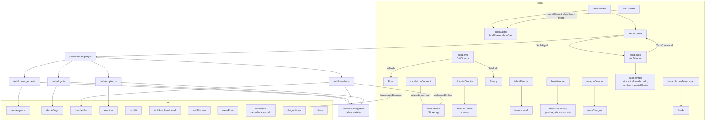

# Leva 2 - Design

**Spec**: `.specs/features/leva-2/spec.md` · **Plano**: `docs/plano-builds-e-habilidades.md` (linha F41 da seção 6;
seções 4, 5.1, 5.3, 5.4, 5.6, 5.7, 5.8) · **Base**: F29 a F40 (designs nos worktrees `wt-f30spec`, `wt-f31spec`,
`wt-f35spec`, `wt-leva1`, `wt-chefes`; spec da F37 em `wt-f30spec/.specs/features/combos/spec.md`) e as regras puras
da leva 2 deste branch (`docs/spec-leva-2`, `5701321`)
**Status**: Draft

Conferido em 15/10 neste worktree (`5701321` = `4c0efae` + regras puras da leva 1 e da leva 2), no
`feat/fundacao-de-poder` (`6fff962`), no `feat/chefes-com-afixos` (`bec3280`), no `feat/icones-hd-tecnicas` (`687a23f`)
e nos designs e specs citados. O worktree ainda não tem a F29 a F40: o que elas criam é citado pelo nome e pela
interface dos designs delas (F34: `TechModule`, `TechPorts`, `TechEmitter`, `PressGate`, `techWorld`, `techBoxes`,
`scaleTechDamage`, `Health.spend`, `Enemy.stun`, `Boss.stun`; F35: `buildEffects`, `CritSources`, `talentDirector`,
`TalentFx`, `TalentHudFx`, `TechSlotsHud`, `BuildBar`, `buildTray`; F31: `domainDirector`, `domainPowers`, `DomainFx`,
`drawVeil`; F32: `BossLineups`, `drawLineup`, `bossTuningFor`, `AffixOutline`, `BossReadout`, `bossDirector`; F36:
`weaponDirector`, `weaponHits`, `WeaponFx`, `weaponStats`, `AffixSuppression`; F37: `RECIPES`, `recipeReady`,
`duoEligible`). Cada passo reconfere essas linhas no começo, depois dos merges. Linhas efetivas contadas como o
`max-lines` do `.oxlintrc.json` (sem linha em branco e sem comentário).

Lições aplicadas: **L-010** (todo limiar testado dos dois lados: 320/321 px do Vazio, 2499/2500 ms, 60/61 px do
Estopim, vida = custo e custo + 1 da Convergência, 3/4 Duos, piso de custo do Seis Olhos, 2999/3000 ms do escudo) e
**L-043** (teste do adaptador que repassa ao motor: `setFrame('convergencia')` no slot, quadro e escala da folha
`dogs`, largura medida no retângulo vivo da barra de postura, alfa real da vinheta do Vazio, quadro vivo do marcador do
Osso).

---

## Correções e reconciliações da spec (sem mudar requisito)

1. **Ids repetidos.** `TLV-02` a `TLV-06` valem cada um para 3 critérios e `DUO-08` para 2 (158 critérios, 147 ids).
   O `validate_tasks.py` e a rastreabilidade precisam de id único. Proposta para a revisão da spec, na ordem do texto:
   TLV-01 (dados), TLV-02 (recuo), TLV-03 (poeira e objeto), TLV-04 (parede), TLV-05 (postura ×), TLV-06 (barra e
   trincas), TLV-07 (chefe caído), TLV-08 (cura ×), TLV-09 (número verde), TLV-10 (andar curando), TLV-11 (janela de
   parry), TLV-12 (círculo), TLV-13 (iai), TLV-14 (custo), TLV-15 (ponto fraco), TLV-16 (crítico no ponto fraco),
   TLV-17 (exceções da TAL-16), TLV-18 (eventos), TLV-19 (ícones), TLV-20 (snapshot), TLV-21 (conferência); e DUO-08
   (dano principal) e DUO-09 (Contra Amaldiçoado), empurrando DUO-09..13 para DUO-10..14. **Este design já usa a
   numeração proposta**, aplicada na spec no passo Tasks (com as referências cruzadas e a correção 8).
2. **A spec da F37 existe** (`wt-f30spec`, 15/10 00:46, depois da conferência da spec da F41). O contrato dela vale e
   a F41 o segue: receita `{ type: 'uniao' | 'evolucao' | 'duo'; id; name; text; hint; cost; pieces }` com peça
   `{ kind: 'tecnica' | 'talento' | 'arma' | 'reliquia' | 'dominio'; id; minLevel }` e curinga `id: '*'`;
   `recipeReady`, `duoEligible(recipe, view, duosDone)`, `halfHeld`; prontas nas cartas 0 a k − 1 (OFR-01); ids
   `uniao:`/`evolucao:` no baú e no snapshot; `evo=`; teste de nomes e textos únicos (NOM-01..05) com a tabela "Regra
   de combo". O que a F41 acrescenta por causa disso: um `text` e um `hint` (até 10 caracteres) por Duo e por
   Evolução (tabela em "Data Models"); o prefixo `duo:<id>` no `combos.ready/done/revealed`; as linhas da tabela "Regra
   de combo" das 10 receitas novas; e a lista de exceções do CGL-02 (efeito sem tecla) ganha as consequências adiadas
   da F41 (Rede de Cortes na ativação do Santuário, poça do Sangue Eterno, condutores da Ordem Elétrica).
3. **Duo na loja e o OFR-01.** O DUO-02 diz "cartas 2 e 3"; a F37 põe as k receitas prontas nas cartas 0 a k − 1 e a
   carta de item novo na carta k. Regra adotada: o Duo entra no sorteio por peso **só das posições 2 e 3 que ainda
   são sorteadas por peso** depois do OFR-01 (com 3 receitas prontas, só a carta 3; com a carta k = 2 de item novo, só a
   3). O Duo nunca é carta 0 nem 1 e nunca entra no baú (F37 DUO-03).
4. **TC2-08 contra TC2-09 no Trovão.** O `castHit` da F33 faz a maestria e, pelo `onCastHit`, a carga do Domínio e o
   gatilho do Santuário. O TC2-08 pede maestria em todo raio e o TC2-09 proíbe carga e gatilho no raio. O passo 0 da
   F41a dá ao `castHit` uma opção `{ domain: false }` (maestria sim, Domínio não), usada só pelo raio e pela coluna do
   Trovão.
5. **Erupção cancelada no sinal.** A regra pura nasce no aperto (o sinal está no relógio dela, `erupt`). A spec não diz
   o que acontece quando o golpe tomado cancela o sinal (CAST-07): o módulo descarta a `EruptionCast` no evento de
   cancelamento, sem pilar nem custo (a máquina só cobra na entrada de `release`).
6. **Teste de eixo dominante reprova com os números de hoje** em duas técnicas (conta em "Calibração"): Cães
   (Mordidas no 3 dá 2,0× a mediana) e Erupção (Erupções no 3 dá 1,5×). Pela assumption "Calibração", o dado muda no
   passo da técnica: Cães `caes: [2, 3, 4, 5]` e `capBiteDamage: 6`; Erupção `queima: [0, 2, 3, 5]`. Os testes de
   `tests/core/divineDogs.test.ts` (CAO-02) e `tests/core/eruption.test.ts` (ERU-02) trocam o número esperado no
   mesmo commit, com o motivo na mensagem. A regra (`core/*.ts`) não muda.
7. **ドン sobe para a F41b.** O DON só depende da F29 e da Osso Duro Nv 3 (F41b); juntá-lo aos combos (F41e) atrasaria
   a sensação do patamar 3 sem motivo. A F41e fica só com receitas (contrato da F37).
8. **Evento da Evolução.** O EVL-02 pede `evolved:<id>`; a F37 (CGL-03) emite `combo:<recipe>` e mantém o
   `evolve:<id>` de hoje. A F41 segue a F37 (`combo:` e `evolve:`), e a revisão da spec troca o texto do EVL-02 para
   `evolve:<id>`; nenhum evento novo com nome quase igual.
9. **Revisão adversarial da spec (15/10).** Mudou requisito e premissa, não arquitetura; o design acompanha:
   Cães `prisao [200, 330, 470, 600]` (identidade no Nv 1, junto da calibração da correção 6); soltura do Osso com
   `k` = cargas + 1 no teto e patamar `decisive` (OSS-04), balanço com as duas estratégias (OSS-13) e Dragão
   Refletido só no teto, sem somar carga (OSS-10); preço dos Dedos 20 / `16 + 6 × dedos` (DED-02), teste de relíquia
   (DED-03) e chance do Portador na carta (DED-07); Contra Amaldiçoado no 1º slot com técnica no Nv 3 (DUO-09);
   dano principal do Trovão `raio × cargas` e dos Cães `mordida × mordidas × cães` (DUO-08); Sombra no Contra com
   prisão de pelo menos 300 ms (DUO-10); poça do Sangue Eterno sob os pés e bebida só pelo trecho do feixe (EVL-05).

---

## Divisão em sub-fases

Confirmada a divisão da spec em 5 sub-fases, com o ドン movido da F41e para a F41b. Um `tasks.md` só, com 5 fases
(F41a a F41e), cada fase um lote de execução inteiro (regra de lotes da skill: ~7 a 9 tarefas, nunca partido). Cada
sub-fase termina jogável e com o gate e os smokes dela verdes; o Verifier roda ao fim de cada sub-fase e escreve a
seção dela em `validation.md`; o veredito final (`validate_state.py`) só depois da F41e.

| Sub-fase | Passos | Requisitos | Depende de | O jogador nota | `TestScene` |
| --- | --- | --- | --- | --- | --- |
| **F41a técnicas** | 0 portas genéricas (refatoração, smokes iguais); 1 arte dos 5 ícones; 2 Convergência; 3 Cães (com a folha `dogs`); 4 Trovão; 5 Erupção | LVX, TC2, CNG, DOG, RAI, ERP, IC2-01..04 | F34, F35, F37 (EIX-10 com Duos) | 12 técnicas no pool, cada uma com ícone | 0 |
| **F41b Domínio, talentos e ドン** | 0 ganchos de crítico e barra de postura (refatoração); 1 Vazio Ilimitado; 2 arte dos 5 ícones de talento + Seis Olhos + Domínio Simples; 3 Mão de Ferro + Reversa Refinada; 4 Osso Duro (barra, trincas, chefe caído); 5 ドン | VAZ, TLV, IC2-05, DON | F31, F35, F41a (ícone `vazio`) | Domínio de controle, 5 talentos, ドン no patamar 3 | 0 |
| **F41c arsenal** | 0 folhas do Osso, `bound-bone` e dedo (arte); 1 Osso de Dragão; 2 Dragão Refletido; 3 Dedos de Sukuna | OSS, DED | F32, F35, F36, F37 | arma que carrega com a defesa; relíquia de aposta | 0 |
| **F41d chefes** | 0 `BossArmor` neutro no `applyDamage` (refatoração); 1 dados, sorteio, contorno e Enfurecido; 2 Couraça; 3 Sobrecarregado; 4 Pele de Dragão | AF2, ENF, COU, SOB, PDR | F32, F36 (suspensão) | 4 afixos novos a partir da r10 | 0 |
| **F41e combos** | 0 sinais e comandos de técnica e dano principal (refatoração); 1 oferta de Duo + Troca Explosiva + Prego Rubro; 2 Contra Amaldiçoado + Sombra no Contra; 3 Ordem Elétrica + Impacto Elétrico; 4 Rede de Cortes; 5 Sangue Eterno; 6 Palavra no Ponto Fraco | DUO, EVL | F37, F41a, F41b, F41c | 6 Duos e 3 Evoluções na caça às receitas | 0 |

Regras de todo passo, em todas as sub-fases (LVX): `TestScene` sem linha líquida (contagem no commit), nenhum arquivo
na lista de exceções, `Hud.ts`, `moves.ts` e `ShopPanel.ts` sem crescer, nenhum campo no `Player.ts`, `Enemy.ts` e
`Boss.ts` até 400 efetivas, toda cor da `PALETTE`, todo tipo de snapshot fora do `debugApi.ts`, e a linha do
`README.md` para cada parâmetro e evento de debug novo no mesmo commit que o cria (LVX-07).

A F41c e a F41d não dependem uma da outra e podem trocar de ordem; as duas tocam `core/bossAffix.ts` (a F41c a chance
do Portador, a F41d o pool), então rodam em sequência, nunca em paralelo.

---

## Abordagens consideradas

As três entregam o mesmo escopo; a recomendada vem primeiro.

| | Abordagem | Prós | Contras |
| --- | --- | --- | --- |
| **A (recomendada)** | Técnica nova = `TechModule` da F34 (as 4 entram sem tocar `TechRunner`, `TechCaster` e `techDirector` depois do passo 0); Duos por **sinais** que os módulos soltam e **comandos** que recebem, aplicados por um `duoDirector`; Evolução dentro do módulo da técnica que a carrega; dano no chefe por um `BossArmor` puro dentro do `applyDamage` do cérebro; crítico de golpe pelas `CritSources` da F35 e crítico de técnica e de objeto por um gancho no alvo | Técnica não conhece Duo; uma regra de dano do chefe para todo caminho (golpe, Kokusen, finalizador); o crítico de golpe continua com a regra do maior da F35 sem arredondar duas vezes | O passo 0 da F41a e o da F41e mexem no centro da conjuração; o gancho no alvo muda o `Hit` no lugar (contrato documentado e testado) |
| B | Duos dentro dos módulos (`if (duoOn('ordemEletrica'))` no Trovão, na Fala, no Boogie, no Vermelho...) e escudo e camadas no `Boss.ts` | Menos peças novas | Cada Duo espalha nos dois módulos das peças; `Boss.ts` passa de 400; o Kokusen e o finalizador não passam por `receiveHit` e escapariam do escudo |
| C | Um `leva2Director` na cena com toda a leva 2 (técnicas, talentos, afixos, Duos) | Nada muda no `TechRunner` | Contraria o REG-01 e o objetivo da F34; snapshot, maestria, `awakenCast` e Santuário teriam um caminho por técnica; um arquivo de ~800 linhas |

---

## Architecture Overview



**Fluxo por quadro** (a ordem da `TestScene` não muda):

1. `techDirector.update`: o `TechCaster` pergunta ao portão (F34) e, no `sign` **e no `charge`**, o `holdPhase` do
   módulo (passo 0 da F41a) segura o estado enquanto a tecla está segura. A Convergência segura o `charge` sem prazo.
2. Golpes do moveset que acertaram neste quadro já estão no `build.strikes` (gravados pelo `combat.onConnect`). O
   `techRunner.update` chama cada módulo; o do Trovão lê `ctx.landedStrikes(seq)` e solta os raios.
3. Os módulos soltam `TechSignal` (troca com orbe, descarga, 2º impacto, corte, feixe); o `TechRunner` os entrega ao
   `duoDirector` pela porta `onTechSignal` no mesmo quadro. O `duoDirector` age por `techRunner.command(...)` e pelo
   emissor.
4. `build.emitter.update` (F34) entrega as emissões de `iai`, `contraAmaldicoado`, `sombra`, `impactoEletrico`.
5. Todo `receiveHit` de comum e de chefe passa antes pelo `hitMods` do `CritDirector` (crítico de técnica e de objeto);
   o chefe resolve camadas e escudo dentro do `applyDamage`.

**Ciclo de vida.** O `runDirector` chama `techCaster.abortCast()` no `roundCleared`, no `shopOpen` e no `startRun`, e
o `areaDirector` na troca de área (passo 0 da F41a): uma carga da Convergência segurada nunca atravessa a konbini.
`techRunner.rebuild()` no `roundStart` e `roundEnd()` no `roundCleared` (F34) refazem e limpam os 4 módulos novos. As
cargas do Osso atravessam rodadas (OSS-06) e zeram no reset da run.

---

## Code Reuse Analysis

### Existing Components to Leverage

| Component | Location | How to Use |
| --- | --- | --- |
| Regras puras da leva 2 | `src/core/convergence.ts`, `divineDogs.ts`, `thunderFist.ts`, `eruption.ts`, `techKit.ts` | O adaptador só chama; nenhuma regra muda (só os números da calibração no `data/`) |
| `TechModule`, `TechPorts`, `TechServices`, registro | F34 `game/tech/module.ts`, `shared.ts`, `registry.ts`, `scenes/test/techPorts.ts` | Uma linha no registro por técnica (REG-04, LVX-05); portas novas só em `shared.ts`/`techPorts.ts` |
| `PressGate.answerPress` com `deny hp`, `techDenied:hp` com o ícone piscando vermelho | F34 `core/cast.ts`, `techDirector` | Portão da Convergência (CNG-02), molde do `speechPress` |
| `holdSign` da Palma Falsa | F34 `core/cast.ts:update(dt, holdSign)` | Generalizado para `holdPhase` (segura `sign` ou `charge`) no passo 0 |
| `Health.spend` e `Health.spent` | F34 `core/health.ts` | Custo em vida da Convergência sem reação, sem número, sem zerar Fúria e combo (CNG-05) |
| `TechWorld.wallAhead` (mesma assinatura da `WallProbe`) | F34 `game/tech/techWorld.ts` | Sonda do feixe (TC2-12) |
| `boxOfRect`, `centerOfBox` | F34 `core/techBoxes.ts` | Alvos `{ id, kind, box, hp, maxHp }` das 4 regras |
| `scaleTechDamage(raw, loadout)` e o truque do `ceil(hp / mul)` | F34 `core/techResolversLeva1.ts`, `resonanceHits.detonate` | Dano escalado nos números crus das regras; o `killed` do feixe bate com o dano escalado |
| `Enemy.stun(ms)` (estado `stunned`) e `Boss.stun(ms, 'tech')` | F34 `core/enemyBrain.ts`, `bossBrain.ts` | Prisão dos Cães, atordoamento do raio, paralisia do Vazio |
| `TechEmitter` e `emitterDirector` (teto 4/s por fonte, micro) | F34 `core/techEmitter.ts`, `scenes/test/emitterDirector.ts` | Fontes novas `iai`, `contraAmaldicoado`, `sombra`, `impactoEletrico` |
| `AXIS_ITEMS`, `RESOLVERS`, carta de 2 eixos, painel do ramo, Despertar, `axes=`/`ramo=` | F30/F33 | 4 entradas de registro e 4 resolvedores (TC2-02..06 sem código novo) |
| `newTechPrice(rarity)`, `poolSurcharge` | F30 `core/shopPricing.ts`, F35 `core/skillSlots.ts` | Preço das 4 técnicas (TC2-03) |
| `techIconSheet`, `ICON_COLORS`, `drawPlate`, `IconCanvas` | `feat/icones-hd-tecnicas` `src/game/art/hd/techIcons.ts`, `icons/*` | 5 receitas novas em `icons/leva2Art.ts` (IC2-01) |
| `lightningBolts(seed, origin, dir)` | `src/core/lightning.ts:81` | Zigue-zague do raio do Trovão, dos Duos elétricos e do iai, com seed (AD-009) |
| `domainDirector.strikeActivation` + `domainPowers.onActivate` | F31 | Vazio: acerto decisivo da ativação primeiro, paralisia depois (VAZ-03) |
| `drawVeil(rng)` | F31 `core/veilChest.ts` | Passa a sortear 2 de 4 (VAZ-02) |
| `buildEffects`, `CritSources.critMul` (regra do maior), `Cooldown`, `RateLimit` | F35 `core/buildEffects.ts`, `core/talents.ts` | Números dos 5 talentos, crítico do Vazio e da Palavra no golpe, 1 vez a cada 6 s |
| `TalentFx`, `TalentHudFx` (brilho da barra de vida) | F35 | Brilho da Reversa Nv 2 reaproveita o do Executor Nv 2 |
| `talentIcons.ts`, `TalentStrip` | F35 | 5 ícones novos (TLV-19) |
| `drawLineup`, `BossLineups`, `bossTuningFor`, `outlineKeyAt`, `AffixOutline`, `BossReadout`, `BOSS_BAR_WIDTH`/`MARGIN` exportados | F32 | Afixos novos, chance do Portador com dedos, contorno com rampa, barra de postura e escudo posicionados sem tocar `Hud.ts` |
| `AffixSuppression`, `Boss.affixesSuppressed` | F36 | Suspensão dos 4 afixos novos (AF2-05) |
| `weaponDirector.strikeMods`, `onDefense`, `onMeleeHit`, `WeaponFx.trail/impact`, folhas `weapon-fx-osso-*` | F36, `feat/arte-armas-imbuidas` (`wt-armas`) | Osso de Dragão no molde das 3 armas (OSS-02, OSS-08) |
| `RECIPES`, `recipeReady`, `duoEligible`, `halfHeld` | F37 `data/evolutions.ts`, `core/evolution.ts` | 6 Duos e 4 Evoluções novas (3 de técnica, 1 de arma) só preenchem a lista |
| `CursedFx.track`, `canSpawnParticle` (`fxCap` 40) | F36 `game/CursedFx.ts`, `src/game/CursedFx.ts:43` | Rachadura e ドン contam no teto (DON-04) |
| `debugParam`, `parseVariant` | `scenes/test/debugParams`, `core/enemyVariant.ts` | `duo=`, `domain=vazio`, `arsenal=dedos` |

### Integration Points

| System | Integration Method |
| --- | --- |
| Técnicas | 1 linha por técnica em `game/tech/registry.ts`; o resto em arquivos próprios e em `data/` |
| Golpe do moveset → Trovão | `combat.onConnect` grava `{ seq, targetId, strength, swingId }` no `build.strikes` quando `mine && hit.moveName` (+1 linha); o módulo lê pela porta `landedStrikes` |
| Konbini e área | `runDirector` (`roundCleared`, `shopOpen`, `startRun`) e `areaDirector` chamam `techCaster.abortCast()` |
| Crítico de técnica e de objeto | `Enemy.hitMods` e `Boss.hitMods` (atribuídos pelo `spawner.wireEnemy` e pelo `bossDirector.attach`) |
| Barra de postura e escudo | `bossDirector` cria a `BossBarOverlay` com os `BossReadout` (a `uiLayer` nasce depois do `RunDirector`) |
| Duos | Porta `onTechSignal` (`techPorts.ts`) → `build.duos.onSignal`; `techRunner.command(tech, cmd)` e `techRunner.mainDamage(tech)` |
| Loja | 4 técnicas, 5 talentos, o Osso, os Dedos e os 6 Duos no fim do `GAME_SHOP_CATALOG`, nessa ordem de sub-fase |
| Snapshot | Cada tipo novo no arquivo de snapshot do sistema dono (`techSnapshot.ts`, `axisSnapshot.ts`, `buildSnapshot.ts`, `domainSnapshot.ts`, `arsenalSnapshot.ts`, `bossSnapshot.ts` da F32), nunca no `debugApi.ts` (LVX-03) |

---

## Components

### F41a, passo 0: portas genéricas (refatoração, smokes iguais)

Nenhum comportamento muda; os smokes `tech`, `tech-axes`, `boogie`, `resonance`, `cursed-speech`, `red-axes`,
`fxlab`, `run-loop` passam iguais. Tudo que os 4 passos de técnica precisam fora do próprio módulo entra aqui (LVX-05).

- **`core/cast.ts`** (F34 ~122 → ~126): `holdSign(slot, id, elapsed, held)` vira `holdPhase(slot, id, phase: 'sign' |
  'charge', elapsedMs, keyHeld): boolean` no `PressGate` e no `update(dtMs, hold?)`. No `charge`, com `hold`
  verdadeiro, o relógio do estado anda até 0 e para ali (o `elapsedMs` continua contando); quando o `hold` cai, sai do
  `charge` para `release` no mesmo `update`, **mesmo antes do fim do `charge`** (tocar e soltar dá 50%, CNG-03).
  `abort(): CastEvent[]` cancela `sign`/`charge` sem cobrar, como o `damageTaken` (CAST-07), e é no-op em `release` e
  `recover`. A Palma Falsa passa a responder `phase === 'sign' && ...`; sem `hold`, nada muda.
  - Risco do CAST-02 (estado de 0 ms pulado sem consultar o `hold`): a Convergência tem sinal 0 e `charge` de 300 a
    600 ms, então o `charge` nunca é pulado; o teste prende a ordem.
- **`game/TechCaster.ts`** (F35 ~92 → ~96): repassa `holdPhase`; `abortCast()` (`machine.abort()` mapeado para o evento
  `techCancel` de sempre).
- **`scenes/test/strikeLog.ts`** (novo, ~30): `class StrikeLog { push(targetId, strength, swingId); since(seq):
  readonly StrikeEntry[]; get seq(); reset() }`, anel de 32 entradas (só o quadro atual importa). Campo `strikes` do
  `BuildDirector`; `combat.onConnect` grava (+1). O módulo nunca recebe chamada de dentro de um contato do Matter.
- **`game/tech/shared.ts`** (F34 ~50 → ~58): `TechPorts` ganha `landedStrikes(sinceSeq)`, `strikeSeq()`, `camera`
  (vista do mundo) e `onTechSignal` (no-op até a F41e). `TechServices.castHit(cast, target, opts?: { domain?: boolean
  })`.
- **`game/TechRunner.ts`** (F34 ~105 → ~108): `castHit` repassa `opts.domain !== false` ao `onCastHit` (TC2-09).
- **`game/tech/module.ts`**: `SlotHudHint` ganha `ring: number | null` (0 a 1). **`game/TechSlotsHud.ts`** (F35 ~160 →
  ~170): arco de 2 px em volta do ícone, `PALETTE.t`, na fração do `ring`; `debug()` ganha `ring` por vaga.
- **`core/viewFilter.ts`** (novo, ~15): `insideView(center, view: { x; y; width; height }): boolean` (bordas inclusas,
  L-010).
- **`game/tech/leva2Targets.ts`** (novo, ~50): `kitTargets(f: TechFrame, view): KitTarget[]` (comuns vivos fora de
  ragdoll e o chefe vivo, com `boxOfRect(hurtRect)`, `hp`, `maxHp`, `kind`, só com o centro dentro da vista,
  TC2-12); `findTarget(f, id)`; `applyKitHit(ctx, cast, target, hit: { damage; bite; band; knockdown?; stunMs? },
  opts)` = o `Hit` com `techMarks`, `scaleTechDamage(damage) + bite` (o componente proporcional nunca é multiplicado),
  `receiveHit`, atordoamento (`enemy.stun`/`boss.stun(ms, 'tech')`), `onTechHit`, `castHit` e o retorno `killed`. Os
  4 módulos e o `duoDirector` usam o mesmo caminho.
- **`core/leva2Press.ts`** (novo, ~20): `convergencePress(hp, hpCost): PressAnswer` (`hpCost > 0 && hp − hpCost <
  CONVERGENCE.hpFloor` → `deny hp`; senão `cast`) e `convergenceHold(phase, keyHeld): boolean` (`charge` e tecla
  segura). Testes nos dois lados: vida 6/7 com custo 6; custo 0 com vida 1.

### F41a, passo 1: arte dos 5 ícones (Opus ou Fable)

- **`src/game/art/hd/icons/leva2Art.ts`** (novo, ~110): receitas `CONVERGENCIA` (gota que vira feixe fino, `t`/`R`),
  `CAES` (cabeça de cão de sombra, `b`/`k` com olho `W`), `TROVAO` (punho com zigue-zague, `c`/`C`), `ERUPCAO` (pilar
  que sobe do chão, `a`/`A`/`r`) e `VAZIO` (círculo de estrelas, `k`/`e`/`W`/`U`), com a placa e as `ICON_COLORS`
  das receitas de hoje, nos dois tamanhos.
- **`techIcons.ts`** (~70 → ~80): `TECH_ICON_IDS` com 16 ids; `RECIPES` com as 5. `TechIconId` cresce sozinho.
- **`tests/game/art/techIcons.test.ts`**: 16 quadros, ids, só índices de `ICON_COLORS`, quadros distintos (IC2-02).
- Prancha `tools/icon-boards.mjs` (saída em `.fable-out/`) com os 16 lado a lado antes do commit (IC2-04). O ícone do
  Vazio fica sem uso até a F41b.

### F41a, passos 2 a 5: as 4 técnicas (molde comum)

Cada passo traz, no mesmo commit: `TechId` + `TECHNIQUES` (nome, `icon`, `aura`, tempos, custo e recarga a 0 ponto,
`killRefund` 0), a entrada de `AXIS_ITEMS` em `data/techAxesLeva2.ts`, o resolvedor em `core/techResolversLeva2.ts`
com o bloco do `TechStats`, a entrada no fim do `GAME_SHOP_CATALOG` (TC2-03, na ordem Convergência, Cães, Trovão,
Erupção), a cor da `Aura`, o tipo do `build.<item>` e do `techState.<id>`, o módulo, a vista, a linha do registro, o
smoke, a linha do `README.md` e o caso nos testes comuns (`techStatsLeva2`, eixo dominante, nomes únicos). Nenhum toca
`TechRunner.ts`, `TechCaster.ts` nem `techDirector.ts` (LVX-05; `tests/game/techRunnerSource.test.ts` da F34 prende).

| Técnica | `TECHNIQUES` (sinal/carga/soltura/recuperação, custo, recarga) | Aura | Borda da chamada | Raridade, preço base |
| --- | --- | --- | --- | --- |
| Convergência `convergencia` | 0 / `chargeMs` (600 → 300) / 60 / 200, 20, 3500 | `red` | `t` | rara, 26 |
| Cães Divinos `caes` | 120 / 0 / 60 / 150, 24, 3500 | `white` | `W` | comum, 20 |
| Punho de Trovão `trovao` | 150 / 0 / 60 / 150, 30, 6000 | `blue` | `C` | rara, 26 |
| Erupção `erupcao` | 250 / 0 / 60 / 200, 30, 3500 | `yellow` | `a` | comum, 20 |

- **`core/techResolversLeva2.ts`** (novo, ~110): `leva2Build(axes, item)`; `resolveConvergence`, `resolveDogs`,
  `resolveThunder`, `resolveEruption` no formato da F33: chamam `convergenceStats`/`dogsStats`/`thunderStats`/
  `eruptionStats`; custo pelo `buildEffects.techCost` (piso de 60% e `costMul`); a Convergência sem eixo de Eficiência
  só passa o `costMul`; o `hpCost` nunca é multiplicado (TC2-02); `damage` × `damageMul` × `vowDamageMul` arredondado
  como o `loadout.ts`; `killRefund: 0`; blocos `convergencia`, `caes`, `trovao`, `erupcao`. O tempo de `charge` da
  Convergência no `TechStats` é o `chargeMs` resolvido.
- **`data/techAxesLeva2.ts`** (novo, ~90): `LEVA2_AXIS_ITEMS` com nomes de eixo (Perfuração, Carga, Largura, Vida,
  Dano, Recarga; Cães, Alcance, Mordidas, Prisão, Eficiência, Recarga; Cargas, Saltos, Dano, Atordoa, Eficiência,
  Recarga; Altura, Erupções, Queima, Dano, Eficiência, Recarga), ramos `:a`/`:b` (Supernova/Curva, Totalidade/Matilha,
  Tempestade/Estática, Meteoro/Lago de Lava) e Despertares (Supernova Carmesim, Sangue Perfurante, Totalidade Negra,
  Matilha Faminta, Raio Celeste, Descarga, Chuva de Meteoros, Caldeira), com o texto de uma linha da spec
  `regras-tecnicas-leva2` (EIX-10, TC2-14). Cresce um item por passo.

#### Convergência (passo 2)

- **`game/tech/convergence.ts`** (novo, ~140): o módulo.
  - `answerPress` → `convergencePress(player.hp, stats.convergencia.hpCost)` (CNG-02); `holdPhase` →
    `convergenceHold` (CNG-01: nunca dispara com a tecla segura, carga cheia inclusa).
  - `update(f)`: enquanto o cast da Convergência está em `charge`, `heldMs += dt` com a tecla segura; no `techCast:
    convergencia` (entrada de `release`, o quadro em que a tecla subiu), `fire(cast, f)`.
  - `fire`: `fireBeam(pureStats, { origin, facing, hp: player.hp, heldMs, targets, wall: world.wallAhead })`, com a
    origem do centro da `hurtRect` mais meia largura no `facing` (CNG-03) e o `hp` de cada alvo trocado por `ceil(hp /
    mul)` (o `killed` da regra bate com o dano escalado). Recusa (CNG-04): `energy.gain(loadout.cost('convergencia'))`,
    `loadout.clearCooldown(slot)`, evento `beamRefused:hp`. Aceita (CNG-05): `player.health.spend(hpCost)` (só com
    custo > 0), evento `beam:<hits>`, `convergenceHits.apply(result)`, vista.
  - `roundEnd()` limpa a vista; `rebuild()` refaz o estado puro (TC2-11). `hudHint()` → `{ badge: null, blink: false,
    ring: charging ? chargeMul(stats, heldMs) : null }` (CNG-09). `state()` → `{ charging, heldMs, chargeMul }`
    (CNG-10).
- **`game/tech/convergenceHits.ts`** (novo, ~70): reto e dobras como acerto normal de `dano + bite`, estilhaços como
  `micro` (CNG-06), tudo por `applyKitHit`; `refundMs > 0` → `loadout.refundCooldown(slot, refundMs)` (TC2-10; a
  regra pura já devolve o corte pelo `killedAny`). Solta `TechSignal { kind: 'beam', origin, end, hpPaid }` (no-op até
  a F41e).
- **`game/techFx/ConvergenceFx.ts`** (novo, ~90): `beam(origin, end, widthPx)` (retângulo `t` com miolo `R`, 120 ms),
  `bend(from, to, widthPx)`, `burst(center, radiusPx)` (anel `T`), registrados no `FxRegistry` com prazo (CNG-08);
  `handGlow(on)` (2 círculos `t`/`R` na mão, presos ao `player.renderPos`, AD-019).
- Smoke **`convergence.smoke.mjs`**: o Independent Test da spec (`seed=1&maxAlive=3&tech=convergencia`, `hp=7`, `hp=6`,
  toque contra carga cheia por `damageNumbers.last`) mais a parede (o feixe para) e a konbini abrindo com a tecla
  segura (`techCancel`, nada gasto, nada no 1º quadro depois).

#### Cães Divinos (passo 3)

- **Arte** (Opus ou Fable, no mesmo passo, antes do módulo): **`src/game/art/hd/fx/dogsSheet.ts`** (novo, ~120), folha
  `dogs` (`HdSheet`, quadros de 32×22 texels, 1 texel = 1 px, cernelha a 15): `run-0..3`, `bite`, `vanish`, silhueta `b`/`k`
  com borda de cima `u` e olho `W` (DOG-06). Feita em `feat/arte-caes-e-don` (`9d547cc`): o 24×16 ficava pequeno demais
  ao lado do player. O lobo da Totalidade é a mesma folha em escala 1,5. Registrada no `registerHdSheets` e em
  `TEX.dogs`; prancha em `tools/hd-boards.mjs` antes do commit.
- **`game/tech/dogs.ts`** (novo, ~120): no `techCast:caes`, `summonDogs(stats, feet, facing)` com `feet` = centro x da
  `hurtRect` e o pé (DOG-01); a cada quadro `pack.update(dt, kitTargets)` até `done`. `bite` → `micro` de `dano +
  bite` com `stunMs = rootMs` (o comum entra em `stunned`, o chefe por `stun(ms, 'tech')`, DOG-02); abate →
  `pack.claimKillRefund()` → `refundCooldown`. `leap`/`gone` → vista. `objects()` → um `{ kind: 'dog' | 'wolf' }` por
  cão vivo (DOG-05); `state()` → `{ dogs: { id, state }[] }`.
- **`game/techFx/DogsFx.ts`** (novo, ~100): pool de até 5 sprites da folha `dogs`, `run-0..3` a ~9 / velocidade × 1000 ms (a 80 ms fixos a pata patina a 300–400 px/s), `bite` no
  `latched`, `setFlipX(dir < 0)`, escala 1,5 no lobo, na linha do chão; `arc(dogId, from, to, 150)` no salto;
  `vanish(at)` com o quadro `vanish` por 150 ms no `FxRegistry` (DOG-03, DOG-04). Pool da cena, fora do teto de 40.
- Smoke **`divine-dogs.smoke.mjs`**: Independent Test da spec (custo 24 com o `costMul` 1, mordida micro sem `hitstun`
  com `stunnedMs` perto de 200 e o ataque em preparo perdido, some antes de 1200 ms, `prisao:3` → `stunnedMs` perto de 600, `ramo=caes:b` → um cão com `dir` oposto).
- **Calibração** (correções 6 e 9): `data/divineDogs.ts` `caes: [2, 3, 4, 5]`, `capBiteDamage: 6` e `prisao: [200,
  330, 470, 600]` (a prisão não entra no modelo do eixo dominante; o chefe fica com 50 ms no Nv 1).

#### Punho de Trovão (passo 4)

- **`game/tech/thunder.ts`** (novo, ~130): no `techCast:trovao`, `fist.cast()` e guarda o `CastRef` (RAI-01; recast
  repõe sem somar, pela regra pura). A cada quadro `fist.update(dt)` (RAI-05) e, para cada entrada de
  `ctx.landedStrikes(lastSeq)`, `fist.onStrike({ targetId, strength, swingId }, kitTargets)` (RAI-02: uma vez por
  alvo; a regra pura gasta 1 carga por `swingId`). Descarga (RAI-03/04): cada `bolt` como `micro` de `dano + bite`
  com `stunMs` e `ctx.triggerHitstop(hopHitstopMs)` por salto (o teto de micro da F29 segura), cada `column` hit
  `micro` sem `knockdown` ou normal com `knockdown` no comum (nunca no chefe), todos com `castHit(cast, t, { domain:
  false })` (TC2-08, TC2-09); evento `bolt:<hops>`; abate → `fist.claimKillRefund()`. Solta `TechSignal { kind:
  'discharge', cast, lastHop, boltDamage, hitIds }` (Ordem Elétrica, F41e).
  - Golpe que acerta depois do fim da janela: a regra pura já tem 0 carga (edge case). Golpe no mesmo quadro do fim da
    janela: `update` roda antes da leitura das entradas, então não solta.
  - `hudHint()` → `{ badge: charges > 0 ? String(charges) : null, blink: false, ring: null }` (RAI-06); `state()` →
    `{ charges, maxCharges, windowLeftMs }` (RAI-08).
- **`game/techFx/ThunderFx.ts`** (novo, ~90): `zigzag(from, to, 120)` com `lightningBolts` (seed = `swingId`, cor `c`
  com miolo `C`), `column(x, 150)` do topo da vista ao chão, `crackle(on)` (2 zigue-zagues curtos nos punhos, presos
  ao `player.renderPos`, redesenhados a cada 100 ms), no `FxRegistry` (RAI-07).
- Smoke **`thunder-fist.smoke.mjs`**: Independent Test da spec (custo 30, 3 jabs = 3 `bolt:*`, o 4º não, golpe que erra
  não gasta, 2 saltos com os comuns a menos de 120 px), mais `axes=trovao.cargas:1` na loja da r4 com o painel do ramo
  (o caso do `tech-axes` da TC2, se o `tech-axes.smoke.mjs` passar de 380 linhas).

#### Erupção (passo 5)

- **`game/tech/eruption.ts`** (novo, ~110): quando o quadro mostra o cast da Erupção em `sign` e não há conjuração
  pendente, `erupt(stats, feet, facing)` e `cast.update(f.cast.elapsedMs)` (o relógio da regra fica no do sinal);
  evento `techCancel` com a conjuração ainda antes da soltura → descarta (correção 5). A cada quadro `update(dt,
  kitTargets)` até `done`; `pillar`/`meteor`/`caldeira` → normal com `knockdown` no comum (ERP-02); `shard` → `micro`;
  `burn` e `lava` → `chip` (ERP-03); abate → `claimKillRefund()`. Lista de conjurações vivas (uma nova não apaga a lava
  da anterior). `objects()` → `{ kind: 'lava' }` por poça e `{ kind: 'meteor' }` por meteoro caindo (ERP-05); `state()`
  → `{ pending, lava }`.
- **`game/techFx/EruptionFx.ts`** (novo, ~110): marca no chão (`a` piscando) em cada posição durante o sinal (ERP-01);
  coluna de 32 px por altura resolvida em 3 faixas `r`/`a`/`A` por 300 ms; meteoro (círculo `a`/`A` com rastro) caindo
  400 ms e anel de 56 px; lava de 64 × 8 px (`r`/`a` tremulando) enquanto vive (ERP-04). Geometria procedural (AD-009);
  um sprite próprio para o fogo fica para a feature de arte à parte.
- Smoke **`eruption.smoke.mjs`**: Independent Test da spec (custo 30, comum a 80 px toma 24 de técnica, colado a 30 px
  não toma, `queima:3` →
  números chip por até 2 s, `ramo=erupcao:b` → `lava` no `techObjects`) mais o golpe tomado no sinal (nenhum pilar).
- **Calibração** (correção 6): `data/eruption.ts` `queima: [0, 2, 3, 5]`.

### F41b: Vazio Ilimitado, talentos e ドン

#### Passo 0: crítico de técnica e de objeto, barra de postura (refatoração)

- **`core/critRules.ts`** (novo, ~40): `targetCritMul(c: { kind: 'tech' | 'prop' | 'other'; band; voidParalyzed;
  weakPointTech; palavraStunned }): number` = a maior fonte que vale (1,5) ou 1: objeto no paralisado do Vazio (VAZ-04);
  técnica não chip no ponto fraco com Seis Olhos Nv 3 (TLV-16); qualquer acerto não chip no atordoado pela Fala com a
  Palavra no Ponto Fraco (EVL-06). Golpe do moveset fica fora: o crítico dele continua nas `CritSources` da F35, que
  ganham `voidParalyzed` e `palavraStunned` (1,5 cada, regra do maior, sem arredondar duas vezes). No passo 0 todas as
  fontes estão desligadas.
- **`scenes/test/critDirector.ts`** (novo, ~70, campo `crits` do `BuildDirector`): `modify(hit, target): void`, só com
  `hit.ownerId === player.id`; técnica = `hit.techId !== undefined` (os módulos, pelo `techMarks` da F32; a ativação do
  Domínio e as emissões não têm `techId`); objeto = `PROP_TRAITS`. Com multiplicador > 1, **muda o `Hit` no lugar**
  (`damage = round(damage × mul)`, `crit = true`): quem criou o `Hit` passa o mesmo objeto ao `onTechConnect` e ao
  `combat.onConnect`, então o número mostra o dano de verdade com o tipo `crit` (contrato testado no
  `critDirector.test`, ver Risks).
- **`game/Enemy.ts`** (+3) e **`game/Boss.ts`** (+3): `hitMods: ((hit, target) => void) | null` chamado na 1ª linha do
  `receiveHit`; atribuído no `spawner.wireEnemy` e no `bossDirector.attach`. O Kokusen e o finalizador não passam por
  aqui (nunca críticos, TLV-17).
- **`scenes/test/effects.ts`** (+1): `onTechConnect` mostra `crit` quando `hit.crit`.
- **`game/BossBarOverlay.ts`** (novo, ~100): barra de postura de 2 px logo abaixo da barra do chefe (`BOSS_BAR_WIDTH`,
  `MARGIN` do `Hud.ts`, F32), cheia em `poise / poiseMax` (`PALETTE.S`), visível em toda luta de chefe (TLV-06);
  `cracks(0..3)` (traços `w`), e o segmento de escudo (F41d). `update(view: BossBarView)`, `debug():
  { poiseBar: { value, max, cracks }; shield }` com a largura lida do retângulo vivo (L-043). Criada pelo `bossDirector`
  junto com o `BossReadout`; o `Hud.ts` não muda.

#### Passo 1: Vazio Ilimitado

- **`data/domains.ts`** (F31 ~95 → ~112): `DomainId` ganha `'vazio'`; `DOMAINS.vazio` = `{ name: 'Vazio Ilimitado',
  line: 'Paralisa o grupo', activation: { radiusPx: 320, common: 0.40, elite: 0.20, boss: 0.06, force: 0 }, durationMs:
  [2500, 3500, 3500] }` (a força 0 deixa os paralisados no lugar, como o Jackpot); `VOID = { commonMs: [2500, 3500,
  3500], bossMs: [300, 300, 600], critMul: 1.5, starRingPx: 14 }`; cores `voidSky: 'e'`, `voidStar: 'W'`, `voidGlow:
  'U'` (VAZ-01, LVX-06).
- **`core/voidDomain.ts`** (novo, ~50): `class VoidParalysis { start(activationId); paralyze(id, ms); isParalyzed(id);
  ids(); update(dtMs); reset() }` (cada alvo com o próprio relógio, independente do fim do Domínio, VAZ-05);
  `voidTargets(center, targets, radiusPx)` com `inRadius` da F31 (320 dentro, 321 fora).
- **`scenes/test/domainPowers.ts`** (F31 ~135 → ~165): `onActivate('vazio', level)`: depois do `strikeActivation`
  (DOM-08, já feito pelo `domainDirector`), todo comum vivo a até 320 px → `enemy.stun(commonMs)` e o chefe vivo →
  `boss.stun(bossMs, 'tech')` (sem armar o finalizador, F34), `paralysis.paralyze`, evento `vazio:<n>` (VAZ-03; com
  ninguém, `vazio:0`). `update`: `paralysis.update(dt)`. `onEnd`: `domainEnd:vazio` vem do `domainDirector`; a
  paralisia segue. `isVoidCrit(id)` = Vazio ativo e `paralysis.isParalyzed(id)` (lido pelo `critDirector` e pelas
  `CritSources`). Se passar de ~170, o Vazio sai para `domainVoid.ts` (molde do `jackpot`).
- **`core/veilChest.ts`**: `drawVeil` sorteia 2 de `DOMAIN_IDS` (4) pelo `chestRng` (VAZ-02). O consumo do stream muda
  (`int(4)` no lugar de `int(3)`): o smoke `domain-veil` e o teste do baú são revistos no passo.
- **`game/VoidFx.ts`** (novo, ~80): vinheta de céu (`e` a 0,35) com 24 estrelas (`W`, posições por seed) na `uiLayer`,
  apagando em 300 ms depois do fim (VAZ-06); anel de 5 estrelas `W`/`U` girando sobre cada paralisado, na posição
  desenhada (`spritePos`, AD-019). Criado pelo `DomainFx`; `debug()` com o alfa real.
- **`game/domainSnapshot.ts`**: `active.paralyzed: number[]` (VAZ-08). `domain=vazio[:n]` já vem do `parseDomainParam`
  genérico.
- Smoke **`void-domain.smoke.mjs`** e teste **`tests/core/domainVazio.test.ts`**: os da spec.

#### Passos 2 a 4: os 5 talentos

- **`data/perks.ts`** (F35 ~140 → ~185): `PerkId` + `maoDeFerro`, `ossoDuro`, `reversaRefinada`, `dominioSimples`,
  `seisOlhos`, com afinidade (`lutador`, `lutador`, `feiticeiro`, `veloz`, `feiticeiro`), textos de carta por nível
  (até 20 caracteres: `Recuo +20%`, `Postura ×1,25`, `Reversa +25%`, `Parry +20 ms`, `Custo −8%`; `next`: `+ rastro e
  quebra`, `+ trincas`, `+ número verde`, `+ círculo`, `+ ponto fraco`, e no Nv 3 `+ parede machuca`, `+ derruba`, `+
  anda curando`, `+ corte iai`, `+ crítico`) e `TALENT2 = { recoil: [1.2, 1.4, 1.6], poise: [1.25, 1.5, 1.75], rct:
  [1.25, 1.5, 1.75], parryMs: [20, 30, 40], cost: [0.92, 0.85, 0.78], wallHit: 15, iai: 20, weakPickMs: 500, sixEnergy:
  10, sixCooldownMs: 6000, channelWalk: 0.4, downStaggerMul: 1.5, circlePx: 24, healGlowMs: 400 }`; entradas no fim do
  `GAME_SHOP_CATALOG` (TLV-01).
- **`core/buildEffects.ts`** (F35 ~120 → ~145): `recoilMul`, `bossPoiseMul`, `rctHealMul`, `parryWindowBonusMs`, e o
  custo do Seis Olhos dentro do `techCost` antes do piso de 60% (TLV-14, bordas da L-010); `CritSources` com
  `voidParalyzed`/`palavraStunned`.
- **`core/talentsLeva2.ts`** (novo, ~110): `class WeakPoint { update(nowMs, center, candidates): number | null }`
  (refeito a cada 500 ms, no 0, 500, 1000...; morto → próxima escolha, TLV-15); `class PushTracker` (empurrões da Mão
  de Ferro: `start(id, nowMs)`, `active(id, nowMs)` enquanto `|vx| > 0,5` e até 600 ms, `wallHit(id): boolean` uma vez
  por empurrão, TLV-04); `crackCount(poise, max) = 0..3` (≤ 75%, 50%, 25%; 75% exato já racha, L-010).
- **`scenes/test/talentsLeva2.ts`** (novo, ~170, campo `leva2` do `TalentDirector`; o diretor da F35 repassa os ganchos
  `onMeleeHit`, `onDefense`, `update`, `removeTalent`, `reset`, `snapshot` com uma linha cada):
  - Mão de Ferro: força pelo `buildEffects.recoilMul` no `StatsDirector.strikeMods` (depois do `forceMul` da força e do
    Peso do Corpo, TLV-02). Nv 2: comum empurrado → `PushTracker.start`; a cada quadro poeira (`TalentFx2.dust`) nos pés
    e `Prop` em `rest` tocado → `prop.breakNow()` como o objeto quebrado de hoje (TLV-03). Nv 3: `world.touchesWall`
    (F34) → acerto normal de `round(15 × hpMul)` uma vez por empurrão com `wallStun` (VRM-16) (TLV-04).
  - Osso Duro: `boss.poiseMul = buildEffects.bossPoiseMul` (TLV-05); a barra recebe `cracks` com Nv ≥ 2 (TLV-06); Nv 3
    → `boss.staggerMul = 1,5` e `boss.lying = true` no `stagger` de postura (TLV-07), evento `bossDown`.
  - Reversa Refinada: `fx.rctHealMul` pelo `buildEffects` (TLV-08); Nv 2 → número `heal` verde e brilho de 400 ms na
    barra de vida pelo `TalentHudFx` (TLV-09); Nv 3 → `player.channeling = { walkMul: 0.4 }` no lugar do `true` (TLV-10;
    troca do valor de um campo que já existe, `Player.ts:66`, sem campo novo).
  - Domínio Simples: `parryWindowBonusMs` (TLV-11); Nv 2 círculo de 24 px no chão com a guarda segura (TLV-12); Nv 3
    `parry`/`deflect` contra atacante vivo → `emitter.emit('iai', ...)` micro de `round(20 × hpMul)`, `CutFx.cut`,
    `iai:<id>` (TLV-13).
  - Seis Olhos: `WeakPoint` sobre `kitTargets` (TLV-15), marca de olho azul (`c`/`C`) com Nv ≥ 2; Nv 3 →
    `weakPointTech` nas fontes do `critDirector` e +10 de energia por `Cooldown(6000)` (TLV-16).
  - `fire(id)` nos momentos do TLV-18.
- **`game/TalentFx2.ts`** (novo, ~110): poeira, círculo do Domínio Simples, marca do olho, mundo, `FX_DEPTH`,
  registrado no `FxRegistry`; a `TalentFx` da F35 (~150) não cresce.
- **`game/Player.ts`** (+2, 0 campo): `channeling` aceita `false | true | { walkMul }`; com `walkMul > 0` o
  `casting` da linha 254 não trava o andar e a velocidade sai × `walkMul`. Golpe, conjuração e esquiva continuam
  encerrando a Reversa como hoje.
- **`core/bossBrain.ts`** (+6): `receiveHit(hit, scale = 1, poiseMul = 1)`; `staggerMul` (padrão 1) no
  `beginStagger('poise', …)`. **`game/Boss.ts`** (+4): `poiseMul`, `staggerMul`, `lying` (o sprite do `stagger` com
  `setAngle(−90 × facing)`; o `AffixOutline` da F32 copia o ângulo), repassados ao cérebro.
- **`src/game/art/hd/talentIcons.ts`** (+5 grades 16×16, ~+70): punho de ferro, osso rachado, mão verde, círculo
  azul, seis olhos; prancha antes do commit (TLV-19, Opus ou Fable).
- Snapshot: `boss.poiseBar` (TLV-20) da `BossBarOverlay`; `build.weakPoint` no `buildSnapshot.ts`; `perks=` aceita
  os 5 ids pelo `parsePerksParam` genérico.
- Smoke **`talents-2.smoke.mjs`** e teste **`tests/core/buildEffectsLeva2.test.ts`**: os da spec.

#### Passo 5: ドン

- **`core/don.ts`** (novo, ~25): `class DonGate { shouldDraw(c: { tier; heavy; knockedDown; bossDown; swingId }):
  boolean }` (patamar 3, golpe forte do moveset, comum derrubado ou chefe derrubado pela Osso Duro Nv 3, uma vez por
  `swingId`; DON-01, DON-05).
- **`src/game/art/hd/onomatopoeia.ts`** (novo, ~90): folha `onomatopoeia` com `don` (ドン, 32×20 texels, `w` com
  contorno `k` e sombra `r`) e, numa folha separada `ground-crack` (`TEX.groundCrack`), `crack-0`/`crack-1` (48×6 texels, `k`/`K`), só `PALETTE`
  (DON-03); feitas em `feat/arte-caes-e-don` (`0e9e415`); prancha em
  `tools/hd-boards.mjs` (Opus ou Fable).
- **`game/DonFx.ts`** (novo, ~60): `play(hitPoint, groundY)`: rachadura na linha do chão sob o alvo por 1500 ms (alfa
  cai nos últimos 300, DON-02) e o ドン subindo 12 px em 600 ms apagando (DON-03); os dois por `cursedFx.track` e só
  com `canSpawnParticle` (DON-04: sem vaga, o desenho sai e o acerto fica).
- **`scenes/test/impactFx.ts`** (+3): `onMeleeImpact` pergunta ao `DonGate` (o comum derrubado é o que ficou em ragdoll
  depois do `receiveHit`) e chama `DonFx.play`, evento `don`. O `bossDown` da Osso Duro chama o mesmo caminho.
- Smoke: **`power.smoke.mjs`** estendido com o Independent Test da spec.

### F41c: arsenal

#### Passo 0: arte do Osso e do dedo (Opus ou Fable)

- **`src/game/art/hd/weaponFx/bone.ts`** (do `wt-armas`): marcador `charge` com quadros `charge-0a` a `charge-5b`
  (as 3 lascas de hoje mais 2, brasas `a`/`A`), no molde do arquivo (OSS-07).
- **`src/game/art/hd/weapons.ts`** (F36 ~105 → ~122): grade `BONE` (osso curvo com brasa) e `'bound-bone'` no
  `HD_WEAPONS` (OSS-11); grade `FINGER` (dedo seco `p`/`P`/`q` com unha `r`) como `'bound-finger'` para a `BuildBar`
  (DED-07).
- Prancha com o marcador de 0 a 5 em sequência e os dois ícones antes do commit; conferência em movimento no passo 1.

#### Passo 1: Osso de Dragão

- **`data/arsenal.ts`** e **`data/weapons.ts`** (F36): `WeaponId` + `'osso'` (`Osso de Dragão`, `lutador`, último do
  `ARSENAL`); `OssoAxisId = 'cargas' | 'soltura' | 'estopim'` (OSS-02, nessa ordem); `WEAPON_TRAIT.osso = 'heavy'`;
  `WEAPON_ICON.osso = 'bound-bone'`; `WEAPON.osso = { capByCargas: [3, 4, 5], perCharge: 0.25, perSoltura: 0.25,
  fullBonus: 1, estopimPx: [0, 60, 90], estopimBase: 3, markerFrameMs: 150 }`.
- **`core/dragonBone.ts`** (novo, ~65): `class BoneCharges { gain(cap): boolean; release(): number; reset();
  charges; full(cap): boolean }` (teto 3/4/5; com 5 continua 5); `releaseMul(charges, soltura, full) = 1 + k × (0,25 +
  0,25 × soltura)` com `k = charges + (full ? 1 : 0)` (OSS-04);
  `estopimTargets(center, commons, radiusPx)` (60 dentro, 61 fora); `estopimDamage(charges, hpMul) = round(3 × charges ×
  hpMul)`.
- **`core/weaponStats.ts`** (F36 ~110 → ~125): `weaponStrikeMul` com o traço do Osso (forte sem `counter`, ×1,2);
  `resolveWeapon('osso', ...)` com `chargeCap`, `soltura`, `estopimPx`.
- **`scenes/test/weaponDirector.ts`** (F36 ~160 → ~175) e **`scenes/test/ossoCharges.ts`** (novo, ~90):
  - Carga (OSS-03): `onDefense('parry' | 'deflect')` e `onPlayerDamaged('hit')` → `gain`, evento `ossoCharge:<n>`. O
    `Player.onDamaged` (hoje atribuído só pelo `TechCaster`) vira um repasse do `combat` para os dois ouvintes, com o tipo
    `hit` ou `chip`; custo de voto e chip de guarda não chegam como `hit`.
  - Soltura (OSS-04): o `strikeMods` do Osso, num forte sem `counter` com carga, multiplica o dano pelo `releaseMul`
    (soltura cheia com as cargas no teto, que também força o patamar `decisive` pelo patamar forçado da F29, `6fff962`)
    e marca o `swingId`; o `onMeleeHit` desse `swingId` zera as cargas uma vez, toca `weapon-fx-osso-impact` e empurra
    `ossoRelease:<n>`; golpe que erra não gasta. Estopim (OSS-05): cada outro comum vivo no raio leva um normal de
    `estopimDamage` com `knockdown`; o chefe não.
  - Cargas entre rodadas e zero na soltura, no reset e no abandono (OSS-06); marcador acima da cabeça alternando `a`/`b`
    a cada 150 ms pelo `WeaponFx.marker(charges)`, escondido com 0 (OSS-07).
- **`game/arsenalSnapshot.ts`**: `weaponCharges` (OSS-12). `arsenal=osso` e `axes=osso.<eixo>:<n>` vêm do F36.
- **`tests/data/weaponBalance.test.ts`**: o Osso no WPN-05 com 1 carga a cada 5000 ms (OSS-13), nas duas estratégias
  (gasta cada carga no forte seguinte; junta até o teto e solta cheia) e com 0 a 2 pontos de Cargas; se reprovar, a
  base `perCharge` (ou o `fullBonus`) é recalibrada no passo e registrada aqui. Conta de referência com Soltura 0:
  gastando 1 a 1, cada carga vale +0,25 forte; juntando, o teto 3 vale +1,00 em 3 cargas (+0,33 por carga) e o teto 5
  vale +1,50 em 5 (+0,30), então juntar rende mais, e o teto maior troca rendimento por estouro.
- Smoke **`dragon-bone.smoke.mjs`** e teste **`tests/core/dragonBone.test.ts`**: os da spec.

#### Passo 2: Dragão Refletido

- **`data/evolutions.ts`** (F37): receita `{ type: 'evolucao', id: 'dragaoRefletido', name: 'Dragão Refletido',
  pieces: [arma osso 4, talento refluxo 1], cost: 60 }` depois das evoluções de arma da F37 (OSS-09); linha na tabela
  "Regra de combo".
- **`ossoCharges.ts`** (+20): com a evolução, `parry`/`deflect` com as cargas no teto contra atacante vivo
  (`combat.attackerOf`) → o `onDefense` decide antes do `gain`: não soma carga, um acerto de `MOVES.contra.damage ×
  meleeMul × releaseMul(charges, soltura, true)` com o Estopim, cargas a 0, `ossoRelease:<n>` (OSS-10); abaixo do teto
  o parry só carrega.

#### Passo 3: Dedos de Sukuna

- **`data/arsenal.ts`**: `RelicId` + `'dedos'` (`Dedos de Sukuna`, `lutador`); `ARSENAL_TUNING.relicMax = { dedos: 5 }`
  (as outras 3) e `shopMax = { dedos: 3 }`; `FINGERS = { dmgStep: 0.06, takenStep: 0.08, bearerBase: 0.10,
  bearerStep: 0.08, auraFrom: 3, price: { first: 20, base: 16, step: 6 } }` (DED-01..03; preço da seção 3.2 do plano).
- **`core/arsenal.ts`** (F36 ~78 → ~92): `relicMaxLevel(id)`, `shopMaxLevel(id)`, `relicPrice(id, level)` (Dedos 20,
  22, 28; as outras 3 com o `relicCost` de hoje); `buy` sobe até o máximo (o debug chega a 5); `arsenalEligible`
  oferece só abaixo do `shopMaxLevel` (DED-02); `raise('dedos')` para a vitória.
- **`tests/data/relicBalance.test.ts`** (novo, DED-03): no Nv 3, modelo misto (metade golpe, metade técnica) Dedos
  1,18 contra Manoplas 1,15 e Rosário 1,15; modelo só golpe 1,18 contra Manoplas 1,30; só técnica 1,18 contra
  Rosário 1,30. Número de Dedos ou de relíquia que inverta a ordem reprova.
- **`core/buildEffects.ts`** (+6): entrada `fingers`; `meleeMul` e `techMul` × `1 + 0,06 n`, `damageTakenMul` ×
  `1 + 0,08 n` (DED-03); só aqui, nenhum `damageMul` escrito à mão.
- **`core/bossAffix.ts`** (F32 ~170 → ~176): `drawLineup(rng, round, rules, finger, fingers = 0)` com a chance
  `0,10 + 0,08 × fingers` a partir da r10, o mesmo `next()` com qualquer número (DED-04); `BossLineups.lineupFor(rng,
  round, o, fingers)` guarda o resultado no 1º pedido.
- **`scenes/test/arsenalDirector.ts`** (F36 ~58 → ~75): `onBossDefeated(spec)`: `spec.finger` com Dedos no Nv 3 ou 4
  → `raise`, banner `Dedo de Sukuna <n>/5`, evento `finger:<n>`, `stats.sync()`; Nv 5 ou abaixo de 3 → nada (DED-05).
  Chamado pelo `spawner.onBossDefeated` ao lado do `bosses.onBossDied`.
- **`core/buildAura.ts`** (+6) e **`game/BuildAura.ts`** (+4): `auraLook(stage, fingers)` → estágio pelo menos 1 e
  cores `r`/`b` com 3 dedos ou mais (DED-06).
- **`core/buildTray.ts`** e **`game/BuildBar.ts`**: `Relíquia Nv<n>` com 5 pontinhos para os Dedos e o ícone
  `bound-finger`; carta com `Dano +6% sofre +8%` do nível que ela dá e a linha `Portador <p>%` (`0,10 + 0,08 × n`
  com o nível da carta; 18, 26, 34) (DED-07).
- Abandono pelo ABD-02: o 4º e o 5º nunca entram no livro, então a devolução já os conta como grátis (DED-08).
- Smoke **`sukuna-fingers.smoke.mjs`** e testes **`tests/core/bossLineupFingers.test.ts`** e o caso de Dedos 0 a 5 em
  `buildEffectsLeva2.test.ts`.

### F41d: chefes

#### Passo 0: `BossArmor` neutro (refatoração)

- **`core/bossArmor.ts`** (novo, ~70): `class BossArmor { constructor(spec: { layers: number; shieldMax: number });
  layers; shield; shieldMax; suspended; resolve(damage, breaks): { damage; events: ArmorEvent[] }; update(dtMs, hitThisFrame) }`.
  `resolve`, na ordem: com `breaks` e camada, quebra 1 (`layerBreak:<restantes>`); reduz por `1 − 0,15 × camadas`
  (arredondado, mínimo 1) se não `suspended`; o escudo absorve primeiro se não `suspended` (`shieldBreak` ao chegar a
  0); devolve o que vai à vida. `update`: depois de 3000 ms sem dano, +10% do máximo por segundo até o máximo, parado se
  `suspended`. No passo 0 nasce com `{ 0, 0 }` e devolve o dano igual.
- **`core/bossBrain.ts`** (+10): `armor` (padrão neutro) e o `applyDamage(damage, poiseDamage, breaksLayer = false)`
  reordenado: postura primeiro; `breaks = breaksLayer || (poiseAntes > 0 && poiseDepois <= 0)` (a quebra de postura
  quebra a camada **antes** do dano, PDR-02); `damage = armor.resolve(damage, breaks)`; vida, fase, morte e `stagger`
  como hoje. A postura não muda com o escudo (SOB-02). `receiveKokusen` passa `breaksLayer = true`; o finalizador
  também.
- **`core/hit.ts`** (+1): `Hit.breaksLayer?: boolean` (marca, AD-021). O `StatsDirector.strikeMods` a põe no `Contra`
  que acerta e no golpe forte do moveset com patamar de força 2 ou mais; o 1º acerto não chip de conjuração com
  Despertar ligado a recebe do `Boss.receiveHit` pela porta `castKey(techId)` do `bossDirector` (`techRunner.lastCast(
  techId)` → `{ castId, awakened }`, método genérico novo do `TechRunner`, uma vez por `castId`).

#### Passos 1 a 4: os afixos

- **`data/bossAffixes.ts`** (F32): `BossAffixId` + `enfurecido`, `couraca`, `sobrecarregado`, `pele`; nomes m/f da spec;
  contorno `R`, `S`, `null`, rampa `['z', 'a', 'A']` (1, 2, 3 camadas); glifo `R`, `S`, `c`, `A`; todos fora do pool
  leve (AF2-01); `incompatible: [['adaptativo', 'pele'], ['couraca', 'sobrecarregado']]` (AF2-02); `BOSS_AFFIX` ganha
  `enfurecido { restMul: 0.8, chainEvery: 3 }`, `couraca { poiseMul: 1.5, regenMul: 2 }`, `sobrecarregado { hpFrac: 0.6,
  shieldFrac: 0.4, regenDelayMs: 3000, regenPerSec: 0.1 }`, `pele { layers: 3, perLayer: 0.15 }`.
- **`core/bossAffix.ts`** (+20): `bossTuningFor(spec)` aplica os 4 (AF2-03, sem `phaser`): Enfurecido `phases[].restMs
  × 0,8` arredondado e `chainEvery: 3` na IA; Couraça `poise.max × 1,5` e `regenPerSec × 2` no cérebro (o atraso igual);
  `armorSpecFor(spec)` → `{ layers: pele ? 3 : 0, shieldMax: spec.shieldMax }`; `outlineKeyAt(affixes, ms, layers)`
  com a rampa da Pele e sem contorno sem camada (PDR-03, AF2-04).
- **`core/bossTier.ts`** (+6): `bossSpecFor` com Sobrecarregado → `maxHp = round(0,6 × maxHp)` e `shieldMax =
  round(0,4 × maxHp)` sobre o HP que ele teria (com o Portador, SOB-01).
- **`core/bossAI.ts`** (F32 ~275 → ~285): `chainEvery` e o contador de voltas do ciclo, zerado na troca de fase; no
  fim do 1º ataque da 3ª, 6ª, 9ª volta, o descanso é só o `minRestMs` do pouso (sem descanso de fase, ENF-02); o
  `restMs × 0,8` respeita o piso `minRestMs` que já existe (`enterRestAfterAttack(minRestMs)`, ENF-01).
- **Suspensão** (AF2-05, F36): o `bossDirector.update` grava `suspended` na IA (usa a tuning de base: ciclo e descanso
  normais), no cérebro (`useBasePoise(on)`: teto e regeneração normais, postura atual presa no teto normal) e no
  `BossArmor` (sem redução, sem absorção, sem regeneração; as camadas ficam).
- **`game/BossBarOverlay.ts`** (+20): com escudo, pinta por cima a barra inteira: vida em `hp / (maxHp + shieldMax)`
  na cor da barra do `Hud` (constante exportada) e o escudo logo depois em `c` (SOB-04).
- **`game/bossSnapshot.ts`** (F32): `boss.shield: { value, max }`, `boss.layers` (0 sem Pele, PDR-04).
- `bossAffix=` com os ids novos pelo `parseBossAffixes` da F32; rótulo, glifos e aviso pelo BRD da F32 (AF2-06).
- Smoke **`boss-affix-2.smoke.mjs`** e teste **`tests/core/bossAffixLeva2.test.ts`**: os da spec.

### F41e: combos

#### Passo 0: sinais, comandos e dano principal (refatoração)

- **`game/tech/module.ts`** (+15): `type TechSignal = { kind: 'swapped'; with: { tech: TechId; objectId: number }; at:
  Vec2 } | { kind: 'discharge'; cast: CastRef; lastHop: Vec2; boltDamage: number; hitIds: readonly number[] } | {
  kind: 'impact2'; targetId: number; at: Vec2 } | { kind: 'cut'; at: Vec2; damage: number } | { kind: 'beam'; origin:
  Vec2; end: Vec2; widthPx: number; hpPaid: number }`; `type TechCommand = { type: 'detonate'; objectId } | { type:
  'growRadius'; objectId; px } | { type: 'detonateMarks'; targetId } | { type: 'domainActivated'; id: DomainId }`;
  `TechModule` ganha `command?(cmd): boolean` e `mainDamage?(): MainDamage` (`{ damage } | { control: 'stun' |
  'daze'; ms }`, DUO-08).
- **`game/TechRunner.ts`** (+12): `command(tech, cmd)`, `broadcast(cmd)`, `mainDamage(tech)`, `lastCast(tech)` (F41d) e
  o serviço `signal(s)` que chama a porta `onTechSignal`. Nenhum nome de técnica.
- Módulos (uma linha cada, sem mudar comportamento): Boogie solta `swapped` na troca com orbe; Divergente solta
  `impact2`; Desmantelar solta `cut`; Trovão e Convergência já soltam desde a F41a. `mainDamage` em todos os 12
  (Vermelho detonação, Azul implosão, Roxo dano, Divergente 2º impacto, Desmantelar corte, Boogie choque ou tontura,
  Ressonância detonação, Fala "Exploda" ou atordoamento, Convergência feixe na carga cheia, Cães mordida × mordidas ×
  cães, Trovão raio × cargas, Erupção pilar: o de uma conjuração num alvo só), tudo do `TechStats` resolvido.

#### Passos 1 a 3: Duos

- **`data/evolutions.ts`** (F37): os 6 Duos no fim de `RECIPES` (DUO-01), com `text` e `hint` (ver "Data Models"),
  peças com `minLevel` 1 e o curinga `tecnica '*' 3` no Contra Amaldiçoado.
- **`data/shop.ts`**: `DUO_SHOP_ENTRIES` (kind `duo`, rara, 40) no fim do catálogo (DUO-02).
- **`core/duos.ts`** (novo, ~60): `duoOn(recipe, view)` (todas as peças possuídas no nível; ignora "feito" e
  "carrega combo", DUO-05); `duoOffer(recipe, view, owned, cardIndex) = cardIndex ∈ {2, 3} && duoEligible(...) &&
  !owned.has(id)` (correção 3); `DUO_CAP = 4`.
- **`core/shopDraw.ts`**, **`core/shopPricing.ts`**, **`core/shop.ts`** (F30/F37): Duo no sorteio por peso das
  posições 2 e 3 que sobram; `cardCost` = `round(40 × inflação)` sem `poolSurcharge`; compra com 4 Duos → `buyDenied:
  duo` sem gastar (DUO-03).
- **`scenes/test/duoDirector.ts`** (novo, ~170, campo `duos` do `BuildDirector`): `owned`, `add(id)` (`duo:<id>`,
  DUO-04), `onSignal(s)`, `update(dt)`, `onPerfectCounter(target)` (chamado pelo `talentDirector` no Contra perfeito da
  F35), `conductors()`, `reset()`, `applyDebug()` (`duo=`, depois do `tech=`, `perks=` e `axes=`, até 4, DUO-13),
  `snapshot()`.
  - Troca Explosiva (DUO-06): `swapped` com `tech: 'vermelho'` → `techRunner.command('vermelho', { type: 'detonate' })`
    no ponto novo do orbe (de onde o player saiu).
  - Prego Rubro (DUO-07): por quadro, cada orbe vivo do Vermelho (`techRunner.objects()`) sobre um alvo com marcas
    (`techState.ressonancia.marks`) → `command('ressonancia', { detonateMarks })` naquele alvo e `command('vermelho',
    { growRadius, px: max(24, propagação resolvida) })` uma vez por orbe.
  - Contra Amaldiçoado (DUO-09): `onPerfectCounter` com 6000 ms desde o último → `emitter.emit('contraAmaldicoado',
    ...)` micro de 50% do `mainDamage` do 1º slot (0, 1, 2) com técnica no Nv 3 ou mais (`curseSlot(view)` em
    `core/duos.ts`), ou o controle por 50% do tempo.
  - Sombra no Contra (DUO-10): `onPerfectCounter` → `emitter.emit('sombra', ...)` micro da mordida resolvida dos Cães
    com `stunMs = max(rootMs resolvido, 300)` (comum em `stunned`, chefe por `stun(ms × 0,25, 'tech')`), desenhada pelo
    `DogsFx.shadowBite(target)`.
  - Ordem Elétrica (DUO-11): `discharge` → para cada alvo vivo em `kitTargets` atordoado por uma `SpeechCast` viva e
    fora de `hitIds`, um `micro` de `boltDamage` com zigue-zague a partir do `lastHop`, sem limite de raio.
  - Impacto Elétrico (DUO-12): `impact2` → `emitter.emit('impactoEletrico', ...)` micro do raio resolvido do Trovão nos 2
    vivos mais perto a até o raio de salto resolvido, com zigue-zague, sem gastar carga.
  - Peça faltando: `duoOn` falso desliga o efeito; o Duo continua contado (DUO-05).
- **`core/buildTray.ts`**: ` · Duos <n>/4` no fim do texto com pelo menos 1 (DUO-04). **`game/buildSnapshot.ts`**:
  `build.duos`.
- **`core/techEmitter.ts`** (F34): `EmitSource` + `'iai' | 'contraAmaldicoado' | 'sombra' | 'impactoEletrico'`.
- Smoke **`duos.smoke.mjs`** e teste **`tests/core/duos.test.ts`**: os da spec.

#### Passos 4 a 6: Evoluções

- **`data/evolutions.ts`**: `redeDeCortes` (técnica `corte` 4 + domínio `santuario` 1), `sangueEterno` (técnica
  `convergencia` 4 + talento `reversaRefinada` 1), `palavraNoPontoFraco` (técnica `fala` 4 + talento `seisOlhos` 1),
  depois das Evoluções de técnica da F37 (EVL-01); a evolução fica com o catalisador abandonado (EVL-02, F37 CGL-05).
- **Rede de Cortes** (`game/tech/cutMarks.ts`, novo, ~70): com `ctx.combo('corte') === 'redeDeCortes'`, cada corte
  deixa marca (até 8, a mais velha sai, 6000 ms, EVL-03); `command({ type: 'domainActivated', id: 'santuario' })`
  (mandado pelo `domainDirector` por `techRunner.broadcast` na ativação) detona todas: todo alvo com a caixa a até 32
  px leva o corte resolvido com o patamar `decisive` forçado (EVL-04). `objects()` → `{ kind: 'cutMark' }`.
- **Sangue Eterno** (`game/tech/convergenceBlood.ts`, novo, ~60): com o combo, cada feixe deixa poça de 32 px sob os
  pés (centro no x do centro da `hurtRect`) por 4000 ms com a vida paga; o feixe seguinte cujo trecho `[origem, fim]`
  contém o centro de uma poça a absorve, dano × 1,5 e cura `round(vida / 2)` (com custo 0 continua dando +50%,
  EVL-05). Como a origem fica meia caixa à frente do centro, o feixe do mesmo lugar nunca bebe: beber pede recuar ou
  passar pela poça e atirar de volta. `objects()` → `{ kind: 'blood' }`.
- **Palavra no Ponto Fraco** (`game/tech/speechWeak.ts`, novo, ~40): com o combo, o "Pare!" atordoa o ponto fraco do
  Seis Olhos a até o alcance da Fala, fora do cone e sem linha de visão; `palavraStunned` liga nas fontes de crítico
  (EVL-06).
- **`TechPorts.combo(tech)`**: lê a receita que o item carrega (F37 CDB-02 `build.<técnica>.combo`).
- Vistas no chão com `PALETTE` (`k`/`W` nas marcas, `r`/`t` nas poças), conferidas em HD (EVL-07). `evo=` pelo F37
  (EVL-08).

---

## Data Models

```typescript
// data/techniques.ts
export type TechId = /* F34 */ | 'convergencia' | 'caes' | 'trovao' | 'erupcao';

// core/cast.ts (passo 0 da F41a)
export interface PressGate {
  answerPress(slot: CastSlot, id: TechId): PressAnswer;
  holdPhase(slot: CastSlot, id: TechId, phase: 'sign' | 'charge', elapsedMs: number, keyHeld: boolean): boolean;
}
// CastMachine.abort(): CastEvent[]

// game/tech/module.ts
export interface SlotHudHint { badge: string | null; blink: boolean; ring: number | null }
export type MainDamage = { damage: number } | { control: 'stun' | 'daze'; ms: number };
// TechSignal, TechCommand: ver o passo 0 da F41e

// game/tech/shared.ts
export interface StrikeEntry { seq: number; targetId: number; strength: Strength; swingId: number }
// TechPorts += landedStrikes(sinceSeq): readonly StrikeEntry[]; strikeSeq(): number; camera: ViewRect;
//             onTechSignal(s: TechSignal): void; combo(tech: TechId): RecipeId | null
// TechServices.castHit(cast, target, opts?: { domain?: boolean })

// core/techStats.ts (blocos novos; killRefund do topo = 0 nas quatro)
interface TechStats {
  convergencia?: { pierce: number; chargeMs: number; widthPx: number; hpCost: number; damage: number;
                   rangePx: number; killRefundPct: number };
  caes?: { dogs: number; rangePx: number; bites: number; biteDamage: number; rootMs: number; bossRootMs: number;
           killRefundPct: number };
  trovao?: { charges: number; jumps: number; jumpRadiusPx: number; damage: number; stunMs: number; bossStunMs: number;
             windowMs: number; killRefundPct: number };
  erupcao?: { heightPx: number; eruptions: number; burnChip: number; damage: number; killRefundPct: number };
}

// game/techSnapshot.ts (TechStateSnapshot ampliado)
convergencia: { charging: boolean; heldMs: number; chargeMul: number } | null;   // CNG-10
caes: { dogs: { id: number; state: 'run' | 'latched' }[] } | null;               // DOG-05
trovao: { charges: number; maxCharges: number; windowLeftMs: number } | null;     // RAI-08
erupcao: { pending: number; lava: number } | null;                               // ERP-05
// TechObjectView.kind += 'dog' | 'wolf' | 'lava' | 'meteor' | 'cutMark' | 'blood'

// game/axisSnapshot.ts: BuildSnapshot ganha convergencia, caes, trovao, erupcao ({ level, axes, branch, awakened,
// stats } | null, TC2-07)

// data/domains.ts
export type DomainId = 'santuario' | 'jackpot' | 'amplificacao' | 'vazio';
// domainSnapshot: active.paralyzed: number[]

// core/buildEffects.ts (ampliado)
interface BuildEffects {
  recoilMul: number; bossPoiseMul: number; rctHealMul: number; parryWindowBonusMs: number; damageTakenMul: number;
}
interface CritSources { /* F35 */ voidParalyzed: boolean; palavraStunned: boolean }
// buildEffects({ perks, overtimeStacks, fingers })

// core/hit.ts
// Hit.breaksLayer?: boolean (F41d)

// game/Player.ts (tipo do campo que já existe)
channeling: boolean | { walkMul: number };

// game/Enemy.ts, game/Boss.ts
hitMods: ((hit: Hit, target: Hittable) => void) | null;
// Boss: poiseMul, staggerMul, lying (F41b); armor via brain (F41d)

// core/bossArmor.ts
export type ArmorEvent = { type: 'layerBreak'; left: number } | { type: 'shieldBreak' };

// data/bossAffixes.ts
export type BossAffixId = /* F32 */ | 'enfurecido' | 'couraca' | 'sobrecarregado' | 'pele';
// BossSpec += shieldMax: number

// game/bossSnapshot.ts
poiseBar: { value: number; max: number; cracks: 0 | 1 | 2 | 3 } | null;  // TLV-20
shield: { value: number; max: number } | null;                          // SOB-04
layers: number;                                                         // PDR-04

// data/arsenal.ts, data/weapons.ts
export type RelicId = 'manoplas' | 'faixas' | 'rosario' | 'dedos';
export type WeaponId = 'bastao' | 'lamina' | 'lanca' | 'osso';
// ArsenalSnapshot += weaponCharges: number; relicLevel 1..5

// data/evolutions.ts (F37): receitas novas
```

**Receitas novas** (forma da F37; preço 60 nas Evoluções, 40 nos Duos):

| Id | Tipo | Peças | Nome | Texto (uma linha) | Dica |
| --- | --- | --- | --- | --- | --- |
| `redeDeCortes` | evolução | técnica `corte` 4, domínio `santuario` 1 | Rede de Cortes | Cada corte deixa marca; o Santuário detona todas | `Rede` |
| `sangueEterno` | evolução | técnica `convergencia` 4, talento `reversaRefinada` 1 | Sangue Eterno | O feixe deixa sangue a seus pés; atire por cima e beba | `Sangue` |
| `palavraNoPontoFraco` | evolução | técnica `fala` 4, talento `seisOlhos` 1 | Palavra no Ponto Fraco | O Pare! acha o ponto fraco e abre crítico | `Palavra` |
| `dragaoRefletido` | evolução | arma `osso` 4, talento `refluxo` 1 | Dragão Refletido | O parry perfeito solta as cargas no atacante | `Dragão` |
| `trocaExplosiva` | duo | técnica `boogie` 1, técnica `vermelho` 1 | Troca Explosiva | Trocar com o orbe Vermelho o detona no cerco | `Troca Exp.` |
| `pregoRubro` | duo | técnica `ressonancia` 1, técnica `vermelho` 1 | Prego Rubro | O orbe Vermelho detona as marcas que toca | `Prego R.` |
| `contraAmaldicoado` | duo | talento `contraAfiado` 1, técnica `*` 3 | Contra Amaldiçoado | O Contra perfeito solta meia técnica de Nv 3 | `Contra Am.` |
| `sombraNoContra` | duo | técnica `caes` 1, talento `contraAfiado` 1 | Sombra no Contra | O Contra perfeito faz um cão morder e prender | `Sombra` |
| `ordemEletrica` | duo | técnica `fala` 1, técnica `trovao` 1 | Ordem Elétrica | O raio salta por todos os atordoados da Fala | `Ordem Elét` |
| `impactoEletrico` | duo | técnica `trovao` 1, técnica `divergente` 1 | Impacto Elétrico | O 2º impacto do Divergente solta raio em 2 | `Imp. Elét.` |

Os textos finais passam pelo `combos.test.ts` (NOM-01/02) no passo; um texto igual a outro troca no mesmo commit.

---

## Calibração do eixo dominante (TC2-13)

Modelo da spec: período `max(recarga + sinal + carga, custo ÷ 8 energia/s)`; cada eixo sozinho no 3, os outros no 0;
o mediano é o dos eixos que mudam o dano sustentado sozinhos no modelo (utilidade e eixos que não mexem no período
ficam fora). Teto: 1,35× o mediano.

**Convergência** (`dano × min(perfuracao, 3)`, sinal 0, carga cheia): base 56 por conjuração, período `max(4100,
2500)` = 4100, 13,66/s. Perfuração 3: 84 → 20,49. Carga 3: período 3800 → 14,74. Dano 3: 104 → 25,37. Recarga 3:
`max(2600, 2500)` = 2600 → 21,54. Mediano dos 4 = 21,02; o maior (Dano) dá **1,21×**. Passa sem mudança.

**Punho de Trovão** (`cargas × min(1 + saltos, 3) × dano`, grupo de 3): base 72, período `max(6150, 3750)` = 6150,
11,71/s. Cargas 3: 144 → 23,41. Dano 3: 144 → 23,41. Recarga 3: `max(3650, 3750)` = 3750 → 19,20. Saltos e Eficiência
não mudam o modelo sozinhos (fora). Mediano 23,41; o maior dá **1,00×**. Passa sem mudança.

**Cães Divinos** (`caes × mordidas × mordida`, um alvo): base 12, período `max(3620, 3000)` = 3620, 3,31/s.

| Build | Hoje | ÷ mediano | Calibrado (`caes [2,3,4,5]`, `capBiteDamage 6`) | ÷ mediano |
| --- | --- | --- | --- | --- |
| Cães 3 | 4 × 1 × 6 = 24 → 6,63 | 1,00 | 5 × 1 × 6 = 30 → 8,29 | 1,00 |
| Mordidas 3 | 2 × 3 × 8 = 48 → 13,26 | **2,00** | 2 × 3 × 6 = 36 → 9,94 | **1,20** |
| Recarga 3 | `max(2120, 3000)` → 4,00 | 0,60 | 4,00 | 0,48 |

O plano dá "cães 2 → 4" e "mordidas 1 → 3"; com os dois extremos do plano o modelo multiplicativo já dá 1,5×, então
um dos dois tem de sair do plano. Escolha: o eixo Cães vai a 5 no 3º ponto (com a investida ×1,25 que já tem) e o 3º
ponto de Mordidas perde o bônus de dano (fica só a 3ª mordida). As faixas da matilha (16 px de espalhamento) cabem 5
cães; a Matilha abre 3 para a frente e 2 para trás.

**Erupção** (`min(erupcoes, 3) × dano + 6 × queima`, grupo de 3 em fila a 56 px): base 24, período `max(3750, 3750)` =
3750, 6,40/s. Eficiência e Recarga sozinhas não mudam o período (um limita o outro) e ficam fora.

| Build | Hoje | ÷ mediano | Calibrado (`queima [0,2,3,5]`) | ÷ mediano |
| --- | --- | --- | --- | --- |
| Erupções 3 (4, conta 3) | 72 → 19,20 | **1,50** | 19,20 | **1,333** |
| Queima 3 | 24 + 24 = 48 → 12,80 | 1,00 | 24 + 30 = 54 → 14,40 | 1,00 |
| Dano 3 | 42 → 11,20 | 0,88 | 11,20 | 0,78 |

Erupções no 3 sempre pega os 3 alvos do modelo (3×); a única saída por número que mantém "1 → 4" é subir o mediano. A
Queima vai a 5 por tique no 3º ponto (o plano dizia 4). A folga fica pequena (1,333 contra 1,35); o teste guarda os
valores exatos desta tabela.

---

## Desempenho

| Onde | Custo | Como fica barato |
| --- | --- | --- |
| `kitTargets` | `O(comuns + 1)` por quadro, só com estado vivo | Só monta com cão vivo, carga do Trovão com golpe novo, Erupção pendente ou na soltura do feixe |
| Feixe | 1 sonda de parede e `O(alvos)` na soltura | Nunca por quadro |
| Cães | até 5 cães × alvos por quadro, por até 1200 ms | Sem matilha, nada roda |
| Trovão | `onStrike` por entrada nova do `StrikeLog` (no máximo os alvos de um golpe) | Sem carga, a regra pura sai na 1ª linha |
| Erupção | fila, queima e lava por conjuração viva | Lista curta; a conjuração sai com `done` |
| Prego Rubro | orbes vivos × alvos com marca por quadro | Só com o Duo ligado e orbe no ar |
| Vazio | anéis de estrelas por paralisado | `Graphics` único redesenhado; nada criado por quadro |
| Vistas | pools fixos (cães 5, marcas 8, poças, estrelas) | Só efeito com prazo entra no `FxRegistry` (teto 40) |
| Micro em rajada (raio com saltos, estilhaços, Ordem Elétrica) | até ~10 micro num quadro | Teto de 60 ms/s de hitstop dos micro e os 12 números vivos com fusão (F29); `power` e `feel` rodam no passo do Trovão |

---

## Linhas efetivas dos arquivos perto do teto e dos que crescem

"F40" é a estimativa somada dos designs da F29 à F40 (reconferir no começo de cada sub-fase); "F41" é este design.
Teto: 400.

| Arquivo | F40 | F41 | Observação |
| --- | --- | --- | --- |
| `src/scenes/TestScene.ts` | ~370 | ~370 | nenhuma linha (LVX-01); tudo nasce em diretor ou campo de diretor |
| `src/data/moves.ts` | 397 | 397 | não muda |
| `src/game/Hud.ts` | ~336 | ~336 | não muda; posições pelas constantes que a F32 exporta |
| `src/game/ShopPanel.ts` | ≤ 274 | ≤ 274 | não muda (Duo é carta comum de dados) |
| `src/game/Player.ts` | ~359 | ~361 | `channeling` com `walkMul`; nenhum campo |
| `src/game/Enemy.ts` | ~345 | ~348 | `hitMods` |
| `src/game/Boss.ts` | ~325 | ~342 | `hitMods`, `poiseMul`, `staggerMul`, `lying`, porta `castKey`; se passar de 380, o desenho deitado sai para `game/boss/` |
| `src/core/bossBrain.ts` | ~168 | ~186 | `armor`, `poiseMul`, `staggerMul`, `useBasePoise` |
| `src/core/bossAI.ts` | ~288 | ~298 | `chainEvery` |
| `src/core/bossAffix.ts` | ~172 | ~198 | afixos, pares, dedos, rampa |
| `src/game/TechRunner.ts` | ~108 | ~122 | `castHit` com opção, `command`, `broadcast`, `mainDamage`, `lastCast`, `signal` |
| `src/game/TechCaster.ts` | ~92 | ~96 | `holdPhase`, `abortCast` |
| `src/core/cast.ts` | ~126 | ~132 | `holdPhase` no `charge`, `abort` |
| `src/scenes/test/techDirector.ts` | ~63 | ~63 | não muda |
| `src/data/techniques.ts` | ~205 | ~265 | 4 entradas |
| `src/data/shop.ts` | ~260 | ~330 | 4 técnicas, 5 talentos, Osso, Dedos, 6 Duos; se passar de 380, as entradas da leva 2 vão a `data/shopLeva2.ts` espalhado no catálogo (uma linha) |
| `src/data/perks.ts` | ~140 | ~185 | 5 talentos |
| `src/core/buildEffects.ts` | ~120 | ~150 | talentos, dedos, crítico |
| `src/scenes/test/domainPowers.ts` | ~135 | ~165 | Vazio |
| `src/scenes/test/talentDirector.ts` | ~170 | ~176 | só os repasses ao `leva2` |
| `src/scenes/test/weaponDirector.ts` | ~160 | ~175 | Osso pelo `ossoCharges` |
| `src/game/TechSlotsHud.ts` | ~160 | ~170 | arco do `ring` |
| `src/data/domains.ts` | ~95 | ~112 | Vazio |
| `src/game/art/hd/techIcons.ts` | ~70 | ~80 | 5 ids |
| `src/game/art/hd/talentIcons.ts` | ~160 | ~230 | 5 grades |
| `src/game/art/hd/weapons.ts` | ~105 | ~125 | osso e dedo |

Arquivos novos (todos abaixo de 400, nenhum na lista de exceções): `scenes/test/strikeLog.ts` ~30,
`core/viewFilter.ts` ~15, `game/tech/leva2Targets.ts` ~50, `core/leva2Press.ts` ~20, `core/techResolversLeva2.ts`
~110, `data/techAxesLeva2.ts` ~90, `art/hd/icons/leva2Art.ts` ~110, `tech/convergence.ts` ~140,
`tech/convergenceHits.ts` ~70, `techFx/ConvergenceFx.ts` ~90, `art/hd/fx/dogsSheet.ts` ~120, `tech/dogs.ts` ~120,
`techFx/DogsFx.ts` ~100, `tech/thunder.ts` ~130, `techFx/ThunderFx.ts` ~90, `tech/eruption.ts` ~110,
`techFx/EruptionFx.ts` ~110, `core/critRules.ts` ~40, `scenes/test/critDirector.ts` ~70, `game/BossBarOverlay.ts` ~120,
`core/voidDomain.ts` ~50, `game/VoidFx.ts` ~80, `core/talentsLeva2.ts` ~110, `scenes/test/talentsLeva2.ts` ~170,
`game/TalentFx2.ts` ~110, `core/don.ts` ~25, `art/hd/onomatopoeia.ts` ~90, `game/DonFx.ts` ~60, `core/dragonBone.ts` ~60,
`scenes/test/ossoCharges.ts` ~110, `core/bossArmor.ts` ~70, `core/duos.ts` ~60, `scenes/test/duoDirector.ts` ~170,
`tech/cutMarks.ts` ~70, `tech/convergenceBlood.ts` ~60, `tech/speechWeak.ts` ~40 e os 10 smokes novos (~200 cada).

Listas de exceção tocadas sem crescer: `debugSnapshot` (`snapshot.ts`, tamanho de função) não ganha linha (cada
campo novo vem pelo snapshot do diretor dono); `impactFx.ts` (complexidade) ganha uma chamada sem ramo novo de topo
(o `DonGate` decide); `strikes.ts` (complexidade) não muda; os testes da lista de `max-lines` (`bossBrain.test.ts`,
`enemyBrain.test.ts`) não crescem: os casos novos vão a arquivos novos.

---

## Error Handling Strategy

| Error Scenario | Handling | User Impact |
| --- | --- | --- |
| Convergência com vida = custo | `convergencePress` nega `hp` (borda: custo e custo + 1) | `techDenied:hp`, o ícone pisca vermelho, a barra de energia não |
| Vida cai até o custo durante a carga | Não acontece por golpe (o golpe cancela, CNG-07); se cair por outra fonte, `fireBeam` recusa: energia de volta, `clearCooldown`, vida igual, `beamRefused:hp` | Nada sai, nada é cobrado |
| Tecla segura quando a konbini abre, o player morre ou a área troca | `abortCast()` cancela sem custo; o 1º quadro depois da konbini não dispara | `techCancel` |
| Feixe com a boca dentro da parede | A regra pura prende a distância em 0 (achado 2 da revisão) | Feixe de 0 px, sem acerto |
| Alvo do cão morre no meio da mordida | Sai da lista de vivos; a regra pura some ou salta (Matilha Faminta) | Nenhuma mordida no morto |
| Golpe de 3 alvos com carga do Trovão | 1 carga por `swingId`, o raio sai do 1º alvo avisado (TRV-04) | Uma descarga só |
| Janela do Trovão acaba no meio do golpe | `update` antes da leitura das entradas | Sem raio |
| Erupção cancelada no sinal | Conjuração pendente descartada no `techCancel` | Nenhum pilar, nada cobrado |
| Dois pilares no mesmo alvo | Dois acertos; a queima renova sem somar (regra pura) | — |
| Vazio sem ninguém no raio | O Domínio corre o tempo e empurra `vazio:0` | Vinheta sem anéis |
| Paralisado pelo Vazio e atordoado pela Fala | `Enemy.stun` fica com o maior restante | Sem encurtar |
| Ponto fraco morre | Próxima escolha a 500 ms | A marca pula |
| Escudo menor que o golpe | Escudo a 0, `shieldBreak`, o resto na vida no mesmo acerto | — |
| Contra com patamar 2 na Pele | Um acerto quebra no máximo 1 camada | Uma camada |
| Dedos no Nv 5 vencendo o Portador | Nada, sem banner | — |
| Osso com 5 cargas e parry | Continua 5 | — |
| Compra de Duo com 4 feitos | `buyDenied:duo`, sem gasto | Carta recusada |
| Peça de Duo abandonada e comprada de novo | `duoOn` volta a valer; nenhum Duo novo contado | Efeito volta |
| Golpe forte derruba 2 comuns no patamar 3 | `DonGate` por `swingId` | Um ドン só |
| `fxCap` cheio no ドン | Desenho pulado, acerto aplicado | Sem rachadura |
| Parâmetros inválidos (`tech=`, `axes=`, `ramo=`, `domain=vazio:9`, `arsenal=dedos` × 6, `bossAffix=x`, `duo=x`, `evo=x`) | Ignorados pelos parsers de sempre; os Dedos param no 5 | Run normal |

---

## Risks & Concerns

| Concern | Location (file:line) | Impact | Mitigation |
| --- | --- | --- | --- |
| A spec repete ids (TLV-02..06, DUO-08) | `.specs/features/leva-2/spec.md` (critérios 2 a 16 do TLV, 8 e 9 do DUO) | `validate_tasks.py` e a rastreabilidade não fecham | Renumeração da correção 1 aplicada na spec no passo Tasks |
| O CAST-02 pula estado de 0 ms antes de consultar o `hold` | `src/core/cast.ts:96-106` | Uma técnica com `charge` 0 e `holdPhase` nunca seguraria | A Convergência tem `charge` de 300 a 600 ms; `castGate.test` (F34) ganha o caso do `charge` segurado aos 599/600/5000 ms e da tecla solta aos 10 ms |
| Nada cancela a conjuração na konbini hoje | `src/core/cast.ts:74-115` (só `damageTaken`), `src/scenes/test/runDirector.ts:71-80` | A carga segurada atravessaria a rodada e dispararia depois | `CastMachine.abort` e `techCaster.abortCast()` no passo 0 da F41a |
| O `castHit` liga maestria e Domínio juntos | F33 `TechRunner.castHit`, F31 `domainDirector.onCastHit` | O raio do Trovão carregaria o Domínio contra o TC2-09 | Opção `{ domain: false }` (correção 4); teste do runner |
| O `killed` do feixe sai do dano cru | `src/core/convergence.ts:220-250` (`HpBook`) | Com Rosário, voto ou Dedos, o reembolso por abate erraria | `hp` de cada alvo como `ceil(hp / mul)`, como a Ressonância da F34 |
| O gancho de crítico muda o `Hit` no lugar | `scenes/test/critDirector.ts` | Quem montar o `Hit` duas vezes (um para o alvo, outro para o número) mostra o número sem crítico | Contrato no comentário do `hitMods` e teste de adaptador por técnica no smoke (`damageNumbers.last.kind === 'crit'`); os 12 módulos usam `applyKitHit` ou o `Hit` único de hoje |
| O teste de eixo dominante da Erupção passa por pouco (1,333) | "Calibração" | Um ajuste pequeno de dano reprova | Valores exatos no teste; mudança de número da Erupção revisa a tabela no mesmo commit |
| A calibração dos Cães sai do "2 → 4" do plano | `src/data/divineDogs.ts` (`caes`, `capBiteDamage`) | Leitura de 5 cães pode embolar | Conferir a matilha de 5 em HD (DOG-07); se embolar, a alternativa é `caes [2,3,4,6]` com o bônus de 8 (1,33×), registrada aqui |
| O sorteio do Baú do Véu muda de consumo com 4 Domínios | F31 `core/veilChest.ts` | Smokes e testes com seed fixa esperando um par | Revistos no passo 1 da F41b, com o par novo anotado |
| `Player.onDamaged` tem um ouvinte só (o `TechCaster`) | `src/game/TechCaster.ts:37` | O Osso não ouviria o dano | Repasse pelo `combat` com os dois ouvintes e o tipo `hit`/`chip`; conferir no passo que o chip de guarda não chega como `hit` |
| O Kokusen e o finalizador não passam pelo `Boss.receiveHit` | `src/core/bossBrain.ts:115-147` | Escudo e camadas escapariam | `BossArmor` dentro do `applyDamage`, núcleo comum dos três caminhos |
| Quebra de postura precisa quebrar a camada antes do dano | `src/core/bossBrain.ts:150-175` | Com a ordem de hoje (dano e postura juntos), a camada quebraria depois | `applyDamage` reordenado: postura, camada, armadura, vida; teste com a postura a 1 e a 0 |
| O desenho do chefe deitado e o contorno da F32 | F32 `game/boss/AffixOutline` copia textura, quadro, posição e escala | O contorno ficaria em pé | O contorno passa a copiar o ângulo (+1 linha) |
| `Boss.ts` perto do teto depois da F32 a F36 | `src/game/Boss.ts` (290 efetivas só com a F32) | Passar de 400 | Estimativa ~342; se passar de 380, o deitado e o `castKey` saem para `game/boss/BossPosture.ts` |
| `data/shop.ts` cresce com 17 entradas | `src/data/shop.ts` | Passar de 400 | `data/shopLeva2.ts` espalhado no fim do catálogo (mesma ordem) |
| `domainPowers.ts` com o Vazio | F31 `scenes/test/domainPowers.ts` | Passar de ~170 | O Vazio sai para `domainVoid.ts` |
| Dois `Hit` com crítico de fontes diferentes (Proporção e Vazio) | F35 `CritSources` | Arredondar duas vezes | Golpe do moveset só pelas `CritSources` (regra do maior num lugar); o gancho do alvo só cuida de técnica e objeto, que nunca têm crítico da F35 |
| A Ordem Elétrica lê o estado da Fala | F34 `techState.fala.stunned` | Acoplar o Trovão à Fala | O `duoDirector` lê o snapshot da Fala e aplica os saltos extras; o Trovão só solta `discharge` |
| Arte nova em movimento (cães, raio, pilar, poças, ドン, marcador do Osso, deitado) | `game/techFx/*`, `art/hd/*` | Prancha estática não mostra troca de lado nem continuidade | Conferir no jogo em HD (`?hd=1`), parado e correndo, para os dois lados, antes do commit de cada passo (CNG-11, DOG-07, RAI-09, ERP-06, VAZ-09, TLV-21, OSS-14, AF2-07, EVL-07, DON-06) |
| A F37 ainda é spec sem design | `wt-f30spec/.specs/features/combos/spec.md` | O nome real de `recipeReady`, do `build.<item>.combo` e do `duoEligible` pode mudar no design da F37 | A F41e começa reconferindo a F37 implementada; a interface usada aqui é a dos critérios RCP, CDB e DUO da F37 |

---

## Tech Decisions

| Decision | Choice | Rationale |
| --- | --- | --- |
| Carga sem prazo da Convergência | `holdPhase` segura o `charge` da `CastMachine`; soltar sai no mesmo `update` | Custo, recusa, flash e cancelamento continuam num lugar só; nada automático |
| Golpe do moveset para o Trovão | `StrikeLog` gravado no `combat.onConnect` e lido pelo módulo no `update` | Sem chamada de dentro de contato do Matter e sem tocar o runner no passo da técnica |
| Alvos na tela | `kitTargets` com `insideView` sobre a vista da câmera | Contrato do `techKit.ts`; uma conversão só |
| Raio do Trovão e o Domínio | `castHit(cast, t, { domain: false })` | TC2-08 e TC2-09 juntos |
| Erupção | Regra criada no `sign`, descartada no `techCancel` | A regra pura conta o sinal; a máquina só cobra na soltura |
| Crítico | Golpe pelas `CritSources` (F35); técnica e objeto pelo `hitMods` do alvo | Regra do maior sem arredondar duas vezes; um ponto só para 12 módulos |
| Dano no chefe | `BossArmor` dentro do `applyDamage` | Golpe, Kokusen e finalizador passam pela mesma regra; ordem postura → camada → redução → escudo → vida |
| Camada no 1º acerto de Despertar | `Boss` pergunta `castKey(techId)` ao `bossDirector`, que lê `techRunner.lastCast` | Nenhum módulo muda; uma vez por `castId` |
| Barra de postura e escudo | `BossBarOverlay` à parte, posicionada pelas constantes da F32 | `Hud.ts` não cresce (LVX-02) |
| Duos | Sinais dos módulos, comandos do runner, `duoDirector` | Técnica não conhece Duo; Duo novo não muda módulo |
| Evoluções da leva 2 | Dentro do módulo da técnica que carrega o combo (`ctx.combo`) | É o item que muda (regra da F37); o catalisador pode sair |
| Reversa andando | Valor `{ walkMul }` no campo `channeling` que já existe | Nenhum campo novo no `Player` |
| ドン | `DonGate` puro + `DonFx` pelo `cursedFx.track` | Uma vez por golpe e dentro do `fxCap` |
| Lote de execução | Um `tasks.md` com 5 fases, um lote por fase | Regra de lotes da skill; cada sub-fase termina jogável |

**Decisão de projeto nova** (entra no `.specs/STATE.md` no commit do passo 0 da F41e, com o próximo número livre
depois dos reservados pela F34 e pela F35):

- **AD-0xx**: efeito que junta duas peças da build (Duo) nunca mora no módulo de uma técnica: o módulo solta
  `TechSignal` e aceita `TechCommand`, e o `duoDirector` decide. Dano no chefe passa todo pelo `BossArmor` dentro do
  `applyDamage` do cérebro. Crítico de técnica e de objeto sai do gancho `hitMods` do alvo; crítico de golpe sai das
  `CritSources`.

O resto segue AD-001 (regras novas em `core/` com teste par: `leva2Press`, `viewFilter`, `techResolversLeva2`,
`critRules`, `voidDomain`, `talentsLeva2`, `don`, `dragonBone`, `bossArmor`, `duos`), AD-003 (barra de postura, anel
do slot, vinheta e ícones na `uiLayer`), AD-006 (estrelas e zigue-zague por seed; Portador pelo `bossAffixRng` com o
mesmo consumo), AD-009 (vistas só com a `PALETTE`), AD-019 (vistas na posição desenhada) e AD-021 (`knockdown` e
`breaksLayer` decididos por quem cria o `Hit`).

---

## Testes e smokes

**Testes novos** (um arquivo por sistema; nenhum teste da lista de exceções cresce):

| Arquivo | Prova |
| --- | --- |
| `tests/core/castHold.test.ts` | `holdPhase` no `charge`: segura aos 599, 600 e 5000 ms; soltar aos 10 ms entra em `release` no mesmo `update`; golpe no `charge` cancela sem cobrar; `abort` em `sign`/`charge` cancela e em `release` não |
| `tests/core/leva2Press.test.ts` | Vida 6/7 com custo 6; custo 0 com vida 1 (L-010) |
| `tests/core/viewFilter.test.ts` | Centro na borda dentro, 1 px fora |
| `tests/core/techStatsLeva2.test.ts` | TC2-02: 4 técnicas × 6 eixos × 0 a 3 pontos × multiplicador 1 e 1,35, piso de custo nas bordas, `hpCost` sem multiplicador |
| `tests/data/techAxesLeva2.test.ts` | TC2-13: os valores da tabela de calibração |
| `tests/game/techRunnerSource.test.ts` (F34) | LVX-05: runner, caster e diretor sem id de técnica; uma chave por `TechId` no registro |
| `tests/game/art/techIcons.test.ts` | IC2-02: 16 quadros |
| `tests/game/convergenceAdapter.test.ts` | L-043: `setTexture('tech-icons')` e `setFrame('convergencia')` no slot 0; o `ring` chega ao arco |
| `tests/core/domainVazio.test.ts` | 320/321 px, 2499/2500 ms, paralisia que sobrevive ao Domínio, crítico só com o Domínio ativo |
| `tests/core/critRules.test.ts` | Cada fonte, a regra do maior, chip fora, Kokusen fora |
| `tests/core/buildEffectsLeva2.test.ts` | Talentos Nv 1 a 3, piso do Seis Olhos nas bordas, janela 150/170/180/190, Dedos 0 a 5 |
| `tests/core/talentsLeva2.test.ts` | Ponto fraco a cada 500 ms (499/500), trincas a 75/50/25% nos dois lados, uma parede por empurrão |
| `tests/core/don.test.ts` | Patamar 2 não, patamar 3 sim, um por `swingId` |
| `tests/core/dragonBone.test.ts` | Teto 3/4/5, 5 continua 5, `releaseMul` com e sem soltura cheia (2 e 3 cargas no teto 3), Estopim 60/61 px |
| `tests/data/relicBalance.test.ts` | DED-03: ordem dos Dedos contra Manoplas e Rosário no Nv 3, modelo misto e modelos puros |
| `tests/core/bossLineupFingers.test.ts` | Chance com 0 e 3 dedos na r10 e na r9; mesmo consumo do stream |
| `tests/core/bossArmor.test.ts` | Camadas 3 → 0 com cada fonte, uma por acerto, nunca voltam; escudo antes da vida, golpe maior que o escudo, 2999/3000 ms, suspensão |
| `tests/core/bossAffixLeva2.test.ts` | Descanso 0,8 com o piso, 3ª volta sem descanso, postura 1,5 e regeneração 2×, escudo 60/40, pares incompatíveis em 1000 seeds |
| `tests/core/duos.test.ts` | Receita pronta, teto 3/4, peça faltando desliga, posições 2 e 3 só |
| `tests/core/evolutionsLeva2.test.ts` | 8 marcas, 32/33 px, poça com custo 0 e 6, feixe do mesmo lugar não bebe (dois lados), 20 px atrás bebe |
| `tests/data/combos.test.ts` (F37) | Nomes, textos e dicas das 10 receitas novas e dos ramos e Despertares da leva 2 |
| `tests/data/weaponBalance.test.ts` (F36) | Osso no WPN-05, gastando 1 a 1 e juntando até o teto, Cargas 0 a 2 |

**Smokes** (todos com `?debug&hd=1&area=modular`): `convergence`, `divine-dogs`, `thunder-fist`, `eruption`,
`void-domain`, `talents-2`, `dragon-bone`, `sukuna-fingers`, `boss-affix-2`, `duos` (novos); `tech-axes`, `power`,
`domain-veil` (estendidos ou revistos); e, sem mudança, os da F29 à F40 que tocam o sistema do passo (`tech`, `boogie`,
`resonance`, `cursed-speech`, `fxlab`, `boss-`, `weapon-imbued`, `combos`, `shop`, `run-loop`). Por passo, só os do
sistema tocado (regra do projeto).

**Arte e conferência** (Opus 5.5 ou Fable, memória do usuário; o mecânico em Sonnet):

| Passo | Peças | Prancha | No jogo |
| --- | --- | --- | --- |
| F41a 1 | 5 ícones | `tools/icon-boards.mjs` com os 16 | slot, carta, voo e chamada de cada técnica |
| F41a 3 | folha `dogs` (6 quadros) | `tools/hd-boards.mjs` | matilha nos dois lados, Matilha para trás, lobo saltando 3 alvos |
| F41b 2 | 5 ícones de talento | `tools/hd-boards.mjs` | `TalentStrip` piscando |
| F41b 5 | ドン e rachadura | `tools/hd-boards.mjs` | golpe forte derrubando nos dois lados |
| F41c 0 | marcador 0 a 5, `bound-bone`, `bound-finger` | `tools/hd-boards.mjs` | marcador acima da cabeça correndo, soltura com rastro e impacto |
| Vistas procedurais (feixe, raio, pilar, lava, vinheta, anéis, poças, marcas, barra de postura, deitado) | — | captura `?hd=1` | em movimento, nos dois lados, no passo de cada uma |
