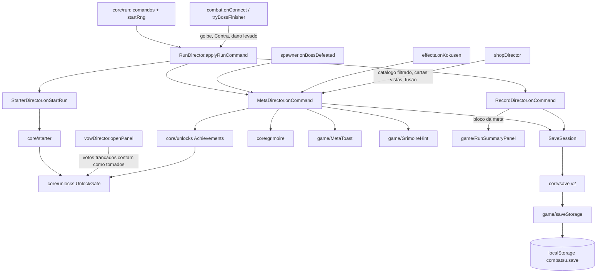

# Meta mínima (F39, restante) — Design

**Spec**: `.specs/features/meta-minima/spec.md` · **Base**: `recorde-e-recomeco` (save v1, `RecordDirector`, painel de
fim de run), já neste branch · **Decisões**: AD-001, AD-003, AD-006, AD-024 (item 3: aqui só conteúdo; o poder base
fica para o Altar, depois da F41); **emenda a AD-005** (ver "Decisão de projeto a registrar")
**Status**: Draft

---

## Arquitetura

```
data/unlocks.ts            ACHIEVEMENTS (as 8 da CNQ-01), TEST_ACHIEVEMENTS (debug), CONTENT_NAMES e KIND_LABELS por tipo, STARTER, STARTER_ROLES, META_TOAST
core/unlocks.ts            tipos do registro; isActive; Achievements (progresso, desbloqueio, mais perto); UnlockGate  ← puro
core/starter.ts            starterPool (cartas de técnica liberadas, sem resultado de receita), drawStarter (3 sem repetir, a recém-liberada na frente), refusalFragments ← puro
core/grimoire.ts           RecipeView, recipeViews(RECIPES), Grimoire (conjunto de chaves), grimoireHint                  ← puro
core/save.ts               SaveData v2 { version, record, meta }, validateMeta, MIGRATIONS[1], serializeSave(record, meta) ← puro
core/runSummary.ts         summaryLines ganha o bloco da meta (Liberado / Falta pouco) antes da linha do recomeço         ← puro
core/run.ts                startRng = new Rng(seed ^ 0xb5c0fbcf), criado no resolveStart com os outros streams
scenes/test/saveLoad.ts    loadSave: a tabela de carga (ex-recordLoad), agora com a meta e os parâmetros unlock=/grimoire=
scenes/test/saveSession.ts SaveSession: a porta única de escrita (carga uma vez por página, escrita juntada no POST_UPDATE)
scenes/test/metaDirector.ts   conquistas, Grimório, avisos, dica da loja, bloco do fim de run, snapshot `meta`
scenes/test/starterDirector.ts painel da Técnica inicial: abre no startRun, congela o jogo, lê 1-3/Enter, equipa no slot 0
game/StarterPanel.ts       painel `Técnica inicial` (título, 3 cartas, rodapé), molde do VowPanel
game/MetaToast.ts          aviso centrado em (480, 172), fila, 2500 ms em tempo real
game/GrimoireHint.ts       linha da dica do Grimório abaixo das cartas da loja
game/metaSnapshot.ts       tipo MetaSnapshot do snapshot de debug
```



- **Donos**: `SaveSession`, `MetaDirector` e `StarterDirector` moram no `RunDirector` (`runDirector.save`, `.meta`,
  `.starter`), criados no construtor dele, como o `record`. O `RunDirector` é campo da cena (`TestScene.ts:79`) e
  sobrevive ao `scene.restart()` da tecla R; as vistas nascem de novo em `mountUi`, chamado pelo `UiSetup.addHud` a
  cada `create` (o mesmo caminho do `record.mountUi`).
- **Uma porta de escrita**: hoje o `RecordDirector` escreve o save sozinho na morte. Com a meta, recorde e meta vão no
  mesmo JSON, então a escrita passa para a `SaveSession`, que os dois diretores chamam com `requestWrite()`. A sessão
  junta os pedidos do quadro numa escrita só, no `POST_UPDATE` da cena, e só escreve se o texto mudou desde a última
  escrita (MSV-06/07).
- **Conquista dormente não existe para o jogo**: o `Achievements` recebe as tabelas de conteúdo; conquista cujo conteúdo
  não está na tabela nem conta progresso nem tranca nada. Hoje (sem F31, F34, F35, F40) as 8 são dormentes, o gate
  deixa tudo passar e os sorteios de hoje consomem o rng exatamente como antes.
- **TestScene perde linhas**: o bloco "loja ou gameplay + área + `run.update`" vira três linhas com o
  `runDirector.tick(dt)`, e a lambda do Kokusen vira uma chamada (ver "Pontos de integração"). 399 → 395.

## Fluxo do quadro com o painel da Técnica inicial (STA-06..12)

Hoje (`TestScene.ts:416-420`):

```ts
if (this.run.state === 'shop') this.shopDirector.updateShop();
else this.updateGameplay(dt);
this.area.update(dt);
for (const cmd of this.run.update(dt, this.runDirector.seedForNewRun)) this.runDirector.applyRunCommand(cmd);
```

Depois:

```ts
if (this.run.state === 'shop') this.shopDirector.updateShop();
else if (!this.runDirector.starter.open) this.updateGameplay(dt);
this.runDirector.tick(dt);
```

```ts
// RunDirector
tick(dt: number): void {
  this.s.area.update(dt);
  if (this.starter.update()) return; // painel aberto (ou fechando neste quadro): a Run não anda (STA-06, STA-12)
  for (const cmd of this.s.run.update(dt, this.seedForNewRun)) this.applyRunCommand(cmd);
  this.meta.update();
}
```

1. **Quadro N (J ou Enter com a run parada)**: o `keydown` chama `run.startPressed()`; o `updateGameplay` lê os
   controles (drena o J); o `run.update` despacha `startRun` e `roundStart` (r1). No `startRun`, o `onStartRun` de hoje
   reseta tudo, equipa o `tech=` de debug e por último chama `starter.onStartRun()`, que decide se abre:
   - fora do `?debug` abre sempre; com `?debug` só com `starter=1` e sem `tech=` (STA-14); nunca no `fxlab`;
   - `offers = drawStarter(starterPool(GAME_SHOP_CATALOG, RECIPES, gate), run.startRng!, STARTER.offers,
     meta.freshTechnique())`; pool vazio não abre (caso de borda); ao abrir, `meta.markOffered(offers)` tira as
     oferecidas da lista de recém-liberadas (STA-18);
   - abrindo: `matter.world.pause()`, `StarterPanel.show(...)`, e **drena o `ShopInput`** com uma leitura descartada
     (STA-10: o Enter que começou a run ficou com `_justDown` ligado, porque ninguém lê Enter na luta).
   No `roundStart` do mesmo quadro, o banner `Rodada 1` não sai: `applyRunCommand` só chama `hud.banner` quando o
   painel está fechado; com ele aberto o texto é pedido ao `record.roundBanner` só no fechamento (STA-12).
2. **Quadros com o painel aberto**: `updateGameplay` não roda (player, técnicas, energia, recarga, inimigos, objetos e
   recuperação param); `starter.update()` devolve `true` e o `run.update` não roda (nenhum spawn, nenhum temporizador da
   run). O `starter.update()` lê primeiro o `ShopInput` (1, 2, 3, Enter) e depois descarta um `controls.read()`, para
   nenhum outro botão apertado com o painel aberto sair como golpe no primeiro quadro de luta. Reafirma
   `matter.world.pause()` se alguém retomou a física (o `effects.unfreeze` retoma sem saber do painel). HUD, câmera e
   efeitos em tempo real seguem como na loja. Sem tecla, nada muda e não há tempo limite (STA-11).
3. **Escolha**: 1/2/3 com carta existente → `loadout.equip(0, id, 1)` (o nível que a 1ª compra dá, sem tocar na
   carteira), evento `starter:<id>`; Enter → `wallet.add(refusalFragments(offers, GAME_SHOP_CATALOG))` (o mesmo número do
   rodapé) e evento `starterRefused`; tecla de carta inexistente não faz nada (STA-09).
   Fechar: esconde o painel, `matter.world.resume()`, mostra o banner do `record.roundBanner(run.round)` por
   `RUN.bannerMs`. O quadro do fechamento ainda devolve `true`; a luta volta no quadro seguinte (STA-12).
4. **R com o painel aberto**: a cena recomeça como hoje (o estado é `roundActive`, não `shop`). O `starter.mountUi`
   zera `open`, `offers` e `chosen`; sem isso o diretor, que sobrevive ao restart, deixaria a cena nova sem gameplay.

Recomeço (STA-16): o J aceito a 1000 ms da morte abre o painel no mesmo quadro; a escolha vale no quadro seguinte,
~1017 ms depois da morte. A reconstrução da área no modular acontece no `roundStart` (`areaDirector.ts:78`), atrás do
painel, e não atrasa a escolha.

## Conquistas: de onde vem cada evento (CNQ-05..12)

| Conquista | Escopo | Evento que soma | Onde nasce |
| --- | --- | --- | --- |
| `rodada5` | `run` | `reach(id, round)` no `roundStart` | `meta.onCommand` |
| `kokusenRodada` | `round` | `bump(id)` a cada Kokusen; `startRound()` zera no `roundStart` | `effects.onKokusen` (a lambda da `TestScene.ts:323-327` passa para lá) → `meta.onKokusen()` |
| `chefeSemTecnica` | `milestone` | `meet(id)` na vitória sobre o chefe se nenhum slot esteve ocupado | `meta.update()` acompanha `s.boss` (chefe novo pelo `id` → limpo; slot ocupado com chefe vivo → sujo); `spawner.onBossDefeated` → `meta.onBossDefeated()` confere de novo `loadout.hasAny()` |
| `jackpots` | `total` | `bump(id)` no `jackpot:hit` | `meta.onJackpot()`, chamado pelo diretor do Domínio da F31 (ligado por quem chegar depois; dormente até existir `jackpotTambor4`) |
| `chefeR10` | `run` | `reach(id, run.round)` em toda vitória sobre chefe (r5 → 5/10; r10 cumpre) | `meta.onBossDefeated()` |
| `contras` | `run` | `bump(id)` quando o golpe aceito tem `hit.counter` e `MOVES[hit.moveName]?.counter` | `combat.onConnect` → `runDirector.onConnect(hit)` → `meta.onPlayerStrike(hit)`; o golpe de ativação do Domínio não tem `moveName` de Contra e não conta |
| `semDano` | `milestone` | `meet(id)` no `roundCleared` com `round >= 3` e nenhum golpe aceito pelo player desde o `roundStart` | `combat.onConnect` com `hit.ownerId !== player.id` → `meta.onPlayerHurt()`; bloqueio, parry e esquiva não chegam ao `onConnect` (`Player.receiveHit` só devolve `true` no golpe cheio, `hitbox.ts:93`) |
| `finalizadorChefe` | `milestone` | `meet(id)` quando o finalizador zera a vida do chefe (o `finisher:boss` que deixa o chefe vivo não conta) | `combat.tryBossFinisher` → `runDirector.onBossFinisher(damage, boss.hp <= 0)` (a linha que hoje soma o dano no `record` vira esta chamada, que soma e avisa a meta) |

- **Run que não conta** (CNQ-13): `meta.counting` é decidido no `startRun`: falso com `s.fxLab` ou com
  `firstRoundForDebug() > 1`. Com ele falso, nenhum evento soma, desbloqueia nem registra receita.
- **Desbloqueio**: `bump`, `reach` e `meet` devolvem os ids que acabaram de se cumprir, na ordem do registro. O
  `MetaDirector` empurra `unlock:<id>`, enfileira `Liberado: <nome> (<tipo>)`, guarda em `unlockedThisRun`, põe a
  técnica liberada no fim de `freshTechniques` (STA-18) e pede escrita (CNQ-02, MSV-06). Já liberada, a conquista continua guardando progresso mas não devolve nada (CNQ-14).
- **Liberado aparece no próximo sorteio** (UNL-07): o `UnlockGate` lê o conjunto vivo de desbloqueios. A loja recebe o
  catálogo filtrado ao abrir (`openShop`), então uma loja aberta e o reroll dela não mudam; a próxima loja já vê.

## Sorteios que respeitam a trava (UNL-05)

| Sorteio | Hoje | Mudança |
| --- | --- | --- |
| Técnica inicial | não existe | `starterPool(catalog, recipes, gate)` só leva técnica com `gate.allows('technique', id)` |
| Cartas da loja | `new Shop(GAME_SHOP_CATALOG, ...)` (`shopDirector.ts:121`) | `new Shop(meta.gate.filterCatalog(GAME_SHOP_CATALOG), ...)`: `technique` → tipo `technique`, `perk` → `talent`; os outros tipos passam. O `shopSnapshot` continua procurando no catálogo inteiro |
| Painel de votos | `drawVows(rng, this.vows.list)` (`vowDirector.ts:63`) | `drawVows(rng, [...this.vows.list, ...meta.gate.lockedIds('vow')])`: voto trancado conta como tomado. Sem trava a lista é a mesma e o rng é consumido igual |
| Baú do chefe (F33), Baú do Véu (F31) | não existem neste branch | a fase que os trouxer filtra os candidatos com `gate.allows(kind, id)`; se já estiverem no código quando a F39 for implementada, a tarefa de integração liga |
| Melhoria de Domínio (F31) | não existe | o ponto que aplica a melhoria pergunta `gate.allows('domainUpgrade', id)` |

Os parâmetros de debug (`tech=`, `perks=`, `vows=`, `domain=`) equipam direto no `loadout`, `build` e `vows`, sem passar
por sorteio, então equipam conteúdo trancado sem mudança (UNL-08).

## Carga do save (MSV-*, SAVE-*)

| Situação | `storage` | `best` | `meta` | Escreve na sessão |
| --- | --- | --- | --- | --- |
| `?debug` com `record=N`, `unlock=` ou `grimoire=` (qualquer um válido) | `'off'` | `record=N` ou `null` | `unlocks` de `unlock=` (ou `[]`), `grimoire` de `grimoire=` (ou `[]`), `progress: {}` | não |
| `?debug&nosave=1` (sem os de cima) | `'off'` | `null` | vazia | não |
| `getItem` (ou o acesso a `window.localStorage`) lança | `'memory'` | `null` | vazia | não |
| chave ausente, JSON inválido ou falha de validação (inclusive da meta, MSV-04) | `'local'` | `null` | vazia | sim (sobrescreve) |
| `version: 1` | `'local'` | o recorde migrado | vazia (MSV-02) | sim |
| `version` > 2 | `'local'`, `locked` | `null` | vazia | não |
| `version: 2` válida | `'local'` | o recorde lido | a meta lida, com ids desconhecidos | sim |

`unlock=all` vira todos os ids do registro em uso; `unlock=none` vira `[]`; `unlock=a,b` guarda só os ids que o registro
conhece (id desconhecido some, caso de borda). `grimoire=a,b` guarda as chaves como vieram. Nenhum parâmetro de debug
lê o armazenamento: os smokes nunca dependem do save real. `achievements=test` (debug, ver Tech Decisions) só troca o
registro e não mexe na carga.

## Fim de run (FAL-*)

O `RecordDirector.onDeath` passa a montar `summaryLines({ ..., meta: this.s.runDirector.meta.summary() })`, com
`MetaSummary = { unlocked: string[]; nearest: { name; label; progress; target } | null; challenge: { name; label } | null }`,
com os nomes já levando o tipo (`Boogie Woogie (técnica)`) e o `challenge` vindo de `challenge(run.round)`. O progresso já está guardado
no instante da morte (cada evento grava no `Achievements` na hora), então o "mais perto" lê o valor depois desta morte.
O bloco entra depois da linha do recorde e antes de `J / Enter para tentar de novo`:

```
Liberado: Boogie Woogie (técnica), Zona Negra (talento)   ← highlight, quebra com listLines (FAL-04), abre o bloco com gap
Falta pouco para: Fala Amaldiçoada (técnica) · 10 Contras numa run (J após defender) (3/10)   ← sem gap se o Liberado veio antes
Desafio: Hora Extra (talento) · limpar uma rodada da r3 em diante sem levar golpe   ← marco de índice (rodada - 1) mod n (FAL-08)
```

Sem desbloqueio na run e sem conquista ativa trancada, o bloco não existe (FAL-03). As linhas mais longas possíveis têm
~91 caracteres (`contras` com 9/10 e `kokusenRodada` com 2/3), abaixo do `SUMMARY_LINE_MAX` (100); um teste monta a
linha de cada entrada do registro com o progresso máximo. Com a carga do END-14 (~19 linhas, ~320 px) mais quatro
linhas e uma folga, o painel fica em ~396 px de 540 (FAL-06, conferido pelo `panelBounds` no teste).

---

## Code Reuse Analysis

### Existing Components to Leverage

| Componente | Onde | Como usa |
| --- | --- | --- |
| `parseSave`, `migrate`, `MIGRATIONS`, `validateRecord`, `isPlain`, `stringList`, `isIntAtLeast` | `core/save.ts:49-149` | v2: `MIGRATIONS[1]` e `validateMeta` com os mesmos ajudantes |
| `SaveStorage` | `game/saveStorage.ts` | passa do `RecordDirector` para a `SaveSession`, sem mudar |
| `loadRecord` e a tabela de carga | `scenes/test/recordLoad.ts:33-42` | vira `loadSave` em `saveLoad.ts`, com a meta e os parâmetros novos; o teste par acompanha |
| `RecordBook`, `roundBanner` | `core/recordBook.ts`, `recordDirector.ts:216` | banner da r1 pedido no fechamento do painel |
| `summaryLines`, `listLines`, `SummaryLine.gap/highlight` | `core/runSummary.ts:136-215` | bloco da meta com as mesmas regras de quebra e folga |
| `panelBounds` | `game/RunSummaryPanel.ts:59` | FAL-06 no teste |
| `drawVows` (uniforme sem repetir com `rng.int`) | `core/vows.ts:33` | `drawStarter` no mesmo molde; o painel de votos recebe os trancados como tomados |
| `ShopInput.read()` (1, 2, 3, J, Enter) | `game/input.ts:115-153` | teclas do painel da Técnica inicial, como o painel de votos (`shopDirector.ts:146-155`) |
| `VowPanel` (3 cartas, título, rodapé, `VOW_PANEL_COLORS`) | `game/VowPanel.ts` | molde do `StarterPanel` |
| `TECHNIQUES[id].cost`, `cooldownMs`; `maxLevel` e `cost.base` da carta | `data/techniques.ts`, `data/shop.ts` | números do Nv 1 e `Nv 1/<máx>` na carta (STA-05; com a F30, `Loadout.stats` no Nv 1) e o valor da recusa (STA-08) |
| `loadout.equip(slot, id, level)` | `core/loadout.ts:64` | equipar a técnica inicial no slot 0, nível 1 |
| Congelamento da loja (`matter.world.pause/resume`, gameplay pulado) | `shopDirector.ts:120,169`, `TestScene.ts:416` | mesmo congelamento com o painel aberto (STA-06) |
| `debugParam`, `debugIntParam`, `isDebug` | `scenes/test/params.ts:5,10` | `starter=1`, `unlock=`, `grimoire=`, `achievements=test` |
| `firstRoundForDebug` | `runDirector.ts:47` | CNQ-13 |
| `snapshot.debugEvents` | `scenes/test/snapshot.ts:12` | `starter:<id>`, `starterRefused`, `unlock:<id>`, `grimoire:<key>` |
| `RECIPES` (`into`, `from`, `name`) e `TECHNIQUES[id].short` | `data/evolutions.ts`, `data/techniques.ts` | chave, nome e rótulos da receita no Grimório |
| `TECHNIQUES`, `PERKS`, `VOWS` | `data/` | existência e nome do conteúdo (UNL-03), sem lista à parte |
| `PALETTE` e o teste de chaves das cores | `game/art/palette.ts`, `tests/game/vowPanel.test.ts`, `recordViews.test.ts` | `STARTER_PANEL_COLORS`, `META_COLORS` com teste igual |

### Integration Points

| Sistema | Como a feature liga |
| --- | --- |
| `core/run.ts` | um stream a mais no `resolveStart`; nenhum estado novo, nenhum ramo novo (o arquivo está na exceção de complexidade) |
| `combat.onConnect` | uma chamada ao `runDirector.onConnect(hit)` no topo, que soma o dano do recorde (golpe do player) e avisa a meta (Contra, dano levado); a linha do `record.onPlayerHit` dentro do `if` sai |
| `combat.tryBossFinisher` | `record.addDamage('golpe', damage)` vira `runDirector.onBossFinisher(damage, boss.hp <= 0)` |
| `spawner.onBossDefeated` | `this.s.runDirector.meta.onBossDefeated();` |
| `effects.ts` | ganha `onKokusen(target, point, facing, streak)`: o que a lambda da cena faz hoje mais `meta.onKokusen()` |
| `shopDirector` | catálogo filtrado no `openShop`; `meta.onShopFrame(view)` depois do `shopPanel.update`; `meta.onRecipeSeen(id)` na fusão |
| `vowDirector.openPanel` | trancados entram como tomados no `drawVows` |
| `RecordDirector` | recebe a `SaveSession`; a morte pede escrita em vez de escrever; o painel ganha o bloco da meta |
| Snapshot | `meta: this.s.runDirector.meta.snapshot()` (o `starter` vai dentro, STA-17) |

---

## Components

### data/unlocks.ts

- **Purpose**: o registro das conquistas e as tabelas de conteúdo (CNQ-01, UNL-02, UNL-03).
- **Interfaces**:
  - `ACHIEVEMENTS: readonly AchievementDef[]`: as 8 da tabela CNQ-01, na ordem, com os rótulos exatos da spec.
  - `TEST_ACHIEVEMENTS: readonly AchievementDef[]`: só para `?debug&achievements=test` e para os smokes:
    `testeR2` (`começar a r2 numa run`, 2, `run`, técnica `corte`), `testeContra` (`1 Contra numa run`, 1, `run`,
    talento `contraAfiado`) e `testeChefe` (`vencer um chefe`, 1, `milestone`, voto `semGuarda`). Conteúdo que já
    existe, para exercitar trava, aviso, save, "falta pouco", "Desafio" e a carta `Novo` hoje.
  - `KIND_LABELS: Record<ContentKind, string>`: `técnica`, `talento`, `voto`, `Domínio`.
  - `STARTER_ROLES: Partial<Record<TechId, string>>` (até 20 caracteres): `divergente` `soco em dois tempos`,
    `corte` `cortes à distância`, `azul` `orbe que puxa`, `vermelho` `disparo que explode`. Técnica nova (F34) traz a
    sua linha; sem ela a carta só omite o papel.
  - `CONTENT_NAMES: Record<ContentKind, Readonly<Record<string, string>>>`: `technique` de `TECHNIQUES` (`name`),
    `talent` de `PERKS` (`name`), `vow` de `VOWS` (`name`), `domainUpgrade` `{}` até a fase do Domínio declarar a
    lista dela (a F31 ou quem criar `jackpotTambor4` acrescenta a fonte aqui). Existência = id presente na tabela.
  - `STARTER = { offers: 3 }`; `META_TOAST = { x: 480, y: 172, ms: 2500 }`; `GRIMOIRE_HINT_Y = 368`.
- **Dependencies**: `data/techniques`, `data/perks`, `data/vows`.

### core/unlocks.ts

- **Purpose**: regras do registro, sem motor e sem armazenamento (UNL-01..07, CNQ-02..04, CNQ-14, FAL-02).
- **Interfaces**:
  - `type ContentKind = 'technique' | 'talent' | 'vow' | 'domainUpgrade'`;
    `type AchievementScope = 'run' | 'round' | 'total' | 'milestone'`
  - `interface AchievementDef { id: string; label: string; target: number; scope: AchievementScope; content: { kind: ContentKind; id: string } }`
  - `type ContentTables = Record<ContentKind, Readonly<Record<string, string>>>` (id → nome)
  - `isActive(def, tables): boolean`
  - `class Achievements`
    - `constructor(registry: readonly AchievementDef[], tables: ContentTables, data: MetaSave)` (copia a `data`)
    - `startRun(): void` (zera os contadores `run` e `round` da run); `startRound(): void` (zera os `round`)
    - `bump(id, n = 1): string[]` (soma no contador da run/rodada, ou no total); `reach(id, value): string[]`
      (contador da run = maior valor); `meet(id): string[]` (marco). Cada um devolve os ids cumpridos agora.
    - `isUnlocked(id)`, `active(): AchievementDef[]`, `dormant(): AchievementDef[]`, `nearest(): Nearest | null` (só
      contagem), `challenge(endRound: number): AchievementDef | null` (marco)
    - `data(): MetaSave` (`unlocks` e `progress`, com os ids desconhecidos do save intactos, MSV-05)
  - `class UnlockGate { constructor(ach: Achievements); allows(kind, id): boolean; lockedIds(kind): string[];
    filterCatalog(catalog: readonly ShopEntry[]): ShopEntry[] }`
  - `isContraStrike(hit: Hit, moves): boolean` (CNQ-10: `hit.counter` e o `moveName` é um Contra do moveset) e
    `isPlayerHurt(hit: Hit, playerId: number): boolean` (CNQ-11: golpe aceito de outro dono), para o diretor só repassar
- **Regras**: dormente (`!isActive`) ignora `bump/reach/meet` e não entra em `active`, `nearest` nem na trava. Progresso
  guardado: `run`/`round` = `max(guardado, contador)`; `total` = guardado + n; `milestone` = 1. Cumpre quando o valor
  do escopo (`contador` para `run`/`round`, guardado para `total`, 1 para marco) `>= target` e o id ainda não está em
  `unlocks`. `nearest`: maior `guardado / target` entre ativas não liberadas de escopo `run`, `round` ou `total`; empate fica
  com a primeira do registro (o `>` estrito na varredura em ordem). `challenge(endRound)`: marcos ativos não liberados
  na ordem do registro, o de índice `(endRound - 1) mod n`; nenhum → `null`. `allows` é falso só para conteúdo de conquista ativa e não liberada.

### core/starter.ts

- **Purpose**: pool e sorteio da Técnica inicial (STA-01, STA-02, STA-04).
- **Interfaces**:
  - `starterPool(catalog: readonly ShopEntry[], recipes: readonly { into: string }[], allows: (id: TechId) => boolean): TechId[]`:
    ids com carta `kind: 'technique'`, fora de qualquer `into` de receita, liberados, **na ordem de `TECHNIQUES`**
    (não na do catálogo).
  - `drawStarter(pool: readonly TechId[], rng: Rng, n: number, fresh: TechId | null = null): TechId[]`: com `fresh` no
    pool, ele é o 1º item e sai do pool antes do sorteio (fora do pool, é ignorado); o resto por embaralhamento parcial
    (`pool.splice(rng.int(0, pool.length - 1), 1)`), até `min(n, pool.length)` itens, na ordem do sorteio.
  - `refusalFragments(offers: readonly TechId[], catalog: readonly ShopEntry[]): number`: o menor `cost.base` entre as
    cartas `technique` das ofertas (STA-08); sem oferta, 0.
- **Reuses**: o molde do `drawVows`.

### core/grimoire.ts

- **Purpose**: receitas vistas e a dica da loja (GRI-01..08).
- **Interfaces**:
  - `interface RecipePiece { kind: 'technique' | 'talent' | 'weapon'; id: string; label: string; minLevel: number }`
  - `interface RecipeView { key: string; name: string; result: string; pieces: readonly RecipePiece[] }`
  - `recipeViews(recipes: readonly Recipe[]): RecipeView[]`: hoje `key = into`, `name = Recipe.name`,
    `result = TECHNIQUES[into].short`, peças = `from` com `TECHNIQUES[id].short` e `minLevel = EVOLUTION_LEVEL`. A F37 troca só esta função pelo
    formato `{kind, id, minLevel}[]`.
  - `class Grimoire { constructor(keys: readonly string[]); has(key); add(key): boolean; list(): string[] }`
    (`add` devolve `false` se já tinha, GRI-03; chaves desconhecidas ficam, MSV-05)
  - `grimoireHint(views, levelOf: (p: RecipePiece) => number, known: (key) => boolean): string | null` (0 = fora da mão)
- **Regras**: elegível = peças na mão (`levelOf > 0`) `>= ceil(total / 2)` e receita não pronta (alguma peça com
  `levelOf < minLevel`); a primeira elegível na ordem dos dados. Revelada: `Grimório: <na mão, ' + '> + <as outras,
  ' + '> → <result>`, cada peça como `<label> Nv <minLevel>`; não revelada: `Grimório: <na mão, ' + '> + ? → ?`, ou
  `Grimório: <na mão, ' + '> → ?` com todas na mão. Com 2 peças dá exatamente o texto da spec.

### core/save.ts (v2)

- **Purpose**: formato v2 com a meta e a migração da v1 (MSV-01..05).
- **Interfaces**:
  - `SAVE_VERSION = 2`; `interface MetaSave { unlocks: string[]; progress: Record<string, number>; grimoire: string[] }`
  - `interface SaveData { version: number; record: RunRecord | null; meta: MetaSave }`; `EMPTY_META()`
  - `MIGRATIONS = { 1: (old) => ({ ...old, meta: EMPTY_META() }) }`
  - `validateMeta(x: unknown): MetaSave | null`: `unlocks` e `grimoire` listas de strings, `progress` objeto plano com
    todo valor `Number.isInteger` e `>= 0`; `meta` ausente → `null` → save inteiro inválido (MSV-04).
  - `serializeSave(record: RunRecord | null, meta: MetaSave): string`
- **Regras**: o `parseSave` valida `record` e `meta` depois da migração; qualquer um inválido dá `invalid`. Os testes
  de migração injetada (`current = 3`) continuam valendo.

### core/runSummary.ts

- **Purpose**: o bloco da meta no painel (FAL-01..05).
- **Interfaces**: `SummaryInput.meta?: MetaSummary`; `metaLines(meta?: MetaSummary): SummaryLine[]`, chamado em
  `summaryLines` entre `recordLine` e a linha do recomeço.
- **Regras**: `Liberado:` usa `listLines('Liberado', nomes, '')` com `highlight` em todas as linhas da lista; a primeira
  linha do bloco leva `gap`; `Falta pouco para: <name> · <label> (<progress>/<target>)` e, logo depois, `Desafio: <name> · <label>` (FAL-08); o
  `name` já vem com o tipo.

### scenes/test/saveLoad.ts e scenes/test/saveSession.ts

- **saveLoad.ts** (ex-`recordLoad.ts`, `git mv` com o teste): `loadSave(params: SaveDebugParams, storage, registryIds): SaveLoad`
  com `SaveDebugParams = { record: number | undefined; nosave: boolean; unlock: string | null; grimoire: string | null }`
  e `SaveLoad = { best: RunRecord | null; meta: MetaSave; storage: RecordStorage; locked: boolean }`. A tabela da seção
  "Carga do save", um `if` por linha.
- **saveSession.ts**: sem Phaser como valor, testável em Node.
  - `constructor(storage: Pick<SaveStorage, 'read' | 'write' | 'kind'>, schedule: (fn: () => void) => void)`
  - `load(params, registryIds): SaveLoad` (só a primeira chamada lê; as outras devolvem a mesma carga)
  - `bind(source: () => { record: RunRecord | null; meta: MetaSave }): void`
  - `requestWrite(): void`: liga `queued` e agenda um `flush` (no jogo, `s.events.once('postupdate', fn)`)
  - `flush(): void`: zera `queued`; escreve só se `storage !== 'off'`, não `locked`, porta não está em `'memory'` e
    `serializeSave(...)` difere de `lastText`; guarda `lastText`. `lastText` nasce com o texto da carga já
    normalizada (um v1 migrado não é reescrito à toa, MSV-07).
  - `remount(): void`: chamado a cada `create`; se havia escrita pendente de antes do restart, faz o `flush` agora
    (o `once` pode ter morrido com a cena velha).
  - `get storageKind(): 'local' | 'memory' | 'off'`, `get locked()`

### scenes/test/metaDirector.ts

- **Purpose**: liga conquistas, Grimório, avisos e dica ao jogo (CNQ-*, GRI-*, FAL-07, CNQ-16).
- **Interfaces**:
  - `mountUi(layer)`: lê a carga pela sessão na primeira vez (cria `Achievements`, `UnlockGate`, `Grimoire`), recria
    `MetaToast` e `GrimoireHint`; registra a fonte da sessão.
  - `readonly gate: UnlockGate` (via getter)
  - `onCommand(cmd)`: `startRun` (zera run, decide `counting`, esconde a dica), `roundStart` (`startRound`,
    `reach('rodada5', round)`, `hurtThisRound = false`, esconde a dica), `roundCleared` (`semDano`), `gameOver`
    (esconde a dica, `save.requestWrite()`)
  - `update()`: acompanha o chefe para `chefeSemTecnica`
  - `onKokusen()`, `onPlayerStrike(hit)`, `onPlayerHurt()`, `onBossDefeated()`, `onBossFinisher(killed)`, `onJackpot()`
  - `onShopFrame(view: ShopView)`: registra a receita de toda carta `evolution` na tela e atualiza a dica
  - `onRecipeSeen(key)`: fusão (e, na F33, a oferta do baú)
  - `freshTechnique(): TechId | null` e `markOffered(ids)`: a lista em memória `freshTechniques` (STA-18); o diretor
    sobrevive ao R e ao J, e a lista com ele
  - `summary(): MetaSummary` (com `challenge(run.round)`), `snapshot(): MetaSnapshot`
- **Regras**: todo evento passa por `if (!this.counting) return`. Nível da peça para a dica: técnica
  `loadout.levelOf(id)`, talento 1 com `build.perks.has(id)` (a F35 troca pelo nível do talento), arma 1 com
  `arsenal.snapshot().weapon === id`; 0 fora da mão.

### scenes/test/starterDirector.ts

- **Purpose**: o painel da Técnica inicial (STA-05..14, STA-17).
- **Interfaces**: `mountUi(layer)` (recria o `StarterPanel`, zera o estado), `get open()`, `onStartRun()`,
  `update(): boolean` (`true` enquanto consumiu o quadro), `snapshot(): MetaSnapshot['starter']`.
- **Dependencies**: `meta.gate`, `meta.freshTechnique`/`markOffered`, `run.startRng`, `loadout`, `wallet`, `shopInput`,
  `controls`, `hud`, `record.roundBanner`.

### game/StarterPanel.ts, game/MetaToast.ts, game/GrimoireHint.ts

- **StarterPanel**: molde do `VowPanel`, profundidade 210, na `uiLayer`. Título `Técnica inicial` em (480, 130); três
  cartas 170x130 a partir de y 170 com folga 18 (546 px, centradas); em cada uma a tecla (`1`..`3`), `Novo` na carta
  recém-liberada, o nome (`TECHNIQUES[id].name`, quebra na largura da carta), `Nv 1/<maxLevel da carta>`, o papel
  (`STARTER_ROLES[id]`, se houver) e `<custo> CE · <recarga> s` do Nv 1; rodapé
  `1-3 escolhe · Enter: sem técnica (+<n>)` em y 320. `show(cards: { key; name; level; role; numbers; fresh }[], refusal)`, `hide()`,
  `debug(): { visible; title; cards: string[][]; footer }`. Cores `STARTER_PANEL_COLORS = { bg: 'k', cardBg: 'K',
  border: 'c', title: 'C', text: 'w', key: 'A', effect: 'S', hint: 'S' }`.
- **MetaToast**: `Text` em (480, 172), origem (0.5, 0.5), cor `META_COLORS.toast` (`'A'`), estilo do banner do HUD.
  `push(text)`, `current(): string | null`. O relógio é o `POST_UPDATE` da cena (tempo real: anda no hitstop, na
  câmera lenta e na loja), registrado no construtor e solto no `SHUTDOWN`. Fila: cada item fica `META_TOAST.ms`.
- **GrimoireHint**: `Text` em (480, `GRIMOIRE_HINT_Y`), origem (0.5, 0), 12 px, cor `META_COLORS.hint` (`'S'`).
  `set(text: string | null)`, `debug(): string | null`. A linha da loja de hoje fica em y 336 (`ShopPanel.ts:48`,
  `CARD_TOP + CARD_H + 16`) com 12 px; y 368 deixa uma linha de folga e não cobre carta nem rodapé (GRI-09).

---

## Data Models

```typescript
// core/save.ts
interface MetaSave { unlocks: string[]; progress: Record<string, number>; grimoire: string[] }
interface SaveData { version: 2; record: RunRecord | null; meta: MetaSave } // JSON em 'combatsu.save'

// core/unlocks.ts
type ContentKind = 'technique' | 'talent' | 'vow' | 'domainUpgrade';
type AchievementScope = 'run' | 'round' | 'total' | 'milestone';
interface AchievementDef {
  id: string;
  label: string; // "começar a r5 numa run"
  target: number; // inteiro >= 1
  scope: AchievementScope;
  content: { kind: ContentKind; id: string };
}
interface Nearest { def: AchievementDef; name: string; progress: number }

// core/runSummary.ts
interface MetaSummary {
  unlocked: string[]; // nomes, na ordem de desbloqueio da run
  nearest: { name: string; label: string; progress: number; target: number } | null;
  challenge: { name: string; label: string } | null;
}

// game/metaSnapshot.ts — snapshot.meta (STA-17, CNQ-16, GRI-10, FAL-07)
interface MetaSnapshot {
  starter: { open: boolean; offers: string[]; chosen: string | null; refusal: number; fresh: string[] };
  registry: 'game' | 'test';
  unlocks: string[];
  progress: Record<string, number>;
  active: string[];
  dormant: string[];
  unlockedThisRun: string[];
  counting: boolean;
  toast: string | null;
  grimoire: string[];
  hint: string | null;
  nearest: string | null;
  challenge: string | null;
}
```

**Relações**: `MetaSave` é a parte persistente do `Achievements` (`unlocks`, `progress`) e do `Grimoire` (`grimoire`).
A `SaveSession` junta `RecordBook.best` e `MetaSave` no `serializeSave`. O `UnlockGate` só lê o `Achievements`.

---

## Pontos de integração (arquivos existentes tocados)

| Arquivo (efetivas antes) | Linha | Mudança | Δ efetivas |
| --- | --- | --- | --- |
| `src/core/run.ts` (237) | 58-68, 132-180, 297-307 | campo `startRngValue`, getter `startRng`, `this.startRngValue = new Rng(seed ^ 0xb5c0fbcf);` | +5 |
| `src/core/save.ts` (107) | 11, 35-49, 134-155 | v2, `MetaSave`, `validateMeta`, `MIGRATIONS[1]`, `serializeSave(record, meta)` | +~30 |
| `src/core/runSummary.ts` (147) | 98-110, 205-215 | `meta?` no `SummaryInput`, `metaLines` | +~15 |
| `src/scenes/test/recordLoad.ts` (25) → `saveLoad.ts` | todo | `loadSave` com meta e `unlock=`/`grimoire=` | +~20 |
| `src/scenes/test/recordDirector.ts` (104) | 176-200, 250-270 | recebe a `SaveSession`; sai o `SaveStorage` e a escrita direta; `meta` no `summaryLines` | ~0 |
| `src/scenes/test/runDirector.ts` (180) | 20-26, 55-77, 100-153 | `save`, `meta`, `starter`; `tick(dt)`; `onConnect(hit)`; `onBossFinisher(damage, killed)`; banner da r1 só com o painel fechado; `starter.onStartRun()` no fim do `onStartRun` | +~25 |
| `src/scenes/TestScene.ts` (399) | 323-327 | lambda do Kokusen → `(target, point, facing, streak) => this.effects.onKokusen(target, point, facing, streak),` | -3 |
| | 416-420 | bloco da seção "Fluxo do quadro" | -1 |
| `src/scenes/test/effects.ts` (47) | 35 | `onKokusen(...)`: `impactFx.kokusenFrame`, `kokusenFx.trigger`, `runDirector.meta.onKokusen()` | +5 |
| `src/scenes/test/combat.ts` (225) | 83, 98 | `this.s.runDirector.onConnect(hit);` no topo do `onConnect`; sai `record.onPlayerHit` de dentro do `if` | 0 |
| | 265 | `record.addDamage('golpe', damage)` → `runDirector.onBossFinisher(damage, boss.hp <= 0)` | 0 |
| `src/scenes/test/spawner.ts` (148) | 162 | `this.s.runDirector.meta.onBossDefeated();` | +1 |
| `src/scenes/test/shopDirector.ts` (144) | 70, 80, 122 | `meta.onRecipeSeen(id)` na fusão; `meta.onShopFrame(view)` depois do `shopPanel.update` (a `view` vira `const`); catálogo filtrado | +2 |
| `src/scenes/test/vowDirector.ts` (70) | 63 | trancados como tomados no `drawVows` | 0 |
| `src/scenes/test/uiSetup.ts` (77) | 81 | `starter.mountUi`, `meta.mountUi` (a `SaveSession.remount` vai dentro do `meta.mountUi`) | +2 |
| `src/scenes/test/snapshot.ts` (210) | 164 | `meta: this.s.runDirector.meta.snapshot(),` | +1 |
| `src/game/debugApi.ts` (309) | 15, 307 | import de `MetaSnapshot` e campo `meta` | +2 |
| `tests/core/save.test.ts`, `tests/core/runSummary.test.ts`, `tests/scenes/recordLoad.test.ts` → `saveLoad.test.ts`, `tests/game/debugApi.test.ts` | — | assinatura nova do `serializeSave`, v2, meta no exemplo do snapshot | — |
| `README.md` | parâmetros de debug | `starter=1`, `unlock=`, `grimoire=`, `achievements=test`; os eventos novos | +5 |

`Hud.ts`, `ShopPanel.ts`, `VowPanel.ts`, `core/vows.ts`, `core/shop.ts` e `tests/core/run.test.ts` (exceção de tamanho)
não são tocados. O runner de smoke (`scripts/smoke/run.mjs`) não muda: o `nosave=1` que ele acrescenta não interfere
com `unlock=`/`grimoire=` (nenhum lê o armazenamento).

## Arquivos perto do teto (efetivas: sem vazias e sem comentários)

| Arquivo | Hoje | Depois | Teto |
| --- | --- | --- | --- |
| `src/scenes/TestScene.ts` | 399 | 395 | 400 (só perde) |
| `src/game/Hud.ts` | 336 | 336 | 400 (intocado) |
| `src/game/debugApi.ts` | 309 | 311 | 400 |
| `src/game/ShopPanel.ts` | 274 | 274 | 400 (intocado, GRI-09) |
| `src/core/run.ts` | 237 | 242 | 400 (complexidade igual) |
| `src/scenes/test/combat.ts` | 225 | 225 | 400 |
| `src/scenes/test/snapshot.ts` | 210 | 211 | 400 |
| `src/scenes/test/runDirector.ts` | 180 | ~205 | 400 |

Arquivos novos (estimativa): `data/unlocks.ts` ~70, `core/unlocks.ts` ~130, `core/starter.ts` ~40,
`core/grimoire.ts` ~70, `scenes/test/saveSession.ts` ~60, `scenes/test/metaDirector.ts` ~200,
`scenes/test/starterDirector.ts` ~90, `game/StarterPanel.ts` ~110, `game/MetaToast.ts` ~55, `game/GrimoireHint.ts`
~30, `game/metaSnapshot.ts` ~25. Função mais longa prevista: `StarterPanel` construtor (~35 linhas); complexidade
máxima em `loadSave` (~9) e `Achievements.evaluate` (~6). Nenhum arquivo novo entra nas exceções.

---

## Error Handling Strategy

| Cenário | Tratamento | O que o jogador vê |
| --- | --- | --- |
| Save v1 do branch de hoje | `MIGRATIONS[1]` mantém o recorde e cria a meta vazia | recorde igual; a próxima escrita grava v2 |
| `meta` corrompida (lista com número, progresso negativo ou fracionário, `meta` ausente na v2) | save inteiro `invalid` (SAVE-05) | começa do zero; a próxima escrita sobrescreve |
| Id desconhecido em `unlocks`, `progress` ou `grimoire` | guardado e ignorado (o `Achievements` e o `Grimoire` preservam) | nada |
| `setItem` lança numa conquista no meio da run | porta em `'memory'`, meta em memória | o aviso aparece igual; o desbloqueio vale até fechar a aba |
| Save de versão mais nova | `locked`, meta vazia em memória, nada escrito | sem desbloqueios antigos; o save novo fica intacto |
| Pool da Técnica inicial vazio | o painel não abre | a run começa com os slots vazios |
| Conteúdo de uma conquista sumiu do código | a conquista volta a dormir; o id fica no save | o conteúdo simplesmente não existe |
| `unlock=` com id desconhecido | id ignorado, o resto vale | — (debug) |
| Duas conquistas no mesmo quadro | as duas liberam; avisos na ordem do registro; uma escrita | dois avisos seguidos |
| Morte no quadro de uma conquista | o desbloqueio conta e entra no `Liberado:` desta run | aparece no painel de fim |

---

## Risks & Concerns

| Concern | Location (file:line) | Impact | Mitigation |
| --- | --- | --- | --- |
| `TestScene.ts` em 399/400 | `src/scenes/TestScene.ts:323-327, 416-420` | passar do teto ao ligar o painel e o Kokusen | o bloco de quadro vai para `runDirector.tick` e a lambda para `effects.onKokusen`: a cena perde 4 linhas |
| O Enter que começou a run fica com `_justDown` ligado (ninguém lê Enter na luta), e o painel o leria como recusa | `src/game/input.ts:151`, `TestScene.ts:364-365` | STA-10 quebrada: o painel fecharia sozinho | o `starter.onStartRun` descarta uma leitura do `ShopInput` ao abrir; o smoke começa a run com Enter e confere o painel aberto |
| Com o `updateGameplay` pulado, os `JustDown` do `PlayerInput` se acumulam (comentário de `TestScene.ts:470`) | `src/scenes/TestScene.ts:470-472` | um K apertado com o painel aberto sairia como golpe no 1º quadro de luta | `starter.update()` lê o `ShopInput` e depois descarta um `controls.read()` (as teclas são objetos `Key` compartilhados; a ordem garante que 1-3 vão para o painel) |
| O `effects.unfreeze` retoma o Matter sem saber do painel | `src/scenes/test/effects.ts:65` | física andando com o painel aberto se um hitstop acabar nele | `starter.update()` reafirma `matter.world.pause()` enquanto aberto |
| `scene.restart()` reaproveita o `RunDirector` | `src/scenes/TestScene.ts:79`, tecla R em `:396` | `starter.open` velho deixaria a cena nova sem gameplay; escrita pendente perdida | `starter.mountUi` zera o estado; `save.remount()` faz o `flush` pendente; smoke `world-restart` e R com o painel aberto no `meta-starter` |
| A escrita pedida num quadro de hitstop | `TestScene.ts:414` (`if (this.effects.frozen) return`) | um `flush` dentro do `update` da cena esperaria o fim do hitstop | o `flush` roda no `POST_UPDATE` da cena, que o Phaser emite em todo quadro, congelado ou não |
| Sorteios das outras fases (baú do chefe F33, Baú do Véu F31, cartas da F30, talentos da F35) não existem aqui | F30 `core/shopDraw.ts`, F33 `core/bossChest.ts`, F31 `domainDirector` | conteúdo trancado oferecido depois do merge | gate genérico (`allows`, `lockedIds`, `filterCatalog`); a tarefa de integração confere com `grep` os sorteios presentes no código na hora; testes de unidade por sorteio (200 seeds sem o trancado) |
| O texto de técnica na carta da loja hoje é só `Nova · slot 1` | `src/core/shop.ts:114-121` | a carta da Técnica inicial diria pouco sobre a técnica | a carta não usa o texto da loja: mostra o papel (`STARTER_ROLES`) e os números do Nv 1 (STA-05); com a F30, os números saem do `Loadout.stats` |
| A F30 pode mudar a loja (4 cartas, linhas novas) | `src/game/ShopPanel.ts:29-48` | a dica do Grimório em y 368 cobrir algo | teste lê `ShopPanel.ts?raw` (`CARD_TOP`, `CARD_H`) e exige a dica abaixo de `CARD_TOP + CARD_H + 16 + 14`; ao mergear a F30, o teste aponta o conflito |
| `combat.ts` e `impactFx.ts` estão modificados no worktree principal (F29) | `src/scenes/test/combat.ts:83,98,265` | conflito de merge | o Kokusen fica no `effects.ts` (não no `impactFx`); o `combat.ts` só troca duas linhas, num commit de integração separado, o último da feature |
| Sal do `startRng` precisa ser único entre os streams de hoje e os reservados | `src/core/run.ts:297-307`; specs F31 (`0xa54ff53a`, `0x9b05688c`), F32 (`0x9b05688c`), F33 (`0x71374491`), F38 (`0xc2b2ae35`); F30 `axisSalt` ainda sem valor | dois sorteios correlacionados | `0xb5c0fbcf` (constante do SHA-256, como os outros), conferido por `grep` em `src/` e `.specs/` dos worktrees em 15/10; o teste compara com todos os sais literais do `run.ts` e com `SHOP.rngSalt` |
| As 8 conquistas dormem hoje: sem a F34/F35/F40 nenhum caminho de desbloqueio roda no navegador | `data/unlocks.ts` | aviso, `Liberado:`, escrita no meio da run e "falta pouco" sem prova de ponta a ponta | `?debug&achievements=test` troca o registro por `TEST_ACHIEVEMENTS` (conteúdo que já existe: `corte`, `contraAfiado`); os smokes `meta-unlock` e `meta-save` usam ele |
| O tempo do aviso | `game/MetaToast.ts` | no `dt` de jogo, o hitstop e a câmera lenta esticariam os 2500 ms | relógio no `POST_UPDATE` com o `delta` real |
| Nenhum teste cobre o `Player.receiveHit` devolvendo `false` no bloqueio para a cena | `src/game/player/defense.ts`, `hitbox.ts:93` | `semDano` contaria bloqueio como golpe levado se a regra mudar | o `metaDirector` importa vistas do Phaser e não roda em Node; a regra fica numa função pura `isPlayerHurt(hit, playerId)` em `core/unlocks.ts`, com teste, e o caminho "bloqueio não chega ao `onConnect`" vai para o Verifier com a citação de `hitbox.ts:93` e `Player.ts:224-228` |

---

## Tech Decisions

| Decisão | Escolha | Motivo |
| --- | --- | --- |
| Congelar com o painel aberto | pular `updateGameplay` e `run.update`, pausar o Matter, sem estado novo na `Run` | molde da loja (SHOP-33); `run.ts` está na exceção de complexidade e a spec mantém a máquina |
| Quem escreve o save | `SaveSession` única, pedidos juntados no `POST_UPDATE`, escrita só se o texto mudou | recorde e meta no mesmo JSON; MSV-06/07 viram uma regra só ("mudou desde a última escrita") |
| Existência do conteúdo | `CONTENT_NAMES` monta id → nome a partir de `TECHNIQUES`, `PERKS`, `VOWS`; `domainUpgrade` vazio até a fase declarar | uma tabela dá existência (UNL-03) e nome (aviso, painel) sem lista à parte para manter |
| Votos trancados | entram como "tomados" no `drawVows` | zero mudança no `core/vows`; sem trava o rng é consumido igual |
| Loja | catálogo filtrado ao abrir | uma loja aberta não muda (UNL-07); o `Shop` não aprende sobre desbloqueio |
| Eventos de combate | fan-out no `RunDirector` (`onConnect`, `onBossFinisher`) | `combat.ts` troca linhas em vez de ganhar; recorde e meta ficam lado a lado |
| Kokusen | `effects.onKokusen` | tira 3 linhas da cena e fica fora do `impactFx` (F29) |
| Registro de teste | `?debug&achievements=test` com `TEST_ACHIEVEMENTS` | só debug; dá prova no navegador da trava, do aviso, da escrita no meio da run e do "falta pouco" antes de existir qualquer conteúdo das outras fases |
| Sal do `startRng` | `0xb5c0fbcf`, literal no `run.ts` | molde dos streams de hoje; fora de todos os sais do código e das specs |
| `recordLoad.ts` | vira `saveLoad.ts` (`git mv`, teste junto) | a carga deixa de ser só do recorde |

## Decisão de projeto a registrar

A Técnica inicial contradiz a letra da **AD-005** ("o jogador começa sem técnica amaldiçoada; técnicas são
desbloqueadas e evoluídas pela loja"). Opção escolhida: **emendar**, não ignorar. A primeira tarefa da feature acrescenta
ao `## Decisions` do `.specs/STATE.md` a próxima `AD-NNN` (o número sai na hora, porque outros branches também
acrescentam):

- **Decision**: Toda run fora do debug começa com o painel `Técnica inicial`: 3 técnicas liberadas sorteadas pelo
  `startRng`; a escolhida entra grátis no slot 0, no nível 1, e daí em diante segue as regras da loja; Enter começa sem
  técnica e com o preço de Nv 1 da carta mais barata oferecida; a técnica recém-liberada vem na 1ª carta. Emenda a AD-005: a loja continua sendo o único lugar de comprar e evoluir técnicas; só a primeira pode vir
  do painel.
- **Reason**: Plano de builds, seção 5.10 e linha F39 (decisões do usuário de 15/10): a run seguinte começa diferente.
- **Trade-off**: A r1 fica mais fácil com técnica; a garantia de técnica no slot 0 da 1ª loja (TSH-05) passa a valer
  só para quem recusou.
- **Scope**: F39 em diante. A AD-005 passa a `active (emendada pela AD-NNN)`.

As AD-001, AD-003 (vistas novas na `uiLayer`), AD-006 (`startRng`) e AD-024 (item 3: só conteúdo; o poder base é do
Altar, fora daqui) são seguidas sem mudança.

---

## Testes

| Arquivo | Cobre |
| --- | --- |
| `tests/core/unlocks.test.ts` | CNQ-01 (as 8, ordem, rótulo, alvo, escopo, conteúdo, iguais à tabela da spec); UNL-02 (forma, alvo inteiro >= 1); UNL-03 com tabelas injetadas (ativa × dormente); UNL-04 (dormente não soma, não aparece em `active`/`nearest`, não tranca); UNL-05/06 (`allows` falso só para ativa não liberada; conteúdo sem conquista sempre livre); CNQ-03 nos dois lados do alvo (L-010: `target - 1` fica trancada, `target` libera no mesmo `bump`); CNQ-04 por escopo (`run` maior valor entre duas runs, `round` zera no `startRound`, `total` soma entre runs, marco 0/1); CNQ-05/06; CNQ-14 (segunda vez devolve `[]`); FAL-02 com empate nos dois sentidos, razão 0 em todas e marco nunca escolhido; FAL-08 (`challenge` com 2 marcos trancados nas rodadas 1, 2, 3 → índices 0, 1, 0; marco liberado sai da roda; nenhum → `null`); CNQ-09 (`reach('chefeR10', 5)` fica em 5/10, `10` libera); ids desconhecidos preservados em `data()`; CNQ-10 (`isContraStrike`: Contra do moveset conta, `counter: true` sem `moveName` de Contra não) e CNQ-11 (`isPlayerHurt`: só golpe de outro dono); UNL-01 lendo `src/core/unlocks.ts?raw` (sem `phaser`, sem `localStorage`) |
| `tests/core/starter.test.ts` | STA-01 (só `kind: 'technique'`, nunca `roxo` nem `into` de receita, trancado fora, ordem de `TECHNIQUES`); STA-02 (3 distintas; pool de 2 → 2; vazio → `[]`); STA-04 (mesma seed, conjunto e recém-liberada → mesmas cartas na mesma ordem); STA-18 (recém-liberada na frente e fora do resto do sorteio; fora do pool, ignorada); STA-08 (`refusalFragments` de `divergente,azul,vermelho` → 15, o menor `cost.base`; sem oferta → 0); uniformidade em 3000 seeds (cada uma das 4 aparece em 75% ± 3%) |
| `tests/core/runStartRng.test.ts` | STA-03: `run.startRng` igual a `new Rng(seed ^ 0xb5c0fbcf)` depois do start; o sal difere de todo sal literal do `run.ts?raw` e de `SHOP.rngSalt`; consumir o `startRng` não muda os outros streams (arquivo novo: o `run.test.ts` está na exceção de tamanho) |
| `tests/core/grimoire.test.ts` | GRI-01 (chave = `into`); GRI-03 (`add` repetido → `false`); GRI-04 com 2 peças (0 na mão, 1, 2 com uma abaixo do nível, 2 no nível) e com uma receita falsa de 3 e de 4 peças (limiar `ceil(n/2)` e "pronta" nos dois lados, L-010); GRI-05/06 (textos exatos, `Vermelho Nv 3 + Azul Nv 3 → Vazio Roxo`, `Vermelho + ? → ?` e `Azul + Vermelho → ?`); GRI-07 (primeira na ordem) |
| `tests/core/save.test.ts` | MSV-01 (ida e volta v2); MSV-02 (v1 com recorde r7 → v2 com r7 e meta vazia); MSV-04 (meta ausente; `unlocks` com número; `progress` -1, 1,5 e `'2'`; `grimoire` não lista; `progress` 0 válido); MSV-05 (ids desconhecidos voltam iguais); versão 3 → `newer`; os testes de migração injetada de hoje |
| `tests/core/runSummary.test.ts` | FAL-01/03/04/05 (bloco antes do recomeço, `gap` só na primeira linha, `highlight` no `Liberado`, quebra de lista longa); FAL-08 (`Desafio` logo depois do `Falta pouco`); a linha de cada entrada do registro do jogo com o progresso máximo cabe em `SUMMARY_LINE_MAX`; FAL-06 com a build cheia do END-14 + 2 liberados + as duas linhas: `panelBounds` dentro de 960x540 |
| `tests/scenes/saveLoad.test.ts` (ex-`recordLoad`) | a tabela da "Carga do save" linha a linha; `unlock=all/none/a,b,x` (x desconhecido some); `grimoire=`; nenhum parâmetro de debug chama `read` |
| `tests/scenes/saveSession.test.ts` | MSV-06 (dois `requestWrite` no mesmo quadro → uma escrita no `flush`); MSV-07 (sem mudança → nenhuma escrita; mudança no progresso → uma); MSV-03 (v1 carregado e escrito → `version: 2`); MSV-08 (recorde antigo mantido); MSV-10 (`off`, `locked` nunca escrevem); MSV-11 (`write` lançando → `'memory'`, sem escrita depois); `remount` com pendência faz o `flush` |
| `tests/game/metaViews.test.ts` | STA-15, CNQ-15, GRI-09: `STARTER_PANEL_COLORS` e `META_COLORS` só com chaves da `PALETTE`; L-043: o `MetaToast` repassa texto, posição (480, 172) e cor ao `Text` falso e tira o item depois de 2500 ms de `POST_UPDATE` (2499 ainda na tela, 2500 o próximo); a dica abaixo do rodapé da loja lendo `ShopPanel.ts?raw`; o `StarterPanel` cabe em 960x540 |
| `tests/game/debugApi.test.ts` | exemplo do snapshot com `meta` |

## Smokes (novos com `?debug&hd=1&area=modular`; `npm run smoke -- meta`)

| Smoke | Passos | Cobre |
| --- | --- | --- |
| `meta-starter.smoke.mjs` | `nosave=1&starter=1&seed=7`: Enter começa a run → painel aberto (STA-10 com Enter), 3 ofertas, `run.state` `roundActive`, `enemies` 0 e a vida do player igual por 2000 ms, banner escondido; apertar 2 → slot 0 = `offers[1]` no nível 1, fragmentos iguais, `starter:<id>`, banner `Rodada 1`, inimigos nascem; recarregar com a mesma seed → mesmas cartas; Enter → slots vazios, carteira + o menor `cost.base` das 3 ofertas (o número do rodapé), `starterRefused`; 4 → nada muda; `tech=azul&starter=1` e sem `starter=1` → painel fechado; R com o painel aberto → cena nova jogável; morrer, J em 1000 ms → painel aberto; 1 antes de 3000 ms da morte → aceito | STA-02, 04..12, 14, 16, 17 |
| `meta-unlock.smoke.mjs` | sem `achievements=` → `meta.active` vazio, `dormant` com as 8, `nearest` e `challenge` `null`, sem linha `Falta pouco` nem `Desafio`; `achievements=test&nosave=1&unlock=none&starter=1&seed=7` → as ofertas nunca têm `corte`, a 1ª loja nunca tem `corte`; limpar a r1 → no `roundStart` da r2 `unlock:testeR2`, aviso `Liberado: Desmantelar (técnica)` em (480, 172) e a próxima loja pode ter `corte` (seed escolhida para ter); morrer → painel com `Liberado: Desmantelar (técnica)`, `Falta pouco para: Contra afiado (talento) · 1 Contra numa run (0/1)` e `Desafio: Sem guarda (voto) · vencer um chefe`; J com `starter=1` → a 1ª carta é `corte` com `Novo`; `unlock=all` → nada trancado, `storage: 'off'`; `round=3&achievements=test` → `counting: false`, nada libera | UNL-03..07, CNQ-02, 13, 15, 16, FAL-01..08, STA-18 |
| `meta-save.smoke.mjs` | `nosave=0`, chave limpa; grava à mão um v1 com recorde r7; carregar → `best.round` 7, meta vazia; morrer na r1 → chave igual (MSV-07); `achievements=test` → chegar à r2 → chave v2 escrita no meio da run com `unlocks: ['testeR2']` e recorde r7; recarregar → `testeR2` liberado (MSV-12); chave com `progress: { testeR2: -1 }` → save inválido, recorde vazio; `Storage.prototype.setItem` lançando → `storage: 'memory'`, aviso igual; limpa a chave no fim | MSV-02, 03, 04, 06, 07, 11, 12 |
| `meta-grimoire.smoke.mjs` | `nosave=1&tech=vermelho` → loja → dica `Grimório: Vermelho + ? → ?`; `grimoire=roxo` → `Grimório: Vermelho Nv 3 + Azul Nv 3 → Vazio Roxo`; `tech=vermelho,azul` → `Grimório: Azul + Vermelho → ?`; `tech=azul:3,vermelho:3` → carta do Roxo na loja e dica escondida (receita pronta) → `grimoire:roxo` uma vez, aviso `Grimório: Vazio Roxo (Azul + Vermelho)`; reroll → sem segundo evento; painel de votos aberto → dica escondida; fechar a loja → dica escondida | GRI-02..10 |

Existentes a rodar: `record-save`, `record-end`, `record-hud` (escrita pela sessão, painel com o bloco da meta),
`shop`, `shop-progress`, `evolution`, `vows`, `run-loop`, `world-restart` (R recria as vistas), `kokusen` (o Kokusen
passa pelo `effects`), `boss-victory`, `finisher`, `no-debug` (fora do debug o painel abre e nada quebra no carregamento).

---

## Mapa requisito → componente

| Requisitos | Onde |
| --- | --- |
| STA-01, 02, 04, 08 (valor), 18 (ordem) | `core/starter.ts` |
| STA-03 | `core/run.ts` |
| STA-05, 15 | `game/StarterPanel.ts`, `scenes/test/starterDirector.ts` |
| STA-06..14, 16, 17, 18 | `scenes/test/starterDirector.ts`, `metaDirector` (`freshTechniques`), `runDirector.tick`, `TestScene.ts:416-420` |
| CNQ-01, UNL-02, UNL-03 | `data/unlocks.ts`, `core/unlocks.ts` |
| UNL-01, 04..07, CNQ-02..04, CNQ-14 | `core/unlocks.ts` |
| UNL-05 (sorteios), UNL-08 | `starterPool`, `shopDirector.openShop`, `vowDirector.openPanel`; debug sem mudança |
| CNQ-05..13 | `scenes/test/metaDirector.ts` e os pontos de evento da tabela de conquistas |
| CNQ-15 | `game/MetaToast.ts` |
| CNQ-16, GRI-10, FAL-07 | `metaDirector.snapshot`, `game/metaSnapshot.ts`, `snapshot.ts`, `debugApi.ts` |
| MSV-01..05 | `core/save.ts` |
| MSV-06..12 | `scenes/test/saveSession.ts`, `saveLoad.ts`, `recordDirector.ts` |
| GRI-01..08 | `core/grimoire.ts`, `metaDirector.onShopFrame/onRecipeSeen` |
| GRI-09 | `game/GrimoireHint.ts` |
| FAL-01..06 | `core/runSummary.ts`, `metaDirector.summary`, `recordDirector.onDeath` |
