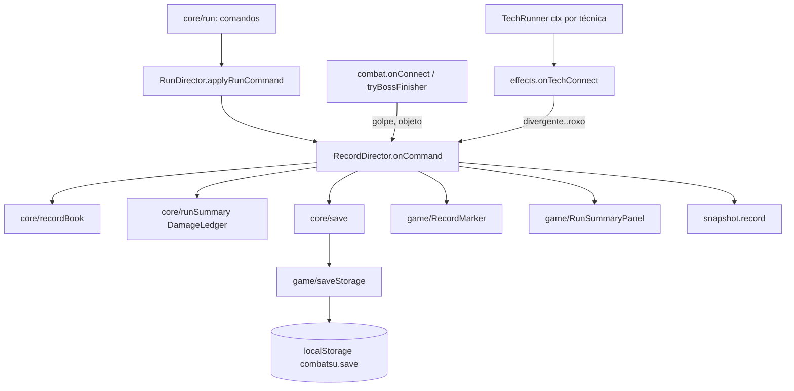

# Recorde e recomeço — Design

**Spec**: `.specs/features/recorde-e-recomeco/spec.md` · **Decisão**: AD-024 (item 3, meta entre runs: esta feature é
só o núcleo, sem poder base nem desbloqueio)
**Status**: Draft

---

## Arquitetura

```
core/save.ts          SaveData v1, parseSave (JSON, validação, migração por passos), serializeSave   ← puro, sem Phaser
core/recordBook.ts    RecordBook: recorde em memória, "passou nesta run", banner uma vez, marcador, decisão de gravar
core/runSummary.ts    DamageLedger (dano por fonte) e summaryLines (linhas do painel, nomes lidos de data/)
game/saveStorage.ts   SaveStorage: única porta para o localStorage (read/write com try/catch, cai para 'memory')
game/RecordMarker.ts  texto "Recorde: rN" na câmera de UI (948, 44), cor normal ou de destaque
game/RunSummaryPanel.ts  painel de fim de run centrado em (480, 270), uma linha de texto por item
game/recordSnapshot.ts   tipo RecordSnapshot do snapshot de debug (arquivo próprio, regra do plano)
scenes/test/recordDirector.ts  liga tudo: lê o save, ouve os comandos da Run, soma o dano, grava ao morrer
scenes/test/recordLoad.ts      loadRecord: a tabela de carga do save, pura (sem Phaser), com teste em tests/scenes/
```



- **Dono do diretor**: o `RecordDirector` mora no `RunDirector` (`runDirector.record`), criado no corpo do construtor
  dele (o campo depende de `s`). `TestScene.ts` (399/400) não ganha campo nem linha.
- **Vistas**: criadas por `recordDirector.mountUi(uiLayer)`, chamado uma vez no `UiSetup.addHud`. O `scene.restart()`
  da tecla R reaproveita a instância da cena (`TestScene.ts:397`): o diretor sobrevive, então `mountUi` recria as vistas
  a cada `create` (os objetos antigos já foram destruídos pelo SHUTDOWN). O save é lido só na primeira montagem:
  com a porta em `'memory'` reler perderia o recorde da aba, e em `'local'` o recorde em memória já é o gravado. Nada
  é gravado no restart (REC-06).
- **Sem atualização por quadro**: o marcador só muda com comando da `Run` (`roundStart` mostra, `gameOver` esconde; o
  estado `title` só existe antes da primeira run e o `mountUi` nasce escondido). Nenhuma linha no `update` da cena.
- **Recomeço**: nada muda na `Run`; a trava de 1000 ms (`RUN.gameOverLockMs`, `core/run.ts:295`) e o J/Enter
  (`TestScene.ts:364-365`) já entregam RST-01/03/04. O `startRun` esconde o painel e zera o registro de dano.

## Fluxo da morte (REC-01..04, REC-09, END-*)

1. `gameOver { round, kills }` chega ao `RecordDirector.onCommand`.
2. Monta o `RunRecord` com o que está vivo naquele instante: `loadout.slotsView` (id e nível), `build.perks`,
   `arsenal.snapshot()` (relíquia e arma com nível), `vows.snapshot().taken`. A carteira (`wallet.fragments`) entra
   só nas linhas do painel, não no save.
3. `book.death(record, { canRecord })` devolve `{ newRecord, write }`. `canRecord` é falso com `?debug&round=N`, N > 1
   (`runDirector.firstRoundForDebug()`), REC-09.
4. Se `write` e a porta está em `'local'` e não travada: `storage.write(serializeSave(book.best))`. Exceção vira
   `'memory'` e o recorde em memória fica (SAVE-07, caso de borda do `setItem`).
5. `hud.setCenter(null)` (END-02), `marker.hide()`, `panel.show(summaryLines(...))`.

## Carga do save (SAVE-*, REC-05, REC-07, REC-08)

| Situação | `storage` | `best` | Escreve na sessão |
| --- | --- | --- | --- |
| `?debug&record=N` (inteiro >= 1; ganha de `nosave`) | `'off'` | `{ round: N, kills: 0, build vazia }` | não |
| `?debug&nosave=1` | `'off'` | `null` | não |
| `getItem` (ou o acesso a `window.localStorage`) lança | `'memory'` | `null` | não |
| chave ausente, JSON inválido ou falha de validação | `'local'` | `null` | sim (sobrescreve) |
| `version` < 1 atual | `'local'` | migrado | sim |
| `version` > atual | `'local'`, `locked: true` | `null` | não (SAVE-04) |
| válido | `'local'` | o `record` lido | sim, se bater |

`record=` inválido é ignorado (`debugIntParam('record', 1)` devolve `undefined`) e a carga segue normal.

---

## Code Reuse Analysis

| Componente | Onde | Como usa |
| --- | --- | --- |
| `debugParam`, `debugIntParam` | `scenes/test/params.ts:5,10` | `nosave` e `record` (só valem com `?debug`) |
| `firstRoundForDebug` | `scenes/test/runDirector.ts:41` | REC-09 |
| Comandos da `Run` | `core/run.ts:221-227` (`gameOver`), `resolveStart` | ponto único de morte e de run nova |
| `area.onCommand(cmd)` | `runDirector.ts:51` | mesmo molde para `record.onCommand(cmd)` |
| `RUN_TEXT_STYLE`, `css`, `MARGIN = 12` | `game/Hud.ts:15,40` | marcador no estilo das linhas de rodada/inimigos (x 948, y 12/28 → 44) |
| `PALETTE.A` (âmbar claro, "destaque de golpe forte") | `game/art/palette.ts:29` | cor de destaque do marcador e do `Recorde!` |
| Cores por chave da paleta + teste | `VOW_PANEL_COLORS` / `tests/game/vowPanel.test.ts` | `RECORD_COLORS` com teste igual (RMK-08, END-14) |
| Nomes | `TECHNIQUES[id].name`, `PERKS`, `ARSENAL`, `VOWS` em `data/` | `summaryLines` e build resumida (id desconhecido some) |
| Snapshots de build | `build.snapshot()`, `arsenal.snapshot()`, `vows.snapshot()`, `loadout.slotsView` | estado na morte (REC-04) |
| Parâmetros de debug que montam build | `?debug&tech=`, `perks=`, `vows=`, `arsenal=` | smoke do painel cheio (END-14) |

## Pontos de integração (arquivos existentes tocados)

| Arquivo (efetivas antes) | Linha | Mudança | Δ efetivas |
| --- | --- | --- | --- |
| `scenes/test/runDirector.ts` (183) | 20 | construtor cria `this.record = new RecordDirector(s)` | +3 |
| | 51 | `this.record.onCommand(cmd);` depois do `area.onCommand` | +1 |
| | 67 | `hud.banner(this.record.roundBanner(cmd.round), RUN.bannerMs)` (RMK-05/06) | 0 |
| | 85-92 | `case 'gameOver'` com o `setCenter` sai (o diretor cuida) | -8 |
| `scenes/test/combat.ts` (223) | 98-105 | dentro do `if (hit.ownerId === player.id)`: `this.s.runDirector.record.onPlayerHit(hit);` (`moveName` → `golpe`, sem → `objeto`) | +1 |
| | 263 | depois de `boss.receiveFinisher()`: `record.addDamage('golpe', damage)` (finalizador do chefe não passa pelo `onConnect`) | +1 |
| `scenes/test/effects.ts` (45) | 33-34 | `onTechConnect(hit, point, source: TechId)` + `record.onTechHit(source, hit.damage)` | +2 |
| `game/TechRunner.ts` (92) | 50, 60-76 | callback ganha `source: TechId`; `ctxFor(id)` embrulha `onTechHit` por técnica (`tech/*.ts` intocados) | +3 |
| `scenes/TestScene.ts` (399) | 319 | `(hit, point, source) => this.effects.onTechConnect(hit, point, source),` (77 colunas, uma linha) | 0 |
| `scenes/test/uiSetup.ts` (76) | 69-71 | `this.s.runDirector.record.mountUi(this.s.uiLayer);` | +1 |
| `scenes/test/snapshot.ts` (209) | 163 | `record: this.s.runDirector.record.snapshot(),` | +1 |
| `game/debugApi.ts` (307) | 14, ~300 | import de `RecordSnapshot` e campo `record` no `GameSnapshot` | +2 |
| `tests/game/debugApi.test.ts` | ~172 | o snapshot de exemplo ganha `record` (o tipo exige) | +~10 |
| `scripts/smoke/run.mjs` | 88-99 | `withNoSave`: URL sem `nosave=` nem `record=` ganha `nosave=1` | +4 |
| `scripts/smoke/hud.smoke.mjs` | 108-116 | lê `snap.record.panel.lines` e confere `hud.center === null` | +1 |
| `scripts/smoke/drops.smoke.mjs` | 96-99 | `Fragmentos: N` lido do painel | 0 |
| `README.md` | parâmetros de debug | `nosave=1`, `record=N` | +2 |

`Hud.ts` (336 efetivas, exceção de função longa) não é tocado. `core/run.ts` e `tests/core/run.test.ts` (exceções)
não são tocados.

## Arquivos perto do teto (contagem efetiva: sem vazias e sem comentários)

| Arquivo | Hoje | Depois | Teto |
| --- | --- | --- | --- |
| `src/scenes/TestScene.ts` | 399 | 399 | 400 (só perde) |
| `src/game/Hud.ts` | 336 | 336 | 400 (intocado) |
| `src/scenes/test/world.ts` | 318 | 318 | 400 (intocado) |
| `src/game/debugApi.ts` | 307 | 309 | 400 |
| `src/scenes/test/snapshot.ts` | 209 | 210 | 400 |
| `src/scenes/test/combat.ts` | 223 | 225 | 400 |
| `src/scenes/test/runDirector.ts` | 183 | 179 | 400 |

Arquivos novos (estimativa, todos longe do teto): `core/save.ts` ~110, `core/recordBook.ts` ~80,
`core/runSummary.ts` ~110, `game/saveStorage.ts` ~50, `game/RecordMarker.ts` ~45, `game/RunSummaryPanel.ts` ~90,
`game/recordSnapshot.ts` ~20, `scenes/test/recordDirector.ts` ~150. Função mais longa prevista: `loadRecord`
(`scenes/test/recordLoad.ts`, ~10 linhas, a tabela de carga acima vira um `if` por linha; complexidade < 10).

---

## Components

### core/save.ts

- **Purpose**: formato, validação e migração do save, sem Phaser e sem `localStorage` (SAVE-01..06).
- **Interfaces**:
  - `SAVE_KEY = 'combatsu.save'`, `SAVE_VERSION = 1`
  - `type Migration = (old: Record<string, unknown>) => Record<string, unknown>`; `MIGRATIONS: Record<number, Migration>`
    (chave = versão de origem; vazio na v1)
  - `parseSave(raw: string | null, migrations = MIGRATIONS, current = SAVE_VERSION): LoadResult`
  - `validateRecord(x: unknown): RunRecord | null`
  - `serializeSave(record: RunRecord | null): string`
- **Regras**: aplica `migrations[v]`, `migrations[v+1]`... até `current`; passo faltando = `invalid`. Validação estrita
  (SAVE-06): inteiros por `Number.isInteger`, `round >= 1`, `kills >= 0`, `level >= 1`. Ids não são checados contra
  `data/` (id desconhecido continua válido, edge case).

### core/recordBook.ts

- **Purpose**: o recorde da sessão e as regras de marcador, banner e gravação (REC-01..03, RMK-01..07, END-10/11).
- **Interfaces**:
  - `isBetter(run: { round; kills }, best: RunRecord | null): boolean` (REC-02; empate exato perde)
  - `class RecordBook { constructor(best: RunRecord | null); best; passed; lastDeathNewRecord; startRun();
    roundBanner(round): string; marker(round, state: RunState): MarkerView; death(run: RunRecord, opts: { canRecord }): { newRecord; write } }`
  - `MarkerView = { visible: boolean; text: string; highlight: boolean }`
- **Regras**: `roundBanner` devolve `Rodada N · Novo recorde!` só quando `round === best.round + 1` e ainda não saiu
  nesta run, senão `Rodada N`; sem recorde nunca comemora. `marker`: escondido sem recorde ou em `title`/`gameOver`;
  `round > best.round` mostra a rodada atual com `highlight`. `death` sem `canRecord` não troca nada.

### core/runSummary.ts

- **Purpose**: dano por fonte da run e as linhas do painel (END-03..12, DMG-06/07).
- **Interfaces**:
  - `type DamageSource = 'golpe' | TechId | 'objeto'`; `DAMAGE_SOURCES` na ordem golpe, técnicas (ordem de `TechId`), objeto
  - `class DamageLedger { add(source, amount); reset(); totals(): Record<DamageSource, number>; rows(): { source; label; damage; pct }[] }`
  - `summaryLines(input: SummaryInput): SummaryLine[]` com `SummaryLine = { text: string; highlight?: boolean }`
  - `SummaryInput = { round; kills; fragments; build: RecordBuild; damage: DamageRow[]; newRecord: boolean; bestRound: number | null }`
    (a build no formato do save, só com ids); `listLines(label, items, empty)` faz a quebra das listas
- **Regras**: `rows` filtra dano > 0, ordena do maior ao menor (empate: ordem de `DAMAGE_SOURCES`), `damage` e `pct`
  com `Math.round`. Rótulos: `Golpe`, `Objeto` e `TECHNIQUES[id].name`. Listas numa linha cada, separadas por `, `
  (`Técnicas: Azul Nv 2, Punho Divergente Nv 1`, `Arsenal: Manoplas de ferro Nv 2, Bastão selado Nv 1`). Linha de
  recorde: `Recorde!` (highlight) se bateu; `Recorde: rN` se há recorde; nenhuma sem recorde (só com `round=N` de debug).
  Última linha: `J / Enter para tentar de novo`.
  Quebra: lista com mais de 100 caracteres (`SUMMARY_LINE_MAX`) continua na linha de baixo, cortada em `, ` com a
  vírgula no fim da linha de cima; o dano vai uma fonte por linha (`Golpe: 60 (60%)`).

### game/saveStorage.ts

- **Purpose**: o único arquivo de `src/` que diz `localStorage` (SAVE-01, SAVE-07).
- **Interfaces**: `class SaveStorage { constructor(getStorage = () => window.localStorage); kind: 'local' | 'memory';
  read(): string | null; write(text: string): boolean }`. Qualquer exceção (inclusive no próprio acesso a
  `window.localStorage`) põe `kind = 'memory'` e devolve `null`/`false`; em `'memory'` não tenta mais.

### game/RecordMarker.ts e game/RunSummaryPanel.ts

- **Marker**: `Text` em (948, 44), origem (1, 0), `RUN_TEXT_STYLE`, na `uiLayer`. `set(view: MarkerView)`, `hide()`, `debug(): MarkerView` (o destaque lido da cor do `Text`).
- **Panel**: fundo `PALETTE.k` a 0,85 e uma coluna de `Text` (13 px, 16 px por linha) centrada em (480, 270);
  `show(lines)`, `hide()`, `debug(): { visible; lines: string[]; bounds: { x; y; w; h } }`. Com a build cheia (2
  técnicas, 6 passivas, 5 votos, 7 fontes) são ~19 linhas (~320 px) e a linha mais longa (5 votos) ~95 caracteres
  (~750 px): cabe em 960x540. Listas acima de 100 caracteres quebram em `, ` numa segunda linha.
  Os `bounds` saem de `panelBounds(lines)` (puro): 8 px por caractere (teto do monospace 13 px) e 16 px de margem;
  o fundo é uma caixa desse tamanho, não a tela inteira, e os `Text` nascem sob demanda e são reaproveitados.
- **Cores**: `RECORD_COLORS = { text: 'w', highlight: 'A', bg: 'k' }` (chaves da `PALETTE`).

### scenes/test/recordDirector.ts

- **Interfaces**: `mountUi(layer)`, `onCommand(cmd: RunCommand)`, `roundBanner(round): string`,
  `onPlayerHit(hit: Hit)`, `onTechHit(source: TechId, damage: number)`, `addDamage(source, damage)`,
  `snapshot(): RecordSnapshot`.
- **Regras**: com `s.fxLab` (laboratório, só bonecos) o registro ignora todo dano (DMG-05). Só conta golpe já aceito:
  os dois caminhos chamados (`onConnect`, `onTechHit`) só rodam depois de `receiveHit` devolver true (DMG-04);
  o finalizador do chefe e o Kokusen no chefe aplicam o dano direto e contam.

---

## Data Models

```typescript
interface LeveledId { id: string; level: number }
interface RecordBuild { techniques: LeveledId[]; perks: string[]; relic: LeveledId | null; weapon: LeveledId | null; vows: string[] }
interface RunRecord { round: number; kills: number; build: RecordBuild }
interface SaveData { version: number; record: RunRecord | null }   // JSON em 'combatsu.save'
type LoadResult = { kind: 'ok'; save: SaveData } | { kind: 'empty' } | { kind: 'invalid' } | { kind: 'newer'; version: number };

interface RecordSnapshot {             // snapshot.record (REC-10, RMK-09, END-15)
  best: RunRecord | null;
  storage: 'local' | 'memory' | 'off';
  locked: boolean;                     // save de versão mais nova: não escreve
  passed: boolean;                     // a run atual passou do recorde
  lastDeathRecord: boolean;            // a última morte gravou recorde
  marker: { visible: boolean; text: string; highlight: boolean };
  panel: { visible: boolean; lines: string[]; bounds: { x: number; y: number; w: number; h: number } };
  damage: Record<DamageSource, number>;
}
```

---

## Error Handling Strategy

| Cenário | Tratamento | O que o jogador vê |
| --- | --- | --- |
| `localStorage` bloqueado (acesso ou `getItem` lança) | `SaveStorage.kind = 'memory'`, recorde vazio | jogo normal; recorde vale só nesta aba |
| `setItem` lança na morte (cota, modo privado) | `kind = 'memory'`, recorde em memória atualizado | `Recorde!` no painel igual |
| JSON quebrado ou campo inválido | `invalid` → recorde vazio; a próxima morte sobrescreve | sem marcador até a próxima morte |
| Save de versão mais nova | `locked`, nada é escrito | sem marcador; o save do build novo fica intacto |
| Id desconhecido no recorde | some da exibição | painel e marcador normais |

---

## Testes

| Arquivo | Cobre |
| --- | --- |
| `tests/core/save.test.ts` | SAVE-02..06: ida e volta; ausente, JSON inválido, `version` não inteira; cada campo inválido (round 0 e 1, kills -1 e 0, level 0 e 1, não inteiro, tipos errados); migração injetada `{1: ..., 2: ...}` com `current = 3` aplicada em ordem; passo faltando → `invalid`; versão maior → `newer`. SAVE-01: lê `src/core/save.ts?raw` e garante sem `phaser` e sem `localStorage` |
| `tests/core/recordBook.test.ts` | REC-02 nos dois lados de cada empate (L-010: round igual com kills +1/igual/-1; round +1/-1); REC-03; `canRecord` falso; RMK-03..07 por estado da run; banner só em `best+1` e uma vez por run, de novo depois de `startRun`; sem recorde nunca comemora |
| `tests/core/runSummary.test.ts` | DMG-06 reset; ordenação e desempate; arredondamento (soma 100 ± 1); `Dano: nenhum`; listas vazias (`nenhuma`/`nenhum`); id desconhecido some; `Recorde!` com highlight × `Recorde: rN`; última linha |
| `tests/game/saveStorage.test.ts` | Storage falso: leitura e escrita; `getItem`, `setItem` e o getter lançando → `'memory'` sem exceção; em `'memory'` não chama mais o storage. Varredura `import.meta.glob('src/**/*.ts', { query: '?raw' })`: só `game/saveStorage.ts` diz `localStorage` (SAVE-01) |
| `tests/game/recordViews.test.ts` | `RECORD_COLORS` só com chaves da `PALETTE` (RMK-08, END-14); L-043: o marcador repassa `highlight` ao `setColor` (teste do adaptador com um `Text` falso) |
| `tests/game/debugApi.test.ts` | exemplo do snapshot com `record` |
| `tests/scenes/recordLoad.test.ts` | Tabela de carga: chave válida; ausente, JSON quebrado e recorde inválido; versão 9 → `locked`; `getItem` lançando → `'memory'`; `nosave=1` e `record=N` (com e sem `nosave`) sem ler o armazenamento |

## Smokes (novos com `?debug&hd=1&area=modular`; `npm run smoke -- record`)

| Smoke | Passos | Cobre |
| --- | --- | --- |
| `record-save.smoke.mjs` | `nosave=0`, `localStorage.clear()`; morrer na r1 → chave escrita, `lastDeathRecord`; recarregar → `best.round = 1`, marcador `Recorde: r1`; morrer de novo na r1 com 0 abates → chave igual (empate); `round=3&nosave=0` → não grava; `nosave=1` e `record=4` → `storage: 'off'`, chave intacta; chave com `version: 9` → `locked`, chave intacta; `evaluateOnNewDocument` fazendo `Storage.prototype.getItem/setItem` lançar → `storage: 'memory'`, painel com `Recorde!`, console sem erro | SAVE-02/04/05/07, REC-01/03/05..10 |
| `record-hud.smoke.mjs` | `record=1&nosave=1&spawn=...` → r1 mostra `Recorde: r1` em (948, 44) sem destaque; limpar a r1 → banner `Rodada 2 · Novo recorde!`, marcador `Recorde: r2` com `highlight`; r3 → banner `Rodada 3` | RMK-01..07, RMK-09 |
| `record-end.smoke.mjs` | `nosave=1&tech=azul` → um soco e um Azul num inimigo → morrer → painel com `Golpe` e `Azul`, valores do `record.damage`, soma das % 100 ± 1, `hud.center === null`; J em 999 ms fica em `gameOver`; J em 1000 ms → `roundActive`, `player.dead = false`, vida cheia antes de 3000 ms da morte, painel escondido, `damage` zerado; segunda URL com `tech=azul:3,vermelho:3&perks=<6>&vows=<5>&arsenal=manoplas,bastao` → `panel.bounds` dentro de 960x540; golpe com o bastão na mão soma em `objeto` | END-01..15, DMG-01..07, RST-01..05 |

Existentes a rodar: `hud`, `drops` (leem o painel), `run-loop`, `world-restart` (restart com R recria as vistas),
`tech` e `kokusen` (assinatura do `onTechHit`), `arsenal`, `vows`, `build`.

---

## Risks & Concerns

| Concern | Location (file:line) | Impact | Mitigation |
| --- | --- | --- | --- |
| A F29 mexe em paralelo em `combat.ts`, `effects.ts` e `runDirector.ts` | `combat.ts:98,263`, `effects.ts:33`, `runDirector.ts:51,67,85` | conflito de merge | toque de 1 a 2 linhas por arquivo, num commit só de integração, o último da feature |
| O runner abre uma página por smoke no mesmo navegador: o `localStorage` passa de um smoke para o outro | `scripts/smoke/run.mjs:103-110` | uma morte no `hud` vira recorde e muda o banner de rodada de outros smokes | `withNoSave` acrescenta `nosave=1` em toda URL sem `nosave=`/`record=`; o `record-save` pede `nosave=0` e limpa a chave no começo e no fim |
| `TestScene.ts` em 399/400 | `TestScene.ts:319` | passar do teto | só a lambda da linha 319 muda (77 colunas, sem quebra do prettier); diretor e vistas fora da cena |
| `scene.restart()` reaproveita a instância e o `RunDirector` | `TestScene.ts:79,397` | vistas apontando para objetos destruídos | `mountUi` recria as vistas a cada `create` (o save é lido uma vez por página); R no `record-save` e smoke `world-restart` |
| O `Hit` da técnica não diz a origem | `game/tech/shared.ts:33`, `TechRunner.ts:60-76` | dano de técnica sem fonte | contexto por técnica no `TechRunner`; nenhum `tech/*.ts` muda |
| Finalizador do chefe e Kokusen no chefe não passam por `receiveHit` | `combat.ts:250-273`, `tech/divergent.ts:238-239` | dano fora do registro | `addDamage('golpe', damage)` no finalizador; o Kokusen já chama `onTechHit` |
| `Hud.ts` na lista de exceções | `game/Hud.ts` | crescer o arquivo | marcador em classe própria; o banner usa o `hud.banner` que existe |
| RST-02 no mundo modular: a run nova reconstrói a área (fade TRV-10) | `runDirector.ts:51` (`area.onCommand`) | vida cheia e `roundActive` podem passar de 3000 ms | o smoke mede em tempo de jogo; se falhar, o achado vai para o Verifier antes de mexer no fade |
| Caminhos de objeto (arremesso, ferramenta, arma) sem teste de unidade | `world.ts:356`, `drops.ts:92`, `arsenalDirector.ts:53` | `objeto` sem conferência | todos passam pelo mesmo `onConnect`; o `record-end` cobre a arma vinculada na mão |

---

## Tech Decisions

| Decisão | Escolha | Motivo |
| --- | --- | --- |
| Onde mora o diretor | `runDirector.record` | a cena está no teto; o recorde só reage a comandos da run |
| Origem do dano de técnica | callback `onTechHit(hit, point, source)` por técnica no `TechRunner` | uma linha na cena, zero nos `tech/*.ts`, sem campo novo no `Hit` (contrato do core) |
| Laboratório de efeitos | o registro ignora tudo com `s.fxLab` | lá só existem bonecos (FXL-01); dispensa saber o alvo em cada caminho |
| Regras de marcador e banner | puras em `core/recordBook.ts` | testáveis em Node; o diretor só aplica |
| Rótulos das fontes no painel | `Golpe`, `Objeto` e o nome da técnica em `data/techniques`; o snapshot usa os ids | o nome muda em `data/` sem quebrar save nem smoke |
| Isolamento dos smokes | `nosave=1` por padrão no runner | o save real e a ordem dos smokes não interferem |
| `record=N` com `nosave=1` | `record=N` define o recorde e nada é gravado | caso de borda da spec |

Nenhuma decisão de projeto nova: a feature segue a AD-024 (item 3) sem superar outra `AD-*`.
