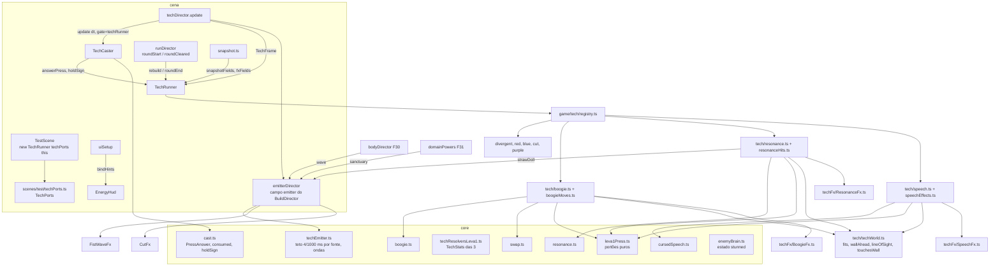

# Técnicas JJK 1 - Design

**Spec**: `.specs/features/tecnicas-jjk-1/spec.md` · **Plano**: `docs/plano-builds-e-habilidades.md` (linha F34 da
seção 6, seções 2.5, 4 e 5.1, regra do `TechEmitter` da seção 6, decisão 4 da seção 7) · **Base**: F29
`fundacao-de-poder` (branch `feat/fundacao-de-poder`, código em andamento), F30 `vermelho-e-corpo`, F31
`expansao-de-dominio`, F33 `eixos-das-tecnicas` (designs nos worktrees `wt-f30spec` e `wt-f31spec`) e as regras puras
da leva 1 deste branch (`feat/regras-tecnicas-leva1`, `519ac6b`)
**Status**: Draft

Linhas citadas conferidas em 14/10 neste worktree (`519ac6b` = `4c0efae` + regras puras da leva 1), no
`feat/fundacao-de-poder` (`f32565d`) e no `feat/icones-hd-tecnicas` (`687a23f`). O worktree ainda não tem a F29 a F33:
o que elas criam ou trocam é citado pelo nome e pela interface dos designs delas (F30: `core/axisBuild.ts`,
`core/techStats.ts`, `Loadout.stats`/`refundCooldown`, `core/strikeEmitter.ts`, `scenes/test/bodyDirector.ts`,
`game/FistWaveFx.ts`, `TechCaster.slotHeld`, `game/tech/redFlight.ts`, `Hit.maxHpBonus`/`dealtDamage`,
`game/axisSnapshot.ts`, `core/shopPricing.ts` com `newTechPrice`; F31: `core/sanctuary.ts` com `SanctuaryTriggers`,
`scenes/test/domainDirector.ts`, `scenes/test/domainPowers.ts` com o `cutNow()`, `game/DomainBar.ts`,
`TechCaster.locked`, a entrada `dominio` do catálogo; F33: o registro `AXIS_ITEMS`, `core/techResolvers.ts` com o
despacho `RESOLVERS`, o `castHit` genérico do `TechRunner`, o `awakenCast:<id>`, `BlueOrbState.setPosition`,
`PurpleFlight`, `choiceDirector`). Essas linhas valem depois dos merges e são reconferidas no começo de cada passo.
Linhas efetivas contadas como o `max-lines` do `.oxlintrc.json` (sem linha em branco e sem comentário).

**Duas correções de endereço da spec, sem mudar requisito.**

1. O corte do Santuário não é montado no `domainDirector`: pelo design da F31 ele mora no `domainPowers.cutNow()`
   (alvos por `sanctuaryTargets`, `Hit` micro, `receiveHit`, `effects.onTechConnect`, `CutFx.cut`/`split`, evento
   `domainCut:<id>`) e a janela de 4 por segundo no `SanctuaryTriggers` de `core/sanctuary.ts`. O EMI-04 vale para o
   `domainPowers` (o `domainDirector` já não tem esse caminho).
2. Depois dos merges da F30 e da F33 há mais smokes que buscam orbe por `kind` além dos 3 do TOB-02: o
   `red-axes.smoke.mjs` (F30, lê `sensorPx`/`texture` da entrada `red`) e o `tech-axes.smoke.mjs` (F33, lê `radius` das
   entradas `blue` e `purple`). O passo 1 começa com `grep -rn "techObjects" scripts/smoke` e troca todos (Risks).

---

## Abordagens consideradas

A feature é grande e mexe no centro da conjuração. As três abordagens entregam o mesmo escopo; a recomendada vem
primeiro e foi a seguida (o usuário mandou seguir a recomendação nas decisões abertas).

| | Abordagem | Prós | Contras |
| --- | --- | --- | --- |
| **A (recomendada)** | Registro `TechId → TechModule` com as dependências num objeto de portas (`TechPorts`, montado por `scenes/test/techPorts.ts`), e o portão de tecla do módulo entrando na `CastMachine` como um campo do `CastContext` (`answer: PressAnswer`) | Toda regra de recusa, custo, flash e cancelamento continua num lugar só (a `CastMachine`); uma técnica nova não toca `TechRunner`, `TechCaster` nem `techDirector` (REG-04): porta nova entra em `techPorts.ts` e na interface; a `TestScene` perde ~20 linhas | O passo 0 mexe na assinatura do construtor do `TechRunner` e no `update` do `TechCaster`; a `CastMachine` ganha 3 conceitos (resposta do módulo, `consumed`, segurar o sinal) |
| B | Registro sem portão: Boogie e Ressonância declaram custo 0 e recarga 0 no `TechDef` e o módulo cobra energia e recarga por fora | `CastMachine` intocada | Duplica a regra de energia, o flash do TEC-10 e o `techDenied`; a marca de custo do `EnergyHud` mostraria 0; o 2º toque da Ressonância viraria uma conjuração com sinal e aura |
| C | Cada técnica nova como diretor em `scenes/test/` (molde do `bodyDirector`), fora do `TechRunner` | Nada muda no `TechRunner` | Contraria o REG-01 e o objetivo da F34; snapshot, maestria, `awakenCast` e Santuário teriam um caminho por técnica |

---

## Architecture Overview

O `TechRunner` deixa de conhecer técnicas: guarda um `Record<TechId, TechModule>` montado por
`game/tech/registry.ts`, passa a cada módulo o mesmo `TechContext` (as portas da cena mais os serviços do próprio
runner) e o mesmo quadro (`TechFrame`), e junta o snapshot pelo que cada módulo declara. As cinco técnicas de hoje viram
módulos sem mudar comportamento. O portão de tecla (REG-02) é uma pergunta ao módulo da técnica do slot, feita pelo
`TechCaster` antes de chamar a `CastMachine`; a resposta entra no `CastContext` e a `CastMachine` decide na ordem de
sempre. O `TechEmitter` puro guarda os tetos por fonte e as ondas; um diretor da cena (`emitterDirector`, campo `emitter`
do `BuildDirector`) aplica os acertos e desenha a Onda e o corte. As três técnicas novas são módulos com estado puro
próprio (as regras da leva 1), um arquivo de efeitos por técnica e uma vista em `techFx/`.



**Fluxo por quadro** (a ordem da `TestScene` não muda):

1. `techDirector.update(dt, input)` (F31): `build.domain.update` grava `techCaster.locked`; depois
   `techCaster.update(dt, this.s.techRunner)`. Para cada tecla de slot apertada, o `TechCaster` pergunta
   `gate.answerPress(slot, id)` ao runner, que repassa ao módulo da técnica (sem resposta: `{ kind: 'cast' }`). A
   resposta vai no `CastContext.answer`. A `CastMachine` devolve `consumed` (sem evento de debug, sem cancelar o golpe),
   `denied:<motivo>` ou a conjuração de sempre. No `update` da máquina, um `holdSign` do módulo pode segurar o estado
   `sign` (Palma Falsa).
2. `techRunner.update(frame)`: monta o `currentCast` no `techCast:<id>` e chama `module.update(frame)` na ordem do
   registro. O quadro leva também `slotConsumed` (o 2º toque da Ressonância detona aqui, no mesmo quadro).
3. `build.body.update(dt)` (F30) e, logo depois, `build.emitter.update(dt)` (passo 2): ondas andam, cortes do Santuário
   na fila saem, as vistas da Onda e do corte são desenhadas.
4. `loadout.tick(dt)`: as técnicas com recarga própria (`TechDef.ownCooldown`) não são descontadas aqui; o módulo
   delas escreve o espelho (`Loadout.setCooldown`) no próprio `update`.

**Ciclo de vida.** `runDirector` chama `techRunner.rebuild()` no `roundStart` (cobre a konbini fechando, o
`noshop=1` e a run nova, porque a run começa com o `roundStart` da 1ª rodada) e `techRunner.roundEnd()` no
`roundCleared` (o que voa ou marca some antes da konbini). Os cinco módulos de hoje não implementam os dois (no-op).

---

## Code Reuse Analysis

### Existing Components to Leverage

| Component | Location | How to Use |
| --- | --- | --- |
| Regras puras da leva 1 (`BoogieState`, `ResonanceState`, `speak`/`SpeechCast`, `swapPlacement`, `pickSwapTarget`, `inCone`, `maxHpBite`) | `src/core/boogie.ts`, `resonance.ts`, `cursedSpeech.ts`, `swap.ts`, `axisRule.ts` | O adaptador só chama; nenhuma regra muda além do JJK-17 (tabela da Eficiência em `data/boogie.ts:29`) |
| Tabelas e ids de eixo e ramo da leva 1 | `src/data/boogie.ts`, `resonance.ts`, `cursedSpeech.ts` (`*_AXIS_IDS`, `*BranchId`) | Entram no `AXIS_ITEMS` da F33 por `data/techAxesLeva1.ts`, na ordem da tabela (desempate do eixo-foco) |
| `CastMachine` (custo e recarga na entrada de `release`, CAST-07 no dano) | `src/core/cast.ts:74-132` | Ganha a resposta do módulo e o `holdSign`; custo, recusa por energia, `busy` e cancelamento por dano continuam os de hoje |
| `TechCaster` (`JustDown`, slot 1 vence, `framePressed`) | `src/game/TechCaster.ts:79-94` | Pergunta ao portão antes do `request`; expõe `slotConsumed` como já expõe `slotPressed` |
| Contrato do `TechContext` (`onTechHit`, `currentCast`, `emit`, `roll`) e `techMarks` | `src/game/tech/shared.ts:26-47` | Vira `TechPorts & TechServices`; `techMarks('light')` nos choques do Boogie |
| `castHit` genérico (maestria, Recarga 3 por abate, `awakenCast`) | F33 `src/game/TechRunner.ts` | As três técnicas chamam `ctx.castHit(cast, target)` em todo acerto aceito; o reembolso por abate da F33 fica em 0 para elas (`TechStats.killRefund = 0`), porque a leva 1 devolve uma vez por conjuração (assumption da spec) |
| `AXIS_ITEMS`, `resolveTechStats` com `RESOLVERS` e o piso de 60% | F33 `src/data/techAxes.ts`, `src/core/techStats.ts`, `src/core/techResolvers.ts` | Três entradas de registro e três resolvedores; loja, carta de 2 eixos, preço do ponto, trava, painel do ramo, `axes=`/`ramo=`, banner do Despertar e `build.<item>` vêm sozinhos (JJK-04 a JJK-07) |
| `newTechPrice(rarity)` | F30 `src/core/shopPricing.ts` | Preço da técnica nova pela raridade da entrada (20 comum, 26 rara; JJK-03) |
| `StrikeEmitter` e `SanctuaryTriggers` | F30 `src/core/strikeEmitter.ts`, F31 `src/core/sanctuary.ts` | Os métodos e a janela deslizante viram o `TechEmitter` (mesmos nomes, mesma conta), para os testes passarem só com import e construtor trocados (EMI-04) |
| `FistWaveFx`, `CutFx.cut`/`split` | F30 `src/game/FistWaveFx.ts`, `src/game/techFx/CutFx.ts` | Passam a ser desenhados pelo `emitterDirector` |
| Folhas `tech-icons` (48) e `tech-icons-24` (24), `TECH_ICON_IDS`, `TechIconId` | `feat/icones-hd-tecnicas`: `src/game/art/hd/techIcons.ts`, `art/index.ts` (`registerHdSheets`), `textures.ts` | Cherry-pick de `c1fac80` e `687a23f` no começo do passo 3; `TechDef.icon` é o próprio id do quadro |
| `bossBrain.stun(ms)` e o `interrupt` por `canAct` | `src/core/bossBrain.ts:104-108`, `src/core/bossAI.ts:93`, `:244-252` | Atordoamento da Fala no chefe e o cancelamento da Finta Total (ver Risks sobre o finalizador) |
| `CounterWindow.open(kind, ms)` | `src/core/counter.ts:28-31`, `Player.counter` (`Player.ts:92`) | Janela de Contra de 400 ms do inimigo enganado pela Palma Falsa, sem campo novo no `Player` |
| `Health.chip` (sem invulnerabilidade nem atordoamento) | `src/core/health.ts:79-88` | Molde do `Health.spend(n)` novo do custo em vida, que também ignora a invulnerabilidade |
| `BodyRenderPos.snap()` | `src/game/physics.ts` (usado em `Player.ts:328`, `:353`) | O teleporte do player e dos corpos não desenha um quadro no meio do caminho (AD-019) |
| `Mover` | `src/core/mover.ts:7-38` | Ganha `moveTo(x)` mantendo o `traveled`: base do `relocate` do projétil e dos orbes do Vermelho e do Roxo |
| Consulta de parede com o chão descartado | `src/game/tech/blue.ts:91-113` (`wallDistanceAhead`) | Molde do `TechWorld.wallAhead`: só conta corpo com a borda à frente (`dist >= 0`) |
| `query.region` sobre `s.terrain` | `src/scenes/test/spawner.ts:94`, `Boss.ts:342`, `:354` | `TechWorld.fits` e `touchesWall`; o `s.terrain` já tem os módulos sólidos do mundo (`world.ts:333`) |
| `DamageNumbers` e o teto de hitstop dos micro (POW-14) | F29 `src/scenes/test/effects.ts:43-59` | Pregos, Grampo e ecos passam por ele; o teto de 60 ms/s segura a rajada de micro |
| Página genérica do ramo e do Despertar | F33 `choiceDirector`, `ChoicePanel` | JJK-05 sem código novo |

### Integration Points

| System | Integration Method |
| --- | --- |
| Construção | `TestScene.createTechniques` troca as ~22 linhas do `new TechRunner(...)` (`TestScene.ts:310-331`) por `this.techRunner = new TechRunner(techPorts(this));` |
| Portão de tecla | `techDirector` passa `this.s.techRunner` ao `techCaster.update(dt, gate)`; o runner implementa `PressGate` (`answerPress`, `holdSign`) |
| Quadro | `techDirector` monta o `TechFrame` (`cast`, `castEvents`, `slotPressed`, `slotHeld`, `slotConsumed`, alvos, chefe) no lugar dos 6 argumentos de hoje (`techDirector.ts:22-29`) |
| Snapshot | `snapshot.ts:180-181` viram `...this.s.techRunner.snapshotFields()` (`kokusen`, `techObjects`, `techState`); `snapshot.ts:186` vira `...this.s.techRunner.fxFields()` (`red`) |
| HUD | `uiSetup.addHud` chama `energyHud.bindHints((id) => this.s.techRunner.hudHint(id))` (número de cargas, piscar) |
| Konbini e run | `runDirector` no `roundStart` → `techRunner.rebuild()`; no `roundCleared` → `techRunner.roundEnd()` |
| Emissor | `bodyDirector` (Onda), `domainPowers` (Santuário) e o módulo da Ressonância (Boneco de Palha) chamam `build.emitter`; o módulo enxerga o emissor pela porta `emitter` do `TechPorts` |
| Loja | `GAME_SHOP_CATALOG` termina com `LEVA1_TECHNIQUE_ENTRIES`; o `shopDirector` passa `iconOf` à vista para a carta mostrar o ícone (técnica pelo `TechDef.icon`, Domínio pelo id possuído) |
| Corpo (F30) | `bodyDirector` desconta do "perdeu HP" o que foi pago pela Fala (`Health.spent`) |

---
## Components

### `game/tech/module.ts` (novo no passo 0, ~70 linhas)

- **Purpose**: o contrato de uma técnica no `TechRunner` (REG-01, REG-02, TOB-01, REG-03).
- **Interfaces** (ver "Data Models"): `TechModule`, `TechFrame`, `TechObjectView`, `TechContribution`,
  `SlotHudHint`. O slot é o `CastSlot` de `core/cast.ts` (`ActiveCastView['slot']`), para a F35 trocar o `0 | 1` num
  lugar só.
- Um módulo só precisa de `id` e `update`. Os outros membros são opcionais e o runner trata a ausência como "faz o de
  hoje": `answerPress` ausente = `{ kind: 'cast' }`; `holdSign` ausente = `false`; `objects` ausente = `[]`;
  `rebuild`/`roundEnd` ausentes = nada.

### `game/tech/registry.ts` (novo no passo 0, ~45 linhas)

- `TECH_MODULES: Record<TechId, (ctx: TechContext) => TechModule>`, na ordem `divergente`, `vermelho`, `azul`,
  `corte`, `roxo` e, nos passos 4 a 6, `boogie`, `ressonancia`, `fala`. O `Record` exaustivo faz o `tsc` acusar a
  técnica nova sem linha aqui (REG-04: a única linha que o passo de técnica põe fora do próprio módulo, além dos dados).
- `buildModules(ctx): readonly TechModule[]` (na ordem das chaves; a ordem é a do TOB-03).

### `game/TechRunner.ts` (reescrito no passo 0, 92 → ~105 linhas)

- **Purpose**: o que é comum a toda técnica: conjuração em curso (MST-02), eventos do quadro, portão, snapshot e ciclo de
  vida, iterando o registro. Nenhum campo, import, getter ou ramo com nome de técnica (REG-01; o `instanceof Boss` do
  `castHit` fica, porque é do alvo).
- **Interfaces**:
  - `constructor(ports: TechPorts)`: monta o `TechContext` (`{ ...ports, currentCast, castHit, emit, objects,
    relocate }`) e os módulos pelo `buildModules`.
  - `get events(): readonly string[]`
  - `update(input: TechInput): void` (ver "Data Models"): `currentCast` no `techCast:<id>`, `module.update(frame)` na
    ordem do registro.
  - `answerPress(slot, id): PressAnswer` e `holdSign(slot, id, signElapsedMs, keyHeld): boolean` (`PressGate`).
  - `hudHint(id): SlotHudHint | null`, `rebuild()`, `roundEnd()`.
  - `snapshotFields(): TechSnapshotFields` (`kokusen` da contribuição do módulo que a declara, `techObjects` com o `tech`
    de cada módulo na ordem do registro e depois pelo id, `techState` com o `state()` de cada módulo que o declara) e
    `fxFields(): TechFxFields` (`red`). Os valores padrão (`EMPTY_KOKUSEN`, `EMPTY_RED_FX`) moram em
    `game/techSnapshot.ts`, não aqui.
  - Serviços do contexto: `objects(): TechObjectSnapshot[]` (o mesmo do snapshot; o Boogie lê os orbes por ele) e
    `relocate(tech, objectId, at): boolean` (repassa ao `relocate` do módulo dono).
- O `castHit` da F33 fica como está (maestria, reembolso pelo `stats(tech).killRefund`, `awakenCast:<id>`).

### `game/tech/shared.ts` (muda no passo 0, F33 ~28 → ~50 linhas)

- `TechPorts`: o que vem da cena (`scene`, `player`, `loadout`, `energy`, `fx`, `fxRegistry`, `uiLayer`, `terrain`,
  `onTechHit`, `triggerHitstop`, `onKokusen`, `onCastHit` (F33), `roll`), mais `projectiles()` (passo 4) e `emitter`
  (passo 5). Porta nova entra aqui e em `techPorts.ts`, nunca no `TechRunner`.
- `TechServices`: `currentCast()`, `castHit(cast, target)`, `emit(event)`, `objects()`, `relocate(tech, id, at)`.
- `TechContext = TechPorts & TechServices`. `TechTarget` e `techMarks` continuam.

### `scenes/test/techPorts.ts` (novo no passo 0, ~55 linhas)

- `techPorts(s: TestScene): TechPorts`: as lambdas que hoje estão na chamada da `TestScene` (`effects.onTechConnect`,
  hitstop + `freeze`, cinema do Kokusen com o `impactFx.kokusenFrame`, `runDirector.onMasteryHit` da F33, o `roll` do
  `run.kokusenRng`) e as referências (`realtimeFx`, `fxRegistry`, `uiLayer`, `terrain`). As lambdas leem `s` na hora
  da chamada, como hoje. Passo 4: `projectiles: () => s.projectiles`. Passo 5: `emitter: s.build.emitter`.

### `core/cast.ts` (muda no passo 0, F31 ~113 → ~122 linhas)

- `type PressAnswer = { kind: 'cast'; skipCooldown?: boolean } | { kind: 'consume' } | { kind: 'deny'; reason:
  DenyReason }`; `interface PressGate { answerPress(slot, id): PressAnswer; holdSign(slot, id, signElapsedMs, keyHeld):
  boolean }`.
- `DenyReason` ganha `'hp'` (FLA-01); `CastEvent` ganha `{ type: 'consumed' }`; `CastContext` ganha `answer?:
  PressAnswer`.
- `request(slot, ctx)`, na ordem: (1) `consume` sem `ctx.locked` devolve `[{ type: 'consumed' }]` antes de tudo
  (RSN-04: o 2º toque detona mesmo com outra conjuração ou golpe em curso, sem gastar nada); (2) conjuração ativa →
  `[]` (CAST-08); (3) slot vazio → `[]`; (4) `locked` → `domain` (F31); (5) `busy`/fase do golpe → `busy`; (6)
  `deny` do módulo → `denied:<motivo>`; (7) recarga, pulada com `skipCooldown`; (8) energia; (9) entra em `sign`.
- `update(dtMs, holdSign?: (cast: ActiveCastView) => boolean)`: no `sign`, com `holdSign` verdadeiro, o relógio do
  estado anda até 0 e para ali (`elapsedMs` continua contando); quando o `holdSign` cai, a máquina sai do `sign` no
  mesmo `update`. Sem `holdSign`, nada muda (os cinco de hoje).
- O que não muda: custo e recarga só na entrada de `release` (CAST-03/04), cancelamento por dano em `sign`/`charge`
  sem cobrar (CAST-07/21) e o pulo de estados de 0 ms (CAST-02).

### `game/TechCaster.ts` (muda no passo 0, F31 ~79 → ~90 linhas)

- `update(dtMs, gate?: PressGate)`: para o slot apertado, `answer = slotDef ? gate?.answerPress(slot, slotDef.id) :
  undefined`; `machine.request(slot, { ...ctx, answer })`; `consumed` marca `slotConsumed[slot]` e não vira evento de
  debug nem `cancelMelee` (REG-02.4). O `holdSign` repassado à máquina é uma função montada uma vez no construtor que
  lê o `gate` e o `slotHeld` do quadro (F30).
- `get slotConsumed(): readonly [boolean, boolean]` (zerado a cada `update`, como o `framePressed`).
- `requestSlot` do FxLab segue sem portão (o FxLab só usa as técnicas de hoje; Out of Scope).

### `core/techEmitter.ts` (novo no passo 2, ~95 linhas; sai `core/strikeEmitter.ts`)

- **Purpose**: o emissor único de efeito de técnica fora da `CastMachine` (EMI-01 a EMI-03).
- **Interfaces**:
  - `type EmitSource = 'wave' | 'sanctuary' | 'strawDoll'`.
  - `class TechEmitter`: `tryEmit(source, nowMs): boolean` e `countAt(source, nowMs): number` (janela deslizante de
    `EMITTER.windowMs` 1000 com no máximo `EMITTER.maxPerWindow` 4, uma por fonte; uma emissão conta enquanto `now − t <
    1000`, então a 5ª a 999 ms da 1ª cai e a 1000 ms sai, EMI-03.4); `emit(at, dir, damage, opts, nowMs)`, `update(dtMs,
    targets, exceptIds)`, `waves` e `reset()` com a assinatura do `StrikeEmitter` da F30 (fonte `wave`);
    `channel(source): { tryRelease(nowMs); countAt(nowMs); reset() }` com a assinatura do `SanctuaryTriggers` da F31.
  - Toda saída de acerto do emissor (`WaveHit`) leva `band: 'micro'` (EMI-02).
- `EMITTER` continua em `data/techAxes.ts` (F30). `SanctuaryTriggers` sai de `core/sanctuary.ts`; `sanctuaryTargets`,
  `sanctuaryCutDamage` e `worldCutHits` ficam lá.

### `scenes/test/emitterDirector.ts` (novo no passo 2, ~120 linhas, campo `emitter` do `BuildDirector`)

- **Purpose**: aplica as emissões e desenha as vistas (EMI-02, EMI-04, RSN-10).
- **Interfaces**:
  - `wave(at, dir, damage, opts): boolean` (o que o `bodyDirector` chamava no `StrikeEmitter`).
  - `sanctuary(level): boolean` (gatilho do Santuário: `tryEmit('sanctuary')`; aceito, põe um corte na fila; recusado,
    nada muda, como o SAN-02; gatilho sem alvo também conta, edge case da F31).
  - `strawDoll(boss, echo: StrawEcho): number` (passo 5): `tryEmit('strawDoll')`; aceito, aplica na hora um `Hit`
    `{ damage: echo.damage + echo.bite, band: 'micro', tech: true }` com postura (a F29 só corta a postura do `chip`),
    chama `effects.onTechConnect` e devolve o dano aplicado; recusado devolve 0 e o acerto que pediu o eco não muda
    (EMI-03). É síncrono porque só é chamado de dentro de um `update`, nunca de callback de contato do Matter.
  - `update(dtMs)`: anda o relógio de jogo próprio, as ondas (`emitter.update`), entrega os `WaveHit` pelo
    `effects.onTechConnect`, solta os cortes da fila (`sanctuaryTargets`, `Hit` micro, `receiveHit`,
    `effects.onTechConnect`, `CutFx.cut` e `CutFx.split`, evento `domainCut:<targetId>`) e desenha a `FistWaveFx`.
  - `countAt(source): number` (o `triggersLastSecond` do snapshot do Domínio), `reset()`.
- Nenhuma emissão chama `castHit`, gasta energia, pausa a regeneração (não há conjuração) ou carrega a barra de Domínio
  (EMI-02): a carga da F31 só vem do `onCastHit`, que o emissor nunca chama.
- `CutFx` criado na hora de cada corte, como o `domainPowers` fazia (o objeto não guarda nada vivo).

### `game/techSnapshot.ts` (novo no passo 1, ~45 linhas)

- `TechObjectSnapshot`, `TechStateSnapshot` (vazio no passo 1; `boogie` no 4, `ressonancia` no 5, `fala` no 6),
  `KokusenView`, `TechSnapshotFields`, `TechFxFields`, `EMPTY_KOKUSEN`, `EMPTY_RED_FX`. Importado pelo `debugApi.ts`
  (TOB-01) e pelo `TechRunner`.

### Ícone HD (passo 3)

- **Cherry-pick** de `c1fac80` e `687a23f` (`feat/icones-hd-tecnicas`): `src/game/art/hd/techIcons.ts`,
  `src/game/art/hd/icons/*`, `registerHdSheets` em `art/index.ts`, `TEX.techIcons`/`techIconsSmall` em
  `textures.ts`, `tests/game/art/techIcons.test.ts`, `tools/icon-boards.mjs`. Sem redesenho.
- **`data/techniques.ts`**: `kanji` sai, entra `icon: TechIconId` (`import type` de `game/art/hd/techIcons.ts`; só
  tipo, apagado na compilação, como o `core/cameraKick.ts` já importa de `game/`).
- **`game/EnergyHud.ts`** (F31 ~216 → ~232): o sprite do slot nasce em `TEX.techIcons` sem `setDisplaySize` (48 texels
  = 48 px, ICO-02) e troca `setFrame(def.icon)`; um `Text` de cargas no canto de cima à esquerda (`hint.badge`) e o
  alpha do ícone piscando a cada 250 ms (`hint.blink`) pelo `bindHints(source)`; `debugState().energy.icons[i]` ganha
  `texture` e `frame` lidos do sprite vivo e `badge` (ICO-07). O overlay da recarga, o rótulo da tecla e a borda
  dourada do Despertar (F30) ficam por cima, na mesma ordem de profundidade.
- **`game/ShopPanel.ts`** (274 → ≤ 274): `kanji` vira `icon` (mesma quantidade de objetos), em `TEX.techIconsSmall` sem
  `setDisplaySize` (24 px, ICO-03); `setFrame(offer.icon)` e visível só com `offer.icon !== null`; `flyToSlot(slot,
  icon, target)` cria o sprite em 24 px sobre a carta e anima `scale: 2` em 300 ms até o slot (48 px, ICO-04). As
  constantes `KANJI_SIZE`/`KANJI_Y` e o comentário do `setScale` (`:328`) saem.
- **`core/techIcon.ts`** (novo, ~20): `techIconFor(entryId, ownedDomain): TechIconId | null` (técnica → `TechDef.icon`;
  `dominio` → o id do Domínio possuído; resto → `null`). O `OfferView` (`core/shop.ts:173-184`) ganha `icon`, preenchido
  pela vista com o `iconOf` que o `shopDirector` passa.
- **`game/techFx/Callout.ts`** (102 → ~101): o sprite em `TEX.techIcons`, `setScale(2)` (96 px, ICO-05) no lugar do
  `setDisplaySize(84)`; `ICON_SIZE` 96 para o deslocamento do texto. O cartão do Kokusen (`KokusenFx.ts:151-158`) não
  muda.
- **`game/DomainBar.ts`** (F31 ~70 → ~78): sprite de 24 px em `TEX.techIconsSmall` à esquerda da barra com o quadro do
  Domínio possuído (`DomainBarView` ganha `icon: DomainId | null`), escondido sem Domínio; `debug()` ganha `icon:
  { texture, frame } | null` (ICO-08).

### `core/leva1Press.ts` (novo no passo 4, ~45 linhas; cresce nos passos 5 e 6)

- **Purpose**: os portões e decisões de tempo das três, puros, para o teste de borda (L-010).
- **Interfaces**:
  - `boogiePress(canCast: boolean): PressAnswer` → `{ kind: 'cast', skipCooldown: true }` ou `deny cooldown` (BWG-06).
    O `skipCooldown` existe porque, sem carga e com a 2ª palma armada, o espelho mostra a recarga e mesmo assim a tecla
    tem de passar.
  - `palmDecision(branch, signElapsedMs, keyHeld): 'hold' | 'swap' | 'feint'`: sem Palma Falsa, `swap`; com ela,
    tecla segura e `elapsed < 250` → `hold`; tecla segura e `elapsed ≥ 250` → `feint`; tecla solta → `swap` (o `sign` de
    80 ms da máquina garante o `max(80, soltura)`, BWG-07).
  - `resonancePress(phase): PressAnswer` (passo 5): `ready` → `cast`; `armed` → `consume`; `cooldown` → `deny cooldown`.
  - `speechPress(hp, hpCost): PressAnswer` (passo 6): `hp <= hpCost` → `deny hp`, senão `cast` (FLA-01).

### `core/techBoxes.ts` (novo no passo 4, ~30 linhas)

- `boxOfRect(rect): Box` (o `Rect` da cena é pelo centro, `bodyTags.ts:4`; o `Box` das regras puras é pelo canto,
  `axisRule.ts:86-91`), `centerOfBox(box)`, `shrink(box, px)`, `widen(box, dx, dy)`, `overlaps(a, b)`. Uma conversão
  só, testada ida e volta.

### `core/rollRng.ts` (novo no passo 5, ~12 linhas)

- `class RollRng extends Rng`: sobrescreve `next()` com o `roll` do contexto (o `int` do `Rng` chama `this.next()`,
  `rng.ts:23`). É o "Rng embrulhado sobre o stream das técnicas" da spec, sem stream novo em `run.ts`.

### `core/techResolversLeva1.ts` (novo no passo 4, ~110 linhas)

- **Purpose**: o `TechStats` das três a partir do `AxisBuild` (JJK-02).
- **Interfaces**:
  - `leva1Build(axes: AxisBuild, item): TechBuild` (pontos por eixo na ordem de `*_AXIS_IDS` e o ramo do `AxisBuild`).
  - `resolveBoogie`, `resolveResonance`, `resolveSpeech`, no formato dos resolvedores da F33: chamam `boogieStats`/
    `resonanceStats`/`speechStats`; custo com `costMul` e o piso `max(custo, ceil(0,6 × TECHNIQUES[id].cost))` por
    último (PRC-05); tempos de `sign`/`release`/`recover` da tabela e `charge` 0; `cooldownMs` = recarga da carga no
    Boogie (`chargeCooldownMs`) e a recarga nas outras; `damage` com cada número de dano × `damageMul` ×
    `vowDamageMul` arredondado como o `loadout.ts:97` (Boogie `shock`; Ressonância `nail`, `grampo`, `detonation`;
    Fala `exploda`); `killRefund: 0` (o reembolso da leva 1 sai pelo módulo, uma vez por conjuração); blocos
    `boogie`/`ressonancia`/`fala` (ver "Data Models").
  - `scaleTechDamage(raw, loadout): number` (o mesmo arredondamento, para os números que as regras puras devolvem no
    jogo: choque, prego, Grampo, detonação, parte de detonação da Coroa, eco do Boneco, "Exploda").
- Registrados no `RESOLVERS` da F33 (uma linha por técnica, no passo dela).

### `data/techAxesLeva1.ts` (novo no passo 4, ~80 linhas)

- `LEVA1_AXIS_ITEMS: Partial<Record<AxisItem, ItemAxes>>`, espalhado no `AXIS_ITEMS` da F33 (uma linha). Nomes:
  - Boogie: Alcance, Tontura, Cargas, Choque, Eficiência, Recarga; ramos Palma Falsa (`palmaFalsa`, `:a`) e Dupla Palma
    (`duplaPalma`, `:b`); Despertares Finta Total (`fintaTotal`) e Eco da Palma (`ecoDaPalma`).
  - Ressonância: Pregos, Detonação, Marca, Propagação, Eficiência, Recarga; ramos Grampo (`grampo`) e Boneco
    (`boneco`); Despertares Coroa de Pregos (`coroaDePregos`) e Boneco de Palha (`bonecoDePalha`).
  - Fala: Alcance, Atordoamento, Vida, Cone, Eficiência, Recarga; ramos "Exploda" (`exploda`) e "Volte" (`volte`);
    Despertares Exploda em Cadeia (`explodaEmCadeia`) e Esmague (`esmague`).
- Texto de efeito de uma linha por ramo e Despertar (EIX-10/JJK-13), do plano (seções 2.5 e 5.1). O passo 4 traz só o
  Boogie; os passos 5 e 6 somam os outros dois.

### `game/tech/techWorld.ts` (novo no passo 4, ~65 linhas)

- **Purpose**: as sondas do mundo das três técnicas sobre `ctx.terrain` (que já tem os módulos sólidos, `world.ts:333`).
- **Interfaces**:
  - `fits(box): boolean`: `query.region(terrain, shrink(box, 1))` vazio. O encolhimento de 1 px descarta o chão sob os
    pés e a parede encostada: o `Bounds.overlaps` do Matter conta borda tocando (ver Risks).
  - `wallAhead(from, dir, maxDist): number | null`: faixa horizontal de 2 px de altura; a menor distância até uma borda
    à frente (`dist >= 0`, como `blue.ts:91-113`), `null` sem parede no trecho (a `WallProbe` da Ressonância).
  - `lineOfSight(from, to): boolean`: `query.ray(terrain, from, to, 1)` vazio (a `lineOfSight` da Fala).
  - `touchesWall(box): boolean`: a caixa alargada 2 px nos lados e encolhida 2 px em cima e embaixo (o pé no chão não
    conta), para o Esmague.

### Boogie Woogie (passo 4)

- **`game/tech/boogie.ts`** (novo, ~140): o módulo.
  - `rebuild()`: `new BoogieState(leva1Build(loadout.axes, 'boogie'))` com a técnica equipada, `null` sem ela (cargas
    cheias, JJK-11). O `update` cria o estado sozinho se a técnica estiver equipada e o estado faltar (1º quadro do
    `tech=boogie`).
  - `answerPress` → `boogiePress(state.canCast())`; `holdSign(slot, id, elapsed, held)` → `palmDecision(...) === 'hold'`.
  - `update(f)`: guarda o `elapsedMs` do `sign` do Boogie; `state.update(dt)` e os ecos vencidos vão ao
    `boogieMoves.echo`; no `techCast:boogie`, `palmDecision` com o `slotHeld` do slot decide `swap` ou `feint`; escreve o
    espelho da recarga no slot (`setCooldown(slot, charges === 0 ? rechargeLeftMs : 0)`, BWG-06.7).
  - `hudHint()` → `{ badge: maxCharges > 1 ? String(charges) : null, blink: false }`.
  - `state()` → `techState.boogie` (JJK-07). `objects()` → `[]`.
- **`game/tech/boogieMoves.ts`** (novo, ~120): o que a troca, a finta e o eco fazem no mundo.
  - `candidates(f)`: comuns vivos e fora de ragdoll (`instanceof Enemy`; os bonecos do FxLab ficam de fora, Out of Scope)
    e o chefe vivo, com `center`/`size` do `hurtRect`; os orbes vivos de `ctx.objects()` com `kind === 'orb'`; os
    `Projectile` de `ctx.projectiles()` com `kind === 'projectile'` e não removidos (BWG-01).
  - `swap(cast, f)`: `state.swap({ player: boxOfRect(player.hurtRect()), facing, candidates, fits: world.fits })`.
    Aceita, no mesmo quadro: `player.teleportTo(centro de playerBox)`; corpo → `teleport(targetCenter)` (velocidade
    zerada); orbe → `ctx.relocate(tech, id, targetCenter)` e projétil → `relocate(x, y)` (velocidade e vida mantidas,
    BWG-02); tontura → `enemy.stun(stunMs)` (BWG-04); choque → um `Hit` `chip` de `scaleTechDamage(shockDamage)` com
    `techMarks('light')` por corpo, `onTechHit`, `castHit` e, no abate, `state.onTechKill()` (BWG-05, BWG-11); evento
    `boogieSwap:<kind>:<id>`; `BoogieFx.flash` na saída e na chegada. Recusada: `energy.gain(loadout.cost('boogie'))`
    (o que a máquina cobrou de fato, com `costMul` e piso, não o `refund` cru da regra pura), evento
    `boogieRefused:<motivo>`, nada se move e nenhuma carga sai (BWG-03).
  - `feint(cast, f)`: `state.feint(centro do player, comuns e chefe com `windingUp = boss.windingUp`)`; `misses` →
    `enemy.feint(3000, onMiss)`, onde `onMiss` abre `player.counter.open('contra', 400)` se o player está a até 120 px
    (BWG-08); `bossCancel` → `boss.feintCancel()`, um `Hit` normal de `round(0,01 × maxHp)` e o evento `fintaTotal`
    (BWG-09); `BoogieFx.flash` só no player.
  - `echo(ev)`: alvo vivo pelo id → `swapPlacement(caixa do player agora, candidato agora, fits)`; aceito, troca como
    a `swap` e morde `round(maxHpPct × maxHp)` como `micro` (com `castHit` para a conjuração da 2ª troca, JJK-08); morto,
    sumido ou sem encaixe → nada se move, nada morde, evento `boogieEchoRefused` (BWG-10).
- **`game/techFx/BoogieFx.ts`** (novo, ~60): `flash(x, y)` com os quadros `palm-0`/`palm-1` da folha `tech-fx-leva1`
  (âmbar `A` e `w`) em 150 ms, registrado no `FxRegistry` com `scheduleDestroy(150)` (BWG-12).

### Ressonância (passo 5)

- **`game/tech/resonance.ts`** (novo, ~150): o módulo.
  - `answerPress` → `resonancePress(state.phase)`.
  - `update(f)`: no `techCast:ressonancia`, `state.throwNails(centro do player, facing, new RollRng(ctx.roll))` com o
    `CastRef` guardado (RSN-01); com `slotConsumed[slot]` e `nextTap === 'detonate'`, `resonanceHits.detonate` no mesmo
    quadro (RSN-04); com `nextTap === 'none'`, nada (RSN-05). A cada quadro `state.update(dt, alvos, world.wallAhead)`;
    a lista de alvos só é montada com prego no ar (sem prego, `[]`: as marcas, ecos e janelas andam sem alvo).
    Escreve o espelho (`setCooldown(slot, phase === 'cooldown' ? cooldownLeftMs : 0)`, RSN-06).
  - Morte por outra fonte (RSN-07): guarda o último centro de cada id com marca; o id que aparece morto (`isDead()`)
    chama `state.onTargetDied`, e o pulo vira `resonanceJump:<de>:<para>`; o que some sem morrer não chama nada (as
    marcas vencem pelo tempo, edge case).
  - Boneco de Palha (RSN-10): enquanto a janela do chefe está aberta, o módulo compara o HP do chefe com o do quadro
    anterior; a queda que não veio do próprio eco vai ao `strawDollEcho` e o eco sai por `ctx.emitter.strawDoll(boss,
    echo)`; o dano devolvido entra na base do quadro seguinte (o eco não gera eco).
  - `objects()` → um `{ id, kind: 'nail', x, y, traveled }` por prego no ar (`id` = base do lançamento + posição no
    leque vivo; `traveled` = `|x − x de saída|`; RSN-12). `state()` → `techState.ressonancia` (as marcas montadas com
    `marksOn(id)` sobre os alvos vivos, porque a regra pura não lista as marcas).
  - `hudHint()` → `{ badge: null, blink: phase === 'armed' && totalMarks > 0 }` (RSN-11).
- **`game/tech/resonanceHits.ts`** (novo, ~110): aplica os eventos.
  - `nail` → `micro` de `scaleTechDamage(damage)`; `nailBlocked` → a vista solta o prego ali; `grampo` → `micro` em cada
    um (RSN-03); `echo` do Boneco → `micro` no chefe com `scaleTechDamage` (RSN-08).
  - `detonate(cast, alvos)`: `state.detonate` com o `hp` de cada alvo trocado por `ceil(hp / mul)`, para o `killed` da
    regra pura bater com o dano escalado; cada `hit` → `Hit` normal de `scaleTechDamage(damage)`; `crown` →
    `scaleTechDamage(detonationDamage) + (damage − detonationDamage)` (a mordida não é multiplicada) e o anel de 80 px
    (RSN-09); evento `resonanceDetonate:<marcas>`.
  - Todo acerto aceito chama `onTechHit` e `castHit` com o `CastRef` do lançamento (JJK-08); o eco do Boneco de Palha
    não chama `castHit`.
- **`game/techFx/ResonanceFx.ts`** (novo, ~110): pool de 6 sprites de prego (quadro `nail`, 8×3 texels, `S`/`W`/`n`)
  reposicionados a cada quadro; um `Graphics` para as cabeças das marcas (até 3 por alvo e o `+N` num `Text` de um pool
  pequeno), na posição desenhada do alvo (`spritePos`, AD-019); `burst(x, y)` e `crownRing(x, y, 80)` registrados no
  `FxRegistry` com prazo (RSN-13). Os objetos do pool são da cena (somem no `SHUTDOWN`) e não entram no `FxRegistry`,
  para não ocupar o teto de 40 vivos com objeto parado.

### Fala Amaldiçoada (passo 6)

- **`game/tech/speech.ts`** (novo, ~140): o módulo.
  - `answerPress` → `speechPress(player.hp, stats.fala.hpCost)` (FLA-01; a `CastMachine` devolve `techDenied:hp` e o
    `techDirector` pisca a barra).
  - No `techCast:fala`: `speak(speechStats, { origin: centro do player, facing, hp: player.hp, targets, lineOfSight:
    world.lineOfSight })` (FLA-02). Recusa (vida caiu no sinal): `energy.gain(loadout.cost('fala'))`,
    `loadout.clearCooldown(slot)`, evento `speechRefused:hp` (FLA-03). Aceita: `player.health.spend(hpCost)`, evento
    `speech:<n>`, `speechEffects.applyHits`, `SpeechFx.voice` e `seal` (FLA-04, FLA-10).
  - Mantém cada `SpeechCast` viva enquanto houver atordoamento dela ou por 800 ms desde a fala, o maior (FLA-09);
    `cast.update(dt)` a cada quadro.
  - Exploda em Cadeia (FLA-06): guarda os ids atordoados pela fala (`isStunned` sobre os vivos) e o último centro; o
    que aparece morto chama `cast.onTargetDied`, os acertos saem como `micro` com o atordoamento, evento
    `speechChain:<id>`.
  - Esmague (FLA-07): enquanto há empurrados (conjunto do adaptador, montado dos acertos com força) e a janela de 800 ms
    não fechou, testa `world.touchesWall(caixa)` e a sobreposição com outro comum vivo; o 1º toque chama
    `cast.onPushedImpact(empurrado, outro | 'wall')` uma vez e sai do conjunto.
  - `state()` → `techState.fala` (`stunned` e `pushed` da `SpeechCast` viva, ou `null`; FLA-11).
- **`game/tech/speechEffects.ts`** (novo, ~110): aplica `SpeechHit` e `SpeechEffectHit`.
  - Comum: `enemy.stun(stunMs)`; com dano ou força, `Hit` `{ damage: scaleTechDamage(damage), force, direction,
    knockdown, tech: true }` e `receiveHit` (FLA-05). Chefe: `boss.stun(bossStunMs)`; força → `boss.shove(direction,
    force)`.
  - Todo alvo atingido chama `onTechHit` (faísca e hitstop da faixa; número só com dano > 0, JJK-10) e `castHit`, mesmo
    com dano 0 (JJK-08). Abate → `cast.claimKillRefund()` → `loadout.cutCooldown(slot, ms)` (FLA-08).
- **`game/techFx/SpeechFx.ts`** (novo, ~100): `voice(origin, facing, rangePx, coneDeg)` (3 arcos num `Graphics` por 250
  ms, cor `T`), `seal(x, y)` (quadro `seal` da folha, 300 ms) e `stunMarker(target, ms)` (quadros `stun-0`/`stun-1`
  sobre a posição desenhada do alvo, um por alvo atordoado, prazo = atordoamento), todos registrados no `FxRegistry`
  (FLA-10).

### Ganchos finos nos corpos (passo 4, usados também no 6)

- **`core/enemyBrain.ts`** (F30 ~130 → ~140): estado `stunned`. `stun(ms): boolean` recusa morto, `ragdollStun` e
  `gettingUp`; senão entra em `stunned` com `max(restante, ms)` (edge case do atordoamento duplo). Em `receiveHit`, golpe
  sem banda que não mata e não derruba, com o estado em `stunned`, devolve `hitReaction` sem trocar de estado (um golpe
  não encerra o atordoamento, BWG-04); `knockdown` leva a `ragdollStun` como hoje; golpe com banda já não troca estado
  (F29). `update`: `stunned` vencido → `idle`. `stunnedMs` (o restante, 0 fora do estado). O `downHits` não muda.
- **`game/Enemy.ts`** (F33 ~326 → ~342): `stun(ms)`, `get stunnedMs()`, `feint(ms, onMiss)`, `teleport(center)`
  (`setPosition`, velocidade zero, `drawPos.snap()`). O `canAct` (`Enemy.ts:363-369`) já cai com o cérebro fora de
  `idle`, e a IA sem `canAct` interrompe o preparo e o golpe (`enemyAI.ts:106-110`): não anda, não começa golpe, perde o
  preparo. A animação já sai `hurt` com o cérebro fora de `idle` (`animState.ts:112`).
- **`game/enemy/EnemyAttack.ts`** (68 → ~76) e **`enemy/context.ts`** (`EnemyShared` ganha `feintMs` e `onFeintMiss`):
  com `feintMs > 0`, o `hitboxOn` não abre a caixa e marca o golpe enganado; o `hitboxOff` desse golpe chama
  `onFeintMiss()` e limpa a marca; o `feintMs` vence pelo tempo no `update` (3000 ms, BWG-08).
- **`game/Boss.ts`** (F33 ~283 → ~300): `teleport(center)`, `stun(ms)` (repassa ao `brain.stun`), `feintCancel()` (um
  `canAct` falso no próximo `update`, que passa pelo `interrupt` de `bossAI.ts:244-252`), `get windingUp()`
  (`ai.state === 'windup'`), `shove(direction, force)` (uma `setVelocity` em x, porque o `receiveHit` do chefe ignora a
  força, `Boss.ts:163-173`).
- **`game/Player.ts`** (512-517): `debugTeleportX(x)` vira `teleportTo(x, y)` com `drawPos.snap()`; o FxLab passa o `y`
  de hoje. Nenhum campo novo.
- **`game/Projectile.ts`** (100 → ~108): `relocate(x, y)` (`mover.moveTo(x)`, corpo e vista no ponto). **`core/mover.ts`**:
  `moveTo(x)` mantém o `traveled` (vida restante).
- Orbes: `relocate(id, at)` no módulo do Vermelho (estado de voo da F30 com `moveTo` e o sensor no ponto), do Azul
  (`BlueOrbState.setPosition` da F33) e do Roxo (`PurpleFlight` da F33 com `moveTo`).
- **`core/health.ts`** (98 → ~106, passo 6): `spend(n): boolean` (com `hp > n`, tira `n` sem dar invulnerabilidade nem
  atordoamento e mesmo durante a invulnerabilidade; senão recusa) e `get spent(): number` (soma paga na run, zerada no
  `reset`). O `bodyDirector` (F30) desconta o `spent` do quadro na queda de HP, então a Fúria e a Cadência não zeram pela
  Fala (FLA-04). O pagamento não passa pelo `Player.takeHit`, então não há reação, não chama `onDamaged` (não cancela a
  conjuração, CAST-07) e não mostra número.

### Arte nova das vistas (passos 4 a 6)

- **`src/game/art/hd/fx/leva1Fx.ts`** (novo, ~110): folha `tech-fx-leva1` (`HdSheet`, quadros de 16×16, 1 texel = 1 px)
  com `palm-0`, `palm-1` (Boogie), `nail` (8×3 no centro do quadro) e `nailHead` (Ressonância), `seal` (glifo da
  serpente) e `stun-0`, `stun-1` (Fala). Cores só da `PALETTE`. Registrada no `registerHdSheets` (`art/index.ts`) e em
  `TEX.techFxLeva1`. Prancha pelo `tools/icon-boards.mjs` estendido (saída em `.fable-out/`) e conferência no jogo em
  movimento, para os dois lados, antes de cada commit (memória "conferir animação em movimento").
- **`art/sprites/techFx.ts`**: `AuraColor` ganha `yellow` (`AURA_COLORS.yellow = { base: 'A', hi: 'w' }`);
  **`techFx/Aura.ts`** ganha `boogie: 'yellow'` (passo 4), `ressonancia: 'white'` (5), `fala: 'purple'` (6): o
  `Record<TechId, AuraColor>` exaustivo exige.

### `scenes/test/enemySnapshot.ts` (novo no passo 4, ~40 linhas)

- `enemyView(e: Enemy)`: o objeto de cada comum do snapshot, tirado de `snapshot.ts:78-107` (−27 linhas na
  `debugSnapshot`, que está na lista de exceção de tamanho de função) com o campo novo `stunnedMs` (FLA-11).

### Mudanças em arquivos existentes (por passo)

Linhas de hoje são deste worktree; as marcadas (F29), (F30), (F31) ou (F33) são das peças que essas fases criam ou
mudam e são reconferidas no começo do passo.

**Passo 0 (refatoração, smokes iguais; REG-01 a REG-03)**

| Arquivo | Linha | Mudança |
| --- | --- | --- |
| `src/game/tech/module.ts`, `registry.ts` (novos) | — | ver acima |
| `src/game/TechRunner.ts` | 11-15, 28-32, 39-77, 84-97, 99-116 | saem os imports e os campos por técnica; `constructor(ports)`; `update(input)`; `snapshotFields`, `fxFields`, `answerPress`, `holdSign`, `hudHint`, `rebuild`, `roundEnd`, `objects`, `relocate`; o `castHit` da F33 fica |
| `src/game/tech/shared.ts` | 26-40 | `TechPorts`, `TechServices`, `TechContext = TechPorts & TechServices` |
| `src/game/tech/divergent.ts` | 33-90 | `implements TechModule`: `id`, `update(f)` (lê `f.cast`, `f.castEvents`, `f.slotPressed`), `contribute()` com `kokusen` (o getter de `:66-74` vira a contribuição) |
| `src/game/tech/red.ts` (+ `redFlight.ts` da F30) | 39-73 | `id`, `update(f)`, `objects()` (a entrada de `:58-62`), `contribute()` com `red` (o `debugState` de `:53-56`) |
| `src/game/tech/blue.ts`, `cut.ts`, `purple.ts` | 21-42, 11-24, 21-46 | `id`, `update(f)`, `objects()` (Azul e Roxo, das entradas de hoje); o construtor recebe só o `ctx` (o `fx`, o `registry` e o `terrain` vêm das portas) |
| `src/core/cast.ts` | 6, 9-15, 74-94, 100-107 | `PressAnswer`, `PressGate`, `DenyReason` `'hp'`, `CastEvent` `consumed`, `CastContext.answer`; ordem do `request` acima; `update(dtMs, holdSign?)` |
| `src/game/TechCaster.ts` | 79-94, 101-112 | `update(dtMs, gate?)`, `slotConsumed`, o `holdSign` montado no construtor; `mapEvents` ignora `consumed` |
| `src/scenes/test/techDirector.ts` | 13-15, 22-29, 32, 52-57 | `techCaster.update(dt, this.s.techRunner)`; `techRunner.update({ cast, castEvents, slotPressed, slotHeld, slotConsumed, enemies, boss })`; a barra pisca com `techDenied:energy` ou `techDenied:hp` (FLA-01 sem tocar no diretor no passo 6); `kokusenSnapshot` vira `snapshotFields().kokusen` (2 leituras) |
| `src/scenes/test/techPorts.ts` (novo) | — | ver acima |
| `src/scenes/TestScene.ts` | 310-331 | `this.techRunner = new TechRunner(techPorts(this));` (−20 efetivas; o comentário da l.309 fica) |
| `src/scenes/test/snapshot.ts` | 180-181, 186 | `...this.s.techRunner.snapshotFields()` e `...this.s.techRunner.fxFields()` |
| `src/scenes/test/runDirector.ts` | 64-70, 71-79 | `this.s.techRunner.rebuild()` no `roundStart`; `this.s.techRunner.roundEnd()` no `roundCleared` (no-op para as cinco) |
| `src/game/FxLab.ts` | 194 | sem mudança (o `requestSlot` segue sem portão) |
| `tests/core/castGate.test.ts` (novo) | — | ver "Testes e smokes" (o `cast.test.ts` tem 172 linhas e não muda) |
| `tests/game/techRunnerSource.test.ts` (novo) | — | lê `TechRunner.ts?raw`, `TechCaster.ts?raw` e `registry.ts?raw` (REG-01, REG-04) |
| `.specs/STATE.md` | Decisions | AD-029 (ver "Tech Decisions") |
| `CLAUDE.md` | tabela "Onde mexer" (Técnicas) | `game/tech/registry.ts` (um módulo por técnica) e `core/techEmitter.ts` + `scenes/test/emitterDirector.ts`; no fim da F34, os smokes `boogie`, `resonance`, `cursed-speech` |

`TestScene`: −20. Smokes iguais: `tech`, `techniques`, `red-anime`, `kokusen`, `evolution`, `fight`, `fxlab`,
`tech-axes` (F33), `domain` (F31), mais `hud` e `cursed-body` (F30) porque o snapshot e o `TechCaster` mudam de forma.

**Passo 1 (contrato do `techObjects`; TOB-01 a TOB-03)**

| Arquivo | Linha | Mudança |
| --- | --- | --- |
| `src/game/techSnapshot.ts` (novo) | — | ver acima |
| `src/game/debugApi.ts` | 334 (+ o `radius` da F33 e o `sensorPx`/`texture` da F30 na mesma linha) | `techObjects: TechObjectSnapshot[]`; `techState: TechStateSnapshot`; 1 import |
| `src/game/TechRunner.ts` | `snapshotFields` | `tech` em cada entrada; ordem do registro e depois `id`; `techState: {}` |
| `src/game/tech/red.ts`, `blue.ts`, `purple.ts` | `objects()` | `kind: 'orb'` (o `kind` antigo vira o `tech` que o runner põe) |
| `scripts/smoke/evolution.smoke.mjs` | 75, 126 | `o.tech === 'roxo' && o.kind === 'orb'` |
| `scripts/smoke/red-anime.smoke.mjs` | 120, 149 | `o.tech === 'vermelho' && o.kind === 'orb'` |
| `scripts/smoke/techniques.smoke.mjs` | 106, 188, 225 | `tech` `'vermelho'`/`'azul'` e `kind === 'orb'` |
| `scripts/smoke/red-axes.smoke.mjs` (F30), `tech-axes.smoke.mjs` (F33) | onde buscam por `kind` | idem (conferir com `grep -rn "techObjects" scripts/smoke` no começo do passo) |
| `tests/game/debugApi.test.ts` | 212 | o literal ganha uma entrada de orbe de cada técnica que tem objeto e `techState: {}` |

`TestScene`: 0. Smokes: os 3 do TOB-02 e os 2 da F30/F33, mais `tech`, `kokusen`, `fxlab`, `hud`.

**Passo 2 (`TechEmitter`, smokes iguais; EMI-01 a EMI-04)**

| Arquivo | Linha | Mudança |
| --- | --- | --- |
| `src/core/techEmitter.ts` (novo) | — | ver acima |
| `src/core/strikeEmitter.ts` (F30) | todo | sai |
| `src/core/sanctuary.ts` (F31) | `SanctuaryTriggers` | sai (a janela é o canal `sanctuary` do emissor) |
| `src/scenes/test/emitterDirector.ts` (novo) | — | ver acima |
| `src/scenes/test/bodyDirector.ts` (F30) | `onMeleeHit` (Onda), `update` | a onda vai a `build.emitter.wave(...)`; saem o `StrikeEmitter`, a entrega dos acertos e a `FistWaveFx` |
| `src/scenes/test/domainPowers.ts` (F31) | `onStrike`, `onCastTrigger`, `update`/`cutNow`, `snapshot` | `build.emitter.sanctuary(level)`; saem `triggers`, `pendingCuts`, `cutNow` e o `CutFx`; `triggersLastSecond: build.emitter.countAt('sanctuary')` |
| `src/scenes/test/buildDirector.ts` (F31/F33) | campos, `reset` | `readonly emitter = new EmitterDirector(s)`; `emitter.reset()` |
| `src/scenes/test/techDirector.ts` (F30) | depois do `build.body.update(dt)` | `this.s.build.emitter.update(dt)` (+1) |
| `tests/core/strikeEmitter.test.ts` (F30) | todo | vira `tests/core/techEmitter.test.ts` com só o import e o construtor trocados, mais os casos novos (EMI-03) |
| `tests/core/sanctuary.test.ts` (F31) | casos da janela | `new SanctuaryTriggers()` → `new TechEmitter().channel('sanctuary')` e o import (EMI-04.6) |

`TestScene`: 0. Smokes iguais: `cursed-body` e `domain` (EMI-04), mais `fight` e `impact`.

**Passo 3 (ícone HD; ICO-01 a ICO-09)**

| Arquivo | Linha | Mudança |
| --- | --- | --- |
| cherry-pick `c1fac80`, `687a23f` | ver acima | ícones, folhas, teste, prancha |
| `src/data/techniques.ts` | 11-12, 30, 43, 56, 69, 82 | `icon: TechIconId` no lugar de `kanji`; ids `divergente`, `vermelho`, `azul`, `corte`, `roxo` |
| `src/game/EnergyHud.ts` | 33-34, 51-56, 98-102, 159-189, 195-234 | sprite em `TEX.techIcons` sem `setDisplaySize`; `setFrame(def.icon)`; `badge` e piscar pelo `bindHints`; `texture`/`frame`/`badge` no `debugState` |
| `src/scenes/test/uiSetup.ts` | `addHud` | `energyHud.bindHints((id) => this.s.techRunner.hudHint(id))` (+1) |
| `src/game/ShopPanel.ts` | 57-58, 75, 120, 161-166, 197, 238-243, 268-290, 324-328 | `kanji` → `icon` (ver acima), sem crescer |
| `src/core/shop.ts` | 173-184, 224-240, 375-390 | `OfferView.icon`; a vista recebe `iconOf(entryId)` |
| `src/core/techIcon.ts` (novo) | — | `techIconFor` |
| `src/scenes/test/shopDirector.ts` | 98-101, 118-130 | `flyToSlot(slot, TECHNIQUES[id].icon, ...)`; passa `iconOf` à vista |
| `src/game/techFx/Callout.ts` | 13, 29-30, 68-71, 96 | `TEX.techIcons`, escala 2, `setFrame(def.icon)` |
| `src/game/DomainBar.ts` (F31), `scenes/test/domainDirector.ts` (`barView`) | construtor, `update`, `debug` | ícone do Domínio (ICO-08) |
| `scripts/smoke/hud.smoke.mjs` | onde lê `hud.energy.icons` | com `tech=azul`, `texture === 'tech-icons'`, `frame === 'azul'` e largura 48 (ICO-07) |
| `scripts/smoke/domain.smoke.mjs` (F31) | cenário `domain=santuario` | `hud.domainBar.icon` com `tech-icons-24`/`santuario` (ICO-08) |
| `tests/data/techniques.test.ts` | — | todo `TechDef.icon` está em `TECH_ICON_IDS` e é o próprio id (ICO-01) |
| `tests/core/techIcon.test.ts` (novo) | — | técnica, `dominio` com e sem Domínio, carta comum → `null` |

Fim do passo 3: `grep -rn "kanji" src --include=*.ts` só acha `sprites/kanji.ts`, o registro em `art/index.ts`, o
`TEX.kanji` em `textures.ts` e o cartão do Kokusen em `KokusenFx.ts` (ICO-06). `TestScene`: 0. Smokes: `hud`, `shop`,
`shop-progress`, `domain`, `tech`, `boot`; captura em HD da carta, do slot e da chamada para os dois lados (ICO-09).

**Passo 4 (Boogie Woogie; BWG-01 a BWG-13 e JJK-* no Boogie)**

| Arquivo | Linha | Mudança |
| --- | --- | --- |
| `src/data/techniques.ts` | 6, `TECHNIQUES` | `TechId` ganha `'boogie'`; entrada `{ name: 'Boogie Woogie', icon: 'boogie', aura: 'A', cost: 20, cooldownMs: 2500, signMs: 80, chargeMs: 0, releaseMs: 60, recoverMs: 150, damage: { shock: 0 }, ownCooldown: true }`; `TechDef.ownCooldown?: true` |
| `src/data/boogie.ts` | 29 | `eficiencia: [20, 17, 14, 12]` (JJK-17) |
| `tests/core/boogie.test.ts` | casos da Eficiência (BOO-02) | 12 no 3º ponto, 17 e 14 no 1º e 2º |
| `.specs/features/regras-tecnicas-leva1/spec.md` | BOO-02 | a tabela da Eficiência segue o JJK-17 (mesmo commit) |
| `src/data/techAxes.ts` (F33) | `AxisItem`, `AxisId`, `BranchId`, `AwakeningId`, `AXIS_ITEMS` | uniões com a leva 1 e `...LEVA1_AXIS_ITEMS` |
| `src/data/techAxesLeva1.ts`, `src/core/techResolversLeva1.ts`, `core/leva1Press.ts`, `core/techBoxes.ts` (novos) | — | ver acima (só o Boogie) |
| `src/core/techStats.ts` (F33) | `TechStats`, `RESOLVERS` | bloco `boogie?`; `boogie: resolveBoogie` |
| `src/core/loadout.ts` (F33) | `startCooldown`, `tick` | `setCooldown(slot, ms)`, `cutCooldown(slot, ms)`, `slotOf(id)`; `startCooldown` e `tick` pulam a técnica com `ownCooldown` |
| `src/core/enemyBrain.ts` (F30) | 3-4, `receiveHit`, `update` | estado `stunned`, `stun(ms)`, `stunnedMs` |
| `src/core/bossBrain.ts` (F30) | 19, 96, 104-108, 121-126 | causa `tech` no `stun` sem finalizador nem multiplicador do `stagger` (pendente de aval, ver Risks) |
| `src/core/mover.ts` | 20-28 | `moveTo(x)` |
| `src/game/Enemy.ts`, `enemy/EnemyAttack.ts`, `enemy/context.ts` | 153-200, 352-392; 63-96; 13-25 | ganchos acima |
| `src/game/Boss.ts` | 89-160, 212-255 | ganchos acima |
| `src/game/Player.ts`, `src/game/FxLab.ts` | 512-517; chamada do teleporte | `teleportTo(x, y)` |
| `src/game/Projectile.ts` | 95-101 | `relocate(x, y)` |
| `src/game/tech/red.ts`/`redFlight.ts` (F30), `blue.ts`, `purple.ts` | — | `relocate(id, at)` |
| `src/game/tech/techWorld.ts`, `boogie.ts`, `boogieMoves.ts`, `techFx/BoogieFx.ts`, `art/hd/fx/leva1Fx.ts` (novos) | — | ver acima |
| `src/game/tech/registry.ts` | `TECH_MODULES` | `boogie: (ctx) => new BoogieTech(ctx)` (a linha do REG-04) |
| `src/game/art/index.ts`, `src/game/textures.ts` | `registerHdSheets`, `TEX` | folha `tech-fx-leva1` (+2, +2) |
| `src/game/art/sprites/techFx.ts`, `src/game/techFx/Aura.ts` | 63, 99-104; 11-17 | `yellow`; `boogie: 'yellow'` |
| `src/scenes/test/techPorts.ts` | — | `projectiles` |
| `src/data/shop.ts` | 243-248 | `LEVA1_TECHNIQUE_ENTRIES` no fim do `GAME_SHOP_CATALOG` com o Boogie (`common`, `maxLevel: 6`) |
| `src/game/axisSnapshot.ts` (F33), `src/game/techSnapshot.ts` | — | `BoogieBuildSnapshot`; `TechStateSnapshot.boogie` |
| `src/scenes/test/enemySnapshot.ts` (novo), `src/scenes/test/snapshot.ts` | 78-107 | `enemies: this.s.enemies.map(enemyView)` |
| `src/game/debugApi.ts` | 54-80 | `stunnedMs: number` em cada comum |
| `scripts/smoke/boogie.smoke.mjs` (novo) | — | ver "Testes e smokes" |

`TestScene`, `TechRunner.ts`, `TechCaster.ts`, `techDirector.ts`: 0 (REG-04). Smokes: `boogie`, `tech`, `techniques`,
`red-anime` (orbe trocado ainda detona), `boss`, `telegraph`, `enemy-react`, `fxlab` (teleporte), `shop`, `shop-axes`,
`tech-axes`, `hud`.

**Passo 5 (Ressonância; RSN-01 a RSN-14 e JJK-* na Ressonância)**

| Arquivo | Linha | Mudança |
| --- | --- | --- |
| `src/data/techniques.ts` | `TechId`, `TECHNIQUES` | `'ressonancia'`: `{ name: 'Ressonância', icon: 'ressonancia', aura: 'S', cost: 25, cooldownMs: 3000, signMs: 120, chargeMs: 0, releaseMs: 80, recoverMs: 180, damage: { nail: 3, detonation: 20 }, ownCooldown: true }` |
| `src/data/techAxesLeva1.ts`, `src/core/techResolversLeva1.ts`, `src/core/techStats.ts`, `core/leva1Press.ts` | — | Ressonância |
| `src/core/rollRng.ts`, `src/game/tech/resonance.ts`, `resonanceHits.ts`, `techFx/ResonanceFx.ts` (novos) | — | ver acima |
| `src/game/tech/registry.ts` | `TECH_MODULES` | `ressonancia: ...` |
| `src/game/tech/shared.ts`, `src/scenes/test/techPorts.ts` | `TechPorts` | `emitter: { strawDoll(boss, echo): number }` |
| `src/scenes/test/emitterDirector.ts` | — | `strawDoll` (a fonte já existe desde o passo 2) |
| `src/game/art/hd/fx/leva1Fx.ts`, `src/game/techFx/Aura.ts` | — | `nail`, `nailHead`; `ressonancia: 'white'` |
| `src/data/shop.ts`, `src/game/axisSnapshot.ts`, `src/game/techSnapshot.ts` | — | entrada `common`; `ResonanceBuildSnapshot`; `techState.ressonancia` |
| `tests/data/techAxesLeva1.test.ts` | — | eixo dominante da Ressonância (JJK-12) |
| `scripts/smoke/resonance.smoke.mjs` (novo) e `tech-axes.smoke.mjs` (F33) | — | ver "Testes e smokes" |

`TestScene`, `TechRunner.ts`, `TechCaster.ts`, `techDirector.ts`: 0. Smokes: `resonance`, `tech-axes`, `boss`, `tech`,
`techniques`, `hud`, `power` (teto de efeitos e números com a rajada de pregos).

**Passo 6 (Fala Amaldiçoada; FLA-01 a FLA-12 e JJK-* na Fala)**

| Arquivo | Linha | Mudança |
| --- | --- | --- |
| `src/data/techniques.ts` | `TechId`, `TECHNIQUES` | `'fala'`: `{ name: 'Fala Amaldiçoada', icon: 'fala', aura: 'T', cost: 25, cooldownMs: 4000, signMs: 100, chargeMs: 0, releaseMs: 80, recoverMs: 200, damage: { exploda: 20 } }` (sem `ownCooldown`: a recarga é a da máquina) |
| `src/data/techAxesLeva1.ts`, `src/core/techResolversLeva1.ts`, `src/core/techStats.ts`, `core/leva1Press.ts` | — | Fala |
| `src/core/health.ts` | 60-110 | `spend(n)`, `spent`, `reset` zera |
| `src/scenes/test/bodyDirector.ts` (F30) | queda de HP no `update` | desconta o `player.health.spent` do quadro |
| `src/scenes/test/effects.ts` (F29) | 43-44 | número só com dano aplicado > 0 (JJK-10) |
| `src/game/tech/speech.ts`, `speechEffects.ts`, `techFx/SpeechFx.ts` (novos) | — | ver acima |
| `src/game/tech/registry.ts` | `TECH_MODULES` | `fala: ...` |
| `src/game/art/hd/fx/leva1Fx.ts`, `src/game/techFx/Aura.ts` | — | `seal`, `stun-0`, `stun-1`; `fala: 'purple'` |
| `src/data/shop.ts`, `src/game/axisSnapshot.ts`, `src/game/techSnapshot.ts` | — | entrada `rare`; `SpeechBuildSnapshot`; `techState.fala` |
| `src/scenes/test/runDirector.ts` | `onStartRun` (depois do `fragments=`) | `?debug&hp=N` (inteiro de 1 ao máximo) com `player.health.spend(hp − N)`; inválido ignorado (+3) |
| `README.md` | parâmetros de URL do debug | `hp=` e os 3 smokes novos |
| `scripts/smoke/cursed-speech.smoke.mjs` (novo) | — | ver "Testes e smokes" |

`TestScene`, `TechRunner.ts`, `TechCaster.ts`, `techDirector.ts`: 0. Smokes: `cursed-speech`, `cursed-body` (a Fala
não zera a Fúria), `boss`, `hud`, `tech`, `power`.

---

## Data Models

```typescript
// core/cast.ts (passo 0)
export type DenyReason = 'energy' | 'cooldown' | 'busy' | 'domain' | 'hp'; // 'domain' é da F31
export type PressAnswer =
  | { kind: 'cast'; skipCooldown?: boolean }
  | { kind: 'consume' }
  | { kind: 'deny'; reason: DenyReason };
export type CastSlot = ActiveCastView['slot'];   // 0 | 1 até a F35
export interface PressGate {
  answerPress(slot: CastSlot, id: TechId): PressAnswer;
  holdSign(slot: CastSlot, id: TechId, signElapsedMs: number, keyHeld: boolean): boolean;
}
export interface CastContext { meleePhase: ...; busy: boolean; locked?: boolean; answer?: PressAnswer }
export type CastEvent = ... | { type: 'consumed' };

// game/tech/module.ts (passo 0)
export interface TechFrame {
  dtMs: number;
  cast: ActiveCastView | null;
  castEvents: readonly string[];
  slotPressed: readonly [boolean, boolean];
  slotHeld: readonly [boolean, boolean];      // F30
  slotConsumed: readonly [boolean, boolean];  // F34
  enemies: readonly TechTarget[];
  boss: Boss | null;
}
export type TechInput = TechFrame;            // o que o techDirector monta
export interface TechObjectView {
  id: number; kind: string; x: number; y: number; traveled: number;
  sensorPx?: number; texture?: string;        // F30, entrada do Vermelho
  radius?: number;                            // F33, Azul e Roxo
}
export interface SlotHudHint { badge: string | null; blink: boolean }
export interface TechContribution { kokusen: KokusenView; red: RedFxView }
export interface TechModule {
  readonly id: TechId;
  update(f: TechFrame): void;
  objects?(): readonly TechObjectView[];
  contribute?(): Partial<TechContribution>;
  state?(): TechStateSnapshot[keyof TechStateSnapshot];
  answerPress?(slot: CastSlot): PressAnswer;
  holdSign?(slot: CastSlot, signElapsedMs: number, keyHeld: boolean): boolean;
  relocate?(objectId: number, at: Vec2): boolean;
  hudHint?(): SlotHudHint;
  rebuild?(): void;
  roundEnd?(): void;
}

// game/techSnapshot.ts (passo 1; cresce nos passos 4 a 6)
export type TechObjectSnapshot = TechObjectView & { tech: TechId };
export interface TechStateSnapshot {
  boogie: { charges: number; maxCharges: number; rechargeLeftMs: number; followUpArmed: boolean;
            fintaCooldownMs: number } | null;                                             // JJK-07, passo 4
  ressonancia: { phase: 'ready' | 'armed' | 'cooldown'; nailsInFlight: number;
                 marks: { targetId: number; count: number }[]; cooldownLeftMs: number } | null; // RSN-12, passo 5
  fala: { stunned: number[]; pushed: number[] } | null;                                     // FLA-11, passo 6
}
export interface TechSnapshotFields {
  kokusen: KokusenView;                       // contrato de hoje (REG-03)
  techObjects: TechObjectSnapshot[];          // TOB-01
  techState: TechStateSnapshot;
}
export interface TechFxFields { red: RedFxView } // `fx.red` de hoje (REG-03)

// core/techStats.ts (F30/F33, ampliado)
export interface TechStats {
  /* ...campos da F30 e da F33 */
  boogie?: { rangePx: number; stunMs: number; maxCharges: number; chargeCooldownMs: number; shockDamage: number;
             killRefundPct: number };
  ressonancia?: { nails: number; detonationDamage: number; nailDamage: number; grampoDamage: number; markMs: number;
                  propagationPx: number; killRefundPct: number };
  fala?: { rangePx: number; coneDeg: number; stunMs: number; bossStunMs: number; hpCost: number; explodaDamage: number;
           killRefundPct: number };
}
// `killRefund` (F33, topo) é 0 nas três; o 0,3 do 3º ponto de Recarga fica no bloco, aplicado pelo módulo uma vez por
// conjuração. `cooldownMs` do Boogie é a recarga de uma carga.

// data/techniques.ts
export interface TechDef { /* ... */ icon: TechIconId; ownCooldown?: true }

// game/axisSnapshot.ts (F33, ampliado)
export type BoogieBuildSnapshot = TechBuildSnapshot<BoogieAxisId,
  { cost: number; cooldownMs: number; rangePx: number; stunMs: number; maxCharges: number; shock: number }>;
export type ResonanceBuildSnapshot = TechBuildSnapshot<ResonanceAxisId,
  { cost: number; cooldownMs: number; nails: number; detonation: number; markMs: number; propagationPx: number }>;
export type SpeechBuildSnapshot = TechBuildSnapshot<SpeechAxisId,
  { cost: number; cooldownMs: number; rangePx: number; coneDeg: number; stunMs: number; hpCost: number }>;
// BuildSnapshot ganha boogie, ressonancia, fala, cada um | null sem a técnica (JJK-07)

// data/techAxes.ts (F33, ampliado)
// AxisItem += 'boogie' | 'ressonancia' | 'fala'; AxisId += BoogieAxisId | ResonanceAxisId | SpeechAxisId
// BranchId += 'palmaFalsa' | 'duplaPalma' | 'grampo' | 'boneco' | 'exploda' | 'volte'
// AwakeningId += 'fintaTotal' | 'ecoDaPalma' | 'coroaDePregos' | 'bonecoDePalha' | 'explodaEmCadeia' | 'esmague'

// GameSnapshot (debugApi.ts)
// techObjects: TechObjectSnapshot[]; techState: TechStateSnapshot; enemies[i].stunnedMs: number;
// hud.energy.icons[i]: { cooldownOverlayHeight; iconHeight; texture: string | null; frame: string | null; badge: string | null }
// hud.domainBar.icon: { texture: string; frame: string } | null
```

**Relação com as regras puras.** Os estados puros (`BoogieState`, `ResonanceState`, `SpeechCast`) recebem a build
crua (`leva1Build`) e devolvem números crus; o `TechStats` das três sai da mesma build pelos resolvedores. O módulo usa
o estado puro para o comportamento e o `TechStats` só para o que a cena já lê dele (custo, recarga, tempos, HUD,
loja, snapshot). Os dois nunca divergem porque nascem da mesma build no mesmo `rebuild()`.

---

## Calibração do eixo dominante da Ressonância (JJK-12)

Modelo das Assumptions da spec: dano por conjuração = `pregos × (3 + detonação)` (todos os pregos no mesmo alvo, em
fila), período = `max(recarga + sinal, custo ÷ 8 energia/s)`, sinal 120 ms. Cada eixo sozinho no 3, os outros no 0:

| Build | Dano por conjuração | Período (ms) | Dano por segundo | ÷ base |
| --- | --- | --- | --- | --- |
| Base (3 pregos, 20, 3000 ms, custo 25) | 69 | `max(3120, 3125)` = 3125 | 22,08 | 1,00 |
| Pregos 3 (6) | 138 | 3125 | 44,16 | 2,00 |
| Detonação 3 (44) | 141 | 3125 | 45,12 | 2,04 |
| Marca 3 | 69 | 3125 | 22,08 | 1,00 |
| Propagação 3 | 69 | 3125 | 22,08 | 1,00 |
| Eficiência 3 (custo 15) | 69 | `max(3120, 1875)` = 3120 | 22,12 | 1,00 |
| Recarga 3 (1500 ms) | 69 | `max(1620, 3125)` = 3125 | 22,08 | 1,00 |
| Eficiência 3 + Recarga 3 | 69 | `max(1620, 1875)` = 1875 | 36,80 | 1,67 |

- Mediana dos dois eixos que mudam o dano sozinhos (Pregos e Detonação) = 44,64. Pregos 3 dá 0,989× e Detonação 3 dá
  1,011×: os dois abaixo de 1,35 (JJK-12.1). O par Eficiência 3 + Recarga 3 (36,80) passa a Recarga 3 sozinha (22,08)
  (JJK-12.2). Nenhum número da tabela muda; o teste fica em `tests/data/techAxesLeva1.test.ts` com estes valores
  esperados.
- Com a mediana dos seis eixos (22,10), Detonação 3 daria 2,04× e Pregos 3 2,00×, o que obrigaria a cortar o "3 → 6" e
  o "20 → 44" do plano: é o motivo da troca da mediana que a spec registrou e que espera o aval do usuário.
- **Aviso para a revisão:** com a mediana de dois eixos, o teste só reprova se um deles disparar muito contra o outro
  (com Pregos 3 = 138, a Detonação 3 só passaria de 1,35× acima de 92 de dano por marca). O teste guarda o equilíbrio
  entre Pregos e Detonação, não o peso deles contra Marca, Propagação e Eficiência; a utilidade desses três é medida no
  smoke e na run de r1 a r10 do Success Criteria.
- Boogie e Fala ficam fora do teste (utilidade: só o Choque dá dano no Boogie e nenhum eixo da Fala dá dano).

---

## Desempenho com muitos corpos

O teto de hoje é 8 comuns vivos (`tuning.ts:168-170`) mais o chefe; as contas abaixo valem também para uma horda de
40 corpos, que é a ordem de grandeza da F38.

| Onde | Custo | Como fica barato |
| --- | --- | --- |
| Pregos da Ressonância (`state.update` por quadro) | `pregos × (alvos + 1 sonda de parede)`: até 6 × (40 caixas + 1 `query.region` sobre o terreno) por quadro, só com prego no ar | Com 0 prego no ar o módulo passa `[]` e não chama a sonda; os pregos vivem no máximo `320 / 900` s ≈ 356 ms |
| Sonda de parede | `query.region` do Matter percorre os corpos do `s.terrain` (dezenas de retângulos mesclados por área) | Faixa de 2 px de altura e só o trecho do passo do prego (~15 px a 60 fps) |
| Troca do Boogie | candidatos `O(comuns + orbes + projéteis)` e 2 `fits` por troca | Só na soltura e no eco, nunca por quadro |
| Fala | `inCone` `O(alvos)` e 1 raio do Matter por alvo dentro do cone, só na soltura | O raio só roda para quem passou no cone (no máximo os alvos do cone) |
| Esmague | sobreposição do empurrado com os comuns vivos e 1 `touchesWall` por empurrado por quadro | Só enquanto há empurrado e a janela de 800 ms não fechou |
| Morte de marcado / atordoado | `O(ids com marca ou atordoamento)` por quadro (`Map` por id) | Sem marca e sem `SpeechCast` viva, nada roda |
| Boneco de Palha | 1 leitura do HP do chefe por quadro | Só com a janela aberta (3000 ms) |
| Vistas | 1 `Graphics` por técnica redesenhado por quadro (cabeças das marcas, arcos), pool fixo de 6 sprites de prego e de textos `+N` | Nada é criado por quadro; só lampejo, estouro, anel, selo e marcador entram no `FxRegistry`, com prazo |
| Teto de efeitos e números (POW-14) | 6 pregos + Grampo podem dar 12 micro num quadro | O teto de 60 ms/s de hitstop dos micro e os 12 números vivos da F29 (com fusão no mesmo alvo em 300 ms) seguram; o smoke `power` roda no passo 5 |
| `techObjects` e `techState` | montados só quando o snapshot é lido (`window.__game`), nunca por quadro | — |

Nenhuma alocação por quadro nos cinco módulos de hoje muda: o `TechFrame` é montado uma vez por quadro no
`techDirector` e passado por referência.

---

## Linhas efetivas dos arquivos perto do teto e dos que crescem

"Hoje" é este worktree (`519ac6b`; F29 onde ela já mudou o arquivo); "fim da F33" soma as estimativas dos designs da
F29 a F33 (reconferir nos merges); "fim da F34" é a estimativa deste design. Teto: 400 efetivas.

| Arquivo | Hoje | Fim da F33 | Fim da F34 | Observação |
| --- | --- | --- | --- | --- |
| `src/scenes/TestScene.ts` | 399 (F29: 390) | 390 | ~370 | a construção do `TechRunner` vai a `techPorts.ts` (passo 0); nenhuma linha líquida depois (JJK-15) |
| `src/data/moves.ts` | 397 | 397 | 397 | não muda |
| `src/game/Player.ts` | 358 | 358 | ~359 | `teleportTo` com `snap()`; nenhum campo |
| `src/game/Enemy.ts` | 311 | ~326 | ~342 | `stun`, `stunnedMs`, `feint`, `teleport` |
| `src/game/Hud.ts` | 336 | 336 | 336 | não muda |
| `src/game/debugApi.ts` | 307 (F29: 310) | ~322 | ~326 | 1 import, `techState`, `stunnedMs`; os tipos em `techSnapshot.ts` |
| `src/game/techFx/KokusenFx.ts` | 317 | 317 | 317 | não muda (o cartão segue no `TEX.kanji`) |
| `src/game/Boss.ts` | 276 | ~283 | ~300 | `teleport`, `stun`, `feintCancel`, `windingUp`, `shove` |
| `src/game/ShopPanel.ts` | 274 | 274 | ~272 | `kanji` → `icon`, sem crescer (ICO-03) |
| `src/core/run.ts` | 237 | ~256 | ~256 | não muda |
| `src/game/EnergyHud.ts` | 196 | ~216 | ~232 | ícone HD, número de cargas, piscar, debug |
| `src/data/shop.ts` | 194 | ~214 | ~242 | 3 entradas no fim do catálogo |
| `src/core/shop.ts` | 292 | ~214 | ~217 | `OfferView.icon` |
| `src/scenes/test/snapshot.ts` | 209 (F29: 210) | 209 | ~183 | o mapa dos comuns vai ao `enemySnapshot.ts`; os campos de técnica por espalhamento |
| `src/data/techniques.ts` | 125 | ~163 | ~205 | 3 entradas e `icon`/`ownCooldown` |
| `src/game/tech/divergent.ts` | 200 | ~185 | ~190 | `TechModule` |
| `src/core/bossAI.ts` | 200 | ~203 | ~203 | não muda (a Finta Total usa o `canAct`) |
| `src/game/tech/red.ts` (+ `redFlight.ts`) | 187 | ~117 (+~140) | ~122 (+~146) | `TechModule`, `relocate` |
| `src/game/tech/blue.ts` | 117 | ~165 | ~172 | `TechModule`, `relocate` |
| `src/game/tech/purple.ts` | 94 | ~150 | ~157 | idem |
| `src/game/tech/cut.ts` | 70 | ~115 | ~118 | `TechModule` |
| `src/scenes/test/runDirector.ts` | 183 | ~178 | ~182 | `rebuild`, `roundEnd`, `hp=` |
| `src/scenes/test/domainPowers.ts` (F31) | — | ~160 | ~135 | o corte vai ao emissor |
| `src/scenes/test/bodyDirector.ts` (F30) | — | ~130 | ~118 | a onda vai ao emissor; desconta o HP pago |
| `src/scenes/test/shopDirector.ts` | 144 | ~150 | ~153 | `iconOf`, voo com o ícone |
| `src/core/enemyBrain.ts` | 125 (F29: 128) | ~130 | ~140 | `stunned` |
| `src/core/bossBrain.ts` | 160 (F29: 162) | ~163 | ~166 | causa `tech` (se aprovada) |
| `src/core/loadout.ts` | 86 | ~118 | ~132 | `setCooldown`, `cutCooldown`, `slotOf`, `ownCooldown` |
| `src/core/cast.ts` | 110 | ~113 | ~122 | portão, `consumed`, `holdSign` |
| `src/game/TechCaster.ts` | 75 | ~79 | ~90 | portão, `slotConsumed`, `holdSign` |
| `src/game/TechRunner.ts` | 92 | ~118 | ~105 | registro |
| `src/scenes/test/techDirector.ts` | 47 | ~60 | ~63 | quadro, flash genérico, `emitter.update` |
| `src/game/tech/shared.ts` | 26 | ~28 | ~50 | `TechPorts`, `TechServices` |
| `src/core/health.ts` | 98 | 98 | ~106 | `spend`, `spent` |
| `src/game/Projectile.ts` | 100 | ~102 | ~108 | `relocate` |
| `src/game/techFx/Callout.ts` | 102 | 102 | ~101 | ícone HD |
| `src/game/art/index.ts` | 137 | 137 | ~150 | folhas de ícone (cherry-pick) e `tech-fx-leva1` |
| `src/game/textures.ts` | 73 | 73 | ~79 | 3 chaves |
| `src/core/techStats.ts` (F30/F33) | — | ~85 | ~92 | 3 blocos e 3 linhas de despacho |
| `src/data/techAxes.ts` (F30/F33) | — | ~125 | ~130 | uniões e o espalhamento |
| `src/game/axisSnapshot.ts` (F30/F33) | — | ~60 | ~72 | 3 tipos |
| `src/game/DomainBar.ts` (F31) | — | ~70 | ~78 | ícone |
| `src/scenes/test/effects.ts` | 45 (F29: 64) | ~64 | ~65 | número só com dano > 0 |
| `src/game/enemy/EnemyAttack.ts` | 68 | 68 | ~76 | golpe enganado |
| `src/core/sanctuary.ts` (F31) | — | ~70 | ~52 | sai o `SanctuaryTriggers` |

Arquivos novos (todos bem abaixo de 400, nenhum na lista de exceções): `game/tech/module.ts` ~70, `registry.ts` ~45,
`scenes/test/techPorts.ts` ~55, `game/techSnapshot.ts` ~45, `core/techEmitter.ts` ~95, `scenes/test/emitterDirector.ts`
~120, `core/techIcon.ts` ~20, `core/leva1Press.ts` ~45, `core/techBoxes.ts` ~30, `core/rollRng.ts` ~12,
`core/techResolversLeva1.ts` ~110, `data/techAxesLeva1.ts` ~80, `game/tech/techWorld.ts` ~65, `tech/boogie.ts` ~140,
`tech/boogieMoves.ts` ~120, `tech/resonance.ts` ~150, `tech/resonanceHits.ts` ~110, `tech/speech.ts` ~140,
`tech/speechEffects.ts` ~110, `techFx/BoogieFx.ts` ~60, `techFx/ResonanceFx.ts` ~110, `techFx/SpeechFx.ts` ~100,
`art/hd/fx/leva1Fx.ts` ~110, `scenes/test/enemySnapshot.ts` ~40, `scripts/smoke/boogie.smoke.mjs` ~220,
`resonance.smoke.mjs` ~220, `cursed-speech.smoke.mjs` ~220. Sai: `core/strikeEmitter.ts` (F30).

Listas de exceção que este design toca, sem crescer nenhuma: `debugSnapshot` (`snapshot.ts`, tamanho de função) encolhe
~27 linhas; `enemyBrain.ts` (complexidade, aviso): o `receiveHit` ganha o teste do `stunned` dentro da cadeia que já
existe (`if (this._state === 'stagger' || this._state === 'stunned')`, com o ramo do `stunned` sem mexer no timer), sem
ramo novo de topo; `EnemyAnimator.ts`/`EnemyDefense.ts` (complexidade) não são tocados (o `stunned` cai no `hurt` do
`animState.ts:112`); `ShopPanel.ts` (complexidade) troca expressão por expressão. Os testes da lista de `max-lines`
(`enemyBrain.test.ts` 418, `bossBrain.test.ts` 450) não crescem: os casos novos vão a arquivos novos.

---

## Error Handling Strategy

| Error Scenario | Handling | User Impact |
| --- | --- | --- |
| Boogie sem alvo à frente, alvo na mesma vertical ou além do alcance | `swap` devolve `noTarget`; o módulo devolve `loadout.cost('boogie')` à energia, não gasta carga, evento `boogieRefused:noTarget` (BWG-03) | A palma estala sem trocar; energia de volta no mesmo quadro |
| Boogie com o destino sem encaixe (parede, chefe grande junto à parede) | `blockedPlayer`/`blockedTarget` pelo `fits`; mesmo tratamento | Idem |
| Boogie sem carga e sem 2ª palma | `boogiePress` nega `cooldown` antes da máquina | `techDenied:cooldown`, sem sinal |
| Dupla Palma: 2ª troca recusada | A regra pura mantém a 2ª palma armada até os 1000 ms (edge case) | Pode tentar de novo na janela |
| Eco da Palma com o alvo morto, sumido ou sem encaixe | Nada se move nem morde; `boogieEchoRefused` (BWG-10) | Nenhum teleporte surpresa |
| Player atingido segurando a Palma Falsa | `CastMachine.damageTaken` cancela o `sign` (CAST-07): sem carga e sem energia gastas (edge case) | `techCancel` |
| Orbe ou projétil trocado sumiu entre a escolha e o `relocate` | `relocate` devolve `false`; o módulo trata como `blockedTarget` antes de mover o player | Troca recusada, energia de volta |
| Ressonância: 2º toque com pregos no ar e sem marca | Portão devolve `consume`, `nextTap` é `none`: nada (RSN-05) | Nada acontece, sem flash |
| Ressonância: 2º toque com Domínio travando técnicas | `consume` só vale sem `locked`; com `locked`, `techDenied:domain` (F31) | Detona depois da trava |
| Ressonância: alvo marcado removido sem morrer | Não chama `onTargetDied`; marcas vencem pelo tempo (edge case) | Sem pulo |
| Ressonância: konbini abre com prego ou marca | `roundEnd()` no `roundCleared` limpa a vista; `rebuild()` no `roundStart` deixa a técnica `ready` (JJK-11) | Rodada nova sem resto |
| Ressonância: detonação mata o chefe | A regra pura não agenda eco nem janela (edge case) | Sem eco póstumo |
| Boneco de Palha com a fonte `strawDoll` no teto | `strawDoll` devolve 0, o acerto que pediu fica igual (EMI-03) | Eco a menos |
| Fala com a vida igual ao custo | `speechPress` nega `hp` (FAL-04, borda nos dois lados: custo e custo + 1) | `techDenied:hp` e a barra pisca |
| Fala com a vida caindo para o custo durante o sinal | `speak` recusa na soltura; energia de volta, `clearCooldown`, vida igual, `speechRefused:hp` (FLA-03) | Nada sai, nada é cobrado |
| Fala atrás de parede dentro do cone | `lineOfSight` falso: o alvo fica fora (FAL-09) | Não trava quem está atrás do muro |
| "Volte" empurra um comum para outro | `onPushedImpact` uma vez; só o empurrado leva a mordida e os dois caem (edge case) | Uma mordida só |
| Atordoado pelo Boogie atordoado de novo pela Fala | `EnemyBrain.stun` fica com o maior restante (edge case) | Sem encurtar |
| Build inválida chegando à regra pura (ramo abaixo do Nv 2) | Não acontece: o `AxisBuild` da F30 nunca põe ramo antes do Nv 2 (VRM-11); o teste dos resolvedores cobre todas as combinações válidas e um `RangeError` derrubaria o teste, não o jogo | — |
| `?debug&hp=` fora de `1..max` | Ignorado, como o `fragments=` | Run com a vida cheia |

---

## Risks & Concerns

| Concern | Location (file:line) | Impact | Mitigation |
| --- | --- | --- | --- |
| O `bossBrain.stun(ms)` que a spec escolheu para a Fala entra em `stagger` com `finisherReady = true` e o dano do `stagger` multiplicado | `src/core/bossBrain.ts:96`, `:104-108`, `:121-126` | Toda Fala (150 ms no chefe) abriria o finalizador de 12% do HP e o multiplicador de dano do `stagger`: um combo forte demais e fora do plano | Recomendação: `stun(ms, cause: StaggerCause = 'wall')` com a causa `tech`, que não arma o finalizador nem o multiplicador (+3 linhas, teste novo `tests/core/bossStunTech.test.ts`). É desvio da assumption "Atordoamento do chefe" e vai ao usuário antes do passo 6 (a Finta Total do passo 4 não atordoa) |
| O `Bounds.overlaps` do Matter conta borda tocando | `src/game/tech/blue.ts:104-111` (o mesmo problema com o chão), `query.region` | Sem encolher, toda troca acusaria o chão sob os pés e seria recusada | `fits` encolhe a caixa 1 px; o smoke `boogie` prova a troca no chão plano; o chefe (40×56) junto à parede continua recusado (10 px de sobra) |
| O `Rect` da cena é pelo centro e o `Box` das regras puras é pelo canto | `src/game/bodyTags.ts:4-10`, `src/core/axisRule.ts:86-91` | Troca, pregos e cone deslocados meia caixa | Uma conversão só (`core/techBoxes.ts`) com teste de ida e volta; os módulos nunca montam `Box` à mão |
| O TOB-02 lista 3 smokes, mas a F30 e a F33 acrescentam leituras por `kind` | `scripts/smoke/red-axes.smoke.mjs` (F30), `tech-axes.smoke.mjs` (F33) | O passo 1 quebraria smokes fora da lista | `grep -rn "techObjects" scripts/smoke` no começo do passo 1 e troca em todos |
| O `killed` da detonação é calculado pela regra pura com o dano cru, e o jogo aplica o dano escalado | `src/core/resonance.ts:302-321` (`cascade`, `killed` na l.315) | Com o Rosário ou voto, um alvo morreria sem propagar, ou a recarga cortaria por um abate que não houve | O módulo passa `ceil(hp / mul)` como `hp`; a diferença sobra só no arredondamento de meio (documentado no teste do adaptador pelo smoke com `arsenal=` de Rosário) |
| O `refund` das recusas da leva 1 é o custo cru | `src/core/boogie.ts:99-103`, `src/core/cursedSpeech.ts:103-105` | Com voto (`costMul`) ou piso, a energia devolvida não bateria com a cobrada | O módulo devolve `loadout.cost(id)`, o mesmo valor que a `CastMachine` cobrou (`cast.ts:128`) |
| O `castHit` da F33 devolve 30% da recarga a cada abate | F33 `TechRunner.castHit` | Somado ao reembolso da leva 1, as três passariam de 100% com 4 abates | `TechStats.killRefund = 0` nas três; o 0,3 fica no bloco da técnica e o módulo aplica uma vez por conjuração (assumption "Recarga no 3º ponto") |
| A F30 zera a Fúria e a Cadência pela queda de HP entre quadros | F30 `bodyDirector.update` (T sobre `player.hp`) | A Fala zeraria a Fúria (contra a assumption "Custo em vida") | `Health.spent` e o desconto no `bodyDirector`; o smoke `cursed-body` roda no passo 6 com a Fala |
| O `Health.chip` ignora o pagamento durante a invulnerabilidade | `src/core/health.ts:79-80` | Fala de graça logo depois de levar golpe | `Health.spend` paga mesmo invulnerável; teste novo em `tests/core/healthSpend.test.ts` |
| O chefe ignora a força do `Hit` | `src/game/Boss.ts:163-173` | O "Volte" no chefe ("só recua") não faria nada | `Boss.shove(direction, force)` com uma `setVelocity` em x; o chefe atordoado não é empurrado pela IA no mesmo quadro (`Boss.ts:248-251` só escreve a velocidade com `canAct`) |
| Teleporte com a posição interpolada (AD-019) e o seguidor de câmera | `src/game/physics.ts` (`BodyRenderPos`), `Player.ts:512-517` | Um quadro desenhado no meio do caminho; a câmera desliza até o ponto novo | `drawPos.snap()` em todo teleporte; a câmera deslizando é desejada (ler a troca); conferir em HD (BWG-13) |
| Comum em ragdoll como candidato da troca | `src/game/Enemy.ts:241-244` (`ragdollBodies`) | Mover o corpo principal não move o ragdoll | Candidatos sem ragdoll (`ragdollBodies === null`) |
| Objetos de vista parados ocupariam o teto de 40 do `FxRegistry` | `src/core/fxRegistry.ts:12-30`; POW-14 | `fx.live` cresceria com a Ressonância só equipada | Pools da cena fora do `FxRegistry`; só efeito com prazo entra |
| A `debugSnapshot` está na lista de exceção de tamanho de função | `.oxlintrc.json` (`max-lines-per-function` de `snapshot.ts`), `snapshot.ts:56-212` | O `stunnedMs` faria a função crescer | `enemyView` em arquivo próprio (−27) |
| O `enemyBrain.ts` está na lista de complexidade | `.oxlintrc.json`, `enemyBrain.ts:77-107` (F29) | Ramo novo de topo no `receiveHit` | O `stunned` entra na condição que já existe do `stagger`; o `stun` e o `update` ficam em métodos à parte |
| O 2º toque da Ressonância consumido antes da checagem de conjuração ativa | `src/core/cast.ts:74-77` | Uma tecla durante outra conjuração detona | É o que o RSN-04 pede (sem conjuração, no mesmo quadro); o `castGate.test.ts` fixa a ordem e o `locked` vence |
| Segurar o `sign` da Palma Falsa alonga a aura e o zoom da conjuração até 250 ms | `src/scenes/test/camera.ts:80-84`, `techFx/Aura.ts` | Leitura de "estou segurando" — desejada | Conferir em HD; nenhum número muda |
| O nome longo não cabe ao lado do ícone de 96 px na chamada | `src/game/techFx/Callout.ts:13-16` (`BAND_W` 360) | "Fala Amaldiçoada" passa da faixa (o "Reversão de Técnica: Vermelho" de hoje já passa) | Conferir na captura do ICO-09; se ficar ruim, o ajuste do `BAND_W` é tarefa de arte à parte (não muda requisito) |
| O ícone de 24 px à esquerda da barra de Domínio de 3 px pode encostar na moldura da energia | F31 `DomainBar` (sob a moldura, `EnergyHud.ts:27`) | Sobreposição no HUD | Conferir na captura em HD no passo 3 (ICO-08/ICO-09) e alinhar pelo pé da moldura |
| Os pregos usam o stream do Kokusen | `TestScene.ts:328` (`run.kokusenRng`) | Na mesma seed, usar a Ressonância muda o sorteio do Kokusen seguinte | Aceito pela spec (sem stream novo em `run.ts`); o smoke `kokusen` não equipa a Ressonância |
| O teste de eixo dominante da Ressonância com a mediana de dois eixos é fraco | spec JJK-12, "Calibração" acima | Não pega um Pregos e uma Detonação fortes juntos | Registrado para a revisão da spec (a troca da mediana já espera aval) |
| O Boneco de Palha lê a queda de HP do chefe por quadro | `game/tech/resonance.ts` | Dois golpes no mesmo quadro viram um eco só com a soma (conta 1 no teto) | Decisão registrada (Tech Decisions); o teto de 4/s é o limite que importa |
| O `tech-axes.smoke.mjs` da F33 pode passar de 380 linhas | F33 design ("passando de 380, o Roxo sai") | O cenário da Ressonância do Independent Test do JJK não caberia | Se passar, o cenário vai ao `resonance.smoke.mjs` com a mesma asserção |
| A F35 vai trocar `0 \| 1` por `SlotIndex` em todo slot | F35 `vagas-e-talentos/design.md:26-27` | Tipos novos da F34 com `0 \| 1` espalhados | `CastSlot = ActiveCastView['slot']` em `core/cast.ts`, usado pelo `PressGate` e pelo `TechModule` |
| Arte nova em movimento (lampejo, pregos, cabeças, arcos, selo, marcador) | `game/techFx/*`, `art/hd/fx/leva1Fx.ts` | Prancha estática não mostra troca de lado nem o marcador seguindo o corpo | Conferir no jogo em HD (`?hd=1`), parado e correndo, para os dois lados, antes do commit de cada passo (BWG-13, RSN-14, FLA-12) |

---

## Tech Decisions

| Decision | Choice | Rationale |
| --- | --- | --- |
| Onde moram as dependências das técnicas | `TechPorts` montado em `scenes/test/techPorts.ts`, espalhado no `TechContext` pelo runner | Porta nova não toca o `TechRunner` (REG-04); a `TestScene` perde a chamada de 22 linhas |
| Portão de tecla | Resposta do módulo no `CastContext.answer`, decidida dentro da `CastMachine` | Uma ordem só de recusas (`busy`, `domain`, `cooldown`, `energy`, `hp`); flash e eventos de sempre |
| 2º toque | `consumed`, sem evento de debug, com `slotConsumed` no quadro | RSN-05 pede "sem evento"; o módulo detona no mesmo quadro |
| Palma Falsa | `holdSign` segura o `sign` da máquina; a decisão é pura (`palmDecision`) | A regra pura só sabe "segurou 250 ms"; o tempo da máquina dá o `max(80, soltura)` sem relógio novo |
| Recarga das técnicas com estado próprio | `TechDef.ownCooldown` e espelho escrito pelo módulo (`Loadout.setCooldown`) | O HUD e o snapshot continuam lendo só o `cooldownOf` |
| Snapshot sem nome de técnica no runner | Contribuições do módulo (`kokusen`, `red`), `objects()` e `state()` | REG-01 e REG-03 ao mesmo tempo |
| Ciclo de vida | `rebuild()` no `roundStart`, `roundEnd()` no `roundCleared` | Cobre konbini, `noshop=1` e run nova num ponto só |
| `TechEmitter` | Classe pura com os métodos do `StrikeEmitter` e um `channel` com os do `SanctuaryTriggers`; aplicação num diretor da cena | Os testes antigos passam só com import e construtor (EMI-04.6); o eco do Boneco de Palha é síncrono porque nasce num `update` |
| Ícone na carta | `OfferView.icon` com o `iconOf` do `shopDirector` | O `ShopPanel` não cresce e não conhece Domínio |
| Atordoamento do comum | Estado `stunned` do `EnemyBrain`; IA parada pelo `canAct` de sempre | Não encurta no 1º golpe (o `hitstun` encurtaria) e não derruba (o `ragdollStun` derrubaria) |
| Palma Falsa no comum | A caixa do golpe enganado não abre; o fim do golpe chama o `onMiss` do módulo | Um golpe de dano 0 ainda faria o player reagir |
| Multiplicador dos ecos | O eco do Boneco (da detonação) é escalado; o do Boneco de Palha (do dano já tomado) não | Escalar o eco de um dano já multiplicado contaria o Rosário duas vezes num soco |
| Boneco de Palha | Queda de HP do chefe por quadro, menos o próprio eco | Pega toda fonte sem gancho novo em cada caminho de dano |
| Número de dano 0 | Guarda no `effects.onTechConnect` | Só as técnicas; o golpe corpo a corpo não muda |
| Vida para os smokes | `?debug&hp=N` no `onStartRun`, aplicado com `Health.spend` | O `cursed-speech` precisa da borda do FLA-01; documentado no `README.md` |

**Decisão de projeto nova (passo 0)**: entra no `.specs/STATE.md` no commit do passo 0 como **AD-029** (o design da
F35 já reservou o AD-028; quem entrar depois renumera se a ordem mudar):

- **AD-029**: técnica amaldiçoada é um `TechModule` registrado em `game/tech/registry.ts`; o `TechRunner`, o
  `TechCaster` e o `techDirector` não citam técnica. Efeito de técnica que nasce de golpe, parry, Domínio ou dano de
  outra fonte sai pelo `TechEmitter` (sem energia, sem maestria, sem carga de Domínio, faixa `micro`, teto de 4 por
  1000 ms por fonte). Ícone de técnica é o quadro HD com o id da técnica (`TechDef.icon`).

O resto segue AD-001 (regras novas em `core/` com teste par: `leva1Press`, `techBoxes`, `rollRng`, `techEmitter`,
`techResolversLeva1`, `techIcon`, o `stunned` e o `Health.spend`), AD-003 (ícones e número de cargas na `uiLayer`),
AD-006 (pregos pelo stream com seed), AD-009 (vistas só com a `PALETTE`), AD-019 (vistas na posição desenhada e
`snap()` no teleporte) e AD-021 (`knockdown` do "Volte" e do Esmague decidido por quem cria o `Hit`).

---

## Testes e smokes

**Testes novos** (um arquivo por sistema; nenhum teste da lista de exceções cresce):

| Arquivo | Prova |
| --- | --- |
| `tests/core/castGate.test.ts` | REG-02: `consume` devolve `consumed` sem gastar energia nem recarga, mesmo com conjuração ativa, e perde para o `locked`; `deny` emite o motivo (`cooldown`, `hp`) e não entra em `sign`; `skipCooldown` passa com recarga > 0; sem resposta, o caminho de hoje; `holdSign` segura o `sign` (aos 249 ms ainda em `sign`, ao soltar sai no mesmo `update`) e o dano em `sign` segurado cancela sem cobrar (CAST-07) |
| `tests/game/techRunnerSource.test.ts` | REG-01 e REG-04 pelo fonte (`?raw`): `TechRunner.ts` e `TechCaster.ts` não citam nenhum id de `TECHNIQUES` nem `tech/<técnica>`; `registry.ts` tem uma chave por `TechId` |
| `tests/core/techEmitter.test.ts` | Os casos do `strikeEmitter.test.ts` (F30) com só import e construtor trocados; EMI-03: 4 por fonte, a 5ª a 999 ms cai, a 1000 e a 1001 ms sai; `wave` cheio não muda `sanctuary` nem `strawDoll`; todo `WaveHit` com `band: 'micro'` |
| `tests/core/techIcon.test.ts` | ICO-01/03/08: técnica → próprio id; `dominio` com Domínio → id dele, sem → `null`; carta comum → `null` |
| `tests/core/leva1Press.test.ts` | BWG-06 (com e sem carga, 2ª palma armada sem carga passa com `skipCooldown`); BWG-07 (`palmDecision` a 79/80/81 e 249/250/251 ms, com e sem tecla, com e sem o ramo); RSN-04 a RSN-06 (`ready`/`armed`/`cooldown`); FLA-01 (vida = custo nega, custo + 1 passa; L-010) |
| `tests/core/techBoxes.test.ts` | Ida e volta `Rect` ↔ `Box`; `shrink`, `widen` e `overlaps` com borda tocando |
| `tests/core/rollRng.test.ts` | O `int` do `RollRng` usa o `roll`; mesmo `roll`, mesmos pregos (RES-12 pelo adaptador) |
| `tests/core/techStatsLeva1.test.ts` | JJK-02: 3 técnicas × 6 eixos × 0 a 3 pontos, com `damageMul`/`vowDamageMul` 1 e 1,35; o piso de 60% nas bordas (Boogie 12 no 3º ponto de Eficiência, 12 com `costMul` que o leva abaixo, e 13 acima; Ressonância e Fala 15) (L-010); `killRefund` 0 e o 0,3 no bloco com Recarga 3; tempos e `cooldownMs` (Boogie = recarga da carga, com o −20% do Cargas 3) |
| `tests/data/techAxesLeva1.test.ts` | JJK-12 com a tabela da "Calibração"; JJK-13 (nomes e textos de ramo e Despertar únicos contra todo o `AXIS_ITEMS`; se o teste da F33 já percorre o registro, este só confere que as 3 entraram); ids e ordem iguais aos `*_AXIS_IDS` |
| `tests/core/enemyStun.test.ts` | BWG-04/FLA-05: `stun` entra em `stunned` e sai em `idle` no prazo (599/600/601 ms); maior restante vence; recusa morto, `ragdollStun` e `gettingUp`; golpe normal não encerra; `knockdown` derruba; `downHits` não muda; com banda, sem troca de estado |
| `tests/core/bossStunTech.test.ts` | Com a causa `tech` (se aprovada): `stagger` sem `finisherReady` e sem o multiplicador; a causa `wall` continua como hoje |
| `tests/core/healthSpend.test.ts` | `spend` com `hp > n` paga (inclusive invulnerável), com `hp <= n` recusa sem mudar; não dá invulnerabilidade nem atordoamento; `spent` soma e zera no `reset` |
| `tests/core/moverMoveTo.test.ts` | `moveTo` muda o `x` e mantém o `traveled` e a expiração |
| `tests/core/loadoutOwnCooldown.test.ts` | `startCooldown` e `tick` não mexem na técnica com `ownCooldown`; `setCooldown`; `cutCooldown` nunca abaixo de 0; `slotOf` |

**Testes que mudam:**

- `tests/core/boogie.test.ts` (JJK-17): a Eficiência 20/17/14/12 nos casos do BOO-02 (custo 12 no 3º ponto).
- `tests/core/strikeEmitter.test.ts` (F30): vira o `techEmitter.test.ts`. `tests/core/sanctuary.test.ts` (F31): os casos
  da janela com o import e o construtor do canal.
- `tests/game/debugApi.test.ts` (`:212`): `techObjects` com `tech`/`kind`, `techState`, `stunnedMs`, ícone no `hud`.
- `tests/data/techniques.test.ts`: `icon` em `TECH_ICON_IDS` e igual ao id; as 3 entradas novas (JJK-01).
- `tests/data/shop.test.ts`, `tests/core/evolutionShop.test.ts`: o catálogo termina com as 3 entradas e nada muda de
  posição (JJK-03). Os testes que fixam o sorteio por seed e mudarem trocam só o id esperado, com o motivo no commit
  (assumption da spec).
- `tests/core/axisBuild.test.ts`, `axisParam.test.ts` (F30/F33): os 9 itens; `axes=boogie.cargas:2` e `ramo=fala:b`
  aceitos só com a técnica equipada (JJK-06).
- `tests/game/art/techIcons.test.ts` (cherry-pick): já cobre `TECH_ICON_IDS` contra o `TECHNIQUES` e passa a valer com as
  3 técnicas no `TechId`.

**Adaptador (L-043).** Sem `vi.mock('phaser')` na base, a prova de que o valor chega ao motor fica no smoke, lendo o
objeto vivo: `hud.energy.icons[i].texture`/`frame` e a largura 48 do sprite (o que o `EnergyHud` passou ao Phaser, sem
`setDisplaySize`), `hud.domainBar.icon`, `techObjects` com os pregos que a vista tem, `enemies[i].stunnedMs` lido do
cérebro e `tech.slots[i].cooldownMs` (o espelho que o módulo escreveu).

**Smokes novos** (todos com `?debug&hd=1&area=modular`, JJK-16):

1. `boogie.smoke.mjs` (`seed=1&maxAlive=1&tech=boogie`): o player e o comum à frente trocam de x e sai
   `boogieSwap:enemy:<id>`, com o comum `stunnedMs` 0 (Tontura 0) e o player sem velocidade; de costas, sai
   `boogieRefused:noTarget` e a energia volta no mesmo quadro (BWG-03); com `axes=boogie.cargas:2`, duas trocas seguidas
   sem `techDenied:cooldown` e o número `1` no ícone depois da 1ª (BWG-06); com `axes=boogie.tontura:3`, o trocado fica
   em `stunned` ~600 ms sem atacar (BWG-04); com `ramo=boogie:b&axes=boogie.alcance:1,boogie.cargas:3` (Nv 5) a 2ª troca
   volta sozinha em 1 s (BWG-10); com `ramo=boogie:a&axes=boogie.alcance:1`, segurar a tecla 300 ms finge (sem troca,
   uma carga gasta) e o comum a até 120 px erra o golpe seguinte, abrindo a Contra (BWG-07, BWG-08); com o chefe da r5
   e o player encostado na parede, `boogieRefused:blockedTarget`; com `tech=boogie,vermelho`, trocar com o orbe em voo
   deixa o orbe no lugar antigo do player e ele ainda detona (edge case).
2. `resonance.smoke.mjs` (`seed=1&maxAlive=2&tech=ressonancia`): o 1º toque gasta 25 de energia e crava 3 marcas
   (`techState.ressonancia.marks`), com os pregos em `techObjects` (`tech: 'ressonancia'`, `kind: 'nail'`) enquanto voam;
   o 2º toque logo em seguida, com os pregos no ar, não faz nada e não sai evento; o 2º toque depois das marcas detona sem
   gastar energia (`resonanceDetonate:3`) e a recarga do slot começa (`tech.slots[0].cooldownMs` ≈ 3000) (RSN-01 a
   RSN-06, RSN-12); `ramo=ressonancia:b` no chefe: o eco `micro` 250 ms depois da detonação (RSN-08); o ícone pisca com
   marca viva (`hud.energy.icons[0]` alterna o alpha, RSN-11).
3. `cursed-speech.smoke.mjs` (`seed=1&maxAlive=2&tech=fala`): a fala gasta 25 de energia e 8 de vida, os dois comuns no
   cone ficam com `stunnedMs` perto de 600 e nenhum ataca nesse tempo (`ai` fora de `windup`/`attack`); com `hp=8` o
   aperto sai `techDenied:hp` e com `hp=9` a fala sai (FLA-01, borda); com `ramo=fala:b` o comum cai derrubado
   (`ragdollStun`); `techState.fala.stunned` lista os ids; nenhum número de dano aparece na fala sem ramo (JJK-10).

**Smoke estendido:** `tech-axes.smoke.mjs` (F33) com `axes=ressonancia.pregos:1` na loja da r4 (carta de 2 eixos, `Nv
2/6`, preço do ponto) e o painel do ramo (JJK-04, JJK-05); se o arquivo passar de 380 linhas, o cenário vai ao
`resonance.smoke.mjs`.

**Smokes por passo** (`npm run smoke -- <trecho>`):

| Passo | Smokes |
| --- | --- |
| 0 | `tech`, `techniques`, `red-anime`, `kokusen`, `evolution`, `fight`, `fxlab`, `tech-axes`, `domain`, `hud`, `cursed-body` (iguais; REG-01.2) |
| 1 | `evolution`, `red-anime`, `techniques`, `red-axes`, `tech-axes` (busca por `tech`/`kind`), `tech`, `kokusen`, `fxlab`, `hud` |
| 2 | `cursed-body`, `domain` (iguais; EMI-04), `fight`, `impact` |
| 3 | `hud`, `shop`, `shop-progress`, `domain`, `tech`, `boot`, `no-debug` |
| 4 | `boogie`, `tech`, `techniques`, `red-anime`, `boss`, `telegraph`, `enemy-react`, `fxlab`, `shop`, `tech-axes`, `hud` |
| 5 | `resonance`, `tech-axes`, `boss`, `tech`, `techniques`, `hud`, `power` |
| 6 | `cursed-speech`, `cursed-body`, `boss`, `hud`, `tech`, `power` |

Fim da F34: os três novos e `tech`, `techniques`, `red-anime`, `red-axes`, `kokusen`, `evolution`, `fight`, `fxlab`,
`tech-axes`, `domain`, `cursed-body`, `hud`, `shop`, `shop-progress`, `boss`, `power`, `boot` e `no-debug`. O `armed` é
instável (ARM-12): repetir isolado antes de suspeitar. Antes de cada commit de código: `npm run gate`. Conferência
manual em HD, em movimento e para os dois lados, das vistas de cada técnica (BWG-13, RSN-14, FLA-12) e do ícone no
slot, na carta e na chamada (ICO-09), antes do commit do passo que as cria.
