# Vagas e talentos - Design

**Spec**: `.specs/features/vagas-e-talentos/spec.md` · **Plano**: `docs/plano-builds-e-habilidades.md` (linha F35 da
seção 6; seções 1.1, 1.2, 4 (aura de build) e 5.3, talentos da leva 1) · **Base**: F29 `fundacao-de-poder`
(`.specs/features/fundacao-de-poder/design.md` no repositório principal), F30 `vermelho-e-corpo`
(`.specs/features/vermelho-e-corpo/design.md`), F31 `expansao-de-dominio` (design na branch
`docs/spec-expansao-de-dominio`), F33 `eixos-das-tecnicas` (design na branch do worktree `wt-f30spec`) e F34
`tecnicas-jjk-1` (ainda sem spec)
**Status**: Draft

Linhas citadas conferidas em 14/10 no código de `f17a6a8` (worktree `docs/spec-vagas-e-talentos`), que ainda não tem a
F29 a F34. Do repositório principal (`feat/fundacao-de-poder`, `5dd0953`) vêm os pontos da F29 que já existem:
`core/statSheet.ts` (52 linhas efetivas), `scenes/test/statsDirector.ts` (48), `core/damageNumber.ts`
(`DamageKind` com `crit`, l.8) e `game/DamageNumbers.ts`. O que a F30, a F31, a F33 e a F34 criam é citado pelo nome e
pela interface dos designs delas: da F30, `core/axisBuild.ts` (`AxisBuild`, `focusAxis`, `resetItem`, `level`,
`total`, `awakened`), `Loadout.stats`/`refundCooldown`/`lastSlot`/`kokusenScale`, `core/techStats.ts` (o piso de 60%),
`core/shopEligibility.ts`, `shopDraw.ts` (`focusItem`, `drawCards`, `axesFor`), `shopPricing.ts` (`inflate`,
`cardCost`), `shopPreview.ts`, `StrikeMods.marks`, `TechCaster.slotHeld`, `scenes/test/wallStun.ts`,
`bodyDirector.ts`, `axisDirector.ts`, `game/axisSnapshot.ts`; da F31, `DomainState.addCharge(ev)` e
`DOMAIN_CHARGE`, `game/DomainBar.ts` (criada pelo `EnergyHud`), `domainDirector`; da F33, `core/choice.ts`
(`ChoiceQueue`), `choicePages.ts`, `bossChest.ts` (`ChestOption`, `chestCandidates`, `drawChest`),
`scenes/test/choiceDirector.ts`, `CastHit`, `TechRunner.onCastHit`. Essas linhas valem depois dos merges e são
reconferidas no começo de cada passo. Linhas efetivas contadas como o `max-lines` do `.oxlintrc.json` (sem linha em
branco e sem comentário).

**Reconferência obrigatória no começo do passo 0.** A F34 cria o registro `TechId → TechModule` e 3 técnicas novas, sem
design ainda: o `grep` do passo 0 (abaixo) roda sobre o código depois do merge da F34 e qualquer `0 | 1` de slot que ela
tenha criado entra na mesma tabela.

---

## Architecture Overview

A F35 não cria um sistema paralelo: põe um tipo e um lugar para cada regra nova, e os diretores que já são campos da
`TestScene` (`BuildDirector`, `StatsDirector`, `UiSetup`, `ShopDirector`, `TechDirector`) as ligam ao motor. Por isso a
`TestScene` não ganha linha (VGX-01).

- **Slots:** `core/skillSlots.ts` é dono do `SlotIndex`, do `SLOT_COUNT` e do pool. Todo código que hoje escreve
  `0 | 1` ou uma tupla de 2 passa a ler daí (passo 0). O 3º slot é só a constante e as teclas (passo 1).
- **Talentos:** o `Perks` vira um mapa com nível (passo 2a). Os números por nível ficam em `data/perks.ts`. As regras
  com estado (pós-imagem, alvo aberto, marca, Hora Extra, limites por tempo) ficam em `core/talents.ts` e
  `core/overtime.ts`. Todo número que vira multiplicador, energia, cura, janela ou custo sai de `core/buildEffects.ts`
  (BEF-01). O `talentDirector` (campo `talents` do `BuildDirector`) liga os gatilhos ao combate e às vistas.
- **Loja:** o pool entra no preço (`shopPricing.cardCost`), na elegibilidade (`shopEligibility`) e na carta 1
  (`shopDraw`) da F30. A bandeja é uma máquina pura (`core/buildTray.ts`), o livro de gastos é outra
  (`core/spentLedger.ts`), e o `trayDirector` (campo `tray` do `BuildDirector`) aplica o abandono. O eixo-foco marcado
  mora no `AxisBuild` da F30, que já responde `focusAxis`: a carta 0, a carta de eixo e as páginas da F33 seguem a
  marca sem mudar de assinatura.
- **Vistas:** `game/TechSlotsHud.ts` sai do `EnergyHud` no passo 0 (refatoração) e cresce no passo 1;
  `game/TalentStrip.ts`, `game/BuildBar.ts`, `game/TalentFx.ts`, `game/TalentHudFx.ts` e `game/BuildAura.ts` são novos,
  criados pelo `UiSetup` ou pelos diretores. Os ícones são arte HD em código (`game/art/hd/talentIcons.ts`).

```mermaid
graph TD
    subgraph data
      PK[perks.ts<br/>9 talentos x 3 níveis, POOL, preços]
      FE[feel.ts<br/>BUILD_AURA]
      TQ[techniques.ts<br/>KOKUSEN.windowBonusCapMs]
    end
    subgraph core
      SS[skillSlots.ts<br/>SlotIndex, SLOT_COUNT, pool]
      BU[build.ts<br/>Perks com nível]
      BE[buildEffects.ts<br/>multiplicadores, crítico, Kokusen, custo]
      TA[talents.ts<br/>pós-imagem, aberto, marca, limites]
      OT[overtime.ts<br/>Hora Extra]
      TR[buildTray.ts<br/>bandeja, texto da BuildBar, dica]
      SL[spentLedger.ts<br/>gasto por item]
      BA[buildAura.ts<br/>níveis de vaga, estágio]
      BP[buildParam.ts<br/>perks= e focus=]
      AB[axisBuild.ts F30<br/>+ marca do eixo-foco]
      ST[statSheet.ts F29]
      LO[loadout.ts<br/>3 slots, slotOf]
    end
    ST --> BE
    BE --> PK
    BE --> OT
    SS --> LO
    SS --> BU
    STD[statsDirector F29] --> ST
    STD -->|kokusenScale.mul e windowBonusMs| LO
    BD[buildDirector] --> TD[talentDirector.ts]
    BD --> TYD[trayDirector.ts]
    TD --> TA
    TD --> OT
    TD --> TFX[game/TalentFx.ts]
    TD --> THF[game/TalentHudFx.ts]
    TD --> STRIP[game/TalentStrip.ts]
    TYD --> TR
    TYD --> SL
    TYD --> AB
    TYD --> BB[game/BuildBar.ts]
    SHD[shopDirector] -->|tray.update antes da loja| TYD
    SHD --> SHOP[core/shop.ts F30<br/>buy recusa pool]
    SHOP --> PR[shopPricing F30<br/>+8 por vaga]
    SHOP --> EL[shopEligibility F30<br/>categoria cheia]
    SHOP --> DR[shopDraw F30<br/>carta 1 do pool]
    PR --> SS
    EL --> SS
    DR --> SS
    EH[game/EnergyHud] --> TSH[game/TechSlotsHud.ts<br/>3 vagas, Corpo, pontinhos]
    TC[game/TechCaster<br/>L/C, I/V, O/B] --> SS
    PAD[powerAuraDirector F29] --> BAV[game/BuildAura.ts]
    PAD --> BA
```



**Fluxo por quadro** (sem mudar a ordem da `TestScene`): o `StatsDirector.update` (F29) monta a `StatSheet`, que lê a
parte dos talentos do `buildEffects` com os acúmulos da Hora Extra, e grava `loadout.damageMul` (relíquia × Hora
Extra), `loadout.kokusenScale` (com `mul` e `windowBonusMs`, BEF-03, BEF-04) e o estágio da aura; o `TechDirector`
passa as 3 entradas do `slotPressed`/`slotHeld` ao `TechRunner`; o golpe do player abre a hitbox com
`player.strikeMods(move)` (F29/F30), que agora traz também a função de crítico e as marcas `wallStun`/`unblockable`
dos talentos; cada alvo recebe o golpe pelo `prepareHit(hit, target)` do `AttackHitbox`, que aplica o maior crítico
daquele alvo (TAL-16); o `combat.onConnect` chama `build.onMeleeHit(hit, point, target)` (F30), que repassa ao
`talentDirector`; o `talentDirector.update(dt)` anda os relógios, confere a perda de HP e desenha.

**Fluxo da konbini:** `shopDirector.updateShop` → `VowPanel` → `build.choice.update(input)` (F33) →
`build.tray.update(input)` (a bandeja come o quadro quando está aberta ou quando `T` abre) → loja. O painel recebe
`{ ...shop.view(...), hint: shopHint(rerollCost, tray.open) }` e a `BuildBar` é atualizada pelo `trayDirector` no
mesmo quadro.

---

## Code Reuse Analysis

### Existing Components to Leverage

| Component | Location | How to Use |
| --- | --- | --- |
| `Loadout` (slots, recarga, `firstEmpty`, `equip`, `clear`) | `src/core/loadout.ts:28-131` | As tuplas viram listas de `SLOT_COUNT`; ganha `slotOf(id)`, que `levelOf`, `upgrade`, `evolve` e o abandono usam no lugar dos ternários de 2 slots (l.44, l.80) |
| `CastMachine.request(slot, ctx)` | `src/core/cast.ts:74` | Recebe `SlotIndex`; o 3º slot passa pelo mesmo caminho (TRS-02); nada novo na máquina |
| `TechCaster` (`JustDown`, `framePressed`, `forcePress`, `requestSlot`) | `src/game/TechCaster.ts:17-94` | Teclas por slot numa lista; a regra "o mais baixo vence" vira `indexOf(true)` (TRS-03) |
| `TechCaster.slotHeld` | F30 `src/game/TechCaster.ts` | Lista de 3: Contido, Lapso e Massa funcionam no `O`/`B` (edge case do `slotHeld`) |
| `DivergentTech.slot` e `pollKokusen(slotPressed)` | `src/game/tech/divergent.ts:41`, `:80`, `:156` | Já indexa `slotPressed[this.slot]`; só o tipo muda e o Kokusen sai pelo `O` (TRS-03) |
| `Kokusen.startAttempt(roll)` | `src/core/kokusen.ts:43-50` | Ganha `bonusMs`: `widthMs = sorteio + bonusMs` (BEF-03, TAL-15) |
| F30 `AxisBuild` (`focusAxis`, `total`, `level`, `awakened`, `resetItem`) | F30 `src/core/axisBuild.ts` | Pontinhos (`total`), borda do Despertar do Corpo, eixo-foco marcado dentro de `focusAxis`, `resetItem` limpa a marca (ABD-08) |
| F30 `focusItem`, `drawCards`, `axesFor` | F30 `src/core/shopDraw.ts` | `focusItem` devolve o item marcado (BBR-08); a carta 1 troca a regra "técnica nova enquanto há slot vazio" pela do pool (POL-06) |
| F30 `cardCost`, `inflate`, `newTechPrice` | F30 `src/core/shopPricing.ts` | `+ 8 × ocupadas` antes da inflação na habilidade nova (POL-02); preço do nível de talento (TAL-04) |
| F30 `eligible`, `techniqueEligible` | F30 `src/core/shopEligibility.ts` | Categoria cheia e pool cheio (POL-04); talento abaixo do Nv 3 vira item que sobe |
| F30 `previewText`, `axisPreview` | F30 `src/core/shopPreview.ts` | Prévia da carta de nível de talento em 2 linhas (TAL-05) |
| F30 `StrikeMods.marks` (`knockdown`, `wallStun`, `decisive`, `maxHpBonus`) | F30 `src/core/statSheet.ts` | Ganha `unblockable` (Passo Sombrio Nv 3) e a função `crit`; o Punho Pesado Nv 3 só liga `wallStun` |
| F30 `wallStun.ts` e `EnemyDefense.enterRagdoll` (`wallStunArmed`) | F30 `src/scenes/test/wallStun.ts` | A parede do Punho Pesado Nv 3 (TAL-07) sem código novo de parede |
| F30 `Loadout.lastSlot`, `refundCooldown(slot, fraction)`, `kokusenScale.hpMul` | F30 `src/core/loadout.ts` | Contra Afiado Nv 3 (30%), Refluxo Nv 3 (zerar), arco do Condutor (`6 × hpMul`) |
| F30 `bodyDirector` (perda de HP fora da loja) | F30 `src/scenes/test/bodyDirector.ts` | Mesmo critério de "perder HP" da Fúria para a Hora Extra: golpe defendido, chip da guarda e custo de voto não contam (TAL-14) |
| F29 `statSheet`, `StatsDirector.sync`/`snapshotFields` | `src/core/statSheet.ts:70-79` (principal) | A parte dos talentos sai do `strikeMultiplier` (l.72) para o `buildEffects`; os campos novos do snapshot entram pelo `snapshotFields` |
| F29 `DamageNumbers` e `DamageKind` (`crit` amarelo) | `src/core/damageNumber.ts:8` (principal) | O golpe crítico sai com `crit`; o tipo novo `heal` (verde) para o Executor |
| F29 `powerAuraDirector` e `core/power.ts` (`powerPoints({ forca, manoplas, punhoPesado })`) | F29 | A aura de build é desenhada junto; o POW-07 continua lendo `perks.has('punhoPesado')` (+2 em qualquer nível) |
| F31 `DomainState.addCharge(ev)` com `DOMAIN_CHARGE` | F31 `src/core/domain.ts` | Executor Nv 3: evento novo `executor` de 20 na tabela; as regras de carga da F31 valem sozinhas (TAL-10) |
| F33 `ChoiceQueue`, `chestCandidates`/`drawChest`, `choiceDirector` | F33 `src/core/choice.ts`, `bossChest.ts` | `removeItem(item)` (ABD-03) e a opção `talento` no baú (TAL-06) |
| `AttackHitbox.prepareHit` | `src/game/hitbox.ts:66`, `:89` | Passa a receber o alvo: `prepareHit(hit, target)`; é onde o crítico de cada alvo entra (TAL-16) |
| `CounterWindow` (`open`, `buffer`, `take`) | `src/core/counter.ts:8-61` | Guarda o tempo do aperto: `lastTakePerfect` quando o aperto chegou nos primeiros 150 ms (Contra perfeito) |
| `EnemyGuard` respeita `hit.unblockable` | `src/core/enemyGuard.ts:87`, `:90` | O golpe sombrio do Passo Sombrio Nv 3 atravessa a guarda só com a marca |
| `resolveIncomingHit` | `src/core/defense.ts:78` | Entrada nova `decoyed` (pós-imagem do Passo Sombrio Nv 2) devolve o desfecho sem dano que o `defense.ts` já trata sem efeito |
| `combat.attackerOf(ownerId)` | `src/scenes/test/combat.ts:123-132` | Monta o `Attacker` com `decoyed` lido do `talentDirector` |
| `EnemyHud.updateBar` | `src/game/enemy/EnemyHud.ts:51-66` | A linha 7:3 do comum fica presa à mesma moldura |
| `VowPanel`/`ChoicePanel` (molde de painel na `uiLayer`) | `src/game/VowPanel.ts`, F30 `ChoicePanel.ts` | Molde da `BuildBar` (camada, profundidade, cores, `debug()`) |
| `debugParam` | `src/scenes/test/params.ts` | `perks=<id>:<nível>` e `focus=<item>.<eixo>` |

### Integration Points

| System | Integration Method |
| --- | --- |
| Conjuração | `TechCaster` lê as teclas de `SLOT_KEYS` (`L`/`C`, `I`/`V`, `O`/`B`); `slotPressed`/`slotHeld` com `SLOT_COUNT` entradas; `TechDirector` repassa como hoje (`techDirector.ts:26`) |
| HUD de combate | `EnergyHud` cria o `TechSlotsHud` no construtor e chama `slotsHud.update(...)` no `update` dele; `debugState()` espalha `slotsHud.debug()` em `hud` (`hud.slots`, `hud.body`, EHD-05) |
| Faixa de talentos | `UiSetup.addHud` cria `ui.talentStrip`; o `talentDirector` chama `strip.flash(id)` junto do evento `talent:<id>` |
| Golpe do player | `StatsDirector.strikeMods(move)` pede ao `build.talents.strikeExtras(move, shadow)` as marcas e a função `crit`; o `PlayerStrikes` guarda o `mods` (F30) e expõe `prepare(hit, target)`, que o `Player.ts:145` passa ao `AttackHitbox` no lugar da lambda de hoje |
| Acerto, defesa, finalizador, abate | `BuildDirector.onMeleeHit/onDefense/onFinisher` (já existem) repassam ao `talents`; `combat.onEnemyDied` (`combat.ts:73`, chamado para comum e chefe por `spawner.ts:81` e `:154`) chama `build.onKill(id, x, y)`; `combat.onDefense` passa o `ownerId` (assinatura do gancho `Player.onDefense` ganha o 3º argumento, sem campo novo) |
| Kokusen | `divergent.ts:94` passa `loadout.kokusenScale.windowBonusMs` ao `startAttempt`; `kokusenDamage` (F30) lê `kokusenScale.mul`; o evento `kokusen` do `TechRunner` chega ao `techDirector`, que chama `build.talents.onKokusen(target)` (anel da Zona Negra Nv 3) |
| Loja | `Shop.buy` recusa com `reason: 'pool'` ou `'item'`; `BuyContext.applyPerk(id)` sobe nível se já tem; `resolveBuy` grava `tray.recordBuy(id, cost)` no livro; `ShopView` ganha `hint`, `OfferView` ganha `frame` |
| Teclas da loja | `ShopInput` ganha `tray` (`T`); `W`/`S` e `A`/`D` já existem (F30) |
| Painéis | `build.tray.update(input)` só abre sem `vows.panelOpen` e sem `build.choice.open` (BBR-05) |
| Reset da run | `build.reset()` (`runDirector.ts:145`) zera `talents` e `tray` (livro, marcas, bandeja); `Perks.reset()` como hoje; `applyDebugAxes` (F30) chama também `build.applyDebugBuild()` (`perks=` depois do `tech=`, `focus=` depois do `axes=`) |
| Snapshot | `build.snapshot()` (F30) ganha `pool`, `talents`, `overtime`; `statsDirector.snapshotFields()` ganha `buildBar`, `talentStrip`, e `stats`/`power` (F29) ganham os campos do BEF-06 e do AUR-05; os tipos novos moram em `game/buildSnapshot.ts` (VGX-03) |

---

## Components

### `core/skillSlots.ts` (novo no passo 0, ~15; ~70 no passo 2b)

- **Purpose**: o tipo do slot de técnica e as regras do pool de vagas (SIX-01, TRS-01, POL-01 a POL-08).
- **Passo 0**: `export type SlotIndex = 0 | 1`; `export const SLOT_COUNT = 2`; `export const SLOT_INDICES:
  readonly SlotIndex[]`; `emptySlots<T>(fill: T): T[]` (lista de `SLOT_COUNT`); `isSlotIndex(n): n is SlotIndex`.
- **Passo 1**: `SlotIndex = 0 | 1 | 2`, `SLOT_COUNT = 3`. Nenhum outro arquivo muda de tipo.
- **Passo 2b** (puro, sem `phaser`):
  - `interface PoolState { used: number; techniques: number; talents: number }` e
    `poolOf(loadout, perks): PoolState` (técnicas equipadas + talentos possuídos; Corpo, arma, relíquia e Domínio fora;
    o Roxo conta 1, POL-01, POL-08).
  - `canAddTechnique(p)` (`p.used < POOL.total && p.techniques < POOL.techniques`) e `canAddTalent(p)` (`p.used <
    POOL.total && p.talents < POOL.talents`), cada um com o teste nos dois lados (6/7, 2/3, 5/6; L-010).
  - `poolSurcharge(p): number` = `POOL.surcharge × p.used` (0 com nada, 48 com 6, POL-02).
  - `vacancyTag(p): string` = `` `OCUPA VAGA ${p.used}/${POOL.total}→${p.used + 1}/${POOL.total}` `` (POL-07).
- **Reuses**: nada; os números (`POOL = { total: 7, techniques: 3, talents: 6, surcharge: 8 }`) moram em
  `data/perks.ts`.

### `core/build.ts` (muda no passo 2a, 84 → ~105)

- `class Perks` troca o `Set<PerkId>` por `Map<PerkId, TalentLevel>` (o `Map` guarda a ordem de inserção, que é a ordem
  de compra): `levelOf(id)` (0 sem o talento), `has(id)` (qualquer nível), `add(id)` (Nv 1, `false` se já tem),
  `levelUp(id)` (`false` no Nv 3 ou sem o talento), `remove(id)` (abandono, ABD-04), `get list(): PerkId[]` (os ids
  na ordem de compra), `get levels(): { id; level }[]` (TAL-01), `reset()`.
- `buildPoints` conta `PERK_POINTS + (nível − 1)` por talento (2, 3 e 4; assumption da spec).
- `strikeMultiplier` sai no passo 2a: a conta vai para o `buildEffects.meleeMul`, com os mesmos fatores na mesma ordem.
- `type TalentLevel = 1 | 2 | 3` mora em `data/perks.ts`.

### `core/buildEffects.ts` (novo no passo 2a, ~45; ~120 no fim)

- **Purpose**: o único que transforma níveis de talento, acúmulos da Hora Extra e fontes de crítico em número
  (BEF-01). Puro.
- **Interfaces**:
  - `buildEffects(input: { perks: Perks; overtimeStacks: number }): BuildEffects`, com `BuildEffects` (ver "Data
    Models"): `meleeMul(t: MeleeTraits)`, `techMul`, `finisherHeal`, `parryEnergy`, `meleeEnergy`, `overtimeMul`,
    `kokusenWindowBonusMs`, `kokusenMul`, `counterRefund`, `refluxEnergy` e os números de gatilho por nível que o
    `talentDirector` lê (o diretor nunca abre `data/perks.ts`).
  - `critMul(sources: CritSources): number` = o maior multiplicador entre as fontes que valem (Proporção pelo HP
    antes do acerto, alvo "aberto", marca), 1 sem fonte (TAL-13, TAL-08, TAL-16).
  - `critDamage(damage, mul): number` = `Math.round(damage × mul)`.
  - `techCost({ base, raw, costMul }): number` = `max(Math.round(raw × costMul), Math.ceil(0.6 × base))` no passo 4
    (BEF-02; a expressão sai do `techStats.ts` da F30/F33, que passa a chamar esta).
- **Regras dos tetos**: `kokusenWindowBonusMs = min(30, soma das fontes)` (BEF-03; hoje a única fonte é a Zona Negra,
  e o voto e a evolução da F40/F37 entram na mesma soma); `kokusenMul = min(KOKUSEN.mulCap, maior entre 2,5 e a Zona
  Negra)` (BEF-04); `overtimeMul = 1 + 0,05 × acúmulos` (BEF-05).
- **Equivalência do passo 2a** (TAL-02): com todo talento no Nv 1, `meleeMul` multiplica `heavyMul`, `counterMul` e
  `shadowMul` na ordem de `build.ts:105-107`, e a tabela do Nv 1 do passo 2a guarda os números de hoje (1,25, 1,4,
  1,5, 20, 12, 2); o passo 2c troca a tabela pelos números do plano.

### `core/talents.ts` (novo no passo 2c, ~150)

- **Purpose**: as regras com estado dos talentos que não são número (TAL-08, TAL-09, TAL-11, TAL-12, TAL-13). Puro,
  tempo de jogo em ms passado por quem chama.
- **Interfaces**:
  - `isPerfectCounter(pressElapsedMs): boolean` (`≤ 150`; 150 e 151 no teste).
  - `class OpenTarget` (Contra Afiado Nv 2): `open(id, nowMs)` (troca o alvo), `isOpen(id, nowMs)` (`< 1000` ms),
    `onDeath(id)`, `reset()`.
  - `class Afterimage` (Passo Sombrio Nv 2): `arm(ownerId, at: Vec2, nowMs)`; `observe(ownerId, phase: 'idle' |
    'windup' | 'attack', nowMs): 'none' | 'decoy'` (a transição para `windup` do dono armado em até 1500 ms marca
    aquele ataque como isca e apaga a pós-imagem; a isca dura até o dono sair de `windup`/`attack`);
    `decoyed(ownerId): boolean`; `get view(): { at: Vec2 } | null`; `reset()`. Outro inimigo não consome (edge case).
  - `class RatioMark` (Proporção Nv 3): `markNearest(deadAt, candidates: { id; x; y }[], nowMs)` (o mais perto a
    `≤ 200` px; sem candidato, nada), `consume(id, nowMs): boolean` (`< 5000` ms), `onDeath(id)`, `reset()`.
  - `nearestWithin(from, candidates, rangePx, exceptId): number | null` (arco do Condutor a 160 px e anel não usam o
    chefe; o chefe nunca entra na lista).
  - `class RateLimit(max, windowMs)` (`try(nowMs): boolean`, janela deslizante; Condutor 2 por 1000 ms, gasto só se o
    arco sai) e `class Cooldown(ms)` (`ready(nowMs)`, `spend(nowMs)`; Refluxo 8000 ms, gasto só quando a recarga foi
    zerada).
  - `strikeCountTrigger(count, every = 3): boolean` (faíscas do Condutor Nv 2).
- **Reuses**: `Vec2` de `core/hit.ts`. O padrão da janela deslizante é o do `StrikeEmitter` (F30).

### `core/overtime.ts` (novo no passo 2c, ~45)

- `class Overtime`: `onKill(level)` (soma 1; no limiar do nível 15/12/10 ganha 1 acúmulo até o teto 3/5/7 e zera o
  contador; com o contador já acima do limiar depois de subir de nível, o próximo abate soma e zera, edge case),
  `onHpLoss()` (`floor(acúmulos / 2)`, contador 0), `stacks`, `kills`, `atCap(level)`, `reset()` (só na run nova,
  TAL-14). Os números vêm de `data/perks.ts`.

### `core/buildTray.ts` (novo no passo 3, ~110)

- **Purpose**: a bandeja da `BuildBar` como máquina pura, o texto da faixa e a dica da loja (BBR-02, BBR-05 a BBR-09,
  ABD-01, ABD-06).
- **Interfaces**:
  - `type TrayItem = { kind: 'slot'; slot: SlotIndex; id: TechId } | { kind: 'corpo' } | { kind: 'talent'; id:
    PerkId } | { kind: 'weapon'; id: ArsenalId } | { kind: 'relic'; id: ArsenalId } | { kind: 'dominio' }`.
  - `trayItems(src): TrayItem[]` na ordem slots 0 a 2 (só os ocupados), Corpo, talentos na ordem de compra, arma,
    relíquia, Domínio (só o que o jogador tem).
  - `class BuildTray`: `toggle()`, `close()`, `get open`, `get selected`, `get confirm`, `step(input, items, hasAxes, dtMs):
    TrayAction[]` com `TrayAction = { type: 'select'; index } | { type: 'focus'; delta: 1 | -1 } | { type: 'ask' } |
    { type: 'abandon' } | { type: 'denied' } | { type: 'close' }`. `A`/`D` andam com volta; `W`/`S` pedem foco só com
    eixo; o 1º `Enter` pergunta, o 2º abandona; `A`, `D`, `W`, `S` ou `T` com a pergunta aberta fecham a pergunta sem
    abandonar; `Enter` no Corpo e no Domínio devolve `denied` (`Não sai da build`); o 2º `Enter` só abandona com a pergunta aberta há
    `TRAY.confirmGuardMs` (300 ms, contados pelo `dtMs`), e antes disso é ignorado (ABD-01). A pergunta é
    `Abandonar <nome> Nv<nível>? +<n> fragmentos`, com `+0` quando o livro devolve 0.
  - `focusCycle(current, axesBelowCap, delta): AxisId | null` (`automático → eixos abaixo do teto na ordem da tabela →
    automático`; `null` é automático, BBR-07).
  - `buildBarText(v: { pool; corpo; weapon; relic; domain }): string` (BBR-02, `—` no que falta).
  - `shopHint(rerollCost, tray: { open; confirm; hasAxes; abandonable }): string` (BBR-09: a frase da loja, a da
    bandeja sem `W/S foco` no item sem eixo e sem `Enter abandonar` no Corpo e no Domínio, e `Enter confirmar ·
    A/D/W/S/T cancelar` com a pergunta aberta).

### `core/spentLedger.ts` (novo no passo 3, ~35)

- `class SpentLedger`: `record(item: LedgerKey, paid)`, `spent(item)`, `refund(item)` = `Math.floor(0,4 × spent)`
  (ABD-02), `clear(item)`, `reset()`. `LedgerKey = TechId | PerkId | ArsenalId`. Fonte grátis nunca chama `record`
  (técnica inicial, debug, baú, maestria, painel). A União chama `clear` nas duas peças e o `record('roxo', preço)`
  vem do próprio `resolveBuy` (60) ou não vem (baú, 0), ABD-02.3.

### `core/buildAura.ts` (novo no passo 4, ~30)

- `buildLevels(src: { techLevels: number[]; talentLevels: number[]; corpoPoints; weapon; relic; domain }): number`;
  `buildFraction(levels) = min(1, levels / 45)` (AUR-01); `auraStage(fraction): 0 | 1 | 2 | 3 | 4` com os limiares
  0,15, 0,35, 0,60 e 0,85 (AUR-02). Números em `BUILD_AURA` (`data/feel.ts`).

### `core/buildParam.ts` (novo no passo 2b, ~35)

- `parsePerksParam(raw): { id: PerkId; level: TalentLevel }[]` (nível 1 a 3, padrão 1, fora disso 1; id desconhecido
  e id repetido saem, POL-10 e edge case) e `parseFocusParam(raw): { item: AxisItem; axis: AxisId } | null` (BBR-11).
  O corte pelo pool e pela categoria é feito por quem aplica, na ordem, com `canAddTalent` (POL-10).

### `data/perks.ts` (reescrito no passo 2c, 40 → ~140)

- `PerkId` com os 9 talentos (`proporcao`, `horaExtra`, `zonaNegra` novos); `PerkDef = { id; name; build; levels:
  readonly [TalentText, TalentText, TalentText] }` com `TalentText = { card: string; next: string }` (texto da carta
  e a linha do sinal ou gatilho do próximo nível, cada um com até 20 caracteres, TAL-05).
- `TALENT` com um valor por nível (ver "Data Models"); `POOL`; `TALENT_PRICE = { new: 18, level: [16, 24] }`;
  `REFUND = 0.4`; `TRAY = { confirmGuardMs: 300 }` (ABD-01); `PERK.minRound` 2 fica. A afinidade nova: `proporcao` → `lutador`, `horaExtra` → `veloz`,
  `zonaNegra` → `feiticeiro`.
- No passo 2a o arquivo só ganha `TalentLevel` e o `TALENT` com os números de hoje no Nv 1 (os Nv 2 e 3 iguais ao Nv 1
  até o passo 2c, para o `buildEffects` já ler por nível).

### `scenes/test/talentDirector.ts` (novo no passo 2c, ~170, campo `talents` do `BuildDirector`)

- **Purpose**: liga cada talento ao ponto do combate que ele muda, solta o evento e pisca o ícone (TAL-07 a TAL-17).
- **Interfaces**:
  - `strikeExtras(move, shadow): { marks: Pick<Hit, 'wallStun' | 'unblockable'>; crit: (target: Hittable) =>
    number }` (chamado pelo `StatsDirector.strikeMods`; a função `crit` lê o HP do alvo vivo, o `OpenTarget` e a
    `RatioMark`, e devolve `buildEffects.critMul`).
  - `onMeleeHit(hit, point, target)` (Condutor, Contra perfeito, Proporção Nv 2 e 3, poeira do Punho Pesado Nv 2),
    `onDefense(kind, point, ownerId)` (Refluxo, Passo Sombrio), `onFinisher()` (Executor), `onKill(id, x, y)` (Hora
    Extra, Proporção Nv 3), `onKokusen(targetId, point, damage)` (anel da Zona Negra Nv 3), `decoys(ownerId)` (lido
    pelo `combat.attackerOf`), `update(dtMs)` (relógios, perda de HP, pós-imagem pelo `ai.state` do dono, desenho),
    `removeTalent(id)` (abandono: limpa o estado do talento), `reset()`, `snapshot()`.
  - Só o momento da tabela "Quando pisca" da spec chama `fire(id)`: `debugEvents.push('talent:<id>')` e
    `ui.talentStrip.flash(id)` (TAL-17, TSP-03). O Condutor dá a energia em todo golpe, mas só chama `fire` no 3º
    (`strikeCountTrigger`, o mesmo das faíscas) e no raio do Nv 3; a Hora Extra chama `fire` quando `Overtime.stacks`
    muda, não em todo acerto com bônus.
- **Dependencies**: `TestScene` (player, enemies, boss, loadout, energy, ui, fx, build.domain, techRunner), `core/talents`,
  `core/overtime`, `buildEffects`.
- **Por que diretor próprio**: o `BuildDirector` está em ~62 linhas no fim da F33 e os 9 talentos dariam ~230 nele.

### `scenes/test/trayDirector.ts` (novo no passo 3, ~140, campo `tray` do `BuildDirector`)

- **Purpose**: a `BuildBar`, a bandeja, o eixo-foco marcado, o livro de gastos e o abandono (BBR-01 a BBR-12, ABD-01 a
  ABD-09).
- **Interfaces**:
  - `update(input: ShopInputSnapshot): boolean` (`true` quando a bandeja consumiu o quadro; não abre com
    `vows.panelOpen` nem `build.choice.open`, BBR-05).
  - `recordBuy(id, cost)` (chamado pelo `resolveBuy`), `onUnion(from)` (limpa o livro das peças), `onShopClose()`
    (fecha a bandeja e a pergunta, edge case), `applyDebug()` (`focus=`), `reset()`, `snapshot(): BuildBarSnapshot`.
  - `abandon(item)`: soma `ledger.refund` na carteira; técnica → `loadout.clear(slot)` (que já chama
    `axes.resetItem`, F33) e `build.choice.dropItem(id)`; talento → `perks.remove(id)`, `talents.removeTalent(id)` e
    `stats.sync()` (a força do Punho Pesado sai junto); relíquia ou arma → `arsenal.clear(kind)` e `stats.sync()` no
    mesmo quadro, e o `arsenalEligible` volta a oferecer a vaga vazia (ABD-05); `ledger.clear(item)`; evento
    `abandon:<item>:<refund>` (ABD-09). As cartas abertas ficam; o preço e a etiqueta se refazem no próximo
    `shop.view` porque o `cardCost` lê o pool na hora (ABD-07).
- **Dependencies**: `BuildTray`, `SpentLedger`, `AxisBuild` (marca), `game/BuildBar.ts`.

### `game/TechSlotsHud.ts` (novo no passo 0, ~105; ~160 no passo 1)

- **Purpose**: os ícones de técnica do `EnergyHud`, tirados dele no passo 0 sem mudar nada na tela, e as 3 vagas, a
  vaga tracejada, os pontinhos e o ícone do Corpo no passo 1 (EHD-01 a EHD-05).
- **Passo 0**: recebe de `EnergyHud.ts` as constantes `ICON_*`, `MASTERY_*`, `SLOT_LABEL` (l.33-44), a interface
  `SlotIcon` (l.51-56), a criação dos ícones e das barras de maestria (l.85-128), `slotIconPosition` (l.149-152), o
  laço de `update` (l.158-188, menos a marca de custo, que fica no `EnergyHud`) e as entradas `icons`/`masteryBars` do
  `debugState` (l.226-230). Interfaces: `update(loadout, mastery)`, `slotIconPosition(slot: SlotIndex)`,
  `objects` (para o `layer.add` e o teste da `uiLayer`), `debug()`.
- **Passo 1**: `SLOT_LABEL = ['L', 'I', 'O']`; por vaga, moldura tracejada (`Graphics`, 4 px de traço e 3 de vão, cor
  `PALETTE.w` a 50%) e a letra quando vazia (EHD-02); 5 pontinhos de 3×3 px sob a vaga ocupada e sob o Corpo, os
  primeiros `axes.total(item)` cheios (EHD-03); o ícone do Corpo na 4ª posição, com a borda dourada (`A`) enquanto
  `axes.awakened('corpo')` (EHD-04); `debug()` devolve `slots: { x, y, w, h, empty, dots }[]` e `body` (EHD-05).
- **Passo 2c**: `flash(slot: SlotIndex)` pinta o ícone do slot de branco por 250 ms (mesmo `TintModes.FILL` da
  `TalentStrip`), chamado pelo `talentDirector` quando o Contra Afiado Nv 3 devolve recarga ou o Refluxo Nv 3 a zera
  (TAL-08, TAL-11); o `debug()` ganha `flashing` por vaga.
- **Layout**: vagas em `x = 14 + i × 58`, `y = 92` (como hoje), o Corpo em `x = 188`; barra de maestria em `y = 144`;
  pontinhos em `y = 149`. O retângulo inteiro vai de `y = 90` a `y = 152`.

### `game/TalentStrip.ts` (novo no passo 2c, ~80)

- **Purpose**: a faixa de talentos do combate (TSP-01 a TSP-06), criada em `UiSetup.addHud` como `ui.talentStrip`.
- **Interfaces**: `update(dtMs, levels: { id; level; dormant }[], overtime: { stacks; cap } | null)`, `flash(id)` (250 ms,
  reinicia), `debug(): TalentStripSnapshot`. `dormant` (Zona Negra sem o Divergente equipado, TAL-19) desenha o ícone a
  40% de alfa.
- **Layout**: até 6 ícones de 16×16 texels mostrados a 32×32 px, de `x = 14` com 6 px de vão, `y = 164`; 3 pontinhos sob
  cada ícone (`y = 200`); os gomos da Hora Extra numa linha de 2 px sob os pontinhos do ícone dela (TSP-04). O flash é
  o ícone em branco (`setTint(PALETTE.w).setTintMode(Phaser.TintModes.FILL)`, como o `DodgeFx.ts:152-153`) por 250 ms.

### `game/BuildBar.ts` (novo no passo 3, ~110)

- **Purpose**: a faixa da build na konbini e a bandeja (BBR-01 a BBR-03, BBR-07, ABD-01, ABD-06), criada em
  `UiSetup.addHud` como `ui.buildBar`, na `uiLayer` com a profundidade do `ShopPanel` (200).
- **Interfaces**: `show()`, `hide()`, `update(view: BuildBarView)`, `debug()`.
- **Layout**: centrada, abaixo da dica da loja (`HINT_Y` = 336 no `ShopPanel`): o texto do BBR-02 em `y = 360`, os
  ícones com os pontinhos em `y = 380` (24 px, 5 ou 3 pontinhos), a estrela do eixo-foco e o nome do eixo marcado sob o
  ícone escolhido; a pergunta do abandono e o `Não sai da build` numa linha em `y = 420`. A tela lógica é 960×540
  (`art/hd/screen.ts:25`).

### `game/TalentFx.ts` (novo no passo 2c, ~150) e `game/TalentHudFx.ts` (novo no passo 2c, ~80)

- **TalentFx** (mundo, `FX_DEPTH`, registrado no `FxRegistry`): poeira e anel no chão do Punho Pesado Nv 2, contorno
  "aberto" do Contra Afiado Nv 2, pós-imagem do Passo Sombrio Nv 2 (o quadro atual do player com alfa 0,4, como o
  `Fx.afterimage` de `fx.ts:161`, mas preso por 1500 ms), estilhaço roxo do golpe sombrio que passou por guarda ou
  bloqueio (Passo Sombrio Nv 3), risco 7:3 por 300 ms, marca da Proporção Nv 3 (o sinal "7:3" amarelo sobre a cabeça
  do marcado, preso a ele enquanto a marca dura), raio azul em zigue-zague de 120 ms do alvo ao vizinho (Condutor Nv 3), punho preto na
  janela do Kokusen (Zona Negra Nv 2, lida de `techRunner.kokusenSnapshot.windowOpen`), aura laranja da Hora Extra Nv 3
  no teto, anel preto de 48 px por 200 ms da Zona Negra Nv 3. Toda cor sai da `PALETTE` (AD-009).
- **TalentHudFx** (`uiLayer`): arco azul de 300 ms do alvo até a barra de energia (Refluxo Nv 2 e Contra Afiado Nv 3; o ponto do mundo
  passa por `camera.getWorldPoint` ao contrário), faíscas do Condutor Nv 2, brilho de 400 ms na barra de vida do
  player (Executor Nv 2) e a linha amarela a 30% da barra do chefe (Proporção). A posição das barras vem de constantes
  exportadas pelo `Hud.ts` (ver "Mudanças por passo"), sem linha nova nele.

### `game/BuildAura.ts` (novo no passo 4, ~70)

- Chama nos pés do player, presa ao `player.renderPos` (AD-019): estágio 1 fiapos de até 8 px, 2 até 20, 3 até 36, 4
  até 60 (o corpo inteiro), em `PALETTE.c`/`PALETTE.C` (azul-claro e ciano) e no tom da força da F29 por cima; estágio 0 não
  desenha (AUR-03). Criada e dirigida pelo `powerAuraDirector` (F29), que lê o estágio do `buildAura`. Some no
  `SHUTDOWN` como a chama da F29.

### `game/art/hd/talentIcons.ts` (novo no passo 1 com o Corpo; os 9 talentos no passo 2c, ~160)

- Grades de 16×16 texels em HD, só com cores da `PALETTE` (o teste da paleta pega cor de fora), registradas como
  texturas em `TEX` pelo caminho de `art/index.ts`. Conferidas na prancha (`tools/hd-boards.mjs`, saída em
  `.fable-out/`) antes do commit (TSP-05).

### `game/buildSnapshot.ts` (novo no passo 1, ~45)

- `HudSlotsSnapshot`, `PoolSnapshot`, `TalentsSnapshot`, `OvertimeSnapshot`, `TalentStripSnapshot`,
  `BuildBarSnapshot`, `BuildAuraSnapshot` e os campos novos de `stats` (VGX-03). O `debugApi.ts` só importa.

---

## Os tipos `0 | 1` de slot que mudam (passo 0, SIX-01)

Conferido com `grep -rnE "0 \| 1|\[boolean, boolean\]|as 0 \|" src` em `f17a6a8`. O que a F30, a F31, a F33 e a F34
acrescentam vem pelo nome; o `grep` roda de novo no começo do passo 0 sobre o código mergeado.

| Arquivo:linha (hoje) | Hoje | Passo 0 |
| --- | --- | --- |
| `src/core/cast.ts:18` | `ActiveCastView.slot: 0 \| 1` | `SlotIndex` |
| `src/core/cast.ts:40` | `Active.slot: 0 \| 1` | `SlotIndex` |
| `src/core/cast.ts:74` | `request(slot: 0 \| 1, ctx)` | `request(slot: SlotIndex, ctx)` |
| `src/core/loadout.ts:29-30` | `slots: [LoadoutSlot \| null, LoadoutSlot \| null]`, `cooldowns: [number, number]` | `(LoadoutSlot \| null)[]` e `number[]`, criados por `emptySlots` |
| `src/core/loadout.ts:38-40` | `slotsView: readonly [A, A]` montado à mão | `readonly (LoadoutSlot \| null)[]` (`[...this.slots]`) |
| `src/core/loadout.ts:44`, `:80` | ternário de 2 slots para achar `id` | `slotOf(id): SlotIndex \| null` (novo) |
| `src/core/loadout.ts:49-53` | `firstEmpty(): 0 \| 1 \| null` com dois `if` | `SlotIndex \| null` por `findIndex` |
| `src/core/loadout.ts:57`, `:66-67` | `hasAny` e o "outro slot" do `equip` com `0`/`1` | `some` sobre a lista (o `equip` recusa o id em qualquer outro slot) |
| `src/core/loadout.ts:64`, `:73`, `:101`, `:106`, `:113` | `slot: 0 \| 1` | `slot: SlotIndex` |
| `src/core/loadout.ts:119-120`, `:125-126` | `tick` e `reset` com os índices 0 e 1 | laço e `emptySlots` |
| F30 `src/core/loadout.ts` | `lastSlot: 0 \| 1 \| null`, `refundCooldown(slot: 0 \| 1, fraction)` | `SlotIndex \| null`, `SlotIndex` |
| `src/core/mastery.ts:3`, `:10` | `MasterySlot = 0 \| 1`, `pts: [number, number]` | `MasterySlot = SlotIndex` e `emptySlots(0)` se a F33 mantiver a maestria por slot; nada se ela passar a ser só por `TechId` |
| `src/core/evolution.ts:19-20` | `keep`/`drop` por `slots[0]?.id === from[0] ? 0 : 1` | `loadout.slotOf(recipe.from[0])` e `slotOf(recipe.from[1])` (com 3 slots o ternário erra; TRS-07) |
| `src/game/TechCaster.ts:19-20`, `:34-35` | `slot1Keys`, `slot2Keys` | `slotKeys: Key[][]` de `SLOT_KEYS = [[L, C], [I, V]]` (passo 1: `[O, B]`) |
| `src/game/TechCaster.ts:23`, `:55` | `framePressed: [boolean, boolean]`, getter `readonly [boolean, boolean]` | `boolean[]` de `SLOT_COUNT`, getter `readonly boolean[]` |
| `src/game/TechCaster.ts:64`, `:75-76` | `requestSlot(slot: 0 \| 1)`, `forcePress(slot: 0 \| 1)` com tupla montada | `SlotIndex`; `framePressed.map((p, i) => p \|\| i === slot)` |
| `src/game/TechCaster.ts:83-87` | `slot1`/`slot2` e `slot2 && !slot1` | `pressed = slotKeys.map(anyJustDown)` (todas consomem a borda, como hoje), `first = pressed.indexOf(true)`, `framePressed = pressed.map((_, i) => i === first)` |
| F30 `src/game/TechCaster.ts` | `slotHeld: readonly [boolean, boolean]` | `readonly boolean[]` |
| `src/game/TechRunner.ts:56` | `onMasteryHit(slot: 0 \| 1, ...)` (F33: `onCastHit(hit: CastHit)`) | `CastHit.slot: SlotIndex` |
| `src/game/TechRunner.ts:103` e F30 `slotHeld` | `slotPressed: readonly [boolean, boolean]` | `readonly boolean[]` |
| `src/game/tech/shared.ts:22` | `CastRef.slot: 0 \| 1` | `SlotIndex` |
| `src/game/tech/divergent.ts:41`, `:92` | `slot: 0 \| 1 \| null`, `beginCast(slot: 0 \| 1)` | `SlotIndex \| null`, `SlotIndex` |
| `src/game/tech/divergent.ts:80`, `:139`, `:156` | `readonly [boolean, boolean]` | `readonly boolean[]` |
| `src/game/EnergyHud.ts:44` | `SLOT_LABEL: readonly ['L', 'I']` | `readonly string[]` (vai para o `TechSlotsHud`) |
| `src/game/EnergyHud.ts:68-70`, `:82-84`, `:85`, `:121`, `:123`, `:128` | tuplas de 2 retângulos e ícones, `[0, 1].map(...) as [X, X]` | `SLOT_INDICES.map(...)`, listas sem `as` |
| `src/game/EnergyHud.ts:149` | `slotIconPosition(slot: 0 \| 1)` | `SlotIndex` |
| `src/game/EnergyHud.ts:177`, `:181` | `i as 0 \| 1` | o laço anda em `SLOT_INDICES` |
| `src/game/FxLab.ts:156` | `{ slot: 0 \| 1; id; state; elapsedMs } \| null` | `ActiveCastView \| null` |
| `src/game/debugApi.ts:325-328` | `slots: [X \| null, X \| null]` | `(TechSlotView \| null)[]` |
| `src/game/debugApi.ts:329` | `cast: { slot: 0 \| 1; ... }` | `ActiveCastView \| null` |
| `src/scenes/test/runDirector.ts:165-166` | `if (slot > 1) break;` e `slot as 0 \| 1` | `if (slot >= SLOT_COUNT) break;` e `slot as SlotIndex` (TRS-04 sai sozinho no passo 1) |
| `src/scenes/test/runDirector.ts:173` | `[0, 1] as const` | `SLOT_INDICES` |
| `src/scenes/test/shopDirector.ts:20`, `:92` | `{ id; slot: 0 \| 1 }` | `{ id; slot: SlotIndex }` |
| `src/scenes/test/shopDirector.ts:67-69` | `slot === 0 ? 1 : 0` no `applyEvolution` | os dois slots da receita por `slotOf` antes do `evolve` (a F33 leva a União ao `axisDirector.applyUnion`: a troca vai onde a fusão estiver) |
| `src/scenes/test/snapshot.ts:215-225` | `slotView(slot: 0 \| 1, ...)` e `[slotView(0, s0), slotView(1, s1)]` | `SLOT_INDICES.map((i) => slotView(i, slots[i]))` (função na exceção de tamanho: mesma contagem de linhas ou menos) |

**Ficam com o tipo próprio** (SIX-01.2): `src/core/dodge.ts:8` e `src/game/player/defense.ts:154` (`-1 | 0 | 1`, lado
da esquiva), `src/game/player/animator.ts:56` (metade da esquiva), `src/game/input.ts:102`, `:141` e
`src/scenes/test/shopDirector.ts:146` (`buySlot`, índice de carta; a F30 o leva a `0..3`), o `select(option: 0 | 1)`
do `ChoicePanel` e o `confirmBranch(item, option: 0 | 1)` do `axisDirector` (F30, índice de opção), as tuplas
`branches: readonly [BranchId, BranchId]` (F33, 2 ramos) e `Recipe.from` (2 peças). `src/core/bossReward.ts:5-6`
sai na F33.

**Fim do passo 0:** `grep -rnE "0 \| 1|\[boolean, boolean\]" src` só devolve as linhas da lista acima.

---

## Mudanças em arquivos existentes (por passo)

**Passo 0 (refatoração, smokes iguais; SIX-01, SIX-02).** Dois commits: (a) os tipos da tabela acima e
`core/skillSlots.ts`; (b) o `TechSlotsHud` sai do `EnergyHud` sem mudar o desenho.

| Arquivo | Linha | Mudança |
| --- | --- | --- |
| `src/core/skillSlots.ts` (novo) | — | `SlotIndex = 0 \| 1`, `SLOT_COUNT = 2`, `SLOT_INDICES`, `emptySlots` |
| arquivos da tabela "Os tipos" | ver tabela | só tipos, imports e as listas de `SLOT_COUNT` |
| `src/game/TechSlotsHud.ts` (novo) | — | recebe `EnergyHud.ts:33-44`, `:51-56`, `:69-70`, `:85-128`, `:149-152`, `:158-188` (menos a marca de custo), `:226-230` |
| `src/game/EnergyHud.ts` | campos, construtor, `update`, `debugState` | `readonly slotsHud = new TechSlotsHud(scene)`; `layer.add(slotsHud.objects)`; `slotsHud.update(loadout, mastery)`; `slotIconPosition` repassa; `debugState` espalha `icons`/`masteryBars` do `slotsHud.debug()` (o formato do `hud.energy` não muda) |
| `tests/core/loadout.test.ts`, `cast.test.ts`, `mastery.test.ts`, `evolution.test.ts` | imports | só tipos (SIX-02) |

`TestScene`: 0. Smokes: `tech`, `techniques`, `kokusen`, `evolution`, `fxlab`, `shop`, `hud`, iguais.

**Passo 1 (3º slot; TRS-01 a TRS-08, EHD-01 a EHD-05)**

| Arquivo | Linha | Mudança |
| --- | --- | --- |
| `src/core/skillSlots.ts` | 2 linhas | `SlotIndex = 0 \| 1 \| 2`, `SLOT_COUNT = 3` |
| `src/game/TechCaster.ts` | `SLOT_KEYS` | `[K.O, K.B]` como 3º par; a doc da classe cita `O`/`B` |
| `src/game/TechSlotsHud.ts` | — | 3 vagas, tracejada, pontinhos, ícone do Corpo, `debug()` com `slots`/`body` (EHD-01 a EHD-05) |
| `src/game/EnergyHud.ts` | `update` | passa `loadout.axes` ao `slotsHud` (pontinhos e borda do Corpo) |
| `src/game/art/hd/talentIcons.ts` (novo) | — | ícone do Corpo (16×16), conferido na prancha |
| `src/game/buildSnapshot.ts` (novo) | — | `HudSlotsSnapshot` |
| `src/game/debugApi.ts` | `hud` | `slots: HudSlotsSnapshot['slots']; body: HudSlotsSnapshot['body']` (+2, com o import) |
| `src/core/evolution.ts` | 19-20 | (já no passo 0) a União com 3 técnicas mantém a 3ª no lugar (TRS-07) |
| `scripts/smoke/hud.smoke.mjs` | ícones e marcas | 3 vagas, letras `L`/`I`/`O`, vazias tracejadas, Corpo e os limites sem sobrepor (EHD-01 a EHD-05) |
| `scripts/smoke/third-slot.smoke.mjs` (novo) | — | ver "Testes e smokes" |
| `README.md` | controles e `tech=` | `O`/`B` conjuram o 3º slot; `tech=` aceita 3 |

`TestScene`: 0.

**Passo 2a (refatoração, smokes iguais; TAL-01, TAL-02)**

| Arquivo | Linha | Mudança |
| --- | --- | --- |
| `src/data/perks.ts` | 23-40 | `TalentLevel`; `TALENT` com os números de hoje no Nv 1 (e Nv 2 e 3 iguais) no lugar de `PERK.heavyMul`/`finisherHeal`/`parryEnergy`/`meleeEnergy`/`shadowMul`/`counterMul` |
| `src/core/build.ts` | 18-40, 51-56, 95-109 | `Perks` com `Map`; `buildPoints` por nível; sai `strikeMultiplier` (e `StrikeTraits`, que o `MeleeTraits` da F29 já cobre) |
| `src/core/buildEffects.ts` (novo) | — | `buildEffects`, `meleeMul`, `finisherHeal`, `parryEnergy`, `meleeEnergy` |
| `src/core/statSheet.ts` (F29) | 3, 34-41, 70-72 | `StatInput` ganha `effects: BuildEffects` no lugar de `perks`; `meleeMul: (t) => effects.meleeMul(t) * relicStrikeMul(...) * vowStrikeMul(...)` (mesma ordem) |
| `src/scenes/test/statsDirector.ts` (F29) | `sheet()` | `effects: buildEffects({ perks: build.perks, overtimeStacks: 0 })` |
| `src/scenes/test/buildDirector.ts` | 39-51 | `onDefense`, `onMeleeHit`, `onFinisher` leem `this.effects` (`buildEffects(...)`) no lugar de `PERK` |
| `src/core/shop.ts` (F30) / `shopEligibility.ts` | elegibilidade do perk | `!perks.has(id)` continua igual (o Nv 2 e o 3 só entram no passo 2c) |
| `tests/core/build.test.ts`, `tests/core/statSheet.test.ts` (F29) | — | `Perks` com nível (ordem de compra no `list`); `statSheet` com `effects`; os números de hoje |
| `tests/core/buildEffects.test.ts` (novo) | — | equivalência do Nv 1 com os números de hoje |

`TestScene`: 0. Smokes: `build`, `shop`, `power`, `vows`, `arsenal`, iguais.

**Passo 2b (pool de 7 vagas; POL-01 a POL-10)**

| Arquivo | Linha | Mudança |
| --- | --- | --- |
| `src/data/perks.ts` | fim | `POOL`, `TALENT_PRICE.new` (18; o `PERK.cost` sai) |
| `src/core/skillSlots.ts` | — | `poolOf`, `canAddTechnique`, `canAddTalent`, `poolSurcharge`, `vacancyTag` |
| `src/core/shopPricing.ts` (F30) | `cardCost` | `inflate(newTechPrice(rarity) + poolSurcharge(pool), round)` para técnica nova e `inflate(18 + poolSurcharge(pool), round)` para talento novo (POL-02, POL-03: os outros `kind` não leem o pool) |
| `src/core/shopEligibility.ts` (F30) | `techniqueEligible`, perk | técnica nova só com `canAddTechnique`; talento novo só com `canAddTalent` (POL-04) |
| `src/core/shopEligibility.ts` (F30) | perk, no passo 2c | Zona Negra nova e o nível dela só com o Divergente equipado (`talentEligible(id, ctx)` lê `hasTech('divergente')`, TAL-19) |
| `src/core/shopDraw.ts` (F30) | carta 1 | sem técnica: técnica nova (a garantia de hoje); com técnica e item novo elegível: `drawOffers` com o peso de hoje só sobre técnicas e talentos novos; senão o sorteio de hoje (POL-06) |
| `src/core/shop.ts` (F30) | `buy`, `view`, `levelText` | `buy` confere `canAdd*` antes de cobrar e devolve `{ ok: false, reason: 'pool' }` (POL-05); a carta de item novo mostra `vacancyTag(pool)` na linha do nível (POL-07); `ShopContext` ganha `perks` (já tem) e lê o pool na hora |
| `src/scenes/test/shopDirector.ts` | `resolveBuy` | `reason === 'pool'` → `buyDenied:pool` |
| `src/core/buildParam.ts` (novo) | — | `parsePerksParam` |
| `src/scenes/test/buildDirector.ts` | `reset` (l.16-21) | sai o laço do `perks=` de hoje; `applyDebugBuild()` (chamado logo depois do `applyDebugAxes` da F30, que vem depois do `tech=`) aplica `parsePerksParam` na ordem, parando na 1ª entrada que passaria do pool ou da categoria (POL-10); o nível sobe por `levelUp` até o pedido |
| `src/game/buildSnapshot.ts`, F30 `game/axisSnapshot.ts` | `BuildSnapshot` | `pool: PoolSnapshot` (POL-09) |
| `src/scenes/test/buildDirector.ts` | `snapshot` | `pool: poolOf(loadout, perks)` com `total` 7 |
| `scripts/smoke/shop.smoke.mjs` | trecho TSH-05/CRD-03 (F30) e cartas | a garantia de técnica fica na carta 1 só sem técnica; com técnica, a carta 1 é técnica ou talento novo; a etiqueta `OCUPA VAGA a/7→b/7`; cenário novo: `perks=` com 6 talentos não vê carta de talento novo |
| `README.md` | parâmetros | `perks=<id>[:<nível>]` |
| `.specs/STATE.md` | Decisions | AD-028 (ver "Tech Decisions") |

`TestScene`: 0.

**Passo 2c (talentos da leva 1; TAL-03 a TAL-18, TSP-01 a TSP-06)**

| Arquivo | Linha | Mudança |
| --- | --- | --- |
| `src/data/perks.ts` | todo | os 9 talentos, `TALENT` com os números do plano, textos por nível, `TALENT_PRICE.level` (16, 24) |
| `src/data/shop.ts` | 193-201 (`PERK_SHOP_ENTRIES`) | `maxLevel: 3`; `cost` da carta de nível vem do `cardCost` (16/24 inflados, TAL-04) |
| `src/core/shopEligibility.ts`, `shopDraw.ts` (F30) | perk, itens possuídos da carta 0 | talento abaixo do Nv 3 é item que sobe (carta 0 e cartas 2 e 3); talento novo a partir da r2 (`PERK.minRound`), níveis sem trava |
| `src/core/shopPreview.ts` (F30) | `previewText` | carta de nível de talento: `Forte +15%→+30%` e a linha `next` do nível (TAL-05) |
| `src/core/shop.ts` (F30) | `BuyContext.applyPerk` | o `shopDirector` passa `(id) => perks.has(id) ? perks.levelUp(id) : perks.add(id)` |
| `src/core/build.ts` | `buildOfEntry` | os 3 talentos novos pela afinidade |
| `src/core/buildEffects.ts` | — | todos os números de gatilho, `critMul`, `overtimeMul`, `kokusenWindowBonusMs`, `kokusenMul`, `techMul` |
| `src/core/talents.ts`, `src/core/overtime.ts` (novos) | — | ver "Components" |
| `src/core/counter.ts` | 8-60 | `opened` (o `ms` do `open`) e `pressAtMs` gravado no `buffer`; `get lastTakePerfect` gravado no `take` (`isPerfectCounter(opened − remaining no aperto)`) |
| `src/core/kokusen.ts` | 43-50 | `startAttempt(roll?, bonusMs = 0)`: `widthMs` soma `bonusMs` |
| `src/data/techniques.ts` | 128-134 | `KOKUSEN.windowBonusCapMs: 30` |
| `src/core/kokusen.ts` (F30 `kokusenDamage`) | multiplicador | `scale.mul` no lugar de `KOKUSEN.mul` |
| `src/core/loadout.ts` (F30 `KokusenScale`) | tipo, `reset` | `mul` (2,5) e `windowBonusMs` (0), escritos só pelo `StatsDirector` |
| `src/game/tech/divergent.ts` | 94 | `this.kokusen.startAttempt(this.ctx.roll, this.ctx.loadout.kokusenScale.windowBonusMs)` |
| `src/core/statSheet.ts` (F29/F30) | `StrikeMods`, `StatSheet` | `StrikeMods.marks` ganha `unblockable`; `StrikeMods.crit?: (target: Hittable) => number`; `StatSheet.talentTechMul` (Hora Extra) |
| `src/scenes/test/statsDirector.ts` (F29) | `sheet`, `sync`, `strikeMods`, `snapshotFields` | `overtimeStacks` do `build.talents`; `loadout.damageMul = sheet.relicTechMul * sheet.talentTechMul`; `kokusenScale.mul`/`windowBonusMs`; `strikeMods` junta `build.talents.strikeExtras(move, shadow)`; campo `talentStrip` |
| `src/game/player/strikes.ts` | 262-282, novo método | `prepare(hit, target)`: o bônus da esquiva de hoje (`dodge.applyCounterBonus`) e, se `mods.crit`, `critDamage` com `crit: true` no `Hit` |
| `src/game/Player.ts` | 145-148 | `new AttackHitbox(scene, this.id, this.team, onConnect, (h, t) => this.strikes.prepare(h, t))` (−2 linhas, nenhum campo) |
| `src/game/hitbox.ts` | 66, 89 | `prepareHit?: (hit: Hit, target: Hittable) => Hit`; `this.prepareHit(hit, target)` |
| `src/core/hit.ts` | `Hit` | `crit?: boolean` |
| `src/core/damageNumber.ts` (F29) | 8-27 | `DamageKind` ganha `heal` (verde `G`, sem fundir com dano) |
| `src/scenes/test/combat.ts` | `onConnect` (l.83-105), `attackerOf` (l.123-132), `onDefense` (l.138) | número com `hit.crit ? 'crit' : 'strike'` (troca de expressão na linha da F29); a linha do `build.onMeleeHit` (l.98) sobe para antes do `energy.gain` (l.97), para o Condutor Nv 3 ler a energia de antes do golpe (0 líquido); `decoyed: this.s.build.talents.decoys(ownerId)` no `Attacker` do comum e do chefe; `onDefense(kind, point, ownerId)` repassa |
| `src/game/player/types.ts` | 20-24 | `Attacker.decoyed?: boolean` |
| `src/game/player/defense.ts` | 31-41, 54, 63, 73, 79, 88 | o objeto do `resolveIncomingHit` ganha `decoyed: attacker?.decoyed === true`; os `onDefense?.(kind, point)` ganham `hit.ownerId` (mesmas linhas, sem ramo novo) |
| `src/game/Player.ts` | 82 | o tipo do gancho `onDefense` ganha o 3º argumento `ownerId: number` (tipo, não campo) |
| `src/core/defense.ts` | 48-61, 78 | `IncomingHit.decoyed?: boolean`; com `decoyed` devolve `AVOIDED('countered')` antes de tudo (o `defense.ts:81-83` já trata `countered` sem dano e sem efeito) |
| `src/scenes/test/combat.ts` | `onEnemyDied` (l.73) | `this.s.build.onKill(enemyId, x, y)` |
| `src/scenes/test/techDirector.ts` | eventos (l.59) | `kokusen` → `this.s.build.talents.onKokusen(...)` com o alvo e o dano que o `TechRunner` guarda no `kokusenSnapshot` |
| `src/game/tech/divergent.ts`, `src/core/kokusen.ts`, `src/game/debugApi.ts` | `kokusenSnapshot`, `Kokusen`, tipo `kokusen` | `lastHit: { targetId; x; y; damage } \| null` (anel da Zona Negra Nv 3) e `windowMs` (getter da largura do cast, prova do adaptador; mesma linha do tipo no `debugApi`) |
| `src/game/Enemy.ts` / `src/game/enemy/EnemyHud.ts` | `EnemyHud` 27-66 | linha amarela (`PALETTE.A`) de 1 px de largura e a altura do poço, a 30% da largura do poço, visível com `setRatioLine(true)` (o `talentDirector` liga em todo comum vivo enquanto tem a Proporção); `Enemy.setRatioLine(on)` repassa (+3) |
| `src/game/Hud.ts` | 15, 17, 61-62 | `export` nas constantes `MARGIN`, `LABEL_W`, `BOSS_BAR_WIDTH`, `BOSS_BAR_HEIGHT` (0 linha) |
| F31 `src/data/` (`DOMAIN_CHARGE`) | tabela | evento `executor: 20` (TAL-10) |
| F33 `src/core/bossChest.ts` | `ChestOption`, `chestCandidates` | `{ kind: 'talento'; id: PerkId }`, um candidato com o talento sorteado pelo `chestRng` entre os abaixo do Nv 3 que o `talentEligible` aceita (TAL-06, TAL-19); `chestOptionId` → `talento:<id>` |
| F33 `src/scenes/test/choiceDirector.ts` | confirmação do baú | `talento` → `perks.levelUp(id)` sem fragmento |
| `src/scenes/test/buildDirector.ts` | campos, repasses | `readonly talents = new TalentDirector(s)`; `onMeleeHit/onDefense/onFinisher/onKill` repassam; `reset` zera; `snapshot` com `talents` e `overtime` (TAL-18) |
| `src/scenes/test/uiSetup.ts` | `addHud` | `ui.talentStrip = new TalentStrip(...)`; `TalentFx`/`TalentHudFx` criados pelo `talentDirector.onSceneCreate()` (+2) |
| `src/game/art/hd/talentIcons.ts` | — | os 9 ícones de talento |
| `src/game/debugApi.ts` | `GameSnapshot` | `talentStrip: TalentStripSnapshot` (+1); `build` já vem tipado do `BuildSnapshot` |
| `scripts/smoke/build.smoke.mjs` | 1-80 | números do Nv 1 (Condutor +1, não +2) e `build.talents` (TAL-07 a TAL-12) |
| `scripts/smoke/boss-chest.smoke.mjs` (F33) | — | cenário `perks=executor` com o baú: a opção `talento:executor` aparece e sobe o Nv (TAL-06) |
| `scripts/smoke/talents.smoke.mjs` (novo) | — | ver "Testes e smokes" |

`TestScene`: 0.

**Passo 3 (`BuildBar` e bandeja; BBR-01 a BBR-12, ABD-01 a ABD-09)**

| Arquivo | Linha | Mudança |
| --- | --- | --- |
| `src/core/buildTray.ts`, `src/core/spentLedger.ts` (novos) | — | ver "Components" |
| `src/core/axisBuild.ts` (F30/F33) | `focusAxis`, `resetItem`, `reset` | `mark(item, axis \| null)`, `markedItem`, `marked(item)`; `focusAxis(item)` devolve o eixo marcado abaixo do teto, senão a regra automática; eixo marcado que chega ao teto volta a automático e o item continua marcado (BBR-08); `resetItem` e `reset` limpam a marca (ABD-08, BBR-11) |
| `src/core/shopDraw.ts` (F30) | `focusItem` | item marcado primeiro; sem marca, a regra da F30 com empate slot 0, slot 1, slot 2, Corpo (BBR-08) |
| `src/core/arsenal.ts` | fim | `clear(kind: 'relic' \| 'weapon')` (ABD-05) |
| F33 `src/core/choice.ts` | `ChoiceQueue` | `removeItem(item)` (ABD-03, edge case do ramo pendente) |
| `src/core/shop.ts` (F30) | `levelText`, `OfferView`, `ShopView`, `buy` | `Nv a→b` em toda carta que sobe nível (BBR-04); `frame: 'grey' \| 'blue' \| 'purple' \| 'gold'` pelo nível que a compra deixa; `buy` recusa a carta cujo item saiu (`reason: 'item'`, ABD-07) |
| `src/game/ShopPanel.ts` | 206, 245-250 | `this.hint.setText(view.hint)` (mesma linha); a cor da borda: `selected ? borderSelected : FRAME_COLOR[offer.frame]` no lugar do ternário de raridade (−3 linhas; `FRAME_COLOR` em `art/techColors` ou no `SHOP_PANEL_COLORS` de onde vem hoje) |
| `src/game/input.ts` | 98-155 | `tray: boolean` no `ShopInputSnapshot` e a tecla `T` (+4) |
| `src/scenes/test/shopDirector.ts` | `updateShop`, `resolveBuy`, `finishClose` | `if (this.s.build.tray.update(input)) return;` depois do painel da F33; `tray.recordBuy(result.id, result.cost)`; `reason === 'item'` → `buyDenied:item`; `{ ...view, hint: shopHint(...) }` no `shopPanel.update`; `tray.onShopClose()` no `finishClose` |
| `src/game/BuildBar.ts` (novo) | — | ver "Components" |
| `src/scenes/test/trayDirector.ts` (novo) | — | ver "Components" |
| `src/scenes/test/buildDirector.ts` | campos | `readonly tray = new TrayDirector(s)`; `reset`; `applyDebugBuild` chama `tray.applyDebug()` |
| `src/scenes/test/uiSetup.ts` | `addHud` | `ui.buildBar = new BuildBar(...)` (+1) |
| `src/scenes/test/statsDirector.ts` | `snapshotFields` | `buildBar: this.s.build.tray.snapshot()` (BBR-12) |
| `src/game/debugApi.ts` | `GameSnapshot` | `buildBar: BuildBarSnapshot` (+1) |
| `scripts/smoke/shop.smoke.mjs`, `shop-axes.smoke.mjs` (F30), `shop-progress.smoke.mjs` | textos da carta e dica | `Nv a→b` (BBR-04) e a dica nova (BBR-09) |
| `scripts/smoke/build-bar.smoke.mjs` (novo) | — | ver "Testes e smokes" |

`TestScene`: 0.

**Passo 4 (piso e aura; BEF-02 a BEF-06, AUR-01 a AUR-05)**

| Arquivo | Linha | Mudança |
| --- | --- | --- |
| `src/core/buildEffects.ts` | `techCost` | o piso de 60% (BEF-02) |
| `src/core/techStats.ts` (F30/F33) | piso | `cost: techCost({ base: TECHNIQUES[id].cost, raw, costMul })` no lugar da expressão `max(..., ceil(0,6 × base))` |
| `src/core/buildAura.ts` (novo) | — | ver "Components" |
| `src/data/feel.ts` (F29) | fim | `BUILD_AURA = { denominator: 45, stages: [0.15, 0.35, 0.6, 0.85], heightPx: [0, 8, 20, 36, 60] }` |
| `src/scenes/test/powerAuraDirector.ts` (F29) | `update` | `buildAura.update(dt, stage, player.renderPos)` com o estágio que o `StatsDirector.update` calcula no mesmo quadro (AUR-04); `view` ganha `buildAura` |
| `src/game/BuildAura.ts` (novo) | — | ver "Components" |
| F29 `src/game/powerSnapshot.ts` | `PowerSnapshot`, `StatsSnapshot` | `buildAura: { stage; fraction }` (AUR-05); `kokusenMul`, `kokusenWindowBonusMs`, `overtimeMul` (BEF-06) |
| `tests/core/loadoutAxes.test.ts` (F30), `techStats*.test.ts` (F30/F33) | piso | o piso passa a ser provado pelo `buildEffects.test.ts`; os casos de equivalência continuam |

`TestScene`: 0.

---

## Data Models

```typescript
// core/skillSlots.ts
export type SlotIndex = 0 | 1 | 2;                 // passo 0: 0 | 1
export const SLOT_COUNT = 3;                        // passo 0: 2
export const SLOT_INDICES: readonly SlotIndex[];
export interface PoolState { used: number; techniques: number; talents: number }

// data/perks.ts
export type PerkId = 'punhoPesado' | 'contraAfiado' | 'passoSombrio' | 'executor' | 'refluxo' | 'condutor'
  | 'proporcao' | 'horaExtra' | 'zonaNegra';
export type TalentLevel = 1 | 2 | 3;
type ByLevel = readonly [number, number, number];
export const POOL = { total: 7, techniques: 3, talents: 6, surcharge: 8 } as const;
export const TALENT_PRICE = { new: 18, level: [16, 24] } as const;   // Nv 2 e Nv 3, antes da inflação
export const REFUND = 0.4;
export const TALENT: {
  heavyMul: ByLevel;          // 1.15 1.30 1.45   (passo 2a: 1.25 nos três)
  counterMul: ByLevel;        // 1.3 1.5 1.7      (passo 2a: 1.4)
  shadowMul: ByLevel;         // 1.3 1.5 1.8      (passo 2a: 1.5)
  finisherHeal: ByLevel;      // 12 20 30         (passo 2a: 20)
  parryEnergy: ByLevel;       // 8 12 18          (passo 2a: 12)
  meleeEnergy: ByLevel;       // 1 2 3            (passo 2a: 2)
  ratioCrit: ByLevel;         // 1.5 1.75 2
  overtime: { every: ByLevel; cap: ByLevel; step: number };          // 15 12 10; 3 5 7; 0.05
  blackZone: { windowMs: ByLevel; kokusenMul: ByLevel };            // 10 20 30; 2.5 2.8 3.1
  ratioLine: 0.3; openCrit: 1.25; openMs: 1000; perfectCounterMs: 150; counterEnergy: 15; counterRefund: 0.3;
  afterimageMs: 1500; refluxCooldownMs: 8000; conductorArc: { base: 6; rangePx: 160; max: 2; windowMs: 1000 };
  sparksEvery: 3; markRangePx: 200; markMs: 5000; markCrit: 2; ringPx: 48; ringFrac: 0.3; domainCharge: 20;
  healGlowMs: 400; slashMs: 300; arcMs: 300; flashMs: 250;
};
export interface TalentText { card: string; next: string }           // cada um com até 20 caracteres (TAL-05)
export interface PerkDef { id: PerkId; name: string; build: Build; levels: readonly [TalentText, TalentText, TalentText] }

// core/buildEffects.ts
export interface CritSources { ratioLevel: number; hpFrac: number; opened: boolean; marked: boolean }
export interface BuildEffects {
  meleeMul(t: MeleeTraits): number;   // pesado × contra × sombrio × Hora Extra, na ordem de build.ts:105-107
  techMul: number;                    // Hora Extra (StatSheet.talentTechMul)
  overtimeMul: number;                // 1 + 0.05 × acúmulos
  finisherHeal: number; parryEnergy: number; meleeEnergy: number;
  kokusenWindowBonusMs: number;       // min(30, soma)
  kokusenMul: number;                 // min(KOKUSEN.mulCap, 2.5 | Zona Negra)
  level(id: PerkId): number;          // o diretor pergunta o nível aqui, nunca ao data/perks
  critMul(s: CritSources): number;    // maior fonte; 1 sem fonte
}
export function techCost(i: { base: number; raw: number; costMul: number }): number;  // passo 4, piso de 60 %

// core/talents.ts
export type AttackPhase = 'idle' | 'windup' | 'attack';  // comum: aiState; chefe: windup | charge/leap/volley
// core/buildTray.ts
export type TrayItem = { kind: 'slot'; slot: SlotIndex; id: TechId } | { kind: 'corpo' }
  | { kind: 'talent'; id: PerkId } | { kind: 'weapon'; id: ArsenalId } | { kind: 'relic'; id: ArsenalId }
  | { kind: 'dominio' };
export type TrayAction = { type: 'select'; index: number } | { type: 'focus'; delta: 1 | -1 } | { type: 'ask' }
  | { type: 'abandon' } | { type: 'denied' } | { type: 'close' };
// core/spentLedger.ts
export type LedgerKey = TechId | PerkId | ArsenalId;

// core/loadout.ts (F30, ampliado; escrito só pelo StatsDirector)
export interface KokusenScale { forca: number; meleeMul: number; hpMul: number; mul: number; windowBonusMs: number }
// core/statSheet.ts (F29/F30, ampliado)
// StrikeMods.marks: Pick<Hit, 'knockdown' | 'wallStun' | 'decisive' | 'maxHpBonus' | 'unblockable'>
// StrikeMods.crit?: (target: Hittable) => number;  StatSheet.talentTechMul: number
// core/hit.ts: Hit.crit?: boolean    core/defense.ts: IncomingHit.decoyed?: boolean
// game/player/types.ts: Attacker.decoyed?: boolean
// core/damageNumber.ts (F29): DamageKind ganha 'heal'
// core/bossChest.ts (F33): ChestOption ganha { kind: 'talento'; id: PerkId }
// core/shop.ts (F30): OfferView.frame: 'grey' | 'blue' | 'purple' | 'gold'; ShopView.hint: string;
//                     BuyResult reason ganha 'pool' | 'item'

// game/buildSnapshot.ts (VGX-03)
export interface HudSlotsSnapshot {
  slots: { x: number; y: number; w: number; h: number; empty: boolean; dots: number }[];   // EHD-05
  body: { x: number; y: number; w: number; h: number; dots: number; awakened: boolean };
}
export interface PoolSnapshot { used: number; total: 7; techniques: number; talents: number }   // POL-09
export type TalentsSnapshot = { id: PerkId; level: TalentLevel }[];                           // TAL-18
export interface OvertimeSnapshot { stacks: number; kills: number }
export interface TalentStripSnapshot {
  x: number; y: number; w: number; h: number; icons: { id: PerkId; level: TalentLevel; flashing: boolean }[];
}
export interface BuildBarSnapshot {
  open: boolean; selected: number; confirm: boolean; focus: { item: string; axis: string } | null;   // BBR-12
}
export interface BuildAuraSnapshot { stage: 0 | 1 | 2 | 3 | 4; fraction: number }                 // AUR-05
// StatsSnapshot (F29) ganha: kokusenMul, kokusenWindowBonusMs, overtimeMul (BEF-06)
// BuildSnapshot (F30) ganha: pool, talents, overtime; `perks` continua a lista de ids (TAL-18)
```

**Cor da moldura (BBR-04)**, função pura `frameFor(kind, nextLevel)` em `core/shopPreview.ts`: Nv 1 e carta sem nível
cinza; técnica e Corpo Nv 2 e 3 azul, Nv 4 roxo, Nv 5 e 6 dourado; talento, relíquia, arma e Domínio Nv 2 azul, Nv 3
roxo. Cores: cinza `s`, azul `c`, roxo `u`, dourado `A` (todas da `PALETTE`).

**Textos das cartas de talento** (todos com até 20 caracteres, conferidos no `tests/data/perks.test.ts`): `card`
do Nv 1 (`Forte +15%`, `Contra ×1,3`, `Pós-esquiva ×1,3`, `Final cura 12`, `Parry +8 CE`, `Golpe +1 CE`,
`7:3 crítico ×1,5`, `+5% a cada 15`, `Janela +10 ms`) e a linha `next` de cada nível (`+ poeira e anel`, `+ alvo aberto`,
`+ pós-imagem`, `+ número verde`, `+ arco azul`, `+ faíscas`, `+ risco 7:3`, `+ relógio`, `+ punho preto`, e no Nv 3
`+ parede atordoa`, `+ CE e recarga`, `+ fura guarda`, `+ carga Domínio`, `+ zera recarga`, `+ arco no cheio`,
`+ marca no abate`, `+ aura no teto`, `+ anel do Kokusen`).

---

## Linhas efetivas dos arquivos perto do teto e dos que crescem

"Hoje" é `f17a6a8`; "fim da F33" soma as estimativas dos designs da F29 a F33 (a F34 não tem design: reconferir nos
merges); "fim da F35" é a estimativa deste design.

| Arquivo | Hoje | Fim da F33 | Fim da F35 | Observação |
| --- | --- | --- | --- | --- |
| `src/scenes/TestScene.ts` | 399 | 390 | 390 | nenhum passo toca (VGX-01); tudo entra por `BuildDirector`, `StatsDirector`, `UiSetup`, `ShopDirector` |
| `src/data/moves.ts` | 397 | 397 | 397 | não muda (VGX-02) |
| `src/game/Player.ts` | 358 | 358 | ~356 | a lambda do `prepareHit` vira uma chamada; o gancho `onDefense` só muda de tipo; nenhum campo (VGX-02) |
| `src/game/Hud.ts` | 336 | 336 | 336 | só `export` em 4 constantes (VGX-02) |
| `src/game/ShopPanel.ts` | 274 | 274 | ~271 | `view.hint` na mesma linha; borda por `FRAME_COLOR[offer.frame]` (−3); exceção de complexidade: o ternário sai, a função fica mais simples |
| **`src/game/EnergyHud.ts`** | **196** | **~216** | **~124** | passo 0 tira os ícones (−~100, +~8 de ligação); passo 1 +2 (passa `axes`) |
| **`src/game/TechCaster.ts`** | **75** | **~81** | **~82** | listas por slot no lugar de `slot1Keys`/`slot2Keys`; `O`/`B` é 1 item a mais em `SLOT_KEYS` |
| **`src/game/TechRunner.ts`** | **92** | **~118** | **~118** | só tipos (`readonly boolean[]`, `CastHit.slot: SlotIndex`) |
| `src/game/TechSlotsHud.ts` (novo) | — | — | ~160 | ~105 no passo 0, ~160 no passo 1 |
| `src/game/Enemy.ts` | 311 | ~326 | ~329 | `setRatioLine(on)` |
| `src/game/debugApi.ts` | 307 | ~322 | ~327 | `hud.slots`, `hud.body`, `talentStrip`, `buildBar`, 1 import; a tupla de `tech.slots` vira lista (−1) |
| `src/game/Boss.ts` | 276 | ~283 | ~283 | não muda: a fase do ataque sai do `state` público (`Boss.ts:114`) |
| `src/data/tuning.ts` | 272 | ~288 | ~288 | não muda: os números novos vão para `data/perks.ts`, `data/feel.ts` e `data/techniques.ts` |
| `src/core/run.ts` | 237 | ~256 | ~256 | não muda (o `chestRng` da F31 sorteia o talento do baú) |
| `src/core/shop.ts` | 292 | ~214 | ~222 | `buy` com `pool`/`item`, `Nv a→b`, `frame`, etiqueta |
| `src/data/shop.ts` | 194 | ~214 | ~214 | `maxLevel: 3` na entrada do talento (mesma linha) |
| `src/scenes/test/snapshot.ts` | 209 | 209 | ~208 | `SLOT_INDICES.map` (função na exceção de tamanho, encolhe) |
| `src/game/tech/divergent.ts` | 200 | ~185 | ~189 | `startAttempt(roll, bonus)`, `lastHit` no `kokusenSnapshot` |
| `src/scenes/test/runDirector.ts` | 183 | ~178 | ~178 | só tipos e `SLOT_COUNT` |
| `src/scenes/test/shopDirector.ts` | 144 | ~150 | ~158 | `tray.update`, `recordBuy`, `buyDenied:pool`/`item`, `hint`, `onShopClose` |
| `src/scenes/test/combat.ts` | 223 | ~232 | ~237 | número `crit`, `decoyed`, `onKill`, `ownerId` no `onDefense`, ordem do `onMeleeHit` |
| `src/game/player/strikes.ts` | 211 | ~218 | ~226 | `prepare(hit, target)` (exceção de complexidade: método novo pequeno, nenhum ramo novo nas funções de hoje) |
| `src/game/player/defense.ts` | 148 | 148 | 148 | só argumentos e 1 campo do objeto (exceção de complexidade, ver "Risks") |
| `src/scenes/test/statsDirector.ts` (F29) | 48 (principal) | ~70 | ~84 | `effects`, `talentTechMul`, `kokusenScale.mul`/`windowBonusMs`, `strikeExtras`, estágio da aura, 3 campos do snapshot |
| `src/core/statSheet.ts` (F29) | 52 (principal) | ~60 | ~62 | `effects` no lugar de `perks`; `talentTechMul` |
| `src/core/loadout.ts` | 86 | ~118 | ~118 | `slotOf` (+4), laços no lugar dos índices (−4), 2 campos do `KokusenScale` |
| `src/core/build.ts` | 84 | ~86 | ~105 | `Perks` com nível; sai `strikeMultiplier` |
| `src/data/perks.ts` | 40 | 40 | ~140 | 9 talentos × 3 níveis com textos |
| `src/scenes/test/buildDirector.ts` | 40 | ~62 | ~80 | campos `talents`, `tray`; `onKill`; `applyDebugBuild`; snapshot |
| `src/scenes/test/uiSetup.ts` | 76 | ~86 | ~89 | `talentStrip`, `buildBar`, `talents.onSceneCreate()` |
| `src/game/input.ts` | 119 | ~133 | ~137 | `T` na loja |
| `src/core/kokusen.ts` | 54 | ~64 | ~65 | `bonusMs`; `kokusenDamage` lê `scale.mul` |
| `src/core/counter.ts` | 38 | 38 | ~46 | `opened`, `pressAtMs`, `lastTakePerfect` |
| `src/core/defense.ts` | 85 | 85 | ~87 | `decoyed` |
| `src/game/enemy/EnemyHud.ts` | 81 | 81 | ~89 | linha 7:3 |
| `src/scenes/test/techDirector.ts` | 47 | ~60 | ~62 | `kokusen` → `talents.onKokusen` |
| `src/core/axisBuild.ts` (F30) | — | ~125 | ~140 | marca do eixo-foco |
| `src/core/shopDraw.ts` (F30) | — | ~90 | ~98 | carta 1 do pool; item marcado; talento como item que sobe |
| `src/core/shopPricing.ts` (F30) | — | ~45 | ~52 | acréscimo do pool, preço do nível de talento |
| `src/core/shopEligibility.ts` (F30) | — | ~50 | ~58 | categoria cheia, talento abaixo do Nv 3 |
| `src/core/shopPreview.ts` (F30) | — | ~65 | ~80 | prévia de nível de talento, `frameFor`, `Nv a→b` |
| `src/core/bossChest.ts` (F33) | — | ~45 | ~52 | opção `talento` |
| `src/core/choice.ts` (F33) | — | ~85 | ~89 | `removeItem` |
| `src/core/techStats.ts` (F30/F33) | — | ~85 | ~84 | o piso vira chamada |
| `src/scenes/test/powerAuraDirector.ts` (F29) | — | ~55 | ~62 | estágio da aura de build |
| `src/core/arsenal.ts` | 96 | 96 | ~101 | `clear(kind)` |

Arquivos novos (todos abaixo de 400, nenhum na lista de exceções): `core/skillSlots.ts` ~70, `core/buildEffects.ts`
~120, `core/talents.ts` ~150, `core/overtime.ts` ~45, `core/buildTray.ts` ~110, `core/spentLedger.ts` ~35,
`core/buildAura.ts` ~30, `core/buildParam.ts` ~35, `scenes/test/talentDirector.ts` ~170,
`scenes/test/trayDirector.ts` ~140, `game/TechSlotsHud.ts` ~160, `game/TalentStrip.ts` ~80, `game/BuildBar.ts` ~110,
`game/TalentFx.ts` ~150, `game/TalentHudFx.ts` ~80, `game/BuildAura.ts` ~70, `game/art/hd/talentIcons.ts` ~160,
`game/buildSnapshot.ts` ~45, `scripts/smoke/third-slot.smoke.mjs` ~150, `talents.smoke.mjs` ~300 (passando de 380, a
Zona Negra e a Hora Extra vão para `talents-kokusen.smoke.mjs`), `build-bar.smoke.mjs` ~260.

Funções nas listas de exceção que este design toca: `SnapshotDirector.techSnapshot` (`snapshot.ts`, encolhe),
`PlayerDefense.receiveHit` (`defense.ts`, 1 campo e argumentos, sem ramo), `ShopPanel.updateCard` (o ternário de
raridade sai), `PlayerStrikes` (método novo fora das funções da exceção), `debugSnapshot` (não muda: os campos novos
vêm do `snapshotFields()` e do `build.snapshot()`).

---

## Error Handling Strategy

| Error Scenario | Handling | User Impact |
| --- | --- | --- |
| Tecla de slot vazio (inclusive depois de abandonar a única técnica) | `CastMachine.request` devolve `[]` sem gastar (`cast.ts:77-78`) | Nada acontece (edge case) |
| `L` e `O` no mesmo quadro | `pressed.indexOf(true)`: só o slot mais baixo vai à `CastMachine` (TRS-03) | Conjura o slot 0 |
| `tech=` com 4 ids | O laço para em `SLOT_COUNT` (TRS-04) | A 4ª é ignorada |
| Compra de item novo além do pool ou da categoria | `Shop.buy` confere antes de cobrar e devolve `reason: 'pool'` (POL-05) | `buyDenied:pool`, carteira igual |
| Carta de melhoria de item abandonado na mesma visita | `Shop.buy` devolve `reason: 'item'` sem cobrar (ABD-07); o `view()` dá `frame: 'grey'` e a linha do nível `FORA DA BUILD` | `buyDenied:item`, a carta continua à vista e já parece morta |
| Carta de item novo que perdeu o lugar depois de um abandono | O `view()` dá `frame: 'grey'` e a linha `SEM VAGA` no lugar do `OCUPA VAGA` (ABD-07) | `buyDenied:pool` se comprada |
| Dois `Enter` em menos de 300 ms na bandeja | O `BuildTray` ignora o 2º (ABD-01) | A pergunta fica aberta, nada abandonado |
| `levelUp` no Nv 3 ou sem o talento | `false`, nada muda (TAL-01); a carta não é oferecida (elegibilidade) | — |
| `perks=` com id desconhecido, repetido, nível fora de 1..3, ou acima do pool | O parser tira os inválidos e repetidos; nível inválido vira 1; o `applyDebugBuild` para na 1ª entrada que passaria do pool ou da categoria (POL-10) | O smoke monta a build sem erro |
| `focus=` com item ou eixo desconhecido, ou item que o jogador não tem | Ignorado (BBR-11) | Foco automático |
| `Enter` no Corpo ou no Domínio na bandeja | `TrayAction 'denied'` (ABD-06) | `Não sai da build`, nada muda |
| Loja fecha com a pergunta aberta | `tray.onShopClose()` fecha sem abandonar | Nada abandonado (edge case) |
| `T` com o painel de votos ou de escolha aberto | `tray.update` devolve `false` sem abrir (BBR-05) | A bandeja não abre |
| Abandonar item com página pendente na fila da F33 | `choice.dropItem(id)` antes de fechar a bandeja | O painel seguinte não mostra a página (edge case) |
| Alvo "aberto" ou marcado que morre | `OpenTarget.onDeath`/`RatioMark.onDeath` pelo `onKill` | O contorno some, ninguém herda (edge case) |
| Arco do Condutor sem comum a 160 px | `nearestWithin` devolve `null` e o `RateLimit` não é gasto | Nenhum arco (edge case) |
| Refluxo Nv 3 sem último slot ou com ele vazio | Nada muda e o `Cooldown` de 8000 ms não é gasto (TAL-11) | Só a energia |
| Soma de janela do Kokusen acima de 30 ms | `min(30, soma)` no `buildEffects` (BEF-03) | Janela +30 ms |
| Kokusen acima de ×3,4 | `min(KOKUSEN.mulCap, ...)` (BEF-04) | ×3,4 no máximo |
| Anel da Zona Negra no chefe | O chefe não entra na lista de candidatos (edge case) | Só comuns levam o anel |
| União com o pool cheio | `poolOf` conta o Roxo como 1 depois do `evolve` | Libera 1 vaga (edge case) |
| Run nova | `build.reset()` zera `talents`, `tray` (livro, marcas, bandeja) e o `Perks`; `loadout.reset()` zera o `kokusenScale` | Tudo vazio (edge case) |

---

## Risks & Concerns

| Concern | Location (file:line) | Impact | Mitigation |
| --- | --- | --- | --- |
| O `EnergyHud` passaria de ~216 para ~280 com a 3ª vaga, a tracejada, os pontinhos e o Corpo | `src/game/EnergyHud.ts:85-188` | Arquivo grande demais e misturado (barra, Domínio, ícones) | Os ícones saem para o `TechSlotsHud` no passo 0, como refatoração com `hud` igual; o `EnergyHud` desce a ~124 |
| O crítico depende do alvo e o golpe só conhece o alvo depois de abrir a hitbox | `src/game/hitbox.ts:89`, `src/game/Player.ts:145-148` | Não há onde multiplicar o dano por alvo sem um gancho novo no `Player` (VGX-02 proíbe campo) | O `prepareHit` que já existe passa a receber o alvo; a lambda do `Player.ts` vira `this.strikes.prepare(h, t)`; a função `crit` chega no `StrikeMods` que a F30 já guarda no `PlayerStrikes` |
| A pós-imagem precisa anular um golpe e o `Player` não tem gancho para isso | `src/game/player/defense.ts:25-91`, `src/core/defense.ts:78` | Um gancho novo seria campo no `Player`; um `case` novo subiria a complexidade de uma função da exceção | `IncomingHit.decoyed` faz o `resolveIncomingHit` devolver `countered`, que o `defense.ts:81-83` já trata sem dano nem efeito; o `decoyed` vem do `Attacker` montado em `combat.attackerOf`. Medir o `complexity` do `receiveHit` no commit: se o `?.`/`??` novo contar, montar o `IncomingHit` numa função à parte no mesmo arquivo |
| O dono da pós-imagem precisa saber quando o inimigo começa um golpe | `src/game/Enemy.ts:206` (`aiState`), `src/game/Boss.ts:114` (`state`) | Sem evento de início de ataque | O `talentDirector` lê a fase a cada quadro (`windup` → isca; comum `attack`, chefe `charge`/`leap`/`volley` mantêm a isca; outro estado encerra); `Afterimage.observe` puro com teste dos dois lados de 1500 ms |
| O chefe não tem bloqueio no código | `src/core/bossAI.ts:19` (`blocked` é a parede da investida), `src/game/Boss.ts` | A parte "bloqueio do chefe" do TAL-09.15 não tem o que atravessar | O golpe sombrio leva `unblockable: true`, que o `EnemyGuard` já respeita (`enemyGuard.ts:87`, `:90`); se a F32 ou a F34 criarem bloqueio de chefe, a regra lê a mesma marca. O `tasks.md` registra que o AC vale só para o comum até lá |
| "Energia cheia antes do ganho" do Condutor Nv 3 | `src/scenes/test/combat.ts:96-98` | Hoje o ganho de `CE.meleeGain` vem antes do `build.onMeleeHit`, e o talento leria a barra já cheia pelo próprio golpe | A linha do `build.onMeleeHit` sobe para antes do `energy.gain` (0 linha líquida; os dois só somam energia, a ordem não muda o total com o teto) |
| `Perks.list` passa da ordem de `PERK_IDS` para a ordem de compra no passo 2a | `src/core/build.ts:33-35`, `tests/core/build.test.ts` | Teste que compara a lista inteira pode mudar | O `build.smoke` só compara uma passiva (`build.smoke.mjs:38`) e usa `includes` (l.68); o `build.test.ts` troca o literal no passo 2a citando o TAL-01 |
| A carta de talento perde a etiqueta da build (`BUILD_NAMES`) na linha do nível | `src/core/shop.ts:224-226` | A linha do nível vira a etiqueta `OCUPA VAGA` (POL-07) ou `Nv a→b` (BBR-04) | Nenhum smoke lê o nome da build na carta (conferido com `grep` em `scripts/smoke`); a afinidade continua no peso de sorteio e no snapshot `build.points` |
| A meta do BBR-10 (60% em 1000 seeds) fica no fio | F30 `shopDraw.drawCards` (carta 0 = foco com `axisRng < 0,6`) | A carta 0 sozinha dá 60% de média; o ruído de 1000 seeds (~1,5 ponto) pode reprovar | O teste conta o eixo-foco em qualquer das 4 cartas (as cartas 2 e 3 trazem o eixo-foco pelo `axesFor`); se a medida ficar abaixo de 62%, o passo 3 para e leva ao usuário, sem mexer no 0,6 sem decisão |
| Faixa de talentos e vagas no canto do HUD | `src/game/EnergyHud.ts:27-38`, `src/game/Hud.ts:43` (combo), F31 `DomainBar` (51-54) | Sobreposição com o contador de fragmentos (y=54), a linha do objeto (y=70) ou a barra de Domínio | Layout por constantes (vagas 90-152, faixa 164-206); EHD-05 e TSP-06 provam pelos limites do snapshot; captura em HD antes do commit dos passos 1 e 2c |
| `talentDirector` com 9 talentos pode passar de 200 linhas | `scenes/test/talentDirector.ts` | Função grande, complexidade | Um método por talento (`onPunho`, `onContra`, ...), números do `buildEffects`; passando de 220, os talentos de energia (Refluxo, Condutor) vão para `talentEnergy.ts` |
| Testes perto do teto de 400 | `tests/core/defense.test.ts` (332), `shop.test.ts` (368), `techShop.test.ts` (383), `scripts/smoke/kokusen.smoke.mjs` (304), `shop.smoke.mjs` (309) | Caso novo passaria do teto | Casos novos em arquivos novos (`talents.test.ts` cobre o `decoyed`; `skillSlots.test.ts` o pool); o `shop.smoke` só troca texto e ganha o cenário dos 6 talentos (~+15) |
| O `hud.energy.icons`/`masteryBars` do snapshot é lido por smokes antigos | `scripts/smoke/hud.smoke.mjs`, `tech.smoke.mjs` | A extração do passo 0 quebraria a leitura | `EnergyHud.debugState` espalha `slotsHud.debug()` com as mesmas chaves no passo 0; as chaves novas (`hud.slots`, `hud.body`) só entram no passo 1 |
| A F34 ainda não tem design e cria o registro `TechModule` e 3 técnicas | spec F35, Problem Statement | Pode criar slot `0 \| 1` novo e mudar as linhas citadas | `grep` do passo 0 sobre o código mergeado; a tabela "Os tipos" ganha as linhas novas antes do commit |
| A Hora Extra mexe no dano da técnica pelo `loadout.damageMul` | F29 `statsDirector.sync`, F30 `resolveTechStats` (`damageMul`) | O número da técnica poderia mudar sem talento | `talentTechMul` é 1 exato sem acúmulo (×1 não muda o `Math.round`); o `statSheet.test` prova a igualdade com 0 acúmulo |
| O piso de custo sai do `techStats` (F30/F33), não do `Loadout` como diz o plano | F30 design, `core/techStats.ts` (PRC-05) | A frase do BEF-02 ("não no `Loadout`") já vale desde a F30 | O passo 4 move a expressão do `techStats` para `buildEffects.techCost`; o teste de equivalência roda todas as técnicas, Eficiência 0 a 3, sem voto e com Fluxo selado (BEF-02) |
| Arte nova em movimento (pós-imagem, contorno, punho preto, aura de build, aura laranja, faíscas, arco) | `game/TalentFx.ts`, `game/BuildAura.ts` | Prancha estática não mostra troca de lado nem a chama no corpo andando | Conferir no jogo em HD, parado e correndo, para os dois lados, antes do commit dos passos 2c e 4 (memória "conferir animação em movimento"); ícones na prancha antes do commit (TSP-05) |
| Teste do adaptador (L-043) | `TechCaster` → `CastMachine`, `StatsDirector.strikeMods` → `Player.strikeMods`, `prepareHit` → dano | Testar só o puro não prova que o número chega ao motor | Smoke lê o objeto vivo: `tech.cast.slot === 2` depois de `O`; HP do comum perde `round(dano × 1,5)` com a Proporção e o número sai `crit`; `kokusen.windowMs` (campo novo: a largura viva da janela do cast, lida do `Kokusen`) 30 ms maior com a Zona Negra Nv 3 |

---

## Tech Decisions

| Decision | Choice | Rationale |
| --- | --- | --- |
| Onde mora o slot | `core/skillSlots.ts` (`SlotIndex`, `SLOT_COUNT`, `SLOT_INDICES`, pool) | Um tipo, um lugar; o plano nomeia o arquivo; o 3º slot vira uma constante |
| Ícones de técnica | `game/TechSlotsHud.ts`, extraído no passo 0 | O `EnergyHud` não passa de ~140; o passo 1 só cresce o arquivo novo |
| Crítico por alvo | `prepareHit(hit, target)` + `StrikeMods.crit` | Usa o gancho que já existe; nenhum campo no `Player`; o crítico vale só para golpe do moveset (o `prepareHit` é só do player) |
| Pós-imagem | `decoyed` no `Attacker` → `countered` no `resolveIncomingHit` | Nenhum ramo novo no `defense.ts` da exceção; a regra fica pura e testável |
| Eixo-foco marcado | Dentro do `AxisBuild` (F30), que já responde `focusAxis` | Carta 0, carta de eixo e páginas da F33 seguem a marca sem mudar de assinatura |
| Livro de gastos | `SpentLedger` gravado pelo `resolveBuy` com o `cost` pago | Inflação incluída e fonte grátis valendo 0 sem código por fonte |
| Talentos no combate | `talentDirector` (campo do `BuildDirector`) + regras em `core/talents.ts` e `core/overtime.ts` + números no `buildEffects` | BEF-01; o diretor só liga; o `BuildDirector` fica pequeno |
| Números novos | `data/perks.ts` (talentos, pool, preços, devolução), `data/feel.ts` (`BUILD_AURA`), `data/techniques.ts` (`KOKUSEN.windowBonusCapMs`) | O `data/tuning.ts` (~288 no fim da F33) não cresce |
| Hora Extra na técnica | `StatSheet.talentTechMul` × relíquia no `loadout.damageMul` | O `StatsDirector` continua o único que escreve o multiplicador (BEF-01.2) |
| Etiqueta da carta | `OCUPA VAGA a/7→b/7` na linha do nível; `Nv a→b` na mesma linha das cartas que sobem | O `ShopPanel` não ganha linha nem objeto (VGX-02) |
| Dica e moldura da loja | `ShopView.hint` e `OfferView.frame` calculados em `core/` | O `ShopPanel` só lê; a função de borda fica mais simples |

**Decisão de projeto nova (passo 2b):** entra no `.specs/STATE.md` no commit do passo 2b.

- **AD-028**: a build tem um pool de 7 vagas compartilhado por técnicas (no máximo 3, nos slots `L`/`C`, `I`/`V` e
  `O`/`B`) e talentos (no máximo 6, Nv 1 a 3); o Corpo, a arma, a relíquia e o Domínio ficam fora do pool. Habilidade
  nova custa +8 fragmentos por vaga ocupada antes da inflação. Todo item da build (menos o Corpo e o Domínio) pode ser
  abandonado na loja devolvendo 40% do que foi pago nele. Todo multiplicador de talento, voto ou relíquia novo entra
  pelo `core/buildEffects.ts`, que é também dono do piso de custo e dos tetos do Kokusen (+30 ms, ×3,4). Não
  substitui nenhuma AD (a AD-026 da F33 fala do nível da técnica, não do número de slots).

O resto segue AD-001 (regras novas em `core/` com teste par), AD-003 (`TalentStrip`, `BuildBar`, `TechSlotsHud` e
`TalentHudFx` na `uiLayer`), AD-006 (o talento do baú sai do `chestRng`; nenhum `Math.random`), AD-009 (toda cor dos
efeitos da `PALETTE`), AD-019 (pós-imagem e aura presas ao `renderPos`) e AD-021 (o Punho Pesado Nv 3 só liga
`wallStun`; quem derruba é a marca `knockdown` de quem cria o `Hit`).

---

## Testes e smokes

**Testes novos** (um arquivo por sistema; nenhum teste da lista de exceções do `max-lines` cresce):

| Arquivo | Prova |
| --- | --- |
| `tests/core/skillSlots.test.ts` | SIX-01 (`SLOT_INDICES` tem `SLOT_COUNT` itens), TRS-01 (`firstEmpty` 0, 1, 2, `null`), POL-01 (Corpo, arma, relíquia e Domínio não contam; Roxo conta 1), POL-02 (técnica rara na r1 com a inicial = 34; talento na r2 = 28; acréscimo 48 com 6), POL-04 (6 e 7 vagas; 2 e 3 técnicas; 5 e 6 talentos), POL-07 (`OCUPA VAGA 5/7→6/7`), POL-08 |
| `tests/core/perksLevel.test.ts` | TAL-01 (`levelOf`, `add` repetido `false`, `levelUp` no Nv 3 `false`, `list` na ordem de compra, `remove`), TAL-04 (16 e 24 inflados) |
| `tests/core/buildParam.test.ts` | POL-10 (`perks=punhoPesado:3,executor,naoExiste,executor:2,condutor:9` → `punhoPesado` 3, `executor` 1, `condutor` 1), BBR-11 (`focus=azul.gravidade`, item ou eixo desconhecido = `null`) |
| `tests/core/talents.test.ts` | TAL-08 (Contra perfeito a 150 e 151 ms; aberto a 999 e 1000 ms; troca de alvo), TAL-09 (pós-imagem: `windup` aos 1499 e 1500 ms, outro inimigo não consome, isca até sair de `attack`), TAL-11 (`Cooldown` a 7999 e 8000 ms; não gasta sem último slot), TAL-12 (arco a 160 e 161 px; o próprio alvo nunca; 2 por 1000 ms; não gasta sem alvo), TAL-13 (marca a 200 e 201 px; 4999 e 5000 ms; consumida no golpe), `decoyed` no `resolveIncomingHit` devolve `countered` sem dano |
| `tests/core/overtime.test.ts` | TAL-14 (14 e 15 abates no Nv 1; 11/12 no Nv 2; 9/10 no Nv 3; teto 3/5/7; perder HP com 1, 2, 5 acúmulos dá 0, 1, 2; o contador zera; subir de nível com o contador acima do limiar) |
| `tests/core/buildEffects.test.ts` | TAL-02 (Nv 1 do passo 2a = números de hoje), TAL-07 a TAL-12 (valor de cada nível), TAL-13 e TAL-16 (HP a 30% e um ponto acima; duas fontes = só a maior), TAL-15 e BEF-03 (janela +10/+20/+30, teto 30 com fonte sintética de 40), BEF-04 (2,5/2,8/3,1, nunca acima de 3,4), BEF-05 (`1 + 0,05 × acúmulos`), BEF-02 (passo 4: custo de cada técnica com Eficiência 0 a 3, sem voto e com Fluxo selado, igual ao resultado da F33) |
| `tests/core/buildTray.test.ts` | BBR-05 a BBR-07 (ordem dos itens, volta nas pontas, ciclo do foco `automático → eixos → automático`), ABD-01 (pergunta, confirmação, cancelamento por `A`/`D`/`W`/`S`/`T`), ABD-06 (`denied` no Corpo e no Domínio), BBR-02 (texto com `—`), BBR-09 (as duas dicas) |
| `tests/core/spentLedger.test.ts` | ABD-02 (Vermelho por 34 na r1 + ponto de 13 na r2 devolve 18; técnica inicial 0; compra na mesma visita nunca devolve mais que o pago), ABD-02.3 (Roxo começa em 60 ou 0, sem herdar as peças) |
| `tests/core/buildAura.test.ts` | AUR-01 (teto 1; lutador cheio 39/45), AUR-02 (7/45 e 6/45; 16/45 e 15/45; 27/45 e 26/45; 39/45 e 38/45) |
| `tests/core/shopFocus.test.ts` | BBR-08 (carta 0 pelo item marcado; eixo marcado no teto volta a automático e o item continua o foco; empate slot 0, 1, 2, Corpo), BBR-10 (1000 seeds, 3 técnicas + Corpo + 1 talento, eixo-foco da técnica de maior nível em pelo menos 60% das lojas) |
| `tests/core/counterPerfect.test.ts` | `lastTakePerfect` com o aperto guardado no `buffer` a 150 e a 151 ms da abertura (o `counter.test.ts` não muda) |
| `tests/data/perks.test.ts` | TAL-03 (9 talentos, afinidade, 3 valores e 3 textos por nível), TAL-05 (cada texto com até 20 caracteres) |

**Testes refeitos:** `tests/core/build.test.ts` (Perks com nível, `buildPoints` 2/3/4 por nível; sai o caso do
`strikeMultiplier`, que vai ao `buildEffects.test.ts`), `tests/core/statSheet.test.ts` (F29; `effects` no lugar de
`perks`; números do Nv 1 mudam no passo 2c), `tests/core/loadout.test.ts` (3 slots no passo 1, `slotOf`),
`tests/core/loadoutAxes.test.ts` e `techStats*.test.ts` (F30/F33; o piso pela chamada no passo 4),
`tests/core/cast.test.ts` (slot 2), `tests/core/mastery.test.ts` (slot 2, TRS-08), `tests/core/evolution.test.ts`
(União com 3 técnicas mantém a 3ª, TRS-07), `tests/core/shopAxes.test.ts` (F30; `Nv a→b`, carta 1 do pool),
`tests/core/shopPricing.test.ts` (F30; acréscimo do pool só em item novo, POL-03), `tests/core/bossChest.test.ts`
(F33; opção `talento` com e sem candidato), `tests/core/damageNumber.test.ts` (F29; `heal`),
`tests/core/kokusen.test.ts` (`startAttempt` com `bonusMs`) e `tests/game/debugApi.test.ts` (literal com `hud.slots`,
`hud.body`, `build.pool`, `build.talents`, `build.overtime`, `talentStrip`, `buildBar`, os campos do BEF-06 e do
AUR-05, e `tech.slots` com 3 entradas).

**Adaptador (L-043).** Sem `vi.mock('phaser')` na base (AD-001), a prova de que o número chega ao motor fica no smoke,
lendo o objeto vivo: `tech.cast.slot === 2` depois de `O` e de `B` (a tecla que o `TechCaster` passa à
`CastMachine`); o HP do comum perde `round(dano do golpe × 1,5)` com a Proporção e o `damageNumbers.last.kind` é
`crit` (o multiplicador que o `StatsDirector` entrega ao `Player.strikeMods` e o `prepareHit` aplica); a energia sobe
`CE.meleeGain + 1` com o Condutor Nv 1; `kokusen.windowMs` (campo novo, a largura viva da janela do cast) 30 ms maior com a Zona Negra Nv 3 (o bônus que o
`divergent.ts` passa ao `Kokusen`).

**Smokes novos** (todos com `?debug&hd=1&area=modular`):

1. `third-slot.smoke.mjs` (`tech=vermelho,azul,divergente&seed=1`): `O` conjura o Divergente e `tech.cast.slot` é 2;
   `B` também; `L` e `O` no mesmo quadro conjuram só o Vermelho; o Kokusen sai pelo `O` na janela; `hud.slots` com 3
   vagas sem sobrepor o Corpo, a barra de energia e a de Domínio; com `tech=vermelho`, as vagas 1 e 2 vêm `empty: true`;
   com `tech=vermelho,azul,divergente&axes=...` segurar `O` no Contido funciona como segurar `L` (edge case).
2. `talents.smoke.mjs` (`perks=punhoPesado:3,proporcao:2,horaExtra:2,zonaNegra:3&seed=1`): golpe forte derruba e o
   comum atordoa na parede (`wallStun:<id>`); o comum abaixo de 30% leva crítico amarelo e o HP cai o valor
   multiplicado; o risco 7:3 aparece; os abates enchem os gomos (`build.overtime`); `stats.kokusenWindowBonusMs` 30;
   a faixa tem 4 ícones na ordem de compra; com `perks=refluxo`, o parry deixa `flashing: true` no ícone dele por
   250 ms e `talent:refluxo` sai no quadro; `talentStrip` não sobrepõe o `EnergyHud` nem as barras (TSP-06).
3. `build-bar.smoke.mjs` (`fragments=300&round=4&tech=vermelho,azul&seed=<a do smoke>`): a faixa diz `Habilidades 2/7
   (Técnicas 2/3)`; `T`, `D`, `S` marcam o 1º eixo do Azul abaixo do teto e a carta 0 é a do Azul com esse eixo; `T`
   fecha e a tecla `1` volta a comprar; `T`, `Enter`, `Enter` no Vermelho esvaziam o slot 0, a carteira sobe o
   devolvido e o preço do talento novo à vista cai `round(8 × inflação)`; `Enter` no Corpo mostra `Não sai da build`;
   uma build no estágio 3 da aura (`power.buildAura.stage === 3`) com a captura dos dois lados em movimento.

**Smokes por passo** (`npm run smoke -- <trecho>`):

| Passo | Smokes |
| --- | --- |
| 0 | `tech`, `techniques`, `kokusen`, `evolution`, `fxlab`, `shop`, `hud` (iguais; SIX-02) |
| 1 | `third-slot`, `hud`, `tech`, `techniques`, `kokusen`, `evolution`, `fxlab`, `red-anime` |
| 2a | `build`, `shop`, `power`, `vows`, `arsenal` (iguais; TAL-02) |
| 2b | `shop`, `build`, `run-loop`, `shop-axes`, `shop-progress` |
| 2c | `talents`, `build`, `boss-chest`, `kokusen`, `fight`, `impact`, `feel`, `defense`, `power`, `choice-panel` |
| 3 | `build-bar`, `shop`, `shop-axes`, `shop-progress`, `choice-panel`, `vows`, `arsenal`, `run-loop` |
| 4 | `build-bar` (aura), `tech-axes`, `techniques`, `power`, `vows` |

Fim da F35: os três novos e `tech`, `techniques`, `kokusen`, `evolution`, `fxlab`, `red-anime`, `fight`, `impact`,
`feel`, `power`, `vows`, `arsenal`, `run-loop`, `choice-panel`, `tech-axes`, `shop`, `shop-axes`, `shop-progress`,
`build`, `boss-chest`, `hud`, `defense` e os de cada técnica da F34. O `armed` é instável (ARM-12): repetir isolado
antes de suspeitar. Antes de cada commit de código: `npm run gate`.
