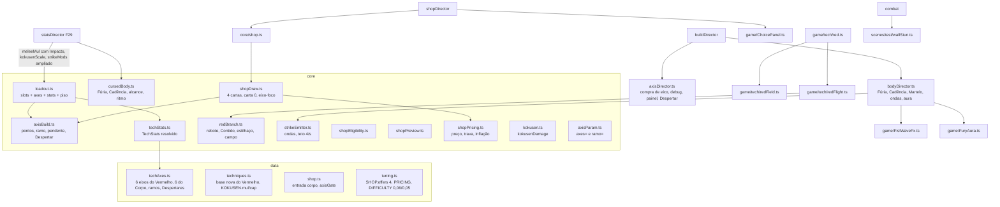

# Vermelho e corpo - Design

**Spec**: `.specs/features/vermelho-e-corpo/spec.md` · **Plano**: `docs/plano-builds-e-habilidades.md` (seções 2.1, 2.2,
2.6, 3.2, 3.3, 5.2, linha F30 da seção 6 e "Levado para a F30" da 6.1) · **Base**: F29 `fundacao-de-poder`
(`.specs/features/fundacao-de-poder/design.md`)
**Status**: Draft

Linhas citadas reconferidas em 15/10 no código integrado de `75a22b4` (`feat/builds-integracao`): F29
`fundacao-de-poder` final, F32 `chefes-com-afixos`, `recorde-e-recomeco` e as regras puras das levas 1 e 2
(`regras-tecnicas-leva1`, `regras-tecnicas-leva2`). O que a F29 entregou (`core/statSheet.ts`,
`scenes/test/statsDirector.ts`, `core/power.ts`, `core/hitBand.ts`, `Hit.band`, `game/DamageNumbers.ts`,
`game/powerSnapshot.ts`, `Player.strikeMods`, `?mods=`) é citado pela interface que está no código. As levas 1 e 2
deixaram a regra comum de eixos pronta (`data/techRule.ts`, `core/axisRule.ts`, `core/techKit.ts`), que a F30 reaproveita
em vez de repetir (ver "Code Reuse Analysis"). Linhas efetivas contadas como o `max-lines` do `.oxlintrc.json` (sem
linha em branco e sem comentário): a `TestScene` está com 388.

---

## Architecture Overview

O modelo de upgrade por eixo vira uma peça pura só, `core/axisBuild.ts`, dona dos pontos, do ramo, do ramo pendente e
do Despertar dos dois itens com eixo (Vermelho e Corpo). Ela mora dentro do `Loadout`, que já é o que o lutador carrega
e já é lido pela loja, pela conjuração, pelo HUD e pela maestria: assim o `Loadout.levelOf('vermelho')`, o
`Loadout.stats('vermelho')` e o `Loadout.upgrade('vermelho')` passam a falar de pontos sem que nenhum chamador mude de
assinatura. Tudo o que é número continua em `data/`; tudo o que liga ao motor fica em diretores que já são campos da
`TestScene` (`StatsDirector`, `BuildDirector`, `UiSetup`, `CombatLinks`, `TechDirector`), por isso a `TestScene` não
ganha linha nenhuma.



Fluxo por quadro (sem mudança de ordem na `TestScene`): o `StatsDirector.update` (F29) monta a `StatSheet` com o
Impacto do Corpo, grava `loadout.kokusenScale` e o multiplicador de HP da rodada; o `TechDirector.update` passa o
`slotHeld` ao `TechRunner` e chama `build.body.update(dt)` (ondas, Fúria, perda de HP); o golpe do player lê
`player.strikeMods(move)` na abertura da hitbox e recebe também o alcance, o fator da recovery e as marcas do golpe.

---

## Code Reuse Analysis

### Existing Components to Leverage

| Component | Location | How to Use |
| --- | --- | --- |
| `Loadout.levelOf` / `upgrade` / `cost` / `damage` / `startCooldown` | `src/core/loadout.ts:43`, `:79`, `:89`, `:95`, `:106` | Ganham o caminho do eixo por dentro; a maestria (`runDirector.ts:216-219`) e o prêmio do chefe (`runDirector.ts:226-231`) continuam chamando `upgrade(id)` e passam a dar ponto no eixo-foco (VRM-19) sem mudar |
| `TECH_RULE` (`axisCap` 3, `pointCap` 5, `branchLevel` 2, `awakenLevel` 5, `maxHpPct` 0,04/0,01, `killRefund` 0,3) e `AxisTable` | `src/data/techRule.ts` (leva 1) | Os tetos, os limiares do ramo e do Despertar, a fração do HP e o reembolso da Recarga 3 vêm daqui; o `data/techAxes.ts` não repete nenhum desses números, e as tabelas dos eixos são `AxisTable` |
| `axisLevel`, `resolveBuild`, `axisAt`, `killRefundPct`, `maxHpBite`, `bitePctFor` | `src/core/axisRule.ts` (leva 1, TRL-01 a TRL-06) | O `AxisBuild` deriva nível, ramo válido e Despertar por `resolveBuild`; o `resolveTechStats` lê a tabela por `axisAt`; o `dealtDamage` soma `maxHpBite(maxHp, kind, pct)`; a Recarga 3 lê `killRefundPct` |
| `nearestTarget`, `dist`, `boxInRadius`, `KillRefund` | `src/core/techKit.ts` (leva 2, KIT-01 a KIT-03) | O rebote, o estilhaço e o Martelo escolhem alvo por `nearestTarget` (centro da caixa, borda inclusa, empate pelo menor id); o reembolso da Recarga 3 é um `KillRefund` criado na soltura com a recarga resolvida e o `killRefundPct` (só o 1º abate da conjuração devolve, TRL-06). O `BiteLedger` não entra: no Vermelho o componente proporcional só sai numa detonação por conjuração (a 3ª do Fliperama, a única do Máximo) e no Corpo uma vez por golpe decisivo, então a regra "1 vez por alvo por conjuração" já vale pela estrutura |
| `Mover` (avança, `traveled`, `expired`) | `src/core/mover.ts` | O voo, o rebote (alcance 200 px) e o pairar do Contido reaproveitam o mesmo movedor, recriado a cada rebote |
| `RedOrbState.chargeFrame(elapsed, chargeMs)` | `src/core/redOrb.ts:115` | Já recebe o `chargeMs`; passa a receber o resolvido (VRM-06) |
| `repulseTargetsFor` | `src/core/redOrb.ts:62` | Ganha o dano por parâmetro (VRM-04) |
| `drawOffers(pool, rng, n, weight)` | `src/core/shop.ts:81` | As cartas 2 e 3 (e a 0 sem item upável) continuam saindo daqui (CRD-02.4, CRD-03) |
| `buildPoints` / `buildOfEntry` | `src/core/build.ts` | `corpo` vira linha `lutador`; os pontos do Vermelho já contam como `levelOf − 1` em `feiticeiro` |
| `SlowMo.trigger(0.4, 350)` | `src/core/slowMo.ts`; `CAMERA_FEEL.slowScale`/`slowMs` (`data/feel.ts:58-59`) | Câmera lenta do Despertar (VRM-17, CRP-13) sem número novo |
| `Hud.banner(text, ms)` | `src/game/Hud.ts` | Banner do Despertar e do ramo, sem crescer o `Hud.ts` |
| `Fx.afterimage(sprite)` | `src/game/fx.ts:163` | Pós-imagem da Conjuração 3 e do Ritmo 3 (VRM-06, CRP-04) |
| `TechTarget.setPull(velocity)` | `src/game/tech/shared.ts:18` | Empurrão do campo do Vermelho Máximo, com a velocidade do puxão do Azul ao contrário (`PULL_SPEED` 150, `core/blueOrb.ts:7`) |
| `techMarks(strength, id)` | `src/game/tech/shared.ts:52` | O golpe pesado de técnica já leva `knockdown: true` (AD-021): toda detonação do Vermelho já derruba hoje, e o VRM-15 não muda isso. Todo `Hit` novo do Vermelho (estilhaço, rebote, campo) leva `techMarks(strength, 'vermelho')`, para o Adaptativo do chefe contar pela técnica (`adaptSourceOf`, ADP-01) |
| `VowPanel` (cartas, `show`/`hide`, `debug`) | `src/game/VowPanel.ts` | Molde do `ChoicePanel` (mesma camada, profundidade e cores) |
| `debugParam` / `debugIntParam` | `src/scenes/test/params.ts` | Lê `axes=` e `ramo=` |
| `multipliersFor(round, DIFFICULTY)` | `src/core/difficulty.ts:41` | Sem mudança (ESC-01); o `StatsDirector` lê o `hp` da rodada para o piso do Kokusen e para o snapshot |
| `expectedIncome(round, WAVE, ECONOMY)` | `src/core/economy.ts:10` | Régua do teste da curva de build (ESC-03) |
| F29: `statSheet`, `StrikeMods` (`{ damage, force }`), `traitsOf`, `PROP_TRAITS` | `src/core/statSheet.ts:7-80` | `StatInput` ganha `impact` (CRP-02); `StrikeMods` ganha campos (CRP-15). `PROP_TRAITS` já é `{ heavy: true, light: false, counter: false, shadow: false }`, os traços do Kokusen do ESC-02: o `kokusenScale` lê `sheet.meleeMul(PROP_TRAITS)`, sem constante nova. Como o objeto na mão já passa pela mesma folha (`StatsDirector.propDamage`, POW-11), o Impacto também sobe o dano do objeto |
| F29: `powerPoints({ forca, manoplas, punhoPesado })` | `src/core/power.ts:42-44` | Ganha `impacto` (CRP-02.3) |
| F29: `StatsDirector` (`sheet`, `sync`, `update`, `reset`, `bindPlayer`, `strikeMods(move, peek)`, `points`, `snapshotFields`) | `src/scenes/test/statsDirector.ts:18-132` | Dono único dos multiplicadores: só ele grava `loadout.damageMul`, `vowDamageMul`, `costMul`, `player.damageTakenMul` e a vida máxima (`:49-57`; conferido por busca, nenhum outro escritor fora do `Loadout.reset`). Os números novos da F30 (Impacto, `kokusenScale`, HP da rodada) entram aqui |
| F29: `Hit.band` (`'chip' \| 'micro'`, `core/hit.ts:25`, `:52`), `MicroBudget` | `src/core/hit.ts`, `src/core/hitBand.ts` | Estilhaço e onda saem `micro`; o campo do Máximo sai `chip`; o teto de 60 ms do micro já vale |
| `effects.onTechConnect(hit, point, target, source)` | `src/scenes/test/effects.ts:46-63` | Os acertos novos entram por aqui. O `source` (hoje `TechId`, do recorde: `record.onTechHit(source, hit.damage)`, DMG-02) passa a `DamageSource` (`core/runSummary.ts:12`) e a linha chama `record.addDamage`: a onda e o Martelo entram como `'golpe'`, o resto do Vermelho como `'vermelho'` |
| F29: `DamageNumbers.show(target, value, kind, at)` com `target.lastDamageTaken ?? hit.damage` | `src/game/DamageNumbers.ts:55`; `effects.ts:48`, `combat.ts:110` | O número já mostra o dano que o alvo levou quando o alvo informa (`Hittable.lastDamageTaken`, hoje só o `Boss`). O `Enemy` ganha o mesmo getter (`brain.lastDamage`) e as duas linhas não mudam |
| F29: `impactTier(hit, { brokePosture, forced })` | `src/core/impactTier.ts:12-19` | O decisivo da Cadência entra pela marca `Hit.decisive` lida dentro do `impactTier` |
| F29: `StatsDirector.snapshotFields()` (`Pick<GameSnapshot, 'damageNumbers' \| 'power' \| 'stats'>`) | `src/scenes/test/statsDirector.ts:112-131` | Campos `difficulty` e `choice` entram por aqui (o `Pick` cresce), sem crescer o `debugSnapshot` (exceção de tamanho) |

### Integration Points

| System | Integration Method |
| --- | --- |
| Loja | `Shop` ganha o `axisRng` (8º parâmetro opcional) e o `chooseAxis(delta)`; `BuyContext.applyAxis(item, axis)` |
| Konbini | `shopDirector.openShop` abre `VowPanel` → `ChoicePanel` → loja; `updateShop` trava a loja enquanto um painel está aberto |
| Conjuração | `CastMachine` lê os tempos do `loadout.stats(id)`; `TechCaster.slotHeld` → `TechDirector` → `TechRunner.update` → `RedTech.update` |
| Golpe do player | `Player.strikeMods(move)` (F29) devolve também `reachPx`, `recoveryMul` e `marks`; `strikes.ts` aplica na hitbox e na recovery |
| Acerto corpo a corpo | `combat.onConnect` (`combat.ts:83-114`) chama `build.onMeleeHit(hit, point, target)` (assinatura nova, mesma linha `:104`) e soma o Fluxo ao `CE.meleeGain` (`:102`) |
| Parede | `combat.listenForContacts` (`combat.ts:304-310`) repassa os pares ao `wallStun.onContacts(pairs)` |
| Reset da run | `runDirector.onStartRun` chama `build.applyDebugAxes()` logo depois de `equipDebugTech()` (`runDirector.ts:174`), que já vem depois do `stats.reset()`; o `StatsDirector.update` do quadro seguinte refaz a folha com o Impacto. `loadout.reset()` já zera o `AxisBuild` |
| Começo de rodada | `runDirector.applyRunCommand('roundStart')` chama `build.axes.onRoundStart()` (zera o anúncio do Despertar) |
| Snapshot | `build.snapshot()` ganha `vermelho` e `corpo`; `statsDirector.snapshotFields()` ganha `difficulty` e `choice`; `shopSnapshot()` ganha `axes`/`selectedAxis` |

---

## Components

### `data/techAxes.ts` (novo, ~110 linhas)

- **Purpose**: todos os números de eixo, ramo e Despertar do Vermelho e do Corpo (VRM-03, CRP-02 a CRP-11).
- **Conteúdo**:
  - `RED_AXIS_IDS = ['potencia', 'escala', 'conjuracao', 'eficiencia', 'recarga', 'perfuracao'] as const` (a ordem é o
    desempate do eixo-foco) e `BODY_AXIS_IDS = ['impacto', 'peso', 'ritmo', 'alcance', 'fluxo', 'furia'] as const`.
  - `RED_AXES`: por eixo, as quatro linhas da tabela do VRM-03 (`touch [30,35,40,45]`, `detonation [25,29,33,37]`,
    `force [8,9,10,11]`, `radius [96,120,144,168]`, `orbTexels [12,14,16,18]`, `sensor [6,7,8,9]`, `signMs
    [250,200,165,125]`, `chargeMs [350,280,225,175]`, `cost [30,26,22,18]`, `cooldownMs [4500,3600,2900,2300]`,
    `shard [0,6,9,12]`, `shardNeighbors [0,1,2,2]`) e os extras (`rings = 1 + potência`, `hitstopPerPotenciaMs: 10`,
    `afterimageAt: 3` na Conjuração; o reembolso da Recarga 3 é o `killRefundPct` da leva 1).
  - `BODY_AXES`: `impactMul [1,1.1,1.2,1.3]`, `forceMul [1,1.2,1.4,1.6]`, `knockdownFrom: 2`, `wallStunAt: 3`,
    `recoveryMul [1,0.92,0.85,0.78]`, `afterimageAt: 3`, `reachPx [0,6,10,14]`, `furyStep [0,0.03,0.04,0.05]`,
    `furyCap [0,0.15,0.24,0.35]`.
  - `RED_BRANCHES`: `ricochete` (`reboundRangePx 200`, `rebounds 1`, `afterFirstMul 0.7`) e `contido`
    (`holdMs 1200`, `radiusMul 1.4`); `RED_AWAKENINGS`: `fliperama` (`rebounds 3`, `speedStep 0.15`, `pctAt 3`) e
    `vermelhoMaximo` (`fieldMs 1200`, `fieldTickMs 200`, `fieldChip 3`, `pushSpeed 150`, `wallStunMs 600`).
  - `BODY_BRANCHES`: `cadencia` (`every 4`, `damageMul 1.5`) e `ondaDoPunho` (`rangePx 80`, `speed 600`,
    `damageFrac 0.4`); `BODY_AWAKENINGS`: `marteloNegro` (`areaPx 48`) e `punhoQueRasga` (`rangePx 160`,
    `secondWaveMs 100`); `EMITTER = { maxPerWindow: 4, windowMs: 1000 }`.
  - `AXIS_NAMES` e `BRANCH_NAMES` (texto da carta e do painel). Os tetos (3 por eixo, 5 por item), os limiares (ramo
    no Nv 2, Despertar no Nv 5), a fração do HP (4 % e 1 %) e o reembolso da Recarga 3 (0,3) **não** entram aqui: são
    o `TECH_RULE` de `data/techRule.ts` (leva 1), lido também pelas técnicas das levas 1 e 2.
  - Cada linha de eixo é uma `AxisTable` (`readonly [T, T, T, T]`, `data/techRule.ts`), lida por `axisAt`.
- **Reuses**: molde de `data/perks.ts` (tabela por id + nomes à parte); `TECH_RULE` e `AxisTable` da leva 1.

### `core/axisBuild.ts` (novo, ~110 linhas)

- **Purpose**: estado puro dos itens com eixo (VRM-02, VRM-11, VRM-17, CRP-01, CRP-08, CRP-13 e os edge cases do ramo).
- **Interfaces**:
  - `type AxisItem = 'vermelho' | 'corpo'`; `type AxisId = RedAxisId | BodyAxisId`; `type BranchId =
    'ricochete' | 'contido' | 'cadencia' | 'ondaDoPunho'`.
  - `class AxisBuild`:
    - `points(item, axis): number`, `total(item): number`, `level(item): number` (`1 + total`)
    - `canAdd(item, axis): boolean` (eixo < 3 e item < 5)
    - `add(item, axis): AddResult` com `AddResult = { ok: false } | { ok: true; branchPending: boolean; awakened:
      boolean }`: recusa sem mudar nada (VRM-02.3); no 1º Nv 2 da run põe o item na fila `pending` (VRM-11,
      CRP-08.1); no Nv 5 com ramo escolhido liga o Despertar (VRM-17, CRP-13)
    - `focusAxis(item): AxisId | null` (mais pontos abaixo do teto; empate pela ordem da tabela; `null` no teto)
    - `branch(item): BranchId | null`, `setBranch(item, branch): boolean` (liga o Despertar se o nível já for ≥ 5:
      edge case do ramo pendente), `get pending(): readonly AxisItem[]` (sempre Vermelho antes do Corpo),
      `awakened(item): boolean`
    - `announce(item): boolean` (devolve `true` só na 1ª vez da rodada com o Despertar ligado) e `onRoundStart()`
    - `resetItem(item)` (o Vermelho sai do slot: evolução) e `reset()` (run nova: Corpo no Nv 1, fila vazia)
  - É o guardião da compra que a leva 1 deixou para a F30 (`regras-tecnicas-leva1`, "Estado de progressão"): valida
    antes de gravar (o `axisLevel` lança `RangeError` em ponto inválido, então o `add` checa o `canAdd` primeiro e
    nunca chama a regra com estado inválido); `level` e `awakened` saem do `resolveBuild({ axes, branch })`.
- **Dependencies**: `data/techAxes.ts`, `data/techRule.ts`, `core/axisRule.ts`. Sem `phaser` (AD-001).

### `core/techStats.ts` (novo, ~90 linhas)

- **Purpose**: o `TechStats` resolvido de uma conjuração (TST-01, VRM-03, PRC-05).
- **Interfaces**:
  - `interface TechStats` (ver "Data Models").
  - `resolveTechStats(input: { id; level; axes: AxisBuild; damageMul; vowDamageMul; costMul; kokusenScale }):
    TechStats`. O Vermelho lê a tabela do eixo, sem `LEVEL_FACTOR`; as outras quatro seguem a regra de hoje
    (`TECHNIQUES` × `LEVEL_FACTOR[level − 1]` × multiplicadores, `cost − 5 × (level − 1)`), com o piso
    `max(custo, ceil(0,6 × TECHNIQUES[id].cost))` aplicado por último (PRC-05).
  - `GEOMETRY` (as constantes que hoje moram em `core/redOrb.ts:6-9`, `core/blueOrb.ts:4-9`, `core/cut.ts:21-25`,
    `core/purple.ts:2-11`, `game/tech/red.ts:22-25`, `game/tech/purple.ts:12-15`, `game/tech/blue.ts:12`,
    `game/techFx/redDetonation.ts:26-29`, `game/techFx/CutFx.ts:7-13`, `game/techFx/BlueOrb.ts:32-36`) passa a morar
    em `data/techniques.ts` como `TECH_GEOMETRY`, e os módulos importam de lá.
- **Reuses**: `TECHNIQUES`, `LEVEL_FACTOR`, `data/techAxes.ts`. O dano é `Math.round(base × fator × damageMul ×
  vowDamageMul)` na mesma ordem de `loadout.ts:97`, para o teste de equivalência comparar com `toBe`.

### `core/loadout.ts` (muda, 86 → ~125 linhas)

- `readonly axes = new AxisBuild()`; `damageMul`, `vowDamageMul` e `costMul` continuam (escritos só pelo
  `StatsDirector`, F29); campo novo `kokusenScale = { forca: 0, meleeMul: 1, hpMul: 1 }` (também só do `StatsDirector`) e
  `lastSlot: 0 | 1 | null` (gravado em `startCooldown`, lido pelo `EnergyHud`, VRM-20).
- `levelOf(id)`: Vermelho equipado devolve `axes.level('vermelho')`; os outros, o nível do slot.
- `slotsView`: o Vermelho aparece com o nível derivado (`level: number`).
- `equip(slot, id, level)`: o Vermelho grava sempre 1 (o `tech=vermelho:N` não muda o nível; assumption da spec).
- `upgrade(id)`: no Vermelho, `axes.add('vermelho', axes.focusAxis('vermelho'))` (VRM-19); nas outras, como hoje.
- `clear(slot)`: se o slot tinha o Vermelho, `axes.resetItem('vermelho')`.
- `stats(id): TechStats` (TST-01); `cost(id)` e `damage(id, base)` passam a ler do `stats` (mesmo número no passo 1).
- `startCooldown(slot)` lê `stats(id).cooldownMs`; `refundCooldown(slot, ms)` corta `ms` do que resta, sem passar de 0
  (VRM-07; o `ms` vem do `KillRefund.claim()` da conjuração).
- `reset()` zera também `axes`, `kokusenScale` e `lastSlot`.

### `core/redBranch.ts` (novo, ~120 linhas)

- **Purpose**: regras puras do ramo e do Despertar do Vermelho e da Perfuração (VRM-08, VRM-09, VRM-12 a VRM-15).
- **Interfaces**:
  - `redPlan(branch, awakened): RedPlan` = `{ pierce: boolean; maxRebounds: 0 | 1 | 3; reboundAny: boolean;
    holdable: boolean; radiusMul: number; field: boolean; pctOnDetonation: (n: number) => boolean }`
    (Ricochete: `pierce false`, 1 rebote só a partir de inimigo/parede/chão/chefe; Fliperama: 3; Contido: `holdable`,
    `radiusMul` 1,4 só na detonação segurada e na parede/chefe do orbe segurado; Máximo: `field`, `pct` em toda
    detonação; Fliperama: `pct` só na 3ª).
  - `detonationMul(n): number` (1 na 1ª, 0,7 depois; VRM-12.4) e `speedAfter(n, base): number` (×1,15 por
    detonação no Fliperama; VRM-13).
  - `pickRebound(point, candidates, hitByLast, playerX, reachPx = 200, maxFromPlayerPx = 320): { targetId; dir } |
    { targetId: null; dir }` (o mais perto a ≤ 200 px do ponto, fora dos atingidos nessa detonação, a ≤ 320 px do
    player; sem alvo, direção horizontal oposta; VRM-09, VRM-12.3/5). Escolhe pelo `nearestTarget` do `techKit`, com o
    `skip` juntando os atingidos e os além de 320 px do player.
  - `shardTargets(passed, others, count, reachPx = 60, alreadyHit: Set<number>): number[]` (o mais perto primeiro,
    cada um uma vez por conjuração; VRM-08): `count` chamadas ao `nearestTarget`, cada escolhido entrando no `skip`.
  - `class RedField` (`update(dtMs): { ticks: number; ended: boolean }`, raio, centro): tique de 200 ms por 1200 ms
    (VRM-15); `pushVelocity(center, target, speedPxS): Vec2`.
  - `class ContidoHold` (`update(dtMs, held): 'fly' | 'hover' | 'detonate'`): pairar no fim dos 320 px, detonar ao
    soltar ou aos 1200 ms desde a saída (VRM-14).
- **Dependencies**: `data/techAxes.ts`, `core/hit.ts` (`normalize`, `Vec2`), `core/techKit.ts` (`nearestTarget`,
  `dist`, `Box`).

### `core/redOrb.ts` (muda, 113 → ~125 linhas)

- `RedOrbState(x, dir, config)` recebe `RedOrbConfig = { speed, rangePx, radius, touch, detonation }` no construtor no
  lugar das constantes de `redOrb.ts:6-9` (o `RED_ORB_SPEED` exportado continua, lido de `TECH_GEOMETRY`); o
  `redOrbConfig(stats)` monta o config do `TechStats` da soltura, com os danos já escalados (o adaptador não chama mais
  o `Loadout.damage` no golpe), e o `redGeometry(stats)` dá o `red` dele (T6).
- `rebound(x, dir, rangePx, speed)` recria o `Mover`, zera `_detonated` e guarda o número da detonação;
  `hover()` para o `Mover` sem detonar (Contido); `hitIds` vira por detonação no rebote (o mesmo alvo pode levar a 2ª
  detonação, como o VRM-12 pede) mas o toque continua 1 vez por orbe.
- `repulseTargets(origin, facing, targets, damage)` ganha o dano (VRM-04).

### `core/cursedBody.ts` (novo, ~100 linhas)

- **Purpose**: regras puras do Corpo em combate (CRP-02 a CRP-09).
- **Interfaces**:
  - `bodyStrike(points, move): BodyStrike` = `{ impactMul, forceMul, recoveryMul, reachPx, knockdown: boolean,
    wallStun: boolean }` (Peso ≥ 2 e `move.strength === 'heavy'` → `knockdown`; Peso 3 → `wallStun`).
  - `widenForward(shape: HitboxShape, px): HitboxShape` = `{ ...shape, width: width + px, offsetX: offsetX + px / 2 }`
    (a borda de trás fica; o retângulo do `game/hitbox.ts:136` é centrado no `offsetX`).
  - `class FuryCounter` (`onConnect(swingId)`, `onHpLoss()`, `stacks`, `bonus(points)`, `atCap(points)`).
  - `class CadenceCounter` (`onConnect(swingId)`, `onActiveEnd(swingId, connected)`, `onHpLoss()`, `count`,
    `nextIsDecisive(): boolean` = `count % 4 === 3`).
  - `marteloTargets(point, enemies, exceptId, areaPx = 48): number[]` (todos os comuns com a caixa a até 48 px do
    ponto, pelo `boxInRadius` do `techKit`).
- **Dependencies**: `data/techAxes.ts`, `core/combo.ts` (`HitboxShape`), `data/moves.ts` (só o tipo `MoveDef`).

### `core/strikeEmitter.ts` (novo, ~70 linhas)

- **Purpose**: o emissor mínimo da Onda do Punho (CRP-10 a CRP-12).
- **Interfaces**: `class StrikeEmitter` com `emit(at: Vec2, dir: 1 | -1, damage, opts: { pierce; rangePx },
  nowMs): boolean` (janela deslizante de 1000 ms de tempo de jogo, no máximo 4; o excedente devolve `false` e não
  sai), `update(dtMs, targets: { id; rect }[], exceptIds): WaveHit[]` (avança a 600 px/s, acerta o 1º que tocar ou
  todos com `pierce`, cada alvo uma vez por onda), `waves` (para a vista) e `reset()`.
- **Reuses**: o padrão de `PurpleSphere` (`core/purple.ts`): avança em linha reta e acerta cada alvo uma vez.

### `core/shopEligibility.ts` e `core/shopPreview.ts` (novos no passo 0, ~45 e ~60 linhas)

- **shopEligibility**: `eligible` (`shop.ts:49-65`), `evolutionEligible` (`:25-28`), `techniqueEligible` (`:31-39`),
  `modifierEligible` (`:68-74`), `recipeOf` (`:22`). No passo 4 ganha `axisEligible(entry, loadout, round)`
  (Corpo sempre dono; Vermelho só equipado; `canAdd` de algum eixo e a trava do PRC-04).
- **shopPreview**: `previewText` (`shop.ts:129-164`), `techniquePreview` (`:114-121`), `factorText` (`:111`),
  `oneDecimalComma` (`:108`). No passo 4 ganha `axisPreview(item, axes, selected, loadout)` (duas linhas com
  `▲`/`▼` e `›` na escolhida; CRD-05).
- O `shop.ts` não reexporta `eligible` nem `previewText`: os testes só trocam o caminho do import, que é a única mudança
  que o SHX-01.2 permite.

### `core/shopDraw.ts` (novo no passo 4, ~90 linhas)

- **Purpose**: as 4 cartas de uma loja (CRD-01 a CRD-04, CRD-07), tirando o `drawFresh` (`shop.ts:286-320`) da classe.
- **Interfaces**:
  - `focusItem(loadout): ShopEntryId | null` (maior nível entre os slots e o Corpo; empate slot 0, slot 1, Corpo).
  - `drawCards(ctx: DrawContext): (Offer | null)[]` com `DrawContext = { pool, rng, axisRng, weight, loadout }`:
    carta 0 = evolução pronta (EVO-01) **ou** melhoria do foco (`axisRng.next() < 0.6` e foco upável) **ou**
    melhoria de outro item dono sorteado pelo `axisRng` **ou** sorteio por peso (CRD-02.4); carta 1 = técnica nova
    enquanto houver slot vazio (CRD-03, a garantia do TSH-05 muda de carta); cartas 2 e 3 por `drawOffers`, uma carta
    por item.
  - `axesFor(item, axes, axisRng): readonly AxisId[]` (o eixo-foco e outro abaixo do teto sorteado; um só se só um
    couber; CRD-04).
- `Offer` ganha `axes?: readonly AxisId[]`.

### `core/shopPricing.ts` (novo no passo 4 com o preço do ponto; completo no passo 5, ~45 linhas)

- **Purpose**: preço e trava (PRC-01 a PRC-04, PRC-06).
- **Interfaces**: `inflate(base, round)` = `Math.round(base × (1 + 0,06 × (round − 1)))`; `newTechPrice(rarity)`
  (20/26); `axisPointPrice(points)` (`12 + 4 × points`); `axisGate(nextPoint)` (1º e 2º na r2, 3º e 4º na r4, 5º na
  r6); `techLevelGate(nextLevel)` (Nv 2 na r2, Nv 3 na r4; substitui o `techGate` de `data/shop.ts:110-114`);
  `cardCost(entry, ctx)` (a função única de preço que o `Shop` chama no lugar do `costOf` de `shop.ts:213-221`).
- Números em `data/tuning.ts` como `PRICING = { inflationPerRound: 0.06, newTech: { common: 20, rare: 26 },
  axisPoint: { base: 12, step: 4 }, axisGate: [2, 2, 4, 4, 6] }`.

### `core/kokusen.ts` (muda, 54 → ~62 linhas)

- `kokusenDamage(D, scale: { forca; meleeMul; hpMul }): number` = `max(round(KOKUSEN.mul × meleeDamageAtLevel(D,
  forca) × meleeMul), round(KOKUSEN.damage × hpMul))` (ESC-02), com `D = round(18 × LEVEL_FACTOR[nível − 1])`, o 2º
  impacto **sem** `damageMul` nem `vowDamageMul`: o Kokusen conta como golpe corpo a corpo forte (Força, passivas,
  Manoplas, votos e Impacto, cada um uma vez); `KOKUSEN.mul` 2,5 e `KOKUSEN.mulCap` 3,4 entram em `data/techniques.ts:135` (ESC-02.6);
  `KOKUSEN.damage` (45) vira o piso.

### `core/axisParam.ts` (novo, ~35 linhas)

- `parseAxesParam(raw): { item; axis; points }[]` e `parseBranchParam(raw): { item; branch }[]` (VRM-10, VRM-18,
  CRP-14): item ou eixo desconhecido, ou nível que não é inteiro positivo, some. O teto vem do `AxisBuild.add` em laço.

### `scenes/test/axisDirector.ts` (novo, ~110 linhas, campo `axes` do `BuildDirector`)

- **Purpose**: liga o `AxisBuild` à loja, ao painel, ao debug e ao banner.
- **Interfaces**:
  - `applyAxis(item, axis): void` (compra: `loadout.axes.add`, evento `axis:<item>.<eixo>`, `branchPending` vira
    evento `branchPending:<item>`, `awakened` vira `awaken:<item>`)
  - `applyDebug(): void` (`axes=` depois do `tech=`, `ramo=` depois; o Vermelho só recebe ponto se estiver equipado)
  - `choicePages(): ChoicePage[]`, `confirmBranch(item, option: 0 | 1): void`
  - `announce(item, name): void` (banner com o nome do Despertar + `slowMo.trigger(CAMERA_FEEL.slowScale,
    CAMERA_FEEL.slowMs)`, só se `axes.announce(item)`), `onRoundStart()`
  - `snapshot(): { vermelho: RedBuildSnapshot | null; corpo: BodyBuildSnapshot }` (VRM-10, CRP-14)

### `scenes/test/bodyDirector.ts` (novo, ~130 linhas, campo `body` do `BuildDirector`)

- **Purpose**: o Corpo no combate (CRP-03 a CRP-13).
- **Interfaces**:
  - `strikeMods(move, base: StrikeMods): StrikeMods` (chamado pelo `StatsDirector.strikeMods`: soma o Peso ao
    `force`, a Fúria e a Cadência ao `damage`, e preenche `reachPx`, `recoveryMul` e `marks`)
  - `onMeleeHit(hit, point, target)` (Fúria, Cadência, Martelo Negro, Onda do Punho; chamado pelo
    `BuildDirector.onMeleeHit`)
  - `onStrikePhase(name, phase)` (fim do `active` sem acerto zera a Cadência; Ritmo 3 solta a pós-imagem na
    `recovery`; chamado pelo `ImpactFx.onStrikePhase`)
  - `update(dtMs)` (perda de HP fora da loja zera Fúria e Cadência, anda o `StrikeEmitter`, entrega os acertos da
    onda com `band: 'micro'` pelo `effects.onTechConnect(hit, point, target, 'golpe')`, desenha `FistWaveFx` e
    `FuryAura`). A onda e os alvos do Martelo saem sem `tech` (contam como golpe no Adaptativo do chefe, ADP-01, e no
    registro da run, DMG-02)
  - `get flowBonus(): number` (CRP-06), `reset()`, `snapshot(): { fury: { stacks; bonus }; cadence: number }`
- **Dependencies**: `TestScene` (player, enemies, boss, loadout, effects, ui, fx), `CursedBodyState` puros.

### `game/FistWaveFx.ts` (novo, ~45 linhas) e `game/FuryAura.ts` (novo, ~50 linhas)

- **FistWaveFx**: um risco por onda viva (`Graphics`, cor da `PALETTE` do soco amaldiçoado `c`/`C`, 1 texel de
  espessura, `FX_DEPTH`), recriado a cada quadro a partir de `StrikeEmitter.waves`; registrado no `FxRegistry`.
- **FuryAura**: elipse de brilho em volta do player na chave `a` (CRP-07.11), raio `base + k × stacks`, presa a
  `player.renderPos` (AD-019); escondida sem pilha. Some no `SHUTDOWN` (edge case do `R`, como a aura da F29).

### `game/ChoicePanel.ts` (novo, ~95 linhas)

- **Purpose**: a página do ramo (CRD-08, CRD-09), no molde do `VowPanel`.
- **Interfaces**: `show(page: ChoicePage)`, `select(option: 0 | 1)`, `hide()`, `get open(): boolean`,
  `debug(): { open: boolean; page: { item: AxisItem; options: [string, string] } | null }`. Duas cartas (A e B) com o
  nome do ramo e a linha do Despertar que ele abre; realce na escolhida.
- Criado em `UiSetup.addHud()` como `ui.choicePanel` (AD-003: entra na `uiLayer`).

### `game/tech/redFlight.ts` (novo, ~140 linhas) e `game/tech/redField.ts` (novo, ~60 linhas)

- **redFlight**: o voo de um orbe depois de nascer (`onTouch`, `finishDetonation`, rebote, pairar do Contido,
  estilhaços, reembolso da recarga pelo `KillRefund`), tirado de `red.ts:105-117` e `:185-226`. Recebe o `TechStats` e o `RedPlan` da
  conjuração (copiados na soltura: um ponto comprado no meio do voo não muda o orbe em voo).
- **redField**: o campo do Vermelho Máximo: a cada quadro, `setPull(pushVelocity)` nos comuns em pé dentro do
  raio e `null` uma vez ao sair ou ao fim (com um orbe Azul vivo, o Azul escreve depois e vence: edge case da spec); a cada tique, `Hit` `chip` de `round(3 × damageMul × vowDamageMul)` pelo `strike`
  comum, com `techMarks('light', 'vermelho')`; vista mínima (anel da `RED_FX_COLORS` que esmaece), registrada no `FxRegistry`.
- `red.ts` fica com a carga, a soltura (repulsão, recuo, pós-imagem da Conjuração 3, banner do Despertar pelo evento
  `awakenCast:vermelho`) e o nascimento do orbe com o sprite do `orbTexels` e o sensor do `sensorPx`.

### `scenes/test/wallStun.ts` (novo, ~45 linhas, campo `wallStun` do `CombatLinks`)

- **Purpose**: a parede que atordoa (VRM-16).
- **Comportamento**: o comum que entra em ragdoll por um `Hit` com `wallStun: true` fica marcado
  (`enemy.wallStunArmed`, gravado pelo `EnemyDefense.enterRagdoll`); `onContacts(pairs)` procura par (corpo do ragdoll
  marcado, corpo `terrain`) com normal horizontal (`|n.x| ≥ 0,7`) e chama `enemy.wallStun(600)` (→
  `EnemyBrain.holdDown(ms)`: em `ragdollStun`, `timer = ms`) e o evento `wallStun:<id>`; normal vertical (o pouso)
  desarma.

### Mudanças em arquivos existentes (por passo)

**Passo 0 (refatoração da loja, smokes iguais; SHX-01)**

| Arquivo | Linha | Mudança |
| --- | --- | --- |
| `src/core/shopEligibility.ts` (novo) | — | recebe `shop.ts:16-74` menos o `weightOf` (que fica no `shop.ts`, usado pelo `drawOffers`) |
| `src/core/shopPreview.ts` (novo) | — | recebe `shop.ts:108-164` |
| `src/core/shop.ts` | 3-4, 11-14, 16-164 | saem os imports que só a elegibilidade e a prévia usavam; `drawFresh` e `view` importam dos dois arquivos novos |
| `tests/core/shop.test.ts`, `techShop.test.ts`, `evolutionShop.test.ts`, `arsenal.test.ts`, `build.test.ts` | imports | só o caminho do import de `eligible`/`previewText` |

`shop.ts`: **292 → ~205**.

**Passo 1 (`TechStats`, smokes iguais; TST-01 a TST-04)**

| Arquivo | Linha | Mudança |
| --- | --- | --- |
| `src/data/techniques.ts` | fim | `TECH_GEOMETRY` com os números de hoje (Vermelho: raio 96, orbe 12, sensor 6, 760 px/s, alcance 420, força 8, repulsão 4/10/80/48, anel 160; Azul: 110/16/130/150/250/1400, consulta 130; Corte: 0/60/120, 20/−25/70, 60/180/48, linha 240; Roxo: `PURPLE` de `core/purple.ts:2-11`, sobe 14, força 9) |
| `src/core/techStats.ts` (novo) | — | `TechStats` + `resolveTechStats` |
| `src/core/loadout.ts` | 88-110 | `stats(id)`; `cost`, `damage` e `startCooldown` leem do `stats` |
| `src/core/cast.ts` | 26-37, 121-124 | `msFor(stats, state)` com `this.loadout.stats(id)` no lugar de `TECHNIQUES[id]` |
| `src/core/redOrb.ts` | 6-9, 97-99, 127, 141 | `RedOrbConfig` no construtor |
| `src/core/blueOrb.ts` | 4-9, 80, 87 | geometria e dano por parâmetro do construtor (`BlueOrbState(config)`) |
| `src/core/cut.ts` | 21-25, 72 | idem (`CutSchedule(config)`) |
| `src/core/purple.ts` | 2-11 | `PURPLE` vira reexport de `TECH_GEOMETRY.roxo` (o teste `tests/data/purple.test.ts` lê `PURPLE`) |
| `src/game/tech/red.ts` | 22-25, 91, 172-179, 200, 207, 217 | `const stats = loadout.stats('vermelho')` na soltura, guardado no `RedOrbEntry`; sensor, sprite, força e dano do `stats` |
| `src/game/tech/blue.ts` | 12, 126 | idem |
| `src/game/tech/cut.ts` | 52 | idem |
| `src/game/tech/purple.ts` | 12-15, 53, 96 | idem |
| `src/game/tech/divergent.ts` | 167, 201 | `stats.damage.first` / `second` |
| `src/game/techFx/RedOrb.ts` | 101-111, 329-337 | `chargeUpdate(..., chargeMs)` já recebe o tempo; `detonate(point, facing, look: { radius, rings })` |
| `src/game/techFx/redDetonation.ts` | 26-29, 54, 65, 89, 117 | `redDetonationBurst(scene, registry, point, look)`; raio da esfera = `look.radius`, anel = `shockRingRadius(look.radius)` (`radius × ringPx / radius` da tabela, em `techFx/redLook.ts` sem `phaser`, com o tipo `RedDetonationLook`); `TECH_GEOMETRY.vermelho.rings: 1` (T6); sprite pelo `orbTexels` no passo 2 |
| `src/game/techFx/BlueOrb.ts` | 32-36 | halo e distorção proporcionais ao `radius` do stat (130 dá os números de hoje) |
| `src/game/techFx/CutFx.ts` | 7-13 | comprimento e meio da linha pelo stat |
| `src/game/techFx/PurpleOrb.ts` | — | raio da esfera pelo stat |
| `src/game/EnergyHud.ts` | 171, 176 | `def.cooldownMs` vira `loadout.stats(s.id).cooldownMs` |
| `src/scenes/test/camera.ts` | 84 | `TECHNIQUES[...].chargeMs` vira `this.s.loadout.stats(id).chargeMs` |
| `tests/core/techStats.test.ts` (novo) | — | equivalência TST-01.6 |

O `redOrbFxSource.test.ts` lê o fonte de `RedOrb.ts` e `redDetonation.ts` (`?raw`) e exige que toda cor passe por
`RED_FX_COLORS`: o `look` só traz números, e o teste não muda. `TestScene`: 0.

**Passo 2 (Vermelho Nv 1 a 6; VRM-01 a VRM-20)**

| Arquivo | Linha | Mudança |
| --- | --- | --- |
| `src/data/techniques.ts` | 43-56 | Vermelho: `cost 30`, `cooldownMs 4500`; `TECH_GEOMETRY.vermelho.rangePx 320` |
| `src/data/techAxes.ts` (novo) | — | ver acima |
| `src/core/axisBuild.ts`, `redBranch.ts`, `axisParam.ts` (novos) | — | ver acima |
| `src/core/techStats.ts` | Vermelho | lê `RED_AXES` pelos pontos (`axisAt`) |
| `src/core/loadout.ts` | 43-86 | `axes`, `levelOf`, `slotsView`, `upgrade`, `clear`, `refundCooldown(slot, ms)`, `lastSlot` |
| `src/core/mastery.ts` | 21-23, 32 | `threshold(level: number)`: `null` a partir do Nv 3 (a maestria só acumula no Nv 1 e 2; VRM-19); `registerHit(slot, level: number, ...)`, porque o `runDirector.ts:216` passa o `slotsView[slot].level`, que vira `number` |
| `src/core/hit.ts` | 28-53 (`Hit`) | `maxHpBonus?: number` (fração do comum; o chefe fica no teto de 1 % pelo `maxHpBite`), `hitstopBonusMs?: number`, `wallStun?: boolean`, `decisive?: boolean`; `dealtDamage(hit, maxHp, kind: BodyKind)` = `hit.damage + maxHpBite(maxHp, kind, hit.maxHpBonus)` (sem bônus = `hit.damage`) |
| `src/core/enemyBrain.ts` | 77-80 | `const dealt = dealtDamage(hit, this.t.maxHp, 'enemy')`, gravado em `_lastDamage` (getter `lastDamage`, como o `BossBrain`), e `this._hp - dealt` (expressão, sem ramo); `holdDown(ms)` |
| `src/core/bossBrain.ts` | 112 | `hit.damage` vira `dealtDamage(hit, this.maxHp, 'boss')` nas duas pontas do `baseDamage` (antes do `scale` do Adaptativo e do ×1,5 do `stagger`, que continuam como estão) |
| `src/game/TechCaster.ts` | 55-57, 79-93 | getter `slotHeld` (`key.isDown` de `L`/`C` e `I`/`V`, lido no `update`) |
| `src/scenes/test/techDirector.ts` | 22-29 | passa `this.s.techCaster.slotHeld` |
| `src/game/TechRunner.ts` | 104-121 | `update(..., slotHeld, ...)` repassa ao `red.update` (`:117`) |
| `src/game/tech/red.ts` | 64-219 | voo vai para `redFlight.ts`; repulsão com o dano do VRM-04; pós-imagem; sprite e sensor do `stats` |
| `src/game/tech/redFlight.ts`, `redField.ts` (novos) | — | ver acima |
| `src/game/techFx/RedOrb.ts` | 329-337 | `rings` anéis com 40 ms entre eles |
| `src/game/techFx/RedOrb.ts`, `src/core/redOrb.ts` | 101-111; 115 | a 3ª textura da carga é a do `orbTexels` resolvido (`chargeFrame` devolve 4, 8 ou o tamanho do orbe), para o orbe não pular de tamanho na soltura (VRM-06) |
| `scripts/smoke/techniques.smoke.mjs` | 111-160 | o trecho RED-10 procura o alvo além do alcance novo (detonação a ~358 px da ponta dos dedos, não ~458): o player para 100 px mais à frente, a janela do alvo vira `dx` de ~460 a ~510, e a espera entre tentativas cobre a recarga de 4500 ms (VRM-01, VRM-09). Sem isso o alvo fica a ~200 px do estouro e o smoke falha no passo 2 |
| `scripts/smoke/evolution.smoke.mjs` | 35 | `tech=azul:3,vermelho&axes=vermelho.potencia:2` (a ponte da T14 sai na T23) |
| `src/game/art/sprites/techFx.ts` | 31-49 | `RED_ORB_SIZES` ganha 14, 16 e 18 (mesmos `stops` do 12) |
| `src/game/textures.ts` | 80-82 | `techOrbRed14/16/18` |
| `src/game/art/index.ts` | 129-131 | o mapa de textura ganha os 3 tamanhos |
| `src/scenes/test/effects.ts` | 46-63 (`onTechConnect`) | `:62` vira `HITSTOP_MS[hit.strength] + (hit.hitstopBonusMs ?? 0)`; só os acertos da detonação levam o bônus da Potência (o toque e o estilhaço não) |
| `src/game/EnergyHud.ts` | 68, 82-84, 154-183 | as 2 marcas viram um conjunto de até `CE.maxCap / 12` marcas (`costMarks(cost, cur, max)` puro em `core/energy.ts`); borda `A` com o Despertar (VRM-17, VRM-20) |
| `src/scenes/test/combat.ts` | 304-310 | `this.wallStun.onContacts(event.pairs)` e o campo |
| `src/scenes/test/wallStun.ts` (novo) | — | ver acima |
| `src/game/enemy/EnemyDefense.ts` | 339-352 | `enterRagdoll` marca `wallStunArmed` com `hit.wallStun` |
| `src/game/Enemy.ts` | campos | `wallStunArmed`, `wallStun(ms)`, `ragdollBodies` (getter) e `lastDamageTaken` (getter de `brain.lastDamage`, o mesmo contrato do `Boss`: o número de dano passa a mostrar o componente proporcional sem mudar `effects.ts:48` nem `combat.ts:110`) |
| `src/scenes/test/runDirector.ts` | 174 | `this.s.build.applyDebugAxes()` logo depois do `equipDebugTech()` |
| `src/scenes/test/buildDirector.ts` | — | campo `axes = new AxisDirector(s)`; `applyDebugAxes`; `snapshot()` com `vermelho`/`corpo` |
| `src/scenes/test/axisDirector.ts` (novo) | — | ver acima |
| `src/scenes/test/snapshot.ts` | 235-242 | `level: number`; `mastery.threshold(level)` |
| `src/game/debugApi.ts` | 335, 383-384, 391 | `build` vira `BuildSnapshot` (de `game/axisSnapshot.ts`); `level: number`; a entrada `red` de `techObjects` ganha `sensorPx` e `texture` (L-043) |
| `src/game/tech/red.ts` | 58-62 | `snapshot` lê `body.circleRadius` e `view.texture.key` do orbe vivo |
| `src/game/axisSnapshot.ts` (novo) | — | `RedBuildSnapshot`, `BodyBuildSnapshot`, `BuildSnapshot`, `ChoiceSnapshot`, `DifficultySnapshot` |
| `README.md` | 88-92 | `axes=` e `ramo=` na tabela de parâmetros (perto do `tech=` e do `mods=`); nota de que `tech=vermelho:N` não muda o nível |

`TestScene`: 0.

**Passo 3 (Corpo Amaldiçoado; CRP-01 a CRP-15)**

| Arquivo | Linha | Mudança |
| --- | --- | --- |
| `src/core/cursedBody.ts`, `strikeEmitter.ts` (novos) | — | ver acima |
| `src/core/statSheet.ts` (F29) | 29-41, 72 | `impact` no `StatInput` e no `meleeMul` (`:72`); `StrikeMods` ganha `reachPx`, `recoveryMul` e `marks` (CRP-02, CRP-15) |
| `src/core/power.ts` (F29) | 42-44 | `powerPoints({ forca, manoplas, punhoPesado, impacto })`: `+ impacto` (CRP-02.3) |
| `src/scenes/test/statsDirector.ts` (F29) | 36-43, 80-87, 99-102 | `sheet()` passa `impact: loadout.axes.points('corpo', 'impacto')`; `points()` soma o `impacto`; `strikeMods` passa pelo `build.body.strikeMods(move, base)`; `kokusenScale` (passo 6) |
| `src/game/player/strikes.ts` | 177-182, 265-289 | `mods` guardado no `openHitbox` (`:272`, campo de `PlayerStrikes`, não do `Player`; o `NO_MODS` ganha os campos neutros); `widenForward(shape, mods.reachPx)`; `...mods.marks` no `Hit`; no `hitboxOff` (`:180-182`), `this.p.moves.scaleRecovery(this.mods.recoveryMul)` |
| `src/core/moveMachine.ts` | 119-128, 159-166 | `scaleRecovery(mul)`: só na `recovery` recém-aberta com o `recoveryMs` cheio (a `whiffRecoveryMs` da voadora não escala) |
| `src/core/impactTier.ts` | 12-19 | `hit.decisive` → `'decisive'` (CRP-08.2): o `Pick` ganha `'decisive'` e a condição da `:17` ganha o termo |
| `src/game/CursedFx.ts` (F29 `trail(path, strength, extraPx)`) | — | sem mudança: o `impactFx` soma `body.reachPx` ao `extraPx` |
| `src/scenes/test/impactFx.ts` | 148-171 (`onStrikePhase`) | o `extraPx` da `:160` vira `power.trailBonusPx + build.body.reachPx` e serve os dois `trail` (`:162`, `:170`); `this.s.build.body.onStrikePhase(name, phase)` |
| `src/scenes/test/combat.ts` | 102, 104 | `CE.meleeGain + this.s.build.body.flowBonus`; `this.s.build.onMeleeHit(hit, point, target)` |
| `src/scenes/test/effects.ts` | 46-47 | `source: DamageSource` no lugar de `TechId` e `record.addDamage(source, hit.damage)` na `:47`, para a onda e o Martelo entrarem como `'golpe'` (T48) |
| `src/scenes/test/buildDirector.ts` | 16-20, 46-48 | `onMeleeHit(hit, point, target)` repassa ao `body`; campo `body = new BodyDirector(s)`; `reset` zera o `body` |
| `src/scenes/test/techDirector.ts` | 46 | `this.s.build.body.update(dt)` |
| `src/scenes/test/bodyDirector.ts`, `game/FistWaveFx.ts`, `game/FuryAura.ts` (novos) | — | ver acima |
| `src/data/shop.ts` | 10-17, 243-248 | `ShopEntryKind` ganha `'body'`; `BODY_SHOP_ENTRY` (`id 'corpo'`, `kind 'body'`, comum, `maxLevel 6`, `cost { base: 12, step: 4 }`) em `GAME_SHOP_CATALOG` (a carta só aparece no passo 4: até lá o `eligible` recusa `kind 'body'`) |
| `src/core/build.ts` | `buildOfEntry`, `buildPoints` | `corpo` → `lutador`; pontos do Corpo somam em `lutador` |

`TestScene`: 0. `Player.ts`: 0 (o hook é o da F29; CRP-15).

**Passo 4 (carta com 2 eixos e painel do ramo; CRD-01 a CRD-10)**

| Arquivo | Linha | Mudança |
| --- | --- | --- |
| `src/data/tuning.ts` | 291-303, 307 | `SHOP.offers: 4` e `SHOP.axisSalt` (no `ShopTuning` e no `SHOP`); o sal novo não repete nenhum dos de hoje (`SHOP.rngSalt` 0x85ebca6b e os de `run.ts:304-314`, inclusive o `0x9b05688c` do `bossAffixRng` da F32) |
| `src/core/run.ts` | 59-69, 133-186, 304-314 | `axisRngValue`, getter `axisRng`, `new Rng(seed ^ SHOP.axisSalt)` (CRD-06), ao lado do `bossAffixRng` da F32 |
| `src/core/shopDraw.ts` (novo) | — | ver acima |
| `src/core/shop.ts` | 255-391 | construtor com `axisRng?`; `drawFresh` chama `drawCards`; `axisChoice` por carta; `chooseAxis(delta)`; `buy` chama `ctx.applyAxis(item, axis)`; `OfferView` ganha `axes` e `selectedAxis`; reroll volta a escolha ao eixo-foco |
| `src/core/shopEligibility.ts` | `eligible` | `kind 'body'` e o Vermelho com eixo por `axisEligible` |
| `src/core/shopPreview.ts` | `previewText` | `axisPreview` para o Vermelho e o Corpo (CRD-05); as outras quatro técnicas seguem "Dano ×" (CRD-10) |
| `src/game/input.ts` | 115-153 | tecla `FOUR` (`buySlot` 0..3) e `moveUp`/`moveDown` (`W`/`↑`, `S`/`↓`) |
| `src/game/ShopPanel.ts` | 32, 206 | `CARD_COUNT = 4` e a dica `` `1-${CARD_COUNT} comprar · W/S eixo · R rerolar (${view.rerollCost}) · Enter continuar` `` (SHX-03, CRD-05.9) |
| `src/data/shop.ts` | 149-156 | Vermelho com `maxLevel 6` (o `levelText` mostra `Nv N/6`; a elegibilidade dele passa ao `axisEligible`) |
| `src/core/shop.ts` | 213-221, 363-369 | `costOf` da carta de eixo = `axisPointPrice(pontos do item)` (PRC-02 adiantado: sem isso a carta do Corpo cairia no `modifiers.cost`, que lê o nível de um atributo que não existe); `levelOf` do `kind 'body'` = `loadout.axes.level('corpo')` |
| `src/core/shopPricing.ts` (novo no passo 4) | — | só `axisPointPrice` e `PRICING.axisPoint` (`data/tuning.ts`); o resto entra no passo 5 |
| `scripts/smoke/shop.smoke.mjs` | 86-88, 325-338 | 4 ofertas distintas; a garantia de técnica (TSH-05) passa a `offers[1]` (CRD-03) |
| `scripts/smoke/shop-progress.smoke.mjs` | 1-62 | o trecho ECN-05/08 passa ao Azul (`tech=azul`): procura a carta do Azul entre as 4 (a carta 0 sai do `axisRng`) e rerola, com `fragments` de sobra, até ela aparecer, `Nv 2/3`, custo 26 + 15 = 41 e `buy:azul:41`; o trecho da maestria segue com o Vermelho (o ponto vai ao eixo-foco e o nível vira 2) |
| `src/game/ChoicePanel.ts` (novo) | — | ver acima |
| `src/scenes/test/uiSetup.ts` | 26, 72-77 | campo `choicePanel!: ChoicePanel` (ao lado do `damageNumbers`) criado no `addHud` |
| `src/scenes/test/shopDirector.ts` | 26-83, 118-140, 146-155 | `axisRng` no `new Shop`; `applyAxis` no `BuyContext`; `moveUp`/`moveDown` → `shop.chooseAxis`; `openShop` e `updateVowPanel` passam pelo `openChoiceOrShop()`; `updateChoicePanel(input)` (A/D, Enter); snapshot com `axes` e `selectedAxis` |
| `src/scenes/test/statsDirector.ts` (F29) | `snapshotFields` | `choice: this.s.ui.choicePanel.debug()` |
| `src/game/debugApi.ts` | 323-331 | `offers[]` (`:326`) ganha `axes: string[] \| null; selectedAxis: string \| null`; campo `choice` |

`TestScene`: 0.

**Passo 5 (preços; PRC-01 a PRC-06)**

| Arquivo | Linha | Mudança |
| --- | --- | --- |
| `src/core/shopPricing.ts` | — | ganha `inflate`, `newTechPrice`, `axisGate`, `techLevelGate` e `cardCost` (ver acima) |
| `src/data/tuning.ts` | depois do `SHOP` (`:306-318`) | `PRICING` |
| `src/data/shop.ts` | 110-157 | `techGate` sai; as técnicas usam `techLevelGate`; o Vermelho e o Corpo usam `axisGate` pelo próximo ponto |
| `src/core/shop.ts` | 213-221, 339, 375 | `costOf` vira `cardCost(entry, { modifiers, loadout, arsenal, round })` com a inflação (PRC-03); o reroll fica fora (`SHOP.rerollBase`/`rerollStep` sem inflação) |
| `src/core/arsenal.ts` | `arsenalCost` | sem mudança: a inflação é aplicada por cima no `cardCost` |
| `src/core/techStats.ts` | piso | `max(custo, ceil(0,6 × TECHNIQUES[id].cost))` depois do `costMul` (PRC-05) |

`TestScene`: 0.

**Passo 6 (escala, por último; ESC-01 a ESC-05)**

| Arquivo | Linha | Mudança |
| --- | --- | --- |
| `src/data/tuning.ts` | 156, 158 | `hpPerRound: 0.06`, `damagePerRound: 0.05` |
| `src/data/techniques.ts` | 135-160 | `KOKUSEN.mul: 2.5`, `KOKUSEN.mulCap: 3.4`; `damage: 45` fica como piso |
| `src/core/kokusen.ts` | fim | `kokusenDamage` |
| `src/core/techStats.ts` | Divergente | `kokusenDamage` no `TechStats`, a partir de `round(18 × LEVEL_FACTOR[nível − 1])` (não do `stats.damage.second`, que já traz os multiplicadores de técnica) e do `kokusenScale` |
| `src/scenes/test/statsDirector.ts` (F29) | 49-57 (`sync`), 112-131 (`snapshotFields`) | `loadout.kokusenScale = { forca: modifiers.level('forca'), meleeMul: sheet.meleeMul(PROP_TRAITS), hpMul }`; campo `difficulty` |
| `src/game/tech/divergent.ts` | 230, 238 | `KOKUSEN.damage` vira `loadout.stats('divergente').kokusenDamage` (hit e `receiveKokusen`, que segue com `× KOKUSEN.poiseMul`) |
| `src/game/debugApi.ts` | — | campo `difficulty` |
| `scripts/smoke/run-loop.smoke.mjs` | 67-83, 113-192 | 60/12/88 viram `Math.round(base × (1 + perRound × (r − 1)))` (ESC-04) |
| `.specs/STATE.md` | Decisions | AD-025 revisa a AD-014 (ESC-01.3); a AD-014 passa a `superseded by AD-025` |

`TestScene`: 0.

---

## Data Models

```typescript
// data/techAxes.ts
export type RedAxisId = 'potencia' | 'escala' | 'conjuracao' | 'eficiencia' | 'recarga' | 'perfuracao';
export type BodyAxisId = 'impacto' | 'peso' | 'ritmo' | 'alcance' | 'fluxo' | 'furia';
export type AxisItem = 'vermelho' | 'corpo';
export type BranchId = 'ricochete' | 'contido' | 'cadencia' | 'ondaDoPunho';
export type AwakeningId = 'fliperama' | 'vermelhoMaximo' | 'marteloNegro' | 'punhoQueRasga';

// core/techStats.ts
export interface TechStats {
  id: TechId;
  level: number;
  cost: number;                       // já com costMul e o piso de 60 %
  cooldownMs: number;
  signMs: number; chargeMs: number; releaseMs: number; recoverMs: number;
  damage: Record<string, number>;     // já com nível/eixo e multiplicadores (= Loadout.damage de hoje)
  kokusenDamage: number;              // só o Divergente; 0 nas outras (passo 6)
  red?: {
    radius: number; orbTexels: 12 | 14 | 16 | 18; sensorPx: number; speed: number; rangePx: number;
    force: number; repulseDamage: number; shard: number; shardNeighbors: 0 | 1 | 2; rings: number;
    hitstopBonusMs: number; afterimage: boolean; killRefundPct: number; // killRefundPct da leva 1 (0 ou 0,3)
    branch: 'ricochete' | 'contido' | null; awakened: boolean;
  };
  blue?: { aheadPx: number; wallMarginPx: number; radius: number; pullSpeed: number; tickMs: number; lifeMs: number };
  cut?: { times: readonly number[]; anglesDeg: readonly number[]; nearPx: number; farPx: number; heightPx: number; lineLen: number };
  purple?: { speed: number; lifeMs: number; radius: number; spawnAhead: number; lift: number; force: number };
}

// core/loadout.ts (escrito só pelo StatsDirector)
export interface KokusenScale { forca: number; meleeMul: number; hpMul: number } // nível da Força, meleeMul forte, HP da rodada

// core/statSheet.ts (F29, ampliado)
export interface StrikeMods {
  damage: number;                     // multiplicador (F29)
  force: number;                      // multiplicador (F29; × Peso no F30)
  reachPx: number;                    // CRP-05
  recoveryMul: number;                // CRP-04
  marks: Pick<Hit, 'knockdown' | 'wallStun' | 'decisive' | 'maxHpBonus'>; // só os campos verdadeiros
}

// core/hit.ts (ampliado)
// Hit ganha: maxHpBonus?: number; hitstopBonusMs?: number; wallStun?: boolean; decisive?: boolean
// maxHpBonus é a fração do comum (TECH_RULE.maxHpPct.enemy, 0,04); o chefe fica no teto de 0,01 pelo maxHpBite
export function dealtDamage(hit: Hit, maxHp: number, kind: BodyKind): number; // hit.damage + maxHpBite(maxHp, kind, hit.maxHpBonus)

// game/axisSnapshot.ts
export interface RedBuildSnapshot {
  level: number; axes: Record<RedAxisId, number>; branch: 'ricochete' | 'contido' | null; awakened: boolean;
  stats: { cost: number; cooldownMs: number; signMs: number; chargeMs: number; radius: number; touch: number; detonation: number };
}
export interface BodyBuildSnapshot {
  level: number; axes: Record<BodyAxisId, number>; branch: 'cadencia' | 'ondaDoPunho' | null; awakened: boolean;
  fury: { stacks: number; bonus: number }; cadence: number;
}
export interface BuildSnapshot {
  build: string | null; points: Record<string, number>; perks: string[]; shadowArmed: boolean;
  vermelho: RedBuildSnapshot | null;  // null sem o Vermelho equipado
  corpo: BodyBuildSnapshot;
}
export interface ChoiceSnapshot { open: boolean; page: { item: AxisItem; options: [string, string] } | null }
export interface DifficultySnapshot { round: number; hpMul: number; damageMul: number }

// core/shop.ts (ampliado)
// OfferView ganha: axes: AxisId[] | null; selectedAxis: AxisId | null
// BuyContext ganha: applyAxis?: (item: AxisItem, axis: AxisId) => void
```

No passo 1 (T3) o `TechStats` é o subconjunto de hoje: sem `kokusenDamage` e sem os campos de eixo do `red`, e os
blocos `red`/`blue`/`cut`/`purple` são os próprios `TECH_GEOMETRY.vermelho`/`azul`/`corte`/`roxo`, que guardam também
números que o modelo acima não lista (`red.repulse` com dano, força e alcance 80/48, `red.ringPx` 160 do anel da vista,
`blue.wallQueryPx` 130). Os campos resolvidos pelos eixos (`repulseDamage`, `shard` e o resto) entram com o VRM-03.

`build.vermelho.stats` vai além do VRM-10 (superconjunto, nenhum AC muda): é o que o `red-axes.smoke.mjs` lê para o
raio 144, o toque 45, a recarga 2300 e o sinal mais carga 390 do Independent Test.

`StrikeMods.marks.maxHpBonus` carrega os 4 % do decisivo com o Martelo Negro: o alvo do golpe soma o bônus no próprio
`receiveHit` (`dealtDamage`), então o golpe continua um acerto só com um número só, como a assumption pede. O número
de dano já sai do alvo: `combat.ts:110` e `effects.ts:48` mostram `target.lastDamageTaken ?? hit.damage` (F29, para o
×1,5 do `stagger` do chefe). O `EnemyBrain` grava o dano resolvido em `lastDamage` e o `Enemy` ganha o getter
`lastDamageTaken`, então as duas linhas não mudam e o número do comum já traz os 4 %. O registro da run
(`record.onPlayerHit`, `record.addDamage`) continua somando o `hit.damage`, como faz hoje com o ×1,5 do chefe: o
componente proporcional não entra no dano por fonte (DMG-02 fica como está; mudar é decisão da meta, não da F30).

---

## Linhas efetivas dos arquivos perto do teto e dos que crescem

"Hoje" é a contagem em `75a22b4` (código integrado, já com a F29, a F32, o recorde e as levas 1 e 2); "fim da F30" é a
estimativa deste design, com os mesmos acréscimos de antes somados à contagem de hoje.

| Arquivo | Hoje | Fim da F30 | Observação |
| --- | --- | --- | --- |
| `src/scenes/TestScene.ts` | 388 | 388 | nenhum passo toca o arquivo (SHX-02); tudo entra por campos que já existem |
| `src/data/moves.ts` | 397 | 397 | não muda (SHX-03): Ritmo e Alcance chegam pelo `strikeMods`, não pelo `MOVES` |
| `src/game/Player.ts` | 359 | 359 | não muda (SHX-03, CRP-15); o hook é o `strikeMods` da F29 |
| `src/game/Hud.ts` | 335 | 335 | não muda (SHX-03); banner pelo `hud.banner` que já existe (`Hud.ts:302`) |
| `src/game/debugApi.ts` | 341 | ~346 | `build` tipado fora, `axes`/`selectedAxis`, `choice`, `difficulty`, 1 import |
| `src/scenes/test/world.ts` | 319 | 319 | não muda |
| `src/game/techFx/KokusenFx.ts` | 317 | 317 | não muda |
| `src/data/tuning.ts` | 301 | ~313 | `SHOP.offers`, `axisSalt`, `PRICING`, `DIFFICULTY` |
| `src/game/Enemy.ts` | 311 | ~321 | `wallStunArmed`, `wallStun`, `ragdollBodies`, `lastDamageTaken` |
| `src/game/Boss.ts` | 304 | 304 | não muda (o chefe já tem `lastDamageTaken`) |
| `src/core/shop.ts` | 292 | ~215 | passo 0 −87; passo 4 +15 (eixo por carta, `chooseAxis`); passo 5 +5 |
| `src/game/techFx/RedOrb.ts` | 289 | ~296 | `look`, anéis da Potência |
| `src/game/ShopPanel.ts` | 274 | 274 | só o valor do `CARD_COUNT` e o texto da dica (exceção de complexidade: não sobe) |
| `src/game/enemy/EnemyDefense.ts` | 273 | ~275 | 1 marca no `enterRagdoll` |
| `src/core/run.ts` | 242 | ~247 | stream `axisRng` (exceção de complexidade: só campo, getter e linha) |
| `src/scenes/test/combat.ts` | 230 | ~233 | campo `wallStun` e repasse dos contatos |
| `src/scenes/test/snapshot.ts` | 230 | 230 | só o tipo do `level` muda (exceção de tamanho de função: não cresce) |
| `src/game/techFx/BlueOrb.ts` | 222 | ~224 | raio do stat |
| `src/game/player/strikes.ts` | 214 | ~220 | `mods` guardado, `widenForward`, `scaleRecovery` |
| `src/core/moveMachine.ts` | 206 | ~212 | `scaleRecovery` |
| `src/game/tech/divergent.ts` | 200 | 200 | troca de expressão |
| `src/scenes/test/runDirector.ts` | 197 | ~199 | `applyDebugAxes`, `onRoundStart` |
| `src/game/EnergyHud.ts` | 196 | ~212 | marcas múltiplas, borda do Despertar |
| `src/data/shop.ts` | 194 | ~200 | `BODY_SHOP_ENTRY`, `axisGate` |
| `src/game/tech/red.ts` | 194 | ~125 | o voo sai para `redFlight.ts` |
| `src/scenes/test/impactFx.ts` | 189 | ~190 | 1 chamada ao `body` e a soma no `extraPx` (exceção de complexidade: sem ramo novo) |
| `src/core/bossBrain.ts` | 173 | 173 | expressão |
| `src/game/techFx/redDetonation.ts` | 163 | ~166 | `look` |
| `src/scenes/test/shopDirector.ts` | 144 | ~175 | `applyAxis`, painel do ramo, `chooseAxis` |
| `src/data/techniques.ts` | 131 | ~171 | `TECH_GEOMETRY`, base do Vermelho, `KOKUSEN.mul` |
| `src/core/enemyBrain.ts` | 128 | ~135 | `dealtDamage`, `lastDamage`, `holdDown` |
| `src/game/input.ts` | 119 | ~126 | tecla 4, `W`/`S` |
| `src/core/redOrb.ts` | 113 | ~125 | config e rebote |
| `src/scenes/test/statsDirector.ts` | 90 | ~102 | `impact`, `kokusenScale`, HP da rodada, `difficulty` e `choice` no `snapshotFields`, repasse ao `body.strikeMods` |
| `src/core/loadout.ts` | 86 | ~125 | `axes`, `stats`, `refundCooldown`, `lastSlot` |
| `src/scenes/test/uiSetup.ts` | 80 | ~82 | `choicePanel` |
| `src/core/hit.ts` | 69 | ~78 | marcas e `dealtDamage` (com `maxHpBite`) |
| `src/scenes/test/effects.ts` | 66 | ~66 | troca de expressão e do tipo do `source` |
| `src/core/statSheet.ts` | 52 | ~58 | `impact`, `StrikeMods` ampliado |
| `src/scenes/test/techDirector.ts` | 47 | ~49 | `slotHeld`, `body.update` |
| `src/core/mastery.ts` | 45 | 45 | `threshold(level: number)` |
| `src/scenes/test/buildDirector.ts` | 39 | ~51 | campos `axes`/`body`, repasses |

Arquivos novos (todos bem abaixo de 400, nenhum na lista de exceções): `data/techAxes.ts` ~110,
`core/axisBuild.ts` ~110, `core/techStats.ts` ~90, `core/redBranch.ts` ~120, `core/cursedBody.ts` ~100,
`core/strikeEmitter.ts` ~70, `core/shopEligibility.ts` ~50, `core/shopPreview.ts` ~65, `core/shopDraw.ts` ~90,
`core/shopPricing.ts` ~45, `core/axisParam.ts` ~35, `scenes/test/axisDirector.ts` ~110,
`scenes/test/bodyDirector.ts` ~130, `scenes/test/wallStun.ts` ~45, `game/tech/redFlight.ts` ~140,
`game/tech/redField.ts` ~60, `game/ChoicePanel.ts` ~95, `game/FistWaveFx.ts` ~45, `game/FuryAura.ts` ~50,
`game/axisSnapshot.ts` ~30.

Funções nas listas de exceção que este design toca: `EnemyBrain.receiveHit` (só a expressão do dano vira chamada),
`ImpactFx.onStrikePhase` (1 chamada, sem ramo), `PlayerStrikes.openHitbox`/`onMove` (`strikes.ts`, sem ramo novo:
`...mods.marks` e uma chamada no `hitboxOff` já existente), `ShopPanel` (só a constante), `Run.resolveStart` (1
linha), `debugSnapshot` (não muda: `build` já vem do `build.snapshot()` e os campos novos vêm do
`snapshotFields()`).

---

## Error Handling Strategy

| Error Scenario | Handling | User Impact |
| --- | --- | --- |
| Ponto acima de 3 no eixo ou de 5 no item (compra, maestria, prêmio do chefe ou `axes=`) | `AxisBuild.add` devolve `{ ok: false }` sem mudar nada; a loja não oferece esse eixo (`canAdd`) | A carta não aparece; maestria e prêmio não dão nada (VRM-19) |
| Compra de eixo sem saldo | `Shop.buy` segue "checar → gastar → aplicar" (SHOP-10): sem `spend`, nada muda | Evento `buyRefused:<id>:funds` |
| `axes=`/`ramo=` com item ou eixo desconhecido, ou nível inválido | `parseAxesParam`/`parseBranchParam` descartam a entrada | O resto do parâmetro vale |
| `axes=vermelho.*` sem o Vermelho equipado | `axisDirector.applyDebug` ignora as entradas do Vermelho | O smoke precisa de `tech=vermelho` junto |
| Item chega ao Nv 5 com o ramo pendente | O Despertar fica desligado; `setBranch` liga na confirmação | Despertar no painel da próxima konbini |
| Run acaba com ramo pendente | `loadout.reset()` → `axes.reset()` limpa a fila | Painel não abre na run nova |
| Reroll com carta de eixo | `drawCards` sorteia de novo pelo `axisRng`; `axisChoice` volta a 0 (eixo-foco) | Escolha volta ao foco |
| Onda acima do teto (5ª em 1000 ms) | `StrikeEmitter.emit` devolve `false`; o golpe não muda | Sem onda extra |
| Contido com a tecla solta antes da saída | `ContidoHold` nasce com `held = false` e voa como o orbe sem ramo | Detonação normal |
| Orbe do Contido pairando e o player atingido | O `CastMachine.damageTaken` só cancela `sign`/`charge`; o orbe já é do `RedTech` | Orbe continua até soltar ou 1,2 s |
| Rebote sem alvo a 200 px | `pickRebound` devolve a direção oposta; o orbe voa 200 px e detona no fim | Rebote visível mesmo sem alvo |
| Kokusen com piso acima do golpe × 2,5 | `kokusenDamage` devolve o piso | Número de Kokusen com o piso |
| Vermelho sai do slot (evolução) com pontos | `Loadout.clear` chama `axes.resetItem('vermelho')` | O Roxo nasce no Nv 1; o Vermelho não volta à loja (edge case da F24) |
| `R` reinicia a cena com a aura da Fúria ou ondas vivas | `FuryAura`/`FistWaveFx` registrados no `FxRegistry` e destruídos no `SHUTDOWN`; o `bodyDirector.reset` zera os contadores | Sem objeto órfão |

---

## Risks & Concerns

| Concern | Location (file:line) | Impact | Mitigation |
| --- | --- | --- | --- |
| A dica do painel diz "1-3 comprar" e nada ensina o `W`/`S` | `src/game/ShopPanel.ts:206` | Com 4 cartas a dica mente sobre a tecla 4, e o jogador não descobre a troca de eixo | Resolvido na revisão: o SHX-03 permite trocar o texto da dica por `` `1-${CARD_COUNT} comprar · W/S eixo · R rerolar (${view.rerollCost}) · Enter continuar` `` (template, 0 linha, 0 ramo), no commit do passo 4 |
| O ESC-02 da primeira versão partia do dano de técnica (`loadout.damage`, que já traz o `vowDamageMul`) e multiplicava pelo `meleeMul` | spec ESC-02.4; `core/statSheet.ts` (F29) | O `vows.damageMul` (Corpo de vidro, Pele de pedra) entraria duas vezes, o Rosário somaria às Manoplas e a Força (que mora no `modifiers.meleeDamage`, fora do `meleeMul`) ficaria de fora, contra o texto do plano | Corrigido na revisão: o Kokusen parte do 2º impacto cru com o fator de nível e passa pela Força e pelo `meleeMul` uma vez (ESC-02.4) |
| A detonação do Vermelho já derruba hoje (`techMarks('heavy')` dá `knockdown`) | `src/game/tech/shared.ts:52-53`, `src/game/tech/red.ts:219` | O "derruba" do VRM-15 não é comportamento novo; o que muda é a parede que atordoa e o campo | Teste do `redField` e do `wallStun` cobrem o que é novo; o smoke não usa a derrubada como prova do Despertar (usa `awakened` e `wallStun:<id>`) |
| Não existe hoje detecção de ragdoll batendo em parede | `src/game/Ragdoll.ts`, `src/scenes/test/combat.ts:304-310` | O VRM-16 depende da normal do par do Matter (`pair.collision.normal`), que o tipo `ContactEvent` não declara | `wallStun.onContacts` lê a normal com guarda de tipo; o teste puro `wallStunFrom(normal, armed)` prova a regra; o smoke força o caso com `tech=vermelho&axes=...&ramo=vermelho:b` perto da parede do módulo `beco` (`modules=beco`) |
| `TechCaster` só conhece `JustDown`; o `slotHeld` precisa ser lido no mesmo `update` | `src/game/TechCaster.ts:79-93` | Ler `isDown` fora do `update` daria o estado do quadro anterior | O getter guarda `isDown` dentro do `update`, como o `framePressed` |
| A recovery escalada perde o "excesso" do quadro | `src/core/moveMachine.ts:159-166` | A máquina já zera o excesso na troca de fase hoje; o `scaleRecovery` só troca o valor cheio | `scaleRecovery` só age com `timer === move.recoveryMs`; teste dos dois lados (Ritmo 0 dá o número de hoje) |
| O `strikeMods` gasta o Passo sombrio (F29) e o Ritmo precisa do valor no `hitboxOff` | `src/game/player/strikes.ts:177-182`, `:265-289` | Chamar o hook duas vezes gastaria o Passo sombrio no segundo | O `mods` do `openHitbox` fica guardado no `PlayerStrikes` e é lido no `hitboxOff`; nenhum campo novo no `Player` |
| O piso de 60 % encosta no voto Fluxo selado (`techCostMul` 0,6, `src/data/vows.ts:31`) | `core/techStats.ts` (piso) | No Nv 1 o voto continua dando os 40 % inteiros (`custo × 0,6` arredondado é o próprio piso nas cinco técnicas: Vermelho 18, Divergente 12, Azul 21, Desmantelar 18, Roxo 42); o que some é o empilhamento com a Eficiência e com o −5 por nível. O voto não vira só desvantagem | Segue o plano (seção 2.1: os votos contam no piso). Sem pergunta ao usuário; o PRC-05.6 fixa os 18 do Vermelho com Eficiência 3 e o voto |
| Peso 2 e a faixa decisiva | `src/core/impactTier.ts:17` | Todo `Hit` com `knockdown` já é `decisive`: com Peso ≥ 2 todo golpe forte que acerta lê como decisivo, e um smoke da Cadência que olhe só o `impact:decisive` do 4º golpe passaria sem o ramo se a cadeia tivesse derrubada | Regra mantida (AD-021, assumption da spec). O smoke da Cadência usa a cadeia `jab → direto → gancho → cotovelada` sem Peso e prova os dois lados: `impact:decisive` com `ramo=corpo:a`, `impact:heavy` sem ramo |
| O Azul e o campo do Vermelho Máximo escrevem o mesmo `setPull` | `src/game/tech/blue.ts:60-64`, `src/game/TechRunner.ts:117-118` | O Azul grava o puxão (ou `null`) em todo comum a cada quadro, depois do Vermelho: com os dois vivos o empurrão some | Edge case da spec: com o Azul vivo o puxão dele vale e o campo só dá o chip; o `redField` só escreve `setPull` em quem está dentro do raio e em pé, e `null` uma vez ao sair ou ao fim. Teste do `redField` com um orbe Azul fingido |
| O empurrão do campo nos derrubados | `src/game/enemy/EnemyMovement.ts:50` | O `setPull` mexe no corpo principal do comum, que fica parado durante o ragdoll; a detonação do Máximo derruba todos no raio | O campo empurra os comuns em pé (quem entra ou levanta): é negação de área. Os derrubados já voam pela força da detonação (VRM-15 reescrito) |
| Eficiência sozinha não rende no Vermelho | modelo do ESC-03.9 | O Vermelho vive preso à recarga (5100 ms contra 3750 ms de energia): Eficiência 3 sozinha não muda o dano sustentado, e a carta vira armadilha | O ESC-03.9 prova que a Eficiência rende em cima da Recarga 3 (a dupla vira a metralhadora que cabe na barra sem o fluxo); a marca de "cabe mais uma" do VRM-20 mostra o ganho com 2 técnicas na mesma barra |
| A Metralhadora do plano pede o fluxo no teto | plano, seção 2.2 | Recarga 3 + Conjuração 2 dá 2690 ms de ciclo, mas 30 de energia a 8/s levam 3750 ms: sem o fluxo, ela fica 28 % mais lenta que o prometido | Goals e Success Criteria pedem `mods=fluxo:4` na conferência; o `red-axes` só lê os tempos do slot |
| A meta de 60 % do eixo-foco (CRD-07) tem pouca folga | `core/shopDraw.ts`, `tests/core/shopAxes.test.ts` | A carta 0 dá o foco em exatamente 60 % das lojas; o que passa disso vem do Vermelho (raro, peso 1) sorteado nas cartas 1 a 3, ~3 pontos a mais. Em 1000 seeds o desvio é ~1,5 ponto | O teste usa seeds fixas (determinístico). Se ficar abaixo de 60 %, o ajuste é a carta do item-foco nas cartas 1 a 3 sair com peso de comum (decisão registrada), nunca baixar a meta |
| Inflação × o preço da relíquia/arma (`arsenalCost`) | `src/core/arsenal.ts` | Dupla regra de preço | `cardCost` aplica a inflação por cima de toda fonte (assumption "Inflação"); o `arsenal.test` não muda porque testa o `arsenalCost` cru |
| `tests/core/run.test.ts` está na lista de exceções do `max-lines` | `.oxlintrc.json` | O teste do `axisRng` faria o arquivo crescer | Teste do stream novo em `tests/core/shopAxes.test.ts` (CRD-06), sem tocar `run.test.ts` |
| Metas do ESC-03 podem não fechar com os preços do plano | `tests/core/buildCurve.test.ts` | Vermelho Nv 5 até a loja da r10 depende da renda de `expectedIncome` | O teste roda no passo 5 já (sem escala) e no 6; se falhar, o ajuste é de número no `PRICING` com nova decisão do usuário, não no teste |
| Muitos números novos na tela no Fliperama com Perfuração | `game/tech/redFlight.ts` | 3 detonações × estilhaços × 8 inimigos | O teto de 12 números e o de 60 ms do micro (F29) já valem; o smoke do POW-14 (F29) roda junto no passo 2 |
| Textura do orbe nos tamanhos novos | `src/game/art/sprites/techFx.ts:31-49` | Arte só pronta depois de olhar (CLAUDE.md) | Prancha `tools/sprite-preview.mjs` dos 4 tamanhos e conferência no jogo, em movimento e nos dois lados, antes do commit do passo 2 |
| `FuryAura` e `FistWaveFx` são arte nova | `game/FuryAura.ts`, `game/FistWaveFx.ts` | Idem | Conferir no jogo em HD (`?hd=1`), parado e correndo, para os dois lados, antes do commit do passo 3 (memória "conferir animação em movimento") |
| O `EnergyHud` passa de 2 marcas fixas para um conjunto | `src/game/EnergyHud.ts:68`, `:82-84`, `:225` | O `debugState().hud.energy.marks` muda de forma | O snapshot passa a listar todas as marcas visíveis; `tests/game/debugApi.test.ts` e o smoke `hud` são revistos no passo 2 |
| O Vermelho deixa de ser vendido pelo nível (`maxLevel 3`) | `src/data/shop.ts:149-156` | `tests/core/techShop.test.ts` e `tests/data/shop.test.ts` fixam o Vermelho Nv 1 a 3 | Os testes do Vermelho saem do `techShop` e vão para o `shopAxes`; os das outras três técnicas ficam |

---

## Tech Decisions

| Decision | Choice | Rationale |
| --- | --- | --- |
| Onde moram os pontos de eixo | `AxisBuild` dentro do `Loadout` (`loadout.axes`) | `levelOf`, `stats`, `upgrade`, `cost` e a loja já recebem o `Loadout`; a maestria e o prêmio do chefe dão ponto sem mudar o chamador; a `TestScene` não ganha campo |
| Nível do Vermelho no `slotsView` | Derivado (`1 + pontos`), tipo `number` | Um número só para HUD, snapshot, receita do Roxo (`recipeReady` lê `levelOf ≥ 3`) e prêmio do chefe |
| Componente proporcional | `Hit.maxHpBonus` resolvido pelo alvo (`dealtDamage`, que chama o `maxHpBite` da leva 1) | O golpe corpo a corpo abre a hitbox antes de saber o alvo; o alvo conhece o próprio `maxHp`. Um acerto, um número, que o `lastDamageTaken` já leva ao número na tela |
| Regra comum de eixos | `TECH_RULE`, `axisRule` e `techKit` das levas 1 e 2, sem cópia em `data/techAxes.ts` | As levas 1 e 2 deixaram a regra pronta e testada para o `axisBuild` da F30 consumir ("Estado de progressão" das duas specs); repetir os números criaria duas fontes para o mesmo teto |
| Reembolso da Recarga 3 | `KillRefund` da leva 2: só o 1º abate da conjuração devolve 30 % | É a regra comum (TRL-06, verificada) que as técnicas das levas 1 e 2 já usam; o VRM-07 da primeira versão (cada abate devolve) deixaria a recarga do Vermelho zerar com 4 abates numa detonação e faria o Vermelho seguir outra regra |
| Decisivo da Cadência | `Hit.decisive` lido no `impactTier` | Sem ramo novo no `onMeleeImpact` (exceção de complexidade) |
| Ritmo | `MoveMachine.scaleRecovery(mul)` chamado no `hitboxOff` com o `mods` guardado | A `MoveDef` não muda (`moves.ts` no teto), e o `Player` não ganha campo |
| Onde liga o Corpo no quadro | `TechDirector.update` chama `build.body.update(dt)` | Só roda em quadro de jogo (fora da loja e do hitstop); o emissor é o embrião do `TechEmitter` da F34 |
| Perda de HP para a Fúria e a Cadência | Queda de `player.hp` entre dois `body.update` | Só anda fora da loja, então o "Corpo de vidro" (que baixa o teto na loja) não zera as pilhas (edge case) |
| Kokusen escalado | `loadout.kokusenScale` escrito pelo `StatsDirector`, lido pelo `TechStats` do Divergente | O `TechRunner` não ganha parâmetro (a `TestScene` montaria um a mais) |
| Snapshot do item | `build.vermelho`/`build.corpo` no `build.snapshot()`; `choice` e `difficulty` no `snapshotFields()` | O `debugSnapshot` (exceção de tamanho) não ganha linha |
| Painel do ramo | Lógica no `shopDirector` (`updateChoicePanel`), vista no `ChoicePanel` | O `choiceDirector` é da F33 (spec, Out of Scope); a F30 só precisa de uma página |
| Stream do eixo | `axisRng` com sal próprio (`SHOP.axisSalt`) | A escolha da carta 0 e dos eixos não desloca o sorteio por peso do `shopRng` (cartas 1 a 3) de uma loja com carta de eixo para outra sem; a mesma seed continua dando as mesmas cartas (CRD-06) |

**Decisão de projeto nova (passo 6):** AD-025 revisa a AD-014: o inimigo comum ganha 6 % de HP e 5 % de dano por
rodada (tetos de 3,0 e 2,5), além da mecânica. Entra no `.specs/STATE.md` no commit do passo 6 (ESC-01.3). O resto
segue AD-001 (regras novas em `core/` com teste par), AD-003 (o `ChoicePanel` e a aura entram na camada certa),
AD-006 (o `axisRng` é um stream com seed), AD-009 (vista do campo, da onda e da aura só com `PALETTE`), AD-019 (a aura
segue `player.renderPos`) e AD-021 (`wallStun` e `decisive` são marcas do `Hit`, decididas por quem cria o golpe).

---

## Testes e smokes

**Testes novos** (um arquivo por sistema; nenhum teste da lista de exceções cresce):

| Arquivo | Prova |
| --- | --- |
| `tests/core/techStats.test.ts` | TST-01.6: 5 técnicas × níveis de hoje × multiplicadores 1 e 1,35 contra `Loadout.cost`/`damage`, `TECHNIQUES` e as constantes de hoje (escrito no passo 1, com os números antigos do Vermelho; no passo 2 o caso do Vermelho passa para o `techAxes.test`) |
| `tests/data/techAxes.test.ts` | VRM-03 (tabela linha a linha), VRM-04 (repulsão 4/5/5/6), ESC-03.9 (nenhum eixo no 3 passa de 1,35 × a mediana do dano sustentado, modelo das Assumptions: hoje 23,3 contra 20,85, 1,12×; e Recarga 3 + Eficiência 2 rende mais que a Recarga 3 sozinha, 27,6 contra 21,3 por segundo) |
| `tests/core/axisBuild.test.ts` | VRM-02 (teto 3/5 nos dois lados), VRM-11/CRP-08.1 (pendente só no 1º Nv 2), VRM-17/CRP-13 (Despertar no Nv 5 com ramo; ramo depois do Nv 5), `focusAxis` com empate, `announce` por rodada, `reset`/`resetItem` |
| `tests/core/loadoutAxes.test.ts` | `levelOf`, `slotsView`, `upgrade` no eixo-foco (VRM-19), `clear` na evolução, `refundCooldown(slot, ms)` (VRM-07: os 690 ms do `KillRefund` com 2300, sem passar de 0), piso do PRC-05 (Divergente Nv 3 = 12; Vermelho Eficiência 3 + Fluxo selado = 18) |
| `tests/core/redBranch.test.ts` | VRM-08 (1/2/2 vizinhos a 60 px, 59 e 61), VRM-09 (alvo a 320 px do player, 319/321), VRM-12 (70 % depois da 1ª, rebote a 200 px, sem alvo vai ao lado oposto), VRM-13 (3 rebotes, +15 %, pct na 3ª), VRM-14 (pairar, soltar, 1199/1200 ms), VRM-15 (tiques de 200 ms em 1200 ms, empurrão de 150 px/s) |
| `tests/core/redOrbConfig.test.ts` | O `RedOrbState` com config (raio, alcance 320, rebote recria o `Mover`) — arquivo novo para não reescrever o `redOrb.test.ts` inteiro |
| `tests/core/cursedBody.test.ts` | CRP-02 a CRP-09: multiplicadores por ponto, `widenForward` (borda de trás fixa), Peso 2 só no `heavy`, Fúria 3/4/5 % até 15/24/35 %, Cadência no 4º e no 8º, zera no golpe sem acerto e na perda de HP, Martelo a 48 px (47/49) |
| `tests/core/strikeEmitter.test.ts` | CRP-10 a CRP-12: 80 e 160 px a 600 px/s, 1º alvo ou todos, 4 e 5 ondas em 1000 ms (999/1000/1001) |
| `tests/core/moveMachineRecovery.test.ts` | CRP-04: `scaleRecovery` 1/0,92/0,85/0,78 arredondado; startup, active e `whiffRecoveryMs` intactos |
| `tests/core/shopAxes.test.ts` | CRD-01 a CRD-07 (4 cartas, carta 0 por `axisRng` 0,59/0,60, evolução vence, carta 1 técnica nova, uma carta por item, 2 eixos ou 1, `chooseAxis`, reroll volta ao foco, mesma seed = mesmas cartas, ≥ 60 % de foco em 1000 seeds) e o stream `axisRng` (CRD-06) |
| `tests/core/shopPricing.test.ts` | PRC-01 a PRC-06: 20/26, 12/16/20/24/28, inflação 1,00/1,06/1,54/2,14 (r1/r2/r10/r20), Vermelho novo na r1 = 26, 1º ponto na r2 = 13, trava do 2º/3º/5º ponto na rodada exata e na anterior, reroll sem inflação |
| `tests/core/buildCurve.test.ts` | ESC-03.7/8: Vermelho focado Nv 2 até a loja da r3 e Nv 5 até a da r10; cenário corpo a corpo da r19 (jab 6 e cotovelada 14 contra 125 de HP) cabe em `expectedIncome(19)` |
| `tests/core/axisParam.test.ts` | VRM-10, VRM-18, CRP-14: entradas válidas, inválidas e o teto |
| `tests/core/kokusenDamage.test.ts` | ESC-02: 45 na r1 sem build, 68 com Força 5, piso × `hpMul` (r9 e r11), golpe × 2,5 acima do piso, nos dois lados do piso; `damageMul` e `vowDamageMul` do `Loadout` em 1,35 não mudam o Kokusen (o voto conta uma vez, pelo `meleeMul`) |
| `tests/core/hitDealt.test.ts` | `dealtDamage` (4 % no comum, 1 % no chefe mesmo com `maxHpBonus` 0,04, sem bônus = `hit.damage`) |
| `tests/core/energyMarks.test.ts` | VRM-20: `costMarks(cost, cur, max)` (múltiplos que cabem; 0 marca abaixo do custo) |
| `tests/game/choicePanel.test.ts` | CRD-08/09: páginas, `select`, `debug` (molde de `tests/game/vowPanel.test.ts`) |

**Adaptador (L-043).** Nenhum teste da base simula o Phaser (não há `vi.mock('phaser')` em `tests/`), então a prova de
que o número chega ao motor fica no smoke, lendo o motor e não o stat: a entrada `red` de `techObjects` ganha
`sensorPx` (o `circleRadius` do corpo do Matter) e `texture` (a chave do sprite vivo), e o `red-axes` confere 8 px e
`tech-orb-red-16` com Escala 2; o `cursed-body` mede quanto o `jab` dura (do evento `move:jab` até `player.move` voltar a
`null`) com e sem `axes=corpo.ritmo:3`: a diferença é `recoveryMs − round(0,78 × recoveryMs)`, com tolerância de 1
quadro; o alcance é provado pelo acerto a 14 px além.

**Testes refeitos:** `tests/core/techShop.test.ts` (Vermelho sai; `techGate` vira `techLevelGate`),
`tests/data/shop.test.ts` (`SHOP.offers` 4, `corpo` no catálogo do jogo, `minRound` novo), `tests/core/shop.test.ts`
e `evolutionShop.test.ts` (4 cartas; garantia na carta 1; caminho dos imports do passo 0), `tests/core/loadout.test.ts`
(Vermelho com custo 30 e recarga 4500), `tests/data/techniques.test.ts` (base nova do Vermelho, `KOKUSEN.mul`),
`tests/core/redOrb.test.ts` (alcance 320 com o `RedOrbConfig`), `tests/core/mastery.test.ts` (`threshold(4)` = `null`),
`tests/core/bossReward.test.ts` (Vermelho Nv 2 recebe ponto), `tests/data/tuning.test.ts` (SPN-13/14 passam a 0,06 e
0,05 citando a AD-025), `tests/core/difficulty.test.ts` (números da r2/r9/r11/r19), `tests/core/kokusen.test.ts`,
`tests/core/cast.test.ts` (tempos pelo `stats`), `tests/core/build.test.ts` (`corpo` em `lutador`),
`tests/game/shopPanel.test.ts` (4 cartas) e `tests/game/debugApi.test.ts` (literal com `build.vermelho`,
`build.corpo`, `choice`, `difficulty`, `axes`, `selectedAxis` e as marcas do `EnergyHud`).

**Smokes novos** (todos com `?debug&hd=1&area=modular`):

1. `red-axes.smoke.mjs` (`seed=1&maxAlive=3&tech=vermelho`): canhão (`axes=vermelho.potencia:3,vermelho.escala:2`:
   `build.vermelho.level` 6, `stats.radius` 144, `stats.touch` 45) e metralhadora
   (`axes=vermelho.recarga:3,vermelho.conjuracao:2`: `tech.slots[0].cooldownMs` 2300 logo depois do `techCast`, sinal
   mais carga 390 ms pelos eventos); `ramo=vermelho:a` com 3 em fila (2 `redDetonate`, a 2ª com 70 %); `ramo=vermelho:b`
   segurando `L` (orbe para, detona ao soltar, raio ×1,4); `axes` com 4 pontos e `ramo=vermelho:b` (`awakened: true`,
   evento `wallStun:<id>` em `modules=beco`).
2. `cursed-body.smoke.mjs` (`seed=1&maxAlive=1&enemyGuard=0`): `axes=corpo.alcance:3` (o `jab` acerta a 14 px além),
   `axes=corpo.peso:2` (o forte derruba), `axes=corpo.impacto:3&mods=forca:5` (`power.points` 8), `ramo=corpo:a` (o 4º
   golpe da cadeia `jab → direto → gancho → cotovelada` dispara `impact:decisive`; a mesma cadeia sem ramo e sem Peso dá
   `impact:heavy` no 4º), `ramo=corpo:b` (onda: `damageNumbers.last.kind` `micro` no 2º inimigo, com
   `maxAlive=2`).
3. `shop-axes.smoke.mjs` (`fragments=200&round=4&tech=vermelho&axes=vermelho.potencia:1`): 4 cartas, carta 0 do
   Vermelho com `axes` `['potencia', x]`, `S` muda `selectedAxis`, tecla `1` compra o 2º eixo; com `ramo` pendente
   (`axes=vermelho.potencia:0` e compra do 1º ponto na loja da r2), o painel abre antes da loja (`choice.open`).
4. `scale.smoke.mjs`: `round=9` (`enemies[].maxHp` 89) e `round=11` (96); nunca a r10 (chefe).

**Smokes por passo** (`npm run smoke -- <trecho>`):

| Passo | Smokes |
| --- | --- |
| 0 | `shop`, `shop-progress`, `run-loop`, `evolution` (SHX-01.2) |
| 1 | `tech`, `techniques`, `red-anime`, `kokusen`, `evolution`, `fight` (TST-04) |
| 2 | `red-axes`, `tech`, `techniques` (trecho RED-10 refeito), `red-anime`, `evolution`, `hud`, `power` (F29; o `power-load.mjs` deixa de ser conferência vazia: o estilhaço é o 1º emissor `micro`), `fxlab`, `record-end` (dano por fonte com o `source` novo), `boss-adaptativo` (os acertos novos do Vermelho contam como `vermelho`) |
| 3 | `cursed-body`, `fight`, `fight-integration`, `impact`, `feel`, `power`, `player-anim`, `record-end` (a onda e o Martelo somam em `golpe`) |
| 4 | `shop-axes`, `shop` (4 ofertas, garantia na carta 1), `shop-progress` (reescrito para o Azul), `vows`, `evolution`, `world-run` |
| 5 | `shop-axes`, `shop`, `shop-progress`, `run-loop` |
| 6 | `scale`, `run-loop` (reescrito), `kokusen`, `boss`, `world-boss`, `boss-invocador` (ressalva R2 da F32: com a escala ligada, o invocado tem o mesmo `maxHp` e dano do comum da onda na mesma rodada) |

Instáveis: `armed` (ARM-12), o EDG-02 do `feel` e timeouts sob carga (`lightning`, `sceneryThemes`): repetir isolado
antes de suspeitar. Antes de cada commit de código: `npm run gate`.
