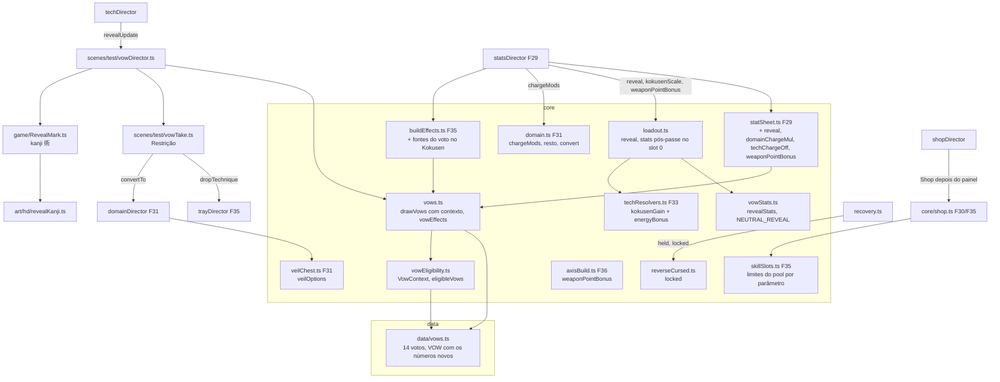

# Votos novos (F40) - Design

**Spec**: `.specs/features/votos-novos/spec.md` · **Plano**: `docs/plano-builds-e-habilidades.md` (seção 5.5 e linha
F40 da seção 6) · **Base**: F29 `fundacao-de-poder` (`.specs/features/fundacao-de-poder/design.md` no repositório
principal; código em `feat/fundacao-de-poder`), F30 `vermelho-e-corpo`, F33 `eixos-das-tecnicas` e F36 `arma-imbuida`
(worktree `wt-f30spec`), F31 `expansao-de-dominio` (worktree `wt-f31spec`), F34 `tecnicas-jjk-1` (worktree `wt-leva1`),
F35 `vagas-e-talentos` (worktree `wt-f35spec`), F38 `hordas-em-atos` (worktree `wt-f31spec`) e F39 `meta-minima`
(aqui, `.specs/features/meta-minima/`)
**Status**: Draft

Linhas citadas conferidas em 15/10 no código de `74e2817` (worktree `docs/spec-meta-e-votos`), que ainda não tem a F29
a F36. Do repositório principal (`feat/fundacao-de-poder`) vêm o `core/statSheet.ts` e o
`scenes/test/statsDirector.ts` da F29, lidos com `git show`. O que a F30 a F36 e a F39 criam é citado pelo nome e pela
interface dos designs delas: da F30, `core/techStats.ts` (`TechStats`, `resolveTechStats`), `Loadout.stats`/
`kokusenScale`; da F31, `core/domain.ts` (`DomainState`, `addCharge`, `own`, `raise`, `markVeil`), `DOMAINS`,
`core/veilChest.ts` (`drawVeil`), `scenes/test/domainDirector.ts` (`choicePages`, `confirm`, `applyDebug`); da F33,
`core/techResolvers.ts`, `core/choicePages.ts`, `ChoicePage` com 1 a 3 opções, `kokusen.land(energy, gain, zoneMs)`;
da F34, o registro `TechId → TechModule` e o `kokusenSnapshot` como contribuição; da F35, `core/skillSlots.ts`
(`POOL`, `poolOf`, `canAddTechnique`, `canAddTalent`, `vacancyTag`), `core/buildEffects.ts`
(`kokusenWindowBonusMs`), `core/spentLedger.ts`, `scenes/test/trayDirector.ts` (`abandon`), `core/buildTray.ts`
(`buildBarText`), `Loadout.slotOf`, `PoolSnapshot`; da F36, `AxisBuild.pointCap(item)` lido do registro
(`WEAPON_AXIS_ITEMS`, `pointCap: 3`) e o `frameFor` da arma; da F38, a cota (`run.roundKills` = abates da cota, chefe
com cota 1) e o `hordeDirector.counterText()`; da F39, `meta.gate.lockedIds('vow')` e a lista em memória
`freshTechniques`/`markOffered` do `MetaDirector`. Essas linhas valem
depois dos merges e são reconferidas no começo de cada passo. Linhas efetivas contadas como o `max-lines` do
`.oxlintrc.json` (sem linha em branco e sem comentário).

**Reconferência obrigatória no começo do passo 0**: a assinatura do `drawVows` depois da F39, a ordem dos aplicadores
de debug no `runDirector.resetRun` (`tech=`, `perks=`, `arsenal=`, `domain=`) e o nome real dos campos da F35
(`POOL`, `PoolState`, `KokusenScale.windowBonusMs`), da F36 (`pointCap`), da F38 (`counterText`) e da F39
(`freshTechniques`, `markOffered`).

---

## Abordagens consideradas

| | Abordagem | A favor | Contra |
| --- | --- | --- | --- |
| **A (escolhida)** | Cada voto novo é um bloco de números no `VowEffects` (o agregador de hoje) e uma regra pura de elegibilidade num arquivo à parte; quem já lê o agregador (o `StatsDirector`, a `Reversa`, o `buildEffects`) lê os campos novos. O que muda a build na hora de tomar (só a Restrição) mora num ajudante do `VowDirector` (`vowTake.ts`) | Um dono por número (VQA-02): nenhum voto escreve no motor; o voto da F41 entra do mesmo jeito; a `TestScene` não muda | O `VowEffects` cresce de 13 para ~25 campos; os diretores que leem precisam de 1 a 3 linhas cada |
| B | Registro `VowId → VowModule` com ganchos (`onTake`, `apply(sheet)`, `eligible(ctx)`) | Cada voto num arquivo | Vários donos do mesmo número (o `apply` de cada módulo mexe na folha), contra a seção 4 do plano e o VQA-02; 14 arquivos para regras de 3 linhas |
| C | Cada diretor consulta `vows.has(id)` direto (o `domainDirector` multiplica a carga, a `Reversa` trava, a loja lê o pool) | Menos tipos | A regra do voto fica espalhada em 6 diretores, sem teste puro e sem um lugar para o snapshot `vows.effects` |

**Escolha: A.** O resto deste design detalha a A.

---

## Architecture Overview

A F40 não cria sistema novo. O catálogo (`data/vows.ts`) ganha 6 entradas; o `core/vows.ts` ganha os efeitos e o
`core/vowEligibility.ts` (novo) a regra de quem pode sair no sorteio; o `VowDirector` monta o contexto da build e
repassa. Cada número chega ao jogo pelo dono que a F29 a F36 já criaram:

- **Dano, vida e corpo a corpo** (Expediente, Corpo emprestado, Restrição, Black Flash fora da Zona): campos de hoje do
  `VowEffects` (`damageMul`, `maxHpMul`, `meleeMul`) → `statSheet` (F29) → `StatsDirector.sync`. O `statSheet` não
  muda a conta do corpo a corpo: a Restrição e o "fora da Zona" multiplicam o `meleeMul` do voto, que o
  `vowStrikeMul` já lê (VRC-04, VBF-03).
- **Pool** (Corpo emprestado, Restrição): `VowEffects.pool` (`PoolLimits`) → as funções do `core/skillSlots.ts` da
  F35, que passam a receber o limite no lugar da constante `POOL` (VCE-01).
- **Kokusen** (Black Flash): `VowEffects.kokusenWindowMs`/`kokusenEnergy` → `buildEffects` (F35, a soma com teto de
  30 ms) → `StatsDirector` grava `loadout.kokusenScale.windowBonusMs` (F35) e `.energyBonus` (novo) → o
  resolvedor do Divergente soma o `energyBonus` ao `kokusenGain` (VBF-01, VBF-02).
- **Slot 0** (Revelação): `VowEffects.reveal` → `StatSheet.reveal` → `StatsDirector` grava `loadout.reveal` →
  `Loadout.stats(id)` aplica `revealStats` só quando `slotOf(id) === 0` (VRV-01 a VRV-05).
- **Barra do Domínio** (Silêncio): `VowEffects.domainChargeMul`/`techChargeOff` → `StatSheet` → `StatsDirector` grava
  `domain.state.chargeMods` → `DomainState.addCharge` multiplica e guarda o resto (VSI-01 a VSI-04).
- **Reversa** (Restrição, Silêncio): `VowEffects.rctGone`/`rctLockedInDomain` → `recovery.ts`, que já lê
  `this.s.vows.effects` (`recovery.ts:63`) e passa `held`/`locked` ao `ReverseCursed` (VRC-05, VSI-05).
- **Arma** (Restrição): `VowEffects.weaponPointBonus` → `StatSheet` → `StatsDirector` grava
  `loadout.axes.weaponPointBonus` → `AxisBuild.pointCap(item)` soma na arma (VRC-06).
- **Texto da carta** (VRV-08, VRC-11, nota): `core/vowCards.ts` monta `VowCard` (nome, ganho, custo, nota, `fresh`)
  do `VOWS` e de um `CardContext` (nome da técnica do slot 0, devolução que a Restrição daria agora, Domínio possuído,
  técnica de Kokusen equipada); o `VowDirector` monta o contexto e o `VowPanel` só desenha.
- **Contador do Expediente** (VEX-05): `hordeDirector.counterText()` (F38) acrescenta `vows.counterSuffix()`.
- **Voto recém-liberado** (VEL-13): o `MetaDirector` (F39) guarda o voto liberado em `freshVows`; o `openPanel` passa
  `meta.freshVow()` ao `drawVows` e chama `meta.markVowOffered(offers)`.
- **Tomar a Restrição** (VRC-01, VRC-02, VRC-07): `VowDirector.take(id)` → `VowTake.apply(id)`: tira as técnicas pelo
  caminho do abandono da F35 sem devolução própria, devolve `floor(0,5 × gasto)` numa entrada só, converte o Domínio e
  chama `stats.sync()` no mesmo quadro.



**Fluxo por quadro** (a ordem da `TestScene` não muda): o `StatsDirector.update` (F29) monta a `StatSheet` com o
`VowEffects` do quadro (os abates da rodada e a Zona entram no contexto) e grava os números de hoje mais o
`loadout.reveal`, o `loadout.kokusenScale` (`windowBonusMs`, `energyBonus`), o `loadout.axes.weaponPointBonus` e o
`domain.state.chargeMods`; o `techDirector.update` chama `vows.revealUpdate(dt, techCaster.cast)` depois do
`techRunner.update` para mostrar ou esconder o kanji; o `recovery.update` passa à Reversa `held` sem a tecla quando o
voto tirou a Reversa e `locked` quando o Silêncio trava; os ganchos de carga do `domainDirector` chamam o
`addCharge(ev)` de sempre, que aplica o `chargeMods` gravado.

**Fluxo da konbini** (VEL-12): `shopDirector.openShop(round)` → com chefe e voto elegível, abre o painel de votos e
**não** cria a `Shop`; o `updateVowPanel` toma ou recusa e chama `startShop(round)`, que cria a `Shop` com o mesmo
`shopRng` e segue para o painel de escolha da F33 (`build.choice.openIfPending()`, onde a página do Véu já sai com a
Restrição) e depois para a loja. Sem painel de votos, o `openShop` chama o mesmo `startShop(round)`.

---

## Code Reuse Analysis

### Existing Components to Leverage

| Component | Location | How to Use |
| --- | --- | --- |
| Catálogo e números dos votos | `src/data/vows.ts:5-59` (`VowId`, `VOW`, `VOWS`, `VOW_IDS`) | 6 entradas novas no fim do `VOWS`, na ordem do VEL-01; números em `VOW` (VQA-01) |
| Votos tomados, sorteio, efeitos | `src/core/vows.ts:5-27` (`Vows`), `:33-38` (`drawVows`), `:41-124` (`VowEffects`, `vowEffects`) | `Vows` fica igual; `drawVows` ganha o contexto; `vowEffects` ganha os blocos novos com o mesmo molde (`if (has(id))`) |
| Diretor dos votos | `src/scenes/test/vowDirector.ts` (depois da F29: sem `sync` e `strikeMul`) | Monta o `VowContext`, aplica o `vows=` depois dos outros debugs, delega o tomar ao `VowTake`, desenha o kanji |
| Folha de números | F29 `src/core/statSheet.ts` (`vowStrikeMul`, `statSheet`), `src/scenes/test/statsDirector.ts` (`sheet`, `sync`, `snapshotFields`) | 4 campos novos na folha; o `sync` grava 4 alvos novos; o snapshot ganha `domainChargeMul` |
| Agregador dos talentos | F35 `src/core/buildEffects.ts` (`kokusenWindowBonusMs = min(30, soma)`) | O voto entra na soma (VBF-01) e dá o bônus de energia do Kokusen (VBF-02) |
| Pool de vagas | F35 `src/core/skillSlots.ts` (`POOL`, `poolOf`, `canAddTechnique`, `canAddTalent`, `vacancyTag`) | Recebem `limits: PoolLimits = POOL`; o valor padrão mantém os testes da F35 |
| Livro de gastos e abandono | F35 `src/core/spentLedger.ts`, `scenes/test/trayDirector.ts` (`abandon`) | A limpeza do ABD-03 sai do `abandon` para um `dropTechnique(slot)`, usado pela Restrição sem a devolução de 40% |
| `TechStats` resolvido | F30/F33 `src/core/techStats.ts`, `techResolvers.ts`, `Loadout.stats(id)` | Pós-passe da Revelação no `Loadout.stats`; o resolvedor do Divergente soma o `energyBonus` |
| Barra e posse do Domínio | F31 `src/core/domain.ts` (`DomainState.addCharge`, `own`), `scenes/test/domainDirector.ts` (`choicePages`, `confirm`) | `chargeMods` e resto no `addCharge`; `convert(id)`; página do Véu com uma opção |
| Página de 1 opção | F33 `ChoicePage.options` (1 a 3), página `despertar` com uma carta e a dica "Enter" | O Véu da Restrição usa o mesmo formato (VRC-08), sem código de painel novo |
| Reversa | `src/core/reverseCursed.ts:56-90` (`update`), `src/scenes/test/recovery.ts:51-58`, `:62-64` | Entrada `locked` no `ReverseInput`; `held` falso com `rctGone` |
| Teto de pontos da arma | F36 `AxisBuild.pointCap(item)` lido do registro | Soma o `weaponPointBonus` só nos itens de arma |
| Trava de conteúdo | F39 `meta.gate.lockedIds('vow')` | Entra no `drawVows` como `locked`, separado de `taken` (ver Risks) |
| Folha HD de ícone | F35 `src/game/art/hd/talentIcons.ts`; `HdSheet` de `src/game/art/hd/sheet.ts:20-28` | Molde do kanji `術` (1 quadro, índices numa tabela de cores da `PALETTE`) |
| Vista criada sob demanda | `src/scenes/test/recovery.ts:121-132` (`reverseAura()`) | O `RevealMark` nasce na 1ª vez e renasce com a cena nova (`R`) |
| Linha de cor da carta | `src/game/VowPanel.ts:91-101` (`buildCard`), `:106-117` (`show`) | Encaixe do nome longo e contagem de linhas no `debug` (VQA-05) |

### Integration Points

| System | Integration Method |
| --- | --- |
| Painel de votos | `shopDirector.openShop` → `vows.openPanel()` (agora com contexto) → `updateVowPanel` → `vows.choose(slot)` → `startShop(round)` |
| Loja e fontes de item | `ShopContext.poolLimits()` (novo) lido por `shopEligibility`, `shopDraw` (carta 1), `shop.buy` e `vacancyTag`; `buildBarText` com o limite |
| Combate | Sem gancho novo: os números chegam pelo `StatsDirector.sync`, como hoje |
| Domínio | `StatsDirector.sync` grava `domain.state.chargeMods`; `VowTake` chama `domainDirector.convertTo('amplificacao')`; `domainDirector.choicePages()` lê `vows.has('restricaoCelestial')` |
| Reversa | `recovery.update` lê `rctGone`, `rctLockedInDomain` e `domain.state.active` |
| Debug | `runDirector.resetRun` chama `vows.applyDebug()` depois do último aplicador de debug (`domain=`) e antes do `stats.reset()` |
| Snapshot | `vows.eligible`, `vows.effects` (campos novos), `vows.panelLines`, `stats.domainChargeMul` |
| Registro de desbloqueios (F39) | `restricaoCelestial` já é o id da conquista `chefeSemTecnica`; nenhum código da F39 muda |

---

## Components

### `data/vows.ts` (muda, 50 → ~78 efetivas)

- `VowId` ganha `revelacao | restricaoCelestial | votoBlackFlash | expediente | corpoEmprestado | votoDeSilencio`.
- `VOWS` ganha as 6 entradas **no fim**, nesta ordem, com `name`, `boon` e `cost` da spec (Assumptions); o
  `VOW_IDS = Object.keys(VOWS)` passa a listar os 14 na ordem do VEL-01.
- `VOW` ganha (VQA-01):
  - `revelacao: { damageMul: 1.4, radiusMul: 1.2, signMs: 150 }`
  - `restricaoCelestial: { meleeMul: 1.4, pool: 8, talents: 8, techniques: 0, refund: 0.5, weaponPoints: 1 }`
  - `votoBlackFlash: { windowMs: 20, energy: 15, outsideZoneMul: 0.8 }`
  - `expediente: { threshold: 10, before: 0.75, after: 1.4 }`
  - `corpoEmprestado: { pool: 8, talents: 7, maxHpMul: 0.75 }`
  - `votoDeSilencio: { chargeMul: 1.5 }`
- `VOW_BANNER = { domainConvert: 'Domínio → Amplificação' }` (VRC-07).
- `VowDef` ganha `note?: string` (só o texto fixo: `expediente` → `'não vale no chefe'`). Os textos que dependem da
  build são moldes com marcadores: `revelacao.boon = '{tech}: +40% dano e +20% raio'`, `restricaoCelestial.cost =
  'sem técnicas nem Reversa; devolve {refund}'`; quem troca o marcador é o `core/vowCards.ts`.
- `VOW_NOTES = { domainConvert: '{domain} → Amplificação', silenceKokusen: 'Kokusen não carrega' }`.
- Os 8 de hoje não mudam (Out of Scope).

### `core/vowEligibility.ts` (novo, ~40)

- **Purpose**: quem pode sair no sorteio do painel (VEL-02 a VEL-08, VEL-11). Puro, sem `phaser`.
- **Interfaces**:
  - `interface VowContext { slot0Tech: boolean; kokusenTech: boolean; ownsDomain: boolean; amplificationExists:
    boolean }` (montado pelo `VowDirector`, ver abaixo).
  - `isEligible(id, taken: readonly VowId[], ctx): boolean`:
    - com `restricaoCelestial` em `taken`: `corpoEmprestado`, `pactoDoFeiticeiro`, `fluxoSelado`, `curaProibida`,
      `votoDeSilencio` → `false` (VEL-07; o Silêncio sairia sem custo);
    - `revelacao` → `ctx.slot0Tech && techCap(taken) > 0` (VEL-03; `techCap` = 0 com a Restrição, 3 sem ela);
    - `restricaoCelestial` → `ctx.amplificationExists` (VEL-04);
    - `votoBlackFlash` → `ctx.kokusenTech` (VEL-05);
    - `votoDeSilencio` → `ctx.ownsDomain` (VEL-06);
    - todo o resto → `true` (VEL-08).
  - `eligibleVows({ taken, locked, ctx }): VowId[]`: na ordem do catálogo, os que não estão em `taken` nem em
    `locked` e passam no `isEligible` (VEL-02, VEL-11). É o que o `drawVows` sorteia e o que o snapshot
    `vows.eligible` mostra (VDB-01).
- **Por que arquivo à parte**: o `core/vows.ts` passaria de ~200 linhas com as duas coisas; a regra de elegibilidade
  tem teste próprio de 1000 seeds e não precisa do `vowEffects`.

### `core/vows.ts` (muda, 102 → ~150 efetivas)

- `drawVows(rng, pool: { taken: readonly VowId[]; locked: readonly VowId[]; ctx: VowContext }, count = VOW.offers,
  fresh: VowId | null = null)`: `const list = eligibleVows(pool)`; com `fresh` na lista, ele sai da lista e entra
  como 1ª oferta, e o mesmo laço de `:35-37` sorteia as `count − 1` restantes (VEL-13, no molde do `drawStarter` da
  F39); sem `fresh` (ou com ele fora da lista), o laço de hoje (VEL-02, VEL-09, VEL-10). Só consome o `rng` dado.
  Com os 8 de hoje sempre elegíveis, sem trava e sem `fresh`, a lista é a de hoje e o `rng` é consumido igual (passo 0).
- `VowEffects` ganha (ver "Data Models"; neutro quando o voto não está tomado): `pool`, `reveal`, `kokusenWindowMs`,
  `kokusenEnergy`, `domainChargeMul`, `techChargeOff`, `rctGone`, `rctLockedInDomain`, `weaponPointBonus`.
- `vowEffects(taken, ctx: { kills: number; activeKills: number | null; zone: boolean })`: os 8 blocos de hoje sem
  mudança (a Fúria continua lendo `ctx.kills`), e no fim:
  - `expediente`: com `activeKills === null` (rodada de chefe ou nenhuma rodada ativa) fator 1 (VEX-04); senão
    `damageMul *= activeKills < threshold ? before : after` (VEX-01 a VEX-03);
  - `corpoEmprestado`: `maxHpMul *= 0.75`; `pool.total = max(pool.total, 8)`; `pool.talents = max(pool.talents, 7)`
    (VCE-02, VCE-03);
  - `restricaoCelestial`: `meleeMul *= 1.4`; `pool.total = max(..., 8)`; `pool.talents = max(..., 8)`;
    `pool.techniques = 0`; `rctGone = true`; `weaponPointBonus += 1` (VRC-03 a VRC-06);
  - `revelacao`: `reveal = { damageMul: 1.4, radiusMul: 1.2, signMsBonus: 150 }` (VRV-01 a VRV-03);
  - `votoBlackFlash`: `kokusenWindowMs += 20`; `kokusenEnergy += 15`; `if (!ctx.zone) meleeMul *= 0.8` (VBF-01 a
    VBF-05);
  - `votoDeSilencio`: `domainChargeMul *= 1.5`; `techChargeOff = true` (corta a conjuração e o Kokusen);
    `rctLockedInDomain = true` (VSI-01, VSI-03, VSI-05).
- `expedienteFactor(activeKills: number | null): number` exportado (o bloco acima e o `counterSuffix` leem a mesma
  regra).
- Os blocos novos ficam **depois** dos 8 de hoje, para a ordem dos fatores de `damageMul`, `maxHpMul` e `meleeMul` ser
  a de hoje quando nenhum voto novo está tomado (o `Math.round` cai no mesmo inteiro, VQA-03).
- `vowEffects` passa de 50 linhas de função: os blocos novos vão para `applyNewVows(fx, has, ctx)` no mesmo arquivo
  (~35), para nenhuma função passar de 80 nem de complexidade 15.

### `core/vowStats.ts` (novo, ~30)

- `interface RevealMods { damageMul: number; radiusMul: number; signMsBonus: number }` e `NEUTRAL_REVEAL` (`1, 1, 0`).
- `revealStats(stats: TechStats, mods: RevealMods): TechStats`: devolve o próprio `stats` com `NEUTRAL_REVEAL`; senão
  uma cópia com `damage` de cada chave `Math.round(v × damageMul)` (VRV-01), todo campo `radius` dos blocos de técnica
  (`red`, `blue`, `purple` e qualquer bloco da F34 que tiver `radius`) `Math.round(r × radiusMul)` (VRV-02) e
  `signMs + signMsBonus` (VRV-03). `kokusenDamage`, `cost`, `cooldownMs` e os alcances (`rangePx`, `farPx`,
  `nearPx`) ficam iguais.
- A varredura dos blocos é genérica (`Object.entries` do `stats`, bloco objeto com `radius` numérico), para as 8
  técnicas do registro da F34 e as da F41 não precisarem de linha aqui.

### `core/skillSlots.ts` (F35, muda, ~70 → ~74)

- `export type PoolLimits = { total: number; techniques: number; talents: number }`; `POOL` (em `data/perks.ts`) já
  tem essa forma.
- `canAddTechnique(p, limits = POOL)`, `canAddTalent(p, limits = POOL)` e `vacancyTag(p, limits = POOL)` (o
  `OCUPA VAGA a/N→b/N` com `N = limits.total`, VCE-05) leem o parâmetro no lugar da constante (VCE-01). O
  `poolSurcharge` não muda (o acréscimo é por vaga ocupada, não pelo tamanho do pool).

### `core/buildEffects.ts` (F35, muda, ~120 → ~126)

- O input ganha `vows: Pick<VowEffects, 'kokusenWindowMs' | 'kokusenEnergy'>`.
- `kokusenWindowBonusMs = min(KOKUSEN.windowBonusCapMs, zonaNegra + vows.kokusenWindowMs)` (VBF-01; a soma e o teto
  são os da F35).
- `kokusenEnergyBonus = vows.kokusenEnergy` (VBF-02; o BEF-01 diz que todo ganho de energia sai daqui).
- Com o voto fora, os dois números são os da F35.

### `core/statSheet.ts` (F29, muda, ~58 → ~64)

- `StatSheet` ganha `reveal: RevealMods`, `domainChargeMul: number`, `techChargeOff: boolean`, `weaponPointBonus:
  number`, copiados do `VowEffects` (VQA-02: um caminho só, voto → folha → `StatsDirector`).
- `meleeMul`, `vowTechMul`, `maxHp` e o resto **não mudam de fórmula**: a Restrição, o Black Flash, o Expediente e o
  Corpo emprestado entram pelos campos `meleeMul`, `damageMul` e `maxHpMul` que o `vowStrikeMul` e o `maxHp` já leem.

### `core/loadout.ts` (F30/F35, muda, ~125 → ~130)

- Campo `reveal: RevealMods = NEUTRAL_REVEAL` (escrito só pelo `StatsDirector`, como o `kokusenScale`).
- `stats(id)`: `const s = resolveTechStats(...)`; `return this.slotOf(id) === 0 ? revealStats(s, this.reveal) : s`
  (VRV-04: os slots 1 e 2 nunca passam pelo pós-passe; VRV-05: o slot é lido a cada chamada, então a técnica que entra
  no slot 0 ganha o efeito no quadro seguinte).
- `KokusenScale` ganha `energyBonus: number` (0 no `reset`), escrito só pelo `StatsDirector`.
- `reset()` volta o `reveal` ao neutro.

### `core/techResolvers.ts` (F33, muda, +1)

- Divergente: `kokusenGain: <tabela do eixo> + input.kokusenScale.energyBonus` (VBF-02). O adaptador
  (`kokusen.land(energy, gain, zoneMs)`, F33) não muda; o `energy.gain` já corta no máximo.

### `core/axisBuild.ts` (F36, muda, ~146 → ~149)

- Campo `weaponPointBonus = 0` (escrito só pelo `StatsDirector`; `reset()` zera).
- `pointCap(item) = registro + (isWeaponItem(item) ? this.weaponPointBonus : 0)` (VRC-06). O `axisCap` (2) não muda.
  `level(item)` continua `1 + total`: com o 4º ponto a arma vai ao Nv 5 e a carta mostra `Nv 4→5` pelo `levelText` da
  F35, sem código novo.

### `core/domain.ts` (F31, muda, ~120 → ~138)

- `interface ChargeMods { mul: number; techOff: boolean }` e `NEUTRAL_CHARGE = { mul: 1, techOff: false }`.
- `chargeGain(base, mul, carry): { add: number; carry: number }` puro: `raw = base × mul + carry`; `add =
  Math.floor(raw)`; `carry = raw − add`. Com `mul` 1 e resto 0, `add = base` e `carry = 0` (os números de hoje).
- `DomainState`:
  - `chargeMods: ChargeMods = NEUTRAL_CHARGE` (escrito só pelo `StatsDirector`) e `carry` (0 a < 1, privado, lido no
    snapshot como `chargeCarry`).
  - `addCharge(ev)`: com `techOff` e `ev` em `TECH_CHARGE_EVENTS = ['techCast', 'kokusen']` sai sem mudar carga nem
    resto (VSI-03; o Kokusen é o acerto do Divergente, e a F31 já o trata como evento à parte do `techCast`); senão
    `chargeGain(DOMAIN_CHARGE[ev], mul, carry)`; com `charge + add ≥ 100`, carga 100 e resto 0 (edge case); as
    guardas da F31 (Domínio possuído, nenhum ativo) ficam antes de tudo.
  - O resto zera na ativação (o `domainDirector.tryActivate` já zera a carga pelo `state`; o mesmo ponto zera o resto)
    e no `reset()` (VSI-04).
  - `convert(id): DomainId | null`: com Domínio possuído de outro id, troca o `owned.id` mantendo `level`, `charge` e
    `carry`, e devolve o id antigo; com o mesmo id ou sem Domínio, devolve `null` (VRC-07, VRC-10).
- O esvaziamento (`tick`, DOM-03) não lê o `chargeMods` (VSI-07).

### `core/veilChest.ts` (F31, muda, ~25 → ~29)

- `veilOptions(pair: readonly [DomainId, DomainId], restricted: boolean): DomainId[]`: `['amplificacao']` com a
  Restrição, o par sem ela (VRC-08). O `drawVeil` continua sorteando o par pelo `chestRng` na r3, então a seed consome
  o mesmo stream com ou sem o voto.

### `core/reverseCursed.ts` (muda, 92 → ~95)

- `ReverseInput.locked?: boolean`. No `update`, no ramo `!this._active` (`:61`), depois do `!inp.held`: com `locked`,
  o aperto novo (`pressed`) empurra `rctDenied` e sai sem cura nem gasto (VSI-05). Com a canalização já ativa o
  `locked` não corta (não acontece: a F31 recusa o Domínio com a Reversa canalizando, DOM-07).
- O "some" da Restrição não entra aqui: o `recovery` passa `held: false`, e o `update` sai no primeiro `return` sem
  evento (VRC-05).

### `scenes/test/vowDirector.ts` (muda, ~86 depois da F29/F39 → ~130)

- **Purpose**: votos da run, contexto da build para o sorteio, tomar com efeito, kanji da Revelação e snapshot.
- **Interfaces**:
  - `reset()`: zera os votos, as ofertas e esconde o painel e o kanji; **não** lê mais o `vows=` (vai para o
    `applyDebug`).
  - `applyDebug()`: `?debug&vows=a,b` toma cada id conhecido na ordem pelo `take(id)` (com efeito; elegibilidade
    ignorada), ids desconhecidos fora (VDB-03). Chamado pelo `runDirector.resetRun` depois do `domain=`.
  - `context(): VowContext`: `slot0Tech = loadout.slotsView[0] !== null`; `kokusenTech` = alguma técnica equipada
    com `loadout.stats(id).kokusenDamage > 0`; `ownsDomain = build.domain.state.owned !== null`;
    `amplificationExists = 'amplificacao' in DOMAINS`.
  - `get effects(): VowEffects` = `vowEffects(list, { kills: run.roundKills, activeKills: this.activeKills(), zone:
    this.zoneActive() })`, com `activeKills()` = `run.roundKills` numa rodada comum em `roundActive` e `null` na
    rodada de chefe (`isBossRound(run.round)`) ou fora de rodada (ver Risks).
  - `counterSuffix(): string`: `''` sem o Expediente ou com `activeKills()` `null`; senão ` · -25%` ou ` · +40%` pelo
    `expedienteFactor` (VEX-05). Na 1ª leitura com fator 1,4 numa rodada, empurra `expediente:on` (um campo
    `expedienteRound` guarda a rodada em que já avisou).
  - `get cards(): VowCard[]`: `vowCard(id, cardContext(), id === this.freshOffered)` para cada oferta aberta (o
    `freshOffered` é o `fresh` que o `openPanel` passou e saiu na 1ª oferta); `cardContext()` lê o nome
    da técnica do slot 0 (`TECHNIQUES[id].name`), a devolução que a Restrição daria agora (soma do `ledger.spent` das
    técnicas equipadas, F35), o Domínio possuído e o `kokusenTech` do `context()`.
  - `private zoneActive()`: `context().kokusenTech && techRunner.kokusenSnapshot.zone` (VBF-03 a VBF-05: Zona de
    técnica **equipada**).
  - `openPanel()`: `drawVows(rng, { taken: list, locked: meta?.gate.lockedIds('vow') ?? [], ctx: context() },
    VOW.offers, meta?.freshVow() ?? null)`; com ofertas, `meta?.markVowOffered(offers)` (VEL-13).
  - `choose(slot)`: como hoje; o voto escolhido passa por `take(id)`.
  - `private take(id)`: `vows.take(id)`; `this.taker.apply(id)`; `this.s.stats.sync()` (a vida, o pool e o dano do
    voto valem no quadro em que o painel fecha; VCE-04 pelo `setMaxHp`, que já recorta a vida no teto).
  - `revealUpdate(dtMs, cast: ActiveCastView | null)`: kanji visível só com `revelacao` tomado, `cast?.slot === 0` e
    `cast.state === 'sign'`, preso a `player.renderPos` (VRV-06, AD-019); escondido no fim do sinal e no cancelamento.
  - `snapshot()`: os campos de hoje mais `eligible: eligibleVows(...)` (VDB-01) e `panelLines` (do `VowPanel`,
    VQA-05).
- **Dependencies**: `TestScene` (loadout, run, build.domain, techRunner, player, stats, meta), `VowTake`,
  `RevealMark`.

### `core/vowCards.ts` (novo, ~40)

- **Purpose**: o texto da carta de voto nesta build (VRV-08, VRC-11, notas, VEL-13). Puro, sem `phaser`.
- **Interfaces**:
  - `interface CardContext { slot0Name: string | null; restrictionRefund: number; domainName: string | null;
    domainIsAmplification: boolean; kokusenTech: boolean }`.
  - `interface VowCard { name: string; boon: string; cost: string; note: string | null; fresh: boolean }`.
  - `vowCard(id, ctx, fresh): VowCard`: troca `{tech}` por `ctx.slot0Name` e `{refund}` por
    `ctx.restrictionRefund`; nota: `VOWS[id].note` quando existe; na Restrição, `{domain} → Amplificação` com
    `domainName` e sem `domainIsAmplification`; no Silêncio, `Kokusen não carrega` com `kokusenTech`; senão `null`.
  - A devolução usa a mesma conta do `VowTake` (`Math.floor(VOW.restricaoCelestial.refund × spent)`), exportada
    daqui como `restrictionRefund(spent)` para os dois lerem a mesma regra (o número da carta é o que entra na carteira).

### `scenes/test/vowTake.ts` (novo, ~60)

- **Purpose**: o que tomar um voto muda na build na hora (só a Restrição hoje; a F41 acrescenta caso aqui).
- **Interfaces**:
  - `class VowTake { constructor(s); apply(id: VowId): void }`: `restricaoCelestial` → `restrict()`; os outros 13
    não fazem nada aqui (os números deles chegam pelo `StatsDirector.sync`).
  - `private restrict()`:
    1. `spent` = soma do `build.tray.dropTechnique(slot)` de cada slot ocupado, do 0 ao 2 (VRC-01: a limpeza do
       ABD-03 e a remoção das páginas pendentes vêm do mesmo método do abandono; a maestria por `TechId` fica);
    2. `refund = restrictionRefund(spent)` (`core/vowCards.ts`); `wallet.add(refund)` uma vez; evento
       `restriction:<refund>` (VRC-02, com `0` quando nada volta, VRC-10);
    3. `from = build.domain.convertTo('amplificacao')`; com `from`, `hud.banner(VOW_BANNER.domainConvert,
       RUN.bannerMs)` e evento `domainConvert:<from>` (VRC-07).
- **Fonte grátis vale 0** sem ramo próprio: o livro da F35 nunca grava técnica inicial, debug, baú nem maestria, então
  o `vows=restricaoCelestial` com `tech=` devolve 0 pelo mesmo caminho (VDB-03).

### `scenes/test/hordeDirector.ts` (F38, muda, +1) e `scenes/test/metaDirector.ts` (F39, muda, ~+6)

- `hordeDirector.counterText()`: o `Abates: k/q` de rodada comum ganha `+ this.s.vows.counterSuffix()` (VEX-05); o
  `Chefe` não muda.
- `MetaDirector`: no desbloqueio de conteúdo `kind: 'vow'`, o id vai para o fim de `freshVows` (ao lado do
  `freshTechniques`, CNQ-02); `freshVow(): VowId | null` (o 1º da lista) e `markVowOffered(ids)` (tira os oferecidos).
  Só memória, como a F39 (STA-18).

### `game/RevealMark.ts` (novo, ~45)

- **Purpose**: o kanji `術` sobre a cabeça durante o sinal da técnica do slot 0 (VRV-06).
- **Interfaces**: `constructor(scene)` (um `Image` com a textura `TEX.revealKanji`, profundidade acima do player,
  câmera do mundo, AD-003); `update(visible: boolean, at: Vec2)` (posição `at.y − REVEAL_MARK.headPx`, sem fade, para
  o smoke ler o quadro exato); `debug(): { visible: boolean; x: number; y: number }` lido do objeto vivo (L-076);
  `destroy()`.
- Criado sob demanda pelo `VowDirector` no molde do `recovery.reverseAura()` (renasce quando a cena muda pelo `R`).

### `game/art/hd/revealKanji.ts` (novo, ~35)

- Folha HD de 1 quadro (16×16 texels, 1 texel = 1 px de mundo) com o `術` em índices de uma tabela de cores da
  `PALETTE` (miolo `U`, contorno `k`), no molde do `talentIcons.ts` da F35; registrada em `art/index.ts` como
  `TEX.revealKanji`. O teste de paleta (`tests/game/art/`) cobre a tabela. Conferido na prancha
  (`tools/hd-boards.mjs`) e no jogo, parado e correndo, para os dois lados (memória "conferir animação em movimento").

### `game/VowPanel.ts` (muda, 110 → ~130)

- `show(cards: readonly VowCard[])` no lugar de `VowDef[]` (o `VowCard` dos 8 de hoje tem os mesmos textos e nota
  `null`, então o painel deles não muda).
- `show`: nome que passa de uma linha na largura `CARD_W − 14` cai para 12 px (o tamanho do texto do subtítulo); os
  nomes de hoje que cabem não mudam (VQA-05).
- Nota: um `Text` de 11 px na cor `hint` (`S`) por carta, em `CARD_TOP + CARD_H + 4`, centrado, visível só com
  `note`; a dica desce de `CARD_H + 20` para `CARD_H + 24`. `Novo`: a linha da tecla vira `1 · Novo` com
  `fresh` (o rótulo da F39 no painel da Técnica inicial).
- `get lines(): { name: number; boon: number; cost: number; note: number }[]`: linhas de cada carta visível, lidas do `Text` vivo
  (`getWrappedText`), para o snapshot `vows.panelLines` e o smoke provarem 1 linha no nome e até 2 no ganho e no custo
  em HD (L-076).
- `get texts(): { key: string; boon: string; cost: string; note: string | null }[]`: o texto vivo de cada carta
  visível, para o snapshot `vows.panelText` (VRV-08, VRC-11, VEL-13 provados no que foi desenhado, L-076).

---

## Mudanças em arquivos existentes (por passo)

**Passo 0 (refatoração, smokes iguais; VEL-02, VEL-10, VEL-12, VQA-03).**

| Arquivo | Linha | Mudança |
| --- | --- | --- |
| `tests/core/fixtures/statSheetVowsBaseline.json` (novo) | — | gerado **antes** de qualquer mudança: `statSheet` + `buildEffects` dos 8 votos (cada um sozinho, os 28 pares e os 8 juntos) × 3 relíquias × talentos da F35 no Nv 1 e no Nv 3, com 0, 9, 10 e 15 abates (VQA-03) |
| `src/core/vowEligibility.ts` (novo) | — | `VowContext`, `isEligible` (só o `true` dos 8 de hoje), `eligibleVows` |
| `src/core/vows.ts` | 33-38, 41-68, 74 | `drawVows` com `{ taken, locked, ctx }`; `VowEffects` com os campos novos neutros; `vowEffects(taken, { kills, activeKills, zone })` |
| `src/core/vowStats.ts` (novo) | — | `RevealMods`, `NEUTRAL_REVEAL`, `revealStats` |
| `src/core/statSheet.ts` (F29) | `StatSheet`, `statSheet` | 4 campos copiados do voto |
| `src/core/buildEffects.ts` (F35) | input, Kokusen | `vows` no input, soma e `kokusenEnergyBonus` |
| `src/core/skillSlots.ts` (F35) | `canAdd*`, `vacancyTag` | `limits = POOL` |
| `src/core/loadout.ts` | campos, `stats`, `reset` | `reveal`, pós-passe no slot 0, `kokusenScale.energyBonus` |
| `src/core/techResolvers.ts` (F33) | Divergente | `kokusenGain + energyBonus` |
| `src/core/axisBuild.ts` (F36) | `pointCap`, `reset` | `weaponPointBonus` |
| `src/core/domain.ts` (F31) | `addCharge`, `reset`, novo `convert` | `chargeMods`, resto, `chargeGain` |
| `src/core/reverseCursed.ts` | 5-15, 61-68 | `locked` |
| `src/scenes/test/statsDirector.ts` (F29) | `sheet`, `sync`, `snapshotFields` | `buildEffects` com `vows`; grava `loadout.reveal`, `kokusenScale.energyBonus`, `axes.weaponPointBonus`, `domain.state.chargeMods`; `stats.domainChargeMul` |
| `src/scenes/test/vowDirector.ts` | `reset`, `effects`, `openPanel`, `choose`, `snapshot` | `applyDebug`, `context`, `take` (sem efeito ainda), `eligible` |
| `src/scenes/test/runDirector.ts` | `resetRun` | `this.s.vows.applyDebug()` depois do `domain=` (+1) |
| `src/scenes/test/shopDirector.ts` | 118-157 | `startShop(round)`: a `Shop` nasce depois do painel de votos (VEL-12); o `openShop` e o `updateVowPanel` chamam o mesmo método; o `round` fica num campo privado |
| `src/scenes/test/recovery.ts` | 51-58 | `held: input.reverseHeld && !fx.rctGone`; `locked: fx.rctLockedInDomain && this.s.build.domain.state.active !== null` |
| `src/game/powerSnapshot.ts` (F29) | `StatsSnapshot` | `domainChargeMul` |
| `src/game/debugApi.ts` | `vows` | `eligible: VowId[]`, `panelLines` (o `effects` já é o tipo `VowEffects`) |
| `tests/core/vows.test.ts`, `vowEligibility.test.ts` (novo), `statSheetVows.test.ts` (novo), `tests/game/debugApi.test.ts` | — | sorteio igual ao de hoje para as mesmas seeds; equivalência contra o fixture |

`TestScene`: 0. Smokes: `vows`, `shop`, `power`, `build`, `kokusen`, `tech`, `defense`, `run-loop`, `choice-panel`,
`domain`, iguais.

**Passo 1 (Expediente e Corpo emprestado; VEX-01 a VEX-03, VCE-01 a VCE-05).**

| Arquivo | Linha | Mudança |
| --- | --- | --- |
| `src/data/vows.ts` | `VowId`, `VOW`, `VOWS` | `expediente`, `corpoEmprestado` (no fim, ver "Ordem do catálogo") |
| `src/core/vows.ts` | `applyNewVows` | os 2 blocos |
| `src/core/vowEligibility.ts` | `isEligible` | os dois sempre elegíveis (o corte do `corpoEmprestado` pela Restrição entra no passo 5) |
| `src/core/shop.ts`, `shopEligibility.ts`, `shopDraw.ts` (F30/F35) | `ShopContext`, `buy`, `view`, elegibilidade, carta 1 | `ShopContext.poolLimits(): PoolLimits`; cada `canAdd*`/`vacancyTag` recebe o limite |
| `src/core/buildTray.ts` (F35) | `buildBarText` | `Habilidades a/N (Técnicas t/T)` com o limite |
| `src/scenes/test/shopDirector.ts` | `startShop` | `poolLimits: () => this.s.vows.effects.pool` no contexto da `Shop` |
| `src/scenes/test/buildDirector.ts` (F35) | `applyDebugBuild`, `snapshot` | `canAddTalent(p, limits)`; `pool.total` do limite |
| `src/game/buildSnapshot.ts` (F35) | `PoolSnapshot` | `total: number` (era o literal `7`) |
| `scripts/smoke/vows-new.smoke.mjs` (novo) | — | cenários do Expediente e do Corpo emprestado |

`TestScene`: 0.

**Passo 2 (Revelação da técnica; VRV-01 a VRV-07).**

| Arquivo | Linha | Mudança |
| --- | --- | --- |
| `src/data/vows.ts`, `src/core/vows.ts`, `src/core/vowEligibility.ts` | — | `revelacao` (VEL-03) |
| `src/game/art/hd/revealKanji.ts` (novo), `src/game/art/index.ts` | registro | `TEX.revealKanji` |
| `src/game/RevealMark.ts` (novo) | — | a vista |
| `src/scenes/test/vowDirector.ts` | `revealUpdate` | o kanji |
| `src/scenes/test/techDirector.ts` | depois do `techRunner.update` (l.30) | `this.s.vows.revealUpdate(dt, this.s.techCaster.cast)` (+1) |
| Vistas que ainda leem raio de constante | `game/techFx/*`, `game/tech/*` (lista do `grep` do passo) | passam a ler o `radius` do `TechStats` do cast (VRV-07); a F30 já fez o Vermelho e o Azul, o passo confere o Roxo e as da F34 |
| `src/game/debugApi.ts` | `vows` | `reveal: { visible; x; y }` do `RevealMark` |

`TestScene`: 0.

**Passo 3 (Voto do Black Flash; VBF-01 a VBF-05).**

| Arquivo | Linha | Mudança |
| --- | --- | --- |
| `src/data/vows.ts`, `src/core/vows.ts`, `src/core/vowEligibility.ts` | — | `votoBlackFlash` (VEL-05) |
| `scripts/smoke/vows-new.smoke.mjs` | — | cenário do Black Flash |

Nada mais: a janela e a energia já passam pelo `buildEffects` (passo 0) e o fator fora da Zona pelo `meleeMul`.
`TestScene`: 0.

**Passo 4 (Voto de silêncio; VSI-01 a VSI-07).**

| Arquivo | Linha | Mudança |
| --- | --- | --- |
| `src/data/vows.ts`, `src/core/vows.ts`, `src/core/vowEligibility.ts` | — | `votoDeSilencio` (VEL-06) |
| `src/game/domainSnapshot.ts` (F31) | `DomainSnapshot` | `chargeCarry: number` |
| `scripts/smoke/vows-new.smoke.mjs` | — | cenário do Silêncio |

A multiplicação, o resto e a trava da Reversa já estão ligados desde o passo 0 com valores neutros. `TestScene`: 0.

**Passo 5 (Restrição celestial; VRC-01 a VRC-10, VEL-04, VEL-07).**

| Arquivo | Linha | Mudança |
| --- | --- | --- |
| `src/data/vows.ts`, `src/core/vows.ts`, `src/core/vowEligibility.ts` | — | `restricaoCelestial`; os 5 votos cortados pela Restrição (VEL-07, o Silêncio incluído) |
| `src/scenes/test/vowTake.ts` (novo) | — | `restrict()` |
| `src/scenes/test/vowDirector.ts` | `take` | `this.taker.apply(id)` |
| `src/scenes/test/trayDirector.ts` (F35) | `abandon` | a limpeza do ABD-03 sai para `dropTechnique(slot): number` (devolve o `ledger.spent` antes de limpar o livro); o `abandon` chama ele e aplica os 40% (0 linha líquida) |
| `src/scenes/test/domainDirector.ts` (F31) | `choicePages`, `confirm('veu')`, novo `convertTo` | página do Véu por `veilOptions(pair, vows.has('restricaoCelestial'))` com 1 opção; o `confirm` lê o id da mesma lista; `convertTo(id)` repassa ao `state.convert` |
| `src/core/veilChest.ts` (F31) | — | `veilOptions` |
| `src/core/shopDraw.ts` (F30/F35) | carta 1 | a garantia "sem técnica → técnica nova" só vale com `canAddTechnique(pool, limits)` (ver Risks) |
| `src/core/shopPreview.ts` (F35/F36) | `frameFor` da arma | Nv 4 **ou mais** roxo (o Nv 5 usa a moldura do Nv 4) |
| `src/core/weaponEvolution.ts` (F36) | receita pronta | arma no Nv 4 **ou mais** (ver Risks) |
| `README.md` | `vows=`, eventos | os 6 ids e os eventos `restriction:<refund>`, `domainConvert:<from>` e `expediente:on` (VDB-04) |
| `scripts/smoke/vows-new.smoke.mjs` | — | cenário da Restrição |

`TestScene`: 0.

**Passo 6 (Legibilidade; VRV-08, VRC-11, VEL-13, VEX-05).**

| Arquivo | Linha | Mudança |
| --- | --- | --- |
| `src/data/vows.ts` | `VowDef`, `VOWS`, `VOW_NOTES` | `note?`; moldes `{tech}` e `{refund}` (os textos das Assumptions da spec) |
| `src/core/vowCards.ts` (novo) | — | `CardContext`, `VowCard`, `vowCard`, `restrictionRefund` |
| `src/core/vows.ts` | `drawVows` | parâmetro `fresh` (VEL-13) |
| `src/scenes/test/vowTake.ts` | `restrict` | `restrictionRefund(spent)` |
| `src/game/VowPanel.ts` | `buildCard`, `show`, `hide` | `show(VowCard[])`, nota sob a carta, `1 · Novo`, dica 4 px abaixo, `texts` |
| `src/scenes/test/vowDirector.ts` | `openPanel`, novos `cards`, `cardContext`, `counterSuffix` | cartas montadas, `fresh`, sufixo e `expediente:on` |
| `src/scenes/test/shopDirector.ts` | `openShop` | `vowPanel.show(this.s.vows.cards)` no lugar do `map` de `VOWS` |
| `src/scenes/test/hordeDirector.ts` (F38) | `counterText` | `+ this.s.vows.counterSuffix()` (+0 líquido: mesma linha) |
| `src/scenes/test/metaDirector.ts` (F39) | desbloqueio, novos `freshVow`, `markVowOffered` | `freshVows` em memória |
| `src/game/debugApi.ts` | `vows` | `panelText` |
| `scripts/smoke/vows-new.smoke.mjs` | — | cenário 9 (legibilidade) |

`TestScene`: 0.

---

## Data Models

```typescript
// data/vows.ts
export type VowId =
  | 'corpoDeVidro' | 'semGuarda' | 'pactoDoFeiticeiro' | 'fluxoSelado' | 'curaProibida' | 'ganancia' | 'furia'
  | 'peleDePedra'
  | 'revelacao' | 'restricaoCelestial' | 'votoBlackFlash' | 'expediente' | 'corpoEmprestado' | 'votoDeSilencio';
// VOW (acrescenta aos de hoje)
//   revelacao:          { damageMul: 1.4, radiusMul: 1.2, signMs: 150 }
//   restricaoCelestial: { meleeMul: 1.4, pool: 8, talents: 8, techniques: 0, refund: 0.5, weaponPoints: 1 }
//   votoBlackFlash:     { windowMs: 20, energy: 15, outsideZoneMul: 0.8 }
//   expediente:         { threshold: 10, before: 0.75, after: 1.4 }
//   corpoEmprestado:    { pool: 8, talents: 7, maxHpMul: 0.75 }
//   votoDeSilencio:     { chargeMul: 1.5 }
export const VOW_BANNER = { domainConvert: 'Domínio → Amplificação' } as const;

// core/vowEligibility.ts
export interface VowContext {
  slot0Tech: boolean;            // técnica no slot 0 (teclas L/C)
  kokusenTech: boolean;          // alguma técnica equipada com kokusenDamage > 0 no TechStats
  ownsDomain: boolean;           // build.domain.state.owned !== null
  amplificationExists: boolean;  // 'amplificacao' in DOMAINS
}
export interface VowPool { taken: readonly VowId[]; locked: readonly VowId[]; ctx: VowContext }

// core/vowStats.ts
export interface RevealMods { damageMul: number; radiusMul: number; signMsBonus: number }
export const NEUTRAL_REVEAL: Readonly<RevealMods>;   // 1, 1, 0

// core/skillSlots.ts (F35)
export interface PoolLimits { total: number; techniques: number; talents: number }   // POOL = 7, 3, 6

// core/vows.ts (ampliado; os 13 campos de hoje ficam)
export interface VowEffects {
  /* ...maxHpMul, damageMul, heavyMul, meleeMul, techDamageMul, techCostMul, guardOff, rctOff, rctHealMul, rctBelow,
     fragmentMul, damageTakenMul, regenOff */
  pool: PoolLimits;               // POOL; 8/7/3 Corpo emprestado; 8/8/0 Restrição; 8/8/0 os dois
  reveal: RevealMods;             // NEUTRAL_REVEAL; 1.4/1.2/150 Revelação
  kokusenWindowMs: number;        // 0; 20 Black Flash (o teto é do buildEffects)
  kokusenEnergy: number;          // 0; 15 Black Flash
  domainChargeMul: number;        // 1; 1.5 Silêncio
  techChargeOff: boolean;         // Silêncio
  rctGone: boolean;               // Restrição: a tecla da Reversa não faz nada
  rctLockedInDomain: boolean;     // Silêncio: a Reversa recusa com Domínio ativo
  weaponPointBonus: number;       // 0; 1 Restrição
}
export interface VowCtx { kills: number; activeKills: number | null; zone: boolean }   // null: chefe ou fora de rodada

// core/vowCards.ts
export interface CardContext { slot0Name: string | null; restrictionRefund: number; domainName: string | null;
  domainIsAmplification: boolean; kokusenTech: boolean }
export interface VowCard { name: string; boon: string; cost: string; note: string | null; fresh: boolean }

// core/statSheet.ts (F29, ampliado)
// StatSheet ganha: reveal: RevealMods; domainChargeMul: number; techChargeOff: boolean; weaponPointBonus: number

// core/buildEffects.ts (F35, ampliado)
// input ganha vows: Pick<VowEffects, 'kokusenWindowMs' | 'kokusenEnergy'>; BuildEffects ganha kokusenEnergyBonus

// core/loadout.ts (escrito só pelo StatsDirector)
// reveal: RevealMods; KokusenScale ganha energyBonus: number

// core/domain.ts (F31, ampliado)
export interface ChargeMods { mul: number; techOff: boolean }
export function chargeGain(base: number, mul: number, carry: number): { add: number; carry: number };

// core/reverseCursed.ts
// ReverseInput ganha locked?: boolean

// game/debugApi.ts (VDB-01, VDB-02)
// vows: { taken; offers; effects: VowEffects; strike; panelCards; eligible: VowId[];
//         panelLines: { name: number; boon: number; cost: number; note: number }[];
//         panelText: { key: string; boon: string; cost: string; note: string | null }[];
//         reveal: { visible: boolean; x: number; y: number } }
// meta (F39): + freshVows: VowId[]
// stats (F29/F35): + domainChargeMul: number
// domain (F31): + chargeCarry: number
```

**Ordem do catálogo.** O VEL-01 fixa a ordem final (`revelacao`, `restricaoCelestial`, `votoBlackFlash`,
`expediente`, `corpoEmprestado`, `votoDeSilencio`), mas os passos 1 a 5 entram noutra ordem. Cada passo insere o voto
dele **na posição final** dentro do bloco novo (o passo 1 põe `expediente` e `corpoEmprestado` depois dos 8; o passo 2
põe `revelacao` antes do `expediente`; e assim por diante), e o `tests/data/vows.test.ts` confere a ordem dos ids
presentes contra a lista do VEL-01 filtrada. O sorteio para a mesma seed muda a cada passo que acrescenta voto
elegível (a lista do sorteio cresce): isso é comportamento novo, não regressão, e o `vows.smoke` lê as ofertas do
snapshot, não ids fixos.

**Relação entre os modelos.** O `VowEffects` é o único que sabe dos votos; a `StatSheet` copia os 4 campos que viram
número de combate; o `StatsDirector` grava cada um no seu dono (`Loadout`, `AxisBuild`, `DomainState`); a `Reversa` e
a loja leem o `VowEffects` direto pelo `vows.effects`, como a Reversa já faz hoje (`recovery.ts:63`).

---

## Linhas efetivas dos arquivos tocados

| Arquivo | Hoje (ou depois da fase dona) | Fim da F40 | Observação |
| --- | --- | --- | --- |
| `src/data/vows.ts` | 50 | ~78 | |
| `src/core/vows.ts` | 102 | ~150 | `applyNewVows` separado (função ≤ 40) |
| `src/core/vowEligibility.ts` | — | ~40 | novo |
| `src/core/vowStats.ts` | — | ~30 | novo |
| `src/core/statSheet.ts` | ~58 (F29/F35) | ~64 | |
| `src/core/buildEffects.ts` | ~120 (F35) | ~126 | |
| `src/core/skillSlots.ts` | ~70 (F35) | ~74 | |
| `src/core/loadout.ts` | ~130 (F35) | ~135 | |
| `src/core/axisBuild.ts` | ~146 (F36) | ~149 | |
| `src/core/domain.ts` | ~120 (F31) | ~138 | |
| `src/core/reverseCursed.ts` | 92 | ~95 | |
| `src/scenes/test/vowDirector.ts` | ~86 (F29/F39) | ~150 | `cards`, `cardContext`, `counterSuffix` |
| `src/scenes/test/vowTake.ts` | — | ~60 | novo |
| `src/scenes/test/shopDirector.ts` | ~230 (F35) | ~236 | |
| `src/scenes/test/recovery.ts` | 115 | ~117 | |
| `src/scenes/test/domainDirector.ts` | ~190 (F31) | ~196 | |
| `src/scenes/test/trayDirector.ts` | ~140 (F35) | ~144 | |
| `src/scenes/test/techDirector.ts` | 52 | 53 | |
| `src/scenes/test/runDirector.ts` | ~205 | ~206 | |
| `src/game/VowPanel.ts` | 100 | ~130 | nota, `Novo`, `texts` |
| `src/core/vowCards.ts` | — | ~40 | novo |
| `src/scenes/test/hordeDirector.ts` | (F38) | +0 | sufixo na mesma linha |
| `src/scenes/test/metaDirector.ts` | (F39) | ~+6 | |
| `src/game/RevealMark.ts` | — | ~45 | novo |
| `src/game/art/hd/revealKanji.ts` | — | ~35 | novo |
| `src/scenes/TestScene.ts` | — | +0 | VQA-04 |

Nenhum arquivo passa de 400 e nenhum entra na lista de exceções do `.oxlintrc.json` (VQA-04).

---

## Error Handling Strategy

| Error Scenario | Handling | User Impact |
| --- | --- | --- |
| Menos de 3 votos elegíveis | `drawVows` devolve só os elegíveis; o painel mostra 1 ou 2 cartas (VEL-09) | Painel com menos cartas |
| Nenhum voto elegível | `drawVows` devolve `[]`, o `openPanel` devolve `false`, a loja abre direto (VEL-09) | Sem painel |
| `vows=` com id desconhecido | Ignorado; os outros tomam na ordem (VDB-03) | O smoke monta o caso |
| `vows=` com voto inelegível (ex.: `votoBlackFlash` sem Divergente) | Toma assim mesmo (debug ignora a elegibilidade) e vale o VBF-05 | −20% no golpe sempre |
| Restrição sem técnica nem Domínio | `dropTechnique` não roda, `refund` 0, `convertTo` devolve `null` (VRC-10) | Evento `restriction:0`, sem faixa |
| Restrição com a técnica inicial grátis | Livro 0 para ela; `refund = floor(0,5 × 0)` | `restriction:0` |
| Restrição com o Domínio já Amplificação | `convert` devolve `null`; sem faixa nem evento | Nada muda no Domínio |
| Restrição com o Véu pendente | O par sorteado na r3 fica; a página mostra só `amplificacao` (VRC-08) | Uma carta, `Enter` toma |
| Carga com o Silêncio passaria de 100 | Carga 100 e resto 0 (edge case) | Barra cheia |
| Voto recém-liberado inelegível ou já tomado | `drawVows` ignora o `fresh` fora da lista; ele continua na `freshVows` até um painel oferecê-lo (VEL-13) | Painel sorteado como sempre |
| Expediente na rodada de chefe ou fora de rodada | `activeKills` `null`, fator 1, sem sufixo (VEX-04, VEX-05) | O chefe sai com o dano de sempre |
| Kanji com o slot 0 vazio ou técnica de outro slot no sinal | `revealUpdate` esconde (VRV-05) | Sem kanji |
| Cena reiniciada (`R`) com o kanji visível | O `RevealMark` renasce no próximo `revealUpdate` (padrão do `reverseAura`) | Kanji na cena nova |
| Corpo emprestado com a vida acima do novo máximo | `setMaxHp` recorta (VCE-04) | Vida cai ao teto |
| Compra que passaria do pool com o limite novo | `Shop.buy` devolve `reason: 'pool'` como na F35 | `buyDenied:pool` |
| Run nova | `vows.reset()` zera; o `StatsDirector.reset` regrava `reveal`, `kokusenScale`, `weaponPointBonus` e `chargeMods` neutros; `DomainState.reset` zera o resto | Tudo volta (edge case) |

---

## Risks & Concerns

| Concern | Location (file:line) | Impact | Mitigation |
| --- | --- | --- | --- |
| A F39 manda os votos trancados ao `drawVows` **como tomados**; com a elegibilidade nova, uma Restrição trancada leria "tomada" e cortaria `corpoEmprestado`, `pactoDoFeiticeiro`, `fluxoSelado`, `curaProibida` e `votoDeSilencio` (VEL-07) sem o jogador ter o voto | F39 `meta-minima/design.md:151` (`drawVows(rng, [...list, ...lockedIds])`), `src/core/vows.ts:33` | Cinco votos somem do sorteio de quem ainda não liberou a Restrição | `drawVows` recebe `taken` e `locked` separados; a elegibilidade só lê `taken`; o trancado só sai da lista. Teste: `locked: ['restricaoCelestial']` mantém os 5 elegíveis |
| `run.roundKills` não zera fora da onda: o `spawner` só é trocado no começo da rodada, nunca anulado | `src/core/run.ts:58`, `:115-117`, `:286`, `:311` | Na travessia e na konbini o Expediente leria os abates da rodada anterior e daria +40%, contra o edge case da spec | O Expediente lê `activeKills` (`roundKills` só numa rodada comum em `roundActive`, `null` fora e no chefe, fator 1, VEX-04); a Fúria continua no `kills` de hoje (VQA-03). Teste do `vowEffects` com `activeKills` `null` e `kills` 15 → fator 1 |
| A carta mostra uma devolução e a Restrição credita outra | `core/vowCards.ts`, `scenes/test/vowTake.ts` | O jogador confia no número da carta (VRC-11) | Uma função só (`restrictionRefund`) e a mesma soma de livros; o smoke da Restrição lê `vows.panelText` antes de tomar e compara com o `restriction:<n>` |
| A nota sob a carta encosta na dica do painel | `src/game/VowPanel.ts` (dica em `CARD_H + 20`) | Texto sobreposto em HD | A dica desce 4 px; conferido na captura em HD do cenário 9 |
| A garantia da carta 1 da loja ("sem técnica → técnica nova", F30 TSH-05 e F35 POL-06) não lê o pool | F35 design `shopDraw.ts` (carta 1) | Com a Restrição (0 técnicas), toda loja forçaria uma carta de técnica, contra o VRC-03 | O passo 5 condiciona a garantia ao `canAddTechnique(pool, limits)`; caso no teste da loja com a Restrição: nenhuma carta de técnica em 1000 seeds |
| A receita de evolução da arma e a moldura podem comparar o nível com `=== 4` | F36 `core/weaponEvolution.ts` (WEV-01), `core/shopPreview.ts` (`frameFor`) | Com o 4º ponto a arma vai ao Nv 5 e perderia a evolução e a moldura roxa | O passo 5 troca por `>= 4` onde for `===`; caso no `weaponShop.test.ts` com `weaponPointBonus` 1 |
| A Revelação arredonda sobre o dano já arredondado (`round(round(base × muls) × 1,4)`) | `core/vowStats.ts` | Pode diferir em 1 de `round(base × muls × 1,4)` | Escolha consciente (Tech Decisions): o pós-passe genérico serve às 8 técnicas e às da F41 sem mexer em 8 resolvedores; o VRV-01 diz "multiplicado por cima e arredondado"; o teste fixa os números por esta regra |
| Vista que desenha o raio de uma constante e não do `TechStats` | `game/techFx/*`, `game/tech/*` (F30 já trocou o Vermelho e o Azul; Roxo pela F33) | O raio simulado sobe 20% e o desenho fica igual (VRV-07) | `grep` por `TECH_GEOMETRY` e por números de raio em `src/game/` no começo do passo 2; smoke lê o `radius` do `techObjects` (F33/F34) e o tamanho do sensor do Vermelho (L-043) |
| Nome de voto com 19 a 20 caracteres numa carta de 156 px a 14 px negrito | `src/game/VowPanel.ts:96-100` | `Revelação da técnica`, `Restrição celestial` e `Voto do Black Flash` podem quebrar em 2 linhas e cobrir o ganho (VQA-05) | O nome que não cabe cai para 12 px; o snapshot `vows.panelLines` lê as linhas do `Text` vivo. Para pôr cada voto novo no painel sem parâmetro novo, o smoke esgota o catálogo pelo `vows=` (cenário 8 de "Testes e smokes") e confere 1/2/2 nas cartas |
| A `Shop` deixa de existir enquanto o painel de votos está aberto | `src/scenes/test/shopDirector.ts:121-140`, `:179-195` | O snapshot `shop.offers` fica vazio com o painel aberto (hoje traz as cartas já sorteadas) | Nenhum smoke lê `shop.offers` com o painel aberto (o `vows.smoke.mjs:165-176` conta as cartas do `shopPanel`, que já é 0); conferido com `grep` no passo 0 |
| Escrever 4 alvos novos a cada quadro no `StatsDirector.sync` | F29 `statsDirector.ts` (`sync`) | Custo por quadro e um dono a mais para lembrar | São atribuições de referência ou número (sem alocação além da `StatSheet` que já é refeita por quadro); o `sync` continua o único escritor (POW-01) |
| `VowDirector.effects` chama `context()` (que lê `loadout.stats` de cada slot) a cada leitura | `scenes/test/vowDirector.ts` | O `effects` é lido várias vezes por quadro (folha, Reversa, drops, snapshot) | O `zoneActive` só precisa do `kokusenTech` quando o Black Flash está tomado: `vows.has('votoBlackFlash') && ...`; sem o voto, nenhum `stats` é resolvido |
| O `vowEffects` passaria de 80 linhas e complexidade 15 com 14 blocos | `src/core/vows.ts:74-124` | Lint quebra | Blocos novos em `applyNewVows` (função própria); medir no commit de cada passo |
| A Restrição tira as técnicas no meio da konbini, com páginas de ramo e ponto pendentes na fila da F33 | F33 `ChoiceQueue`, F35 `choice.dropItem` | Página de técnica que saiu apareceria no painel seguinte | O `dropTechnique` é o mesmo do abandono, que já tira as páginas (ABD-03); o painel de escolha abre **depois** do painel de votos (fluxo da konbini) |
| Arte nova em movimento (kanji sobre a cabeça) | `game/RevealMark.ts` | Prancha estática não mostra o kanji tremendo ou atrasado ao correr | Preso a `player.renderPos` (AD-019); conferido no jogo em HD, parado e correndo, para os dois lados, antes do commit do passo 2 |
| Teste do adaptador (L-043) | `StatsDirector.sync` → `Loadout`, `AxisBuild`, `DomainState`; `recovery` → `ReverseCursed` | Testar só o puro não prova que o número chega ao motor | Smoke lê o objeto vivo: `build.vermelho.stats.radius` 115 e o sensor do orbe (`techObjects`); `kokusen.windowMs` 20 maior; `domain.charge` 3 depois de 2 leves; `rctDenied` sem `rctStart` |

---

## Tech Decisions

| Decision | Choice | Rationale |
| --- | --- | --- |
| Onde mora a elegibilidade | `core/vowEligibility.ts`, chamado pelo `drawVows` | Puro e testável em 1000 seeds; o `core/vows.ts` fica com o agregador |
| Trancado × tomado | `drawVows` recebe `taken` e `locked` separados | A elegibilidade da Restrição lê "tomado"; trancado não é tomado |
| Corpo a corpo da Restrição e do Black Flash | Multiplicam o `VowEffects.meleeMul` | O `statSheet.vowStrikeMul` já lê esse campo: a fórmula da F29 não muda e a equivalência é por construção |
| Revelação no `TechStats` | Pós-passe `revealStats` no `Loadout.stats` quando `slotOf(id) === 0` | Um lugar para as 8 técnicas (e as da F41); o `TechStats` de quem não está no slot 0 nem passa pela função |
| Energia do Kokusen | `buildEffects.kokusenEnergyBonus` → `kokusenScale.energyBonus` → `kokusenGain` do resolvedor | BEF-01 (energia pelo `buildEffects`); o adaptador do Divergente não muda |
| Carga do Silêncio | `chargeGain` com resto dentro do `DomainState` | A carga pública continua inteira (DOM-01); com `mul` 1 o resultado é o de hoje sem ramo |
| Mods da carga e da arma | Gravados pelo `StatsDirector.sync` (`domain.state.chargeMods`, `axes.weaponPointBonus`) | O `StatsDirector` segue o único escritor dos números (POW-01); o `domainDirector` e a F36 não leem votos |
| Reversa sem tecla × trava | Restrição: `held: false` (nada acontece); Silêncio: `locked` com `rctDenied` por aperto | "Some" é ausência; trava é temporária e precisa avisar (Assumptions da spec) |
| Efeitos de tomar | `scenes/test/vowTake.ts` | O `VowDirector` fica pequeno; o voto da F41 que mexer na build entra num `case` aqui |
| Loja depois do voto | `startShop(round)` chamado no fechamento do painel | O `shopRng` é consumido no mesmo ponto da sequência de quem recusa, então as cartas são as de hoje (VEL-12) |
| Ordem do debug | `vows.applyDebug()` depois do `domain=`, com efeito de tomar | A Restrição precisa das técnicas e do Domínio já montados (VDB-03) |
| Snapshot da carta | `vows.panelLines` lido do `Text` vivo | VQA-05 provado em HD pelo smoke, não por estimativa de largura (L-076) |

**Decisão de projeto nova (passo 0):** entra no `.specs/STATE.md` no commit do passo 0, com o próximo número livre
depois do merge da F34 a F39 (a F35 propôs a AD-028 e a F34 a AD-029).

- **AD-NNN**: voto vinculativo é uma entrada do catálogo (`data/vows.ts`) com números em `VOW`, efeitos agregados só
  pelo `vowEffects` (lidos pelo `statSheet`, pelo `buildEffects` ou pelo leitor que já existe) e uma regra pura de
  elegibilidade no `core/vowEligibility.ts`, aplicada pelo sorteio do painel. Voto trancado (F39) não conta como
  tomado. O que um voto muda na build no momento de tomar mora no `scenes/test/vowTake.ts`. Nenhum voto escreve
  direto no motor. Não substitui nenhuma AD (emenda o "como" da AD-024 para os votos).

O resto segue AD-001 (regras novas em `core/` com teste par), AD-003 (o kanji na câmera do mundo), AD-006 (o sorteio
só pelo `vowRng`; o Véu pelo `chestRng` de sempre), AD-009 (toda cor da `PALETTE`), AD-019 (o kanji preso ao
`renderPos`) e AD-024 (votos depois de cada chefe).

---

## Testes e smokes

**Testes novos** (um arquivo por sistema; nenhum teste da lista de exceções cresce):

| Arquivo | Prova |
| --- | --- |
| `tests/core/vowEligibility.test.ts` | VEL-03 (Revelação com e sem slot 0; com slot 0 e a Restrição tomada, fora), VEL-04 (com e sem `amplificationExists`), VEL-05 (com e sem `kokusenTech`), VEL-06 (com e sem Domínio), VEL-07 (os 5 fora com a Restrição, o Silêncio incluído; `locked: ['restricaoCelestial']` não corta nenhum), VEL-08 (os 8 de hoje, Expediente e Corpo emprestado sempre), VEL-11 (trancado fora da lista), ordem do catálogo |
| `tests/core/vowsDraw.test.ts` | VEL-02 e o Independent Test: 1000 seeds sem Divergente nunca dão `votoBlackFlash` e com ele dão; sem Domínio nunca dão Silêncio; com a Restrição os 5 nunca saem; VEL-13 (`fresh` elegível → 1ª oferta em toda seed e nunca repetido nas outras; `fresh` inelegível ou tomado → sorteio igual ao sem `fresh`); VEL-09 (2 elegíveis → 2 ofertas; 0 → `[]`); VEL-10 (mesma seed, mesmos tomados e mesmo contexto → mesmo sorteio); passo 0: sorteio igual ao do código de hoje para 50 seeds (lista gravada antes da mudança) |
| `tests/core/vowsNew.test.ts` | VEX-01/02 (`activeKills` 9 → ×0,75; 10 → ×1,4, L-010), VEX-03 (Fúria + 10 abates = 1,3 × 1,4), VEX-04 (`activeKills` `null` com `kills` 15 → fator 1; `expedienteFactor(null)` 1, `(9)` 0,75, `(10)` 1,4), VCE-02 (8/7/3), VCE-03 (Corpo de vidro + Corpo emprestado = 0,45), Restrição (8/8/0, `meleeMul` ×1,4, `rctGone`, `weaponPointBonus` 1), Restrição + Corpo emprestado (8/8/0), VBF (`zone` falso → `meleeMul` ×0,8; verdadeiro → sem o fator; janela 20, energia 15), VSI (1,5, `techChargeOff`, `rctLockedInDomain`), Restrição + Silêncio fora do sorteio (VEL-07), VRV (`reveal` 1,4/1,2/150) |
| `tests/core/vowStats.test.ts` | VRV-01 (Vermelho Nv 1: toque 42, `kokusenDamage` igual), VRV-02 (raio 96 → 115; Azul e Roxo pelo mesmo caminho; `rangePx`/`farPx` iguais), VRV-03 (`signMs` 400), `NEUTRAL_REVEAL` devolve o mesmo objeto |
| `tests/core/loadoutReveal.test.ts` | VRV-04 (o mesmo Vermelho no slot 1 fica igual), VRV-05 (slot 0 vazio: nada; equipar no slot 0 aplica na próxima chamada), `kokusenScale.energyBonus` somado ao `kokusenGain` do Divergente (VBF-02) |
| `tests/core/domainCharge.test.ts` | VSI-01/02 (2 leves = 3; 1 forte = 3; 1 abate + 1 leve = 3; `chargeGain(15, 1,5, 0)` = 22 com resto 0,5), VSI-03 (`techCast` **e** `kokusen` com `techOff` não mudam carga nem resto; sem `techOff`, o Kokusen dá 15 como na F31), VSI-04 (ativação e `reset` zeram o resto), teto 100 com resto 0, `mul` 1 = números de hoje, VSI-07 (esvaziamento igual), `convert` (Santuário Nv 2 com carga 40 → Amplificação Nv 2 com 40; mesmo id → `null`; sem Domínio → `null`) |
| `tests/core/reverseLock.test.ts` | VSI-05 (`locked` + aperto → `rctDenied` uma vez por aperto, nenhum `rctStart`), VSI-06 (sem `locked` como hoje), `held: false` não emite nada (VRC-05) |
| `tests/core/statSheetVows.test.ts` | VQA-03 contra o fixture do passo 0 (8 votos × 3 relíquias × talentos, `statSheet` e `buildEffects`); VBF-01 (voto 20; voto + Zona Negra Nv 1 = 30; voto + Nv 3 = 30) |
| `tests/core/vowCards.test.ts` | VRV-08 (`{tech}` → `Boogie Woogie: +40% dano e +20% raio`), VRC-11 (`devolve 23` com gasto 47; nota `Santuário → Amplificação` com Santuário; sem nota com Amplificação ou sem Domínio), nota fixa do Expediente, nota do Silêncio só com `kokusenTech`, os 8 de hoje com o texto de hoje e nota `null`, `restrictionRefund(47)` 23 e `(0)` 0 |
| `tests/core/veilOptions.test.ts` | VRC-08 (com a Restrição só `amplificacao`; sem ela o par) |
| `tests/data/vows.test.ts` | VEL-01 (ordem dos ids), VQA-01 (todo número novo em `VOW`; `core/vows.ts?raw` sem `phaser`), textos da carta presentes |

**Testes refeitos:** `tests/core/vows.test.ts` (assinatura do `drawVows` e do `vowEffects`), `tests/core/skillSlots.test.ts`
(F35; `canAdd*` e `vacancyTag` com limite 8/7 e 8/8/0: 7 talentos + 1 técnica aceito com o Corpo emprestado, o 8º
talento recusado), `tests/core/buildTray.test.ts` (F35; `Habilidades 1/8 (Técnicas 0/0)`),
`tests/core/shopDraw*.test.ts` (F30/F35; garantia da carta 1 com técnicas 0), `tests/core/axisBuild*.test.ts` e
`weaponShop.test.ts` (F36; 4º ponto com o bônus, teto de 2 por eixo, Nv 5 com `Nv 4→5`, moldura roxa, receita pronta
no Nv 5), `tests/core/buildEffects.test.ts` (F35; input com `vows` neutro), `tests/game/vowPanel.test.ts` (cores
continuam chaves da `PALETTE`; nota visível só com `note`, `1 · Novo` só com `fresh`, `texts` lido do objeto) e `tests/game/debugApi.test.ts` (literal com `vows.eligible`, `vows.panelLines`,
`vows.reveal`, `vows.effects` com os campos novos, `stats.domainChargeMul`, `domain.chargeCarry`).

**Adaptador (L-043).** Sem `vi.mock('phaser')` na base (AD-001), a prova de que o número chega ao motor fica no smoke,
lendo o objeto vivo: o sensor e a esfera do Vermelho com raio 115 (`techObjects`, F33/F34); `kokusen.windowMs` (F35)
20 ms maior com o voto; a energia sobe `kokusenGain + 15` no Kokusen; `domain.charge` 3 depois de 2 leves; a carta
`OCUPA VAGA 1/8→2/8`; `tech.cast.elapsedMs` no fim do sinal 150 ms mais tarde.

**Smoke novo** `scripts/smoke/vows-new.smoke.mjs` (`?debug&hd=1&area=modular`; cada passo acrescenta o cenário do seu
voto):

1. **Elegibilidade** (passo 1 em diante): `tech=divergente` com a r5 vencida → `vows.eligible` contém
   `votoBlackFlash` (a partir do passo 3); sem técnica não contém; sem Domínio não contém `votoDeSilencio`.
2. **Expediente** (passo 1): `vows=expediente&round=4` (cota 12 no ato I; a r2 tem cota 8 e fecha antes do 11º
   abate): o golpe forte no comum antes do 10º abate tira `round(base × 0,75)`; depois do 10º, `round(base × 1,4)`.
   `vows=expediente&round=5`: no chefe o golpe forte tira `round(base × 1)` (VEX-04). No passo 6, o mesmo cenário lê
   o HUD `Abates: 9/12 · -25%`, depois `Abates: 10/12 · +40%` e um só `expediente:on`; na r5, `Chefe` sem sufixo.
3. **Corpo emprestado** (passo 1): `vows=corpoEmprestado&tech=vermelho`: `build.pool.total` 8, a carta de item novo
   com `OCUPA VAGA 1/8→2/8`, a vida máxima 75% da de hoje.
4. **Revelação** (passo 2): `vows=revelacao&tech=vermelho,azul`: `build.vermelho.stats.radius` 115 e `touch` 42; o
   Azul igual ao de hoje; `L` mostra `vows.reveal.visible` durante o sinal e esconde no `charge`; o sinal dura 150 ms a
   mais (`tech.cast` em `sign` com `elapsedMs` 300 e ainda em `sign`); captura em HD dos dois lados.
5. **Black Flash** (passo 3): `tech=divergente&vows=votoBlackFlash`: `stats.kokusenWindowBonusMs` 20; `stats.meleeMul`
   20% menor fora da Zona; depois de um Kokusen, a Zona ativa tira o fator e a energia sobe 15 a mais.
6. **Silêncio** (passo 4): `domain=amplificacao&charge=0&vows=votoDeSilencio`: 2 leves → `domain.charge` 3; uma
   conjuração que acerta não muda a carga; `charge=100`, `P`, segurar a Reversa → `rctDenied` e nenhum `rctStart`;
   depois do Domínio, a Reversa canaliza.
7. **Restrição** (passo 5): `tech=vermelho&domain=santuario:2&fragments=200` na r5, compra um ponto do Vermelho na
   konbini da r3 (para o livro ter gasto), vence o chefe e toma a Restrição no painel: slots vazios, carteira com
   `floor(0,5 × gasto)` a mais e o evento `restriction:<n>`, `domain.owned` `{ amplificacao, 2 }` e
   `domainConvert:santuario`, a loja aberta em seguida sem carta de técnica, `build.pool.total` 8, segurar a Reversa
   sem nenhum `rct*`. No passo 6, antes de tomar: a carta da Restrição em `vows.panelText` diz `devolve <n>` com o
   mesmo `n` do `restriction:<n>` e a nota `Santuário → Amplificação`.
8. **Cartas do painel** (passo 5), duas runs com `tech=divergente&domain=amplificacao` e os 8 de hoje tomados pelo
   `vows=`: (a) tomando também Expediente, Corpo emprestado e Revelação, sobram exatamente Restrição, Black Flash e
   Silêncio; (b) tomando Black Flash e Silêncio, sobram 4 (Revelação, Restrição, Expediente, Corpo emprestado) e o
   smoke fixa uma seed cujas 3 ofertas são as três que a run (a) não mostrou (achada uma vez com a lógica do
   `vowsDraw.test.ts` e escrita no smoke). A Restrição não pode estar entre os tomados: ela tira o Divergente e corta o
   Corpo emprestado. No painel do chefe, `vows.panelLines` com nome 1, ganho/custo ≤ 2 e nota ≤ 1 nas 3 cartas
   (VQA-05).
9. **Legibilidade** (passo 6): (a) `vows=` com os 8 de hoje e `tech=vermelho`: a carta da Revelação em
   `vows.panelText` diz `Vermelho: +40% dano e +20% raio`; (b) voto recém-liberado: `nosave=1&unlock=none`, sem
   técnica, limpar até a r5 e vencer o chefe sem técnica (a conquista `chefeSemTecnica` se cumpre; run que conta, sem
   `round=`): o painel de votos abre com `vows.offers[0]` `restricaoCelestial`, `panelText[0].key` `1 · Novo` e
   `meta.freshVows` vazio; captura em HD com a nota e o `Novo` olhada.

**Smokes por passo** (`npm run smoke -- <trecho>`):

| Passo | Smokes |
| --- | --- |
| 0 | `vows`, `shop`, `power`, `build`, `kokusen`, `tech`, `defense`, `run-loop`, `choice-panel`, `domain` (iguais) |
| 1 | `vows-new`, `vows`, `shop`, `build-bar`, `build` |
| 2 | `vows-new`, `tech`, `red-anime`, `tech-axes`, `techniques`, `fxlab` |
| 3 | `vows-new`, `kokusen`, `talents`, `fight` |
| 4 | `vows-new`, `domain`, `defense` (Reversa) |
| 5 | `vows-new`, `vows`, `shop`, `shop-axes`, `build-bar`, `choice-panel`, `domain`, `weapon-imbued` (F36), `run-loop` |
| 6 | `vows-new`, `vows`, `hud`, `horde` (F38), `meta` (F39) |

Fim da F40: o novo e `vows`, `shop`, `shop-axes`, `build`, `build-bar`, `power`, `kokusen`, `talents`, `tech`,
`techniques`, `tech-axes`, `red-anime`, `fxlab`, `fight`, `defense`, `domain`, `choice-panel`, `weapon-imbued`, `run-loop`,
`hud`, `horde`, `meta`.
Antes de cada commit de código: `npm run gate`.

---

## Mapa requisito → componente

| Requisitos | Onde |
| --- | --- |
| VEL-01 | `data/vows.ts` |
| VEL-02 a VEL-11 | `core/vowEligibility.ts`, `core/vows.ts` (`drawVows`), `VowDirector.context`/`openPanel` |
| VEL-12 | `shopDirector.startShop` |
| VEL-13 | `core/vows.ts` (`drawVows` com `fresh`), `MetaDirector.freshVows`, `VowDirector.openPanel`, `VowPanel` (`Novo`) |
| VEX-01 a VEX-04 | `core/vows.ts` (`activeKills`, `expedienteFactor`), `VowDirector.effects`/`activeKills` |
| VEX-05 | `VowDirector.counterSuffix`, `hordeDirector.counterText` (F38) |
| VRV-08, VRC-11 | `core/vowCards.ts`, `VowDirector.cards`/`cardContext`, `VowPanel` (nota, `texts`) |
| VCE-01 a VCE-05 | `core/vows.ts` (`pool`, `maxHpMul`), `core/skillSlots.ts`, `ShopContext.poolLimits`, `buildTray.buildBarText`, `StatsDirector.sync` (`setMaxHp`) |
| VRV-01 a VRV-05 | `core/vowStats.ts`, `Loadout.stats`, `StatsDirector.sync` (`loadout.reveal`) |
| VRV-06 | `VowDirector.revealUpdate`, `game/RevealMark.ts`, `art/hd/revealKanji.ts`, `techDirector` |
| VRV-07 | vistas das técnicas (passo 2) |
| VBF-01, VBF-02 | `core/buildEffects.ts`, `kokusenScale.energyBonus`, `core/techResolvers.ts` |
| VBF-03 a VBF-05 | `core/vows.ts` (`zone`), `VowDirector.zoneActive` |
| VSI-01 a VSI-04, VSI-07 | `core/domain.ts` (`chargeGain`, `chargeMods`, resto), `StatsDirector.sync` |
| VSI-05, VSI-06 | `core/reverseCursed.ts` (`locked`), `recovery.ts` |
| VRC-01, VRC-02, VRC-10 | `scenes/test/vowTake.ts`, `trayDirector.dropTechnique` |
| VRC-03 | `core/vows.ts` (`pool`), `core/skillSlots.ts`, `shopDraw` (carta 1) |
| VRC-04 | `core/vows.ts` (`meleeMul`) |
| VRC-05 | `recovery.ts` (`held`) |
| VRC-06 | `core/axisBuild.ts` (`weaponPointBonus`), `frameFor`, `weaponEvolution` |
| VRC-07 a VRC-09 | `DomainState.convert`, `domainDirector.convertTo`/`choicePages`, `core/veilChest.ts` (`veilOptions`) |
| VDB-01 a VDB-04 | `VowDirector.snapshot`/`applyDebug`, `StatsDirector.snapshotFields`, `debugApi.ts`, `README.md` |
| VQA-01 a VQA-05 | `data/vows.ts`, `core/vows.ts` sem `phaser`, fixture do passo 0, contagem de linhas, `VowPanel.lines` |
